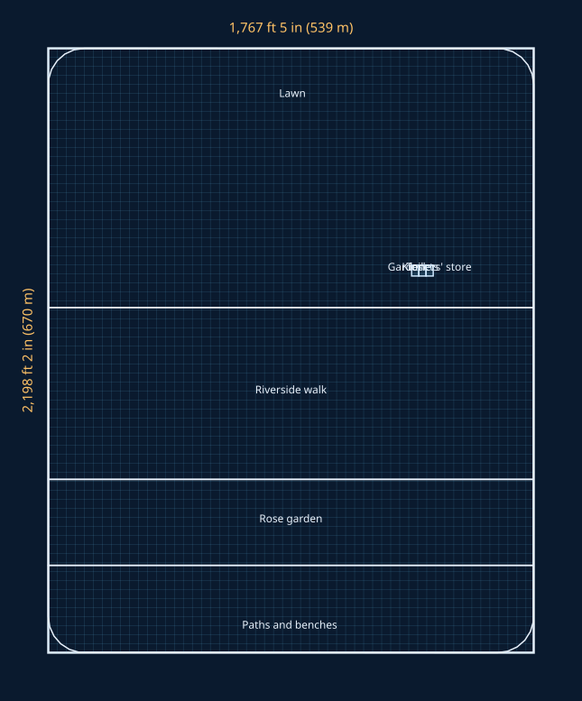

# P6-04 Dockside Gardens: plan

Footprint 1,767 ft 5 in (539 m) × 2,198 ft 2 in (670 m) · structural grid 32 ft 10 in (10 m)

## Levels

| Level | Floor above deck | Height | Floor area |
|---|---|---|---|
| Level 1 · Ground | 0 ft (0 mm) | 13 ft 1 in (4,000 mm) | 3,100 sq ft (288 m²) |

## Elements

| ID | Designation | Type | Name | Level(s) | Size / length | Area | Status |
|---|---|---|---|---|---|---|---|
| E001 | D5F4P6B5A1R1 | zone | Lawn | L1 | 1,766 ft 9 in (538 m) × 942 ft 11 in (287 m) | 1,656,693 sq ft (153,912 m²) | proposed |
| E002 | D5F4P6B5A1R2 | room | Kiosk | L1 | 26 ft 3 in (8,000 mm) × 39 ft 4 in (12 m) | 1,033 sq ft (96 m²) | proposed |
| E003 | D5F4P6B5A1R3 | room | Toilets | L1 | 26 ft 3 in (8,000 mm) × 39 ft 4 in (12 m) | 1,033 sq ft (96 m²) | proposed |
| E004 | D5F4P6B5A1R4 | room | Gardeners' store | L1 | 26 ft 3 in (8,000 mm) × 39 ft 4 in (12 m) | 1,033 sq ft (96 m²) | proposed |
| E005 | D5F4P6B5A1R5 | zone | Riverside walk | L1 | 1,766 ft 5 in (538 m) × 625 ft (190 m) | 1,103,798 sq ft (102,546 m²) | proposed |
| E006 | D5F4P6B5A1R6 | zone | Rose garden | L1 | 1,766 ft 5 in (538 m) × 312 ft 8 in (95 m) | 552,189 sq ft (51,300 m²) | proposed |
| E007 | D5F4P6B5A1R7 | zone | Paths and benches | L1 | 1,766 ft 1 in (538 m) × 317 ft 7 in (97 m) | 552,317 sq ft (51,312 m²) | proposed |

## Drawings

### Level 1 · Ground

