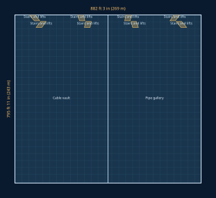
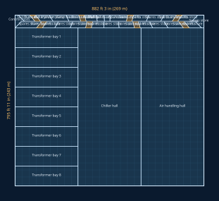
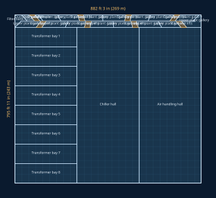

# P6-09 Dockside Utility Plant: plan

Footprint 882 ft 3 in (269 m) × 795 ft 11 in (243 m) · structural grid 32 ft 10 in (10 m)

## Levels

| Level | Floor above deck | Height | Floor area |
|---|---|---|---|
| Level B1 · Pipe and cable basement | −16 ft 5 in (5,000 mm) | 16 ft 5 in (5,000 mm) | 702,185 sq ft (65,235 m²) |
| Level 1 · Plant floor | 0 ft (0 mm) | 26 ft 3 in (8,000 mm) | 693,609 sq ft (64,438 m²) |
| Level 2 · Upper plant deck | 26 ft 3 in (8,000 mm) | 19 ft 8 in (6,000 mm) | 693,609 sq ft (64,438 m²) |

## Elements

| ID | Designation | Type | Name | Level(s) | Size / length | Area | Status |
|---|---|---|---|---|---|---|---|
| E001 | D5F4P6B14A1L1R1, D5F4P6B14A1L2R1 | room | Transformer bay 1 | L1, L2 | 294 ft (90 m) × 92 ft 2 in (28 m) | 27,101 sq ft (2,518 m²) | proposed |
| E002 | D5F4P6B14A1L1R2, D5F4P6B14A1L2R2 | room | Transformer bay 2 | L1, L2 | 294 ft (90 m) × 91 ft 10 in (28 m) | 27,005 sq ft (2,509 m²) | proposed |
| E003 | D5F4P6B14A1L1R3, D5F4P6B14A1L2R3 | room | Transformer bay 3 | L1, L2 | 294 ft (90 m) × 92 ft 2 in (28 m) | 27,101 sq ft (2,518 m²) | proposed |
| E004 | D5F4P6B14A1L1R4, D5F4P6B14A1L2R4 | room | Transformer bay 4 | L1, L2 | 294 ft (90 m) × 92 ft 2 in (28 m) | 27,101 sq ft (2,518 m²) | proposed |
| E005 | D5F4P6B14A1L1R5, D5F4P6B14A1L2R5 | room | Transformer bay 5 | L1, L2 | 294 ft (90 m) × 92 ft 2 in (28 m) | 27,101 sq ft (2,518 m²) | proposed |
| E006 | D5F4P6B14A1L1R6, D5F4P6B14A1L2R6 | room | Transformer bay 6 | L1, L2 | 294 ft (90 m) × 91 ft 10 in (28 m) | 27,005 sq ft (2,509 m²) | proposed |
| E007 | D5F4P6B14A1L1R7, D5F4P6B14A1L2R7 | room | Transformer bay 7 | L1, L2 | 294 ft (90 m) × 92 ft 2 in (28 m) | 27,101 sq ft (2,518 m²) | proposed |
| E008 | D5F4P6B14A1L1R8, D5F4P6B14A1L2R8 | room | Transformer bay 8 | L1, L2 | 294 ft (90 m) × 92 ft 2 in (28 m) | 27,101 sq ft (2,518 m²) | proposed |
| E009 | D5F4P6B14A1L1R9, D5F4P6B14A1L2R9 | room | Chiller hall | L1, L2 | 294 ft 3 in (90 m) × 736 ft 11 in (225 m) | 216,856 sq ft (20,147 m²) | proposed |
| E010 | D5F4P6B14A1L1R10, D5F4P6B14A1L2R10 | room | Air handling hall | L1, L2 | 294 ft (90 m) × 736 ft 11 in (225 m) | 216,615 sq ft (20,124 m²) | proposed |
| E011 | D5F4P6B14A1LB1R1, D5F4P6B14A1L1R11, D5F4P6B14A1L2R11 | core | Stairs and lifts | LB1, L1, L2 | 49 ft 3 in (15 m) × 27 ft 11 in (8,500 mm) | 737 sq ft (68 m²) | proposed |
| E012 | D5F4P6B14A1LB1R2, D5F4P6B14A1L1R12, D5F4P6B14A1L2R12 | core | Stairs and lifts | LB1, L1, L2 | 34 ft 5 in (10 m) × 27 ft 11 in (8,500 mm) | 732 sq ft (68 m²) | proposed |
| E013 | D5F4P6B14A1LB1R3, D5F4P6B14A1L1R13, D5F4P6B14A1L2R13 | core | Stairs and lifts | LB1, L1, L2 | 32 ft 6 in (9,900 mm) × 27 ft 11 in (8,500 mm) | 732 sq ft (68 m²) | proposed |
| E014 | D5F4P6B14A1LB1R4, D5F4P6B14A1L1R14, D5F4P6B14A1L2R14 | core | Stairs and lifts | LB1, L1, L2 | 46 ft 11 in (14 m) × 27 ft 11 in (8,500 mm) | 732 sq ft (68 m²) | proposed |
| E015 | D5F4P6B14A1LB1R5, D5F4P6B14A1L1R15, D5F4P6B14A1L2R15 | core | Stairs and lifts | LB1, L1, L2 | 49 ft 3 in (15 m) × 27 ft 11 in (8,500 mm) | 737 sq ft (68 m²) | proposed |
| E016 | D5F4P6B14A1LB1R6, D5F4P6B14A1L1R16, D5F4P6B14A1L2R16 | core | Stairs and lifts | LB1, L1, L2 | 34 ft 5 in (10 m) × 27 ft 11 in (8,500 mm) | 732 sq ft (68 m²) | proposed |
| E017 | D5F4P6B14A1LB1R7, D5F4P6B14A1L1R17, D5F4P6B14A1L2R17 | core | Stairs and lifts | LB1, L1, L2 | 32 ft 6 in (9,900 mm) × 27 ft 11 in (8,500 mm) | 732 sq ft (68 m²) | proposed |
| E018 | D5F4P6B14A1LB1R8, D5F4P6B14A1L1R18, D5F4P6B14A1L2R18 | core | Stairs and lifts | LB1, L1, L2 | 46 ft 11 in (14 m) × 27 ft 11 in (8,500 mm) | 732 sq ft (68 m²) | proposed |
| E019 | D5F4P6B14A1L1R19 | room | Control room | L1 | 42 ft 8 in (13 m) × 59 ft 1 in (18 m) | 1,290 sq ft (120 m²) | proposed |
| E020 | D5F4P6B14A1L1R20 | room | Switch room | L1 | 76 ft 9 in (23 m) × 27 ft 11 in (8,500 mm) | 1,432 sq ft (133 m²) | proposed |
| E021 | D5F4P6B14A1L1R21 | room | Battery room | L1 | 81 ft 4 in (25 m) × 27 ft 11 in (8,500 mm) | 1,711 sq ft (159 m²) | proposed |
| E022 | D5F4P6B14A1L1R22 | room | Water pump room | L1 | 92 ft 2 in (28 m) × 27 ft 11 in (8,500 mm) | 2,141 sq ft (199 m²) | proposed |
| E023 | D5F4P6B14A1L1R23 | room | Water treatment room | L1 | 67 ft 11 in (21 m) × 27 ft 11 in (8,500 mm) | 1,587 sq ft (147 m²) | proposed |
| E024 | D5F4P6B14A1L1R24 | room | Workshop | L1 | 59 ft 5 in (18 m) × 27 ft 11 in (8,500 mm) | 1,500 sq ft (139 m²) | proposed |
| E025 | D5F4P6B14A1L1R25 | room | Locker room | L1 | 37 ft 5 in (11 m) × 27 ft 11 in (8,500 mm) | 965 sq ft (90 m²) | proposed |
| E026 | D5F4P6B14A1L1R26 | room | Staff toilets and showers | L1 | 27 ft 7 in (8,400 mm) × 27 ft 11 in (8,500 mm) | 746 sq ft (69 m²) | proposed |
| E027 | D5F4P6B14A1L1R27 | room | Spares store | L1 | 82 ft 8 in (25 m) × 27 ft 11 in (8,500 mm) | 2,228 sq ft (207 m²) | proposed |
| E028 | D5F4P6B14A1L1R28 | room | Spares store | L1 | 79 ft 1 in (24 m) × 27 ft 11 in (8,500 mm) | 1,944 sq ft (181 m²) | proposed |
| E029 | D5F4P6B14A1L1R29 | room | Spares store | L1 | 83 ft 8 in (26 m) × 27 ft 11 in (8,500 mm) | 1,940 sq ft (180 m²) | proposed |
| E030 | D5F4P6B14A1L1R30 | room | Spares store | L1 | 73 ft 10 in (22 m) × 27 ft 11 in (8,500 mm) | 1,555 sq ft (144 m²) | proposed |
| E031 | D5F4P6B14A1L1R31 | room | Spares store | L1 | 93 ft 6 in (29 m) × 27 ft 11 in (8,500 mm) | 1,940 sq ft (180 m²) | proposed |
| E032 | D5F4P6B14A1L1R32 | room | Spares store | L1 | 55 ft 1 in (17 m) × 59 ft 1 in (18 m) | 1,953 sq ft (181 m²) | proposed |
| E033 | D5F4P6B14A1L1R33 | room | Spares store | L1 | 81 ft (25 m) × 27 ft 11 in (8,500 mm) | 1,551 sq ft (144 m²) | proposed |
| E034 | D5F4P6B14A1L1R34 | room | Spares store | L1 | 89 ft 3 in (27 m) × 27 ft 11 in (8,500 mm) | 1,940 sq ft (180 m²) | proposed |
| E035 | D5F4P6B14A1L1R35 | room | Spares store | L1 | 85 ft (26 m) × 27 ft 11 in (8,500 mm) | 1,949 sq ft (181 m²) | proposed |
| E036 | D5F4P6B14A1L1R36 | room | Spares store | L1 | 66 ft 7 in (20 m) × 27 ft 11 in (8,500 mm) | 1,551 sq ft (144 m²) | proposed |
| E037 | D5F4P6B14A1L1R37 | room | Spares store | L1 | 74 ft 10 in (23 m) × 27 ft 11 in (8,500 mm) | 1,944 sq ft (181 m²) | proposed |
| E038 | D5F4P6B14A1L1R38 | room | Spares store | L1 | 71 ft 10 in (22 m) × 27 ft 11 in (8,500 mm) | 1,940 sq ft (180 m²) | proposed |
| E039 | D5F4P6B14A1L1R39 | room | Spares store | L1 | 59 ft 5 in (18 m) × 27 ft 11 in (8,500 mm) | 1,555 sq ft (144 m²) | proposed |
| E040 | D5F4P6B14A1L1R40 | room | Spares store | L1 | 79 ft 1 in (24 m) × 27 ft 11 in (8,500 mm) | 1,944 sq ft (181 m²) | proposed |
| E041 | D5F4P6B14A1L1R41 | room | Spares store | L1 | 83 ft 8 in (26 m) × 27 ft 11 in (8,500 mm) | 1,940 sq ft (180 m²) | proposed |
| E042 | D5F4P6B14A1L1R42 | room | Spares store | L1 | 73 ft 10 in (22 m) × 27 ft 11 in (8,500 mm) | 1,555 sq ft (144 m²) | proposed |
| E043 | D5F4P6B14A1L1R43 | room | Spares store | L1 | 122 ft 5 in (37 m) × 27 ft 11 in (8,500 mm) | 2,722 sq ft (253 m²) | proposed |
| E044 | D5F4P6B14A1L2R19 | room | Filter bank room | L2 | 57 ft 5 in (18 m) × 59 ft 1 in (18 m) | 1,720 sq ft (160 m²) | proposed |
| E045 | D5F4P6B14A1L2R20 | room | Ductwork gallery | L2 | 60 ft 8 in (18 m) × 27 ft 11 in (8,500 mm) | 1,002 sq ft (93 m²) | proposed |
| E046 | D5F4P6B14A1L2R21 | room | Crew rest room | L2 | 36 ft 9 in (11 m) × 27 ft 11 in (8,500 mm) | 425 sq ft (40 m²) | proposed |
| E047 | D5F4P6B14A1L2R22 | room | Upper plant gallery | L2 | 106 ft (32 m) × 27 ft 11 in (8,500 mm) | 2,452 sq ft (228 m²) | proposed |
| E048 | D5F4P6B14A1L2R23 | room | Upper plant gallery | L2 | 104 ft (32 m) × 27 ft 11 in (8,500 mm) | 2,562 sq ft (238 m²) | proposed |
| E049 | D5F4P6B14A1L2R24 | room | Upper plant gallery | L2 | 92 ft 2 in (28 m) × 27 ft 11 in (8,500 mm) | 2,447 sq ft (227 m²) | proposed |
| E050 | D5F4P6B14A1L2R25 | room | Upper plant gallery | L2 | 110 ft 11 in (34 m) × 27 ft 11 in (8,500 mm) | 2,992 sq ft (278 m²) | proposed |
| E051 | D5F4P6B14A1L2R26 | room | Upper plant gallery | L2 | 97 ft 9 in (30 m) × 27 ft 11 in (8,500 mm) | 2,452 sq ft (228 m²) | proposed |
| E052 | D5F4P6B14A1L2R27 | room | Upper plant gallery | L2 | 123 ft 4 in (38 m) × 27 ft 11 in (8,500 mm) | 2,987 sq ft (278 m²) | proposed |
| E053 | D5F4P6B14A1L2R28 | room | Upper plant gallery | L2 | 112 ft 6 in (34 m) × 27 ft 11 in (8,500 mm) | 2,452 sq ft (228 m²) | proposed |
| E054 | D5F4P6B14A1L2R29 | room | Upper plant gallery | L2 | 92 ft 2 in (28 m) × 59 ft 1 in (18 m) | 2,992 sq ft (278 m²) | proposed |
| E055 | D5F4P6B14A1L2R30 | room | Upper plant gallery | L2 | 106 ft 11 in (33 m) × 27 ft 11 in (8,500 mm) | 2,452 sq ft (228 m²) | proposed |
| E056 | D5F4P6B14A1L2R31 | room | Upper plant gallery | L2 | 119 ft 9 in (36 m) × 27 ft 11 in (8,500 mm) | 2,987 sq ft (278 m²) | proposed |
| E057 | D5F4P6B14A1L2R32 | room | Upper plant gallery | L2 | 92 ft 2 in (28 m) × 27 ft 11 in (8,500 mm) | 2,447 sq ft (227 m²) | proposed |
| E058 | D5F4P6B14A1L2R33 | room | Upper plant gallery | L2 | 110 ft 11 in (34 m) × 27 ft 11 in (8,500 mm) | 2,992 sq ft (278 m²) | proposed |
| E059 | D5F4P6B14A1L2R34 | room | Upper plant gallery | L2 | 97 ft 9 in (30 m) × 27 ft 11 in (8,500 mm) | 2,452 sq ft (228 m²) | proposed |
| E060 | D5F4P6B14A1L2R35 | room | Upper plant gallery | L2 | 123 ft 4 in (38 m) × 27 ft 11 in (8,500 mm) | 2,987 sq ft (278 m²) | proposed |
| E061 | D5F4P6B14A1L2R36 | room | Upper plant gallery | L2 | 122 ft 5 in (37 m) × 27 ft 11 in (8,500 mm) | 2,722 sq ft (253 m²) | proposed |
| E062 | D5F4P6B14A1LB1R9 | room | Cable vault | LB1 | 440 ft 11 in (134 m) × 795 ft 11 in (243 m) | 350,962 sq ft (32,605 m²) | proposed |
| E063 | D5F4P6B14A1LB1R10 | room | Pipe gallery | LB1 | 441 ft 3 in (134 m) × 795 ft 11 in (243 m) | 351,223 sq ft (32,630 m²) | proposed |

## Drawings

### Level B1 · Pipe and cable basement

### Level 1 · Plant floor

### Level 2 · Upper plant deck

