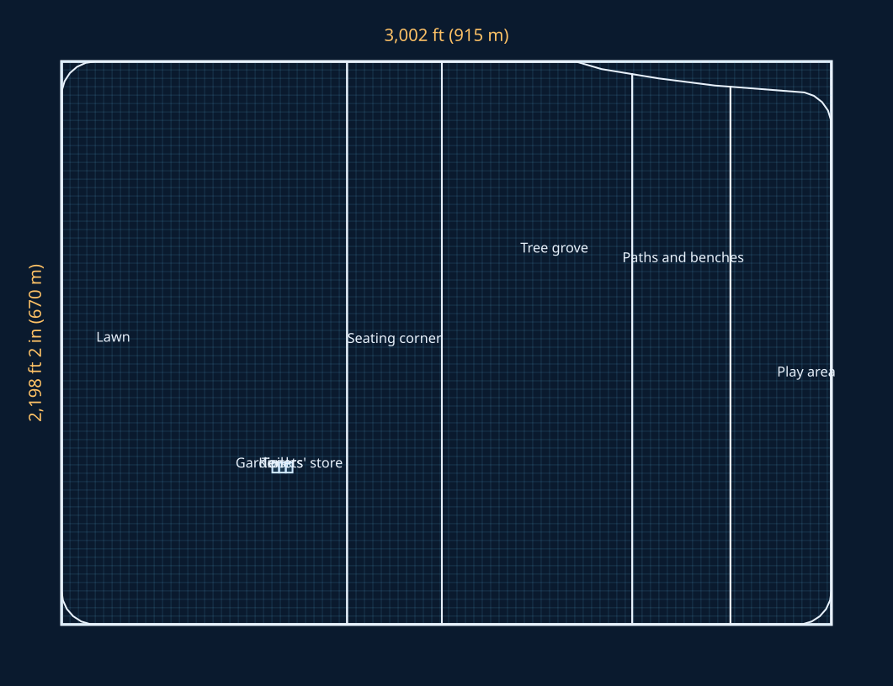

# P6-12 Pocket Park 1: plan

Footprint 3,002 ft (915 m) × 2,198 ft 2 in (670 m) · structural grid 32 ft 10 in (10 m)

## Levels

| Level | Floor above deck | Height | Floor area |
|---|---|---|---|
| Level 1 · Ground | 0 ft (0 mm) | 13 ft 1 in (4,000 mm) | 3,100 sq ft (288 m²) |

## Elements

| ID | Designation | Type | Name | Level(s) | Size / length | Area | Status |
|---|---|---|---|---|---|---|---|
| E001 | D5F4P6B7A1R1 | zone | Lawn | L1 | 1,113 ft 2 in (339 m) × 2,196 ft 10 in (670 m) | 2,436,356 sq ft (226,345 m²) | proposed |
| E002 | D5F4P6B7A1R2 | room | Kiosk | L1 | 26 ft 3 in (8,000 mm) × 39 ft 4 in (12 m) | 1,033 sq ft (96 m²) | proposed |
| E003 | D5F4P6B7A1R3 | room | Toilets | L1 | 26 ft 3 in (8,000 mm) × 39 ft 4 in (12 m) | 1,033 sq ft (96 m²) | proposed |
| E004 | D5F4P6B7A1R4 | room | Gardeners' store | L1 | 26 ft 3 in (8,000 mm) × 39 ft 4 in (12 m) | 1,033 sq ft (96 m²) | proposed |
| E005 | D5F4P6B7A1R5 | zone | Seating corner | L1 | 369 ft 9 in (113 m) × 2,196 ft 2 in (669 m) | 811,984 sq ft (75,436 m²) | proposed |
| E006 | D5F4P6B7A1R6 | zone | Tree grove | L1 | 742 ft 2 in (226 m) × 2,195 ft 10 in (669 m) | 1,623,529 sq ft (150,831 m²) | proposed |
| E007 | D5F4P6B7A1R7 | zone | Paths and benches | L1 | 383 ft 2 in (117 m) × 2,147 ft 8 in (655 m) | 812,537 sq ft (75,487 m²) | proposed |
| E008 | D5F4P6B7A1R8 | zone | Play area | L1 | 393 ft 8 in (120 m) × 2,098 ft 5 in (640 m) | 811,841 sq ft (75,422 m²) | proposed |

## Drawings

### Level 1 · Ground

