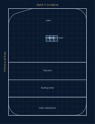

# P6-14 Pocket Park 2: plan

Footprint 524 ft 11 in (160 m) × 719 ft 6 in (219 m) · structural grid 32 ft 10 in (10 m)

## Levels

| Level | Floor above deck | Height | Floor area |
|---|---|---|---|
| Level 1 · Ground | 0 ft (0 mm) | 13 ft 1 in (4,000 mm) | 3,100 sq ft (288 m²) |

## Elements

| ID | Designation | Type | Name | Level(s) | Size / length | Area | Status |
|---|---|---|---|---|---|---|---|
| E001 | D5F4P6B10A2R1 | zone | Lawn | L1 | 523 ft 11 in (160 m) × 362 ft 6 in (110 m) | 183,904 sq ft (17,085 m²) | proposed |
| E002 | D5F4P6B10A2R2 | room | Kiosk | L1 | 26 ft 3 in (8,000 mm) × 39 ft 4 in (12 m) | 1,033 sq ft (96 m²) | proposed |
| E003 | D5F4P6B10A2R3 | room | Toilets | L1 | 26 ft 3 in (8,000 mm) × 39 ft 4 in (12 m) | 1,033 sq ft (96 m²) | proposed |
| E004 | D5F4P6B10A2R4 | room | Gardeners' store | L1 | 26 ft 3 in (8,000 mm) × 39 ft 4 in (12 m) | 1,033 sq ft (96 m²) | proposed |
| E005 | D5F4P6B10A2R5 | zone | Play area | L1 | 524 ft 3 in (160 m) × 117 ft 2 in (36 m) | 61,387 sq ft (5,703 m²) | proposed |
| E006 | D5F4P6B10A2R6 | zone | Seating corner | L1 | 524 ft 11 in (160 m) × 116 ft 10 in (36 m) | 61,273 sq ft (5,692 m²) | proposed |
| E007 | D5F4P6B10A2R7 | zone | Paths and benches | L1 | 524 ft 11 in (160 m) × 122 ft 1 in (37 m) | 61,392 sq ft (5,704 m²) | proposed |

## Drawings

### Level 1 · Ground

