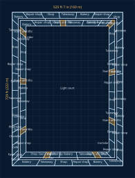
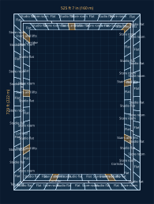

# P6-15 Dockside Shops 3: plan

Footprint 525 ft 7 in (160 m) × 729 ft (222 m) · structural grid 32 ft 10 in (10 m)

## Levels

| Level | Floor above deck | Height | Floor area |
|---|---|---|---|
| Level 1 · Shop floor | 0 ft (0 mm) | 16 ft 5 in (5,000 mm) | 118,731 sq ft (11,030 m²) |
| Level 2 · Upper floor | 16 ft 5 in (5,000 mm) | 13 ft 1 in (4,000 mm) | 118,731 sq ft (11,030 m²) |

## Elements

| ID | Designation | Type | Name | Level(s) | Size / length | Area | Status |
|---|---|---|---|---|---|---|---|
| E001 | D5F4P6B11A2L1R1 | zone | Light court | L1 | 394 ft 4 in (120 m) × 597 ft 9 in (182 m) | 235,734 sq ft (21,900 m²) | proposed |
| E002 | D5F4P6B11A2L1R2 | zone | Corridor | L1 | 9 ft 10 in (3,000 mm) × 399 ft 7 in (122 m) | 3,875 sq ft (360 m²) | proposed |
| E003 | D5F4P6B11A2L1R3 | zone | Corridor | L1 | 131 ft 3 in (40 m) × 275 ft 7 in (84 m) | 3,875 sq ft (360 m²) | proposed |
| E004 | D5F4P6B11A2L1R4 | zone | Corridor | L1 | 343 ft 2 in (105 m) × 66 ft 7 in (20 m) | 3,875 sq ft (360 m²) | proposed |
| E005 | D5F4P6B11A2L1R5 | zone | Corridor | L1 | 9 ft 10 in (3,000 mm) × 399 ft 3 in (122 m) | 3,875 sq ft (360 m²) | proposed |
| E006 | D5F4P6B11A2L1R6 | zone | Corridor | L1 | 187 ft 8 in (57 m) × 218 ft 6 in (67 m) | 3,875 sq ft (360 m²) | proposed |
| E007 | D5F4P6B11A2L1R7 | zone | Corridor | L1 | 284 ft 1 in (87 m) × 9 ft 10 in (3,000 mm) | 2,738 sq ft (254 m²) | proposed |
| E008 | D5F4P6B11A2L1R8, D5F4P6B11A2L2R1 | core | Stairs and lifts | L1, L2 | 27 ft 11 in (8,500 mm) × 43 ft 8 in (13 m) | 727 sq ft (68 m²) | proposed |
| E009 | D5F4P6B11A2L1R9, D5F4P6B11A2L2R2 | core | Stairs and lifts | L1, L2 | 27 ft 11 in (8,500 mm) × 29 ft 6 in (9,000 mm) | 732 sq ft (68 m²) | proposed |
| E010 | D5F4P6B11A2L1R10, D5F4P6B11A2L2R3 | core | Stairs and lifts | L1, L2 | 27 ft 11 in (8,500 mm) × 50 ft 2 in (15 m) | 732 sq ft (68 m²) | proposed |
| E011 | D5F4P6B11A2L1R11, D5F4P6B11A2L2R4 | core | Stairs and lifts | L1, L2 | 28 ft 10 in (8,800 mm) × 27 ft 11 in (8,500 mm) | 727 sq ft (68 m²) | proposed |
| E012 | D5F4P6B11A2L1R12, D5F4P6B11A2L2R5 | core | Stairs and lifts | L1, L2 | 40 ft (12 m) × 40 ft 4 in (12 m) | 732 sq ft (68 m²) | proposed |
| E013 | D5F4P6B11A2L1R13, D5F4P6B11A2L2R6 | core | Stairs and lifts | L1, L2 | 27 ft 11 in (8,500 mm) × 33 ft 2 in (10 m) | 727 sq ft (68 m²) | proposed |
| E014 | D5F4P6B11A2L1R14, D5F4P6B11A2L2R7 | core | Stairs and lifts | L1, L2 | 27 ft 11 in (8,500 mm) × 40 ft (12 m) | 732 sq ft (68 m²) | proposed |
| E015 | D5F4P6B11A2L1R15, D5F4P6B11A2L2R8 | core | Stairs and lifts | L1, L2 | 44 ft 7 in (14 m) × 27 ft 11 in (8,500 mm) | 737 sq ft (68 m²) | proposed |
| E016 | D5F4P6B11A2L1R16, D5F4P6B11A2L2R9 | core | Stairs and lifts | L1, L2 | 38 ft 9 in (12 m) × 27 ft 11 in (8,500 mm) | 732 sq ft (68 m²) | proposed |
| E017 | D5F4P6B11A2L1R17 | room | Toilets | L1 | 27 ft 11 in (8,500 mm) × 50 ft 2 in (15 m) | 645 sq ft (60 m²) | proposed |
| E018 | D5F4P6B11A2L1R18 | room | Pawn shop | L1 | 27 ft 11 in (8,500 mm) × 48 ft 7 in (15 m) | 650 sq ft (60 m²) | proposed |
| E019 | D5F4P6B11A2L1R19 | room | Café | L1 | 27 ft 11 in (8,500 mm) × 68 ft 7 in (21 m) | 1,290 sq ft (120 m²) | proposed |
| E020 | D5F4P6B11A2L1R20 | room | Chandler | L1 | 27 ft 11 in (8,500 mm) × 76 ft 1 in (23 m) | 1,615 sq ft (150 m²) | proposed |
| E021 | D5F4P6B11A2L1R21 | room | Pharmacy | L1 | 27 ft 11 in (8,500 mm) × 45 ft 7 in (14 m) | 860 sq ft (80 m²) | proposed |
| E022 | D5F4P6B11A2L1R22 | room | Shop | L1 | 27 ft 11 in (8,500 mm) × 91 ft 2 in (28 m) | 2,260 sq ft (210 m²) | proposed |
| E023 | D5F4P6B11A2L1R23 | room | Takeaway | L1 | 27 ft 11 in (8,500 mm) × 84 ft 8 in (26 m) | 2,260 sq ft (210 m²) | proposed |
| E024 | D5F4P6B11A2L1R24 | room | Bakery | L1 | 27 ft 11 in (8,500 mm) × 84 ft 4 in (26 m) | 2,264 sq ft (210 m²) | proposed |
| E025 | D5F4P6B11A2L1R25 | room | Repair shop | L1 | 27 ft 11 in (8,500 mm) × 89 ft 11 in (27 m) | 2,255 sq ft (210 m²) | proposed |
| E026 | D5F4P6B11A2L1R26 | room | Shop | L1 | 27 ft 11 in (8,500 mm) × 96 ft 5 in (29 m) | 2,260 sq ft (210 m²) | proposed |
| E027 | D5F4P6B11A2L1R27 | room | Takeaway | L1 | 27 ft 11 in (8,500 mm) × 103 ft (31 m) | 2,260 sq ft (210 m²) | proposed |
| E028 | D5F4P6B11A2L1R28 | room | Bakery | L1 | 72 ft 10 in (22 m) × 60 ft (18 m) | 2,260 sq ft (210 m²) | proposed |
| E029 | D5F4P6B11A2L1R29 | room | Repair shop | L1 | 99 ft 1 in (30 m) × 27 ft 11 in (8,500 mm) | 2,260 sq ft (210 m²) | proposed |
| E030 | D5F4P6B11A2L1R30 | room | Shop | L1 | 90 ft 3 in (28 m) × 27 ft 11 in (8,500 mm) | 2,264 sq ft (210 m²) | proposed |
| E031 | D5F4P6B11A2L1R31 | room | Takeaway | L1 | 85 ft 8 in (26 m) × 27 ft 11 in (8,500 mm) | 2,260 sq ft (210 m²) | proposed |
| E032 | D5F4P6B11A2L1R32 | room | Bakery | L1 | 90 ft 3 in (28 m) × 27 ft 11 in (8,500 mm) | 2,260 sq ft (210 m²) | proposed |
| E033 | D5F4P6B11A2L1R33 | room | Repair shop | L1 | 99 ft 5 in (30 m) × 27 ft 11 in (8,500 mm) | 2,260 sq ft (210 m²) | proposed |
| E034 | D5F4P6B11A2L1R34 | room | Shop | L1 | 70 ft 3 in (21 m) × 62 ft 8 in (19 m) | 2,260 sq ft (210 m²) | proposed |
| E035 | D5F4P6B11A2L1R35 | room | Takeaway | L1 | 27 ft 11 in (8,500 mm) × 103 ft (31 m) | 2,264 sq ft (210 m²) | proposed |
| E036 | D5F4P6B11A2L1R36 | room | Bakery | L1 | 27 ft 11 in (8,500 mm) × 96 ft 5 in (29 m) | 2,260 sq ft (210 m²) | proposed |
| E037 | D5F4P6B11A2L1R37 | room | Repair shop | L1 | 27 ft 11 in (8,500 mm) × 89 ft 11 in (27 m) | 2,260 sq ft (210 m²) | proposed |
| E038 | D5F4P6B11A2L1R38 | room | Shop | L1 | 27 ft 11 in (8,500 mm) × 84 ft 4 in (26 m) | 2,260 sq ft (210 m²) | proposed |
| E039 | D5F4P6B11A2L1R39 | room | Takeaway | L1 | 27 ft 11 in (8,500 mm) × 85 ft 4 in (26 m) | 2,260 sq ft (210 m²) | proposed |
| E040 | D5F4P6B11A2L1R40 | room | Bakery | L1 | 27 ft 11 in (8,500 mm) × 91 ft 6 in (28 m) | 2,260 sq ft (210 m²) | proposed |
| E041 | D5F4P6B11A2L1R41 | room | Repair shop | L1 | 27 ft 11 in (8,500 mm) × 97 ft 9 in (30 m) | 2,260 sq ft (210 m²) | proposed |
| E042 | D5F4P6B11A2L1R42 | room | Shop | L1 | 27 ft 11 in (8,500 mm) × 104 ft 4 in (32 m) | 2,260 sq ft (210 m²) | proposed |
| E043 | D5F4P6B11A2L1R43 | room | Takeaway | L1 | 88 ft 11 in (27 m) × 43 ft 8 in (13 m) | 2,260 sq ft (210 m²) | proposed |
| E044 | D5F4P6B11A2L1R44 | room | Bakery | L1 | 97 ft 1 in (30 m) × 27 ft 11 in (8,500 mm) | 2,260 sq ft (210 m²) | proposed |
| E045 | D5F4P6B11A2L1R45 | room | Repair shop | L1 | 88 ft 3 in (27 m) × 27 ft 11 in (8,500 mm) | 2,264 sq ft (210 m²) | proposed |
| E046 | D5F4P6B11A2L1R46 | room | Shop | L1 | 85 ft 8 in (26 m) × 27 ft 11 in (8,500 mm) | 2,260 sq ft (210 m²) | proposed |
| E047 | D5F4P6B11A2L1R47 | room | Takeaway | L1 | 92 ft 2 in (28 m) × 27 ft 11 in (8,500 mm) | 2,260 sq ft (210 m²) | proposed |
| E048 | D5F4P6B11A2L1R48 | room | Bakery | L1 | 130 ft 7 in (40 m) × 27 ft 11 in (8,500 mm) | 3,033 sq ft (282 m²) | proposed |
| E049 | D5F4P6B11A2L1R49 | room | Repair shop | L1 | 27 ft 11 in (8,500 mm) × 126 ft 8 in (39 m) | 2,882 sq ft (268 m²) | proposed |
| E050 | D5F4P6B11A2L1R50 | room | Shop | L1 | 27 ft 11 in (8,500 mm) × 93 ft 10 in (29 m) | 2,264 sq ft (210 m²) | proposed |
| E051 | D5F4P6B11A2L1R51 | room | Takeaway | L1 | 27 ft 11 in (8,500 mm) × 86 ft 3 in (26 m) | 2,260 sq ft (210 m²) | proposed |
| E052 | D5F4P6B11A2L1R52 | room | Bakery | L1 | 27 ft 11 in (8,500 mm) × 46 ft 3 in (14 m) | 1,240 sq ft (115 m²) | proposed |
| E053 | D5F4P6B11A2L1R53 | room | Repair shop | L1 | 27 ft 11 in (8,500 mm) × 89 ft 3 in (27 m) | 2,260 sq ft (210 m²) | proposed |
| E054 | D5F4P6B11A2L1R54 | room | Shop | L1 | 27 ft 11 in (8,500 mm) × 96 ft 5 in (29 m) | 2,264 sq ft (210 m²) | proposed |
| E055 | D5F4P6B11A2L1R55 | room | Takeaway | L1 | 27 ft 11 in (8,500 mm) × 65 ft 3 in (20 m) | 1,240 sq ft (115 m²) | proposed |
| E056 | D5F4P6B11A2L1R56 | room | Bakery | L1 | 75 ft 2 in (23 m) × 56 ft 9 in (17 m) | 2,260 sq ft (210 m²) | proposed |
| E057 | D5F4P6B11A2L1R57 | room | Repair shop | L1 | 96 ft 9 in (30 m) × 27 ft 11 in (8,500 mm) | 2,260 sq ft (210 m²) | proposed |
| E058 | D5F4P6B11A2L1R58 | room | Shop | L1 | 52 ft 2 in (16 m) × 27 ft 11 in (8,500 mm) | 1,244 sq ft (116 m²) | proposed |
| E059 | D5F4P6B11A2L1R59 | room | Takeaway | L1 | 86 ft 3 in (26 m) × 27 ft 11 in (8,500 mm) | 2,260 sq ft (210 m²) | proposed |
| E060 | D5F4P6B11A2L1R60 | room | Bakery | L1 | 96 ft 2 in (29 m) × 27 ft 11 in (8,500 mm) | 2,264 sq ft (210 m²) | proposed |
| E061 | D5F4P6B11A2L1R61 | room | Repair shop | L1 | 67 ft 7 in (21 m) × 27 ft 11 in (8,500 mm) | 1,240 sq ft (115 m²) | proposed |
| E062 | D5F4P6B11A2L1R62 | room | Shop | L1 | 27 ft 11 in (8,500 mm) × 104 ft (32 m) | 2,260 sq ft (210 m²) | proposed |
| E063 | D5F4P6B11A2L1R63 | room | Takeaway | L1 | 27 ft 11 in (8,500 mm) × 96 ft 9 in (30 m) | 2,260 sq ft (210 m²) | proposed |
| E064 | D5F4P6B11A2L1R64 | room | Bakery | L1 | 27 ft 11 in (8,500 mm) × 54 ft 9 in (17 m) | 1,244 sq ft (116 m²) | proposed |
| E065 | D5F4P6B11A2L1R65 | room | Repair shop | L1 | 27 ft 11 in (8,500 mm) × 84 ft 8 in (26 m) | 2,260 sq ft (210 m²) | proposed |
| E066 | D5F4P6B11A2L1R66 | room | Shop | L1 | 27 ft 11 in (8,500 mm) × 85 ft 11 in (26 m) | 2,260 sq ft (210 m²) | proposed |
| E067 | D5F4P6B11A2L1R67 | room | Takeaway | L1 | 27 ft 11 in (8,500 mm) × 55 ft 1 in (17 m) | 1,244 sq ft (116 m²) | proposed |
| E068 | D5F4P6B11A2L1R68 | room | Bakery | L1 | 27 ft 11 in (8,500 mm) × 99 ft 9 in (30 m) | 2,264 sq ft (210 m²) | proposed |
| E069 | D5F4P6B11A2L1R69 | room | Repair shop | L1 | 42 ft 4 in (13 m) × 90 ft 7 in (28 m) | 2,260 sq ft (210 m²) | proposed |
| E070 | D5F4P6B11A2L1R70 | room | Shop | L1 | 67 ft 3 in (20 m) × 27 ft 11 in (8,500 mm) | 1,235 sq ft (115 m²) | proposed |
| E071 | D5F4P6B11A2L1R71 | room | Takeaway | L1 | 92 ft 2 in (28 m) × 27 ft 11 in (8,500 mm) | 2,260 sq ft (210 m²) | proposed |
| E072 | D5F4P6B11A2L1R72 | room | Bakery | L1 | 86 ft 3 in (26 m) × 27 ft 11 in (8,500 mm) | 2,255 sq ft (210 m²) | proposed |
| E073 | D5F4P6B11A2L1R73 | room | Repair shop | L1 | 52 ft 6 in (16 m) × 27 ft 11 in (8,500 mm) | 1,244 sq ft (116 m²) | proposed |
| E074 | D5F4P6B11A2L1R74 | room | Shop | L1 | 124 ft 4 in (38 m) × 27 ft 11 in (8,500 mm) | 2,882 sq ft (268 m²) | proposed |
| E075 | D5F4P6B11A2L2R10 | zone | Corridor | L2 | 9 ft 10 in (3,000 mm) × 399 ft 7 in (122 m) | 3,875 sq ft (360 m²) | proposed |
| E076 | D5F4P6B11A2L2R11 | zone | Corridor | L2 | 131 ft 3 in (40 m) × 275 ft 7 in (84 m) | 3,875 sq ft (360 m²) | proposed |
| E077 | D5F4P6B11A2L2R12 | zone | Corridor | L2 | 343 ft 2 in (105 m) × 66 ft 7 in (20 m) | 3,875 sq ft (360 m²) | proposed |
| E078 | D5F4P6B11A2L2R13 | zone | Corridor | L2 | 9 ft 10 in (3,000 mm) × 399 ft 3 in (122 m) | 3,875 sq ft (360 m²) | proposed |
| E079 | D5F4P6B11A2L2R14 | zone | Corridor | L2 | 187 ft 8 in (57 m) × 218 ft 6 in (67 m) | 3,875 sq ft (360 m²) | proposed |
| E080 | D5F4P6B11A2L2R15 | zone | Corridor | L2 | 284 ft 1 in (87 m) × 9 ft 10 in (3,000 mm) | 2,738 sq ft (254 m²) | proposed |
| E081 | D5F4P6B11A2L2R16 | room | Tea point | L2 | 27 ft 11 in (8,500 mm) × 37 ft 5 in (11 m) | 274 sq ft (25 m²) | proposed |
| E082 | D5F4P6B11A2L2R17 | room | Flat | L2 | 27 ft 11 in (8,500 mm) × 82 ft 8 in (25 m) | 1,615 sq ft (150 m²) | proposed |
| E083 | D5F4P6B11A2L2R18 | room | Studio flat | L2 | 27 ft 11 in (8,500 mm) × 78 ft 1 in (24 m) | 1,615 sq ft (150 m²) | proposed |
| E084 | D5F4P6B11A2L2R19 | room | Store room | L2 | 27 ft 11 in (8,500 mm) × 62 ft 4 in (19 m) | 1,290 sq ft (120 m²) | proposed |
| E085 | D5F4P6B11A2L2R20 | room | Flat | L2 | 27 ft 11 in (8,500 mm) × 69 ft 11 in (21 m) | 1,615 sq ft (150 m²) | proposed |
| E086 | D5F4P6B11A2L2R21 | room | Studio flat | L2 | 27 ft 11 in (8,500 mm) × 65 ft 3 in (20 m) | 1,615 sq ft (150 m²) | proposed |
| E087 | D5F4P6B11A2L2R22 | room | Store room | L2 | 27 ft 11 in (8,500 mm) × 49 ft 6 in (15 m) | 1,295 sq ft (120 m²) | proposed |
| E088 | D5F4P6B11A2L2R23 | room | Flat | L2 | 27 ft 11 in (8,500 mm) × 60 ft (18 m) | 1,610 sq ft (150 m²) | proposed |
| E089 | D5F4P6B11A2L2R24 | room | Studio flat | L2 | 27 ft 11 in (8,500 mm) × 63 ft 8 in (19 m) | 1,619 sq ft (150 m²) | proposed |
| E090 | D5F4P6B11A2L2R25 | room | Store room | L2 | 27 ft 11 in (8,500 mm) × 56 ft 1 in (17 m) | 1,290 sq ft (120 m²) | proposed |
| E091 | D5F4P6B11A2L2R26 | room | Flat | L2 | 27 ft 11 in (8,500 mm) × 71 ft 10 in (22 m) | 1,615 sq ft (150 m²) | proposed |
| E092 | D5F4P6B11A2L2R27 | room | Studio flat | L2 | 27 ft 11 in (8,500 mm) × 76 ft 1 in (23 m) | 1,610 sq ft (150 m²) | proposed |
| E093 | D5F4P6B11A2L2R28 | room | Store room | L2 | 27 ft 11 in (8,500 mm) × 68 ft 11 in (21 m) | 1,295 sq ft (120 m²) | proposed |
| E094 | D5F4P6B11A2L2R29 | room | Flat | L2 | 42 ft (13 m) × 68 ft 11 in (21 m) | 1,615 sq ft (150 m²) | proposed |
| E095 | D5F4P6B11A2L2R30 | room | Studio flat | L2 | 80 ft 9 in (25 m) × 27 ft 11 in (8,500 mm) | 1,615 sq ft (150 m²) | proposed |
| E096 | D5F4P6B11A2L2R31 | room | Store room | L2 | 63 ft 4 in (19 m) × 27 ft 11 in (8,500 mm) | 1,290 sq ft (120 m²) | proposed |
| E097 | D5F4P6B11A2L2R32 | room | Flat | L2 | 69 ft 3 in (21 m) × 27 ft 11 in (8,500 mm) | 1,615 sq ft (150 m²) | proposed |
| E098 | D5F4P6B11A2L2R33 | room | Studio flat | L2 | 62 ft 8 in (19 m) × 27 ft 11 in (8,500 mm) | 1,615 sq ft (150 m²) | proposed |
| E099 | D5F4P6B11A2L2R34 | room | Store room | L2 | 48 ft 11 in (15 m) × 27 ft 11 in (8,500 mm) | 1,295 sq ft (120 m²) | proposed |
| E100 | D5F4P6B11A2L2R35 | room | Flat | L2 | 64 ft 8 in (20 m) × 27 ft 11 in (8,500 mm) | 1,610 sq ft (150 m²) | proposed |
| E101 | D5F4P6B11A2L2R36 | room | Studio flat | L2 | 71 ft 2 in (22 m) × 27 ft 11 in (8,500 mm) | 1,615 sq ft (150 m²) | proposed |
| E102 | D5F4P6B11A2L2R37 | room | Store room | L2 | 65 ft 7 in (20 m) × 27 ft 11 in (8,500 mm) | 1,295 sq ft (120 m²) | proposed |
| E103 | D5F4P6B11A2L2R38 | room | Flat | L2 | 79 ft 1 in (24 m) × 31 ft 6 in (9,600 mm) | 1,615 sq ft (150 m²) | proposed |
| E104 | D5F4P6B11A2L2R39 | room | Studio flat | L2 | 27 ft 11 in (8,500 mm) × 83 ft (25 m) | 1,610 sq ft (150 m²) | proposed |
| E105 | D5F4P6B11A2L2R40 | room | Store room | L2 | 27 ft 11 in (8,500 mm) × 67 ft 7 in (21 m) | 1,295 sq ft (120 m²) | proposed |
| E106 | D5F4P6B11A2L2R41 | room | Flat | L2 | 27 ft 11 in (8,500 mm) × 74 ft 10 in (23 m) | 1,615 sq ft (150 m²) | proposed |
| E107 | D5F4P6B11A2L2R42 | room | Studio flat | L2 | 27 ft 11 in (8,500 mm) × 70 ft 3 in (21 m) | 1,615 sq ft (150 m²) | proposed |
| E108 | D5F4P6B11A2L2R43 | room | Store room | L2 | 27 ft 11 in (8,500 mm) × 54 ft 6 in (17 m) | 1,290 sq ft (120 m²) | proposed |
| E109 | D5F4P6B11A2L2R44 | room | Flat | L2 | 27 ft 11 in (8,500 mm) × 62 ft (19 m) | 1,615 sq ft (150 m²) | proposed |
| E110 | D5F4P6B11A2L2R45 | room | Studio flat | L2 | 27 ft 11 in (8,500 mm) × 60 ft 4 in (18 m) | 1,615 sq ft (150 m²) | proposed |
| E111 | D5F4P6B11A2L2R46 | room | Store room | L2 | 27 ft 11 in (8,500 mm) × 51 ft 2 in (16 m) | 1,295 sq ft (120 m²) | proposed |
| E112 | D5F4P6B11A2L2R47 | room | Flat | L2 | 27 ft 11 in (8,500 mm) × 66 ft 7 in (20 m) | 1,610 sq ft (150 m²) | proposed |
| E113 | D5F4P6B11A2L2R48 | room | Studio flat | L2 | 27 ft 11 in (8,500 mm) × 71 ft 6 in (22 m) | 1,619 sq ft (150 m²) | proposed |
| E114 | D5F4P6B11A2L2R49 | room | Store room | L2 | 27 ft 11 in (8,500 mm) × 63 ft 8 in (19 m) | 1,285 sq ft (119 m²) | proposed |
| E115 | D5F4P6B11A2L2R50 | room | Flat | L2 | 27 ft 11 in (8,500 mm) × 79 ft 9 in (24 m) | 1,619 sq ft (150 m²) | proposed |
| E116 | D5F4P6B11A2L2R51 | room | Studio flat | L2 | 36 ft 5 in (11 m) × 74 ft 10 in (23 m) | 1,615 sq ft (150 m²) | proposed |
| E117 | D5F4P6B11A2L2R52 | room | Store room | L2 | 70 ft 6 in (22 m) × 27 ft 11 in (8,500 mm) | 1,290 sq ft (120 m²) | proposed |
| E118 | D5F4P6B11A2L2R53 | room | Flat | L2 | 76 ft 5 in (23 m) × 27 ft 11 in (8,500 mm) | 1,615 sq ft (150 m²) | proposed |
| E119 | D5F4P6B11A2L2R54 | room | Studio flat | L2 | 69 ft 11 in (21 m) × 27 ft 11 in (8,500 mm) | 1,615 sq ft (150 m²) | proposed |
| E120 | D5F4P6B11A2L2R55 | room | Store room | L2 | 52 ft 2 in (16 m) × 27 ft 11 in (8,500 mm) | 1,290 sq ft (120 m²) | proposed |
| E121 | D5F4P6B11A2L2R56 | room | Flat | L2 | 61 ft (19 m) × 27 ft 11 in (8,500 mm) | 1,615 sq ft (150 m²) | proposed |
| E122 | D5F4P6B11A2L2R57 | room | Studio flat | L2 | 64 ft (20 m) × 27 ft 11 in (8,500 mm) | 1,615 sq ft (150 m²) | proposed |
| E123 | D5F4P6B11A2L2R58 | room | Store room | L2 | 58 ft 1 in (18 m) × 27 ft 11 in (8,500 mm) | 1,290 sq ft (120 m²) | proposed |
| E124 | D5F4P6B11A2L2R59 | room | Flat | L2 | 75 ft 9 in (23 m) × 27 ft 11 in (8,500 mm) | 1,615 sq ft (150 m²) | proposed |
| E125 | D5F4P6B11A2L2R60 | room | Studio flat | L2 | 85 ft (26 m) × 27 ft 11 in (8,500 mm) | 1,683 sq ft (156 m²) | proposed |
| E126 | D5F4P6B11A2L2R61 | room | Store room | L2 | 27 ft 11 in (8,500 mm) × 72 ft 2 in (22 m) | 1,290 sq ft (120 m²) | proposed |
| E127 | D5F4P6B11A2L2R62 | room | Flat | L2 | 27 ft 11 in (8,500 mm) × 78 ft 5 in (24 m) | 1,592 sq ft (148 m²) | proposed |
| E128 | D5F4P6B11A2L2R63 | room | Studio flat | L2 | 27 ft 11 in (8,500 mm) × 71 ft 10 in (22 m) | 1,619 sq ft (150 m²) | proposed |
| E129 | D5F4P6B11A2L2R64 | room | Store room | L2 | 27 ft 11 in (8,500 mm) × 55 ft 5 in (17 m) | 1,290 sq ft (120 m²) | proposed |
| E130 | D5F4P6B11A2L2R65 | room | Flat | L2 | 27 ft 11 in (8,500 mm) × 62 ft 4 in (19 m) | 1,615 sq ft (150 m²) | proposed |
| E131 | D5F4P6B11A2L2R66 | room | Studio flat | L2 | 27 ft 11 in (8,500 mm) × 46 ft 3 in (14 m) | 1,240 sq ft (115 m²) | proposed |
| E132 | D5F4P6B11A2L2R67 | room | Store room | L2 | 27 ft 11 in (8,500 mm) × 52 ft 10 in (16 m) | 1,290 sq ft (120 m²) | proposed |
| E133 | D5F4P6B11A2L2R68 | room | Flat | L2 | 27 ft 11 in (8,500 mm) × 69 ft 3 in (21 m) | 1,619 sq ft (150 m²) | proposed |
| E134 | D5F4P6B11A2L2R69 | room | Studio flat | L2 | 27 ft 11 in (8,500 mm) × 74 ft 2 in (23 m) | 1,615 sq ft (150 m²) | proposed |
| E135 | D5F4P6B11A2L2R70 | room | Store room | L2 | 27 ft 11 in (8,500 mm) × 65 ft 3 in (20 m) | 1,240 sq ft (115 m²) | proposed |
| E136 | D5F4P6B11A2L2R71 | room | Flat | L2 | 53 ft 6 in (16 m) × 56 ft 9 in (17 m) | 1,610 sq ft (150 m²) | proposed |
| E137 | D5F4P6B11A2L2R72 | room | Studio flat | L2 | 78 ft 5 in (24 m) × 27 ft 11 in (8,500 mm) | 1,619 sq ft (150 m²) | proposed |
| E138 | D5F4P6B11A2L2R73 | room | Store room | L2 | 59 ft 9 in (18 m) × 27 ft 11 in (8,500 mm) | 1,290 sq ft (120 m²) | proposed |
| E139 | D5F4P6B11A2L2R74 | room | Flat | L2 | 52 ft 2 in (16 m) × 27 ft 11 in (8,500 mm) | 1,244 sq ft (116 m²) | proposed |
| E140 | D5F4P6B11A2L2R75 | room | Studio flat | L2 | 61 ft 8 in (19 m) × 27 ft 11 in (8,500 mm) | 1,615 sq ft (150 m²) | proposed |
| E141 | D5F4P6B11A2L2R76 | room | Store room | L2 | 56 ft 1 in (17 m) × 27 ft 11 in (8,500 mm) | 1,295 sq ft (120 m²) | proposed |
| E142 | D5F4P6B11A2L2R77 | room | Flat | L2 | 74 ft 6 in (23 m) × 27 ft 11 in (8,500 mm) | 1,615 sq ft (150 m²) | proposed |
| E143 | D5F4P6B11A2L2R78 | room | Studio flat | L2 | 67 ft 7 in (21 m) × 27 ft 11 in (8,500 mm) | 1,240 sq ft (115 m²) | proposed |
| E144 | D5F4P6B11A2L2R79 | room | Store room | L2 | 27 ft 11 in (8,500 mm) × 70 ft 10 in (22 m) | 1,290 sq ft (120 m²) | proposed |
| E145 | D5F4P6B11A2L2R80 | room | Flat | L2 | 27 ft 11 in (8,500 mm) × 78 ft 1 in (24 m) | 1,619 sq ft (150 m²) | proposed |
| E146 | D5F4P6B11A2L2R81 | room | Studio flat | L2 | 27 ft 11 in (8,500 mm) × 72 ft 6 in (22 m) | 1,610 sq ft (150 m²) | proposed |
| E147 | D5F4P6B11A2L2R82 | room | Store room | L2 | 27 ft 11 in (8,500 mm) × 54 ft 9 in (17 m) | 1,244 sq ft (116 m²) | proposed |
| E148 | D5F4P6B11A2L2R83 | room | Flat | L2 | 27 ft 11 in (8,500 mm) × 61 ft 4 in (19 m) | 1,619 sq ft (150 m²) | proposed |
| E149 | D5F4P6B11A2L2R84 | room | Studio flat | L2 | 27 ft 11 in (8,500 mm) × 60 ft 4 in (18 m) | 1,615 sq ft (150 m²) | proposed |
| E150 | D5F4P6B11A2L2R85 | room | Store room | L2 | 27 ft 11 in (8,500 mm) × 52 ft 6 in (16 m) | 1,285 sq ft (119 m²) | proposed |
| E151 | D5F4P6B11A2L2R86 | room | Flat | L2 | 27 ft 11 in (8,500 mm) × 55 ft 1 in (17 m) | 1,244 sq ft (116 m²) | proposed |
| E152 | D5F4P6B11A2L2R87 | room | Studio flat | L2 | 27 ft 11 in (8,500 mm) × 75 ft 6 in (23 m) | 1,615 sq ft (150 m²) | proposed |
| E153 | D5F4P6B11A2L2R88 | room | Store room | L2 | 27 ft 11 in (8,500 mm) × 68 ft 3 in (21 m) | 1,290 sq ft (120 m²) | proposed |
| E154 | D5F4P6B11A2L2R89 | room | Flat | L2 | 42 ft 4 in (13 m) × 68 ft 7 in (21 m) | 1,619 sq ft (150 m²) | proposed |
| E155 | D5F4P6B11A2L2R90 | room | Studio flat | L2 | 67 ft 3 in (20 m) × 27 ft 11 in (8,500 mm) | 1,235 sq ft (115 m²) | proposed |
| E156 | D5F4P6B11A2L2R91 | room | Store room | L2 | 59 ft 9 in (18 m) × 27 ft 11 in (8,500 mm) | 1,290 sq ft (120 m²) | proposed |
| E157 | D5F4P6B11A2L2R92 | room | Flat | L2 | 64 ft 8 in (20 m) × 27 ft 11 in (8,500 mm) | 1,615 sq ft (150 m²) | proposed |
| E158 | D5F4P6B11A2L2R93 | room | Studio flat | L2 | 61 ft 8 in (19 m) × 27 ft 11 in (8,500 mm) | 1,610 sq ft (150 m²) | proposed |
| E159 | D5F4P6B11A2L2R94 | room | Store room | L2 | 52 ft 6 in (16 m) × 27 ft 11 in (8,500 mm) | 1,244 sq ft (116 m²) | proposed |
| E160 | D5F4P6B11A2L2R95 | room | Flat | L2 | 75 ft 9 in (23 m) × 27 ft 11 in (8,500 mm) | 1,615 sq ft (150 m²) | proposed |
| E161 | D5F4P6B11A2L2R96 | room | Studio flat | L2 | 70 ft 3 in (21 m) × 27 ft 11 in (8,500 mm) | 1,267 sq ft (118 m²) | proposed |

## Drawings

### Level 1 · Shop floor

### Level 2 · Upper floor

