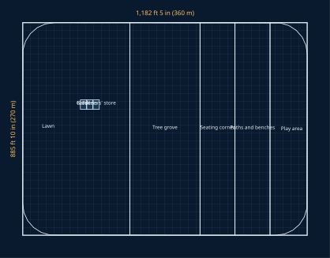

# P6-16 Pocket Park 3: plan

Footprint 1,182 ft 5 in (360 m) × 885 ft 10 in (270 m) · structural grid 32 ft 10 in (10 m)

## Levels

| Level | Floor above deck | Height | Floor area |
|---|---|---|---|
| Level 1 · Ground | 0 ft (0 mm) | 13 ft 1 in (4,000 mm) | 3,100 sq ft (288 m²) |

## Elements

| ID | Designation | Type | Name | Level(s) | Size / length | Area | Status |
|---|---|---|---|---|---|---|---|
| E001 | D5F4P6B13A2R1 | zone | Lawn | L1 | 445 ft 6 in (136 m) × 884 ft 10 in (270 m) | 386,118 sq ft (35,872 m²) | proposed |
| E002 | D5F4P6B13A2R2 | room | Kiosk | L1 | 26 ft 3 in (8,000 mm) × 39 ft 4 in (12 m) | 1,033 sq ft (96 m²) | proposed |
| E003 | D5F4P6B13A2R3 | room | Toilets | L1 | 26 ft 3 in (8,000 mm) × 39 ft 4 in (12 m) | 1,033 sq ft (96 m²) | proposed |
| E004 | D5F4P6B13A2R4 | room | Gardeners' store | L1 | 26 ft 3 in (8,000 mm) × 39 ft 4 in (12 m) | 1,033 sq ft (96 m²) | proposed |
| E005 | D5F4P6B13A2R5 | zone | Tree grove | L1 | 291 ft 4 in (89 m) × 885 ft 2 in (270 m) | 257,693 sq ft (23,940 m²) | proposed |
| E006 | D5F4P6B13A2R6 | zone | Seating corner | L1 | 145 ft 4 in (44 m) × 884 ft 6 in (270 m) | 128,556 sq ft (11,943 m²) | proposed |
| E007 | D5F4P6B13A2R7 | zone | Paths and benches | L1 | 145 ft 8 in (44 m) × 884 ft 10 in (270 m) | 128,847 sq ft (11,970 m²) | proposed |
| E008 | D5F4P6B13A2R8 | zone | Play area | L1 | 154 ft 6 in (47 m) × 884 ft 6 in (270 m) | 128,733 sq ft (11,960 m²) | proposed |

## Drawings

### Level 1 · Ground

