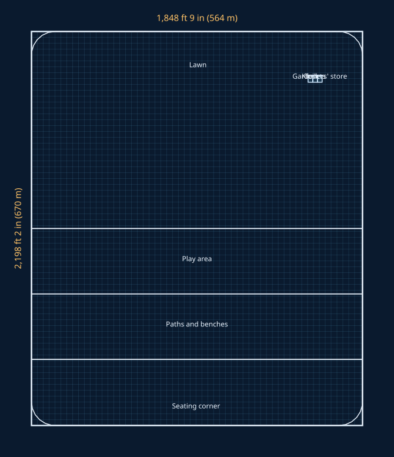

# P6-20 Pocket Park 5: plan

Footprint 1,848 ft 9 in (564 m) × 2,198 ft 2 in (670 m) · structural grid 32 ft 10 in (10 m)

## Levels

| Level | Floor above deck | Height | Floor area |
|---|---|---|---|
| Level 1 · Ground | 0 ft (0 mm) | 13 ft 1 in (4,000 mm) | 3,100 sq ft (288 m²) |

## Elements

| ID | Designation | Type | Name | Level(s) | Size / length | Area | Status |
|---|---|---|---|---|---|---|---|
| E001 | D5F4P6B18A1R1 | zone | Lawn | L1 | 1,848 ft 1 in (563 m) × 1,099 ft 1 in (335 m) | 2,021,892 sq ft (187,840 m²) | proposed |
| E002 | D5F4P6B18A1R2 | room | Kiosk | L1 | 26 ft 3 in (8,000 mm) × 39 ft 4 in (12 m) | 1,033 sq ft (96 m²) | proposed |
| E003 | D5F4P6B18A1R3 | room | Toilets | L1 | 26 ft 3 in (8,000 mm) × 39 ft 4 in (12 m) | 1,033 sq ft (96 m²) | proposed |
| E004 | D5F4P6B18A1R4 | room | Gardeners' store | L1 | 26 ft 3 in (8,000 mm) × 39 ft 4 in (12 m) | 1,033 sq ft (96 m²) | proposed |
| E005 | D5F4P6B18A1R5 | zone | Play area | L1 | 1,847 ft 9 in (563 m) × 364 ft 10 in (111 m) | 674,001 sq ft (62,617 m²) | proposed |
| E006 | D5F4P6B18A1R6 | zone | Paths and benches | L1 | 1,847 ft 9 in (563 m) × 364 ft 10 in (111 m) | 674,061 sq ft (62,622 m²) | proposed |
| E007 | D5F4P6B18A1R7 | zone | Seating corner | L1 | 1,847 ft 9 in (563 m) × 369 ft 5 in (113 m) | 673,927 sq ft (62,610 m²) | proposed |

## Drawings

### Level 1 · Ground

