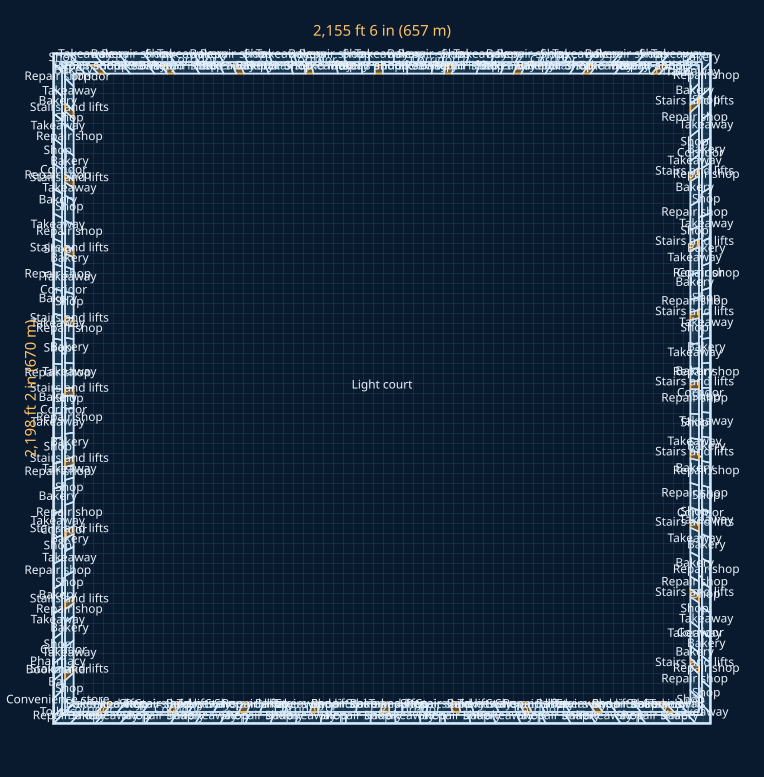
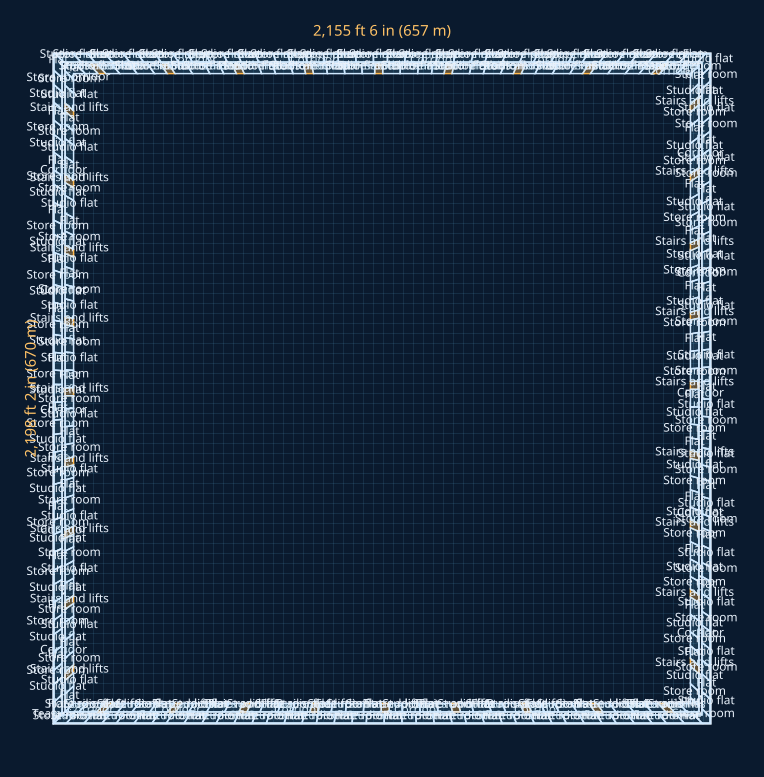

# P6-21 Dockside Shops 6: plan

Footprint 2,155 ft 6 in (657 m) × 2,198 ft 2 in (670 m) · structural grid 32 ft 10 in (10 m)

## Levels

| Level | Floor above deck | Height | Floor area |
|---|---|---|---|
| Level 1 · Shop floor | 0 ft (0 mm) | 16 ft 5 in (5,000 mm) | 444,657 sq ft (41,310 m²) |
| Level 2 · Upper floor | 16 ft 5 in (5,000 mm) | 13 ft 1 in (4,000 mm) | 444,657 sq ft (41,310 m²) |

## Elements

| ID | Designation | Type | Name | Level(s) | Size / length | Area | Status |
|---|---|---|---|---|---|---|---|
| E001 | D5F4P6B4A3L1R1 | zone | Light court | L1 | 2,024 ft 3 in (617 m) × 2,066 ft 11 in (630 m) | 4,184,040 sq ft (388,710 m²) | proposed |
| E002 | D5F4P6B4A3L1R2 | zone | Corridor | L1 | 9 ft 10 in (3,000 mm) × 401 ft 7 in (122 m) | 3,875 sq ft (360 m²) | proposed |
| E003 | D5F4P6B4A3L1R3 | zone | Corridor | L1 | 9 ft 10 in (3,000 mm) × 398 ft (121 m) | 3,875 sq ft (360 m²) | proposed |
| E004 | D5F4P6B4A3L1R4 | zone | Corridor | L1 | 9 ft 10 in (3,000 mm) × 395 ft 8 in (121 m) | 3,875 sq ft (360 m²) | proposed |
| E005 | D5F4P6B4A3L1R5 | zone | Corridor | L1 | 9 ft 10 in (3,000 mm) × 396 ft 8 in (121 m) | 3,875 sq ft (360 m²) | proposed |
| E006 | D5F4P6B4A3L1R6 | zone | Corridor | L1 | 9 ft 10 in (3,000 mm) × 400 ft 3 in (122 m) | 3,875 sq ft (360 m²) | proposed |
| E007 | D5F4P6B4A3L1R7 | zone | Corridor | L1 | 238 ft 6 in (73 m) × 173 ft 3 in (53 m) | 3,875 sq ft (360 m²) | proposed |
| E008 | D5F4P6B4A3L1R8 | zone | Corridor | L1 | 399 ft 7 in (122 m) × 9 ft 10 in (3,000 mm) | 3,875 sq ft (360 m²) | proposed |
| E009 | D5F4P6B4A3L1R9 | zone | Corridor | L1 | 395 ft 8 in (121 m) × 9 ft 10 in (3,000 mm) | 3,875 sq ft (360 m²) | proposed |
| E010 | D5F4P6B4A3L1R10 | zone | Corridor | L1 | 395 ft 4 in (120 m) × 9 ft 10 in (3,000 mm) | 3,875 sq ft (360 m²) | proposed |
| E011 | D5F4P6B4A3L1R11 | zone | Corridor | L1 | 398 ft 11 in (122 m) × 9 ft 10 in (3,000 mm) | 3,875 sq ft (360 m²) | proposed |
| E012 | D5F4P6B4A3L1R12 | zone | Corridor | L1 | 294 ft (90 m) × 117 ft 5 in (36 m) | 3,875 sq ft (360 m²) | proposed |
| E013 | D5F4P6B4A3L1R13 | zone | Corridor | L1 | 9 ft 10 in (3,000 mm) × 400 ft 7 in (122 m) | 3,875 sq ft (360 m²) | proposed |
| E014 | D5F4P6B4A3L1R14 | zone | Corridor | L1 | 9 ft 10 in (3,000 mm) × 397 ft (121 m) | 3,875 sq ft (360 m²) | proposed |
| E015 | D5F4P6B4A3L1R15 | zone | Corridor | L1 | 9 ft 10 in (3,000 mm) × 395 ft 4 in (120 m) | 3,875 sq ft (360 m²) | proposed |
| E016 | D5F4P6B4A3L1R16 | zone | Corridor | L1 | 9 ft 10 in (3,000 mm) × 397 ft 8 in (121 m) | 3,875 sq ft (360 m²) | proposed |
| E017 | D5F4P6B4A3L1R17 | zone | Corridor | L1 | 9 ft 10 in (3,000 mm) × 401 ft 3 in (122 m) | 3,875 sq ft (360 m²) | proposed |
| E018 | D5F4P6B4A3L1R18 | zone | Corridor | L1 | 346 ft 2 in (106 m) × 65 ft 3 in (20 m) | 3,875 sq ft (360 m²) | proposed |
| E019 | D5F4P6B4A3L1R19 | zone | Corridor | L1 | 398 ft 4 in (121 m) × 9 ft 10 in (3,000 mm) | 3,875 sq ft (360 m²) | proposed |
| E020 | D5F4P6B4A3L1R20 | zone | Corridor | L1 | 395 ft 4 in (120 m) × 9 ft 10 in (3,000 mm) | 3,875 sq ft (360 m²) | proposed |
| E021 | D5F4P6B4A3L1R21 | zone | Corridor | L1 | 396 ft 4 in (121 m) × 9 ft 10 in (3,000 mm) | 3,875 sq ft (360 m²) | proposed |
| E022 | D5F4P6B4A3L1R22 | zone | Corridor | L1 | 399 ft 11 in (122 m) × 9 ft 10 in (3,000 mm) | 3,875 sq ft (360 m²) | proposed |
| E023 | D5F4P6B4A3L1R23 | zone | Corridor | L1 | 186 ft (57 m) × 9 ft 10 in (3,000 mm) | 1,744 sq ft (162 m²) | proposed |
| E024 | D5F4P6B4A3L1R24, D5F4P6B4A3L2R1 | core | Stairs and lifts | L1, L2 | 27 ft 11 in (8,500 mm) × 51 ft 2 in (16 m) | 732 sq ft (68 m²) | proposed |
| E025 | D5F4P6B4A3L1R25, D5F4P6B4A3L2R2 | core | Stairs and lifts | L1, L2 | 27 ft 11 in (8,500 mm) × 44 ft 11 in (14 m) | 732 sq ft (68 m²) | proposed |
| E026 | D5F4P6B4A3L1R26, D5F4P6B4A3L2R3 | core | Stairs and lifts | L1, L2 | 27 ft 11 in (8,500 mm) × 39 ft 1 in (12 m) | 732 sq ft (68 m²) | proposed |
| E027 | D5F4P6B4A3L1R27, D5F4P6B4A3L2R4 | core | Stairs and lifts | L1, L2 | 27 ft 11 in (8,500 mm) × 32 ft 10 in (10 m) | 732 sq ft (68 m²) | proposed |
| E028 | D5F4P6B4A3L1R28, D5F4P6B4A3L2R5 | core | Stairs and lifts | L1, L2 | 27 ft 11 in (8,500 mm) × 26 ft 7 in (8,100 mm) | 732 sq ft (68 m²) | proposed |
| E029 | D5F4P6B4A3L1R29, D5F4P6B4A3L2R6 | core | Stairs and lifts | L1, L2 | 27 ft 11 in (8,500 mm) × 32 ft 2 in (9,800 mm) | 732 sq ft (68 m²) | proposed |
| E030 | D5F4P6B4A3L1R30, D5F4P6B4A3L2R7 | core | Stairs and lifts | L1, L2 | 27 ft 11 in (8,500 mm) × 38 ft 5 in (12 m) | 732 sq ft (68 m²) | proposed |
| E031 | D5F4P6B4A3L1R31, D5F4P6B4A3L2R8 | core | Stairs and lifts | L1, L2 | 27 ft 11 in (8,500 mm) × 44 ft 3 in (14 m) | 732 sq ft (68 m²) | proposed |
| E032 | D5F4P6B4A3L1R32, D5F4P6B4A3L2R9 | core | Stairs and lifts | L1, L2 | 27 ft 11 in (8,500 mm) × 50 ft 6 in (15 m) | 732 sq ft (68 m²) | proposed |
| E033 | D5F4P6B4A3L1R33, D5F4P6B4A3L2R10 | core | Stairs and lifts | L1, L2 | 51 ft 10 in (16 m) × 27 ft 11 in (8,500 mm) | 737 sq ft (68 m²) | proposed |
| E034 | D5F4P6B4A3L1R34, D5F4P6B4A3L2R11 | core | Stairs and lifts | L1, L2 | 45 ft 3 in (14 m) × 27 ft 11 in (8,500 mm) | 732 sq ft (68 m²) | proposed |
| E035 | D5F4P6B4A3L1R35, D5F4P6B4A3L2R12 | core | Stairs and lifts | L1, L2 | 39 ft 1 in (12 m) × 27 ft 11 in (8,500 mm) | 732 sq ft (68 m²) | proposed |
| E036 | D5F4P6B4A3L1R36, D5F4P6B4A3L2R13 | core | Stairs and lifts | L1, L2 | 32 ft 10 in (10 m) × 27 ft 11 in (8,500 mm) | 732 sq ft (68 m²) | proposed |
| E037 | D5F4P6B4A3L1R37, D5F4P6B4A3L2R14 | core | Stairs and lifts | L1, L2 | 26 ft 7 in (8,100 mm) × 27 ft 11 in (8,500 mm) | 732 sq ft (68 m²) | proposed |
| E038 | D5F4P6B4A3L1R38, D5F4P6B4A3L2R15 | core | Stairs and lifts | L1, L2 | 32 ft 2 in (9,800 mm) × 27 ft 11 in (8,500 mm) | 732 sq ft (68 m²) | proposed |
| E039 | D5F4P6B4A3L1R39, D5F4P6B4A3L2R16 | core | Stairs and lifts | L1, L2 | 38 ft 5 in (12 m) × 27 ft 11 in (8,500 mm) | 732 sq ft (68 m²) | proposed |
| E040 | D5F4P6B4A3L1R40, D5F4P6B4A3L2R17 | core | Stairs and lifts | L1, L2 | 44 ft 7 in (14 m) × 27 ft 11 in (8,500 mm) | 727 sq ft (68 m²) | proposed |
| E041 | D5F4P6B4A3L1R41, D5F4P6B4A3L2R18 | core | Stairs and lifts | L1, L2 | 51 ft 2 in (16 m) × 27 ft 11 in (8,500 mm) | 732 sq ft (68 m²) | proposed |
| E042 | D5F4P6B4A3L1R42, D5F4P6B4A3L2R19 | core | Stairs and lifts | L1, L2 | 27 ft 11 in (8,500 mm) × 51 ft 2 in (16 m) | 732 sq ft (68 m²) | proposed |
| E043 | D5F4P6B4A3L1R43, D5F4P6B4A3L2R20 | core | Stairs and lifts | L1, L2 | 27 ft 11 in (8,500 mm) × 44 ft 11 in (14 m) | 732 sq ft (68 m²) | proposed |
| E044 | D5F4P6B4A3L1R44, D5F4P6B4A3L2R21 | core | Stairs and lifts | L1, L2 | 27 ft 11 in (8,500 mm) × 39 ft 1 in (12 m) | 732 sq ft (68 m²) | proposed |
| E045 | D5F4P6B4A3L1R45, D5F4P6B4A3L2R22 | core | Stairs and lifts | L1, L2 | 27 ft 11 in (8,500 mm) × 32 ft 10 in (10 m) | 732 sq ft (68 m²) | proposed |
| E046 | D5F4P6B4A3L1R46, D5F4P6B4A3L2R23 | core | Stairs and lifts | L1, L2 | 27 ft 11 in (8,500 mm) × 26 ft 7 in (8,100 mm) | 732 sq ft (68 m²) | proposed |
| E047 | D5F4P6B4A3L1R47, D5F4P6B4A3L2R24 | core | Stairs and lifts | L1, L2 | 27 ft 11 in (8,500 mm) × 32 ft 2 in (9,800 mm) | 732 sq ft (68 m²) | proposed |
| E048 | D5F4P6B4A3L1R48, D5F4P6B4A3L2R25 | core | Stairs and lifts | L1, L2 | 27 ft 11 in (8,500 mm) × 38 ft 5 in (12 m) | 732 sq ft (68 m²) | proposed |
| E049 | D5F4P6B4A3L1R49, D5F4P6B4A3L2R26 | core | Stairs and lifts | L1, L2 | 27 ft 11 in (8,500 mm) × 44 ft 3 in (14 m) | 732 sq ft (68 m²) | proposed |
| E050 | D5F4P6B4A3L1R50, D5F4P6B4A3L2R27 | core | Stairs and lifts | L1, L2 | 27 ft 11 in (8,500 mm) × 50 ft 6 in (15 m) | 732 sq ft (68 m²) | proposed |
| E051 | D5F4P6B4A3L1R51, D5F4P6B4A3L2R28 | core | Stairs and lifts | L1, L2 | 51 ft 10 in (16 m) × 27 ft 11 in (8,500 mm) | 737 sq ft (68 m²) | proposed |
| E052 | D5F4P6B4A3L1R52, D5F4P6B4A3L2R29 | core | Stairs and lifts | L1, L2 | 45 ft 3 in (14 m) × 27 ft 11 in (8,500 mm) | 732 sq ft (68 m²) | proposed |
| E053 | D5F4P6B4A3L1R53, D5F4P6B4A3L2R30 | core | Stairs and lifts | L1, L2 | 39 ft 1 in (12 m) × 27 ft 11 in (8,500 mm) | 732 sq ft (68 m²) | proposed |
| E054 | D5F4P6B4A3L1R54, D5F4P6B4A3L2R31 | core | Stairs and lifts | L1, L2 | 32 ft 10 in (10 m) × 27 ft 11 in (8,500 mm) | 732 sq ft (68 m²) | proposed |
| E055 | D5F4P6B4A3L1R55, D5F4P6B4A3L2R32 | core | Stairs and lifts | L1, L2 | 26 ft 7 in (8,100 mm) × 27 ft 11 in (8,500 mm) | 732 sq ft (68 m²) | proposed |
| E056 | D5F4P6B4A3L1R56, D5F4P6B4A3L2R33 | core | Stairs and lifts | L1, L2 | 32 ft 2 in (9,800 mm) × 27 ft 11 in (8,500 mm) | 732 sq ft (68 m²) | proposed |
| E057 | D5F4P6B4A3L1R57, D5F4P6B4A3L2R34 | core | Stairs and lifts | L1, L2 | 38 ft 5 in (12 m) × 27 ft 11 in (8,500 mm) | 732 sq ft (68 m²) | proposed |
| E058 | D5F4P6B4A3L1R58, D5F4P6B4A3L2R35 | core | Stairs and lifts | L1, L2 | 44 ft 7 in (14 m) × 27 ft 11 in (8,500 mm) | 727 sq ft (68 m²) | proposed |
| E059 | D5F4P6B4A3L1R59, D5F4P6B4A3L2R36 | core | Stairs and lifts | L1, L2 | 51 ft 2 in (16 m) × 27 ft 11 in (8,500 mm) | 732 sq ft (68 m²) | proposed |
| E060 | D5F4P6B4A3L1R60 | room | Toilets | L1 | 27 ft 11 in (8,500 mm) × 50 ft 10 in (16 m) | 645 sq ft (60 m²) | proposed |
| E061 | D5F4P6B4A3L1R61 | room | Convenience store | L1 | 27 ft 11 in (8,500 mm) × 84 ft 8 in (26 m) | 1,615 sq ft (150 m²) | proposed |
| E062 | D5F4P6B4A3L1R62 | room | Bar | L1 | 27 ft 11 in (8,500 mm) × 83 ft (25 m) | 1,615 sq ft (150 m²) | proposed |
| E063 | D5F4P6B4A3L1R63 | room | Bookmaker | L1 | 27 ft 11 in (8,500 mm) × 47 ft 3 in (14 m) | 645 sq ft (60 m²) | proposed |
| E064 | D5F4P6B4A3L1R64 | room | Pharmacy | L1 | 27 ft 11 in (8,500 mm) × 54 ft 6 in (17 m) | 865 sq ft (80 m²) | proposed |
| E065 | D5F4P6B4A3L1R65 | room | Shop | L1 | 27 ft 11 in (8,500 mm) × 103 ft (31 m) | 2,260 sq ft (210 m²) | proposed |
| E066 | D5F4P6B4A3L1R66 | room | Takeaway | L1 | 27 ft 11 in (8,500 mm) × 100 ft 9 in (31 m) | 2,255 sq ft (210 m²) | proposed |
| E067 | D5F4P6B4A3L1R67 | room | Bakery | L1 | 27 ft 11 in (8,500 mm) × 98 ft 9 in (30 m) | 2,260 sq ft (210 m²) | proposed |
| E068 | D5F4P6B4A3L1R68 | room | Repair shop | L1 | 27 ft 11 in (8,500 mm) × 96 ft 9 in (30 m) | 2,264 sq ft (210 m²) | proposed |
| E069 | D5F4P6B4A3L1R69 | room | Shop | L1 | 27 ft 11 in (8,500 mm) × 94 ft 6 in (29 m) | 2,260 sq ft (210 m²) | proposed |
| E070 | D5F4P6B4A3L1R70 | room | Takeaway | L1 | 27 ft 11 in (8,500 mm) × 92 ft 6 in (28 m) | 2,260 sq ft (210 m²) | proposed |
| E071 | D5F4P6B4A3L1R71 | room | Bakery | L1 | 27 ft 11 in (8,500 mm) × 90 ft 7 in (28 m) | 2,260 sq ft (210 m²) | proposed |
| E072 | D5F4P6B4A3L1R72 | room | Repair shop | L1 | 27 ft 11 in (8,500 mm) × 88 ft 7 in (27 m) | 2,264 sq ft (210 m²) | proposed |
| E073 | D5F4P6B4A3L1R73 | room | Shop | L1 | 27 ft 11 in (8,500 mm) × 86 ft 3 in (26 m) | 2,260 sq ft (210 m²) | proposed |
| E074 | D5F4P6B4A3L1R74 | room | Takeaway | L1 | 27 ft 11 in (8,500 mm) × 84 ft 4 in (26 m) | 2,260 sq ft (210 m²) | proposed |
| E075 | D5F4P6B4A3L1R75 | room | Bakery | L1 | 27 ft 11 in (8,500 mm) × 82 ft (25 m) | 2,255 sq ft (210 m²) | proposed |
| E076 | D5F4P6B4A3L1R76 | room | Repair shop | L1 | 27 ft 11 in (8,500 mm) × 82 ft 4 in (25 m) | 2,264 sq ft (210 m²) | proposed |
| E077 | D5F4P6B4A3L1R77 | room | Shop | L1 | 27 ft 11 in (8,500 mm) × 84 ft 4 in (26 m) | 2,260 sq ft (210 m²) | proposed |
| E078 | D5F4P6B4A3L1R78 | room | Takeaway | L1 | 27 ft 11 in (8,500 mm) × 86 ft 3 in (26 m) | 2,260 sq ft (210 m²) | proposed |
| E079 | D5F4P6B4A3L1R79 | room | Bakery | L1 | 27 ft 11 in (8,500 mm) × 88 ft 3 in (27 m) | 2,260 sq ft (210 m²) | proposed |
| E080 | D5F4P6B4A3L1R80 | room | Repair shop | L1 | 27 ft 11 in (8,500 mm) × 90 ft 7 in (28 m) | 2,264 sq ft (210 m²) | proposed |
| E081 | D5F4P6B4A3L1R81 | room | Shop | L1 | 27 ft 11 in (8,500 mm) × 92 ft 6 in (28 m) | 2,260 sq ft (210 m²) | proposed |
| E082 | D5F4P6B4A3L1R82 | room | Takeaway | L1 | 27 ft 11 in (8,500 mm) × 94 ft 6 in (29 m) | 2,260 sq ft (210 m²) | proposed |
| E083 | D5F4P6B4A3L1R83 | room | Bakery | L1 | 27 ft 11 in (8,500 mm) × 96 ft 5 in (29 m) | 2,255 sq ft (210 m²) | proposed |
| E084 | D5F4P6B4A3L1R84 | room | Repair shop | L1 | 27 ft 11 in (8,500 mm) × 98 ft 9 in (30 m) | 2,260 sq ft (210 m²) | proposed |
| E085 | D5F4P6B4A3L1R85 | room | Shop | L1 | 27 ft 11 in (8,500 mm) × 101 ft 1 in (31 m) | 2,264 sq ft (210 m²) | proposed |
| E086 | D5F4P6B4A3L1R86 | room | Takeaway | L1 | 27 ft 11 in (8,500 mm) × 103 ft (31 m) | 2,260 sq ft (210 m²) | proposed |
| E087 | D5F4P6B4A3L1R87 | room | Bakery | L1 | 27 ft 11 in (8,500 mm) × 105 ft (32 m) | 2,260 sq ft (210 m²) | proposed |
| E088 | D5F4P6B4A3L1R88 | room | Repair shop | L1 | 27 ft 11 in (8,500 mm) × 106 ft 11 in (33 m) | 2,260 sq ft (210 m²) | proposed |
| E089 | D5F4P6B4A3L1R89 | room | Shop | L1 | 76 ft 5 in (23 m) × 59 ft 5 in (18 m) | 2,264 sq ft (210 m²) | proposed |
| E090 | D5F4P6B4A3L1R90 | room | Takeaway | L1 | 106 ft 8 in (32 m) × 27 ft 11 in (8,500 mm) | 2,260 sq ft (210 m²) | proposed |
| E091 | D5F4P6B4A3L1R91 | room | Bakery | L1 | 104 ft 4 in (32 m) × 27 ft 11 in (8,500 mm) | 2,255 sq ft (210 m²) | proposed |
| E092 | D5F4P6B4A3L1R92 | room | Repair shop | L1 | 102 ft 4 in (31 m) × 27 ft 11 in (8,500 mm) | 2,264 sq ft (210 m²) | proposed |
| E093 | D5F4P6B4A3L1R93 | room | Shop | L1 | 100 ft 1 in (30 m) × 27 ft 11 in (8,500 mm) | 2,260 sq ft (210 m²) | proposed |
| E094 | D5F4P6B4A3L1R94 | room | Takeaway | L1 | 98 ft 1 in (30 m) × 27 ft 11 in (8,500 mm) | 2,260 sq ft (210 m²) | proposed |
| E095 | D5F4P6B4A3L1R95 | room | Bakery | L1 | 96 ft 2 in (29 m) × 27 ft 11 in (8,500 mm) | 2,260 sq ft (210 m²) | proposed |
| E096 | D5F4P6B4A3L1R96 | room | Repair shop | L1 | 93 ft 10 in (29 m) × 27 ft 11 in (8,500 mm) | 2,260 sq ft (210 m²) | proposed |
| E097 | D5F4P6B4A3L1R97 | room | Shop | L1 | 91 ft 6 in (28 m) × 27 ft 11 in (8,500 mm) | 2,260 sq ft (210 m²) | proposed |
| E098 | D5F4P6B4A3L1R98 | room | Takeaway | L1 | 89 ft 7 in (27 m) × 27 ft 11 in (8,500 mm) | 2,260 sq ft (210 m²) | proposed |
| E099 | D5F4P6B4A3L1R99 | room | Bakery | L1 | 87 ft 7 in (27 m) × 27 ft 11 in (8,500 mm) | 2,264 sq ft (210 m²) | proposed |
| E100 | D5F4P6B4A3L1R100 | room | Repair shop | L1 | 85 ft 4 in (26 m) × 27 ft 11 in (8,500 mm) | 2,260 sq ft (210 m²) | proposed |
| E101 | D5F4P6B4A3L1R101 | room | Shop | L1 | 83 ft 4 in (25 m) × 27 ft 11 in (8,500 mm) | 2,260 sq ft (210 m²) | proposed |
| E102 | D5F4P6B4A3L1R102 | room | Takeaway | L1 | 82 ft 4 in (25 m) × 27 ft 11 in (8,500 mm) | 2,260 sq ft (210 m²) | proposed |
| E103 | D5F4P6B4A3L1R103 | room | Bakery | L1 | 83 ft 4 in (25 m) × 27 ft 11 in (8,500 mm) | 2,260 sq ft (210 m²) | proposed |
| E104 | D5F4P6B4A3L1R104 | room | Repair shop | L1 | 85 ft 4 in (26 m) × 27 ft 11 in (8,500 mm) | 2,260 sq ft (210 m²) | proposed |
| E105 | D5F4P6B4A3L1R105 | room | Shop | L1 | 87 ft 3 in (27 m) × 27 ft 11 in (8,500 mm) | 2,260 sq ft (210 m²) | proposed |
| E106 | D5F4P6B4A3L1R106 | room | Takeaway | L1 | 89 ft 7 in (27 m) × 27 ft 11 in (8,500 mm) | 2,264 sq ft (210 m²) | proposed |
| E107 | D5F4P6B4A3L1R107 | room | Bakery | L1 | 91 ft 6 in (28 m) × 27 ft 11 in (8,500 mm) | 2,260 sq ft (210 m²) | proposed |
| E108 | D5F4P6B4A3L1R108 | room | Repair shop | L1 | 93 ft 6 in (28 m) × 27 ft 11 in (8,500 mm) | 2,255 sq ft (210 m²) | proposed |
| E109 | D5F4P6B4A3L1R109 | room | Shop | L1 | 96 ft 2 in (29 m) × 27 ft 11 in (8,500 mm) | 2,264 sq ft (210 m²) | proposed |
| E110 | D5F4P6B4A3L1R110 | room | Takeaway | L1 | 98 ft 1 in (30 m) × 27 ft 11 in (8,500 mm) | 2,260 sq ft (210 m²) | proposed |
| E111 | D5F4P6B4A3L1R111 | room | Bakery | L1 | 100 ft 1 in (30 m) × 27 ft 11 in (8,500 mm) | 2,260 sq ft (210 m²) | proposed |
| E112 | D5F4P6B4A3L1R112 | room | Repair shop | L1 | 102 ft 4 in (31 m) × 27 ft 11 in (8,500 mm) | 2,264 sq ft (210 m²) | proposed |
| E113 | D5F4P6B4A3L1R113 | room | Shop | L1 | 104 ft 4 in (32 m) × 27 ft 11 in (8,500 mm) | 2,255 sq ft (210 m²) | proposed |
| E114 | D5F4P6B4A3L1R114 | room | Takeaway | L1 | 106 ft 8 in (32 m) × 27 ft 11 in (8,500 mm) | 2,260 sq ft (210 m²) | proposed |
| E115 | D5F4P6B4A3L1R115 | room | Bakery | L1 | 79 ft 5 in (24 m) × 56 ft 5 in (17 m) | 2,260 sq ft (210 m²) | proposed |
| E116 | D5F4P6B4A3L1R116 | room | Repair shop | L1 | 27 ft 11 in (8,500 mm) × 107 ft 3 in (33 m) | 2,264 sq ft (210 m²) | proposed |
| E117 | D5F4P6B4A3L1R117 | room | Shop | L1 | 27 ft 11 in (8,500 mm) × 105 ft (32 m) | 2,260 sq ft (210 m²) | proposed |
| E118 | D5F4P6B4A3L1R118 | room | Takeaway | L1 | 27 ft 11 in (8,500 mm) × 103 ft (31 m) | 2,260 sq ft (210 m²) | proposed |
| E119 | D5F4P6B4A3L1R119 | room | Bakery | L1 | 27 ft 11 in (8,500 mm) × 101 ft 1 in (31 m) | 2,260 sq ft (210 m²) | proposed |
| E120 | D5F4P6B4A3L1R120 | room | Repair shop | L1 | 27 ft 11 in (8,500 mm) × 99 ft 1 in (30 m) | 2,264 sq ft (210 m²) | proposed |
| E121 | D5F4P6B4A3L1R121 | room | Shop | L1 | 27 ft 11 in (8,500 mm) × 96 ft 5 in (29 m) | 2,255 sq ft (210 m²) | proposed |
| E122 | D5F4P6B4A3L1R122 | room | Takeaway | L1 | 27 ft 11 in (8,500 mm) × 94 ft 6 in (29 m) | 2,260 sq ft (210 m²) | proposed |
| E123 | D5F4P6B4A3L1R123 | room | Bakery | L1 | 27 ft 11 in (8,500 mm) × 92 ft 6 in (28 m) | 2,260 sq ft (210 m²) | proposed |
| E124 | D5F4P6B4A3L1R124 | room | Repair shop | L1 | 27 ft 11 in (8,500 mm) × 90 ft 7 in (28 m) | 2,260 sq ft (210 m²) | proposed |
| E125 | D5F4P6B4A3L1R125 | room | Shop | L1 | 27 ft 11 in (8,500 mm) × 88 ft 7 in (27 m) | 2,264 sq ft (210 m²) | proposed |
| E126 | D5F4P6B4A3L1R126 | room | Takeaway | L1 | 27 ft 11 in (8,500 mm) × 86 ft 3 in (26 m) | 2,260 sq ft (210 m²) | proposed |
| E127 | D5F4P6B4A3L1R127 | room | Bakery | L1 | 27 ft 11 in (8,500 mm) × 84 ft 4 in (26 m) | 2,260 sq ft (210 m²) | proposed |
| E128 | D5F4P6B4A3L1R128 | room | Repair shop | L1 | 27 ft 11 in (8,500 mm) × 82 ft 4 in (25 m) | 2,260 sq ft (210 m²) | proposed |
| E129 | D5F4P6B4A3L1R129 | room | Shop | L1 | 27 ft 11 in (8,500 mm) × 82 ft 4 in (25 m) | 2,260 sq ft (210 m²) | proposed |
| E130 | D5F4P6B4A3L1R130 | room | Takeaway | L1 | 27 ft 11 in (8,500 mm) × 84 ft 4 in (26 m) | 2,260 sq ft (210 m²) | proposed |
| E131 | D5F4P6B4A3L1R131 | room | Bakery | L1 | 27 ft 11 in (8,500 mm) × 86 ft 3 in (26 m) | 2,260 sq ft (210 m²) | proposed |
| E132 | D5F4P6B4A3L1R132 | room | Repair shop | L1 | 27 ft 11 in (8,500 mm) × 88 ft 3 in (27 m) | 2,260 sq ft (210 m²) | proposed |
| E133 | D5F4P6B4A3L1R133 | room | Shop | L1 | 27 ft 11 in (8,500 mm) × 90 ft 7 in (28 m) | 2,264 sq ft (210 m²) | proposed |
| E134 | D5F4P6B4A3L1R134 | room | Takeaway | L1 | 27 ft 11 in (8,500 mm) × 92 ft 6 in (28 m) | 2,260 sq ft (210 m²) | proposed |
| E135 | D5F4P6B4A3L1R135 | room | Bakery | L1 | 27 ft 11 in (8,500 mm) × 94 ft 6 in (29 m) | 2,260 sq ft (210 m²) | proposed |
| E136 | D5F4P6B4A3L1R136 | room | Repair shop | L1 | 27 ft 11 in (8,500 mm) × 96 ft 5 in (29 m) | 2,260 sq ft (210 m²) | proposed |
| E137 | D5F4P6B4A3L1R137 | room | Shop | L1 | 27 ft 11 in (8,500 mm) × 98 ft 9 in (30 m) | 2,264 sq ft (210 m²) | proposed |
| E138 | D5F4P6B4A3L1R138 | room | Takeaway | L1 | 27 ft 11 in (8,500 mm) × 100 ft 9 in (31 m) | 2,255 sq ft (210 m²) | proposed |
| E139 | D5F4P6B4A3L1R139 | room | Bakery | L1 | 27 ft 11 in (8,500 mm) × 103 ft (31 m) | 2,260 sq ft (210 m²) | proposed |
| E140 | D5F4P6B4A3L1R140 | room | Repair shop | L1 | 27 ft 11 in (8,500 mm) × 105 ft (32 m) | 2,260 sq ft (210 m²) | proposed |
| E141 | D5F4P6B4A3L1R141 | room | Shop | L1 | 27 ft 11 in (8,500 mm) × 106 ft 11 in (33 m) | 2,260 sq ft (210 m²) | proposed |
| E142 | D5F4P6B4A3L1R142 | room | Takeaway | L1 | 74 ft 6 in (23 m) × 61 ft 4 in (19 m) | 2,264 sq ft (210 m²) | proposed |
| E143 | D5F4P6B4A3L1R143 | room | Bakery | L1 | 106 ft 8 in (32 m) × 27 ft 11 in (8,500 mm) | 2,260 sq ft (210 m²) | proposed |
| E144 | D5F4P6B4A3L1R144 | room | Repair shop | L1 | 104 ft 8 in (32 m) × 27 ft 11 in (8,500 mm) | 2,260 sq ft (210 m²) | proposed |
| E145 | D5F4P6B4A3L1R145 | room | Shop | L1 | 102 ft 4 in (31 m) × 27 ft 11 in (8,500 mm) | 2,260 sq ft (210 m²) | proposed |
| E146 | D5F4P6B4A3L1R146 | room | Takeaway | L1 | 100 ft 1 in (30 m) × 27 ft 11 in (8,500 mm) | 2,260 sq ft (210 m²) | proposed |
| E147 | D5F4P6B4A3L1R147 | room | Bakery | L1 | 98 ft 1 in (30 m) × 27 ft 11 in (8,500 mm) | 2,260 sq ft (210 m²) | proposed |
| E148 | D5F4P6B4A3L1R148 | room | Repair shop | L1 | 96 ft 2 in (29 m) × 27 ft 11 in (8,500 mm) | 2,260 sq ft (210 m²) | proposed |
| E149 | D5F4P6B4A3L1R149 | room | Shop | L1 | 94 ft 2 in (29 m) × 27 ft 11 in (8,500 mm) | 2,264 sq ft (210 m²) | proposed |
| E150 | D5F4P6B4A3L1R150 | room | Takeaway | L1 | 91 ft 10 in (28 m) × 27 ft 11 in (8,500 mm) | 2,260 sq ft (210 m²) | proposed |
| E151 | D5F4P6B4A3L1R151 | room | Bakery | L1 | 89 ft 7 in (27 m) × 27 ft 11 in (8,500 mm) | 2,255 sq ft (210 m²) | proposed |
| E152 | D5F4P6B4A3L1R152 | room | Repair shop | L1 | 87 ft 7 in (27 m) × 27 ft 11 in (8,500 mm) | 2,264 sq ft (210 m²) | proposed |
| E153 | D5F4P6B4A3L1R153 | room | Shop | L1 | 85 ft 4 in (26 m) × 27 ft 11 in (8,500 mm) | 2,260 sq ft (210 m²) | proposed |
| E154 | D5F4P6B4A3L1R154 | room | Takeaway | L1 | 83 ft 4 in (25 m) × 27 ft 11 in (8,500 mm) | 2,260 sq ft (210 m²) | proposed |
| E155 | D5F4P6B4A3L1R155 | room | Bakery | L1 | 82 ft 4 in (25 m) × 27 ft 11 in (8,500 mm) | 2,264 sq ft (210 m²) | proposed |
| E156 | D5F4P6B4A3L1R156 | room | Repair shop | L1 | 83 ft (25 m) × 27 ft 11 in (8,500 mm) | 2,255 sq ft (210 m²) | proposed |
| E157 | D5F4P6B4A3L1R157 | room | Shop | L1 | 85 ft 4 in (26 m) × 27 ft 11 in (8,500 mm) | 2,260 sq ft (210 m²) | proposed |
| E158 | D5F4P6B4A3L1R158 | room | Takeaway | L1 | 87 ft 3 in (27 m) × 27 ft 11 in (8,500 mm) | 2,260 sq ft (210 m²) | proposed |
| E159 | D5F4P6B4A3L1R159 | room | Bakery | L1 | 89 ft 7 in (27 m) × 27 ft 11 in (8,500 mm) | 2,264 sq ft (210 m²) | proposed |
| E160 | D5F4P6B4A3L1R160 | room | Repair shop | L1 | 91 ft 6 in (28 m) × 27 ft 11 in (8,500 mm) | 2,260 sq ft (210 m²) | proposed |
| E161 | D5F4P6B4A3L1R161 | room | Shop | L1 | 93 ft 6 in (28 m) × 27 ft 11 in (8,500 mm) | 2,260 sq ft (210 m²) | proposed |
| E162 | D5F4P6B4A3L1R162 | room | Takeaway | L1 | 95 ft 10 in (29 m) × 27 ft 11 in (8,500 mm) | 2,260 sq ft (210 m²) | proposed |
| E163 | D5F4P6B4A3L1R163 | room | Bakery | L1 | 98 ft 1 in (30 m) × 27 ft 11 in (8,500 mm) | 2,260 sq ft (210 m²) | proposed |
| E164 | D5F4P6B4A3L1R164 | room | Repair shop | L1 | 100 ft 1 in (30 m) × 27 ft 11 in (8,500 mm) | 2,260 sq ft (210 m²) | proposed |
| E165 | D5F4P6B4A3L1R165 | room | Shop | L1 | 102 ft 4 in (31 m) × 27 ft 11 in (8,500 mm) | 2,264 sq ft (210 m²) | proposed |
| E166 | D5F4P6B4A3L1R166 | room | Takeaway | L1 | 104 ft 4 in (32 m) × 27 ft 11 in (8,500 mm) | 2,260 sq ft (210 m²) | proposed |
| E167 | D5F4P6B4A3L1R167 | room | Bakery | L1 | 106 ft 4 in (32 m) × 27 ft 11 in (8,500 mm) | 2,255 sq ft (210 m²) | proposed |
| E168 | D5F4P6B4A3L1R168 | room | Repair shop | L1 | 81 ft 4 in (25 m) × 27 ft 11 in (8,500 mm) | 1,510 sq ft (140 m²) | proposed |
| E169 | D5F4P6B4A3L1R169 | room | Shop | L1 | 27 ft 11 in (8,500 mm) × 128 ft 7 in (39 m) | 2,845 sq ft (264 m²) | proposed |
| E170 | D5F4P6B4A3L1R170 | room | Takeaway | L1 | 27 ft 11 in (8,500 mm) × 104 ft 8 in (32 m) | 2,264 sq ft (210 m²) | proposed |
| E171 | D5F4P6B4A3L1R171 | room | Bakery | L1 | 27 ft 11 in (8,500 mm) × 102 ft (31 m) | 2,255 sq ft (210 m²) | proposed |
| E172 | D5F4P6B4A3L1R172 | room | Repair shop | L1 | 27 ft 11 in (8,500 mm) × 61 ft 8 in (19 m) | 1,176 sq ft (109 m²) | proposed |
| E173 | D5F4P6B4A3L1R173 | room | Shop | L1 | 27 ft 11 in (8,500 mm) × 98 ft 5 in (30 m) | 2,260 sq ft (210 m²) | proposed |
| E174 | D5F4P6B4A3L1R174 | room | Takeaway | L1 | 27 ft 11 in (8,500 mm) × 96 ft 2 in (29 m) | 2,260 sq ft (210 m²) | proposed |
| E175 | D5F4P6B4A3L1R175 | room | Bakery | L1 | 27 ft 11 in (8,500 mm) × 55 ft 5 in (17 m) | 1,171 sq ft (109 m²) | proposed |
| E176 | D5F4P6B4A3L1R176 | room | Repair shop | L1 | 27 ft 11 in (8,500 mm) × 92 ft 2 in (28 m) | 2,260 sq ft (210 m²) | proposed |
| E177 | D5F4P6B4A3L1R177 | room | Shop | L1 | 27 ft 11 in (8,500 mm) × 89 ft 11 in (27 m) | 2,260 sq ft (210 m²) | proposed |
| E178 | D5F4P6B4A3L1R178 | room | Takeaway | L1 | 27 ft 11 in (8,500 mm) × 49 ft 6 in (15 m) | 1,176 sq ft (109 m²) | proposed |
| E179 | D5F4P6B4A3L1R179 | room | Bakery | L1 | 27 ft 11 in (8,500 mm) × 85 ft 11 in (26 m) | 2,255 sq ft (210 m²) | proposed |
| E180 | D5F4P6B4A3L1R180 | room | Repair shop | L1 | 27 ft 11 in (8,500 mm) × 84 ft (26 m) | 2,264 sq ft (210 m²) | proposed |
| E181 | D5F4P6B4A3L1R181 | room | Shop | L1 | 27 ft 11 in (8,500 mm) × 43 ft (13 m) | 1,171 sq ft (109 m²) | proposed |
| E182 | D5F4P6B4A3L1R182 | room | Takeaway | L1 | 27 ft 11 in (8,500 mm) × 82 ft 4 in (25 m) | 2,260 sq ft (210 m²) | proposed |
| E183 | D5F4P6B4A3L1R183 | room | Bakery | L1 | 27 ft 11 in (8,500 mm) × 84 ft 4 in (26 m) | 2,260 sq ft (210 m²) | proposed |
| E184 | D5F4P6B4A3L1R184 | room | Repair shop | L1 | 27 ft 11 in (8,500 mm) × 46 ft 11 in (14 m) | 1,171 sq ft (109 m²) | proposed |
| E185 | D5F4P6B4A3L1R185 | room | Shop | L1 | 27 ft 11 in (8,500 mm) × 88 ft 7 in (27 m) | 2,264 sq ft (210 m²) | proposed |
| E186 | D5F4P6B4A3L1R186 | room | Takeaway | L1 | 27 ft 11 in (8,500 mm) × 90 ft 7 in (28 m) | 2,260 sq ft (210 m²) | proposed |
| E187 | D5F4P6B4A3L1R187 | room | Bakery | L1 | 27 ft 11 in (8,500 mm) × 53 ft 2 in (16 m) | 1,171 sq ft (109 m²) | proposed |
| E188 | D5F4P6B4A3L1R188 | room | Repair shop | L1 | 27 ft 11 in (8,500 mm) × 94 ft 6 in (29 m) | 2,260 sq ft (210 m²) | proposed |
| E189 | D5F4P6B4A3L1R189 | room | Shop | L1 | 27 ft 11 in (8,500 mm) × 96 ft 5 in (29 m) | 2,260 sq ft (210 m²) | proposed |
| E190 | D5F4P6B4A3L1R190 | room | Takeaway | L1 | 27 ft 11 in (8,500 mm) × 59 ft 1 in (18 m) | 1,171 sq ft (109 m²) | proposed |
| E191 | D5F4P6B4A3L1R191 | room | Bakery | L1 | 27 ft 11 in (8,500 mm) × 100 ft 9 in (31 m) | 2,264 sq ft (210 m²) | proposed |
| E192 | D5F4P6B4A3L1R192 | room | Repair shop | L1 | 27 ft 11 in (8,500 mm) × 102 ft 8 in (31 m) | 2,260 sq ft (210 m²) | proposed |
| E193 | D5F4P6B4A3L1R193 | room | Shop | L1 | 27 ft 11 in (8,500 mm) × 65 ft 3 in (20 m) | 1,171 sq ft (109 m²) | proposed |
| E194 | D5F4P6B4A3L1R194 | room | Takeaway | L1 | 27 ft 11 in (8,500 mm) × 106 ft 8 in (32 m) | 2,260 sq ft (210 m²) | proposed |
| E195 | D5F4P6B4A3L1R195 | room | Bakery | L1 | 65 ft 11 in (20 m) × 69 ft 7 in (21 m) | 2,260 sq ft (210 m²) | proposed |
| E196 | D5F4P6B4A3L1R196 | room | Repair shop | L1 | 68 ft 3 in (21 m) × 27 ft 11 in (8,500 mm) | 1,171 sq ft (109 m²) | proposed |
| E197 | D5F4P6B4A3L1R197 | room | Shop | L1 | 104 ft 8 in (32 m) × 27 ft 11 in (8,500 mm) | 2,255 sq ft (210 m²) | proposed |
| E198 | D5F4P6B4A3L1R198 | room | Takeaway | L1 | 102 ft 8 in (31 m) × 27 ft 11 in (8,500 mm) | 2,260 sq ft (210 m²) | proposed |
| E199 | D5F4P6B4A3L1R199 | room | Bakery | L1 | 62 ft (19 m) × 27 ft 11 in (8,500 mm) | 1,171 sq ft (109 m²) | proposed |
| E200 | D5F4P6B4A3L1R200 | room | Repair shop | L1 | 98 ft 9 in (30 m) × 27 ft 11 in (8,500 mm) | 2,264 sq ft (210 m²) | proposed |
| E201 | D5F4P6B4A3L1R201 | room | Shop | L1 | 96 ft 5 in (29 m) × 27 ft 11 in (8,500 mm) | 2,260 sq ft (210 m²) | proposed |
| E202 | D5F4P6B4A3L1R202 | room | Takeaway | L1 | 55 ft 9 in (17 m) × 27 ft 11 in (8,500 mm) | 1,171 sq ft (109 m²) | proposed |
| E203 | D5F4P6B4A3L1R203 | room | Bakery | L1 | 92 ft 6 in (28 m) × 27 ft 11 in (8,500 mm) | 2,260 sq ft (210 m²) | proposed |
| E204 | D5F4P6B4A3L1R204 | room | Repair shop | L1 | 90 ft 3 in (28 m) × 27 ft 11 in (8,500 mm) | 2,260 sq ft (210 m²) | proposed |
| E205 | D5F4P6B4A3L1R205 | room | Shop | L1 | 49 ft 6 in (15 m) × 27 ft 11 in (8,500 mm) | 1,176 sq ft (109 m²) | proposed |
| E206 | D5F4P6B4A3L1R206 | room | Takeaway | L1 | 85 ft 11 in (26 m) × 27 ft 11 in (8,500 mm) | 2,255 sq ft (210 m²) | proposed |
| E207 | D5F4P6B4A3L1R207 | room | Bakery | L1 | 84 ft (26 m) × 27 ft 11 in (8,500 mm) | 2,264 sq ft (210 m²) | proposed |
| E208 | D5F4P6B4A3L1R208 | room | Repair shop | L1 | 43 ft (13 m) × 27 ft 11 in (8,500 mm) | 1,171 sq ft (109 m²) | proposed |
| E209 | D5F4P6B4A3L1R209 | room | Shop | L1 | 82 ft 4 in (25 m) × 27 ft 11 in (8,500 mm) | 2,260 sq ft (210 m²) | proposed |
| E210 | D5F4P6B4A3L1R210 | room | Takeaway | L1 | 84 ft 4 in (26 m) × 27 ft 11 in (8,500 mm) | 2,260 sq ft (210 m²) | proposed |
| E211 | D5F4P6B4A3L1R211 | room | Bakery | L1 | 46 ft 11 in (14 m) × 27 ft 11 in (8,500 mm) | 1,171 sq ft (109 m²) | proposed |
| E212 | D5F4P6B4A3L1R212 | room | Repair shop | L1 | 88 ft 7 in (27 m) × 27 ft 11 in (8,500 mm) | 2,264 sq ft (210 m²) | proposed |
| E213 | D5F4P6B4A3L1R213 | room | Shop | L1 | 90 ft 7 in (28 m) × 27 ft 11 in (8,500 mm) | 2,255 sq ft (210 m²) | proposed |
| E214 | D5F4P6B4A3L1R214 | room | Takeaway | L1 | 53 ft 6 in (16 m) × 27 ft 11 in (8,500 mm) | 1,176 sq ft (109 m²) | proposed |
| E215 | D5F4P6B4A3L1R215 | room | Bakery | L1 | 94 ft 10 in (29 m) × 27 ft 11 in (8,500 mm) | 2,260 sq ft (210 m²) | proposed |
| E216 | D5F4P6B4A3L1R216 | room | Repair shop | L1 | 97 ft 1 in (30 m) × 27 ft 11 in (8,500 mm) | 2,260 sq ft (210 m²) | proposed |
| E217 | D5F4P6B4A3L1R217 | room | Shop | L1 | 59 ft 9 in (18 m) × 27 ft 11 in (8,500 mm) | 1,176 sq ft (109 m²) | proposed |
| E218 | D5F4P6B4A3L1R218 | room | Takeaway | L1 | 101 ft 1 in (31 m) × 27 ft 11 in (8,500 mm) | 2,260 sq ft (210 m²) | proposed |
| E219 | D5F4P6B4A3L1R219 | room | Bakery | L1 | 103 ft 4 in (32 m) × 27 ft 11 in (8,500 mm) | 2,264 sq ft (210 m²) | proposed |
| E220 | D5F4P6B4A3L1R220 | room | Repair shop | L1 | 65 ft 11 in (20 m) × 27 ft 11 in (8,500 mm) | 1,171 sq ft (109 m²) | proposed |
| E221 | D5F4P6B4A3L1R221 | room | Shop | L1 | 107 ft 3 in (33 m) × 27 ft 11 in (8,500 mm) | 2,260 sq ft (210 m²) | proposed |
| E222 | D5F4P6B4A3L1R222 | room | Takeaway | L1 | 48 ft 7 in (15 m) × 87 ft 3 in (27 m) | 2,260 sq ft (210 m²) | proposed |
| E223 | D5F4P6B4A3L1R223 | room | Bakery | L1 | 27 ft 11 in (8,500 mm) × 67 ft 11 in (21 m) | 1,171 sq ft (109 m²) | proposed |
| E224 | D5F4P6B4A3L1R224 | room | Repair shop | L1 | 27 ft 11 in (8,500 mm) × 104 ft 8 in (32 m) | 2,264 sq ft (210 m²) | proposed |
| E225 | D5F4P6B4A3L1R225 | room | Shop | L1 | 27 ft 11 in (8,500 mm) × 102 ft (31 m) | 2,255 sq ft (210 m²) | proposed |
| E226 | D5F4P6B4A3L1R226 | room | Takeaway | L1 | 27 ft 11 in (8,500 mm) × 61 ft 8 in (19 m) | 1,176 sq ft (109 m²) | proposed |
| E227 | D5F4P6B4A3L1R227 | room | Bakery | L1 | 27 ft 11 in (8,500 mm) × 98 ft 5 in (30 m) | 2,260 sq ft (210 m²) | proposed |
| E228 | D5F4P6B4A3L1R228 | room | Repair shop | L1 | 27 ft 11 in (8,500 mm) × 96 ft 2 in (29 m) | 2,260 sq ft (210 m²) | proposed |
| E229 | D5F4P6B4A3L1R229 | room | Shop | L1 | 27 ft 11 in (8,500 mm) × 55 ft 5 in (17 m) | 1,171 sq ft (109 m²) | proposed |
| E230 | D5F4P6B4A3L1R230 | room | Takeaway | L1 | 27 ft 11 in (8,500 mm) × 92 ft 2 in (28 m) | 2,260 sq ft (210 m²) | proposed |
| E231 | D5F4P6B4A3L1R231 | room | Bakery | L1 | 27 ft 11 in (8,500 mm) × 89 ft 11 in (27 m) | 2,260 sq ft (210 m²) | proposed |
| E232 | D5F4P6B4A3L1R232 | room | Repair shop | L1 | 27 ft 11 in (8,500 mm) × 49 ft 6 in (15 m) | 1,176 sq ft (109 m²) | proposed |
| E233 | D5F4P6B4A3L1R233 | room | Shop | L1 | 27 ft 11 in (8,500 mm) × 85 ft 11 in (26 m) | 2,255 sq ft (210 m²) | proposed |
| E234 | D5F4P6B4A3L1R234 | room | Takeaway | L1 | 27 ft 11 in (8,500 mm) × 84 ft (26 m) | 2,264 sq ft (210 m²) | proposed |
| E235 | D5F4P6B4A3L1R235 | room | Bakery | L1 | 27 ft 11 in (8,500 mm) × 43 ft (13 m) | 1,171 sq ft (109 m²) | proposed |
| E236 | D5F4P6B4A3L1R236 | room | Repair shop | L1 | 27 ft 11 in (8,500 mm) × 82 ft 4 in (25 m) | 2,260 sq ft (210 m²) | proposed |
| E237 | D5F4P6B4A3L1R237 | room | Shop | L1 | 27 ft 11 in (8,500 mm) × 84 ft 4 in (26 m) | 2,260 sq ft (210 m²) | proposed |
| E238 | D5F4P6B4A3L1R238 | room | Takeaway | L1 | 27 ft 11 in (8,500 mm) × 46 ft 11 in (14 m) | 1,171 sq ft (109 m²) | proposed |
| E239 | D5F4P6B4A3L1R239 | room | Bakery | L1 | 27 ft 11 in (8,500 mm) × 88 ft 7 in (27 m) | 2,264 sq ft (210 m²) | proposed |
| E240 | D5F4P6B4A3L1R240 | room | Repair shop | L1 | 27 ft 11 in (8,500 mm) × 90 ft 7 in (28 m) | 2,260 sq ft (210 m²) | proposed |
| E241 | D5F4P6B4A3L1R241 | room | Shop | L1 | 27 ft 11 in (8,500 mm) × 53 ft 2 in (16 m) | 1,171 sq ft (109 m²) | proposed |
| E242 | D5F4P6B4A3L1R242 | room | Takeaway | L1 | 27 ft 11 in (8,500 mm) × 94 ft 6 in (29 m) | 2,260 sq ft (210 m²) | proposed |
| E243 | D5F4P6B4A3L1R243 | room | Bakery | L1 | 27 ft 11 in (8,500 mm) × 96 ft 5 in (29 m) | 2,260 sq ft (210 m²) | proposed |
| E244 | D5F4P6B4A3L1R244 | room | Repair shop | L1 | 27 ft 11 in (8,500 mm) × 59 ft 1 in (18 m) | 1,171 sq ft (109 m²) | proposed |
| E245 | D5F4P6B4A3L1R245 | room | Shop | L1 | 27 ft 11 in (8,500 mm) × 100 ft 9 in (31 m) | 2,264 sq ft (210 m²) | proposed |
| E246 | D5F4P6B4A3L1R246 | room | Takeaway | L1 | 27 ft 11 in (8,500 mm) × 102 ft 8 in (31 m) | 2,260 sq ft (210 m²) | proposed |
| E247 | D5F4P6B4A3L1R247 | room | Bakery | L1 | 27 ft 11 in (8,500 mm) × 65 ft 3 in (20 m) | 1,171 sq ft (109 m²) | proposed |
| E248 | D5F4P6B4A3L1R248 | room | Repair shop | L1 | 27 ft 11 in (8,500 mm) × 106 ft 8 in (32 m) | 2,260 sq ft (210 m²) | proposed |
| E249 | D5F4P6B4A3L1R249 | room | Shop | L1 | 65 ft 11 in (20 m) × 69 ft 7 in (21 m) | 2,260 sq ft (210 m²) | proposed |
| E250 | D5F4P6B4A3L1R250 | room | Takeaway | L1 | 68 ft 3 in (21 m) × 27 ft 11 in (8,500 mm) | 1,171 sq ft (109 m²) | proposed |
| E251 | D5F4P6B4A3L1R251 | room | Bakery | L1 | 104 ft 8 in (32 m) × 27 ft 11 in (8,500 mm) | 2,255 sq ft (210 m²) | proposed |
| E252 | D5F4P6B4A3L1R252 | room | Repair shop | L1 | 102 ft 8 in (31 m) × 27 ft 11 in (8,500 mm) | 2,260 sq ft (210 m²) | proposed |
| E253 | D5F4P6B4A3L1R253 | room | Shop | L1 | 62 ft (19 m) × 27 ft 11 in (8,500 mm) | 1,171 sq ft (109 m²) | proposed |
| E254 | D5F4P6B4A3L1R254 | room | Takeaway | L1 | 98 ft 9 in (30 m) × 27 ft 11 in (8,500 mm) | 2,264 sq ft (210 m²) | proposed |
| E255 | D5F4P6B4A3L1R255 | room | Bakery | L1 | 96 ft 5 in (29 m) × 27 ft 11 in (8,500 mm) | 2,260 sq ft (210 m²) | proposed |
| E256 | D5F4P6B4A3L1R256 | room | Repair shop | L1 | 55 ft 9 in (17 m) × 27 ft 11 in (8,500 mm) | 1,171 sq ft (109 m²) | proposed |
| E257 | D5F4P6B4A3L1R257 | room | Shop | L1 | 92 ft 6 in (28 m) × 27 ft 11 in (8,500 mm) | 2,260 sq ft (210 m²) | proposed |
| E258 | D5F4P6B4A3L1R258 | room | Takeaway | L1 | 90 ft 3 in (28 m) × 27 ft 11 in (8,500 mm) | 2,260 sq ft (210 m²) | proposed |
| E259 | D5F4P6B4A3L1R259 | room | Bakery | L1 | 49 ft 6 in (15 m) × 27 ft 11 in (8,500 mm) | 1,176 sq ft (109 m²) | proposed |
| E260 | D5F4P6B4A3L1R260 | room | Repair shop | L1 | 85 ft 11 in (26 m) × 27 ft 11 in (8,500 mm) | 2,255 sq ft (210 m²) | proposed |
| E261 | D5F4P6B4A3L1R261 | room | Shop | L1 | 84 ft (26 m) × 27 ft 11 in (8,500 mm) | 2,264 sq ft (210 m²) | proposed |
| E262 | D5F4P6B4A3L1R262 | room | Takeaway | L1 | 43 ft (13 m) × 27 ft 11 in (8,500 mm) | 1,171 sq ft (109 m²) | proposed |
| E263 | D5F4P6B4A3L1R263 | room | Bakery | L1 | 82 ft 4 in (25 m) × 27 ft 11 in (8,500 mm) | 2,260 sq ft (210 m²) | proposed |
| E264 | D5F4P6B4A3L1R264 | room | Repair shop | L1 | 84 ft 4 in (26 m) × 27 ft 11 in (8,500 mm) | 2,260 sq ft (210 m²) | proposed |
| E265 | D5F4P6B4A3L1R265 | room | Shop | L1 | 46 ft 11 in (14 m) × 27 ft 11 in (8,500 mm) | 1,171 sq ft (109 m²) | proposed |
| E266 | D5F4P6B4A3L1R266 | room | Takeaway | L1 | 88 ft 7 in (27 m) × 27 ft 11 in (8,500 mm) | 2,264 sq ft (210 m²) | proposed |
| E267 | D5F4P6B4A3L1R267 | room | Bakery | L1 | 90 ft 7 in (28 m) × 27 ft 11 in (8,500 mm) | 2,255 sq ft (210 m²) | proposed |
| E268 | D5F4P6B4A3L1R268 | room | Repair shop | L1 | 53 ft 6 in (16 m) × 27 ft 11 in (8,500 mm) | 1,176 sq ft (109 m²) | proposed |
| E269 | D5F4P6B4A3L1R269 | room | Shop | L1 | 94 ft 10 in (29 m) × 27 ft 11 in (8,500 mm) | 2,260 sq ft (210 m²) | proposed |
| E270 | D5F4P6B4A3L1R270 | room | Takeaway | L1 | 97 ft 1 in (30 m) × 27 ft 11 in (8,500 mm) | 2,260 sq ft (210 m²) | proposed |
| E271 | D5F4P6B4A3L1R271 | room | Bakery | L1 | 59 ft 9 in (18 m) × 27 ft 11 in (8,500 mm) | 1,176 sq ft (109 m²) | proposed |
| E272 | D5F4P6B4A3L1R272 | room | Repair shop | L1 | 101 ft 1 in (31 m) × 27 ft 11 in (8,500 mm) | 2,260 sq ft (210 m²) | proposed |
| E273 | D5F4P6B4A3L1R273 | room | Shop | L1 | 103 ft 4 in (32 m) × 27 ft 11 in (8,500 mm) | 2,264 sq ft (210 m²) | proposed |
| E274 | D5F4P6B4A3L1R274 | room | Takeaway | L1 | 65 ft 11 in (20 m) × 27 ft 11 in (8,500 mm) | 1,171 sq ft (109 m²) | proposed |
| E275 | D5F4P6B4A3L1R275 | room | Bakery | L1 | 128 ft 7 in (39 m) × 27 ft 11 in (8,500 mm) | 2,845 sq ft (264 m²) | proposed |
| E276 | D5F4P6B4A3L2R37 | zone | Corridor | L2 | 9 ft 10 in (3,000 mm) × 401 ft 7 in (122 m) | 3,875 sq ft (360 m²) | proposed |
| E277 | D5F4P6B4A3L2R38 | zone | Corridor | L2 | 9 ft 10 in (3,000 mm) × 398 ft (121 m) | 3,875 sq ft (360 m²) | proposed |
| E278 | D5F4P6B4A3L2R39 | zone | Corridor | L2 | 9 ft 10 in (3,000 mm) × 395 ft 8 in (121 m) | 3,875 sq ft (360 m²) | proposed |
| E279 | D5F4P6B4A3L2R40 | zone | Corridor | L2 | 9 ft 10 in (3,000 mm) × 396 ft 8 in (121 m) | 3,875 sq ft (360 m²) | proposed |
| E280 | D5F4P6B4A3L2R41 | zone | Corridor | L2 | 9 ft 10 in (3,000 mm) × 400 ft 3 in (122 m) | 3,875 sq ft (360 m²) | proposed |
| E281 | D5F4P6B4A3L2R42 | zone | Corridor | L2 | 238 ft 6 in (73 m) × 173 ft 3 in (53 m) | 3,875 sq ft (360 m²) | proposed |
| E282 | D5F4P6B4A3L2R43 | zone | Corridor | L2 | 399 ft 7 in (122 m) × 9 ft 10 in (3,000 mm) | 3,875 sq ft (360 m²) | proposed |
| E283 | D5F4P6B4A3L2R44 | zone | Corridor | L2 | 395 ft 8 in (121 m) × 9 ft 10 in (3,000 mm) | 3,875 sq ft (360 m²) | proposed |
| E284 | D5F4P6B4A3L2R45 | zone | Corridor | L2 | 395 ft 4 in (120 m) × 9 ft 10 in (3,000 mm) | 3,875 sq ft (360 m²) | proposed |
| E285 | D5F4P6B4A3L2R46 | zone | Corridor | L2 | 398 ft 11 in (122 m) × 9 ft 10 in (3,000 mm) | 3,875 sq ft (360 m²) | proposed |
| E286 | D5F4P6B4A3L2R47 | zone | Corridor | L2 | 294 ft (90 m) × 117 ft 5 in (36 m) | 3,875 sq ft (360 m²) | proposed |
| E287 | D5F4P6B4A3L2R48 | zone | Corridor | L2 | 9 ft 10 in (3,000 mm) × 400 ft 7 in (122 m) | 3,875 sq ft (360 m²) | proposed |
| E288 | D5F4P6B4A3L2R49 | zone | Corridor | L2 | 9 ft 10 in (3,000 mm) × 397 ft (121 m) | 3,875 sq ft (360 m²) | proposed |
| E289 | D5F4P6B4A3L2R50 | zone | Corridor | L2 | 9 ft 10 in (3,000 mm) × 395 ft 4 in (120 m) | 3,875 sq ft (360 m²) | proposed |
| E290 | D5F4P6B4A3L2R51 | zone | Corridor | L2 | 9 ft 10 in (3,000 mm) × 397 ft 8 in (121 m) | 3,875 sq ft (360 m²) | proposed |
| E291 | D5F4P6B4A3L2R52 | zone | Corridor | L2 | 9 ft 10 in (3,000 mm) × 401 ft 3 in (122 m) | 3,875 sq ft (360 m²) | proposed |
| E292 | D5F4P6B4A3L2R53 | zone | Corridor | L2 | 346 ft 2 in (106 m) × 65 ft 3 in (20 m) | 3,875 sq ft (360 m²) | proposed |
| E293 | D5F4P6B4A3L2R54 | zone | Corridor | L2 | 398 ft 4 in (121 m) × 9 ft 10 in (3,000 mm) | 3,875 sq ft (360 m²) | proposed |
| E294 | D5F4P6B4A3L2R55 | zone | Corridor | L2 | 395 ft 4 in (120 m) × 9 ft 10 in (3,000 mm) | 3,875 sq ft (360 m²) | proposed |
| E295 | D5F4P6B4A3L2R56 | zone | Corridor | L2 | 396 ft 4 in (121 m) × 9 ft 10 in (3,000 mm) | 3,875 sq ft (360 m²) | proposed |
| E296 | D5F4P6B4A3L2R57 | zone | Corridor | L2 | 399 ft 11 in (122 m) × 9 ft 10 in (3,000 mm) | 3,875 sq ft (360 m²) | proposed |
| E297 | D5F4P6B4A3L2R58 | zone | Corridor | L2 | 186 ft (57 m) × 9 ft 10 in (3,000 mm) | 1,744 sq ft (162 m²) | proposed |
| E298 | D5F4P6B4A3L2R59 | room | Tea point | L2 | 27 ft 11 in (8,500 mm) × 37 ft 9 in (12 m) | 274 sq ft (26 m²) | proposed |
| E299 | D5F4P6B4A3L2R60 | room | Flat | L2 | 27 ft 11 in (8,500 mm) × 85 ft (26 m) | 1,615 sq ft (150 m²) | proposed |
| E300 | D5F4P6B4A3L2R61 | room | Studio flat | L2 | 27 ft 11 in (8,500 mm) × 83 ft 4 in (25 m) | 1,615 sq ft (150 m²) | proposed |
| E301 | D5F4P6B4A3L2R62 | room | Store room | L2 | 27 ft 11 in (8,500 mm) × 70 ft 3 in (21 m) | 1,290 sq ft (120 m²) | proposed |
| E302 | D5F4P6B4A3L2R63 | room | Flat | L2 | 27 ft 11 in (8,500 mm) × 80 ft 9 in (25 m) | 1,619 sq ft (150 m²) | proposed |
| E303 | D5F4P6B4A3L2R64 | room | Studio flat | L2 | 27 ft 11 in (8,500 mm) × 79 ft 1 in (24 m) | 1,610 sq ft (150 m²) | proposed |
| E304 | D5F4P6B4A3L2R65 | room | Store room | L2 | 27 ft 11 in (8,500 mm) × 66 ft 3 in (20 m) | 1,290 sq ft (120 m²) | proposed |
| E305 | D5F4P6B4A3L2R66 | room | Flat | L2 | 27 ft 11 in (8,500 mm) × 76 ft 5 in (23 m) | 1,615 sq ft (150 m²) | proposed |
| E306 | D5F4P6B4A3L2R67 | room | Studio flat | L2 | 27 ft 11 in (8,500 mm) × 75 ft 2 in (23 m) | 1,619 sq ft (150 m²) | proposed |
| E307 | D5F4P6B4A3L2R68 | room | Store room | L2 | 27 ft 11 in (8,500 mm) × 62 ft (19 m) | 1,290 sq ft (120 m²) | proposed |
| E308 | D5F4P6B4A3L2R69 | room | Flat | L2 | 27 ft 11 in (8,500 mm) × 72 ft 2 in (22 m) | 1,615 sq ft (150 m²) | proposed |
| E309 | D5F4P6B4A3L2R70 | room | Studio flat | L2 | 27 ft 11 in (8,500 mm) × 70 ft 6 in (22 m) | 1,610 sq ft (150 m²) | proposed |
| E310 | D5F4P6B4A3L2R71 | room | Store room | L2 | 27 ft 11 in (8,500 mm) × 58 ft 1 in (18 m) | 1,295 sq ft (120 m²) | proposed |
| E311 | D5F4P6B4A3L2R72 | room | Flat | L2 | 27 ft 11 in (8,500 mm) × 68 ft 3 in (21 m) | 1,615 sq ft (150 m²) | proposed |
| E312 | D5F4P6B4A3L2R73 | room | Studio flat | L2 | 27 ft 11 in (8,500 mm) × 66 ft 7 in (20 m) | 1,615 sq ft (150 m²) | proposed |
| E313 | D5F4P6B4A3L2R74 | room | Store room | L2 | 27 ft 11 in (8,500 mm) × 53 ft 6 in (16 m) | 1,290 sq ft (120 m²) | proposed |
| E314 | D5F4P6B4A3L2R75 | room | Flat | L2 | 27 ft 11 in (8,500 mm) × 64 ft (20 m) | 1,615 sq ft (150 m²) | proposed |
| E315 | D5F4P6B4A3L2R76 | room | Studio flat | L2 | 27 ft 11 in (8,500 mm) × 62 ft 8 in (19 m) | 1,615 sq ft (150 m²) | proposed |
| E316 | D5F4P6B4A3L2R77 | room | Store room | L2 | 27 ft 11 in (8,500 mm) × 49 ft 6 in (15 m) | 1,290 sq ft (120 m²) | proposed |
| E317 | D5F4P6B4A3L2R78 | room | Flat | L2 | 27 ft 11 in (8,500 mm) × 59 ft 9 in (18 m) | 1,615 sq ft (150 m²) | proposed |
| E318 | D5F4P6B4A3L2R79 | room | Studio flat | L2 | 27 ft 11 in (8,500 mm) × 58 ft 9 in (18 m) | 1,619 sq ft (150 m²) | proposed |
| E319 | D5F4P6B4A3L2R80 | room | Store room | L2 | 27 ft 11 in (8,500 mm) × 47 ft 3 in (14 m) | 1,290 sq ft (120 m²) | proposed |
| E320 | D5F4P6B4A3L2R81 | room | Flat | L2 | 27 ft 11 in (8,500 mm) × 60 ft (18 m) | 1,610 sq ft (150 m²) | proposed |
| E321 | D5F4P6B4A3L2R82 | room | Studio flat | L2 | 27 ft 11 in (8,500 mm) × 61 ft 8 in (19 m) | 1,615 sq ft (150 m²) | proposed |
| E322 | D5F4P6B4A3L2R83 | room | Store room | L2 | 27 ft 11 in (8,500 mm) × 51 ft 6 in (16 m) | 1,295 sq ft (120 m²) | proposed |
| E323 | D5F4P6B4A3L2R84 | room | Flat | L2 | 27 ft 11 in (8,500 mm) × 64 ft 4 in (20 m) | 1,615 sq ft (150 m²) | proposed |
| E324 | D5F4P6B4A3L2R85 | room | Studio flat | L2 | 27 ft 11 in (8,500 mm) × 65 ft 11 in (20 m) | 1,615 sq ft (150 m²) | proposed |
| E325 | D5F4P6B4A3L2R86 | room | Store room | L2 | 27 ft 11 in (8,500 mm) × 55 ft 9 in (17 m) | 1,295 sq ft (120 m²) | proposed |
| E326 | D5F4P6B4A3L2R87 | room | Flat | L2 | 27 ft 11 in (8,500 mm) × 68 ft 3 in (21 m) | 1,610 sq ft (150 m²) | proposed |
| E327 | D5F4P6B4A3L2R88 | room | Studio flat | L2 | 27 ft 11 in (8,500 mm) × 69 ft 11 in (21 m) | 1,615 sq ft (150 m²) | proposed |
| E328 | D5F4P6B4A3L2R89 | room | Store room | L2 | 27 ft 11 in (8,500 mm) × 59 ft 9 in (18 m) | 1,290 sq ft (120 m²) | proposed |
| E329 | D5F4P6B4A3L2R90 | room | Flat | L2 | 27 ft 11 in (8,500 mm) × 72 ft 10 in (22 m) | 1,619 sq ft (150 m²) | proposed |
| E330 | D5F4P6B4A3L2R91 | room | Studio flat | L2 | 27 ft 11 in (8,500 mm) × 74 ft 2 in (23 m) | 1,615 sq ft (150 m²) | proposed |
| E331 | D5F4P6B4A3L2R92 | room | Store room | L2 | 27 ft 11 in (8,500 mm) × 64 ft (20 m) | 1,290 sq ft (120 m²) | proposed |
| E332 | D5F4P6B4A3L2R93 | room | Flat | L2 | 27 ft 11 in (8,500 mm) × 76 ft 9 in (23 m) | 1,610 sq ft (150 m²) | proposed |
| E333 | D5F4P6B4A3L2R94 | room | Studio flat | L2 | 27 ft 11 in (8,500 mm) × 78 ft 5 in (24 m) | 1,615 sq ft (150 m²) | proposed |
| E334 | D5F4P6B4A3L2R95 | room | Store room | L2 | 27 ft 11 in (8,500 mm) × 68 ft 3 in (21 m) | 1,295 sq ft (120 m²) | proposed |
| E335 | D5F4P6B4A3L2R96 | room | Flat | L2 | 27 ft 11 in (8,500 mm) × 81 ft (25 m) | 1,615 sq ft (150 m²) | proposed |
| E336 | D5F4P6B4A3L2R97 | room | Studio flat | L2 | 27 ft 11 in (8,500 mm) × 82 ft 4 in (25 m) | 1,610 sq ft (150 m²) | proposed |
| E337 | D5F4P6B4A3L2R98 | room | Store room | L2 | 27 ft 11 in (8,500 mm) × 72 ft 2 in (22 m) | 1,295 sq ft (120 m²) | proposed |
| E338 | D5F4P6B4A3L2R99 | room | Flat | L2 | 32 ft 10 in (10 m) × 80 ft 1 in (24 m) | 1,615 sq ft (150 m²) | proposed |
| E339 | D5F4P6B4A3L2R100 | room | Studio flat | L2 | 85 ft (26 m) × 27 ft 11 in (8,500 mm) | 1,615 sq ft (150 m²) | proposed |
| E340 | D5F4P6B4A3L2R101 | room | Store room | L2 | 71 ft 10 in (22 m) × 27 ft 11 in (8,500 mm) | 1,290 sq ft (120 m²) | proposed |
| E341 | D5F4P6B4A3L2R102 | room | Flat | L2 | 82 ft (25 m) × 27 ft 11 in (8,500 mm) | 1,615 sq ft (150 m²) | proposed |
| E342 | D5F4P6B4A3L2R103 | room | Studio flat | L2 | 80 ft 9 in (25 m) × 27 ft 11 in (8,500 mm) | 1,619 sq ft (150 m²) | proposed |
| E343 | D5F4P6B4A3L2R104 | room | Store room | L2 | 67 ft 7 in (21 m) × 27 ft 11 in (8,500 mm) | 1,290 sq ft (120 m²) | proposed |
| E344 | D5F4P6B4A3L2R105 | room | Flat | L2 | 77 ft 9 in (24 m) × 27 ft 11 in (8,500 mm) | 1,610 sq ft (150 m²) | proposed |
| E345 | D5F4P6B4A3L2R106 | room | Studio flat | L2 | 76 ft 5 in (23 m) × 27 ft 11 in (8,500 mm) | 1,615 sq ft (150 m²) | proposed |
| E346 | D5F4P6B4A3L2R107 | room | Store room | L2 | 63 ft 8 in (19 m) × 27 ft 11 in (8,500 mm) | 1,295 sq ft (120 m²) | proposed |
| E347 | D5F4P6B4A3L2R108 | room | Flat | L2 | 73 ft 10 in (22 m) × 27 ft 11 in (8,500 mm) | 1,615 sq ft (150 m²) | proposed |
| E348 | D5F4P6B4A3L2R109 | room | Studio flat | L2 | 72 ft 2 in (22 m) × 27 ft 11 in (8,500 mm) | 1,615 sq ft (150 m²) | proposed |
| E349 | D5F4P6B4A3L2R110 | room | Store room | L2 | 59 ft 1 in (18 m) × 27 ft 11 in (8,500 mm) | 1,290 sq ft (120 m²) | proposed |
| E350 | D5F4P6B4A3L2R111 | room | Flat | L2 | 69 ft 3 in (21 m) × 27 ft 11 in (8,500 mm) | 1,615 sq ft (150 m²) | proposed |
| E351 | D5F4P6B4A3L2R112 | room | Studio flat | L2 | 67 ft 11 in (21 m) × 27 ft 11 in (8,500 mm) | 1,615 sq ft (150 m²) | proposed |
| E352 | D5F4P6B4A3L2R113 | room | Store room | L2 | 55 ft 1 in (17 m) × 27 ft 11 in (8,500 mm) | 1,290 sq ft (120 m²) | proposed |
| E353 | D5F4P6B4A3L2R114 | room | Flat | L2 | 65 ft 3 in (20 m) × 27 ft 11 in (8,500 mm) | 1,615 sq ft (150 m²) | proposed |
| E354 | D5F4P6B4A3L2R115 | room | Studio flat | L2 | 63 ft 8 in (19 m) × 27 ft 11 in (8,500 mm) | 1,615 sq ft (150 m²) | proposed |
| E355 | D5F4P6B4A3L2R116 | room | Store room | L2 | 50 ft 6 in (15 m) × 27 ft 11 in (8,500 mm) | 1,290 sq ft (120 m²) | proposed |
| E356 | D5F4P6B4A3L2R117 | room | Flat | L2 | 61 ft (19 m) × 27 ft 11 in (8,500 mm) | 1,619 sq ft (150 m²) | proposed |
| E357 | D5F4P6B4A3L2R118 | room | Studio flat | L2 | 59 ft 5 in (18 m) × 27 ft 11 in (8,500 mm) | 1,615 sq ft (150 m²) | proposed |
| E358 | D5F4P6B4A3L2R119 | room | Store room | L2 | 46 ft 11 in (14 m) × 27 ft 11 in (8,500 mm) | 1,290 sq ft (120 m²) | proposed |
| E359 | D5F4P6B4A3L2R120 | room | Flat | L2 | 59 ft 1 in (18 m) × 27 ft 11 in (8,500 mm) | 1,610 sq ft (150 m²) | proposed |
| E360 | D5F4P6B4A3L2R121 | room | Studio flat | L2 | 60 ft 8 in (18 m) × 27 ft 11 in (8,500 mm) | 1,615 sq ft (150 m²) | proposed |
| E361 | D5F4P6B4A3L2R122 | room | Store room | L2 | 50 ft 6 in (15 m) × 27 ft 11 in (8,500 mm) | 1,295 sq ft (120 m²) | proposed |
| E362 | D5F4P6B4A3L2R123 | room | Flat | L2 | 63 ft 4 in (19 m) × 27 ft 11 in (8,500 mm) | 1,615 sq ft (150 m²) | proposed |
| E363 | D5F4P6B4A3L2R124 | room | Studio flat | L2 | 65 ft (20 m) × 27 ft 11 in (8,500 mm) | 1,615 sq ft (150 m²) | proposed |
| E364 | D5F4P6B4A3L2R125 | room | Store room | L2 | 54 ft 9 in (17 m) × 27 ft 11 in (8,500 mm) | 1,290 sq ft (120 m²) | proposed |
| E365 | D5F4P6B4A3L2R126 | room | Flat | L2 | 67 ft 11 in (21 m) × 27 ft 11 in (8,500 mm) | 1,619 sq ft (150 m²) | proposed |
| E366 | D5F4P6B4A3L2R127 | room | Studio flat | L2 | 68 ft 11 in (21 m) × 27 ft 11 in (8,500 mm) | 1,610 sq ft (150 m²) | proposed |
| E367 | D5F4P6B4A3L2R128 | room | Store room | L2 | 58 ft 9 in (18 m) × 27 ft 11 in (8,500 mm) | 1,290 sq ft (120 m²) | proposed |
| E368 | D5F4P6B4A3L2R129 | room | Flat | L2 | 71 ft 10 in (22 m) × 27 ft 11 in (8,500 mm) | 1,615 sq ft (150 m²) | proposed |
| E369 | D5F4P6B4A3L2R130 | room | Studio flat | L2 | 73 ft 6 in (22 m) × 27 ft 11 in (8,500 mm) | 1,615 sq ft (150 m²) | proposed |
| E370 | D5F4P6B4A3L2R131 | room | Store room | L2 | 63 ft 4 in (19 m) × 27 ft 11 in (8,500 mm) | 1,295 sq ft (120 m²) | proposed |
| E371 | D5F4P6B4A3L2R132 | room | Flat | L2 | 76 ft 1 in (23 m) × 27 ft 11 in (8,500 mm) | 1,615 sq ft (150 m²) | proposed |
| E372 | D5F4P6B4A3L2R133 | room | Studio flat | L2 | 77 ft 9 in (24 m) × 27 ft 11 in (8,500 mm) | 1,615 sq ft (150 m²) | proposed |
| E373 | D5F4P6B4A3L2R134 | room | Store room | L2 | 67 ft 7 in (21 m) × 27 ft 11 in (8,500 mm) | 1,290 sq ft (120 m²) | proposed |
| E374 | D5F4P6B4A3L2R135 | room | Flat | L2 | 80 ft 5 in (24 m) × 27 ft 11 in (8,500 mm) | 1,610 sq ft (150 m²) | proposed |
| E375 | D5F4P6B4A3L2R136 | room | Studio flat | L2 | 82 ft (25 m) × 27 ft 11 in (8,500 mm) | 1,619 sq ft (150 m²) | proposed |
| E376 | D5F4P6B4A3L2R137 | room | Store room | L2 | 71 ft 6 in (22 m) × 27 ft 11 in (8,500 mm) | 1,290 sq ft (120 m²) | proposed |
| E377 | D5F4P6B4A3L2R138 | room | Flat | L2 | 84 ft 8 in (26 m) × 27 ft 11 in (8,500 mm) | 1,615 sq ft (150 m²) | proposed |
| E378 | D5F4P6B4A3L2R139 | room | Studio flat | L2 | 43 ft (13 m) × 69 ft 11 in (21 m) | 1,615 sq ft (150 m²) | proposed |
| E379 | D5F4P6B4A3L2R140 | room | Store room | L2 | 27 ft 11 in (8,500 mm) × 72 ft 6 in (22 m) | 1,295 sq ft (120 m²) | proposed |
| E380 | D5F4P6B4A3L2R141 | room | Flat | L2 | 27 ft 11 in (8,500 mm) × 82 ft 8 in (25 m) | 1,610 sq ft (150 m²) | proposed |
| E381 | D5F4P6B4A3L2R142 | room | Studio flat | L2 | 27 ft 11 in (8,500 mm) × 81 ft 4 in (25 m) | 1,615 sq ft (150 m²) | proposed |
| E382 | D5F4P6B4A3L2R143 | room | Store room | L2 | 27 ft 11 in (8,500 mm) × 68 ft 3 in (21 m) | 1,290 sq ft (120 m²) | proposed |
| E383 | D5F4P6B4A3L2R144 | room | Flat | L2 | 27 ft 11 in (8,500 mm) × 78 ft 9 in (24 m) | 1,619 sq ft (150 m²) | proposed |
| E384 | D5F4P6B4A3L2R145 | room | Studio flat | L2 | 27 ft 11 in (8,500 mm) × 77 ft 1 in (24 m) | 1,615 sq ft (150 m²) | proposed |
| E385 | D5F4P6B4A3L2R146 | room | Store room | L2 | 27 ft 11 in (8,500 mm) × 64 ft (20 m) | 1,290 sq ft (120 m²) | proposed |
| E386 | D5F4P6B4A3L2R147 | room | Flat | L2 | 27 ft 11 in (8,500 mm) × 74 ft 2 in (23 m) | 1,610 sq ft (150 m²) | proposed |
| E387 | D5F4P6B4A3L2R148 | room | Studio flat | L2 | 27 ft 11 in (8,500 mm) × 73 ft 2 in (22 m) | 1,619 sq ft (150 m²) | proposed |
| E388 | D5F4P6B4A3L2R149 | room | Store room | L2 | 27 ft 11 in (8,500 mm) × 60 ft (18 m) | 1,290 sq ft (120 m²) | proposed |
| E389 | D5F4P6B4A3L2R150 | room | Flat | L2 | 27 ft 11 in (8,500 mm) × 70 ft 3 in (21 m) | 1,615 sq ft (150 m²) | proposed |
| E390 | D5F4P6B4A3L2R151 | room | Studio flat | L2 | 27 ft 11 in (8,500 mm) × 68 ft 7 in (21 m) | 1,615 sq ft (150 m²) | proposed |
| E391 | D5F4P6B4A3L2R152 | room | Store room | L2 | 27 ft 11 in (8,500 mm) × 55 ft 9 in (17 m) | 1,295 sq ft (120 m²) | proposed |
| E392 | D5F4P6B4A3L2R153 | room | Flat | L2 | 27 ft 11 in (8,500 mm) × 65 ft 11 in (20 m) | 1,610 sq ft (150 m²) | proposed |
| E393 | D5F4P6B4A3L2R154 | room | Studio flat | L2 | 27 ft 11 in (8,500 mm) × 64 ft 8 in (20 m) | 1,615 sq ft (150 m²) | proposed |
| E394 | D5F4P6B4A3L2R155 | room | Store room | L2 | 27 ft 11 in (8,500 mm) × 51 ft 10 in (16 m) | 1,295 sq ft (120 m²) | proposed |
| E395 | D5F4P6B4A3L2R156 | room | Flat | L2 | 27 ft 11 in (8,500 mm) × 62 ft (19 m) | 1,615 sq ft (150 m²) | proposed |
| E396 | D5F4P6B4A3L2R157 | room | Studio flat | L2 | 27 ft 11 in (8,500 mm) × 60 ft 4 in (18 m) | 1,610 sq ft (150 m²) | proposed |
| E397 | D5F4P6B4A3L2R158 | room | Store room | L2 | 27 ft 11 in (8,500 mm) × 47 ft 7 in (14 m) | 1,290 sq ft (120 m²) | proposed |
| E398 | D5F4P6B4A3L2R159 | room | Flat | L2 | 27 ft 11 in (8,500 mm) × 58 ft 9 in (18 m) | 1,619 sq ft (150 m²) | proposed |
| E399 | D5F4P6B4A3L2R160 | room | Studio flat | L2 | 27 ft 11 in (8,500 mm) × 59 ft 5 in (18 m) | 1,615 sq ft (150 m²) | proposed |
| E400 | D5F4P6B4A3L2R161 | room | Store room | L2 | 27 ft 11 in (8,500 mm) × 49 ft 3 in (15 m) | 1,290 sq ft (120 m²) | proposed |
| E401 | D5F4P6B4A3L2R162 | room | Flat | L2 | 27 ft 11 in (8,500 mm) × 62 ft 4 in (19 m) | 1,615 sq ft (150 m²) | proposed |
| E402 | D5F4P6B4A3L2R163 | room | Studio flat | L2 | 27 ft 11 in (8,500 mm) × 63 ft 8 in (19 m) | 1,610 sq ft (150 m²) | proposed |
| E403 | D5F4P6B4A3L2R164 | room | Store room | L2 | 27 ft 11 in (8,500 mm) × 53 ft 6 in (16 m) | 1,295 sq ft (120 m²) | proposed |
| E404 | D5F4P6B4A3L2R165 | room | Flat | L2 | 27 ft 11 in (8,500 mm) × 66 ft 3 in (20 m) | 1,615 sq ft (150 m²) | proposed |
| E405 | D5F4P6B4A3L2R166 | room | Studio flat | L2 | 27 ft 11 in (8,500 mm) × 67 ft 11 in (21 m) | 1,615 sq ft (150 m²) | proposed |
| E406 | D5F4P6B4A3L2R167 | room | Store room | L2 | 27 ft 11 in (8,500 mm) × 57 ft 9 in (18 m) | 1,295 sq ft (120 m²) | proposed |
| E407 | D5F4P6B4A3L2R168 | room | Flat | L2 | 27 ft 11 in (8,500 mm) × 70 ft 6 in (22 m) | 1,615 sq ft (150 m²) | proposed |
| E408 | D5F4P6B4A3L2R169 | room | Studio flat | L2 | 27 ft 11 in (8,500 mm) × 71 ft 10 in (22 m) | 1,610 sq ft (150 m²) | proposed |
| E409 | D5F4P6B4A3L2R170 | room | Store room | L2 | 27 ft 11 in (8,500 mm) × 61 ft 8 in (19 m) | 1,290 sq ft (120 m²) | proposed |
| E410 | D5F4P6B4A3L2R171 | room | Flat | L2 | 27 ft 11 in (8,500 mm) × 74 ft 10 in (23 m) | 1,619 sq ft (150 m²) | proposed |
| E411 | D5F4P6B4A3L2R172 | room | Studio flat | L2 | 27 ft 11 in (8,500 mm) × 76 ft 1 in (23 m) | 1,615 sq ft (150 m²) | proposed |
| E412 | D5F4P6B4A3L2R173 | room | Store room | L2 | 27 ft 11 in (8,500 mm) × 65 ft 11 in (20 m) | 1,290 sq ft (120 m²) | proposed |
| E413 | D5F4P6B4A3L2R174 | room | Flat | L2 | 27 ft 11 in (8,500 mm) × 79 ft 1 in (24 m) | 1,615 sq ft (150 m²) | proposed |
| E414 | D5F4P6B4A3L2R175 | room | Studio flat | L2 | 27 ft 11 in (8,500 mm) × 80 ft 5 in (24 m) | 1,615 sq ft (150 m²) | proposed |
| E415 | D5F4P6B4A3L2R176 | room | Store room | L2 | 27 ft 11 in (8,500 mm) × 69 ft 11 in (21 m) | 1,290 sq ft (120 m²) | proposed |
| E416 | D5F4P6B4A3L2R177 | room | Flat | L2 | 27 ft 11 in (8,500 mm) × 83 ft (25 m) | 1,615 sq ft (150 m²) | proposed |
| E417 | D5F4P6B4A3L2R178 | room | Studio flat | L2 | 27 ft 11 in (8,500 mm) × 84 ft 8 in (26 m) | 1,615 sq ft (150 m²) | proposed |
| E418 | D5F4P6B4A3L2R179 | room | Store room | L2 | 53 ft 10 in (16 m) × 47 ft 11 in (15 m) | 1,295 sq ft (120 m²) | proposed |
| E419 | D5F4P6B4A3L2R180 | room | Flat | L2 | 84 ft 4 in (26 m) × 27 ft 11 in (8,500 mm) | 1,615 sq ft (150 m²) | proposed |
| E420 | D5F4P6B4A3L2R181 | room | Studio flat | L2 | 82 ft 8 in (25 m) × 27 ft 11 in (8,500 mm) | 1,610 sq ft (150 m²) | proposed |
| E421 | D5F4P6B4A3L2R182 | room | Store room | L2 | 69 ft 11 in (21 m) × 27 ft 11 in (8,500 mm) | 1,290 sq ft (120 m²) | proposed |
| E422 | D5F4P6B4A3L2R183 | room | Flat | L2 | 80 ft 1 in (24 m) × 27 ft 11 in (8,500 mm) | 1,615 sq ft (150 m²) | proposed |
| E423 | D5F4P6B4A3L2R184 | room | Studio flat | L2 | 78 ft 9 in (24 m) × 27 ft 11 in (8,500 mm) | 1,619 sq ft (150 m²) | proposed |
| E424 | D5F4P6B4A3L2R185 | room | Store room | L2 | 65 ft 7 in (20 m) × 27 ft 11 in (8,500 mm) | 1,290 sq ft (120 m²) | proposed |
| E425 | D5F4P6B4A3L2R186 | room | Flat | L2 | 75 ft 9 in (23 m) × 27 ft 11 in (8,500 mm) | 1,615 sq ft (150 m²) | proposed |
| E426 | D5F4P6B4A3L2R187 | room | Studio flat | L2 | 74 ft 2 in (23 m) × 27 ft 11 in (8,500 mm) | 1,615 sq ft (150 m²) | proposed |
| E427 | D5F4P6B4A3L2R188 | room | Store room | L2 | 61 ft 4 in (19 m) × 27 ft 11 in (8,500 mm) | 1,295 sq ft (120 m²) | proposed |
| E428 | D5F4P6B4A3L2R189 | room | Flat | L2 | 71 ft 6 in (22 m) × 27 ft 11 in (8,500 mm) | 1,610 sq ft (150 m²) | proposed |
| E429 | D5F4P6B4A3L2R190 | room | Studio flat | L2 | 70 ft 3 in (21 m) × 27 ft 11 in (8,500 mm) | 1,615 sq ft (150 m²) | proposed |
| E430 | D5F4P6B4A3L2R191 | room | Store room | L2 | 57 ft 1 in (17 m) × 27 ft 11 in (8,500 mm) | 1,290 sq ft (120 m²) | proposed |
| E431 | D5F4P6B4A3L2R192 | room | Flat | L2 | 67 ft 3 in (20 m) × 27 ft 11 in (8,500 mm) | 1,615 sq ft (150 m²) | proposed |
| E432 | D5F4P6B4A3L2R193 | room | Studio flat | L2 | 65 ft 11 in (20 m) × 27 ft 11 in (8,500 mm) | 1,619 sq ft (150 m²) | proposed |
| E433 | D5F4P6B4A3L2R194 | room | Store room | L2 | 52 ft 10 in (16 m) × 27 ft 11 in (8,500 mm) | 1,290 sq ft (120 m²) | proposed |
| E434 | D5F4P6B4A3L2R195 | room | Flat | L2 | 63 ft (19 m) × 27 ft 11 in (8,500 mm) | 1,615 sq ft (150 m²) | proposed |
| E435 | D5F4P6B4A3L2R196 | room | Studio flat | L2 | 61 ft 4 in (19 m) × 27 ft 11 in (8,500 mm) | 1,610 sq ft (150 m²) | proposed |
| E436 | D5F4P6B4A3L2R197 | room | Store room | L2 | 48 ft 11 in (15 m) × 27 ft 11 in (8,500 mm) | 1,295 sq ft (120 m²) | proposed |
| E437 | D5F4P6B4A3L2R198 | room | Flat | L2 | 59 ft 1 in (18 m) × 27 ft 11 in (8,500 mm) | 1,615 sq ft (150 m²) | proposed |
| E438 | D5F4P6B4A3L2R199 | room | Studio flat | L2 | 58 ft 9 in (18 m) × 27 ft 11 in (8,500 mm) | 1,615 sq ft (150 m²) | proposed |
| E439 | D5F4P6B4A3L2R200 | room | Store room | L2 | 48 ft 3 in (15 m) × 27 ft 11 in (8,500 mm) | 1,290 sq ft (120 m²) | proposed |
| E440 | D5F4P6B4A3L2R201 | room | Flat | L2 | 61 ft 4 in (19 m) × 27 ft 11 in (8,500 mm) | 1,615 sq ft (150 m²) | proposed |
| E441 | D5F4P6B4A3L2R202 | room | Studio flat | L2 | 62 ft 8 in (19 m) × 27 ft 11 in (8,500 mm) | 1,610 sq ft (150 m²) | proposed |
| E442 | D5F4P6B4A3L2R203 | room | Store room | L2 | 52 ft 10 in (16 m) × 27 ft 11 in (8,500 mm) | 1,299 sq ft (121 m²) | proposed |
| E443 | D5F4P6B4A3L2R204 | room | Flat | L2 | 65 ft 3 in (20 m) × 27 ft 11 in (8,500 mm) | 1,610 sq ft (150 m²) | proposed |
| E444 | D5F4P6B4A3L2R205 | room | Studio flat | L2 | 66 ft 11 in (20 m) × 27 ft 11 in (8,500 mm) | 1,615 sq ft (150 m²) | proposed |
| E445 | D5F4P6B4A3L2R206 | room | Store room | L2 | 56 ft 9 in (17 m) × 27 ft 11 in (8,500 mm) | 1,290 sq ft (120 m²) | proposed |
| E446 | D5F4P6B4A3L2R207 | room | Flat | L2 | 69 ft 11 in (21 m) × 27 ft 11 in (8,500 mm) | 1,619 sq ft (150 m²) | proposed |
| E447 | D5F4P6B4A3L2R208 | room | Studio flat | L2 | 71 ft 2 in (22 m) × 27 ft 11 in (8,500 mm) | 1,615 sq ft (150 m²) | proposed |
| E448 | D5F4P6B4A3L2R209 | room | Store room | L2 | 61 ft (19 m) × 27 ft 11 in (8,500 mm) | 1,290 sq ft (120 m²) | proposed |
| E449 | D5F4P6B4A3L2R210 | room | Flat | L2 | 73 ft 10 in (22 m) × 27 ft 11 in (8,500 mm) | 1,610 sq ft (150 m²) | proposed |
| E450 | D5F4P6B4A3L2R211 | room | Studio flat | L2 | 75 ft 6 in (23 m) × 27 ft 11 in (8,500 mm) | 1,615 sq ft (150 m²) | proposed |
| E451 | D5F4P6B4A3L2R212 | room | Store room | L2 | 65 ft 3 in (20 m) × 27 ft 11 in (8,500 mm) | 1,295 sq ft (120 m²) | proposed |
| E452 | D5F4P6B4A3L2R213 | room | Flat | L2 | 78 ft 1 in (24 m) × 27 ft 11 in (8,500 mm) | 1,615 sq ft (150 m²) | proposed |
| E453 | D5F4P6B4A3L2R214 | room | Studio flat | L2 | 79 ft 9 in (24 m) × 27 ft 11 in (8,500 mm) | 1,615 sq ft (150 m²) | proposed |
| E454 | D5F4P6B4A3L2R215 | room | Store room | L2 | 69 ft 7 in (21 m) × 27 ft 11 in (8,500 mm) | 1,290 sq ft (120 m²) | proposed |
| E455 | D5F4P6B4A3L2R216 | room | Flat | L2 | 82 ft 8 in (25 m) × 27 ft 11 in (8,500 mm) | 1,619 sq ft (150 m²) | proposed |
| E456 | D5F4P6B4A3L2R217 | room | Studio flat | L2 | 83 ft 8 in (26 m) × 27 ft 11 in (8,500 mm) | 1,610 sq ft (150 m²) | proposed |
| E457 | D5F4P6B4A3L2R218 | room | Store room | L2 | 67 ft 7 in (21 m) × 27 ft 11 in (8,500 mm) | 1,125 sq ft (105 m²) | proposed |
| E458 | D5F4P6B4A3L2R219 | room | Flat | L2 | 27 ft 11 in (8,500 mm) × 85 ft (26 m) | 1,615 sq ft (150 m²) | proposed |
| E459 | D5F4P6B4A3L2R220 | room | Studio flat | L2 | 27 ft 11 in (8,500 mm) × 69 ft 11 in (21 m) | 1,231 sq ft (114 m²) | proposed |
| E460 | D5F4P6B4A3L2R221 | room | Store room | L2 | 27 ft 11 in (8,500 mm) × 70 ft 3 in (21 m) | 1,290 sq ft (120 m²) | proposed |
| E461 | D5F4P6B4A3L2R222 | room | Flat | L2 | 27 ft 11 in (8,500 mm) × 80 ft 5 in (24 m) | 1,615 sq ft (150 m²) | proposed |
| E462 | D5F4P6B4A3L2R223 | room | Studio flat | L2 | 27 ft 11 in (8,500 mm) × 78 ft 9 in (24 m) | 1,615 sq ft (150 m²) | proposed |
| E463 | D5F4P6B4A3L2R224 | room | Store room | L2 | 27 ft 11 in (8,500 mm) × 61 ft 8 in (19 m) | 1,176 sq ft (109 m²) | proposed |
| E464 | D5F4P6B4A3L2R225 | room | Flat | L2 | 27 ft 11 in (8,500 mm) × 75 ft 6 in (23 m) | 1,615 sq ft (150 m²) | proposed |
| E465 | D5F4P6B4A3L2R226 | room | Studio flat | L2 | 27 ft 11 in (8,500 mm) × 73 ft 10 in (22 m) | 1,615 sq ft (150 m²) | proposed |
| E466 | D5F4P6B4A3L2R227 | room | Store room | L2 | 27 ft 11 in (8,500 mm) × 60 ft 8 in (18 m) | 1,290 sq ft (120 m²) | proposed |
| E467 | D5F4P6B4A3L2R228 | room | Flat | L2 | 27 ft 11 in (8,500 mm) × 55 ft 5 in (17 m) | 1,171 sq ft (109 m²) | proposed |
| E468 | D5F4P6B4A3L2R229 | room | Studio flat | L2 | 27 ft 11 in (8,500 mm) × 69 ft 7 in (21 m) | 1,615 sq ft (150 m²) | proposed |
| E469 | D5F4P6B4A3L2R230 | room | Store room | L2 | 27 ft 11 in (8,500 mm) × 56 ft 5 in (17 m) | 1,290 sq ft (120 m²) | proposed |
| E470 | D5F4P6B4A3L2R231 | room | Flat | L2 | 27 ft 11 in (8,500 mm) × 66 ft 7 in (20 m) | 1,615 sq ft (150 m²) | proposed |
| E471 | D5F4P6B4A3L2R232 | room | Studio flat | L2 | 27 ft 11 in (8,500 mm) × 49 ft 6 in (15 m) | 1,176 sq ft (109 m²) | proposed |
| E472 | D5F4P6B4A3L2R233 | room | Store room | L2 | 27 ft 11 in (8,500 mm) × 51 ft 10 in (16 m) | 1,290 sq ft (120 m²) | proposed |
| E473 | D5F4P6B4A3L2R234 | room | Flat | L2 | 27 ft 11 in (8,500 mm) × 62 ft (19 m) | 1,615 sq ft (150 m²) | proposed |
| E474 | D5F4P6B4A3L2R235 | room | Studio flat | L2 | 27 ft 11 in (8,500 mm) × 60 ft 4 in (18 m) | 1,615 sq ft (150 m²) | proposed |
| E475 | D5F4P6B4A3L2R236 | room | Store room | L2 | 27 ft 11 in (8,500 mm) × 43 ft (13 m) | 1,171 sq ft (109 m²) | proposed |
| E476 | D5F4P6B4A3L2R237 | room | Flat | L2 | 27 ft 11 in (8,500 mm) × 58 ft 9 in (18 m) | 1,615 sq ft (150 m²) | proposed |
| E477 | D5F4P6B4A3L2R238 | room | Studio flat | L2 | 27 ft 11 in (8,500 mm) × 60 ft (18 m) | 1,615 sq ft (150 m²) | proposed |
| E478 | D5F4P6B4A3L2R239 | room | Store room | L2 | 27 ft 11 in (8,500 mm) × 49 ft 10 in (15 m) | 1,290 sq ft (120 m²) | proposed |
| E479 | D5F4P6B4A3L2R240 | room | Flat | L2 | 27 ft 11 in (8,500 mm) × 46 ft 11 in (14 m) | 1,171 sq ft (109 m²) | proposed |
| E480 | D5F4P6B4A3L2R241 | room | Studio flat | L2 | 27 ft 11 in (8,500 mm) × 65 ft (20 m) | 1,615 sq ft (150 m²) | proposed |
| E481 | D5F4P6B4A3L2R242 | room | Store room | L2 | 27 ft 11 in (8,500 mm) × 54 ft 9 in (17 m) | 1,295 sq ft (120 m²) | proposed |
| E482 | D5F4P6B4A3L2R243 | room | Flat | L2 | 27 ft 11 in (8,500 mm) × 67 ft 7 in (21 m) | 1,615 sq ft (150 m²) | proposed |
| E483 | D5F4P6B4A3L2R244 | room | Studio flat | L2 | 27 ft 11 in (8,500 mm) × 53 ft 2 in (16 m) | 1,171 sq ft (109 m²) | proposed |
| E484 | D5F4P6B4A3L2R245 | room | Store room | L2 | 27 ft 11 in (8,500 mm) × 59 ft 5 in (18 m) | 1,290 sq ft (120 m²) | proposed |
| E485 | D5F4P6B4A3L2R246 | room | Flat | L2 | 27 ft 11 in (8,500 mm) × 72 ft 6 in (22 m) | 1,619 sq ft (150 m²) | proposed |
| E486 | D5F4P6B4A3L2R247 | room | Studio flat | L2 | 27 ft 11 in (8,500 mm) × 73 ft 6 in (22 m) | 1,610 sq ft (150 m²) | proposed |
| E487 | D5F4P6B4A3L2R248 | room | Store room | L2 | 27 ft 11 in (8,500 mm) × 59 ft 1 in (18 m) | 1,171 sq ft (109 m²) | proposed |
| E488 | D5F4P6B4A3L2R249 | room | Flat | L2 | 27 ft 11 in (8,500 mm) × 77 ft 1 in (24 m) | 1,615 sq ft (150 m²) | proposed |
| E489 | D5F4P6B4A3L2R250 | room | Studio flat | L2 | 27 ft 11 in (8,500 mm) × 78 ft 9 in (24 m) | 1,615 sq ft (150 m²) | proposed |
| E490 | D5F4P6B4A3L2R251 | room | Store room | L2 | 27 ft 11 in (8,500 mm) × 68 ft 7 in (21 m) | 1,295 sq ft (120 m²) | proposed |
| E491 | D5F4P6B4A3L2R252 | room | Flat | L2 | 27 ft 11 in (8,500 mm) × 65 ft 3 in (20 m) | 1,171 sq ft (109 m²) | proposed |
| E492 | D5F4P6B4A3L2R253 | room | Studio flat | L2 | 27 ft 11 in (8,500 mm) × 83 ft 4 in (25 m) | 1,615 sq ft (150 m²) | proposed |
| E493 | D5F4P6B4A3L2R254 | room | Store room | L2 | 27 ft 11 in (8,500 mm) × 73 ft 2 in (22 m) | 1,290 sq ft (120 m²) | proposed |
| E494 | D5F4P6B4A3L2R255 | room | Flat | L2 | 65 ft 11 in (20 m) × 46 ft 11 in (14 m) | 1,615 sq ft (150 m²) | proposed |
| E495 | D5F4P6B4A3L2R256 | room | Studio flat | L2 | 68 ft 3 in (21 m) × 27 ft 11 in (8,500 mm) | 1,171 sq ft (109 m²) | proposed |
| E496 | D5F4P6B4A3L2R257 | room | Store room | L2 | 70 ft 6 in (21 m) × 27 ft 11 in (8,500 mm) | 1,290 sq ft (120 m²) | proposed |
| E497 | D5F4P6B4A3L2R258 | room | Flat | L2 | 80 ft 9 in (25 m) × 27 ft 11 in (8,500 mm) | 1,615 sq ft (150 m²) | proposed |
| E498 | D5F4P6B4A3L2R259 | room | Studio flat | L2 | 79 ft 1 in (24 m) × 27 ft 11 in (8,500 mm) | 1,610 sq ft (150 m²) | proposed |
| E499 | D5F4P6B4A3L2R260 | room | Store room | L2 | 62 ft (19 m) × 27 ft 11 in (8,500 mm) | 1,171 sq ft (109 m²) | proposed |
| E500 | D5F4P6B4A3L2R261 | room | Flat | L2 | 75 ft 9 in (23 m) × 27 ft 11 in (8,500 mm) | 1,615 sq ft (150 m²) | proposed |
| E501 | D5F4P6B4A3L2R262 | room | Studio flat | L2 | 74 ft 6 in (23 m) × 27 ft 11 in (8,500 mm) | 1,619 sq ft (150 m²) | proposed |
| E502 | D5F4P6B4A3L2R263 | room | Store room | L2 | 61 ft 4 in (19 m) × 27 ft 11 in (8,500 mm) | 1,290 sq ft (120 m²) | proposed |
| E503 | D5F4P6B4A3L2R264 | room | Flat | L2 | 55 ft 9 in (17 m) × 27 ft 11 in (8,500 mm) | 1,171 sq ft (109 m²) | proposed |
| E504 | D5F4P6B4A3L2R265 | room | Studio flat | L2 | 69 ft 7 in (21 m) × 27 ft 11 in (8,500 mm) | 1,615 sq ft (150 m²) | proposed |
| E505 | D5F4P6B4A3L2R266 | room | Store room | L2 | 56 ft 5 in (17 m) × 27 ft 11 in (8,500 mm) | 1,290 sq ft (120 m²) | proposed |
| E506 | D5F4P6B4A3L2R267 | room | Flat | L2 | 66 ft 7 in (20 m) × 27 ft 11 in (8,500 mm) | 1,615 sq ft (150 m²) | proposed |
| E507 | D5F4P6B4A3L2R268 | room | Studio flat | L2 | 49 ft 6 in (15 m) × 27 ft 11 in (8,500 mm) | 1,176 sq ft (109 m²) | proposed |
| E508 | D5F4P6B4A3L2R269 | room | Store room | L2 | 51 ft 10 in (16 m) × 27 ft 11 in (8,500 mm) | 1,290 sq ft (120 m²) | proposed |
| E509 | D5F4P6B4A3L2R270 | room | Flat | L2 | 62 ft (19 m) × 27 ft 11 in (8,500 mm) | 1,615 sq ft (150 m²) | proposed |
| E510 | D5F4P6B4A3L2R271 | room | Studio flat | L2 | 60 ft 4 in (18 m) × 27 ft 11 in (8,500 mm) | 1,615 sq ft (150 m²) | proposed |
| E511 | D5F4P6B4A3L2R272 | room | Store room | L2 | 43 ft (13 m) × 27 ft 11 in (8,500 mm) | 1,171 sq ft (109 m²) | proposed |
| E512 | D5F4P6B4A3L2R273 | room | Flat | L2 | 58 ft 9 in (18 m) × 27 ft 11 in (8,500 mm) | 1,610 sq ft (150 m²) | proposed |
| E513 | D5F4P6B4A3L2R274 | room | Studio flat | L2 | 60 ft 4 in (18 m) × 27 ft 11 in (8,500 mm) | 1,619 sq ft (150 m²) | proposed |
| E514 | D5F4P6B4A3L2R275 | room | Store room | L2 | 49 ft 10 in (15 m) × 27 ft 11 in (8,500 mm) | 1,290 sq ft (120 m²) | proposed |
| E515 | D5F4P6B4A3L2R276 | room | Flat | L2 | 46 ft 11 in (14 m) × 27 ft 11 in (8,500 mm) | 1,171 sq ft (109 m²) | proposed |
| E516 | D5F4P6B4A3L2R277 | room | Studio flat | L2 | 65 ft (20 m) × 27 ft 11 in (8,500 mm) | 1,615 sq ft (150 m²) | proposed |
| E517 | D5F4P6B4A3L2R278 | room | Store room | L2 | 54 ft 9 in (17 m) × 27 ft 11 in (8,500 mm) | 1,290 sq ft (120 m²) | proposed |
| E518 | D5F4P6B4A3L2R279 | room | Flat | L2 | 67 ft 11 in (21 m) × 27 ft 11 in (8,500 mm) | 1,615 sq ft (150 m²) | proposed |
| E519 | D5F4P6B4A3L2R280 | room | Studio flat | L2 | 53 ft 6 in (16 m) × 27 ft 11 in (8,500 mm) | 1,176 sq ft (109 m²) | proposed |
| E520 | D5F4P6B4A3L2R281 | room | Store room | L2 | 59 ft 5 in (18 m) × 27 ft 11 in (8,500 mm) | 1,290 sq ft (120 m²) | proposed |
| E521 | D5F4P6B4A3L2R282 | room | Flat | L2 | 72 ft 6 in (22 m) × 27 ft 11 in (8,500 mm) | 1,615 sq ft (150 m²) | proposed |
| E522 | D5F4P6B4A3L2R283 | room | Studio flat | L2 | 74 ft 2 in (23 m) × 27 ft 11 in (8,500 mm) | 1,615 sq ft (150 m²) | proposed |
| E523 | D5F4P6B4A3L2R284 | room | Store room | L2 | 59 ft 9 in (18 m) × 27 ft 11 in (8,500 mm) | 1,176 sq ft (109 m²) | proposed |
| E524 | D5F4P6B4A3L2R285 | room | Flat | L2 | 77 ft 9 in (24 m) × 27 ft 11 in (8,500 mm) | 1,619 sq ft (150 m²) | proposed |
| E525 | D5F4P6B4A3L2R286 | room | Studio flat | L2 | 79 ft 1 in (24 m) × 27 ft 11 in (8,500 mm) | 1,615 sq ft (150 m²) | proposed |
| E526 | D5F4P6B4A3L2R287 | room | Store room | L2 | 68 ft 11 in (21 m) × 27 ft 11 in (8,500 mm) | 1,290 sq ft (120 m²) | proposed |
| E527 | D5F4P6B4A3L2R288 | room | Flat | L2 | 65 ft 11 in (20 m) × 27 ft 11 in (8,500 mm) | 1,171 sq ft (109 m²) | proposed |
| E528 | D5F4P6B4A3L2R289 | room | Studio flat | L2 | 84 ft (26 m) × 27 ft 11 in (8,500 mm) | 1,615 sq ft (150 m²) | proposed |
| E529 | D5F4P6B4A3L2R290 | room | Store room | L2 | 71 ft 6 in (22 m) × 29 ft 10 in (9,100 mm) | 1,290 sq ft (120 m²) | proposed |
| E530 | D5F4P6B4A3L2R291 | room | Flat | L2 | 27 ft 11 in (8,500 mm) × 85 ft (26 m) | 1,615 sq ft (150 m²) | proposed |
| E531 | D5F4P6B4A3L2R292 | room | Studio flat | L2 | 27 ft 11 in (8,500 mm) × 67 ft 11 in (21 m) | 1,171 sq ft (109 m²) | proposed |
| E532 | D5F4P6B4A3L2R293 | room | Store room | L2 | 27 ft 11 in (8,500 mm) × 70 ft 3 in (21 m) | 1,290 sq ft (120 m²) | proposed |
| E533 | D5F4P6B4A3L2R294 | room | Flat | L2 | 27 ft 11 in (8,500 mm) × 80 ft 5 in (24 m) | 1,615 sq ft (150 m²) | proposed |
| E534 | D5F4P6B4A3L2R295 | room | Studio flat | L2 | 27 ft 11 in (8,500 mm) × 78 ft 9 in (24 m) | 1,615 sq ft (150 m²) | proposed |
| E535 | D5F4P6B4A3L2R296 | room | Store room | L2 | 27 ft 11 in (8,500 mm) × 61 ft 8 in (19 m) | 1,176 sq ft (109 m²) | proposed |
| E536 | D5F4P6B4A3L2R297 | room | Flat | L2 | 27 ft 11 in (8,500 mm) × 75 ft 6 in (23 m) | 1,615 sq ft (150 m²) | proposed |
| E537 | D5F4P6B4A3L2R298 | room | Studio flat | L2 | 27 ft 11 in (8,500 mm) × 73 ft 10 in (22 m) | 1,615 sq ft (150 m²) | proposed |
| E538 | D5F4P6B4A3L2R299 | room | Store room | L2 | 27 ft 11 in (8,500 mm) × 60 ft 8 in (18 m) | 1,290 sq ft (120 m²) | proposed |
| E539 | D5F4P6B4A3L2R300 | room | Flat | L2 | 27 ft 11 in (8,500 mm) × 55 ft 5 in (17 m) | 1,171 sq ft (109 m²) | proposed |
| E540 | D5F4P6B4A3L2R301 | room | Studio flat | L2 | 27 ft 11 in (8,500 mm) × 69 ft 7 in (21 m) | 1,615 sq ft (150 m²) | proposed |
| E541 | D5F4P6B4A3L2R302 | room | Store room | L2 | 27 ft 11 in (8,500 mm) × 56 ft 5 in (17 m) | 1,290 sq ft (120 m²) | proposed |
| E542 | D5F4P6B4A3L2R303 | room | Flat | L2 | 27 ft 11 in (8,500 mm) × 66 ft 7 in (20 m) | 1,615 sq ft (150 m²) | proposed |
| E543 | D5F4P6B4A3L2R304 | room | Studio flat | L2 | 27 ft 11 in (8,500 mm) × 49 ft 6 in (15 m) | 1,176 sq ft (109 m²) | proposed |
| E544 | D5F4P6B4A3L2R305 | room | Store room | L2 | 27 ft 11 in (8,500 mm) × 51 ft 10 in (16 m) | 1,290 sq ft (120 m²) | proposed |
| E545 | D5F4P6B4A3L2R306 | room | Flat | L2 | 27 ft 11 in (8,500 mm) × 62 ft (19 m) | 1,615 sq ft (150 m²) | proposed |
| E546 | D5F4P6B4A3L2R307 | room | Studio flat | L2 | 27 ft 11 in (8,500 mm) × 60 ft 4 in (18 m) | 1,615 sq ft (150 m²) | proposed |
| E547 | D5F4P6B4A3L2R308 | room | Store room | L2 | 27 ft 11 in (8,500 mm) × 43 ft (13 m) | 1,171 sq ft (109 m²) | proposed |
| E548 | D5F4P6B4A3L2R309 | room | Flat | L2 | 27 ft 11 in (8,500 mm) × 58 ft 9 in (18 m) | 1,615 sq ft (150 m²) | proposed |
| E549 | D5F4P6B4A3L2R310 | room | Studio flat | L2 | 27 ft 11 in (8,500 mm) × 60 ft (18 m) | 1,615 sq ft (150 m²) | proposed |
| E550 | D5F4P6B4A3L2R311 | room | Store room | L2 | 27 ft 11 in (8,500 mm) × 49 ft 10 in (15 m) | 1,290 sq ft (120 m²) | proposed |
| E551 | D5F4P6B4A3L2R312 | room | Flat | L2 | 27 ft 11 in (8,500 mm) × 46 ft 11 in (14 m) | 1,171 sq ft (109 m²) | proposed |
| E552 | D5F4P6B4A3L2R313 | room | Studio flat | L2 | 27 ft 11 in (8,500 mm) × 65 ft (20 m) | 1,615 sq ft (150 m²) | proposed |
| E553 | D5F4P6B4A3L2R314 | room | Store room | L2 | 27 ft 11 in (8,500 mm) × 54 ft 9 in (17 m) | 1,295 sq ft (120 m²) | proposed |
| E554 | D5F4P6B4A3L2R315 | room | Flat | L2 | 27 ft 11 in (8,500 mm) × 67 ft 7 in (21 m) | 1,615 sq ft (150 m²) | proposed |
| E555 | D5F4P6B4A3L2R316 | room | Studio flat | L2 | 27 ft 11 in (8,500 mm) × 53 ft 2 in (16 m) | 1,171 sq ft (109 m²) | proposed |
| E556 | D5F4P6B4A3L2R317 | room | Store room | L2 | 27 ft 11 in (8,500 mm) × 59 ft 5 in (18 m) | 1,290 sq ft (120 m²) | proposed |
| E557 | D5F4P6B4A3L2R318 | room | Flat | L2 | 27 ft 11 in (8,500 mm) × 72 ft 6 in (22 m) | 1,619 sq ft (150 m²) | proposed |
| E558 | D5F4P6B4A3L2R319 | room | Studio flat | L2 | 27 ft 11 in (8,500 mm) × 73 ft 6 in (22 m) | 1,610 sq ft (150 m²) | proposed |
| E559 | D5F4P6B4A3L2R320 | room | Store room | L2 | 27 ft 11 in (8,500 mm) × 59 ft 1 in (18 m) | 1,171 sq ft (109 m²) | proposed |
| E560 | D5F4P6B4A3L2R321 | room | Flat | L2 | 27 ft 11 in (8,500 mm) × 77 ft 1 in (24 m) | 1,615 sq ft (150 m²) | proposed |
| E561 | D5F4P6B4A3L2R322 | room | Studio flat | L2 | 27 ft 11 in (8,500 mm) × 78 ft 9 in (24 m) | 1,615 sq ft (150 m²) | proposed |
| E562 | D5F4P6B4A3L2R323 | room | Store room | L2 | 27 ft 11 in (8,500 mm) × 68 ft 7 in (21 m) | 1,295 sq ft (120 m²) | proposed |
| E563 | D5F4P6B4A3L2R324 | room | Flat | L2 | 27 ft 11 in (8,500 mm) × 65 ft 3 in (20 m) | 1,171 sq ft (109 m²) | proposed |
| E564 | D5F4P6B4A3L2R325 | room | Studio flat | L2 | 27 ft 11 in (8,500 mm) × 83 ft 4 in (25 m) | 1,615 sq ft (150 m²) | proposed |
| E565 | D5F4P6B4A3L2R326 | room | Store room | L2 | 27 ft 11 in (8,500 mm) × 73 ft 2 in (22 m) | 1,290 sq ft (120 m²) | proposed |
| E566 | D5F4P6B4A3L2R327 | room | Flat | L2 | 65 ft 11 in (20 m) × 46 ft 11 in (14 m) | 1,615 sq ft (150 m²) | proposed |
| E567 | D5F4P6B4A3L2R328 | room | Studio flat | L2 | 68 ft 3 in (21 m) × 27 ft 11 in (8,500 mm) | 1,171 sq ft (109 m²) | proposed |
| E568 | D5F4P6B4A3L2R329 | room | Store room | L2 | 70 ft 6 in (22 m) × 27 ft 11 in (8,500 mm) | 1,290 sq ft (120 m²) | proposed |
| E569 | D5F4P6B4A3L2R330 | room | Flat | L2 | 80 ft 9 in (25 m) × 27 ft 11 in (8,500 mm) | 1,615 sq ft (150 m²) | proposed |
| E570 | D5F4P6B4A3L2R331 | room | Studio flat | L2 | 79 ft 1 in (24 m) × 27 ft 11 in (8,500 mm) | 1,610 sq ft (150 m²) | proposed |
| E571 | D5F4P6B4A3L2R332 | room | Store room | L2 | 62 ft (19 m) × 27 ft 11 in (8,500 mm) | 1,171 sq ft (109 m²) | proposed |
| E572 | D5F4P6B4A3L2R333 | room | Flat | L2 | 75 ft 9 in (23 m) × 27 ft 11 in (8,500 mm) | 1,615 sq ft (150 m²) | proposed |
| E573 | D5F4P6B4A3L2R334 | room | Studio flat | L2 | 74 ft 6 in (23 m) × 27 ft 11 in (8,500 mm) | 1,619 sq ft (150 m²) | proposed |
| E574 | D5F4P6B4A3L2R335 | room | Store room | L2 | 61 ft 4 in (19 m) × 27 ft 11 in (8,500 mm) | 1,290 sq ft (120 m²) | proposed |
| E575 | D5F4P6B4A3L2R336 | room | Flat | L2 | 55 ft 9 in (17 m) × 27 ft 11 in (8,500 mm) | 1,171 sq ft (109 m²) | proposed |
| E576 | D5F4P6B4A3L2R337 | room | Studio flat | L2 | 69 ft 7 in (21 m) × 27 ft 11 in (8,500 mm) | 1,615 sq ft (150 m²) | proposed |
| E577 | D5F4P6B4A3L2R338 | room | Store room | L2 | 56 ft 5 in (17 m) × 27 ft 11 in (8,500 mm) | 1,290 sq ft (120 m²) | proposed |
| E578 | D5F4P6B4A3L2R339 | room | Flat | L2 | 66 ft 7 in (20 m) × 27 ft 11 in (8,500 mm) | 1,615 sq ft (150 m²) | proposed |
| E579 | D5F4P6B4A3L2R340 | room | Studio flat | L2 | 49 ft 6 in (15 m) × 27 ft 11 in (8,500 mm) | 1,176 sq ft (109 m²) | proposed |
| E580 | D5F4P6B4A3L2R341 | room | Store room | L2 | 51 ft 10 in (16 m) × 27 ft 11 in (8,500 mm) | 1,290 sq ft (120 m²) | proposed |
| E581 | D5F4P6B4A3L2R342 | room | Flat | L2 | 62 ft (19 m) × 27 ft 11 in (8,500 mm) | 1,615 sq ft (150 m²) | proposed |
| E582 | D5F4P6B4A3L2R343 | room | Studio flat | L2 | 60 ft 4 in (18 m) × 27 ft 11 in (8,500 mm) | 1,615 sq ft (150 m²) | proposed |
| E583 | D5F4P6B4A3L2R344 | room | Store room | L2 | 43 ft (13 m) × 27 ft 11 in (8,500 mm) | 1,171 sq ft (109 m²) | proposed |
| E584 | D5F4P6B4A3L2R345 | room | Flat | L2 | 58 ft 9 in (18 m) × 27 ft 11 in (8,500 mm) | 1,610 sq ft (150 m²) | proposed |
| E585 | D5F4P6B4A3L2R346 | room | Studio flat | L2 | 60 ft 4 in (18 m) × 27 ft 11 in (8,500 mm) | 1,619 sq ft (150 m²) | proposed |
| E586 | D5F4P6B4A3L2R347 | room | Store room | L2 | 49 ft 10 in (15 m) × 27 ft 11 in (8,500 mm) | 1,290 sq ft (120 m²) | proposed |
| E587 | D5F4P6B4A3L2R348 | room | Flat | L2 | 46 ft 11 in (14 m) × 27 ft 11 in (8,500 mm) | 1,171 sq ft (109 m²) | proposed |
| E588 | D5F4P6B4A3L2R349 | room | Studio flat | L2 | 65 ft (20 m) × 27 ft 11 in (8,500 mm) | 1,615 sq ft (150 m²) | proposed |
| E589 | D5F4P6B4A3L2R350 | room | Store room | L2 | 54 ft 9 in (17 m) × 27 ft 11 in (8,500 mm) | 1,290 sq ft (120 m²) | proposed |
| E590 | D5F4P6B4A3L2R351 | room | Flat | L2 | 67 ft 11 in (21 m) × 27 ft 11 in (8,500 mm) | 1,615 sq ft (150 m²) | proposed |
| E591 | D5F4P6B4A3L2R352 | room | Studio flat | L2 | 53 ft 6 in (16 m) × 27 ft 11 in (8,500 mm) | 1,176 sq ft (109 m²) | proposed |
| E592 | D5F4P6B4A3L2R353 | room | Store room | L2 | 59 ft 5 in (18 m) × 27 ft 11 in (8,500 mm) | 1,290 sq ft (120 m²) | proposed |
| E593 | D5F4P6B4A3L2R354 | room | Flat | L2 | 72 ft 6 in (22 m) × 27 ft 11 in (8,500 mm) | 1,615 sq ft (150 m²) | proposed |
| E594 | D5F4P6B4A3L2R355 | room | Studio flat | L2 | 74 ft 2 in (23 m) × 27 ft 11 in (8,500 mm) | 1,615 sq ft (150 m²) | proposed |
| E595 | D5F4P6B4A3L2R356 | room | Store room | L2 | 59 ft 9 in (18 m) × 27 ft 11 in (8,500 mm) | 1,176 sq ft (109 m²) | proposed |
| E596 | D5F4P6B4A3L2R357 | room | Flat | L2 | 77 ft 9 in (24 m) × 27 ft 11 in (8,500 mm) | 1,619 sq ft (150 m²) | proposed |
| E597 | D5F4P6B4A3L2R358 | room | Studio flat | L2 | 79 ft 1 in (24 m) × 27 ft 11 in (8,500 mm) | 1,615 sq ft (150 m²) | proposed |
| E598 | D5F4P6B4A3L2R359 | room | Store room | L2 | 68 ft 11 in (21 m) × 27 ft 11 in (8,500 mm) | 1,290 sq ft (120 m²) | proposed |
| E599 | D5F4P6B4A3L2R360 | room | Flat | L2 | 65 ft 11 in (20 m) × 27 ft 11 in (8,500 mm) | 1,171 sq ft (109 m²) | proposed |
| E600 | D5F4P6B4A3L2R361 | room | Studio flat | L2 | 84 ft (26 m) × 27 ft 11 in (8,500 mm) | 1,615 sq ft (150 m²) | proposed |
| E601 | D5F4P6B4A3L2R362 | room | Store room | L2 | 71 ft 6 in (22 m) × 27 ft 11 in (8,500 mm) | 1,231 sq ft (114 m²) | proposed |

## Drawings

### Level 1 · Shop floor

### Level 2 · Upper floor

