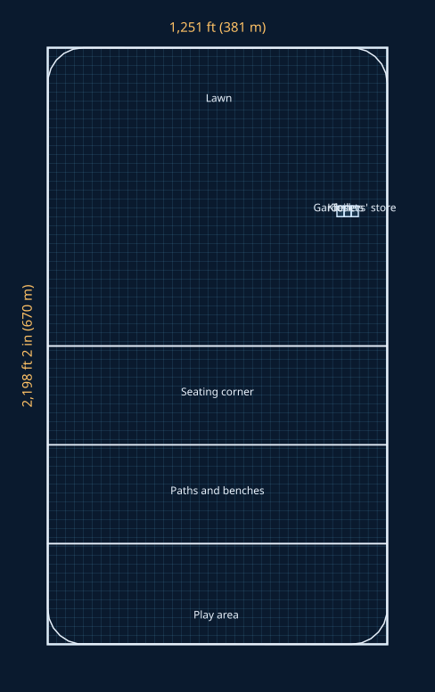

# P6-22 Pocket Park 6: plan

Footprint 1,251 ft (381 m) × 2,198 ft 2 in (670 m) · structural grid 32 ft 10 in (10 m)

## Levels

| Level | Floor above deck | Height | Floor area |
|---|---|---|---|
| Level 1 · Ground | 0 ft (0 mm) | 13 ft 1 in (4,000 mm) | 3,100 sq ft (288 m²) |

## Elements

| ID | Designation | Type | Name | Level(s) | Size / length | Area | Status |
|---|---|---|---|---|---|---|---|
| E001 | D5F4P6B5A2R1 | zone | Lawn | L1 | 1,250 ft 4 in (381 m) × 1,099 ft 1 in (335 m) | 1,365,303 sq ft (126,841 m²) | proposed |
| E002 | D5F4P6B5A2R2 | room | Kiosk | L1 | 26 ft 3 in (8,000 mm) × 39 ft 4 in (12 m) | 1,033 sq ft (96 m²) | proposed |
| E003 | D5F4P6B5A2R3 | room | Toilets | L1 | 26 ft 3 in (8,000 mm) × 39 ft 4 in (12 m) | 1,033 sq ft (96 m²) | proposed |
| E004 | D5F4P6B5A2R4 | room | Gardeners' store | L1 | 26 ft 3 in (8,000 mm) × 39 ft 4 in (12 m) | 1,033 sq ft (96 m²) | proposed |
| E005 | D5F4P6B5A2R5 | zone | Seating corner | L1 | 1,250 ft (381 m) × 364 ft 2 in (111 m) | 455,097 sq ft (42,280 m²) | proposed |
| E006 | D5F4P6B5A2R6 | zone | Paths and benches | L1 | 1,250 ft (381 m) × 364 ft 2 in (111 m) | 455,157 sq ft (42,285 m²) | proposed |
| E007 | D5F4P6B5A2R7 | zone | Play area | L1 | 1,250 ft (381 m) × 370 ft 9 in (113 m) | 455,135 sq ft (42,283 m²) | proposed |

## Drawings

### Level 1 · Ground

