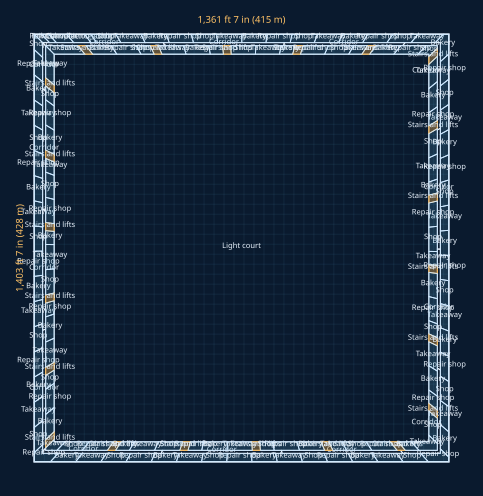
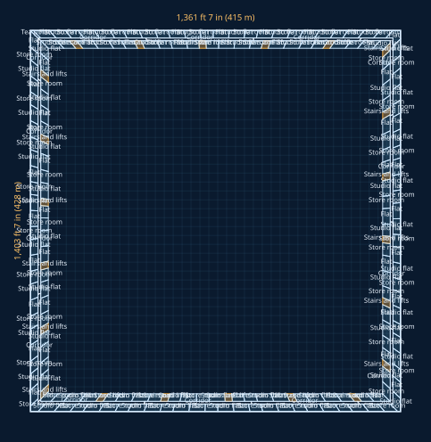

# P6-25 Dockside Shops 8: plan

Footprint 1,361 ft 7 in (415 m) × 1,403 ft 7 in (428 m) · structural grid 32 ft 10 in (10 m)

## Levels

| Level | Floor above deck | Height | Floor area |
|---|---|---|---|
| Level 1 · Shop floor | 0 ft (0 mm) | 16 ft 5 in (5,000 mm) | 277,709 sq ft (25,800 m²) |
| Level 2 · Upper floor | 16 ft 5 in (5,000 mm) | 13 ft 1 in (4,000 mm) | 277,673 sq ft (25,797 m²) |

## Elements

| ID | Designation | Type | Name | Level(s) | Size / length | Area | Status |
|---|---|---|---|---|---|---|---|
| E001 | D5F4P6B11A3L1R1 | zone | Light court | L1 | 1,230 ft 4 in (375 m) × 1,272 ft 4 in (388 m) | 1,565,342 sq ft (145,425 m²) | proposed |
| E002 | D5F4P6B11A3L1R2 | zone | Corridor | L1 | 400 ft 7 in (122 m) × 9 ft 10 in (3,000 mm) | 3,875 sq ft (360 m²) | proposed |
| E003 | D5F4P6B11A3L1R3 | zone | Corridor | L1 | 396 ft 8 in (121 m) × 9 ft 10 in (3,000 mm) | 3,875 sq ft (360 m²) | proposed |
| E004 | D5F4P6B11A3L1R4 | zone | Corridor | L1 | 398 ft 7 in (122 m) × 9 ft 10 in (3,000 mm) | 3,875 sq ft (360 m²) | proposed |
| E005 | D5F4P6B11A3L1R5 | zone | Corridor | L1 | 123 ft 8 in (38 m) × 286 ft 9 in (87 m) | 3,875 sq ft (360 m²) | proposed |
| E006 | D5F4P6B11A3L1R6 | zone | Corridor | L1 | 9 ft 10 in (3,000 mm) × 396 ft 8 in (121 m) | 3,875 sq ft (360 m²) | proposed |
| E007 | D5F4P6B11A3L1R7 | zone | Corridor | L1 | 9 ft 10 in (3,000 mm) × 396 ft 8 in (121 m) | 3,875 sq ft (360 m²) | proposed |
| E008 | D5F4P6B11A3L1R8 | zone | Corridor | L1 | 130 ft 11 in (40 m) × 279 ft 6 in (85 m) | 3,875 sq ft (360 m²) | proposed |
| E009 | D5F4P6B11A3L1R9 | zone | Corridor | L1 | 398 ft 7 in (122 m) × 9 ft 10 in (3,000 mm) | 3,875 sq ft (360 m²) | proposed |
| E010 | D5F4P6B11A3L1R10 | zone | Corridor | L1 | 396 ft 8 in (121 m) × 9 ft 10 in (3,000 mm) | 3,875 sq ft (360 m²) | proposed |
| E011 | D5F4P6B11A3L1R11 | zone | Corridor | L1 | 393 ft 4 in (120 m) × 17 ft 1 in (5,200 mm) | 3,875 sq ft (360 m²) | proposed |
| E012 | D5F4P6B11A3L1R12 | zone | Corridor | L1 | 9 ft 10 in (3,000 mm) × 400 ft 7 in (122 m) | 3,875 sq ft (360 m²) | proposed |
| E013 | D5F4P6B11A3L1R13 | zone | Corridor | L1 | 9 ft 10 in (3,000 mm) × 396 ft 8 in (121 m) | 3,875 sq ft (360 m²) | proposed |
| E014 | D5F4P6B11A3L1R14 | zone | Corridor | L1 | 9 ft 10 in (3,000 mm) × 398 ft 7 in (122 m) | 3,875 sq ft (360 m²) | proposed |
| E015 | D5F4P6B11A3L1R15 | zone | Corridor | L1 | 9 ft 10 in (3,000 mm) × 158 ft 6 in (48 m) | 1,473 sq ft (137 m²) | proposed |
| E016 | D5F4P6B11A3L1R16, D5F4P6B11A3L2R1 | core | Stairs and lifts | L1, L2 | 49 ft 3 in (15 m) × 27 ft 11 in (8,500 mm) | 737 sq ft (68 m²) | proposed |
| E017 | D5F4P6B11A3L1R17, D5F4P6B11A3L2R2 | core | Stairs and lifts | L1, L2 | 38 ft 9 in (12 m) × 27 ft 11 in (8,500 mm) | 732 sq ft (68 m²) | proposed |
| E018 | D5F4P6B11A3L1R18, D5F4P6B11A3L2R3 | core | Stairs and lifts | L1, L2 | 28 ft 3 in (8,600 mm) × 27 ft 11 in (8,500 mm) | 727 sq ft (68 m²) | proposed |
| E019 | D5F4P6B11A3L1R19, D5F4P6B11A3L2R4 | core | Stairs and lifts | L1, L2 | 34 ft 5 in (10 m) × 27 ft 11 in (8,500 mm) | 732 sq ft (68 m²) | proposed |
| E020 | D5F4P6B11A3L1R20, D5F4P6B11A3L2R5 | core | Stairs and lifts | L1, L2 | 44 ft 11 in (14 m) × 27 ft 11 in (8,500 mm) | 732 sq ft (68 m²) | proposed |
| E021 | D5F4P6B11A3L1R21, D5F4P6B11A3L2R6 | core | Stairs and lifts | L1, L2 | 27 ft 11 in (8,500 mm) × 53 ft 2 in (16 m) | 732 sq ft (68 m²) | proposed |
| E022 | D5F4P6B11A3L1R22, D5F4P6B11A3L2R7 | core | Stairs and lifts | L1, L2 | 27 ft 11 in (8,500 mm) × 43 ft (13 m) | 727 sq ft (68 m²) | proposed |
| E023 | D5F4P6B11A3L1R23, D5F4P6B11A3L2R8 | core | Stairs and lifts | L1, L2 | 27 ft 11 in (8,500 mm) × 33 ft 2 in (10 m) | 727 sq ft (68 m²) | proposed |
| E024 | D5F4P6B11A3L1R24, D5F4P6B11A3L2R9 | core | Stairs and lifts | L1, L2 | 27 ft 11 in (8,500 mm) × 29 ft 2 in (8,900 mm) | 732 sq ft (68 m²) | proposed |
| E025 | D5F4P6B11A3L1R25, D5F4P6B11A3L2R10 | core | Stairs and lifts | L1, L2 | 27 ft 11 in (8,500 mm) × 39 ft 4 in (12 m) | 737 sq ft (68 m²) | proposed |
| E026 | D5F4P6B11A3L1R26, D5F4P6B11A3L2R11 | core | Stairs and lifts | L1, L2 | 27 ft 11 in (8,500 mm) × 49 ft 3 in (15 m) | 732 sq ft (68 m²) | proposed |
| E027 | D5F4P6B11A3L1R27, D5F4P6B11A3L2R12 | core | Stairs and lifts | L1, L2 | 49 ft 3 in (15 m) × 27 ft 11 in (8,500 mm) | 737 sq ft (68 m²) | proposed |
| E028 | D5F4P6B11A3L1R28, D5F4P6B11A3L2R13 | core | Stairs and lifts | L1, L2 | 38 ft 9 in (12 m) × 27 ft 11 in (8,500 mm) | 732 sq ft (68 m²) | proposed |
| E029 | D5F4P6B11A3L1R29, D5F4P6B11A3L2R14 | core | Stairs and lifts | L1, L2 | 28 ft 3 in (8,600 mm) × 27 ft 11 in (8,500 mm) | 727 sq ft (68 m²) | proposed |
| E030 | D5F4P6B11A3L1R30, D5F4P6B11A3L2R15 | core | Stairs and lifts | L1, L2 | 34 ft 5 in (10 m) × 27 ft 11 in (8,500 mm) | 732 sq ft (68 m²) | proposed |
| E031 | D5F4P6B11A3L1R31, D5F4P6B11A3L2R16 | core | Stairs and lifts | L1, L2 | 44 ft 11 in (14 m) × 27 ft 11 in (8,500 mm) | 732 sq ft (68 m²) | proposed |
| E032 | D5F4P6B11A3L1R32, D5F4P6B11A3L2R17 | core | Stairs and lifts | L1, L2 | 27 ft 11 in (8,500 mm) × 53 ft 2 in (16 m) | 732 sq ft (68 m²) | proposed |
| E033 | D5F4P6B11A3L1R33, D5F4P6B11A3L2R18 | core | Stairs and lifts | L1, L2 | 27 ft 11 in (8,500 mm) × 43 ft (13 m) | 727 sq ft (68 m²) | proposed |
| E034 | D5F4P6B11A3L1R34, D5F4P6B11A3L2R19 | core | Stairs and lifts | L1, L2 | 27 ft 11 in (8,500 mm) × 33 ft 2 in (10 m) | 727 sq ft (68 m²) | proposed |
| E035 | D5F4P6B11A3L1R35, D5F4P6B11A3L2R20 | core | Stairs and lifts | L1, L2 | 27 ft 11 in (8,500 mm) × 29 ft 2 in (8,900 mm) | 732 sq ft (68 m²) | proposed |
| E036 | D5F4P6B11A3L1R36, D5F4P6B11A3L2R21 | core | Stairs and lifts | L1, L2 | 27 ft 11 in (8,500 mm) × 39 ft 4 in (12 m) | 737 sq ft (68 m²) | proposed |
| E037 | D5F4P6B11A3L1R37, D5F4P6B11A3L2R22 | core | Stairs and lifts | L1, L2 | 27 ft 11 in (8,500 mm) × 49 ft 3 in (15 m) | 732 sq ft (68 m²) | proposed |
| E038 | D5F4P6B11A3L1R38 | room | Toilets | L1 | 50 ft 6 in (15 m) × 27 ft 11 in (8,500 mm) | 645 sq ft (60 m²) | proposed |
| E039 | D5F4P6B11A3L1R39 | room | Pawn shop | L1 | 49 ft 6 in (15 m) × 27 ft 11 in (8,500 mm) | 645 sq ft (60 m²) | proposed |
| E040 | D5F4P6B11A3L1R40 | room | Chandler | L1 | 82 ft 8 in (25 m) × 27 ft 11 in (8,500 mm) | 1,615 sq ft (150 m²) | proposed |
| E041 | D5F4P6B11A3L1R41 | room | Convenience store | L1 | 80 ft 5 in (24 m) × 27 ft 11 in (8,500 mm) | 1,615 sq ft (150 m²) | proposed |
| E042 | D5F4P6B11A3L1R42 | room | Tattoo studio | L1 | 40 ft (12 m) × 27 ft 11 in (8,500 mm) | 540 sq ft (50 m²) | proposed |
| E043 | D5F4P6B11A3L1R43 | room | Shop | L1 | 99 ft 5 in (30 m) × 27 ft 11 in (8,500 mm) | 2,260 sq ft (210 m²) | proposed |
| E044 | D5F4P6B11A3L1R44 | room | Takeaway | L1 | 96 ft 2 in (29 m) × 27 ft 11 in (8,500 mm) | 2,260 sq ft (210 m²) | proposed |
| E045 | D5F4P6B11A3L1R45 | room | Bakery | L1 | 92 ft 10 in (28 m) × 27 ft 11 in (8,500 mm) | 2,260 sq ft (210 m²) | proposed |
| E046 | D5F4P6B11A3L1R46 | room | Repair shop | L1 | 89 ft 7 in (27 m) × 27 ft 11 in (8,500 mm) | 2,260 sq ft (210 m²) | proposed |
| E047 | D5F4P6B11A3L1R47 | room | Shop | L1 | 86 ft 3 in (26 m) × 27 ft 11 in (8,500 mm) | 2,264 sq ft (210 m²) | proposed |
| E048 | D5F4P6B11A3L1R48 | room | Takeaway | L1 | 82 ft 8 in (25 m) × 27 ft 11 in (8,500 mm) | 2,260 sq ft (210 m²) | proposed |
| E049 | D5F4P6B11A3L1R49 | room | Bakery | L1 | 82 ft 8 in (25 m) × 27 ft 11 in (8,500 mm) | 2,260 sq ft (210 m²) | proposed |
| E050 | D5F4P6B11A3L1R50 | room | Repair shop | L1 | 85 ft 11 in (26 m) × 27 ft 11 in (8,500 mm) | 2,260 sq ft (210 m²) | proposed |
| E051 | D5F4P6B11A3L1R51 | room | Shop | L1 | 89 ft 7 in (27 m) × 27 ft 11 in (8,500 mm) | 2,260 sq ft (210 m²) | proposed |
| E052 | D5F4P6B11A3L1R52 | room | Takeaway | L1 | 93 ft 2 in (28 m) × 27 ft 11 in (8,500 mm) | 2,260 sq ft (210 m²) | proposed |
| E053 | D5F4P6B11A3L1R53 | room | Bakery | L1 | 96 ft 5 in (29 m) × 27 ft 11 in (8,500 mm) | 2,260 sq ft (210 m²) | proposed |
| E054 | D5F4P6B11A3L1R54 | room | Repair shop | L1 | 99 ft 9 in (30 m) × 27 ft 11 in (8,500 mm) | 2,260 sq ft (210 m²) | proposed |
| E055 | D5F4P6B11A3L1R55 | room | Shop | L1 | 103 ft (31 m) × 27 ft 11 in (8,500 mm) | 2,260 sq ft (210 m²) | proposed |
| E056 | D5F4P6B11A3L1R56 | room | Takeaway | L1 | 106 ft 8 in (32 m) × 27 ft 11 in (8,500 mm) | 2,264 sq ft (210 m²) | proposed |
| E057 | D5F4P6B11A3L1R57 | room | Bakery | L1 | 44 ft 11 in (14 m) × 90 ft 3 in (28 m) | 2,260 sq ft (210 m²) | proposed |
| E058 | D5F4P6B11A3L1R58 | room | Repair shop | L1 | 27 ft 11 in (8,500 mm) × 104 ft 8 in (32 m) | 2,260 sq ft (210 m²) | proposed |
| E059 | D5F4P6B11A3L1R59 | room | Shop | L1 | 27 ft 11 in (8,500 mm) × 101 ft 5 in (31 m) | 2,260 sq ft (210 m²) | proposed |
| E060 | D5F4P6B11A3L1R60 | room | Takeaway | L1 | 27 ft 11 in (8,500 mm) × 98 ft 1 in (30 m) | 2,260 sq ft (210 m²) | proposed |
| E061 | D5F4P6B11A3L1R61 | room | Bakery | L1 | 27 ft 11 in (8,500 mm) × 94 ft 10 in (29 m) | 2,260 sq ft (210 m²) | proposed |
| E062 | D5F4P6B11A3L1R62 | room | Repair shop | L1 | 27 ft 11 in (8,500 mm) × 91 ft 6 in (28 m) | 2,260 sq ft (210 m²) | proposed |
| E063 | D5F4P6B11A3L1R63 | room | Shop | L1 | 27 ft 11 in (8,500 mm) × 88 ft 3 in (27 m) | 2,260 sq ft (210 m²) | proposed |
| E064 | D5F4P6B11A3L1R64 | room | Takeaway | L1 | 27 ft 11 in (8,500 mm) × 85 ft (26 m) | 2,260 sq ft (210 m²) | proposed |
| E065 | D5F4P6B11A3L1R65 | room | Bakery | L1 | 27 ft 11 in (8,500 mm) × 82 ft 8 in (25 m) | 2,260 sq ft (210 m²) | proposed |
| E066 | D5F4P6B11A3L1R66 | room | Repair shop | L1 | 27 ft 11 in (8,500 mm) × 83 ft 8 in (26 m) | 2,260 sq ft (210 m²) | proposed |
| E067 | D5F4P6B11A3L1R67 | room | Shop | L1 | 27 ft 11 in (8,500 mm) × 86 ft 11 in (26 m) | 2,260 sq ft (210 m²) | proposed |
| E068 | D5F4P6B11A3L1R68 | room | Takeaway | L1 | 27 ft 11 in (8,500 mm) × 90 ft 3 in (28 m) | 2,260 sq ft (210 m²) | proposed |
| E069 | D5F4P6B11A3L1R69 | room | Bakery | L1 | 27 ft 11 in (8,500 mm) × 93 ft 10 in (29 m) | 2,269 sq ft (211 m²) | proposed |
| E070 | D5F4P6B11A3L1R70 | room | Repair shop | L1 | 27 ft 11 in (8,500 mm) × 96 ft 9 in (30 m) | 2,260 sq ft (210 m²) | proposed |
| E071 | D5F4P6B11A3L1R71 | room | Shop | L1 | 27 ft 11 in (8,500 mm) × 100 ft 1 in (30 m) | 2,260 sq ft (210 m²) | proposed |
| E072 | D5F4P6B11A3L1R72 | room | Takeaway | L1 | 27 ft 11 in (8,500 mm) × 103 ft 4 in (32 m) | 2,260 sq ft (210 m²) | proposed |
| E073 | D5F4P6B11A3L1R73 | room | Bakery | L1 | 27 ft 11 in (8,500 mm) × 106 ft 8 in (32 m) | 2,260 sq ft (210 m²) | proposed |
| E074 | D5F4P6B11A3L1R74 | room | Repair shop | L1 | 92 ft 6 in (28 m) × 42 ft 8 in (13 m) | 2,260 sq ft (210 m²) | proposed |
| E075 | D5F4P6B11A3L1R75 | room | Shop | L1 | 104 ft 8 in (32 m) × 27 ft 11 in (8,500 mm) | 2,260 sq ft (210 m²) | proposed |
| E076 | D5F4P6B11A3L1R76 | room | Takeaway | L1 | 101 ft 1 in (31 m) × 27 ft 11 in (8,500 mm) | 2,255 sq ft (210 m²) | proposed |
| E077 | D5F4P6B11A3L1R77 | room | Bakery | L1 | 97 ft 9 in (30 m) × 27 ft 11 in (8,500 mm) | 2,264 sq ft (210 m²) | proposed |
| E078 | D5F4P6B11A3L1R78 | room | Repair shop | L1 | 94 ft 2 in (29 m) × 27 ft 11 in (8,500 mm) | 2,260 sq ft (210 m²) | proposed |
| E079 | D5F4P6B11A3L1R79 | room | Shop | L1 | 90 ft 11 in (28 m) × 27 ft 11 in (8,500 mm) | 2,260 sq ft (210 m²) | proposed |
| E080 | D5F4P6B11A3L1R80 | room | Takeaway | L1 | 87 ft 7 in (27 m) × 27 ft 11 in (8,500 mm) | 2,260 sq ft (210 m²) | proposed |
| E081 | D5F4P6B11A3L1R81 | room | Bakery | L1 | 84 ft 4 in (26 m) × 27 ft 11 in (8,500 mm) | 2,264 sq ft (210 m²) | proposed |
| E082 | D5F4P6B11A3L1R82 | room | Repair shop | L1 | 82 ft 8 in (25 m) × 27 ft 11 in (8,500 mm) | 2,260 sq ft (210 m²) | proposed |
| E083 | D5F4P6B11A3L1R83 | room | Shop | L1 | 84 ft 8 in (26 m) × 27 ft 11 in (8,500 mm) | 2,260 sq ft (210 m²) | proposed |
| E084 | D5F4P6B11A3L1R84 | room | Takeaway | L1 | 87 ft 11 in (27 m) × 27 ft 11 in (8,500 mm) | 2,260 sq ft (210 m²) | proposed |
| E085 | D5F4P6B11A3L1R85 | room | Bakery | L1 | 91 ft 2 in (28 m) × 27 ft 11 in (8,500 mm) | 2,255 sq ft (210 m²) | proposed |
| E086 | D5F4P6B11A3L1R86 | room | Repair shop | L1 | 95 ft 2 in (29 m) × 27 ft 11 in (8,500 mm) | 2,264 sq ft (210 m²) | proposed |
| E087 | D5F4P6B11A3L1R87 | room | Shop | L1 | 98 ft 5 in (30 m) × 27 ft 11 in (8,500 mm) | 2,260 sq ft (210 m²) | proposed |
| E088 | D5F4P6B11A3L1R88 | room | Takeaway | L1 | 101 ft 8 in (31 m) × 27 ft 11 in (8,500 mm) | 2,260 sq ft (210 m²) | proposed |
| E089 | D5F4P6B11A3L1R89 | room | Bakery | L1 | 105 ft (32 m) × 27 ft 11 in (8,500 mm) | 2,260 sq ft (210 m²) | proposed |
| E090 | D5F4P6B11A3L1R90 | room | Repair shop | L1 | 78 ft 9 in (24 m) × 56 ft 5 in (17 m) | 2,264 sq ft (210 m²) | proposed |
| E091 | D5F4P6B11A3L1R91 | room | Shop | L1 | 27 ft 11 in (8,500 mm) × 106 ft (32 m) | 2,260 sq ft (210 m²) | proposed |
| E092 | D5F4P6B11A3L1R92 | room | Takeaway | L1 | 27 ft 11 in (8,500 mm) × 102 ft 8 in (31 m) | 2,260 sq ft (210 m²) | proposed |
| E093 | D5F4P6B11A3L1R93 | room | Bakery | L1 | 27 ft 11 in (8,500 mm) × 99 ft 5 in (30 m) | 2,260 sq ft (210 m²) | proposed |
| E094 | D5F4P6B11A3L1R94 | room | Repair shop | L1 | 27 ft 11 in (8,500 mm) × 96 ft 2 in (29 m) | 2,260 sq ft (210 m²) | proposed |
| E095 | D5F4P6B11A3L1R95 | room | Shop | L1 | 27 ft 11 in (8,500 mm) × 92 ft 10 in (28 m) | 2,260 sq ft (210 m²) | proposed |
| E096 | D5F4P6B11A3L1R96 | room | Takeaway | L1 | 27 ft 11 in (8,500 mm) × 89 ft 7 in (27 m) | 2,260 sq ft (210 m²) | proposed |
| E097 | D5F4P6B11A3L1R97 | room | Bakery | L1 | 27 ft 11 in (8,500 mm) × 86 ft 3 in (26 m) | 2,260 sq ft (210 m²) | proposed |
| E098 | D5F4P6B11A3L1R98 | room | Repair shop | L1 | 27 ft 11 in (8,500 mm) × 83 ft (25 m) | 2,260 sq ft (210 m²) | proposed |
| E099 | D5F4P6B11A3L1R99 | room | Shop | L1 | 27 ft 11 in (8,500 mm) × 82 ft 8 in (25 m) | 2,260 sq ft (210 m²) | proposed |
| E100 | D5F4P6B11A3L1R100 | room | Takeaway | L1 | 27 ft 11 in (8,500 mm) × 85 ft 8 in (26 m) | 2,260 sq ft (210 m²) | proposed |
| E101 | D5F4P6B11A3L1R101 | room | Bakery | L1 | 27 ft 11 in (8,500 mm) × 88 ft 11 in (27 m) | 2,264 sq ft (210 m²) | proposed |
| E102 | D5F4P6B11A3L1R102 | room | Repair shop | L1 | 27 ft 11 in (8,500 mm) × 91 ft 10 in (28 m) | 2,260 sq ft (210 m²) | proposed |
| E103 | D5F4P6B11A3L1R103 | room | Shop | L1 | 27 ft 11 in (8,500 mm) × 95 ft 2 in (29 m) | 2,260 sq ft (210 m²) | proposed |
| E104 | D5F4P6B11A3L1R104 | room | Takeaway | L1 | 27 ft 11 in (8,500 mm) × 98 ft 9 in (30 m) | 2,264 sq ft (210 m²) | proposed |
| E105 | D5F4P6B11A3L1R105 | room | Bakery | L1 | 27 ft 11 in (8,500 mm) × 102 ft (31 m) | 2,260 sq ft (210 m²) | proposed |
| E106 | D5F4P6B11A3L1R106 | room | Repair shop | L1 | 27 ft 11 in (8,500 mm) × 105 ft 4 in (32 m) | 2,260 sq ft (210 m²) | proposed |
| E107 | D5F4P6B11A3L1R107 | room | Shop | L1 | 27 ft 11 in (8,500 mm) × 76 ft 5 in (23 m) | 1,382 sq ft (128 m²) | proposed |
| E108 | D5F4P6B11A3L1R108 | room | Takeaway | L1 | 128 ft 7 in (39 m) × 27 ft 11 in (8,500 mm) | 2,873 sq ft (267 m²) | proposed |
| E109 | D5F4P6B11A3L1R109 | room | Bakery | L1 | 101 ft 5 in (31 m) × 27 ft 11 in (8,500 mm) | 2,260 sq ft (210 m²) | proposed |
| E110 | D5F4P6B11A3L1R110 | room | Repair shop | L1 | 97 ft 9 in (30 m) × 27 ft 11 in (8,500 mm) | 2,260 sq ft (210 m²) | proposed |
| E111 | D5F4P6B11A3L1R111 | room | Shop | L1 | 58 ft 5 in (18 m) × 27 ft 11 in (8,500 mm) | 1,235 sq ft (115 m²) | proposed |
| E112 | D5F4P6B11A3L1R112 | room | Takeaway | L1 | 90 ft 11 in (28 m) × 27 ft 11 in (8,500 mm) | 2,255 sq ft (210 m²) | proposed |
| E113 | D5F4P6B11A3L1R113 | room | Bakery | L1 | 87 ft 7 in (27 m) × 27 ft 11 in (8,500 mm) | 2,264 sq ft (210 m²) | proposed |
| E114 | D5F4P6B11A3L1R114 | room | Repair shop | L1 | 47 ft 11 in (15 m) × 27 ft 11 in (8,500 mm) | 1,235 sq ft (115 m²) | proposed |
| E115 | D5F4P6B11A3L1R115 | room | Shop | L1 | 83 ft (25 m) × 27 ft 11 in (8,500 mm) | 2,264 sq ft (210 m²) | proposed |
| E116 | D5F4P6B11A3L1R116 | room | Takeaway | L1 | 85 ft (26 m) × 27 ft 11 in (8,500 mm) | 2,260 sq ft (210 m²) | proposed |
| E117 | D5F4P6B11A3L1R117 | room | Bakery | L1 | 50 ft 10 in (16 m) × 27 ft 11 in (8,500 mm) | 1,231 sq ft (114 m²) | proposed |
| E118 | D5F4P6B11A3L1R118 | room | Repair shop | L1 | 91 ft 10 in (28 m) × 27 ft 11 in (8,500 mm) | 2,264 sq ft (210 m²) | proposed |
| E119 | D5F4P6B11A3L1R119 | room | Shop | L1 | 95 ft 2 in (29 m) × 27 ft 11 in (8,500 mm) | 2,255 sq ft (210 m²) | proposed |
| E120 | D5F4P6B11A3L1R120 | room | Takeaway | L1 | 61 ft 4 in (19 m) × 27 ft 11 in (8,500 mm) | 1,235 sq ft (115 m²) | proposed |
| E121 | D5F4P6B11A3L1R121 | room | Bakery | L1 | 102 ft (31 m) × 27 ft 11 in (8,500 mm) | 2,260 sq ft (210 m²) | proposed |
| E122 | D5F4P6B11A3L1R122 | room | Repair shop | L1 | 105 ft 8 in (32 m) × 27 ft 11 in (8,500 mm) | 2,264 sq ft (210 m²) | proposed |
| E123 | D5F4P6B11A3L1R123 | room | Shop | L1 | 63 ft 4 in (19 m) × 35 ft 5 in (11 m) | 1,231 sq ft (114 m²) | proposed |
| E124 | D5F4P6B11A3L1R124 | room | Takeaway | L1 | 27 ft 11 in (8,500 mm) × 106 ft (32 m) | 2,264 sq ft (210 m²) | proposed |
| E125 | D5F4P6B11A3L1R125 | room | Bakery | L1 | 27 ft 11 in (8,500 mm) × 102 ft (31 m) | 2,255 sq ft (210 m²) | proposed |
| E126 | D5F4P6B11A3L1R126 | room | Repair shop | L1 | 27 ft 11 in (8,500 mm) × 62 ft 8 in (19 m) | 1,235 sq ft (115 m²) | proposed |
| E127 | D5F4P6B11A3L1R127 | room | Shop | L1 | 27 ft 11 in (8,500 mm) × 95 ft 10 in (29 m) | 2,264 sq ft (210 m²) | proposed |
| E128 | D5F4P6B11A3L1R128 | room | Takeaway | L1 | 27 ft 11 in (8,500 mm) × 92 ft 2 in (28 m) | 2,260 sq ft (210 m²) | proposed |
| E129 | D5F4P6B11A3L1R129 | room | Bakery | L1 | 27 ft 11 in (8,500 mm) × 52 ft 10 in (16 m) | 1,235 sq ft (115 m²) | proposed |
| E130 | D5F4P6B11A3L1R130 | room | Repair shop | L1 | 27 ft 11 in (8,500 mm) × 85 ft 11 in (26 m) | 2,264 sq ft (210 m²) | proposed |
| E131 | D5F4P6B11A3L1R131 | room | Shop | L1 | 27 ft 11 in (8,500 mm) × 82 ft 8 in (25 m) | 2,260 sq ft (210 m²) | proposed |
| E132 | D5F4P6B11A3L1R132 | room | Takeaway | L1 | 27 ft 11 in (8,500 mm) × 45 ft 7 in (14 m) | 1,235 sq ft (115 m²) | proposed |
| E133 | D5F4P6B11A3L1R133 | room | Bakery | L1 | 27 ft 11 in (8,500 mm) × 86 ft 3 in (26 m) | 2,260 sq ft (210 m²) | proposed |
| E134 | D5F4P6B11A3L1R134 | room | Repair shop | L1 | 27 ft 11 in (8,500 mm) × 89 ft 7 in (27 m) | 2,255 sq ft (210 m²) | proposed |
| E135 | D5F4P6B11A3L1R135 | room | Shop | L1 | 27 ft 11 in (8,500 mm) × 55 ft 9 in (17 m) | 1,235 sq ft (115 m²) | proposed |
| E136 | D5F4P6B11A3L1R136 | room | Takeaway | L1 | 27 ft 11 in (8,500 mm) × 96 ft 2 in (29 m) | 2,255 sq ft (210 m²) | proposed |
| E137 | D5F4P6B11A3L1R137 | room | Bakery | L1 | 27 ft 11 in (8,500 mm) × 99 ft 9 in (30 m) | 2,260 sq ft (210 m²) | proposed |
| E138 | D5F4P6B11A3L1R138 | room | Repair shop | L1 | 27 ft 11 in (8,500 mm) × 65 ft 7 in (20 m) | 1,235 sq ft (115 m²) | proposed |
| E139 | D5F4P6B11A3L1R139 | room | Shop | L1 | 27 ft 11 in (8,500 mm) × 106 ft 4 in (32 m) | 2,260 sq ft (210 m²) | proposed |
| E140 | D5F4P6B11A3L1R140 | room | Takeaway | L1 | 85 ft 8 in (26 m) × 49 ft 6 in (15 m) | 2,264 sq ft (210 m²) | proposed |
| E141 | D5F4P6B11A3L1R141 | room | Bakery | L1 | 68 ft 3 in (21 m) × 27 ft 11 in (8,500 mm) | 1,226 sq ft (114 m²) | proposed |
| E142 | D5F4P6B11A3L1R142 | room | Repair shop | L1 | 101 ft 5 in (31 m) × 27 ft 11 in (8,500 mm) | 2,260 sq ft (210 m²) | proposed |
| E143 | D5F4P6B11A3L1R143 | room | Shop | L1 | 97 ft 9 in (30 m) × 27 ft 11 in (8,500 mm) | 2,260 sq ft (210 m²) | proposed |
| E144 | D5F4P6B11A3L1R144 | room | Takeaway | L1 | 58 ft 5 in (18 m) × 27 ft 11 in (8,500 mm) | 1,235 sq ft (115 m²) | proposed |
| E145 | D5F4P6B11A3L1R145 | room | Bakery | L1 | 90 ft 11 in (28 m) × 27 ft 11 in (8,500 mm) | 2,255 sq ft (210 m²) | proposed |
| E146 | D5F4P6B11A3L1R146 | room | Repair shop | L1 | 87 ft 7 in (27 m) × 27 ft 11 in (8,500 mm) | 2,264 sq ft (210 m²) | proposed |
| E147 | D5F4P6B11A3L1R147 | room | Shop | L1 | 47 ft 11 in (15 m) × 27 ft 11 in (8,500 mm) | 1,235 sq ft (115 m²) | proposed |
| E148 | D5F4P6B11A3L1R148 | room | Takeaway | L1 | 83 ft (25 m) × 27 ft 11 in (8,500 mm) | 2,264 sq ft (210 m²) | proposed |
| E149 | D5F4P6B11A3L1R149 | room | Bakery | L1 | 85 ft (26 m) × 27 ft 11 in (8,500 mm) | 2,260 sq ft (210 m²) | proposed |
| E150 | D5F4P6B11A3L1R150 | room | Repair shop | L1 | 50 ft 10 in (16 m) × 27 ft 11 in (8,500 mm) | 1,231 sq ft (114 m²) | proposed |
| E151 | D5F4P6B11A3L1R151 | room | Shop | L1 | 91 ft 10 in (28 m) × 27 ft 11 in (8,500 mm) | 2,264 sq ft (210 m²) | proposed |
| E152 | D5F4P6B11A3L1R152 | room | Takeaway | L1 | 95 ft 2 in (29 m) × 27 ft 11 in (8,500 mm) | 2,255 sq ft (210 m²) | proposed |
| E153 | D5F4P6B11A3L1R153 | room | Bakery | L1 | 61 ft 4 in (19 m) × 27 ft 11 in (8,500 mm) | 1,235 sq ft (115 m²) | proposed |
| E154 | D5F4P6B11A3L1R154 | room | Repair shop | L1 | 102 ft (31 m) × 27 ft 11 in (8,500 mm) | 2,260 sq ft (210 m²) | proposed |
| E155 | D5F4P6B11A3L1R155 | room | Shop | L1 | 105 ft 8 in (32 m) × 27 ft 11 in (8,500 mm) | 2,264 sq ft (210 m²) | proposed |
| E156 | D5F4P6B11A3L1R156 | room | Takeaway | L1 | 63 ft 4 in (19 m) × 35 ft 5 in (11 m) | 1,231 sq ft (114 m²) | proposed |
| E157 | D5F4P6B11A3L1R157 | room | Bakery | L1 | 27 ft 11 in (8,500 mm) × 106 ft (32 m) | 2,264 sq ft (210 m²) | proposed |
| E158 | D5F4P6B11A3L1R158 | room | Repair shop | L1 | 27 ft 11 in (8,500 mm) × 102 ft (31 m) | 2,255 sq ft (210 m²) | proposed |
| E159 | D5F4P6B11A3L1R159 | room | Shop | L1 | 27 ft 11 in (8,500 mm) × 62 ft 8 in (19 m) | 1,235 sq ft (115 m²) | proposed |
| E160 | D5F4P6B11A3L1R160 | room | Takeaway | L1 | 27 ft 11 in (8,500 mm) × 95 ft 10 in (29 m) | 2,264 sq ft (210 m²) | proposed |
| E161 | D5F4P6B11A3L1R161 | room | Bakery | L1 | 27 ft 11 in (8,500 mm) × 92 ft 2 in (28 m) | 2,260 sq ft (210 m²) | proposed |
| E162 | D5F4P6B11A3L1R162 | room | Repair shop | L1 | 27 ft 11 in (8,500 mm) × 52 ft 10 in (16 m) | 1,235 sq ft (115 m²) | proposed |
| E163 | D5F4P6B11A3L1R163 | room | Shop | L1 | 27 ft 11 in (8,500 mm) × 85 ft 11 in (26 m) | 2,264 sq ft (210 m²) | proposed |
| E164 | D5F4P6B11A3L1R164 | room | Takeaway | L1 | 27 ft 11 in (8,500 mm) × 82 ft 8 in (25 m) | 2,260 sq ft (210 m²) | proposed |
| E165 | D5F4P6B11A3L1R165 | room | Bakery | L1 | 27 ft 11 in (8,500 mm) × 45 ft 7 in (14 m) | 1,235 sq ft (115 m²) | proposed |
| E166 | D5F4P6B11A3L1R166 | room | Repair shop | L1 | 27 ft 11 in (8,500 mm) × 86 ft 3 in (26 m) | 2,260 sq ft (210 m²) | proposed |
| E167 | D5F4P6B11A3L1R167 | room | Shop | L1 | 27 ft 11 in (8,500 mm) × 89 ft 7 in (27 m) | 2,255 sq ft (210 m²) | proposed |
| E168 | D5F4P6B11A3L1R168 | room | Takeaway | L1 | 27 ft 11 in (8,500 mm) × 55 ft 9 in (17 m) | 1,235 sq ft (115 m²) | proposed |
| E169 | D5F4P6B11A3L1R169 | room | Bakery | L1 | 27 ft 11 in (8,500 mm) × 96 ft 2 in (29 m) | 2,255 sq ft (210 m²) | proposed |
| E170 | D5F4P6B11A3L1R170 | room | Repair shop | L1 | 27 ft 11 in (8,500 mm) × 99 ft 9 in (30 m) | 2,260 sq ft (210 m²) | proposed |
| E171 | D5F4P6B11A3L1R171 | room | Shop | L1 | 27 ft 11 in (8,500 mm) × 65 ft 7 in (20 m) | 1,235 sq ft (115 m²) | proposed |
| E172 | D5F4P6B11A3L1R172 | room | Takeaway | L1 | 27 ft 11 in (8,500 mm) × 128 ft 11 in (39 m) | 2,877 sq ft (267 m²) | proposed |
| E173 | D5F4P6B11A3L2R23 | zone | Corridor | L2 | 400 ft 7 in (122 m) × 9 ft 10 in (3,000 mm) | 3,875 sq ft (360 m²) | proposed |
| E174 | D5F4P6B11A3L2R24 | zone | Corridor | L2 | 396 ft 8 in (121 m) × 9 ft 10 in (3,000 mm) | 3,875 sq ft (360 m²) | proposed |
| E175 | D5F4P6B11A3L2R25 | zone | Corridor | L2 | 398 ft 7 in (122 m) × 9 ft 10 in (3,000 mm) | 3,875 sq ft (360 m²) | proposed |
| E176 | D5F4P6B11A3L2R26 | zone | Corridor | L2 | 123 ft 8 in (38 m) × 286 ft 9 in (87 m) | 3,875 sq ft (360 m²) | proposed |
| E177 | D5F4P6B11A3L2R27 | zone | Corridor | L2 | 9 ft 10 in (3,000 mm) × 396 ft 8 in (121 m) | 3,875 sq ft (360 m²) | proposed |
| E178 | D5F4P6B11A3L2R28 | zone | Corridor | L2 | 9 ft 10 in (3,000 mm) × 396 ft 8 in (121 m) | 3,875 sq ft (360 m²) | proposed |
| E179 | D5F4P6B11A3L2R29 | zone | Corridor | L2 | 130 ft 11 in (40 m) × 279 ft 6 in (85 m) | 3,875 sq ft (360 m²) | proposed |
| E180 | D5F4P6B11A3L2R30 | zone | Corridor | L2 | 398 ft 7 in (122 m) × 9 ft 10 in (3,000 mm) | 3,875 sq ft (360 m²) | proposed |
| E181 | D5F4P6B11A3L2R31 | zone | Corridor | L2 | 396 ft 8 in (121 m) × 9 ft 10 in (3,000 mm) | 3,875 sq ft (360 m²) | proposed |
| E182 | D5F4P6B11A3L2R32 | zone | Corridor | L2 | 393 ft 4 in (120 m) × 17 ft 1 in (5,200 mm) | 3,875 sq ft (360 m²) | proposed |
| E183 | D5F4P6B11A3L2R33 | zone | Corridor | L2 | 9 ft 10 in (3,000 mm) × 400 ft 7 in (122 m) | 3,875 sq ft (360 m²) | proposed |
| E184 | D5F4P6B11A3L2R34 | zone | Corridor | L2 | 9 ft 10 in (3,000 mm) × 396 ft 8 in (121 m) | 3,875 sq ft (360 m²) | proposed |
| E185 | D5F4P6B11A3L2R35 | zone | Corridor | L2 | 9 ft 10 in (3,000 mm) × 398 ft 7 in (122 m) | 3,875 sq ft (360 m²) | proposed |
| E186 | D5F4P6B11A3L2R36 | zone | Corridor | L2 | 9 ft 10 in (3,000 mm) × 158 ft 6 in (48 m) | 1,473 sq ft (137 m²) | proposed |
| E187 | D5F4P6B11A3L2R37 | room | Tea point | L2 | 37 ft 5 in (11 m) × 27 ft 11 in (8,500 mm) | 274 sq ft (26 m²) | proposed |
| E188 | D5F4P6B11A3L2R38 | room | Flat | L2 | 84 ft (26 m) × 27 ft 11 in (8,500 mm) | 1,615 sq ft (150 m²) | proposed |
| E189 | D5F4P6B11A3L2R39 | room | Studio flat | L2 | 81 ft 8 in (25 m) × 27 ft 11 in (8,500 mm) | 1,615 sq ft (150 m²) | proposed |
| E190 | D5F4P6B11A3L2R40 | room | Store room | L2 | 67 ft 11 in (21 m) × 27 ft 11 in (8,500 mm) | 1,290 sq ft (120 m²) | proposed |
| E191 | D5F4P6B11A3L2R41 | room | Flat | L2 | 77 ft 5 in (24 m) × 27 ft 11 in (8,500 mm) | 1,615 sq ft (150 m²) | proposed |
| E192 | D5F4P6B11A3L2R42 | room | Studio flat | L2 | 75 ft 2 in (23 m) × 27 ft 11 in (8,500 mm) | 1,615 sq ft (150 m²) | proposed |
| E193 | D5F4P6B11A3L2R43 | room | Store room | L2 | 61 ft 4 in (19 m) × 27 ft 11 in (8,500 mm) | 1,295 sq ft (120 m²) | proposed |
| E194 | D5F4P6B11A3L2R44 | room | Flat | L2 | 70 ft 6 in (22 m) × 27 ft 11 in (8,500 mm) | 1,615 sq ft (150 m²) | proposed |
| E195 | D5F4P6B11A3L2R45 | room | Studio flat | L2 | 68 ft 3 in (21 m) × 27 ft 11 in (8,500 mm) | 1,615 sq ft (150 m²) | proposed |
| E196 | D5F4P6B11A3L2R46 | room | Store room | L2 | 54 ft 6 in (17 m) × 27 ft 11 in (8,500 mm) | 1,290 sq ft (120 m²) | proposed |
| E197 | D5F4P6B11A3L2R47 | room | Flat | L2 | 64 ft (20 m) × 27 ft 11 in (8,500 mm) | 1,615 sq ft (150 m²) | proposed |
| E198 | D5F4P6B11A3L2R48 | room | Studio flat | L2 | 61 ft 4 in (19 m) × 27 ft 11 in (8,500 mm) | 1,610 sq ft (150 m²) | proposed |
| E199 | D5F4P6B11A3L2R49 | room | Store room | L2 | 47 ft 11 in (15 m) × 27 ft 11 in (8,500 mm) | 1,295 sq ft (120 m²) | proposed |
| E200 | D5F4P6B11A3L2R50 | room | Flat | L2 | 59 ft 5 in (18 m) × 27 ft 11 in (8,500 mm) | 1,615 sq ft (150 m²) | proposed |
| E201 | D5F4P6B11A3L2R51 | room | Studio flat | L2 | 61 ft 4 in (19 m) × 27 ft 11 in (8,500 mm) | 1,615 sq ft (150 m²) | proposed |
| E202 | D5F4P6B11A3L2R52 | room | Store room | L2 | 51 ft 10 in (16 m) × 27 ft 11 in (8,500 mm) | 1,290 sq ft (120 m²) | proposed |
| E203 | D5F4P6B11A3L2R53 | room | Flat | L2 | 65 ft 7 in (20 m) × 27 ft 11 in (8,500 mm) | 1,615 sq ft (150 m²) | proposed |
| E204 | D5F4P6B11A3L2R54 | room | Studio flat | L2 | 67 ft 11 in (21 m) × 27 ft 11 in (8,500 mm) | 1,615 sq ft (150 m²) | proposed |
| E205 | D5F4P6B11A3L2R55 | room | Store room | L2 | 58 ft 5 in (18 m) × 27 ft 11 in (8,500 mm) | 1,290 sq ft (120 m²) | proposed |
| E206 | D5F4P6B11A3L2R56 | room | Flat | L2 | 72 ft 2 in (22 m) × 27 ft 11 in (8,500 mm) | 1,615 sq ft (150 m²) | proposed |
| E207 | D5F4P6B11A3L2R57 | room | Studio flat | L2 | 74 ft 10 in (23 m) × 27 ft 11 in (8,500 mm) | 1,619 sq ft (150 m²) | proposed |
| E208 | D5F4P6B11A3L2R58 | room | Store room | L2 | 65 ft 3 in (20 m) × 27 ft 11 in (8,500 mm) | 1,290 sq ft (120 m²) | proposed |
| E209 | D5F4P6B11A3L2R59 | room | Flat | L2 | 79 ft 1 in (24 m) × 27 ft 11 in (8,500 mm) | 1,615 sq ft (150 m²) | proposed |
| E210 | D5F4P6B11A3L2R60 | room | Studio flat | L2 | 81 ft 4 in (25 m) × 27 ft 11 in (8,500 mm) | 1,610 sq ft (150 m²) | proposed |
| E211 | D5F4P6B11A3L2R61 | room | Store room | L2 | 72 ft 2 in (22 m) × 27 ft 11 in (8,500 mm) | 1,295 sq ft (120 m²) | proposed |
| E212 | D5F4P6B11A3L2R62 | room | Flat | L2 | 54 ft 2 in (16 m) × 58 ft 1 in (18 m) | 1,610 sq ft (150 m²) | proposed |
| E213 | D5F4P6B11A3L2R63 | room | Studio flat | L2 | 27 ft 11 in (8,500 mm) × 83 ft 4 in (25 m) | 1,615 sq ft (150 m²) | proposed |
| E214 | D5F4P6B11A3L2R64 | room | Store room | L2 | 27 ft 11 in (8,500 mm) × 69 ft 11 in (21 m) | 1,295 sq ft (120 m²) | proposed |
| E215 | D5F4P6B11A3L2R65 | room | Flat | L2 | 27 ft 11 in (8,500 mm) × 79 ft 5 in (24 m) | 1,615 sq ft (150 m²) | proposed |
| E216 | D5F4P6B11A3L2R66 | room | Studio flat | L2 | 27 ft 11 in (8,500 mm) × 76 ft 9 in (23 m) | 1,615 sq ft (150 m²) | proposed |
| E217 | D5F4P6B11A3L2R67 | room | Store room | L2 | 27 ft 11 in (8,500 mm) × 63 ft (19 m) | 1,295 sq ft (120 m²) | proposed |
| E218 | D5F4P6B11A3L2R68 | room | Flat | L2 | 27 ft 11 in (8,500 mm) × 72 ft 6 in (22 m) | 1,615 sq ft (150 m²) | proposed |
| E219 | D5F4P6B11A3L2R69 | room | Studio flat | L2 | 27 ft 11 in (8,500 mm) × 70 ft 3 in (21 m) | 1,615 sq ft (150 m²) | proposed |
| E220 | D5F4P6B11A3L2R70 | room | Store room | L2 | 27 ft 11 in (8,500 mm) × 56 ft 5 in (17 m) | 1,290 sq ft (120 m²) | proposed |
| E221 | D5F4P6B11A3L2R71 | room | Flat | L2 | 27 ft 11 in (8,500 mm) × 65 ft 11 in (20 m) | 1,615 sq ft (150 m²) | proposed |
| E222 | D5F4P6B11A3L2R72 | room | Studio flat | L2 | 27 ft 11 in (8,500 mm) × 63 ft 8 in (19 m) | 1,615 sq ft (150 m²) | proposed |
| E223 | D5F4P6B11A3L2R73 | room | Store room | L2 | 27 ft 11 in (8,500 mm) × 49 ft 10 in (15 m) | 1,290 sq ft (120 m²) | proposed |
| E224 | D5F4P6B11A3L2R74 | room | Flat | L2 | 27 ft 11 in (8,500 mm) × 59 ft 5 in (18 m) | 1,615 sq ft (150 m²) | proposed |
| E225 | D5F4P6B11A3L2R75 | room | Studio flat | L2 | 27 ft 11 in (8,500 mm) × 59 ft 1 in (18 m) | 1,615 sq ft (150 m²) | proposed |
| E226 | D5F4P6B11A3L2R76 | room | Store room | L2 | 27 ft 11 in (8,500 mm) × 49 ft 3 in (15 m) | 1,290 sq ft (120 m²) | proposed |
| E227 | D5F4P6B11A3L2R77 | room | Flat | L2 | 27 ft 11 in (8,500 mm) × 63 ft (19 m) | 1,615 sq ft (150 m²) | proposed |
| E228 | D5F4P6B11A3L2R78 | room | Studio flat | L2 | 27 ft 11 in (8,500 mm) × 65 ft 3 in (20 m) | 1,615 sq ft (150 m²) | proposed |
| E229 | D5F4P6B11A3L2R79 | room | Store room | L2 | 27 ft 11 in (8,500 mm) × 55 ft 9 in (17 m) | 1,290 sq ft (120 m²) | proposed |
| E230 | D5F4P6B11A3L2R80 | room | Flat | L2 | 27 ft 11 in (8,500 mm) × 69 ft 7 in (21 m) | 1,615 sq ft (150 m²) | proposed |
| E231 | D5F4P6B11A3L2R81 | room | Studio flat | L2 | 27 ft 11 in (8,500 mm) × 71 ft 10 in (22 m) | 1,615 sq ft (150 m²) | proposed |
| E232 | D5F4P6B11A3L2R82 | room | Store room | L2 | 27 ft 11 in (8,500 mm) × 62 ft 4 in (19 m) | 1,290 sq ft (120 m²) | proposed |
| E233 | D5F4P6B11A3L2R83 | room | Flat | L2 | 27 ft 11 in (8,500 mm) × 76 ft 1 in (23 m) | 1,615 sq ft (150 m²) | proposed |
| E234 | D5F4P6B11A3L2R84 | room | Studio flat | L2 | 27 ft 11 in (8,500 mm) × 78 ft 5 in (24 m) | 1,615 sq ft (150 m²) | proposed |
| E235 | D5F4P6B11A3L2R85 | room | Store room | L2 | 27 ft 11 in (8,500 mm) × 68 ft 11 in (21 m) | 1,290 sq ft (120 m²) | proposed |
| E236 | D5F4P6B11A3L2R86 | room | Flat | L2 | 27 ft 11 in (8,500 mm) × 82 ft 8 in (25 m) | 1,615 sq ft (150 m²) | proposed |
| E237 | D5F4P6B11A3L2R87 | room | Studio flat | L2 | 37 ft 9 in (12 m) × 74 ft 10 in (23 m) | 1,615 sq ft (150 m²) | proposed |
| E238 | D5F4P6B11A3L2R88 | room | Store room | L2 | 72 ft 10 in (22 m) × 27 ft 11 in (8,500 mm) | 1,295 sq ft (120 m²) | proposed |
| E239 | D5F4P6B11A3L2R89 | room | Flat | L2 | 82 ft (25 m) × 27 ft 11 in (8,500 mm) | 1,615 sq ft (150 m²) | proposed |
| E240 | D5F4P6B11A3L2R90 | room | Studio flat | L2 | 79 ft 9 in (24 m) × 27 ft 11 in (8,500 mm) | 1,615 sq ft (150 m²) | proposed |
| E241 | D5F4P6B11A3L2R91 | room | Store room | L2 | 65 ft 11 in (20 m) × 27 ft 11 in (8,500 mm) | 1,290 sq ft (120 m²) | proposed |
| E242 | D5F4P6B11A3L2R92 | room | Flat | L2 | 75 ft 6 in (23 m) × 27 ft 11 in (8,500 mm) | 1,615 sq ft (150 m²) | proposed |
| E243 | D5F4P6B11A3L2R93 | room | Studio flat | L2 | 73 ft 2 in (22 m) × 27 ft 11 in (8,500 mm) | 1,615 sq ft (150 m²) | proposed |
| E244 | D5F4P6B11A3L2R94 | room | Store room | L2 | 59 ft 5 in (18 m) × 27 ft 11 in (8,500 mm) | 1,290 sq ft (120 m²) | proposed |
| E245 | D5F4P6B11A3L2R95 | room | Flat | L2 | 68 ft 11 in (21 m) × 27 ft 11 in (8,500 mm) | 1,619 sq ft (150 m²) | proposed |
| E246 | D5F4P6B11A3L2R96 | room | Studio flat | L2 | 66 ft 3 in (20 m) × 27 ft 11 in (8,500 mm) | 1,615 sq ft (150 m²) | proposed |
| E247 | D5F4P6B11A3L2R97 | room | Store room | L2 | 52 ft 6 in (16 m) × 27 ft 11 in (8,500 mm) | 1,290 sq ft (120 m²) | proposed |
| E248 | D5F4P6B11A3L2R98 | room | Flat | L2 | 62 ft (19 m) × 27 ft 11 in (8,500 mm) | 1,615 sq ft (150 m²) | proposed |
| E249 | D5F4P6B11A3L2R99 | room | Studio flat | L2 | 59 ft 5 in (18 m) × 27 ft 11 in (8,500 mm) | 1,610 sq ft (150 m²) | proposed |
| E250 | D5F4P6B11A3L2R100 | room | Store room | L2 | 47 ft 3 in (14 m) × 27 ft 11 in (8,500 mm) | 1,295 sq ft (120 m²) | proposed |
| E251 | D5F4P6B11A3L2R101 | room | Flat | L2 | 60 ft 8 in (18 m) × 27 ft 11 in (8,500 mm) | 1,615 sq ft (150 m²) | proposed |
| E252 | D5F4P6B11A3L2R102 | room | Studio flat | L2 | 63 ft 4 in (19 m) × 27 ft 11 in (8,500 mm) | 1,615 sq ft (150 m²) | proposed |
| E253 | D5F4P6B11A3L2R103 | room | Store room | L2 | 53 ft 10 in (16 m) × 27 ft 11 in (8,500 mm) | 1,290 sq ft (120 m²) | proposed |
| E254 | D5F4P6B11A3L2R104 | room | Flat | L2 | 67 ft 7 in (21 m) × 27 ft 11 in (8,500 mm) | 1,615 sq ft (150 m²) | proposed |
| E255 | D5F4P6B11A3L2R105 | room | Studio flat | L2 | 69 ft 11 in (21 m) × 27 ft 11 in (8,500 mm) | 1,615 sq ft (150 m²) | proposed |
| E256 | D5F4P6B11A3L2R106 | room | Store room | L2 | 60 ft 4 in (18 m) × 27 ft 11 in (8,500 mm) | 1,290 sq ft (120 m²) | proposed |
| E257 | D5F4P6B11A3L2R107 | room | Flat | L2 | 74 ft 2 in (23 m) × 27 ft 11 in (8,500 mm) | 1,615 sq ft (150 m²) | proposed |
| E258 | D5F4P6B11A3L2R108 | room | Studio flat | L2 | 76 ft 9 in (23 m) × 27 ft 11 in (8,500 mm) | 1,619 sq ft (150 m²) | proposed |
| E259 | D5F4P6B11A3L2R109 | room | Store room | L2 | 67 ft 3 in (20 m) × 27 ft 11 in (8,500 mm) | 1,290 sq ft (120 m²) | proposed |
| E260 | D5F4P6B11A3L2R110 | room | Flat | L2 | 81 ft (25 m) × 27 ft 11 in (8,500 mm) | 1,615 sq ft (150 m²) | proposed |
| E261 | D5F4P6B11A3L2R111 | room | Studio flat | L2 | 83 ft 4 in (25 m) × 27 ft 11 in (8,500 mm) | 1,610 sq ft (150 m²) | proposed |
| E262 | D5F4P6B11A3L2R112 | room | Store room | L2 | 54 ft 2 in (16 m) × 47 ft 3 in (14 m) | 1,295 sq ft (120 m²) | proposed |
| E263 | D5F4P6B11A3L2R113 | room | Flat | L2 | 27 ft 11 in (8,500 mm) × 84 ft (26 m) | 1,615 sq ft (150 m²) | proposed |
| E264 | D5F4P6B11A3L2R114 | room | Studio flat | L2 | 27 ft 11 in (8,500 mm) × 81 ft 8 in (25 m) | 1,615 sq ft (150 m²) | proposed |
| E265 | D5F4P6B11A3L2R115 | room | Store room | L2 | 27 ft 11 in (8,500 mm) × 67 ft 11 in (21 m) | 1,290 sq ft (120 m²) | proposed |
| E266 | D5F4P6B11A3L2R116 | room | Flat | L2 | 27 ft 11 in (8,500 mm) × 77 ft 5 in (24 m) | 1,615 sq ft (150 m²) | proposed |
| E267 | D5F4P6B11A3L2R117 | room | Studio flat | L2 | 27 ft 11 in (8,500 mm) × 75 ft 2 in (23 m) | 1,615 sq ft (150 m²) | proposed |
| E268 | D5F4P6B11A3L2R118 | room | Store room | L2 | 27 ft 11 in (8,500 mm) × 61 ft 4 in (19 m) | 1,290 sq ft (120 m²) | proposed |
| E269 | D5F4P6B11A3L2R119 | room | Flat | L2 | 27 ft 11 in (8,500 mm) × 70 ft 10 in (22 m) | 1,615 sq ft (150 m²) | proposed |
| E270 | D5F4P6B11A3L2R120 | room | Studio flat | L2 | 27 ft 11 in (8,500 mm) × 68 ft 7 in (21 m) | 1,619 sq ft (150 m²) | proposed |
| E271 | D5F4P6B11A3L2R121 | room | Store room | L2 | 27 ft 11 in (8,500 mm) × 54 ft 6 in (17 m) | 1,290 sq ft (120 m²) | proposed |
| E272 | D5F4P6B11A3L2R122 | room | Flat | L2 | 27 ft 11 in (8,500 mm) × 64 ft (19 m) | 1,615 sq ft (150 m²) | proposed |
| E273 | D5F4P6B11A3L2R123 | room | Studio flat | L2 | 27 ft 11 in (8,500 mm) × 61 ft 8 in (19 m) | 1,615 sq ft (150 m²) | proposed |
| E274 | D5F4P6B11A3L2R124 | room | Store room | L2 | 27 ft 11 in (8,500 mm) × 47 ft 11 in (15 m) | 1,290 sq ft (120 m²) | proposed |
| E275 | D5F4P6B11A3L2R125 | room | Flat | L2 | 27 ft 11 in (8,500 mm) × 59 ft 1 in (18 m) | 1,615 sq ft (150 m²) | proposed |
| E276 | D5F4P6B11A3L2R126 | room | Studio flat | L2 | 27 ft 11 in (8,500 mm) × 60 ft 8 in (18 m) | 1,615 sq ft (150 m²) | proposed |
| E277 | D5F4P6B11A3L2R127 | room | Store room | L2 | 27 ft 11 in (8,500 mm) × 51 ft 2 in (16 m) | 1,290 sq ft (120 m²) | proposed |
| E278 | D5F4P6B11A3L2R128 | room | Flat | L2 | 27 ft 11 in (8,500 mm) × 65 ft (20 m) | 1,615 sq ft (150 m²) | proposed |
| E279 | D5F4P6B11A3L2R129 | room | Studio flat | L2 | 27 ft 11 in (8,500 mm) × 67 ft 3 in (20 m) | 1,615 sq ft (150 m²) | proposed |
| E280 | D5F4P6B11A3L2R130 | room | Store room | L2 | 27 ft 11 in (8,500 mm) × 57 ft 9 in (18 m) | 1,290 sq ft (120 m²) | proposed |
| E281 | D5F4P6B11A3L2R131 | room | Flat | L2 | 27 ft 11 in (8,500 mm) × 71 ft 6 in (22 m) | 1,615 sq ft (150 m²) | proposed |
| E282 | D5F4P6B11A3L2R132 | room | Studio flat | L2 | 27 ft 11 in (8,500 mm) × 73 ft 10 in (22 m) | 1,615 sq ft (150 m²) | proposed |
| E283 | D5F4P6B11A3L2R133 | room | Store room | L2 | 27 ft 11 in (8,500 mm) × 64 ft 4 in (20 m) | 1,290 sq ft (120 m²) | proposed |
| E284 | D5F4P6B11A3L2R134 | room | Flat | L2 | 27 ft 11 in (8,500 mm) × 78 ft 1 in (24 m) | 1,615 sq ft (150 m²) | proposed |
| E285 | D5F4P6B11A3L2R135 | room | Studio flat | L2 | 27 ft 11 in (8,500 mm) × 80 ft 5 in (24 m) | 1,615 sq ft (150 m²) | proposed |
| E286 | D5F4P6B11A3L2R136 | room | Store room | L2 | 27 ft 11 in (8,500 mm) × 70 ft 10 in (22 m) | 1,295 sq ft (120 m²) | proposed |
| E287 | D5F4P6B11A3L2R137 | room | Flat | L2 | 27 ft 11 in (8,500 mm) × 84 ft 4 in (26 m) | 1,610 sq ft (150 m²) | proposed |
| E288 | D5F4P6B11A3L2R138 | room | Studio flat | L2 | 84 ft 8 in (26 m) × 27 ft 11 in (8,500 mm) | 1,615 sq ft (150 m²) | proposed |
| E289 | D5F4P6B11A3L2R139 | room | Store room | L2 | 69 ft 7 in (21 m) × 27 ft 11 in (8,500 mm) | 1,258 sq ft (117 m²) | proposed |
| E290 | D5F4P6B11A3L2R140 | room | Flat | L2 | 78 ft 9 in (24 m) × 27 ft 11 in (8,500 mm) | 1,615 sq ft (150 m²) | proposed |
| E291 | D5F4P6B11A3L2R141 | room | Studio flat | L2 | 76 ft 1 in (23 m) × 27 ft 11 in (8,500 mm) | 1,615 sq ft (150 m²) | proposed |
| E292 | D5F4P6B11A3L2R142 | room | Store room | L2 | 62 ft 4 in (19 m) × 27 ft 11 in (8,500 mm) | 1,290 sq ft (120 m²) | proposed |
| E293 | D5F4P6B11A3L2R143 | room | Flat | L2 | 58 ft 5 in (18 m) × 27 ft 11 in (8,500 mm) | 1,235 sq ft (115 m²) | proposed |
| E294 | D5F4P6B11A3L2R144 | room | Studio flat | L2 | 68 ft 3 in (21 m) × 27 ft 11 in (8,500 mm) | 1,610 sq ft (150 m²) | proposed |
| E295 | D5F4P6B11A3L2R145 | room | Store room | L2 | 54 ft 9 in (17 m) × 27 ft 11 in (8,500 mm) | 1,299 sq ft (121 m²) | proposed |
| E296 | D5F4P6B11A3L2R146 | room | Flat | L2 | 63 ft 8 in (19 m) × 27 ft 11 in (8,500 mm) | 1,610 sq ft (150 m²) | proposed |
| E297 | D5F4P6B11A3L2R147 | room | Studio flat | L2 | 47 ft 11 in (15 m) × 27 ft 11 in (8,500 mm) | 1,235 sq ft (115 m²) | proposed |
| E298 | D5F4P6B11A3L2R148 | room | Store room | L2 | 47 ft 7 in (14 m) × 27 ft 11 in (8,500 mm) | 1,295 sq ft (120 m²) | proposed |
| E299 | D5F4P6B11A3L2R149 | room | Flat | L2 | 59 ft 9 in (18 m) × 27 ft 11 in (8,500 mm) | 1,615 sq ft (150 m²) | proposed |
| E300 | D5F4P6B11A3L2R150 | room | Studio flat | L2 | 62 ft 4 in (19 m) × 27 ft 11 in (8,500 mm) | 1,615 sq ft (150 m²) | proposed |
| E301 | D5F4P6B11A3L2R151 | room | Store room | L2 | 50 ft 10 in (16 m) × 27 ft 11 in (8,500 mm) | 1,231 sq ft (114 m²) | proposed |
| E302 | D5F4P6B11A3L2R152 | room | Flat | L2 | 67 ft 11 in (21 m) × 27 ft 11 in (8,500 mm) | 1,615 sq ft (150 m²) | proposed |
| E303 | D5F4P6B11A3L2R153 | room | Studio flat | L2 | 70 ft 6 in (22 m) × 27 ft 11 in (8,500 mm) | 1,615 sq ft (150 m²) | proposed |
| E304 | D5F4P6B11A3L2R154 | room | Store room | L2 | 61 ft 4 in (19 m) × 27 ft 11 in (8,500 mm) | 1,290 sq ft (120 m²) | proposed |
| E305 | D5F4P6B11A3L2R155 | room | Flat | L2 | 61 ft 4 in (19 m) × 27 ft 11 in (8,500 mm) | 1,235 sq ft (115 m²) | proposed |
| E306 | D5F4P6B11A3L2R156 | room | Studio flat | L2 | 78 ft 5 in (24 m) × 27 ft 11 in (8,500 mm) | 1,615 sq ft (150 m²) | proposed |
| E307 | D5F4P6B11A3L2R157 | room | Store room | L2 | 68 ft 11 in (21 m) × 27 ft 11 in (8,500 mm) | 1,290 sq ft (120 m²) | proposed |
| E308 | D5F4P6B11A3L2R158 | room | Flat | L2 | 83 ft (25 m) × 27 ft 11 in (8,500 mm) | 1,619 sq ft (150 m²) | proposed |
| E309 | D5F4P6B11A3L2R159 | room | Studio flat | L2 | 63 ft 4 in (19 m) × 35 ft 5 in (11 m) | 1,231 sq ft (114 m²) | proposed |
| E310 | D5F4P6B11A3L2R160 | room | Store room | L2 | 27 ft 11 in (8,500 mm) × 71 ft 10 in (22 m) | 1,290 sq ft (120 m²) | proposed |
| E311 | D5F4P6B11A3L2R161 | room | Flat | L2 | 27 ft 11 in (8,500 mm) × 81 ft 4 in (25 m) | 1,619 sq ft (150 m²) | proposed |
| E312 | D5F4P6B11A3L2R162 | room | Studio flat | L2 | 27 ft 11 in (8,500 mm) × 78 ft 5 in (24 m) | 1,610 sq ft (150 m²) | proposed |
| E313 | D5F4P6B11A3L2R163 | room | Store room | L2 | 27 ft 11 in (8,500 mm) × 62 ft 8 in (19 m) | 1,235 sq ft (115 m²) | proposed |
| E314 | D5F4P6B11A3L2R164 | room | Flat | L2 | 27 ft 11 in (8,500 mm) × 73 ft 2 in (22 m) | 1,619 sq ft (150 m²) | proposed |
| E315 | D5F4P6B11A3L2R165 | room | Studio flat | L2 | 27 ft 11 in (8,500 mm) × 70 ft 6 in (22 m) | 1,615 sq ft (150 m²) | proposed |
| E316 | D5F4P6B11A3L2R166 | room | Store room | L2 | 27 ft 11 in (8,500 mm) × 56 ft 9 in (17 m) | 1,290 sq ft (120 m²) | proposed |
| E317 | D5F4P6B11A3L2R167 | room | Flat | L2 | 27 ft 11 in (8,500 mm) × 52 ft 10 in (16 m) | 1,235 sq ft (115 m²) | proposed |
| E318 | D5F4P6B11A3L2R168 | room | Studio flat | L2 | 27 ft 11 in (8,500 mm) × 63 ft 4 in (19 m) | 1,619 sq ft (150 m²) | proposed |
| E319 | D5F4P6B11A3L2R169 | room | Store room | L2 | 27 ft 11 in (8,500 mm) × 49 ft 3 in (15 m) | 1,290 sq ft (120 m²) | proposed |
| E320 | D5F4P6B11A3L2R170 | room | Flat | L2 | 27 ft 11 in (8,500 mm) × 59 ft 1 in (18 m) | 1,615 sq ft (150 m²) | proposed |
| E321 | D5F4P6B11A3L2R171 | room | Studio flat | L2 | 27 ft 11 in (8,500 mm) × 45 ft 7 in (14 m) | 1,235 sq ft (115 m²) | proposed |
| E322 | D5F4P6B11A3L2R172 | room | Store room | L2 | 27 ft 11 in (8,500 mm) × 50 ft 10 in (16 m) | 1,290 sq ft (120 m²) | proposed |
| E323 | D5F4P6B11A3L2R173 | room | Flat | L2 | 27 ft 11 in (8,500 mm) × 64 ft 8 in (20 m) | 1,615 sq ft (150 m²) | proposed |
| E324 | D5F4P6B11A3L2R174 | room | Studio flat | L2 | 27 ft 11 in (8,500 mm) × 66 ft 11 in (20 m) | 1,610 sq ft (150 m²) | proposed |
| E325 | D5F4P6B11A3L2R175 | room | Store room | L2 | 27 ft 11 in (8,500 mm) × 55 ft 9 in (17 m) | 1,235 sq ft (115 m²) | proposed |
| E326 | D5F4P6B11A3L2R176 | room | Flat | L2 | 27 ft 11 in (8,500 mm) × 72 ft 6 in (22 m) | 1,610 sq ft (150 m²) | proposed |
| E327 | D5F4P6B11A3L2R177 | room | Studio flat | L2 | 27 ft 11 in (8,500 mm) × 75 ft 2 in (23 m) | 1,615 sq ft (150 m²) | proposed |
| E328 | D5F4P6B11A3L2R178 | room | Store room | L2 | 27 ft 11 in (8,500 mm) × 65 ft 7 in (20 m) | 1,290 sq ft (120 m²) | proposed |
| E329 | D5F4P6B11A3L2R179 | room | Flat | L2 | 27 ft 11 in (8,500 mm) × 65 ft 7 in (20 m) | 1,235 sq ft (115 m²) | proposed |
| E330 | D5F4P6B11A3L2R180 | room | Studio flat | L2 | 27 ft 11 in (8,500 mm) × 82 ft 8 in (25 m) | 1,615 sq ft (150 m²) | proposed |
| E331 | D5F4P6B11A3L2R181 | room | Store room | L2 | 28 ft 10 in (8,800 mm) × 72 ft 2 in (22 m) | 1,290 sq ft (120 m²) | proposed |
| E332 | D5F4P6B11A3L2R182 | room | Flat | L2 | 84 ft 8 in (26 m) × 27 ft 11 in (8,500 mm) | 1,619 sq ft (150 m²) | proposed |
| E333 | D5F4P6B11A3L2R183 | room | Studio flat | L2 | 68 ft 3 in (21 m) × 27 ft 11 in (8,500 mm) | 1,226 sq ft (114 m²) | proposed |
| E334 | D5F4P6B11A3L2R184 | room | Store room | L2 | 67 ft 7 in (21 m) × 27 ft 11 in (8,500 mm) | 1,295 sq ft (120 m²) | proposed |
| E335 | D5F4P6B11A3L2R185 | room | Flat | L2 | 76 ft 5 in (23 m) × 27 ft 11 in (8,500 mm) | 1,610 sq ft (150 m²) | proposed |
| E336 | D5F4P6B11A3L2R186 | room | Studio flat | L2 | 74 ft 2 in (23 m) × 27 ft 11 in (8,500 mm) | 1,615 sq ft (150 m²) | proposed |
| E337 | D5F4P6B11A3L2R187 | room | Store room | L2 | 58 ft 5 in (18 m) × 27 ft 11 in (8,500 mm) | 1,235 sq ft (115 m²) | proposed |
| E338 | D5F4P6B11A3L2R188 | room | Flat | L2 | 68 ft 3 in (21 m) × 27 ft 11 in (8,500 mm) | 1,610 sq ft (150 m²) | proposed |
| E339 | D5F4P6B11A3L2R189 | room | Studio flat | L2 | 65 ft 11 in (20 m) × 27 ft 11 in (8,500 mm) | 1,619 sq ft (150 m²) | proposed |
| E340 | D5F4P6B11A3L2R190 | room | Store room | L2 | 51 ft 10 in (16 m) × 27 ft 11 in (8,500 mm) | 1,290 sq ft (120 m²) | proposed |
| E341 | D5F4P6B11A3L2R191 | room | Flat | L2 | 47 ft 11 in (15 m) × 27 ft 11 in (8,500 mm) | 1,235 sq ft (115 m²) | proposed |
| E342 | D5F4P6B11A3L2R192 | room | Studio flat | L2 | 59 ft 5 in (18 m) × 27 ft 11 in (8,500 mm) | 1,619 sq ft (150 m²) | proposed |
| E343 | D5F4P6B11A3L2R193 | room | Store room | L2 | 48 ft 3 in (15 m) × 27 ft 11 in (8,500 mm) | 1,290 sq ft (120 m²) | proposed |
| E344 | D5F4P6B11A3L2R194 | room | Flat | L2 | 62 ft 4 in (19 m) × 27 ft 11 in (8,500 mm) | 1,615 sq ft (150 m²) | proposed |
| E345 | D5F4P6B11A3L2R195 | room | Studio flat | L2 | 50 ft 10 in (16 m) × 27 ft 11 in (8,500 mm) | 1,231 sq ft (114 m²) | proposed |
| E346 | D5F4P6B11A3L2R196 | room | Store room | L2 | 56 ft 1 in (17 m) × 27 ft 11 in (8,500 mm) | 1,290 sq ft (120 m²) | proposed |
| E347 | D5F4P6B11A3L2R197 | room | Flat | L2 | 70 ft 3 in (21 m) × 27 ft 11 in (8,500 mm) | 1,619 sq ft (150 m²) | proposed |
| E348 | D5F4P6B11A3L2R198 | room | Studio flat | L2 | 72 ft 6 in (22 m) × 27 ft 11 in (8,500 mm) | 1,610 sq ft (150 m²) | proposed |
| E349 | D5F4P6B11A3L2R199 | room | Store room | L2 | 61 ft 4 in (19 m) × 27 ft 11 in (8,500 mm) | 1,235 sq ft (115 m²) | proposed |
| E350 | D5F4P6B11A3L2R200 | room | Flat | L2 | 78 ft 5 in (24 m) × 27 ft 11 in (8,500 mm) | 1,615 sq ft (150 m²) | proposed |
| E351 | D5F4P6B11A3L2R201 | room | Studio flat | L2 | 80 ft 9 in (25 m) × 27 ft 11 in (8,500 mm) | 1,615 sq ft (150 m²) | proposed |
| E352 | D5F4P6B11A3L2R202 | room | Store room | L2 | 71 ft 6 in (22 m) × 27 ft 11 in (8,500 mm) | 1,295 sq ft (120 m²) | proposed |
| E353 | D5F4P6B11A3L2R203 | room | Flat | L2 | 63 ft 4 in (19 m) × 35 ft 5 in (11 m) | 1,231 sq ft (114 m²) | proposed |
| E354 | D5F4P6B11A3L2R204 | room | Studio flat | L2 | 27 ft 11 in (8,500 mm) × 83 ft (25 m) | 1,610 sq ft (150 m²) | proposed |
| E355 | D5F4P6B11A3L2R205 | room | Store room | L2 | 27 ft 11 in (8,500 mm) × 69 ft 7 in (21 m) | 1,299 sq ft (121 m²) | proposed |
| E356 | D5F4P6B11A3L2R206 | room | Flat | L2 | 27 ft 11 in (8,500 mm) × 78 ft 5 in (24 m) | 1,610 sq ft (150 m²) | proposed |
| E357 | D5F4P6B11A3L2R207 | room | Studio flat | L2 | 27 ft 11 in (8,500 mm) × 62 ft 8 in (19 m) | 1,235 sq ft (115 m²) | proposed |
| E358 | D5F4P6B11A3L2R208 | room | Store room | L2 | 27 ft 11 in (8,500 mm) × 62 ft (19 m) | 1,299 sq ft (121 m²) | proposed |
| E359 | D5F4P6B11A3L2R209 | room | Flat | L2 | 27 ft 11 in (8,500 mm) × 70 ft 10 in (22 m) | 1,610 sq ft (150 m²) | proposed |
| E360 | D5F4P6B11A3L2R210 | room | Studio flat | L2 | 27 ft 11 in (8,500 mm) × 68 ft 7 in (21 m) | 1,615 sq ft (150 m²) | proposed |
| E361 | D5F4P6B11A3L2R211 | room | Store room | L2 | 27 ft 11 in (8,500 mm) × 52 ft 10 in (16 m) | 1,235 sq ft (115 m²) | proposed |
| E362 | D5F4P6B11A3L2R212 | room | Flat | L2 | 27 ft 11 in (8,500 mm) × 63 ft 4 in (19 m) | 1,619 sq ft (150 m²) | proposed |
| E363 | D5F4P6B11A3L2R213 | room | Studio flat | L2 | 27 ft 11 in (8,500 mm) × 60 ft 8 in (18 m) | 1,615 sq ft (150 m²) | proposed |
| E364 | D5F4P6B11A3L2R214 | room | Store room | L2 | 27 ft 11 in (8,500 mm) × 47 ft 3 in (14 m) | 1,290 sq ft (120 m²) | proposed |
| E365 | D5F4P6B11A3L2R215 | room | Flat | L2 | 27 ft 11 in (8,500 mm) × 45 ft 7 in (14 m) | 1,235 sq ft (115 m²) | proposed |
| E366 | D5F4P6B11A3L2R216 | room | Studio flat | L2 | 27 ft 11 in (8,500 mm) × 62 ft 8 in (19 m) | 1,615 sq ft (150 m²) | proposed |
| E367 | D5F4P6B11A3L2R217 | room | Store room | L2 | 27 ft 11 in (8,500 mm) × 53 ft 2 in (16 m) | 1,290 sq ft (120 m²) | proposed |
| E368 | D5F4P6B11A3L2R218 | room | Flat | L2 | 27 ft 11 in (8,500 mm) × 66 ft 11 in (20 m) | 1,610 sq ft (150 m²) | proposed |
| E369 | D5F4P6B11A3L2R219 | room | Studio flat | L2 | 27 ft 11 in (8,500 mm) × 55 ft 9 in (17 m) | 1,235 sq ft (115 m²) | proposed |
| E370 | D5F4P6B11A3L2R220 | room | Store room | L2 | 27 ft 11 in (8,500 mm) × 60 ft 8 in (18 m) | 1,290 sq ft (120 m²) | proposed |
| E371 | D5F4P6B11A3L2R221 | room | Flat | L2 | 27 ft 11 in (8,500 mm) × 74 ft 6 in (23 m) | 1,610 sq ft (150 m²) | proposed |
| E372 | D5F4P6B11A3L2R222 | room | Studio flat | L2 | 27 ft 11 in (8,500 mm) × 77 ft 1 in (24 m) | 1,615 sq ft (150 m²) | proposed |
| E373 | D5F4P6B11A3L2R223 | room | Store room | L2 | 27 ft 11 in (8,500 mm) × 65 ft 7 in (20 m) | 1,235 sq ft (115 m²) | proposed |
| E374 | D5F4P6B11A3L2R224 | room | Flat | L2 | 27 ft 11 in (8,500 mm) × 82 ft 8 in (25 m) | 1,615 sq ft (150 m²) | proposed |
| E375 | D5F4P6B11A3L2R225 | room | Studio flat | L2 | 27 ft 11 in (8,500 mm) × 72 ft 2 in (22 m) | 1,263 sq ft (117 m²) | proposed |

## Drawings

### Level 1 · Shop floor

### Level 2 · Upper floor

