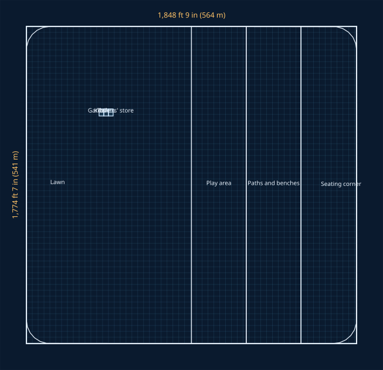

# P6-28 Pocket Park 9: plan

Footprint 1,848 ft 9 in (564 m) × 1,774 ft 7 in (541 m) · structural grid 32 ft 10 in (10 m)

## Levels

| Level | Floor above deck | Height | Floor area |
|---|---|---|---|
| Level 1 · Ground | 0 ft (0 mm) | 13 ft 1 in (4,000 mm) | 3,100 sq ft (288 m²) |

## Elements

| ID | Designation | Type | Name | Level(s) | Size / length | Area | Status |
|---|---|---|---|---|---|---|---|
| E001 | D5F4P6B17A3R1 | zone | Lawn | L1 | 924 ft 3 in (282 m) × 1,773 ft 11 in (541 m) | 1,630,330 sq ft (151,463 m²) | proposed |
| E002 | D5F4P6B17A3R2 | room | Kiosk | L1 | 26 ft 3 in (8,000 mm) × 39 ft 4 in (12 m) | 1,033 sq ft (96 m²) | proposed |
| E003 | D5F4P6B17A3R3 | room | Toilets | L1 | 26 ft 3 in (8,000 mm) × 39 ft 4 in (12 m) | 1,033 sq ft (96 m²) | proposed |
| E004 | D5F4P6B17A3R4 | room | Gardeners' store | L1 | 26 ft 3 in (8,000 mm) × 39 ft 4 in (12 m) | 1,033 sq ft (96 m²) | proposed |
| E005 | D5F4P6B17A3R5 | zone | Play area | L1 | 306 ft 9 in (94 m) × 1,773 ft 7 in (541 m) | 543,973 sq ft (50,537 m²) | proposed |
| E006 | D5F4P6B17A3R6 | zone | Paths and benches | L1 | 306 ft 5 in (93 m) × 1,773 ft 7 in (541 m) | 543,391 sq ft (50,483 m²) | proposed |
| E007 | D5F4P6B17A3R7 | zone | Seating corner | L1 | 311 ft 4 in (95 m) × 1,773 ft 4 in (540 m) | 543,512 sq ft (50,494 m²) | proposed |

## Drawings

### Level 1 · Ground

