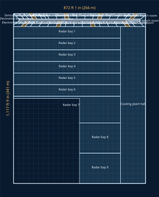
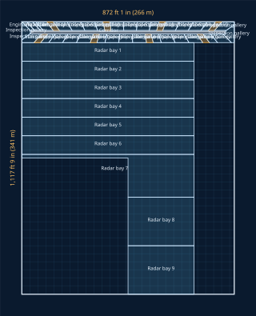

# P1-02 Port Sensor Hall: plan

Footprint 872 ft 1 in (266 m) × 1,117 ft 9 in (341 m) · structural grid 32 ft 10 in (10 m)

## Levels

| Level | Floor above deck | Height | Floor area |
|---|---|---|---|
| Level 1 · Array floor | 0 ft (0 mm) | 39 ft 4 in (12 m) | 711,899 sq ft (66,138 m²) |
| Level 2 · Gallery floor | 39 ft 4 in (12 m) | 16 ft 5 in (5,000 mm) | 541,571 sq ft (50,314 m²) |

## Elements

| ID | Designation | Type | Name | Level(s) | Size / length | Area | Status |
|---|---|---|---|---|---|---|---|
| E001 | D5F5P1B2A1L1R1, D5F5P1B2A1L2R1 | room | Radar bay 1 | L1, L2 | 707 ft (216 m) × 76 ft 5 in (23 m) | 54,047 sq ft (5,021 m²) | proposed |
| E002 | D5F5P1B2A1L1R2, D5F5P1B2A1L2R2 | room | Radar bay 2 | L1, L2 | 707 ft (216 m) × 76 ft 5 in (23 m) | 54,047 sq ft (5,021 m²) | proposed |
| E003 | D5F5P1B2A1L1R3, D5F5P1B2A1L2R3 | room | Radar bay 3 | L1, L2 | 707 ft (216 m) × 76 ft 5 in (23 m) | 54,047 sq ft (5,021 m²) | proposed |
| E004 | D5F5P1B2A1L1R4, D5F5P1B2A1L2R4 | room | Radar bay 4 | L1, L2 | 707 ft (216 m) × 76 ft 5 in (23 m) | 54,047 sq ft (5,021 m²) | proposed |
| E005 | D5F5P1B2A1L1R5, D5F5P1B2A1L2R5 | room | Radar bay 5 | L1, L2 | 707 ft (216 m) × 76 ft 5 in (23 m) | 54,047 sq ft (5,021 m²) | proposed |
| E006 | D5F5P1B2A1L1R6, D5F5P1B2A1L2R6 | room | Radar bay 6 | L1, L2 | 707 ft (216 m) × 76 ft 5 in (23 m) | 54,047 sq ft (5,021 m²) | proposed |
| E007 | D5F5P1B2A1L1R7, D5F5P1B2A1L2R7 | room | Radar bay 7 | L1, L2 | 707 ft (216 m) × 175 ft 2 in (53 m) | 53,915 sq ft (5,009 m²) | proposed |
| E008 | D5F5P1B2A1L1R8, D5F5P1B2A1L2R8 | room | Radar bay 8 | L1, L2 | 271 ft (83 m) × 199 ft 6 in (61 m) | 54,057 sq ft (5,022 m²) | proposed |
| E009 | D5F5P1B2A1L1R9, D5F5P1B2A1L2R9 | room | Radar bay 9 | L1, L2 | 271 ft (83 m) × 199 ft 2 in (61 m) | 53,968 sq ft (5,014 m²) | proposed |
| E010 | D5F5P1B2A1L1R10 | room | Cooling plant hall | L1 | 165 ft (50 m) × 1,032 ft 6 in (315 m) | 170,386 sq ft (15,829 m²) | proposed |
| E011 | D5F5P1B2A1L1R11, D5F5P1B2A1L2R10 | core | Stairs and lifts | L1, L2 | 52 ft 6 in (16 m) × 35 ft 5 in (11 m) | 936 sq ft (87 m²) | proposed |
| E012 | D5F5P1B2A1L1R12, D5F5P1B2A1L2R11 | core | Stairs and lifts | L1, L2 | 33 ft 10 in (10 m) × 35 ft 5 in (11 m) | 936 sq ft (87 m²) | proposed |
| E013 | D5F5P1B2A1L1R13, D5F5P1B2A1L2R12 | core | Stairs and lifts | L1, L2 | 37 ft 9 in (12 m) × 35 ft 5 in (11 m) | 930 sq ft (86 m²) | proposed |
| E014 | D5F5P1B2A1L1R14, D5F5P1B2A1L2R13 | core | Stairs and lifts | L1, L2 | 56 ft 9 in (17 m) × 35 ft 5 in (11 m) | 936 sq ft (87 m²) | proposed |
| E015 | D5F5P1B2A1L1R15, D5F5P1B2A1L2R14 | core | Stairs and lifts | L1, L2 | 52 ft 6 in (16 m) × 35 ft 5 in (11 m) | 936 sq ft (87 m²) | proposed |
| E016 | D5F5P1B2A1L1R16, D5F5P1B2A1L2R15 | core | Stairs and lifts | L1, L2 | 33 ft 10 in (10 m) × 35 ft 5 in (11 m) | 936 sq ft (87 m²) | proposed |
| E017 | D5F5P1B2A1L1R17, D5F5P1B2A1L2R16 | core | Stairs and lifts | L1, L2 | 37 ft 9 in (12 m) × 35 ft 5 in (11 m) | 930 sq ft (86 m²) | proposed |
| E018 | D5F5P1B2A1L1R18, D5F5P1B2A1L2R17 | core | Stairs and lifts | L1, L2 | 56 ft 9 in (17 m) × 35 ft 5 in (11 m) | 936 sq ft (87 m²) | proposed |
| E019 | D5F5P1B2A1L1R19 | zone | Corridor | L1 | 801 ft 2 in (244 m) × 14 ft 5 in (4,400 mm) | 7,931 sq ft (737 m²) | proposed |
| E020 | D5F5P1B2A1L1R20 | room | Sensor control room | L1 | 70 ft 3 in (21 m) × 35 ft 5 in (11 m) | 1,285 sq ft (119 m²) | proposed |
| E021 | D5F5P1B2A1L1R21 | room | Calibration lab | L1 | 61 ft 8 in (19 m) × 35 ft 5 in (11 m) | 1,081 sq ft (100 m²) | proposed |
| E022 | D5F5P1B2A1L1R22 | room | Waveguide workshop | L1 | 59 ft 5 in (18 m) × 35 ft 5 in (11 m) | 1,093 sq ft (102 m²) | proposed |
| E023 | D5F5P1B2A1L1R23 | room | Spares cage | L1 | 59 ft 9 in (18 m) × 35 ft 5 in (11 m) | 1,285 sq ft (119 m²) | proposed |
| E024 | D5F5P1B2A1L1R24 | room | Locker room | L1 | 48 ft 3 in (15 m) × 35 ft 5 in (11 m) | 971 sq ft (90 m²) | proposed |
| E025 | D5F5P1B2A1L1R25 | room | Staff toilets and showers | L1 | 39 ft 8 in (12 m) × 35 ft 5 in (11 m) | 744 sq ft (69 m²) | proposed |
| E026 | D5F5P1B2A1L1R26 | room | Electronics bench room | L1 | 69 ft 11 in (21 m) × 35 ft 5 in (11 m) | 1,930 sq ft (179 m²) | proposed |
| E027 | D5F5P1B2A1L1R27 | room | Electronics bench room | L1 | 65 ft 3 in (20 m) × 35 ft 5 in (11 m) | 1,930 sq ft (179 m²) | proposed |
| E028 | D5F5P1B2A1L1R28 | room | Electronics bench room | L1 | 58 ft 5 in (18 m) × 35 ft 5 in (11 m) | 1,930 sq ft (179 m²) | proposed |
| E029 | D5F5P1B2A1L1R29 | room | Electronics bench room | L1 | 56 ft 9 in (17 m) × 35 ft 5 in (11 m) | 1,930 sq ft (179 m²) | proposed |
| E030 | D5F5P1B2A1L1R30 | room | Electronics bench room | L1 | 59 ft 9 in (18 m) × 35 ft 5 in (11 m) | 1,930 sq ft (179 m²) | proposed |
| E031 | D5F5P1B2A1L1R31 | room | Electronics bench room | L1 | 40 ft 8 in (12 m) × 35 ft 5 in (11 m) | 1,128 sq ft (105 m²) | proposed |
| E032 | D5F5P1B2A1L1R32 | room | Electronics bench room | L1 | 69 ft 7 in (21 m) × 35 ft 5 in (11 m) | 1,930 sq ft (179 m²) | proposed |
| E033 | D5F5P1B2A1L1R33 | room | Electronics bench room | L1 | 74 ft 2 in (23 m) × 35 ft 5 in (11 m) | 1,930 sq ft (179 m²) | proposed |
| E034 | D5F5P1B2A1L1R34 | room | Electronics bench room | L1 | 78 ft 9 in (24 m) × 35 ft 5 in (11 m) | 1,930 sq ft (179 m²) | proposed |
| E035 | D5F5P1B2A1L1R35 | room | Electronics bench room | L1 | 59 ft 9 in (18 m) × 35 ft 5 in (11 m) | 1,128 sq ft (105 m²) | proposed |
| E036 | D5F5P1B2A1L1R36 | room | Electronics bench room | L1 | 81 ft 4 in (25 m) × 37 ft 5 in (11 m) | 1,930 sq ft (179 m²) | proposed |
| E037 | D5F5P1B2A1L1R37 | room | Electronics bench room | L1 | 46 ft 3 in (14 m) × 74 ft 2 in (23 m) | 1,936 sq ft (180 m²) | proposed |
| E038 | D5F5P1B2A1L1R38 | room | Electronics bench room | L1 | 86 ft 7 in (26 m) × 35 ft 5 in (11 m) | 1,930 sq ft (179 m²) | proposed |
| E039 | D5F5P1B2A1L1R39 | room | Electronics bench room | L1 | 60 ft 4 in (18 m) × 35 ft 5 in (11 m) | 1,128 sq ft (105 m²) | proposed |
| E040 | D5F5P1B2A1L1R40 | room | Electronics bench room | L1 | 77 ft 1 in (24 m) × 35 ft 5 in (11 m) | 1,930 sq ft (179 m²) | proposed |
| E041 | D5F5P1B2A1L1R41 | room | Electronics bench room | L1 | 72 ft 6 in (22 m) × 35 ft 5 in (11 m) | 1,930 sq ft (179 m²) | proposed |
| E042 | D5F5P1B2A1L1R42 | room | Electronics bench room | L1 | 67 ft 11 in (21 m) × 35 ft 5 in (11 m) | 1,930 sq ft (179 m²) | proposed |
| E043 | D5F5P1B2A1L1R43 | room | Electronics bench room | L1 | 41 ft 8 in (13 m) × 35 ft 5 in (11 m) | 1,128 sq ft (105 m²) | proposed |
| E044 | D5F5P1B2A1L1R44 | room | Electronics bench room | L1 | 58 ft 5 in (18 m) × 35 ft 5 in (11 m) | 1,930 sq ft (179 m²) | proposed |
| E045 | D5F5P1B2A1L1R45 | room | Electronics bench room | L1 | 56 ft 9 in (17 m) × 35 ft 5 in (11 m) | 1,930 sq ft (179 m²) | proposed |
| E046 | D5F5P1B2A1L1R46 | room | Electronics bench room | L1 | 59 ft 9 in (18 m) × 35 ft 5 in (11 m) | 1,930 sq ft (179 m²) | proposed |
| E047 | D5F5P1B2A1L1R47 | room | Electronics bench room | L1 | 40 ft 8 in (12 m) × 35 ft 5 in (11 m) | 1,128 sq ft (105 m²) | proposed |
| E048 | D5F5P1B2A1L1R48 | room | Electronics bench room | L1 | 69 ft 7 in (21 m) × 35 ft 5 in (11 m) | 1,930 sq ft (179 m²) | proposed |
| E049 | D5F5P1B2A1L1R49 | room | Electronics bench room | L1 | 74 ft 2 in (23 m) × 35 ft 5 in (11 m) | 1,930 sq ft (179 m²) | proposed |
| E050 | D5F5P1B2A1L1R50 | room | Electronics bench room | L1 | 78 ft 9 in (24 m) × 35 ft 5 in (11 m) | 1,930 sq ft (179 m²) | proposed |
| E051 | D5F5P1B2A1L1R51 | room | Electronics bench room | L1 | 59 ft 9 in (18 m) × 35 ft 5 in (11 m) | 1,128 sq ft (105 m²) | proposed |
| E052 | D5F5P1B2A1L1R52 | room | Electronics bench room | L1 | 81 ft 4 in (25 m) × 37 ft 5 in (11 m) | 1,930 sq ft (179 m²) | proposed |
| E053 | D5F5P1B2A1L1R53 | room | Electronics bench room | L1 | 35 ft 5 in (11 m) × 74 ft 2 in (23 m) | 1,535 sq ft (143 m²) | proposed |
| E054 | D5F5P1B2A1L2R18 | zone | Corridor | L2 | 801 ft 2 in (244 m) × 14 ft 5 in (4,400 mm) | 7,931 sq ft (737 m²) | proposed |
| E055 | D5F5P1B2A1L2R19 | room | Engineers' office | L2 | 52 ft 10 in (16 m) × 35 ft 5 in (11 m) | 645 sq ft (60 m²) | proposed |
| E056 | D5F5P1B2A1L2R20 | room | Data room | L2 | 57 ft 1 in (17 m) × 35 ft 5 in (11 m) | 860 sq ft (80 m²) | proposed |
| E057 | D5F5P1B2A1L2R21 | room | Tea point | L2 | 43 ft 8 in (13 m) × 35 ft 5 in (11 m) | 436 sq ft (41 m²) | proposed |
| E058 | D5F5P1B2A1L2R22 | room | Inspection gallery | L2 | 71 ft 10 in (22 m) × 35 ft 5 in (11 m) | 1,517 sq ft (141 m²) | proposed |
| E059 | D5F5P1B2A1L2R23 | room | Inspection gallery | L2 | 77 ft 1 in (24 m) × 35 ft 5 in (11 m) | 1,930 sq ft (179 m²) | proposed |
| E060 | D5F5P1B2A1L2R24 | room | Inspection gallery | L2 | 72 ft 6 in (22 m) × 35 ft 5 in (11 m) | 1,930 sq ft (179 m²) | proposed |
| E061 | D5F5P1B2A1L2R25 | room | Inspection gallery | L2 | 67 ft 11 in (21 m) × 35 ft 5 in (11 m) | 1,930 sq ft (179 m²) | proposed |
| E062 | D5F5P1B2A1L2R26 | room | Inspection gallery | L2 | 41 ft 8 in (13 m) × 35 ft 5 in (11 m) | 1,128 sq ft (105 m²) | proposed |
| E063 | D5F5P1B2A1L2R27 | room | Inspection gallery | L2 | 58 ft 5 in (18 m) × 35 ft 5 in (11 m) | 1,930 sq ft (179 m²) | proposed |
| E064 | D5F5P1B2A1L2R28 | room | Inspection gallery | L2 | 56 ft 9 in (17 m) × 35 ft 5 in (11 m) | 1,930 sq ft (179 m²) | proposed |
| E065 | D5F5P1B2A1L2R29 | room | Inspection gallery | L2 | 59 ft 9 in (18 m) × 35 ft 5 in (11 m) | 1,930 sq ft (179 m²) | proposed |
| E066 | D5F5P1B2A1L2R30 | room | Inspection gallery | L2 | 40 ft 8 in (12 m) × 35 ft 5 in (11 m) | 1,128 sq ft (105 m²) | proposed |
| E067 | D5F5P1B2A1L2R31 | room | Inspection gallery | L2 | 69 ft 7 in (21 m) × 35 ft 5 in (11 m) | 1,930 sq ft (179 m²) | proposed |
| E068 | D5F5P1B2A1L2R32 | room | Inspection gallery | L2 | 74 ft 2 in (23 m) × 35 ft 5 in (11 m) | 1,930 sq ft (179 m²) | proposed |
| E069 | D5F5P1B2A1L2R33 | room | Inspection gallery | L2 | 78 ft 9 in (24 m) × 35 ft 5 in (11 m) | 1,930 sq ft (179 m²) | proposed |
| E070 | D5F5P1B2A1L2R34 | room | Inspection gallery | L2 | 59 ft 9 in (18 m) × 35 ft 5 in (11 m) | 1,128 sq ft (105 m²) | proposed |
| E071 | D5F5P1B2A1L2R35 | room | Inspection gallery | L2 | 81 ft 4 in (25 m) × 37 ft 5 in (11 m) | 1,930 sq ft (179 m²) | proposed |
| E072 | D5F5P1B2A1L2R36 | room | Inspection gallery | L2 | 46 ft 3 in (14 m) × 74 ft 2 in (23 m) | 1,936 sq ft (180 m²) | proposed |
| E073 | D5F5P1B2A1L2R37 | room | Inspection gallery | L2 | 86 ft 7 in (26 m) × 35 ft 5 in (11 m) | 1,930 sq ft (179 m²) | proposed |
| E074 | D5F5P1B2A1L2R38 | room | Inspection gallery | L2 | 60 ft 4 in (18 m) × 35 ft 5 in (11 m) | 1,128 sq ft (105 m²) | proposed |
| E075 | D5F5P1B2A1L2R39 | room | Inspection gallery | L2 | 77 ft 1 in (24 m) × 35 ft 5 in (11 m) | 1,930 sq ft (179 m²) | proposed |
| E076 | D5F5P1B2A1L2R40 | room | Inspection gallery | L2 | 72 ft 6 in (22 m) × 35 ft 5 in (11 m) | 1,930 sq ft (179 m²) | proposed |
| E077 | D5F5P1B2A1L2R41 | room | Inspection gallery | L2 | 67 ft 11 in (21 m) × 35 ft 5 in (11 m) | 1,930 sq ft (179 m²) | proposed |
| E078 | D5F5P1B2A1L2R42 | room | Inspection gallery | L2 | 41 ft 8 in (13 m) × 35 ft 5 in (11 m) | 1,128 sq ft (105 m²) | proposed |
| E079 | D5F5P1B2A1L2R43 | room | Inspection gallery | L2 | 58 ft 5 in (18 m) × 35 ft 5 in (11 m) | 1,930 sq ft (179 m²) | proposed |
| E080 | D5F5P1B2A1L2R44 | room | Inspection gallery | L2 | 56 ft 9 in (17 m) × 35 ft 5 in (11 m) | 1,930 sq ft (179 m²) | proposed |
| E081 | D5F5P1B2A1L2R45 | room | Inspection gallery | L2 | 59 ft 9 in (18 m) × 35 ft 5 in (11 m) | 1,930 sq ft (179 m²) | proposed |
| E082 | D5F5P1B2A1L2R46 | room | Inspection gallery | L2 | 40 ft 8 in (12 m) × 35 ft 5 in (11 m) | 1,128 sq ft (105 m²) | proposed |
| E083 | D5F5P1B2A1L2R47 | room | Inspection gallery | L2 | 69 ft 7 in (21 m) × 35 ft 5 in (11 m) | 1,930 sq ft (179 m²) | proposed |
| E084 | D5F5P1B2A1L2R48 | room | Inspection gallery | L2 | 74 ft 2 in (23 m) × 35 ft 5 in (11 m) | 1,930 sq ft (179 m²) | proposed |
| E085 | D5F5P1B2A1L2R49 | room | Inspection gallery | L2 | 78 ft 9 in (24 m) × 35 ft 5 in (11 m) | 1,930 sq ft (179 m²) | proposed |
| E086 | D5F5P1B2A1L2R50 | room | Inspection gallery | L2 | 59 ft 9 in (18 m) × 35 ft 5 in (11 m) | 1,128 sq ft (105 m²) | proposed |
| E087 | D5F5P1B2A1L2R51 | room | Inspection gallery | L2 | 81 ft 4 in (25 m) × 37 ft 5 in (11 m) | 1,930 sq ft (179 m²) | proposed |
| E088 | D5F5P1B2A1L2R52 | room | Inspection gallery | L2 | 35 ft 5 in (11 m) × 74 ft 2 in (23 m) | 1,535 sq ft (143 m²) | proposed |

## Drawings

### Level 1 · Array floor

### Level 2 · Gallery floor

