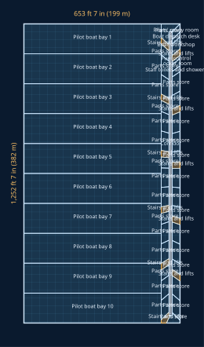
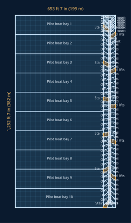

# P1-03 Pilot Boat Station: plan

Footprint 653 ft 7 in (199 m) × 1,252 ft 7 in (382 m) · structural grid 32 ft 10 in (10 m)

## Levels

| Level | Floor above deck | Height | Floor area |
|---|---|---|---|
| Level 1 · Boat hangar floor | 0 ft (0 mm) | 45 ft 11 in (14 m) | 792,902 sq ft (73,663 m²) |
| Level 2 · Crew floor | 45 ft 11 in (14 m) | 13 ft 9 in (4,200 mm) | 792,902 sq ft (73,663 m²) |

## Elements

| ID | Designation | Type | Name | Level(s) | Size / length | Area | Status |
|---|---|---|---|---|---|---|---|
| E001 | D5F5P1B3A1L1R1, D5F5P1B3A1L2R1 | room | Pilot boat bay 1 | L1, L2 | 574 ft 10 in (175 m) × 125 ft 4 in (38 m) | 72,039 sq ft (6,693 m²) | proposed |
| E002 | D5F5P1B3A1L1R2, D5F5P1B3A1L2R2 | room | Pilot boat bay 2 | L1, L2 | 574 ft 10 in (175 m) × 125 ft 4 in (38 m) | 72,039 sq ft (6,693 m²) | proposed |
| E003 | D5F5P1B3A1L1R3, D5F5P1B3A1L2R3 | room | Pilot boat bay 3 | L1, L2 | 574 ft 10 in (175 m) × 125 ft (38 m) | 71,850 sq ft (6,675 m²) | proposed |
| E004 | D5F5P1B3A1L1R4, D5F5P1B3A1L2R4 | room | Pilot boat bay 4 | L1, L2 | 574 ft 10 in (175 m) × 125 ft 4 in (38 m) | 72,039 sq ft (6,693 m²) | proposed |
| E005 | D5F5P1B3A1L1R5, D5F5P1B3A1L2R5 | room | Pilot boat bay 5 | L1, L2 | 574 ft 10 in (175 m) × 125 ft 4 in (38 m) | 72,039 sq ft (6,693 m²) | proposed |
| E006 | D5F5P1B3A1L1R6, D5F5P1B3A1L2R6 | room | Pilot boat bay 6 | L1, L2 | 574 ft 10 in (175 m) × 125 ft 4 in (38 m) | 72,039 sq ft (6,693 m²) | proposed |
| E007 | D5F5P1B3A1L1R7, D5F5P1B3A1L2R7 | room | Pilot boat bay 7 | L1, L2 | 574 ft 10 in (175 m) × 125 ft 4 in (38 m) | 72,039 sq ft (6,693 m²) | proposed |
| E008 | D5F5P1B3A1L1R8, D5F5P1B3A1L2R8 | room | Pilot boat bay 8 | L1, L2 | 574 ft 10 in (175 m) × 125 ft (38 m) | 71,850 sq ft (6,675 m²) | proposed |
| E009 | D5F5P1B3A1L1R9, D5F5P1B3A1L2R9 | room | Pilot boat bay 9 | L1, L2 | 574 ft 10 in (175 m) × 125 ft 4 in (38 m) | 72,039 sq ft (6,693 m²) | proposed |
| E010 | D5F5P1B3A1L1R10, D5F5P1B3A1L2R10 | room | Pilot boat bay 10 | L1, L2 | 574 ft 10 in (175 m) × 125 ft 4 in (38 m) | 72,039 sq ft (6,693 m²) | proposed |
| E011 | D5F5P1B3A1L1R11, D5F5P1B3A1L2R11 | core | Stairs and lifts | L1, L2 | 32 ft 6 in (9,900 mm) × 52 ft 6 in (16 m) | 847 sq ft (79 m²) | proposed |
| E012 | D5F5P1B3A1L1R12, D5F5P1B3A1L2R12 | core | Stairs and lifts | L1, L2 | 32 ft 6 in (9,900 mm) × 40 ft 4 in (12 m) | 853 sq ft (79 m²) | proposed |
| E013 | D5F5P1B3A1L1R13, D5F5P1B3A1L2R13 | core | Stairs and lifts | L1, L2 | 32 ft 6 in (9,900 mm) × 28 ft 3 in (8,600 mm) | 853 sq ft (79 m²) | proposed |
| E014 | D5F5P1B3A1L1R14, D5F5P1B3A1L2R14 | core | Stairs and lifts | L1, L2 | 32 ft 6 in (9,900 mm) × 36 ft 9 in (11 m) | 853 sq ft (79 m²) | proposed |
| E015 | D5F5P1B3A1L1R15, D5F5P1B3A1L2R15 | core | Stairs and lifts | L1, L2 | 32 ft 6 in (9,900 mm) × 48 ft 11 in (15 m) | 853 sq ft (79 m²) | proposed |
| E016 | D5F5P1B3A1L1R16, D5F5P1B3A1L2R16 | core | Stairs and lifts | L1, L2 | 36 ft 5 in (11 m) × 45 ft 3 in (14 m) | 853 sq ft (79 m²) | proposed |
| E017 | D5F5P1B3A1L1R17, D5F5P1B3A1L2R17 | core | Stairs and lifts | L1, L2 | 32 ft 6 in (9,900 mm) × 46 ft 7 in (14 m) | 858 sq ft (80 m²) | proposed |
| E018 | D5F5P1B3A1L1R18, D5F5P1B3A1L2R18 | core | Stairs and lifts | L1, L2 | 32 ft 6 in (9,900 mm) × 34 ft 1 in (10 m) | 853 sq ft (79 m²) | proposed |
| E019 | D5F5P1B3A1L1R19, D5F5P1B3A1L2R19 | core | Stairs and lifts | L1, L2 | 32 ft 6 in (9,900 mm) × 30 ft 6 in (9,300 mm) | 853 sq ft (79 m²) | proposed |
| E020 | D5F5P1B3A1L1R20, D5F5P1B3A1L2R20 | core | Stairs and lifts | L1, L2 | 32 ft 6 in (9,900 mm) × 42 ft 8 in (13 m) | 853 sq ft (79 m²) | proposed |
| E021 | D5F5P1B3A1L1R21, D5F5P1B3A1L2R21 | core | Stairs and lifts | L1, L2 | 32 ft 6 in (9,900 mm) × 55 ft 1 in (17 m) | 853 sq ft (79 m²) | proposed |
| E022 | D5F5P1B3A1L1R22 | zone | Corridor | L1 | 13 ft 9 in (4,200 mm) × 1,187 ft 8 in (362 m) | 11,728 sq ft (1,090 m²) | proposed |
| E023 | D5F5P1B3A1L1R23 | room | Pilots' ready room | L1 | 32 ft 6 in (9,900 mm) × 64 ft 8 in (20 m) | 1,076 sq ft (100 m²) | proposed |
| E024 | D5F5P1B3A1L1R24 | room | Boat dispatch desk | L1 | 32 ft 6 in (9,900 mm) × 49 ft 10 in (15 m) | 645 sq ft (60 m²) | proposed |
| E025 | D5F5P1B3A1L1R25 | room | Boat workshop | L1 | 32 ft 6 in (9,900 mm) × 77 ft 5 in (24 m) | 1,593 sq ft (148 m²) | proposed |
| E026 | D5F5P1B3A1L1R26 | room | Fuel control | L1 | 32 ft 6 in (9,900 mm) × 38 ft 9 in (12 m) | 437 sq ft (41 m²) | proposed |
| E027 | D5F5P1B3A1L1R27 | room | Locker room | L1 | 32 ft 6 in (9,900 mm) × 53 ft 10 in (16 m) | 964 sq ft (90 m²) | proposed |
| E028 | D5F5P1B3A1L1R28 | room | Staff toilets and showers | L1 | 32 ft 6 in (9,900 mm) × 45 ft 11 in (14 m) | 757 sq ft (70 m²) | proposed |
| E029 | D5F5P1B3A1L1R29 | room | Parts store | L1 | 32 ft 6 in (9,900 mm) × 99 ft 9 in (30 m) | 2,589 sq ft (241 m²) | proposed |
| E030 | D5F5P1B3A1L1R30 | room | Parts store | L1 | 32 ft 6 in (9,900 mm) × 74 ft 6 in (23 m) | 1,886 sq ft (175 m²) | proposed |
| E031 | D5F5P1B3A1L1R31 | room | Parts store | L1 | 32 ft 6 in (9,900 mm) × 90 ft 11 in (28 m) | 2,584 sq ft (240 m²) | proposed |
| E032 | D5F5P1B3A1L1R32 | room | Parts store | L1 | 32 ft 6 in (9,900 mm) × 86 ft 7 in (26 m) | 2,584 sq ft (240 m²) | proposed |
| E033 | D5F5P1B3A1L1R33 | room | Parts store | L1 | 32 ft 6 in (9,900 mm) × 48 ft 7 in (15 m) | 1,455 sq ft (135 m²) | proposed |
| E034 | D5F5P1B3A1L1R34 | room | Parts store | L1 | 32 ft 6 in (9,900 mm) × 82 ft (25 m) | 2,589 sq ft (241 m²) | proposed |
| E035 | D5F5P1B3A1L1R35 | room | Parts store | L1 | 32 ft 6 in (9,900 mm) × 85 ft (26 m) | 2,584 sq ft (240 m²) | proposed |
| E036 | D5F5P1B3A1L1R36 | room | Parts store | L1 | 32 ft 6 in (9,900 mm) × 53 ft 6 in (16 m) | 1,455 sq ft (135 m²) | proposed |
| E037 | D5F5P1B3A1L1R37 | room | Parts store | L1 | 32 ft 6 in (9,900 mm) × 92 ft 10 in (28 m) | 2,584 sq ft (240 m²) | proposed |
| E038 | D5F5P1B3A1L1R38 | room | Parts store | L1 | 32 ft 6 in (9,900 mm) × 97 ft 1 in (30 m) | 2,589 sq ft (241 m²) | proposed |
| E039 | D5F5P1B3A1L1R39 | room | Parts store | L1 | 32 ft 6 in (9,900 mm) × 65 ft 3 in (20 m) | 1,449 sq ft (135 m²) | proposed |
| E040 | D5F5P1B3A1L1R40 | room | Parts store | L1 | 32 ft 6 in (9,900 mm) × 105 ft 4 in (32 m) | 2,589 sq ft (241 m²) | proposed |
| E041 | D5F5P1B3A1L1R41 | room | Parts store | L1 | 32 ft 6 in (9,900 mm) × 109 ft 7 in (33 m) | 2,589 sq ft (241 m²) | proposed |
| E042 | D5F5P1B3A1L1R42 | room | Parts store | L1 | 56 ft 5 in (17 m) × 43 ft 8 in (13 m) | 1,449 sq ft (135 m²) | proposed |
| E043 | D5F5P1B3A1L1R43 | room | Parts store | L1 | 32 ft 6 in (9,900 mm) × 109 ft 3 in (33 m) | 2,584 sq ft (240 m²) | proposed |
| E044 | D5F5P1B3A1L1R44 | room | Parts store | L1 | 32 ft 6 in (9,900 mm) × 105 ft (32 m) | 2,584 sq ft (240 m²) | proposed |
| E045 | D5F5P1B3A1L1R45 | room | Parts store | L1 | 32 ft 6 in (9,900 mm) × 66 ft 11 in (20 m) | 1,455 sq ft (135 m²) | proposed |
| E046 | D5F5P1B3A1L1R46 | room | Parts store | L1 | 32 ft 6 in (9,900 mm) × 96 ft 9 in (30 m) | 2,584 sq ft (240 m²) | proposed |
| E047 | D5F5P1B3A1L1R47 | room | Parts store | L1 | 32 ft 6 in (9,900 mm) × 92 ft 10 in (28 m) | 2,589 sq ft (241 m²) | proposed |
| E048 | D5F5P1B3A1L1R48 | room | Parts store | L1 | 32 ft 6 in (9,900 mm) × 54 ft 6 in (17 m) | 1,449 sq ft (135 m²) | proposed |
| E049 | D5F5P1B3A1L1R49 | room | Parts store | L1 | 32 ft 6 in (9,900 mm) × 84 ft 8 in (26 m) | 2,584 sq ft (240 m²) | proposed |
| E050 | D5F5P1B3A1L1R50 | room | Parts store | L1 | 32 ft 6 in (9,900 mm) × 81 ft 8 in (25 m) | 2,589 sq ft (241 m²) | proposed |
| E051 | D5F5P1B3A1L1R51 | room | Parts store | L1 | 32 ft 6 in (9,900 mm) × 46 ft 11 in (14 m) | 1,455 sq ft (135 m²) | proposed |
| E052 | D5F5P1B3A1L1R52 | room | Parts store | L1 | 32 ft 6 in (9,900 mm) × 86 ft 11 in (26 m) | 2,589 sq ft (241 m²) | proposed |
| E053 | D5F5P1B3A1L1R53 | room | Parts store | L1 | 32 ft 6 in (9,900 mm) × 90 ft 11 in (28 m) | 2,584 sq ft (240 m²) | proposed |
| E054 | D5F5P1B3A1L1R54 | room | Parts store | L1 | 32 ft 6 in (9,900 mm) × 59 ft 5 in (18 m) | 1,455 sq ft (135 m²) | proposed |
| E055 | D5F5P1B3A1L1R55 | room | Parts store | L1 | 32 ft 6 in (9,900 mm) × 98 ft 9 in (30 m) | 2,584 sq ft (240 m²) | proposed |
| E056 | D5F5P1B3A1L1R56 | room | Parts store | L1 | 32 ft 6 in (9,900 mm) × 103 ft (31 m) | 2,584 sq ft (240 m²) | proposed |
| E057 | D5F5P1B3A1L1R57 | room | Parts store | L1 | 32 ft 6 in (9,900 mm) × 71 ft 10 in (22 m) | 1,460 sq ft (136 m²) | proposed |
| E058 | D5F5P1B3A1L1R58 | room | Parts store | L1 | 78 ft 9 in (24 m) × 86 ft 7 in (26 m) | 3,309 sq ft (307 m²) | proposed |
| E059 | D5F5P1B3A1L2R22 | zone | Corridor | L2 | 13 ft 9 in (4,200 mm) × 1,187 ft 8 in (362 m) | 11,728 sq ft (1,090 m²) | proposed |
| E060 | D5F5P1B3A1L2R23 | room | Crew rest room | L2 | 32 ft 6 in (9,900 mm) × 43 ft 8 in (13 m) | 373 sq ft (35 m²) | proposed |
| E061 | D5F5P1B3A1L2R24 | room | Crew rest room | L2 | 32 ft 6 in (9,900 mm) × 42 ft 8 in (13 m) | 362 sq ft (34 m²) | proposed |
| E062 | D5F5P1B3A1L2R25 | room | Crew rest room | L2 | 32 ft 6 in (9,900 mm) × 42 ft 4 in (13 m) | 373 sq ft (35 m²) | proposed |
| E063 | D5F5P1B3A1L2R26 | room | Crew rest room | L2 | 32 ft 6 in (9,900 mm) × 41 ft 8 in (13 m) | 368 sq ft (34 m²) | proposed |
| E064 | D5F5P1B3A1L2R27 | room | Crew rest room | L2 | 32 ft 6 in (9,900 mm) × 41 ft (12 m) | 368 sq ft (34 m²) | proposed |
| E065 | D5F5P1B3A1L2R28 | room | Crew rest room | L2 | 32 ft 6 in (9,900 mm) × 40 ft 4 in (12 m) | 368 sq ft (34 m²) | proposed |
| E066 | D5F5P1B3A1L2R29 | room | Crew rest room | L2 | 32 ft 6 in (9,900 mm) × 40 ft (12 m) | 373 sq ft (35 m²) | proposed |
| E067 | D5F5P1B3A1L2R30 | room | Crew rest room | L2 | 32 ft 6 in (9,900 mm) × 50 ft 2 in (15 m) | 730 sq ft (68 m²) | proposed |
| E068 | D5F5P1B3A1L2R31 | room | Mess | L2 | 32 ft 6 in (9,900 mm) × 51 ft 6 in (16 m) | 863 sq ft (80 m²) | proposed |
| E069 | D5F5P1B3A1L2R32 | room | Tea point | L2 | 32 ft 6 in (9,900 mm) × 35 ft 5 in (11 m) | 373 sq ft (35 m²) | proposed |
| E070 | D5F5P1B3A1L2R33 | room | Offices | L2 | 32 ft 6 in (9,900 mm) × 52 ft 6 in (16 m) | 964 sq ft (90 m²) | proposed |
| E071 | D5F5P1B3A1L2R34 | room | Offices | L2 | 32 ft 6 in (9,900 mm) × 51 ft 2 in (16 m) | 975 sq ft (91 m²) | proposed |
| E072 | D5F5P1B3A1L2R35 | room | Offices | L2 | 32 ft 6 in (9,900 mm) × 49 ft 6 in (15 m) | 970 sq ft (90 m²) | proposed |
| E073 | D5F5P1B3A1L2R36 | room | Offices | L2 | 32 ft 6 in (9,900 mm) × 47 ft 11 in (15 m) | 970 sq ft (90 m²) | proposed |
| E074 | D5F5P1B3A1L2R37 | room | Offices | L2 | 32 ft 6 in (9,900 mm) × 46 ft 3 in (14 m) | 970 sq ft (90 m²) | proposed |
| E075 | D5F5P1B3A1L2R38 | room | Offices | L2 | 32 ft 6 in (9,900 mm) × 32 ft 2 in (9,800 mm) | 549 sq ft (51 m²) | proposed |
| E076 | D5F5P1B3A1L2R39 | room | Offices | L2 | 32 ft 6 in (9,900 mm) × 42 ft 4 in (13 m) | 964 sq ft (90 m²) | proposed |
| E077 | D5F5P1B3A1L2R40 | room | Offices | L2 | 32 ft 6 in (9,900 mm) × 41 ft (12 m) | 975 sq ft (91 m²) | proposed |
| E078 | D5F5P1B3A1L2R41 | room | Offices | L2 | 32 ft 6 in (9,900 mm) × 39 ft 1 in (12 m) | 964 sq ft (90 m²) | proposed |
| E079 | D5F5P1B3A1L2R42 | room | Offices | L2 | 32 ft 6 in (9,900 mm) × 37 ft 9 in (12 m) | 975 sq ft (91 m²) | proposed |
| E080 | D5F5P1B3A1L2R43 | room | Offices | L2 | 32 ft 6 in (9,900 mm) × 36 ft 1 in (11 m) | 970 sq ft (90 m²) | proposed |
| E081 | D5F5P1B3A1L2R44 | room | Offices | L2 | 32 ft 6 in (9,900 mm) × 34 ft 5 in (10 m) | 964 sq ft (90 m²) | proposed |
| E082 | D5F5P1B3A1L2R45 | room | Offices | L2 | 32 ft 6 in (9,900 mm) × 28 ft 3 in (8,600 mm) | 810 sq ft (75 m²) | proposed |
| E083 | D5F5P1B3A1L2R46 | room | Offices | L2 | 32 ft 6 in (9,900 mm) × 30 ft 10 in (9,400 mm) | 970 sq ft (90 m²) | proposed |
| E084 | D5F5P1B3A1L2R47 | room | Offices | L2 | 32 ft 6 in (9,900 mm) × 31 ft 2 in (9,500 mm) | 970 sq ft (90 m²) | proposed |
| E085 | D5F5P1B3A1L2R48 | room | Offices | L2 | 32 ft 6 in (9,900 mm) × 32 ft 10 in (10 m) | 975 sq ft (91 m²) | proposed |
| E086 | D5F5P1B3A1L2R49 | room | Offices | L2 | 32 ft 6 in (9,900 mm) × 34 ft 1 in (10 m) | 964 sq ft (90 m²) | proposed |
| E087 | D5F5P1B3A1L2R50 | room | Offices | L2 | 32 ft 6 in (9,900 mm) × 36 ft 1 in (11 m) | 975 sq ft (91 m²) | proposed |
| E088 | D5F5P1B3A1L2R51 | room | Offices | L2 | 32 ft 6 in (9,900 mm) × 37 ft 5 in (11 m) | 964 sq ft (90 m²) | proposed |
| E089 | D5F5P1B3A1L2R52 | room | Offices | L2 | 32 ft 6 in (9,900 mm) × 34 ft 1 in (10 m) | 810 sq ft (75 m²) | proposed |
| E090 | D5F5P1B3A1L2R53 | room | Offices | L2 | 32 ft 6 in (9,900 mm) × 41 ft 8 in (13 m) | 970 sq ft (90 m²) | proposed |
| E091 | D5F5P1B3A1L2R54 | room | Offices | L2 | 32 ft 6 in (9,900 mm) × 43 ft 4 in (13 m) | 970 sq ft (90 m²) | proposed |
| E092 | D5F5P1B3A1L2R55 | room | Offices | L2 | 32 ft 6 in (9,900 mm) × 44 ft 11 in (14 m) | 970 sq ft (90 m²) | proposed |
| E093 | D5F5P1B3A1L2R56 | room | Offices | L2 | 32 ft 6 in (9,900 mm) × 46 ft 7 in (14 m) | 970 sq ft (90 m²) | proposed |
| E094 | D5F5P1B3A1L2R57 | room | Offices | L2 | 32 ft 6 in (9,900 mm) × 48 ft 3 in (15 m) | 970 sq ft (90 m²) | proposed |
| E095 | D5F5P1B3A1L2R58 | room | Offices | L2 | 32 ft 6 in (9,900 mm) × 49 ft 6 in (15 m) | 970 sq ft (90 m²) | proposed |
| E096 | D5F5P1B3A1L2R59 | room | Offices | L2 | 32 ft 6 in (9,900 mm) × 45 ft 11 in (14 m) | 805 sq ft (75 m²) | proposed |
| E097 | D5F5P1B3A1L2R60 | room | Offices | L2 | 32 ft 6 in (9,900 mm) × 54 ft 2 in (16 m) | 975 sq ft (91 m²) | proposed |
| E098 | D5F5P1B3A1L2R61 | room | Offices | L2 | 32 ft 6 in (9,900 mm) × 55 ft 5 in (17 m) | 964 sq ft (90 m²) | proposed |
| E099 | D5F5P1B3A1L2R62 | room | Offices | L2 | 32 ft 6 in (9,900 mm) × 57 ft 5 in (18 m) | 975 sq ft (91 m²) | proposed |
| E100 | D5F5P1B3A1L2R63 | room | Offices | L2 | 32 ft 6 in (9,900 mm) × 58 ft 9 in (18 m) | 970 sq ft (90 m²) | proposed |
| E101 | D5F5P1B3A1L2R64 | room | Offices | L2 | 32 ft 6 in (9,900 mm) × 60 ft 4 in (18 m) | 970 sq ft (90 m²) | proposed |
| E102 | D5F5P1B3A1L2R65 | room | Offices | L2 | 34 ft 9 in (11 m) × 53 ft 6 in (16 m) | 964 sq ft (90 m²) | proposed |
| E103 | D5F5P1B3A1L2R66 | room | Offices | L2 | 42 ft 4 in (13 m) × 32 ft 6 in (9,900 mm) | 810 sq ft (75 m²) | proposed |
| E104 | D5F5P1B3A1L2R67 | room | Offices | L2 | 32 ft 6 in (9,900 mm) × 60 ft 8 in (18 m) | 964 sq ft (90 m²) | proposed |
| E105 | D5F5P1B3A1L2R68 | room | Offices | L2 | 32 ft 6 in (9,900 mm) × 59 ft 5 in (18 m) | 975 sq ft (91 m²) | proposed |
| E106 | D5F5P1B3A1L2R69 | room | Offices | L2 | 32 ft 6 in (9,900 mm) × 57 ft 9 in (18 m) | 970 sq ft (90 m²) | proposed |
| E107 | D5F5P1B3A1L2R70 | room | Offices | L2 | 32 ft 6 in (9,900 mm) × 56 ft 1 in (17 m) | 970 sq ft (90 m²) | proposed |
| E108 | D5F5P1B3A1L2R71 | room | Offices | L2 | 32 ft 6 in (9,900 mm) × 54 ft 6 in (17 m) | 970 sq ft (90 m²) | proposed |
| E109 | D5F5P1B3A1L2R72 | room | Offices | L2 | 32 ft 6 in (9,900 mm) × 52 ft 10 in (16 m) | 970 sq ft (90 m²) | proposed |
| E110 | D5F5P1B3A1L2R73 | room | Offices | L2 | 32 ft 6 in (9,900 mm) × 46 ft 3 in (14 m) | 805 sq ft (75 m²) | proposed |
| E111 | D5F5P1B3A1L2R74 | room | Offices | L2 | 32 ft 6 in (9,900 mm) × 48 ft 7 in (15 m) | 970 sq ft (90 m²) | proposed |
| E112 | D5F5P1B3A1L2R75 | room | Offices | L2 | 32 ft 6 in (9,900 mm) × 46 ft 11 in (14 m) | 964 sq ft (90 m²) | proposed |
| E113 | D5F5P1B3A1L2R76 | room | Offices | L2 | 32 ft 6 in (9,900 mm) × 45 ft 7 in (14 m) | 975 sq ft (91 m²) | proposed |
| E114 | D5F5P1B3A1L2R77 | room | Offices | L2 | 32 ft 6 in (9,900 mm) × 43 ft 8 in (13 m) | 964 sq ft (90 m²) | proposed |
| E115 | D5F5P1B3A1L2R78 | room | Offices | L2 | 32 ft 6 in (9,900 mm) × 42 ft 4 in (13 m) | 975 sq ft (91 m²) | proposed |
| E116 | D5F5P1B3A1L2R79 | room | Offices | L2 | 32 ft 6 in (9,900 mm) × 40 ft 8 in (12 m) | 970 sq ft (90 m²) | proposed |
| E117 | D5F5P1B3A1L2R80 | room | Offices | L2 | 32 ft 6 in (9,900 mm) × 34 ft 1 in (10 m) | 805 sq ft (75 m²) | proposed |
| E118 | D5F5P1B3A1L2R81 | room | Offices | L2 | 32 ft 6 in (9,900 mm) × 36 ft 5 in (11 m) | 975 sq ft (91 m²) | proposed |
| E119 | D5F5P1B3A1L2R82 | room | Offices | L2 | 32 ft 6 in (9,900 mm) × 34 ft 5 in (10 m) | 964 sq ft (90 m²) | proposed |
| E120 | D5F5P1B3A1L2R83 | room | Offices | L2 | 32 ft 6 in (9,900 mm) × 33 ft 2 in (10 m) | 970 sq ft (90 m²) | proposed |
| E121 | D5F5P1B3A1L2R84 | room | Offices | L2 | 32 ft 6 in (9,900 mm) × 31 ft 10 in (9,700 mm) | 975 sq ft (91 m²) | proposed |
| E122 | D5F5P1B3A1L2R85 | room | Offices | L2 | 32 ft 6 in (9,900 mm) × 30 ft 6 in (9,300 mm) | 964 sq ft (90 m²) | proposed |
| E123 | D5F5P1B3A1L2R86 | room | Offices | L2 | 32 ft 6 in (9,900 mm) × 31 ft 6 in (9,600 mm) | 975 sq ft (91 m²) | proposed |
| E124 | D5F5P1B3A1L2R87 | room | Offices | L2 | 32 ft 6 in (9,900 mm) × 27 ft 7 in (8,400 mm) | 805 sq ft (75 m²) | proposed |
| E125 | D5F5P1B3A1L2R88 | room | Offices | L2 | 32 ft 6 in (9,900 mm) × 35 ft 9 in (11 m) | 970 sq ft (90 m²) | proposed |
| E126 | D5F5P1B3A1L2R89 | room | Offices | L2 | 32 ft 6 in (9,900 mm) × 37 ft 1 in (11 m) | 970 sq ft (90 m²) | proposed |
| E127 | D5F5P1B3A1L2R90 | room | Offices | L2 | 32 ft 6 in (9,900 mm) × 38 ft 9 in (12 m) | 970 sq ft (90 m²) | proposed |
| E128 | D5F5P1B3A1L2R91 | room | Offices | L2 | 32 ft 6 in (9,900 mm) × 40 ft 4 in (12 m) | 970 sq ft (90 m²) | proposed |
| E129 | D5F5P1B3A1L2R92 | room | Offices | L2 | 32 ft 6 in (9,900 mm) × 42 ft (13 m) | 970 sq ft (90 m²) | proposed |
| E130 | D5F5P1B3A1L2R93 | room | Offices | L2 | 32 ft 6 in (9,900 mm) × 43 ft 8 in (13 m) | 970 sq ft (90 m²) | proposed |
| E131 | D5F5P1B3A1L2R94 | room | Offices | L2 | 32 ft 6 in (9,900 mm) × 40 ft (12 m) | 810 sq ft (75 m²) | proposed |
| E132 | D5F5P1B3A1L2R95 | room | Offices | L2 | 32 ft 6 in (9,900 mm) × 47 ft 11 in (15 m) | 970 sq ft (90 m²) | proposed |
| E133 | D5F5P1B3A1L2R96 | room | Offices | L2 | 32 ft 6 in (9,900 mm) × 49 ft 6 in (15 m) | 970 sq ft (90 m²) | proposed |
| E134 | D5F5P1B3A1L2R97 | room | Offices | L2 | 32 ft 6 in (9,900 mm) × 50 ft 10 in (16 m) | 964 sq ft (90 m²) | proposed |
| E135 | D5F5P1B3A1L2R98 | room | Offices | L2 | 32 ft 6 in (9,900 mm) × 52 ft 10 in (16 m) | 975 sq ft (91 m²) | proposed |
| E136 | D5F5P1B3A1L2R99 | room | Offices | L2 | 32 ft 6 in (9,900 mm) × 54 ft 2 in (16 m) | 970 sq ft (90 m²) | proposed |
| E137 | D5F5P1B3A1L2R100 | room | Offices | L2 | 32 ft 6 in (9,900 mm) × 55 ft 9 in (17 m) | 970 sq ft (90 m²) | proposed |
| E138 | D5F5P1B3A1L2R101 | room | Offices | L2 | 32 ft 6 in (9,900 mm) × 52 ft 6 in (16 m) | 810 sq ft (75 m²) | proposed |
| E139 | D5F5P1B3A1L2R102 | room | Offices | L2 | 32 ft 6 in (9,900 mm) × 60 ft (18 m) | 964 sq ft (90 m²) | proposed |
| E140 | D5F5P1B3A1L2R103 | room | Offices | L2 | 33 ft 10 in (10 m) × 57 ft 9 in (18 m) | 975 sq ft (91 m²) | proposed |
| E141 | D5F5P1B3A1L2R104 | room | Offices | L2 | 71 ft 10 in (22 m) × 32 ft 6 in (9,900 mm) | 1,369 sq ft (127 m²) | proposed |

## Drawings

### Level 1 · Boat hangar floor

### Level 2 · Crew floor

