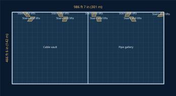
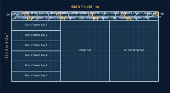
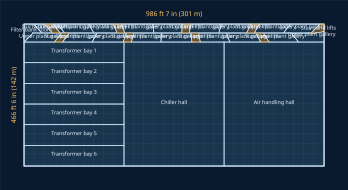

# P1-06 Port Antenna Plant: plan

Footprint 986 ft 7 in (301 m) × 466 ft 6 in (142 m) · structural grid 32 ft 10 in (10 m)

## Levels

| Level | Floor above deck | Height | Floor area |
|---|---|---|---|
| Level B1 · Pipe and cable basement | −16 ft 5 in (5,000 mm) | 16 ft 5 in (5,000 mm) | 460,260 sq ft (42,760 m²) |
| Level 1 · Plant floor | 0 ft (0 mm) | 26 ft 3 in (8,000 mm) | 450,610 sq ft (41,863 m²) |
| Level 2 · Upper plant deck | 26 ft 3 in (8,000 mm) | 19 ft 8 in (6,000 mm) | 450,610 sq ft (41,863 m²) |

## Elements

| ID | Designation | Type | Name | Level(s) | Size / length | Area | Status |
|---|---|---|---|---|---|---|---|
| E001 | D5F5P1B6A1L1R1, D5F5P1B6A1L2R1 | room | Transformer bay 1 | L1, L2 | 328 ft 9 in (100 m) × 67 ft 11 in (21 m) | 22,326 sq ft (2,074 m²) | proposed |
| E002 | D5F5P1B6A1L1R2, D5F5P1B6A1L2R2 | room | Transformer bay 2 | L1, L2 | 328 ft 9 in (100 m) × 67 ft 11 in (21 m) | 22,326 sq ft (2,074 m²) | proposed |
| E003 | D5F5P1B6A1L1R3, D5F5P1B6A1L2R3 | room | Transformer bay 3 | L1, L2 | 328 ft 9 in (100 m) × 67 ft 11 in (21 m) | 22,326 sq ft (2,074 m²) | proposed |
| E004 | D5F5P1B6A1L1R4, D5F5P1B6A1L2R4 | room | Transformer bay 4 | L1, L2 | 328 ft 9 in (100 m) × 67 ft 11 in (21 m) | 22,326 sq ft (2,074 m²) | proposed |
| E005 | D5F5P1B6A1L1R5, D5F5P1B6A1L2R5 | room | Transformer bay 5 | L1, L2 | 328 ft 9 in (100 m) × 67 ft 11 in (21 m) | 22,326 sq ft (2,074 m²) | proposed |
| E006 | D5F5P1B6A1L1R6, D5F5P1B6A1L2R6 | room | Transformer bay 6 | L1, L2 | 328 ft 9 in (100 m) × 67 ft 11 in (21 m) | 22,326 sq ft (2,074 m²) | proposed |
| E007 | D5F5P1B6A1L1R7, D5F5P1B6A1L2R7 | room | Chiller hall | L1, L2 | 329 ft 1 in (100 m) × 407 ft 6 in (124 m) | 134,089 sq ft (12,457 m²) | proposed |
| E008 | D5F5P1B6A1L1R8, D5F5P1B6A1L2R8 | room | Air handling hall | L1, L2 | 328 ft 9 in (100 m) × 407 ft 6 in (124 m) | 133,955 sq ft (12,445 m²) | proposed |
| E009 | D5F5P1B6A1LB1R1, D5F5P1B6A1L1R9, D5F5P1B6A1L2R9 | core | Stairs and lifts | LB1, L1, L2 | 49 ft 10 in (15 m) × 27 ft 11 in (8,500 mm) | 737 sq ft (68 m²) | proposed |
| E010 | D5F5P1B6A1LB1R2, D5F5P1B6A1L1R10, D5F5P1B6A1L2R10 | core | Stairs and lifts | LB1, L1, L2 | 36 ft 9 in (11 m) × 27 ft 11 in (8,500 mm) | 732 sq ft (68 m²) | proposed |
| E011 | D5F5P1B6A1LB1R3, D5F5P1B6A1L1R11, D5F5P1B6A1L2R11 | core | Stairs and lifts | LB1, L1, L2 | 28 ft 7 in (8,700 mm) × 27 ft 11 in (8,500 mm) | 732 sq ft (68 m²) | proposed |
| E012 | D5F5P1B6A1LB1R4, D5F5P1B6A1L1R12, D5F5P1B6A1L2R12 | core | Stairs and lifts | LB1, L1, L2 | 41 ft 4 in (13 m) × 27 ft 11 in (8,500 mm) | 732 sq ft (68 m²) | proposed |
| E013 | D5F5P1B6A1LB1R5, D5F5P1B6A1L1R13, D5F5P1B6A1L2R13 | core | Stairs and lifts | LB1, L1, L2 | 40 ft 8 in (12 m) × 29 ft 2 in (8,900 mm) | 732 sq ft (68 m²) | proposed |
| E014 | D5F5P1B6A1LB1R6, D5F5P1B6A1L1R14, D5F5P1B6A1L2R14 | core | Stairs and lifts | LB1, L1, L2 | 43 ft 4 in (13 m) × 27 ft 11 in (8,500 mm) | 737 sq ft (68 m²) | proposed |
| E015 | D5F5P1B6A1LB1R7, D5F5P1B6A1L1R15, D5F5P1B6A1L2R15 | core | Stairs and lifts | LB1, L1, L2 | 30 ft 6 in (9,300 mm) × 27 ft 11 in (8,500 mm) | 737 sq ft (68 m²) | proposed |
| E016 | D5F5P1B6A1LB1R8, D5F5P1B6A1L1R16, D5F5P1B6A1L2R16 | core | Stairs and lifts | LB1, L1, L2 | 34 ft 9 in (11 m) × 27 ft 11 in (8,500 mm) | 727 sq ft (68 m²) | proposed |
| E017 | D5F5P1B6A1LB1R9, D5F5P1B6A1L1R17, D5F5P1B6A1L2R17 | core | Stairs and lifts | LB1, L1, L2 | 47 ft 11 in (15 m) × 27 ft 11 in (8,500 mm) | 732 sq ft (68 m²) | proposed |
| E018 | D5F5P1B6A1L1R18 | room | Control room | L1 | 42 ft 8 in (13 m) × 59 ft 1 in (18 m) | 1,290 sq ft (120 m²) | proposed |
| E019 | D5F5P1B6A1L1R19 | room | Switch room | L1 | 76 ft 5 in (23 m) × 27 ft 11 in (8,500 mm) | 1,414 sq ft (131 m²) | proposed |
| E020 | D5F5P1B6A1L1R20 | room | Battery room | L1 | 82 ft 4 in (25 m) × 27 ft 11 in (8,500 mm) | 1,715 sq ft (159 m²) | proposed |
| E021 | D5F5P1B6A1L1R21 | room | Water pump room | L1 | 93 ft 6 in (28 m) × 27 ft 11 in (8,500 mm) | 2,141 sq ft (199 m²) | proposed |
| E022 | D5F5P1B6A1L1R22 | room | Water treatment room | L1 | 68 ft 3 in (21 m) × 27 ft 11 in (8,500 mm) | 1,542 sq ft (143 m²) | proposed |
| E023 | D5F5P1B6A1L1R23 | room | Workshop | L1 | 62 ft (19 m) × 27 ft 11 in (8,500 mm) | 1,500 sq ft (139 m²) | proposed |
| E024 | D5F5P1B6A1L1R24 | room | Antenna power room | L1 | 62 ft 8 in (19 m) × 27 ft 11 in (8,500 mm) | 1,606 sq ft (149 m²) | proposed |
| E025 | D5F5P1B6A1L1R25 | room | Locker room | L1 | 36 ft 9 in (11 m) × 27 ft 11 in (8,500 mm) | 961 sq ft (89 m²) | proposed |
| E026 | D5F5P1B6A1L1R26 | room | Staff toilets and showers | L1 | 49 ft 3 in (15 m) × 27 ft 11 in (8,500 mm) | 1,331 sq ft (124 m²) | proposed |
| E027 | D5F5P1B6A1L1R27 | room | Spares store | L1 | 83 ft (25 m) × 27 ft 11 in (8,500 mm) | 2,164 sq ft (201 m²) | proposed |
| E028 | D5F5P1B6A1L1R28 | room | Spares store | L1 | 87 ft 7 in (27 m) × 27 ft 11 in (8,500 mm) | 2,164 sq ft (201 m²) | proposed |
| E029 | D5F5P1B6A1L1R29 | room | Spares store | L1 | 51 ft 10 in (16 m) × 27 ft 11 in (8,500 mm) | 1,075 sq ft (100 m²) | proposed |
| E030 | D5F5P1B6A1L1R30 | room | Spares store | L1 | 95 ft 6 in (29 m) × 27 ft 11 in (8,500 mm) | 2,159 sq ft (201 m²) | proposed |
| E031 | D5F5P1B6A1L1R31 | room | Spares store | L1 | 100 ft 1 in (30 m) × 27 ft 11 in (8,500 mm) | 2,159 sq ft (201 m²) | proposed |
| E032 | D5F5P1B6A1L1R32 | room | Spares store | L1 | 65 ft (20 m) × 27 ft 11 in (8,500 mm) | 1,084 sq ft (101 m²) | proposed |
| E033 | D5F5P1B6A1L1R33 | room | Spares store | L1 | 85 ft 11 in (26 m) × 34 ft 1 in (10 m) | 2,168 sq ft (201 m²) | proposed |
| E034 | D5F5P1B6A1L1R34 | room | Spares store | L1 | 99 ft 9 in (30 m) × 27 ft 11 in (8,500 mm) | 2,159 sq ft (201 m²) | proposed |
| E035 | D5F5P1B6A1L1R35 | room | Spares store | L1 | 57 ft 5 in (18 m) × 27 ft 11 in (8,500 mm) | 1,075 sq ft (100 m²) | proposed |
| E036 | D5F5P1B6A1L1R36 | room | Spares store | L1 | 91 ft 2 in (28 m) × 27 ft 11 in (8,500 mm) | 2,159 sq ft (201 m²) | proposed |
| E037 | D5F5P1B6A1L1R37 | room | Spares store | L1 | 86 ft 11 in (26 m) × 27 ft 11 in (8,500 mm) | 2,164 sq ft (201 m²) | proposed |
| E038 | D5F5P1B6A1L1R38 | room | Spares store | L1 | 44 ft 7 in (14 m) × 27 ft 11 in (8,500 mm) | 1,075 sq ft (100 m²) | proposed |
| E039 | D5F5P1B6A1L1R39 | room | Spares store | L1 | 79 ft 9 in (24 m) × 27 ft 11 in (8,500 mm) | 2,159 sq ft (201 m²) | proposed |
| E040 | D5F5P1B6A1L1R40 | room | Spares store | L1 | 81 ft (25 m) × 27 ft 11 in (8,500 mm) | 2,159 sq ft (201 m²) | proposed |
| E041 | D5F5P1B6A1L1R41 | room | Spares store | L1 | 45 ft 7 in (14 m) × 27 ft 11 in (8,500 mm) | 1,080 sq ft (100 m²) | proposed |
| E042 | D5F5P1B6A1L1R42 | room | Spares store | L1 | 89 ft 3 in (27 m) × 27 ft 11 in (8,500 mm) | 2,164 sq ft (201 m²) | proposed |
| E043 | D5F5P1B6A1L1R43 | room | Spares store | L1 | 93 ft 10 in (29 m) × 27 ft 11 in (8,500 mm) | 2,164 sq ft (201 m²) | proposed |
| E044 | D5F5P1B6A1L1R44 | room | Spares store | L1 | 58 ft 5 in (18 m) × 27 ft 11 in (8,500 mm) | 1,075 sq ft (100 m²) | proposed |
| E045 | D5F5P1B6A1L1R45 | room | Spares store | L1 | 122 ft 1 in (37 m) × 27 ft 11 in (8,500 mm) | 2,704 sq ft (251 m²) | proposed |
| E046 | D5F5P1B6A1L2R18 | room | Filter bank room | L2 | 57 ft 5 in (18 m) × 59 ft 1 in (18 m) | 1,715 sq ft (159 m²) | proposed |
| E047 | D5F5P1B6A1L2R19 | room | Ductwork gallery | L2 | 60 ft 8 in (18 m) × 27 ft 11 in (8,500 mm) | 988 sq ft (92 m²) | proposed |
| E048 | D5F5P1B6A1L2R20 | room | Crew rest room | L2 | 37 ft 5 in (11 m) × 27 ft 11 in (8,500 mm) | 425 sq ft (40 m²) | proposed |
| E049 | D5F5P1B6A1L2R21 | room | Upper plant gallery | L2 | 118 ft 1 in (36 m) × 27 ft 11 in (8,500 mm) | 2,772 sq ft (258 m²) | proposed |
| E050 | D5F5P1B6A1L2R22 | room | Upper plant gallery | L2 | 92 ft 6 in (28 m) × 27 ft 11 in (8,500 mm) | 2,200 sq ft (204 m²) | proposed |
| E051 | D5F5P1B6A1L2R23 | room | Upper plant gallery | L2 | 106 ft (32 m) × 27 ft 11 in (8,500 mm) | 2,768 sq ft (257 m²) | proposed |
| E052 | D5F5P1B6A1L2R24 | room | Upper plant gallery | L2 | 97 ft 1 in (30 m) × 27 ft 11 in (8,500 mm) | 2,630 sq ft (244 m²) | proposed |
| E053 | D5F5P1B6A1L2R25 | room | Upper plant gallery | L2 | 105 ft 4 in (32 m) × 27 ft 11 in (8,500 mm) | 2,772 sq ft (258 m²) | proposed |
| E054 | D5F5P1B6A1L2R26 | room | Upper plant gallery | L2 | 106 ft (32 m) × 27 ft 11 in (8,500 mm) | 2,630 sq ft (244 m²) | proposed |
| E055 | D5F5P1B6A1L2R27 | room | Upper plant gallery | L2 | 118 ft 1 in (36 m) × 27 ft 11 in (8,500 mm) | 2,772 sq ft (258 m²) | proposed |
| E056 | D5F5P1B6A1L2R28 | room | Upper plant gallery | L2 | 118 ft 9 in (36 m) × 27 ft 11 in (8,500 mm) | 2,630 sq ft (244 m²) | proposed |
| E057 | D5F5P1B6A1L2R29 | room | Upper plant gallery | L2 | 106 ft 11 in (33 m) × 34 ft 1 in (10 m) | 2,772 sq ft (258 m²) | proposed |
| E058 | D5F5P1B6A1L2R30 | room | Upper plant gallery | L2 | 114 ft 10 in (35 m) × 27 ft 11 in (8,500 mm) | 2,630 sq ft (244 m²) | proposed |
| E059 | D5F5P1B6A1L2R31 | room | Upper plant gallery | L2 | 112 ft 6 in (34 m) × 27 ft 11 in (8,500 mm) | 2,768 sq ft (257 m²) | proposed |
| E060 | D5F5P1B6A1L2R32 | room | Upper plant gallery | L2 | 102 ft (31 m) × 27 ft 11 in (8,500 mm) | 2,630 sq ft (244 m²) | proposed |
| E061 | D5F5P1B6A1L2R33 | room | Upper plant gallery | L2 | 102 ft (31 m) × 27 ft 11 in (8,500 mm) | 2,768 sq ft (257 m²) | proposed |
| E062 | D5F5P1B6A1L2R34 | room | Upper plant gallery | L2 | 99 ft 5 in (30 m) × 27 ft 11 in (8,500 mm) | 2,630 sq ft (244 m²) | proposed |
| E063 | D5F5P1B6A1L2R35 | room | Upper plant gallery | L2 | 111 ft 11 in (34 m) × 27 ft 11 in (8,500 mm) | 2,772 sq ft (258 m²) | proposed |
| E064 | D5F5P1B6A1L2R36 | room | Upper plant gallery | L2 | 112 ft 6 in (34 m) × 27 ft 11 in (8,500 mm) | 2,630 sq ft (244 m²) | proposed |
| E065 | D5F5P1B6A1L2R37 | room | Upper plant gallery | L2 | 122 ft 1 in (37 m) × 27 ft 11 in (8,500 mm) | 2,704 sq ft (251 m²) | proposed |
| E066 | D5F5P1B6A1LB1R10 | room | Cable vault | LB1 | 493 ft 1 in (150 m) × 466 ft 6 in (142 m) | 230,053 sq ft (21,373 m²) | proposed |
| E067 | D5F5P1B6A1LB1R11 | room | Pipe gallery | LB1 | 493 ft 5 in (150 m) × 466 ft 6 in (142 m) | 230,206 sq ft (21,387 m²) | proposed |

## Drawings

### Level B1 · Pipe and cable basement

### Level 1 · Plant floor

### Level 2 · Upper plant deck

