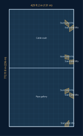
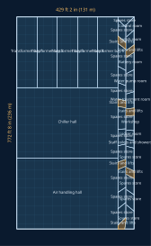
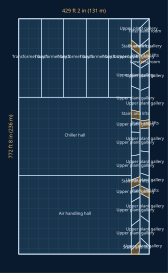

# P1-07 Port Approach Utility Plant: plan

Footprint 429 ft 2 in (131 m) × 772 ft 8 in (236 m) · structural grid 32 ft 10 in (10 m)

## Levels

| Level | Floor above deck | Height | Floor area |
|---|---|---|---|
| Level B1 · Pipe and cable basement | −16 ft 5 in (5,000 mm) | 16 ft 5 in (5,000 mm) | 331,565 sq ft (30,803 m²) |
| Level 1 · Plant floor | 0 ft (0 mm) | 26 ft 3 in (8,000 mm) | 324,085 sq ft (30,108 m²) |
| Level 2 · Upper plant deck | 26 ft 3 in (8,000 mm) | 19 ft 8 in (6,000 mm) | 324,085 sq ft (30,108 m²) |

## Elements

| ID | Designation | Type | Name | Level(s) | Size / length | Area | Status |
|---|---|---|---|---|---|---|---|
| E001 | D5F5P1B7A1L1R1, D5F5P1B7A1L2R1 | room | Transformer bay 1 | L1, L2 | 74 ft 2 in (23 m) × 257 ft 7 in (78 m) | 19,096 sq ft (1,774 m²) | proposed |
| E002 | D5F5P1B7A1L1R2, D5F5P1B7A1L2R2 | room | Transformer bay 2 | L1, L2 | 73 ft 10 in (22 m) × 257 ft 7 in (78 m) | 19,012 sq ft (1,766 m²) | proposed |
| E003 | D5F5P1B7A1L1R3, D5F5P1B7A1L2R3 | room | Transformer bay 3 | L1, L2 | 74 ft 2 in (23 m) × 257 ft 7 in (78 m) | 19,096 sq ft (1,774 m²) | proposed |
| E004 | D5F5P1B7A1L1R4, D5F5P1B7A1L2R4 | room | Transformer bay 4 | L1, L2 | 73 ft 10 in (22 m) × 257 ft 7 in (78 m) | 19,012 sq ft (1,766 m²) | proposed |
| E005 | D5F5P1B7A1L1R5, D5F5P1B7A1L2R5 | room | Transformer bay 5 | L1, L2 | 74 ft 2 in (23 m) × 257 ft 7 in (78 m) | 19,096 sq ft (1,774 m²) | proposed |
| E006 | D5F5P1B7A1L1R6, D5F5P1B7A1L2R6 | room | Chiller hall | L1, L2 | 370 ft 1 in (113 m) × 257 ft 7 in (78 m) | 95,312 sq ft (8,855 m²) | proposed |
| E007 | D5F5P1B7A1L1R7, D5F5P1B7A1L2R7 | room | Air handling hall | L1, L2 | 370 ft 1 in (113 m) × 257 ft 7 in (78 m) | 95,312 sq ft (8,855 m²) | proposed |
| E008 | D5F5P1B7A1LB1R1, D5F5P1B7A1L1R8, D5F5P1B7A1L2R8 | core | Stairs and lifts | LB1, L1, L2 | 27 ft 11 in (8,500 mm) × 45 ft 11 in (14 m) | 732 sq ft (68 m²) | proposed |
| E009 | D5F5P1B7A1LB1R2, D5F5P1B7A1L1R9, D5F5P1B7A1L2R9 | core | Stairs and lifts | LB1, L1, L2 | 27 ft 11 in (8,500 mm) × 29 ft 2 in (8,900 mm) | 732 sq ft (68 m²) | proposed |
| E010 | D5F5P1B7A1LB1R3, D5F5P1B7A1L1R10, D5F5P1B7A1L2R10 | core | Stairs and lifts | LB1, L1, L2 | 27 ft 11 in (8,500 mm) × 40 ft (12 m) | 732 sq ft (68 m²) | proposed |
| E011 | D5F5P1B7A1LB1R4, D5F5P1B7A1L1R11, D5F5P1B7A1L2R11 | core | Stairs and lifts | LB1, L1, L2 | 29 ft 2 in (8,900 mm) × 40 ft 8 in (12 m) | 737 sq ft (68 m²) | proposed |
| E012 | D5F5P1B7A1LB1R5, D5F5P1B7A1L1R12, D5F5P1B7A1L2R12 | core | Stairs and lifts | LB1, L1, L2 | 27 ft 11 in (8,500 mm) × 37 ft 9 in (12 m) | 732 sq ft (68 m²) | proposed |
| E013 | D5F5P1B7A1LB1R6, D5F5P1B7A1L1R13, D5F5P1B7A1L2R13 | core | Stairs and lifts | LB1, L1, L2 | 27 ft 11 in (8,500 mm) × 31 ft 6 in (9,600 mm) | 732 sq ft (68 m²) | proposed |
| E014 | D5F5P1B7A1LB1R7, D5F5P1B7A1L1R14, D5F5P1B7A1L2R14 | core | Stairs and lifts | LB1, L1, L2 | 27 ft 11 in (8,500 mm) × 48 ft 3 in (15 m) | 732 sq ft (68 m²) | proposed |
| E015 | D5F5P1B7A1L1R15 | room | Control room | L1 | 27 ft 11 in (8,500 mm) × 72 ft 6 in (22 m) | 1,290 sq ft (120 m²) | proposed |
| E016 | D5F5P1B7A1L1R16 | room | Switch room | L1 | 27 ft 11 in (8,500 mm) × 74 ft 2 in (23 m) | 1,436 sq ft (133 m²) | proposed |
| E017 | D5F5P1B7A1L1R17 | room | Battery room | L1 | 27 ft 11 in (8,500 mm) × 77 ft 9 in (24 m) | 1,711 sq ft (159 m²) | proposed |
| E018 | D5F5P1B7A1L1R18 | room | Water pump room | L1 | 27 ft 11 in (8,500 mm) × 88 ft 3 in (27 m) | 2,146 sq ft (199 m²) | proposed |
| E019 | D5F5P1B7A1L1R19 | room | Water treatment room | L1 | 27 ft 11 in (8,500 mm) × 63 ft 4 in (19 m) | 1,592 sq ft (148 m²) | proposed |
| E020 | D5F5P1B7A1L1R20 | room | Workshop | L1 | 27 ft 11 in (8,500 mm) × 55 ft 9 in (17 m) | 1,500 sq ft (139 m²) | proposed |
| E021 | D5F5P1B7A1L1R21 | room | Locker room | L1 | 27 ft 11 in (8,500 mm) × 37 ft 9 in (11 m) | 961 sq ft (89 m²) | proposed |
| E022 | D5F5P1B7A1L1R22 | room | Staff toilets and showers | L1 | 27 ft 11 in (8,500 mm) × 32 ft 6 in (9,900 mm) | 750 sq ft (70 m²) | proposed |
| E023 | D5F5P1B7A1L1R23 | room | Spares store | L1 | 27 ft 11 in (8,500 mm) × 89 ft 11 in (27 m) | 2,237 sq ft (208 m²) | proposed |
| E024 | D5F5P1B7A1L1R24 | room | Spares store | L1 | 27 ft 11 in (8,500 mm) × 74 ft 6 in (23 m) | 1,606 sq ft (149 m²) | proposed |
| E025 | D5F5P1B7A1L1R25 | room | Spares store | L1 | 27 ft 11 in (8,500 mm) × 78 ft 9 in (24 m) | 1,606 sq ft (149 m²) | proposed |
| E026 | D5F5P1B7A1L1R26 | room | Spares store | L1 | 34 ft 1 in (10 m) × 87 ft 11 in (27 m) | 2,242 sq ft (208 m²) | proposed |
| E027 | D5F5P1B7A1L1R27 | room | Spares store | L1 | 27 ft 11 in (8,500 mm) × 82 ft 4 in (25 m) | 1,606 sq ft (149 m²) | proposed |
| E028 | D5F5P1B7A1L1R28 | room | Spares store | L1 | 27 ft 11 in (8,500 mm) × 78 ft 1 in (24 m) | 1,606 sq ft (149 m²) | proposed |
| E029 | D5F5P1B7A1L1R29 | room | Spares store | L1 | 27 ft 11 in (8,500 mm) × 95 ft 6 in (29 m) | 2,232 sq ft (207 m²) | proposed |
| E030 | D5F5P1B7A1L1R30 | room | Spares store | L1 | 27 ft 11 in (8,500 mm) × 65 ft 11 in (20 m) | 1,610 sq ft (150 m²) | proposed |
| E031 | D5F5P1B7A1L1R31 | room | Spares store | L1 | 27 ft 11 in (8,500 mm) × 61 ft 4 in (19 m) | 1,606 sq ft (149 m²) | proposed |
| E032 | D5F5P1B7A1L1R32 | room | Spares store | L1 | 27 ft 11 in (8,500 mm) × 83 ft (25 m) | 2,232 sq ft (207 m²) | proposed |
| E033 | D5F5P1B7A1L1R33 | room | Spares store | L1 | 27 ft 11 in (8,500 mm) × 66 ft 3 in (20 m) | 1,610 sq ft (150 m²) | proposed |
| E034 | D5F5P1B7A1L1R34 | room | Spares store | L1 | 27 ft 11 in (8,500 mm) × 70 ft 6 in (22 m) | 1,606 sq ft (149 m²) | proposed |
| E035 | D5F5P1B7A1L1R35 | room | Spares store | L1 | 27 ft 11 in (8,500 mm) × 98 ft 1 in (30 m) | 2,232 sq ft (207 m²) | proposed |
| E036 | D5F5P1B7A1L1R36 | room | Spares store | L1 | 27 ft 11 in (8,500 mm) × 82 ft 8 in (25 m) | 1,606 sq ft (149 m²) | proposed |
| E037 | D5F5P1B7A1L1R37 | room | Spares store | L1 | 59 ft 1 in (18 m) × 36 ft 9 in (11 m) | 1,125 sq ft (105 m²) | proposed |
| E038 | D5F5P1B7A1L2R15 | room | Filter bank room | L2 | 27 ft 11 in (8,500 mm) × 87 ft 3 in (27 m) | 1,715 sq ft (159 m²) | proposed |
| E039 | D5F5P1B7A1L2R16 | room | Ductwork gallery | L2 | 27 ft 11 in (8,500 mm) × 58 ft 5 in (18 m) | 1,011 sq ft (94 m²) | proposed |
| E040 | D5F5P1B7A1L2R17 | room | Crew rest room | L2 | 27 ft 11 in (8,500 mm) × 33 ft 6 in (10 m) | 430 sq ft (40 m²) | proposed |
| E041 | D5F5P1B7A1L2R18 | room | Upper plant gallery | L2 | 27 ft 11 in (8,500 mm) × 90 ft 7 in (28 m) | 2,118 sq ft (197 m²) | proposed |
| E042 | D5F5P1B7A1L2R19 | room | Upper plant gallery | L2 | 27 ft 11 in (8,500 mm) × 111 ft 11 in (34 m) | 2,900 sq ft (269 m²) | proposed |
| E043 | D5F5P1B7A1L2R20 | room | Upper plant gallery | L2 | 27 ft 11 in (8,500 mm) × 78 ft 9 in (24 m) | 2,118 sq ft (197 m²) | proposed |
| E044 | D5F5P1B7A1L2R21 | room | Upper plant gallery | L2 | 27 ft 11 in (8,500 mm) × 82 ft 4 in (25 m) | 2,113 sq ft (196 m²) | proposed |
| E045 | D5F5P1B7A1L2R22 | room | Upper plant gallery | L2 | 27 ft 11 in (8,500 mm) × 54 ft 9 in (17 m) | 1,217 sq ft (113 m²) | proposed |
| E046 | D5F5P1B7A1L2R23 | room | Upper plant gallery | L2 | 27 ft 11 in (8,500 mm) × 93 ft 6 in (28 m) | 2,118 sq ft (197 m²) | proposed |
| E047 | D5F5P1B7A1L2R24 | room | Upper plant gallery | L2 | 27 ft 11 in (8,500 mm) × 99 ft 1 in (30 m) | 2,113 sq ft (196 m²) | proposed |
| E048 | D5F5P1B7A1L2R25 | room | Upper plant gallery | L2 | 34 ft 1 in (10 m) × 52 ft 10 in (16 m) | 1,221 sq ft (113 m²) | proposed |
| E049 | D5F5P1B7A1L2R26 | room | Upper plant gallery | L2 | 27 ft 11 in (8,500 mm) × 99 ft 9 in (30 m) | 2,109 sq ft (196 m²) | proposed |
| E050 | D5F5P1B7A1L2R27 | room | Upper plant gallery | L2 | 27 ft 11 in (8,500 mm) × 94 ft 6 in (29 m) | 2,118 sq ft (197 m²) | proposed |
| E051 | D5F5P1B7A1L2R28 | room | Upper plant gallery | L2 | 27 ft 11 in (8,500 mm) × 57 ft 9 in (18 m) | 1,217 sq ft (113 m²) | proposed |
| E052 | D5F5P1B7A1L2R29 | room | Upper plant gallery | L2 | 27 ft 11 in (8,500 mm) × 83 ft 8 in (26 m) | 2,118 sq ft (197 m²) | proposed |
| E053 | D5F5P1B7A1L2R30 | room | Upper plant gallery | L2 | 27 ft 11 in (8,500 mm) × 78 ft 9 in (24 m) | 2,113 sq ft (196 m²) | proposed |
| E054 | D5F5P1B7A1L2R31 | room | Upper plant gallery | L2 | 27 ft 11 in (8,500 mm) × 46 ft 3 in (14 m) | 1,217 sq ft (113 m²) | proposed |
| E055 | D5F5P1B7A1L2R32 | room | Upper plant gallery | L2 | 27 ft 11 in (8,500 mm) × 85 ft (26 m) | 2,118 sq ft (197 m²) | proposed |
| E056 | D5F5P1B7A1L2R33 | room | Upper plant gallery | L2 | 27 ft 11 in (8,500 mm) × 90 ft 7 in (28 m) | 2,113 sq ft (196 m²) | proposed |
| E057 | D5F5P1B7A1L2R34 | room | Upper plant gallery | L2 | 27 ft 11 in (8,500 mm) × 63 ft (19 m) | 1,217 sq ft (113 m²) | proposed |
| E058 | D5F5P1B7A1L2R35 | room | Upper plant gallery | L2 | 59 ft 1 in (18 m) × 92 ft 2 in (28 m) | 2,731 sq ft (254 m²) | proposed |
| E059 | D5F5P1B7A1LB1R8 | room | Cable vault | LB1 | 429 ft 2 in (131 m) × 386 ft 2 in (118 m) | 165,712 sq ft (15,395 m²) | proposed |
| E060 | D5F5P1B7A1LB1R9 | room | Pipe gallery | LB1 | 429 ft 2 in (131 m) × 386 ft 6 in (118 m) | 165,853 sq ft (15,408 m²) | proposed |

## Drawings

### Level B1 · Pipe and cable basement

### Level 1 · Plant floor

### Level 2 · Upper plant deck

