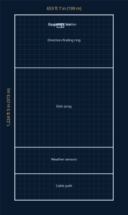

# P1-10 Antenna Field 2: plan

Footprint 653 ft 7 in (199 m) × 1,224 ft 5 in (373 m) · structural grid 32 ft 10 in (10 m)

## Levels

| Level | Floor above deck | Height | Floor area |
|---|---|---|---|
| Level 1 · Field | 0 ft (0 mm) | 13 ft 1 in (4,000 mm) | 1,206 sq ft (112 m²) |

## Elements

| ID | Designation | Type | Name | Level(s) | Size / length | Area | Status |
|---|---|---|---|---|---|---|---|
| E001 | D5F5P1B3A2R1 | zone | Direction-finding ring | L1 | 653 ft 7 in (199 m) × 349 ft 9 in (107 m) | 228,569 sq ft (21,235 m²) | proposed |
| E002 | D5F5P1B3A2R2 | room | Equipment hut | L1 | 30 ft 10 in (9,400 mm) × 26 ft 3 in (8,000 mm) | 809 sq ft (75 m²) | proposed |
| E003 | D5F5P1B3A2R3 | room | Engineers' shelter | L1 | 15 ft 1 in (4,600 mm) × 26 ft 3 in (8,000 mm) | 396 sq ft (37 m²) | proposed |
| E004 | D5F5P1B3A2R4 | zone | Dish array | L1 | 653 ft 7 in (199 m) × 524 ft 11 in (160 m) | 343,067 sq ft (31,872 m²) | proposed |
| E005 | D5F5P1B3A2R5 | zone | Weather sensors | L1 | 653 ft 7 in (199 m) × 174 ft 10 in (53 m) | 114,284 sq ft (10,617 m²) | proposed |
| E006 | D5F5P1B3A2R6 | zone | Cable path | L1 | 653 ft 7 in (199 m) × 174 ft 10 in (53 m) | 114,284 sq ft (10,617 m²) | proposed |

## Drawings

### Level 1 · Field

