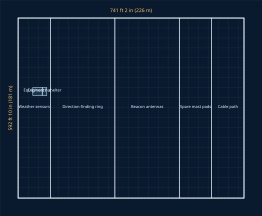

# P1-11 Antenna Field 3: plan

Footprint 741 ft 2 in (226 m) × 592 ft 10 in (181 m) · structural grid 32 ft 10 in (10 m)

## Levels

| Level | Floor above deck | Height | Floor area |
|---|---|---|---|
| Level 1 · Field | 0 ft (0 mm) | 13 ft 1 in (4,000 mm) | 1,206 sq ft (112 m²) |

## Elements

| ID | Designation | Type | Name | Level(s) | Size / length | Area | Status |
|---|---|---|---|---|---|---|---|
| E001 | D5F5P1B4A2R1 | zone | Weather sensors | L1 | 106 ft (32 m) × 592 ft 10 in (181 m) | 62,825 sq ft (5,837 m²) | proposed |
| E002 | D5F5P1B4A2R2 | room | Equipment hut | L1 | 30 ft 10 in (9,400 mm) × 26 ft 3 in (8,000 mm) | 809 sq ft (75 m²) | proposed |
| E003 | D5F5P1B4A2R3 | room | Engineers' shelter | L1 | 15 ft 1 in (4,600 mm) × 26 ft 3 in (8,000 mm) | 396 sq ft (37 m²) | proposed |
| E004 | D5F5P1B4A2R4 | zone | Direction-finding ring | L1 | 211 ft 7 in (64 m) × 592 ft 10 in (181 m) | 125,455 sq ft (11,655 m²) | proposed |
| E005 | D5F5P1B4A2R5 | zone | Beacon antennas | L1 | 211 ft 11 in (65 m) × 592 ft 10 in (181 m) | 125,650 sq ft (11,673 m²) | proposed |
| E006 | D5F5P1B4A2R6 | zone | Spare mast pads | L1 | 105 ft 8 in (32 m) × 592 ft 10 in (181 m) | 62,630 sq ft (5,819 m²) | proposed |
| E007 | D5F5P1B4A2R7 | zone | Cable path | L1 | 106 ft (32 m) × 592 ft 10 in (181 m) | 62,825 sq ft (5,837 m²) | proposed |

## Drawings

### Level 1 · Field

