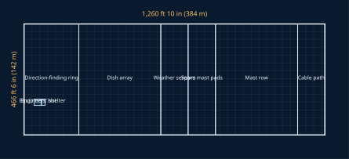

# P1-13 Antenna Field 5: plan

Footprint 1,260 ft 10 in (384 m) × 466 ft 6 in (142 m) · structural grid 32 ft 10 in (10 m)

## Levels

| Level | Floor above deck | Height | Floor area |
|---|---|---|---|
| Level 1 · Field | 0 ft (0 mm) | 13 ft 1 in (4,000 mm) | 1,206 sq ft (112 m²) |

## Elements

| ID | Designation | Type | Name | Level(s) | Size / length | Area | Status |
|---|---|---|---|---|---|---|---|
| E001 | D5F5P1B6A2R1 | zone | Direction-finding ring | L1 | 229 ft 4 in (70 m) × 466 ft 6 in (142 m) | 106,991 sq ft (9,940 m²) | proposed |
| E002 | D5F5P1B6A2R2 | room | Equipment hut | L1 | 30 ft 6 in (9,300 mm) × 26 ft 3 in (8,000 mm) | 801 sq ft (74 m²) | proposed |
| E003 | D5F5P1B6A2R3 | room | Engineers' shelter | L1 | 15 ft 5 in (4,700 mm) × 26 ft 3 in (8,000 mm) | 405 sq ft (38 m²) | proposed |
| E004 | D5F5P1B6A2R4 | zone | Dish array | L1 | 343 ft 10 in (105 m) × 466 ft 6 in (142 m) | 160,410 sq ft (14,903 m²) | proposed |
| E005 | D5F5P1B6A2R5 | zone | Weather sensors | L1 | 114 ft 6 in (35 m) × 466 ft 6 in (142 m) | 53,419 sq ft (4,963 m²) | proposed |
| E006 | D5F5P1B6A2R6 | zone | Spare mast pads | L1 | 114 ft 10 in (35 m) × 466 ft 6 in (142 m) | 53,572 sq ft (4,977 m²) | proposed |
| E007 | D5F5P1B6A2R7 | zone | Mast row | L1 | 343 ft 10 in (105 m) × 466 ft 6 in (142 m) | 160,410 sq ft (14,903 m²) | proposed |
| E008 | D5F5P1B6A2R8 | zone | Cable path | L1 | 114 ft 6 in (35 m) × 466 ft 6 in (142 m) | 53,419 sq ft (4,963 m²) | proposed |

## Drawings

### Level 1 · Field

