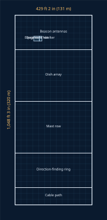

# P1-14 Antenna Field 6: plan

Footprint 429 ft 2 in (131 m) × 1,048 ft 3 in (320 m) · structural grid 32 ft 10 in (10 m)

## Levels

| Level | Floor above deck | Height | Floor area |
|---|---|---|---|
| Level 1 · Field | 0 ft (0 mm) | 13 ft 1 in (4,000 mm) | 1,206 sq ft (112 m²) |

## Elements

| ID | Designation | Type | Name | Level(s) | Size / length | Area | Status |
|---|---|---|---|---|---|---|---|
| E001 | D5F5P1B7A2R1 | zone | Beacon antennas | L1 | 429 ft 2 in (131 m) × 190 ft 7 in (58 m) | 81,800 sq ft (7,599 m²) | proposed |
| E002 | D5F5P1B7A2R2 | room | Equipment hut | L1 | 30 ft 10 in (9,400 mm) × 26 ft 3 in (8,000 mm) | 809 sq ft (75 m²) | proposed |
| E003 | D5F5P1B7A2R3 | room | Engineers' shelter | L1 | 15 ft 1 in (4,600 mm) × 26 ft 3 in (8,000 mm) | 396 sq ft (37 m²) | proposed |
| E004 | D5F5P1B7A2R4 | zone | Dish array | L1 | 429 ft 2 in (131 m) × 285 ft 9 in (87 m) | 122,630 sq ft (11,393 m²) | proposed |
| E005 | D5F5P1B7A2R5 | zone | Mast row | L1 | 429 ft 2 in (131 m) × 286 ft 1 in (87 m) | 122,771 sq ft (11,406 m²) | proposed |
| E006 | D5F5P1B7A2R6 | zone | Direction-finding ring | L1 | 429 ft 2 in (131 m) × 190 ft 7 in (58 m) | 81,800 sq ft (7,599 m²) | proposed |
| E007 | D5F5P1B7A2R7 | zone | Cable path | L1 | 429 ft 2 in (131 m) × 95 ft 2 in (29 m) | 40,830 sq ft (3,793 m²) | proposed |

## Drawings

### Level 1 · Field

