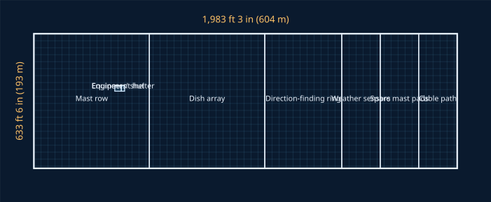

# P1-15 Antenna Field 7: plan

Footprint 1,983 ft 3 in (604 m) × 633 ft 6 in (193 m) · structural grid 32 ft 10 in (10 m)

## Levels

| Level | Floor above deck | Height | Floor area |
|---|---|---|---|
| Level 1 · Field | 0 ft (0 mm) | 13 ft 1 in (4,000 mm) | 1,206 sq ft (112 m²) |

## Elements

| ID | Designation | Type | Name | Level(s) | Size / length | Area | Status |
|---|---|---|---|---|---|---|---|
| E001 | D5F5P1B8A2R1 | zone | Mast row | L1 | 541 ft (165 m) × 633 ft 6 in (193 m) | 342,747 sq ft (31,842 m²) | proposed |
| E002 | D5F5P1B8A2R2 | room | Equipment hut | L1 | 30 ft 10 in (9,400 mm) × 26 ft 3 in (8,000 mm) | 809 sq ft (75 m²) | proposed |
| E003 | D5F5P1B8A2R3 | room | Engineers' shelter | L1 | 15 ft 1 in (4,600 mm) × 26 ft 3 in (8,000 mm) | 396 sq ft (37 m²) | proposed |
| E004 | D5F5P1B8A2R4 | zone | Dish array | L1 | 540 ft 8 in (165 m) × 633 ft 6 in (193 m) | 342,539 sq ft (31,823 m²) | proposed |
| E005 | D5F5P1B8A2R5 | zone | Direction-finding ring | L1 | 360 ft 7 in (110 m) × 633 ft 6 in (193 m) | 228,428 sq ft (21,222 m²) | proposed |
| E006 | D5F5P1B8A2R6 | zone | Weather sensors | L1 | 180 ft 5 in (55 m) × 633 ft 6 in (193 m) | 114,318 sq ft (10,620 m²) | proposed |
| E007 | D5F5P1B8A2R7 | zone | Spare mast pads | L1 | 180 ft 1 in (55 m) × 633 ft 6 in (193 m) | 114,110 sq ft (10,601 m²) | proposed |
| E008 | D5F5P1B8A2R8 | zone | Cable path | L1 | 180 ft 5 in (55 m) × 633 ft 6 in (193 m) | 114,318 sq ft (10,620 m²) | proposed |

## Drawings

### Level 1 · Field

