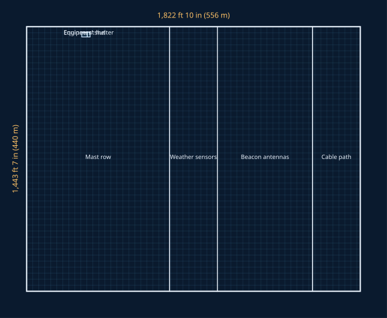

# P1-19 Antenna Field 11: plan

Footprint 1,822 ft 10 in (556 m) × 1,443 ft 7 in (440 m) · structural grid 32 ft 10 in (10 m)

## Levels

| Level | Floor above deck | Height | Floor area |
|---|---|---|---|
| Level 1 · Field | 0 ft (0 mm) | 13 ft 1 in (4,000 mm) | 1,206 sq ft (112 m²) |

## Elements

| ID | Designation | Type | Name | Level(s) | Size / length | Area | Status |
|---|---|---|---|---|---|---|---|
| E001 | D5F5P1B4A3R1 | zone | Mast row | L1 | 781 ft 2 in (238 m) × 1,443 ft 7 in (440 m) | 1,127,670 sq ft (104,764 m²) | proposed |
| E002 | D5F5P1B4A3R2 | room | Equipment hut | L1 | 30 ft 6 in (9,300 mm) × 26 ft 3 in (8,000 mm) | 801 sq ft (74 m²) | proposed |
| E003 | D5F5P1B4A3R3 | room | Engineers' shelter | L1 | 15 ft 5 in (4,700 mm) × 26 ft 3 in (8,000 mm) | 405 sq ft (38 m²) | proposed |
| E004 | D5F5P1B4A3R4 | zone | Weather sensors | L1 | 260 ft 6 in (79 m) × 1,443 ft 7 in (440 m) | 376,048 sq ft (34,936 m²) | proposed |
| E005 | D5F5P1B4A3R5 | zone | Beacon antennas | L1 | 520 ft 8 in (159 m) × 1,443 ft 7 in (440 m) | 751,622 sq ft (69,828 m²) | proposed |
| E006 | D5F5P1B4A3R6 | zone | Cable path | L1 | 260 ft 6 in (79 m) × 1,443 ft 7 in (440 m) | 376,048 sq ft (34,936 m²) | proposed |

## Drawings

### Level 1 · Field

