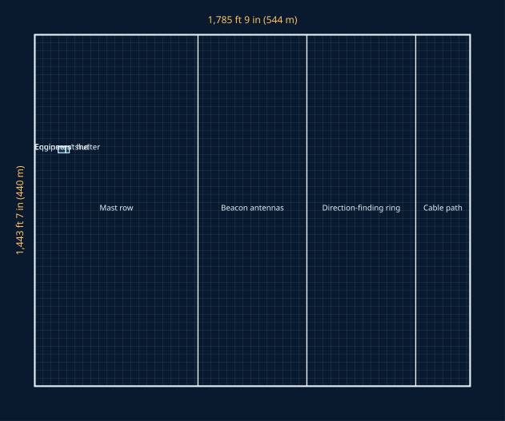

# P1-20 Antenna Field 12: plan

Footprint 1,785 ft 9 in (544 m) × 1,443 ft 7 in (440 m) · structural grid 32 ft 10 in (10 m)

## Levels

| Level | Floor above deck | Height | Floor area |
|---|---|---|---|
| Level 1 · Field | 0 ft (0 mm) | 13 ft 1 in (4,000 mm) | 1,206 sq ft (112 m²) |

## Elements

| ID | Designation | Type | Name | Level(s) | Size / length | Area | Status |
|---|---|---|---|---|---|---|---|
| E001 | D5F5P1B5A3R1 | zone | Mast row | L1 | 669 ft 7 in (204 m) × 1,443 ft 7 in (440 m) | 966,642 sq ft (89,804 m²) | proposed |
| E002 | D5F5P1B5A3R2 | room | Equipment hut | L1 | 30 ft 10 in (9,400 mm) × 26 ft 3 in (8,000 mm) | 809 sq ft (75 m²) | proposed |
| E003 | D5F5P1B5A3R3 | room | Engineers' shelter | L1 | 15 ft 1 in (4,600 mm) × 26 ft 3 in (8,000 mm) | 396 sq ft (37 m²) | proposed |
| E004 | D5F5P1B5A3R4 | zone | Beacon antennas | L1 | 446 ft 6 in (136 m) × 1,443 ft 7 in (440 m) | 644,586 sq ft (59,884 m²) | proposed |
| E005 | D5F5P1B5A3R5 | zone | Direction-finding ring | L1 | 446 ft 6 in (136 m) × 1,443 ft 7 in (440 m) | 644,586 sq ft (59,884 m²) | proposed |
| E006 | D5F5P1B5A3R6 | zone | Cable path | L1 | 223 ft 1 in (68 m) × 1,443 ft 7 in (440 m) | 322,056 sq ft (29,920 m²) | proposed |

## Drawings

### Level 1 · Field

