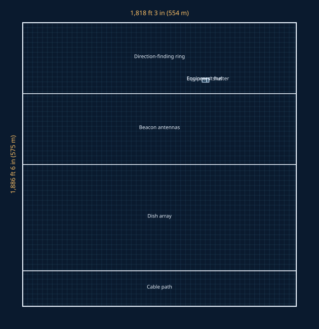

# P1-22 Antenna Field 14: plan

Footprint 1,818 ft 3 in (554 m) × 1,886 ft 6 in (575 m) · structural grid 32 ft 10 in (10 m)

## Levels

| Level | Floor above deck | Height | Floor area |
|---|---|---|---|
| Level 1 · Field | 0 ft (0 mm) | 13 ft 1 in (4,000 mm) | 1,206 sq ft (112 m²) |

## Elements

| ID | Designation | Type | Name | Level(s) | Size / length | Area | Status |
|---|---|---|---|---|---|---|---|
| E001 | D5F5P1B7A3R1 | zone | Direction-finding ring | L1 | 1,818 ft 3 in (554 m) × 471 ft 5 in (144 m) | 857,222 sq ft (79,639 m²) | proposed |
| E002 | D5F5P1B7A3R2 | room | Equipment hut | L1 | 30 ft 6 in (9,300 mm) × 26 ft 3 in (8,000 mm) | 801 sq ft (74 m²) | proposed |
| E003 | D5F5P1B7A3R3 | room | Engineers' shelter | L1 | 15 ft 5 in (4,700 mm) × 26 ft 3 in (8,000 mm) | 405 sq ft (38 m²) | proposed |
| E004 | D5F5P1B7A3R4 | zone | Beacon antennas | L1 | 1,818 ft 3 in (554 m) × 471 ft 9 in (144 m) | 857,819 sq ft (79,694 m²) | proposed |
| E005 | D5F5P1B7A3R5 | zone | Dish array | L1 | 1,818 ft 3 in (554 m) × 707 ft 4 in (216 m) | 1,286,132 sq ft (119,486 m²) | proposed |
| E006 | D5F5P1B7A3R6 | zone | Cable path | L1 | 1,818 ft 3 in (554 m) × 235 ft 11 in (72 m) | 428,909 sq ft (39,847 m²) | proposed |

## Drawings

### Level 1 · Field

