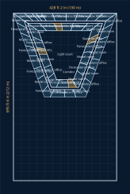
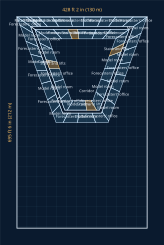

# P2-04 Space Weather Office: plan

Footprint 428 ft 2 in (130 m) × 695 ft 6 in (212 m) · structural grid 32 ft 10 in (10 m)

## Levels

| Level | Floor above deck | Height | Floor area |
|---|---|---|---|
| Level 1 · Ground floor | 0 ft (0 mm) | 15 ft 9 in (4,800 mm) | 61,043 sq ft (5,671 m²) |
| Level 2 · Forecast floor | 15 ft 9 in (4,800 mm) | 13 ft 9 in (4,200 mm) | 60,999 sq ft (5,667 m²) |

## Elements

| ID | Designation | Type | Name | Level(s) | Size / length | Area | Status |
|---|---|---|---|---|---|---|---|
| E001 | D5F5P2B3A1L1R1 | zone | Light court | L1 | 220 ft 10 in (67 m) × 203 ft 5 in (62 m) | 29,664 sq ft (2,756 m²) | proposed |
| E002 | D5F5P2B3A1L1R2 | zone | Corridor | L1 | 338 ft 11 in (103 m) × 72 ft 6 in (22 m) | 3,876 sq ft (360 m²) | proposed |
| E003 | D5F5P2B3A1L1R3 | zone | Corridor | L1 | 225 ft 9 in (69 m) × 218 ft 2 in (66 m) | 3,887 sq ft (361 m²) | proposed |
| E004 | D5F5P2B3A1L1R4 | zone | Corridor | L1 | 96 ft 5 in (29 m) × 238 ft 6 in (73 m) | 2,467 sq ft (229 m²) | proposed |
| E005 | D5F5P2B3A1L1R5, D5F5P2B3A1L2R1 | core | Stairs and lifts | L1, L2 | 34 ft 9 in (11 m) × 31 ft 2 in (9,500 mm) | 813 sq ft (76 m²) | proposed |
| E006 | D5F5P2B3A1L1R6, D5F5P2B3A1L2R2 | core | Stairs and lifts | L1, L2 | 48 ft 7 in (15 m) × 42 ft (13 m) | 816 sq ft (76 m²) | proposed |
| E007 | D5F5P2B3A1L1R7, D5F5P2B3A1L2R3 | core | Stairs and lifts | L1, L2 | 38 ft 1 in (12 m) × 31 ft 2 in (9,500 mm) | 813 sq ft (76 m²) | proposed |
| E008 | D5F5P2B3A1L1R8, D5F5P2B3A1L2R4 | core | Stairs and lifts | L1, L2 | 44 ft (13 m) × 28 ft 10 in (8,800 mm) | 817 sq ft (76 m²) | proposed |
| E009 | D5F5P2B3A1L1R9 | room | Forecast room | L1 | 81 ft 4 in (25 m) × 31 ft 2 in (9,500 mm) | 1,294 sq ft (120 m²) | proposed |
| E010 | D5F5P2B3A1L1R10 | room | Sensor data room | L1 | 59 ft 5 in (18 m) × 31 ft 2 in (9,500 mm) | 859 sq ft (80 m²) | proposed |
| E011 | D5F5P2B3A1L1R11 | room | Warning desk | L1 | 41 ft (12 m) × 31 ft 2 in (9,500 mm) | 435 sq ft (40 m²) | proposed |
| E012 | D5F5P2B3A1L1R12 | room | Toilets | L1 | 43 ft 8 in (13 m) × 31 ft 2 in (9,500 mm) | 644 sq ft (60 m²) | proposed |
| E013 | D5F5P2B3A1L1R13 | room | Forecasters' office | L1 | 57 ft 1 in (17 m) × 31 ft 2 in (9,500 mm) | 1,294 sq ft (120 m²) | proposed |
| E014 | D5F5P2B3A1L1R14 | room | Model room | L1 | 57 ft 9 in (18 m) × 31 ft 2 in (9,500 mm) | 1,611 sq ft (150 m²) | proposed |
| E015 | D5F5P2B3A1L1R15 | room | Forecasters' office | L1 | 47 ft 7 in (14 m) × 31 ft 2 in (9,500 mm) | 1,294 sq ft (120 m²) | proposed |
| E016 | D5F5P2B3A1L1R16 | room | Model room | L1 | 68 ft 7 in (21 m) × 31 ft 2 in (9,500 mm) | 1,611 sq ft (150 m²) | proposed |
| E017 | D5F5P2B3A1L1R17 | room | Forecasters' office | L1 | 69 ft 3 in (21 m) × 31 ft 2 in (9,500 mm) | 1,294 sq ft (120 m²) | proposed |
| E018 | D5F5P2B3A1L1R18 | room | Model room | L1 | 90 ft 7 in (28 m) × 31 ft 2 in (9,500 mm) | 1,621 sq ft (151 m²) | proposed |
| E019 | D5F5P2B3A1L1R19 | room | Forecasters' office | L1 | 57 ft 9 in (18 m) × 66 ft 3 in (20 m) | 1,288 sq ft (120 m²) | proposed |
| E020 | D5F5P2B3A1L1R20 | room | Model room | L1 | 58 ft 1 in (18 m) × 67 ft 3 in (20 m) | 1,617 sq ft (150 m²) | proposed |
| E021 | D5F5P2B3A1L1R21 | room | Forecasters' office | L1 | 51 ft 2 in (16 m) × 48 ft 11 in (15 m) | 1,292 sq ft (120 m²) | proposed |
| E022 | D5F5P2B3A1L1R22 | room | Model room | L1 | 51 ft 10 in (16 m) × 53 ft 6 in (16 m) | 1,620 sq ft (150 m²) | proposed |
| E023 | D5F5P2B3A1L1R23 | room | Forecasters' office | L1 | 44 ft 11 in (14 m) × 45 ft 11 in (14 m) | 1,291 sq ft (120 m²) | proposed |
| E024 | D5F5P2B3A1L1R24 | room | Model room | L1 | 45 ft 3 in (14 m) × 64 ft 4 in (20 m) | 1,612 sq ft (150 m²) | proposed |
| E025 | D5F5P2B3A1L1R25 | room | Forecasters' office | L1 | 38 ft 9 in (12 m) × 63 ft 4 in (19 m) | 1,298 sq ft (121 m²) | proposed |
| E026 | D5F5P2B3A1L1R26 | room | Model room | L1 | 58 ft 5 in (18 m) × 44 ft 11 in (14 m) | 1,615 sq ft (150 m²) | proposed |
| E027 | D5F5P2B3A1L1R27 | room | Forecasters' office | L1 | 47 ft 3 in (14 m) × 31 ft 2 in (9,500 mm) | 1,288 sq ft (120 m²) | proposed |
| E028 | D5F5P2B3A1L1R28 | room | Model room | L1 | 59 ft 9 in (18 m) × 31 ft 2 in (9,500 mm) | 1,616 sq ft (150 m²) | proposed |
| E029 | D5F5P2B3A1L1R29 | room | Forecasters' office | L1 | 47 ft 3 in (14 m) × 48 ft 7 in (15 m) | 1,290 sq ft (120 m²) | proposed |
| E030 | D5F5P2B3A1L1R30 | room | Model room | L1 | 43 ft (13 m) × 71 ft 2 in (22 m) | 1,619 sq ft (150 m²) | proposed |
| E031 | D5F5P2B3A1L1R31 | room | Forecasters' office | L1 | 42 ft 4 in (13 m) × 52 ft 10 in (16 m) | 1,287 sq ft (120 m²) | proposed |
| E032 | D5F5P2B3A1L1R32 | room | Model room | L1 | 49 ft 3 in (15 m) × 54 ft 2 in (16 m) | 1,616 sq ft (150 m²) | proposed |
| E033 | D5F5P2B3A1L1R33 | room | Forecasters' office | L1 | 48 ft 7 in (15 m) × 42 ft 8 in (13 m) | 1,288 sq ft (120 m²) | proposed |
| E034 | D5F5P2B3A1L1R34 | room | Model room | L1 | 55 ft 9 in (17 m) × 60 ft 4 in (18 m) | 1,609 sq ft (149 m²) | proposed |
| E035 | D5F5P2B3A1L1R35 | room | Forecasters' office | L1 | 55 ft 1 in (17 m) × 59 ft 5 in (18 m) | 1,295 sq ft (120 m²) | proposed |
| E036 | D5F5P2B3A1L1R36 | room | Model room | L1 | 56 ft 5 in (17 m) × 62 ft 8 in (19 m) | 1,160 sq ft (108 m²) | proposed |
| E037 | D5F5P2B3A1L1R37 | room | Forecasters' office | L1 | 79 ft 1 in (24 m) × 31 ft 2 in (9,500 mm) | 1,288 sq ft (120 m²) | proposed |
| E038 | D5F5P2B3A1L1R38 | room | Model room | L1 | 73 ft 10 in (22 m) × 31 ft 2 in (9,500 mm) | 1,616 sq ft (150 m²) | proposed |
| E039 | D5F5P2B3A1L1R39 | room | Forecasters' office | L1 | 48 ft 7 in (15 m) × 31 ft 2 in (9,500 mm) | 1,294 sq ft (120 m²) | proposed |
| E040 | D5F5P2B3A1L1R40 | room | Model room | L1 | 70 ft 3 in (21 m) × 31 ft 2 in (9,500 mm) | 1,611 sq ft (150 m²) | proposed |
| E041 | D5F5P2B3A1L1R41 | room | Forecasters' office | L1 | 75 ft 9 in (23 m) × 31 ft 2 in (9,500 mm) | 1,299 sq ft (121 m²) | proposed |
| E042 | D5F5P2B3A1L1R42 | room | Model room | L1 | 57 ft 9 in (18 m) × 66 ft 3 in (20 m) | 1,668 sq ft (155 m²) | proposed |
| E043 | D5F5P2B3A1L1R43 | room | Forecasters' office | L1 | 50 ft 10 in (16 m) × 47 ft 11 in (15 m) | 1,294 sq ft (120 m²) | proposed |
| E044 | D5F5P2B3A1L1R44 | room | Model room | L1 | 49 ft 10 in (15 m) × 54 ft 9 in (17 m) | 1,598 sq ft (148 m²) | proposed |
| E045 | D5F5P2B3A1L1R45 | room | Forecasters' office | L1 | 42 ft (13 m) × 53 ft 6 in (16 m) | 1,288 sq ft (120 m²) | proposed |
| E046 | D5F5P2B3A1L1R46 | room | Model room | L1 | 45 ft 7 in (14 m) × 68 ft 7 in (21 m) | 1,671 sq ft (155 m²) | proposed |
| E047 | D5F5P2B3A1L1R47 | room | Forecasters' office | L1 | 51 ft 2 in (16 m) × 31 ft 2 in (9,500 mm) | 1,294 sq ft (120 m²) | proposed |
| E048 | D5F5P2B3A1L1R48 | room | Model room | L1 | 48 ft 3 in (15 m) × 59 ft 5 in (18 m) | 1,610 sq ft (150 m²) | proposed |
| E049 | D5F5P2B3A1L1R49 | room | Forecasters' office | L1 | 41 ft (12 m) × 56 ft 5 in (17 m) | 1,287 sq ft (120 m²) | proposed |
| E050 | D5F5P2B3A1L1R50 | room | Model room | L1 | 49 ft 6 in (15 m) × 57 ft 1 in (17 m) | 1,668 sq ft (155 m²) | proposed |
| E051 | D5F5P2B3A1L1R51 | room | Forecasters' office | L1 | 52 ft 2 in (16 m) × 51 ft 6 in (16 m) | 1,284 sq ft (119 m²) | proposed |
| E052 | D5F5P2B3A1L1R52 | room | Model room | L1 | 60 ft (18 m) × 73 ft 2 in (22 m) | 1,617 sq ft (150 m²) | proposed |
| E053 | D5F5P2B3A1L2R5 | zone | Corridor | L2 | 338 ft 11 in (103 m) × 72 ft 6 in (22 m) | 3,876 sq ft (360 m²) | proposed |
| E054 | D5F5P2B3A1L2R6 | zone | Corridor | L2 | 225 ft 9 in (69 m) × 218 ft 2 in (66 m) | 3,887 sq ft (361 m²) | proposed |
| E055 | D5F5P2B3A1L2R7 | zone | Corridor | L2 | 96 ft 5 in (29 m) × 238 ft 6 in (73 m) | 2,467 sq ft (229 m²) | proposed |
| E056 | D5F5P2B3A1L2R8 | room | Research room | L2 | 69 ft 3 in (21 m) × 31 ft 2 in (9,500 mm) | 864 sq ft (80 m²) | proposed |
| E057 | D5F5P2B3A1L2R9 | room | Tea point | L2 | 47 ft 11 in (15 m) × 31 ft 2 in (9,500 mm) | 337 sq ft (31 m²) | proposed |
| E058 | D5F5P2B3A1L2R10 | room | Staff toilets and showers | L2 | 57 ft 1 in (17 m) × 31 ft 2 in (9,500 mm) | 752 sq ft (70 m²) | proposed |
| E059 | D5F5P2B3A1L2R11 | room | Forecasters' office | L2 | 66 ft 11 in (20 m) × 31 ft 2 in (9,500 mm) | 1,299 sq ft (121 m²) | proposed |
| E060 | D5F5P2B3A1L2R12 | room | Model room | L2 | 65 ft 11 in (20 m) × 31 ft 2 in (9,500 mm) | 1,611 sq ft (150 m²) | proposed |
| E061 | D5F5P2B3A1L2R13 | room | Forecasters' office | L2 | 46 ft 3 in (14 m) × 31 ft 2 in (9,500 mm) | 1,294 sq ft (120 m²) | proposed |
| E062 | D5F5P2B3A1L2R14 | room | Model room | L2 | 59 ft 1 in (18 m) × 31 ft 2 in (9,500 mm) | 1,611 sq ft (150 m²) | proposed |
| E063 | D5F5P2B3A1L2R15 | room | Forecasters' office | L2 | 59 ft 9 in (18 m) × 31 ft 2 in (9,500 mm) | 1,294 sq ft (120 m²) | proposed |
| E064 | D5F5P2B3A1L2R16 | room | Model room | L2 | 81 ft (25 m) × 31 ft 2 in (9,500 mm) | 1,616 sq ft (150 m²) | proposed |
| E065 | D5F5P2B3A1L2R17 | room | Forecasters' office | L2 | 81 ft (25 m) × 31 ft 6 in (9,600 mm) | 1,283 sq ft (119 m²) | proposed |
| E066 | D5F5P2B3A1L2R18 | room | Model room | L2 | 60 ft 8 in (18 m) × 75 ft 2 in (23 m) | 1,614 sq ft (150 m²) | proposed |
| E067 | D5F5P2B3A1L2R19 | room | Forecasters' office | L2 | 53 ft 10 in (16 m) × 56 ft 9 in (17 m) | 1,282 sq ft (119 m²) | proposed |
| E068 | D5F5P2B3A1L2R20 | room | Model room | L2 | 54 ft 6 in (17 m) × 57 ft 9 in (18 m) | 1,603 sq ft (149 m²) | proposed |
| E069 | D5F5P2B3A1L2R21 | room | Forecasters' office | L2 | 47 ft 7 in (14 m) × 42 ft 8 in (13 m) | 1,288 sq ft (120 m²) | proposed |
| E070 | D5F5P2B3A1L2R22 | room | Model room | L2 | 47 ft 11 in (15 m) × 56 ft 9 in (17 m) | 1,606 sq ft (149 m²) | proposed |
| E071 | D5F5P2B3A1L2R23 | room | Forecasters' office | L2 | 41 ft 4 in (13 m) × 55 ft 5 in (17 m) | 1,283 sq ft (119 m²) | proposed |
| E072 | D5F5P2B3A1L2R24 | room | Model room | L2 | 41 ft 8 in (13 m) × 74 ft 2 in (23 m) | 1,614 sq ft (150 m²) | proposed |
| E073 | D5F5P2B3A1L2R25 | room | Forecasters' office | L2 | 54 ft 6 in (17 m) × 35 ft 9 in (11 m) | 1,291 sq ft (120 m²) | proposed |
| E074 | D5F5P2B3A1L2R26 | room | Model room | L2 | 59 ft 1 in (18 m) × 31 ft 2 in (9,500 mm) | 1,611 sq ft (150 m²) | proposed |
| E075 | D5F5P2B3A1L2R27 | room | Forecasters' office | L2 | 51 ft 2 in (16 m) × 31 ft 2 in (9,500 mm) | 1,294 sq ft (120 m²) | proposed |
| E076 | D5F5P2B3A1L2R28 | room | Model room | L2 | 51 ft 2 in (16 m) × 57 ft 9 in (18 m) | 1,617 sq ft (150 m²) | proposed |
| E077 | D5F5P2B3A1L2R29 | room | Forecasters' office | L2 | 39 ft 8 in (12 m) × 60 ft 4 in (18 m) | 1,295 sq ft (120 m²) | proposed |
| E078 | D5F5P2B3A1L2R30 | room | Model room | L2 | 46 ft 7 in (14 m) × 61 ft 8 in (19 m) | 1,624 sq ft (151 m²) | proposed |
| E079 | D5F5P2B3A1L2R31 | room | Forecasters' office | L2 | 45 ft 11 in (14 m) × 43 ft (13 m) | 1,287 sq ft (120 m²) | proposed |
| E080 | D5F5P2B3A1L2R32 | room | Model room | L2 | 52 ft 10 in (16 m) × 53 ft 6 in (16 m) | 1,614 sq ft (150 m²) | proposed |
| E081 | D5F5P2B3A1L2R33 | room | Forecasters' office | L2 | 52 ft 2 in (16 m) × 51 ft 10 in (16 m) | 1,288 sq ft (120 m²) | proposed |
| E082 | D5F5P2B3A1L2R34 | room | Model room | L2 | 59 ft 1 in (18 m) × 69 ft 11 in (21 m) | 1,608 sq ft (149 m²) | proposed |
| E083 | D5F5P2B3A1L2R35 | room | Forecasters' office | L2 | 53 ft 2 in (16 m) × 53 ft 6 in (16 m) | 816 sq ft (76 m²) | proposed |
| E084 | D5F5P2B3A1L2R36 | room | Model room | L2 | 87 ft 7 in (27 m) × 31 ft 2 in (9,500 mm) | 1,611 sq ft (150 m²) | proposed |
| E085 | D5F5P2B3A1L2R37 | room | Forecasters' office | L2 | 61 ft 8 in (19 m) × 31 ft 2 in (9,500 mm) | 1,294 sq ft (120 m²) | proposed |
| E086 | D5F5P2B3A1L2R38 | room | Model room | L2 | 60 ft 8 in (18 m) × 31 ft 2 in (9,500 mm) | 1,616 sq ft (150 m²) | proposed |
| E087 | D5F5P2B3A1L2R39 | room | Forecasters' office | L2 | 61 ft 8 in (19 m) × 31 ft 2 in (9,500 mm) | 1,288 sq ft (120 m²) | proposed |
| E088 | D5F5P2B3A1L2R40 | room | Model room | L2 | 87 ft 11 in (27 m) × 31 ft 2 in (9,500 mm) | 1,621 sq ft (151 m²) | proposed |
| E089 | D5F5P2B3A1L2R41 | room | Forecasters' office | L2 | 57 ft 9 in (18 m) × 66 ft 3 in (20 m) | 1,346 sq ft (125 m²) | proposed |
| E090 | D5F5P2B3A1L2R42 | room | Model room | L2 | 53 ft 10 in (16 m) × 56 ft 1 in (17 m) | 1,609 sq ft (150 m²) | proposed |
| E091 | D5F5P2B3A1L2R43 | room | Forecasters' office | L2 | 45 ft 11 in (14 m) × 44 ft (13 m) | 1,284 sq ft (119 m²) | proposed |
| E092 | D5F5P2B3A1L2R44 | room | Model room | L2 | 45 ft 3 in (14 m) × 64 ft 4 in (20 m) | 1,612 sq ft (150 m²) | proposed |
| E093 | D5F5P2B3A1L2R45 | room | Forecasters' office | L2 | 41 ft 8 in (13 m) × 60 ft 4 in (18 m) | 1,358 sq ft (126 m²) | proposed |
| E094 | D5F5P2B3A1L2R46 | room | Model room | L2 | 64 ft (20 m) × 31 ft 2 in (9,500 mm) | 1,616 sq ft (150 m²) | proposed |
| E095 | D5F5P2B3A1L2R47 | room | Forecasters' office | L2 | 40 ft 4 in (12 m) × 59 ft 5 in (18 m) | 1,288 sq ft (120 m²) | proposed |
| E096 | D5F5P2B3A1L2R48 | room | Model room | L2 | 44 ft 11 in (14 m) × 64 ft 8 in (20 m) | 1,602 sq ft (149 m²) | proposed |
| E097 | D5F5P2B3A1L2R49 | room | Forecasters' office | L2 | 46 ft 7 in (14 m) × 45 ft 11 in (14 m) | 1,346 sq ft (125 m²) | proposed |
| E098 | D5F5P2B3A1L2R50 | room | Model room | L2 | 56 ft 5 in (17 m) × 62 ft 8 in (19 m) | 1,620 sq ft (150 m²) | proposed |
| E099 | D5F5P2B3A1L2R51 | room | Forecasters' office | L2 | 57 ft 1 in (17 m) × 64 ft 8 in (20 m) | 1,297 sq ft (120 m²) | proposed |

## Drawings

### Level 1 · Ground floor

### Level 2 · Forecast floor

