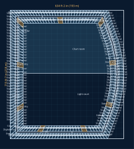
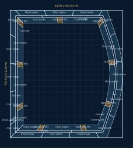

# P2-05 Navigation Charts Library: plan

Footprint 634 ft 2 in (193 m) × 715 ft 7 in (218 m) · structural grid 32 ft 10 in (10 m)

## Levels

| Level | Floor above deck | Height | Floor area |
|---|---|---|---|
| Level 1 · Reading floor | 0 ft (0 mm) | 16 ft 5 in (5,000 mm) | 263,805 sq ft (24,508 m²) |
| Level 2 · Stacks floor | 16 ft 5 in (5,000 mm) | 13 ft 9 in (4,200 mm) | 134,583 sq ft (12,503 m²) |

## Elements

| ID | Designation | Type | Name | Level(s) | Size / length | Area | Status |
|---|---|---|---|---|---|---|---|
| E001 | D5F5P2B4A1L1R1 | room | Chart room | L1 | 489 ft 2 in (149 m) × 278 ft 7 in (85 m) | 129,248 sq ft (12,008 m²) | proposed |
| E002 | D5F5P2B4A1L1R2 | zone | Light court | L1 | 489 ft 6 in (149 m) × 292 ft 8 in (89 m) | 136,143 sq ft (12,648 m²) | proposed |
| E003 | D5F5P2B4A1L1R3 | zone | Corridor | L1 | 9 ft 10 in (3,000 mm) × 399 ft 7 in (122 m) | 3,875 sq ft (360 m²) | proposed |
| E004 | D5F5P2B4A1L1R4 | zone | Corridor | L1 | 151 ft 3 in (46 m) × 255 ft 7 in (78 m) | 3,875 sq ft (360 m²) | proposed |
| E005 | D5F5P2B4A1L1R5 | zone | Corridor | L1 | 363 ft 10 in (111 m) × 59 ft 9 in (18 m) | 3,876 sq ft (360 m²) | proposed |
| E006 | D5F5P2B4A1L1R6 | zone | Corridor | L1 | 69 ft 3 in (21 m) × 389 ft 1 in (119 m) | 3,884 sq ft (361 m²) | proposed |
| E007 | D5F5P2B4A1L1R7 | zone | Corridor | L1 | 246 ft 1 in (75 m) × 213 ft 7 in (65 m) | 3,863 sq ft (359 m²) | proposed |
| E008 | D5F5P2B4A1L1R8 | zone | Corridor | L1 | 313 ft 8 in (96 m) × 9 ft 10 in (3,000 mm) | 3,034 sq ft (282 m²) | proposed |
| E009 | D5F5P2B4A1L1R9, D5F5P2B4A1L2R1 | core | Stairs and lifts | L1, L2 | 31 ft 2 in (9,500 mm) × 45 ft 3 in (14 m) | 818 sq ft (76 m²) | proposed |
| E010 | D5F5P2B4A1L1R10, D5F5P2B4A1L2R2 | core | Stairs and lifts | L1, L2 | 31 ft 2 in (9,500 mm) × 31 ft 6 in (9,600 mm) | 813 sq ft (76 m²) | proposed |
| E011 | D5F5P2B4A1L1R11, D5F5P2B4A1L2R3 | core | Stairs and lifts | L1, L2 | 31 ft 6 in (9,600 mm) × 55 ft 9 in (17 m) | 818 sq ft (76 m²) | proposed |
| E012 | D5F5P2B4A1L1R12, D5F5P2B4A1L2R4 | core | Stairs and lifts | L1, L2 | 30 ft 10 in (9,400 mm) × 31 ft 2 in (9,500 mm) | 818 sq ft (76 m²) | proposed |
| E013 | D5F5P2B4A1L1R13, D5F5P2B4A1L2R5 | core | Stairs and lifts | L1, L2 | 33 ft 2 in (10 m) × 51 ft 6 in (16 m) | 818 sq ft (76 m²) | proposed |
| E014 | D5F5P2B4A1L1R14, D5F5P2B4A1L2R6 | core | Stairs and lifts | L1, L2 | 33 ft 2 in (10 m) × 29 ft 6 in (9,000 mm) | 820 sq ft (76 m²) | proposed |
| E015 | D5F5P2B4A1L1R15, D5F5P2B4A1L2R7 | core | Stairs and lifts | L1, L2 | 37 ft 5 in (11 m) × 34 ft 9 in (11 m) | 818 sq ft (76 m²) | proposed |
| E016 | D5F5P2B4A1L1R16, D5F5P2B4A1L2R8 | core | Stairs and lifts | L1, L2 | 37 ft 1 in (11 m) × 31 ft 2 in (9,500 mm) | 818 sq ft (76 m²) | proposed |
| E017 | D5F5P2B4A1L1R17, D5F5P2B4A1L2R9 | core | Stairs and lifts | L1, L2 | 43 ft 8 in (13 m) × 31 ft 2 in (9,500 mm) | 823 sq ft (76 m²) | proposed |
| E018 | D5F5P2B4A1L1R18 | room | Enquiry desk | L1 | 31 ft 2 in (9,500 mm) × 47 ft 7 in (14 m) | 537 sq ft (50 m²) | proposed |
| E019 | D5F5P2B4A1L1R19 | room | Digital chart room | L1 | 31 ft 2 in (9,500 mm) × 56 ft 1 in (17 m) | 864 sq ft (80 m²) | proposed |
| E020 | D5F5P2B4A1L1R20 | room | Copy room | L1 | 31 ft 2 in (9,500 mm) × 40 ft 4 in (12 m) | 429 sq ft (40 m²) | proposed |
| E021 | D5F5P2B4A1L1R21 | room | Toilets | L1 | 31 ft 2 in (9,500 mm) × 45 ft 7 in (14 m) | 644 sq ft (60 m²) | proposed |
| E022 | D5F5P2B4A1L1R22 | room | Study carrel | L1 | 31 ft 2 in (9,500 mm) × 38 ft 9 in (12 m) | 486 sq ft (45 m²) | proposed |
| E023 | D5F5P2B4A1L1R23 | room | Study carrel | L1 | 31 ft 2 in (9,500 mm) × 37 ft 5 in (11 m) | 486 sq ft (45 m²) | proposed |
| E024 | D5F5P2B4A1L1R24 | room | Study carrel | L1 | 31 ft 2 in (9,500 mm) × 36 ft 1 in (11 m) | 486 sq ft (45 m²) | proposed |
| E025 | D5F5P2B4A1L1R25 | room | Study carrel | L1 | 31 ft 2 in (9,500 mm) × 34 ft 5 in (10 m) | 481 sq ft (45 m²) | proposed |
| E026 | D5F5P2B4A1L1R26 | room | Study carrel | L1 | 31 ft 2 in (9,500 mm) × 33 ft 2 in (10 m) | 486 sq ft (45 m²) | proposed |
| E027 | D5F5P2B4A1L1R27 | room | Study carrel | L1 | 31 ft 2 in (9,500 mm) × 31 ft 6 in (9,600 mm) | 481 sq ft (45 m²) | proposed |
| E028 | D5F5P2B4A1L1R28 | room | Study carrel | L1 | 31 ft 2 in (9,500 mm) × 30 ft 6 in (9,300 mm) | 491 sq ft (46 m²) | proposed |
| E029 | D5F5P2B4A1L1R29 | room | Study carrel | L1 | 31 ft 2 in (9,500 mm) × 28 ft 10 in (8,800 mm) | 481 sq ft (45 m²) | proposed |
| E030 | D5F5P2B4A1L1R30 | room | Study carrel | L1 | 31 ft 2 in (9,500 mm) × 27 ft 7 in (8,400 mm) | 486 sq ft (45 m²) | proposed |
| E031 | D5F5P2B4A1L1R31 | room | Study carrel | L1 | 31 ft 2 in (9,500 mm) × 25 ft 11 in (7,900 mm) | 481 sq ft (45 m²) | proposed |
| E032 | D5F5P2B4A1L1R32 | room | Study carrel | L1 | 31 ft 2 in (9,500 mm) × 24 ft 7 in (7,500 mm) | 486 sq ft (45 m²) | proposed |
| E033 | D5F5P2B4A1L1R33 | room | Study carrel | L1 | 31 ft 2 in (9,500 mm) × 23 ft 4 in (7,100 mm) | 486 sq ft (45 m²) | proposed |
| E034 | D5F5P2B4A1L1R34 | room | Study carrel | L1 | 31 ft 2 in (9,500 mm) × 22 ft (6,700 mm) | 486 sq ft (45 m²) | proposed |
| E035 | D5F5P2B4A1L1R35 | room | Study carrel | L1 | 31 ft 2 in (9,500 mm) × 20 ft 4 in (6,200 mm) | 481 sq ft (45 m²) | proposed |
| E036 | D5F5P2B4A1L1R36 | room | Study carrel | L1 | 31 ft 2 in (9,500 mm) × 19 ft (5,800 mm) | 486 sq ft (45 m²) | proposed |
| E037 | D5F5P2B4A1L1R37 | room | Study carrel | L1 | 31 ft 2 in (9,500 mm) × 17 ft 5 in (5,300 mm) | 486 sq ft (45 m²) | proposed |
| E038 | D5F5P2B4A1L1R38 | room | Study carrel | L1 | 31 ft 2 in (9,500 mm) × 16 ft 1 in (4,900 mm) | 486 sq ft (45 m²) | proposed |
| E039 | D5F5P2B4A1L1R39 | room | Study carrel | L1 | 31 ft 2 in (9,500 mm) × 16 ft 5 in (5,000 mm) | 486 sq ft (45 m²) | proposed |
| E040 | D5F5P2B4A1L1R40 | room | Study carrel | L1 | 31 ft 2 in (9,500 mm) × 17 ft 9 in (5,400 mm) | 481 sq ft (45 m²) | proposed |
| E041 | D5F5P2B4A1L1R41 | room | Study carrel | L1 | 31 ft 2 in (9,500 mm) × 19 ft 4 in (5,900 mm) | 486 sq ft (45 m²) | proposed |
| E042 | D5F5P2B4A1L1R42 | room | Study carrel | L1 | 31 ft 2 in (9,500 mm) × 20 ft 8 in (6,300 mm) | 486 sq ft (45 m²) | proposed |
| E043 | D5F5P2B4A1L1R43 | room | Study carrel | L1 | 31 ft 2 in (9,500 mm) × 22 ft (6,700 mm) | 486 sq ft (45 m²) | proposed |
| E044 | D5F5P2B4A1L1R44 | room | Study carrel | L1 | 31 ft 2 in (9,500 mm) × 23 ft 4 in (7,100 mm) | 481 sq ft (45 m²) | proposed |
| E045 | D5F5P2B4A1L1R45 | room | Study carrel | L1 | 31 ft 2 in (9,500 mm) × 24 ft 11 in (7,600 mm) | 486 sq ft (45 m²) | proposed |
| E046 | D5F5P2B4A1L1R46 | room | Study carrel | L1 | 31 ft 2 in (9,500 mm) × 26 ft 3 in (8,000 mm) | 481 sq ft (45 m²) | proposed |
| E047 | D5F5P2B4A1L1R47 | room | Study carrel | L1 | 31 ft 2 in (9,500 mm) × 27 ft 11 in (8,500 mm) | 491 sq ft (46 m²) | proposed |
| E048 | D5F5P2B4A1L1R48 | room | Study carrel | L1 | 31 ft 2 in (9,500 mm) × 28 ft 10 in (8,800 mm) | 481 sq ft (45 m²) | proposed |
| E049 | D5F5P2B4A1L1R49 | room | Study carrel | L1 | 31 ft 2 in (9,500 mm) × 30 ft 6 in (9,300 mm) | 486 sq ft (45 m²) | proposed |
| E050 | D5F5P2B4A1L1R50 | room | Study carrel | L1 | 31 ft 2 in (9,500 mm) × 31 ft 10 in (9,700 mm) | 481 sq ft (45 m²) | proposed |
| E051 | D5F5P2B4A1L1R51 | room | Study carrel | L1 | 31 ft 2 in (9,500 mm) × 33 ft 6 in (10 m) | 486 sq ft (45 m²) | proposed |
| E052 | D5F5P2B4A1L1R52 | room | Study carrel | L1 | 31 ft 2 in (9,500 mm) × 34 ft 9 in (11 m) | 486 sq ft (45 m²) | proposed |
| E053 | D5F5P2B4A1L1R53 | room | Study carrel | L1 | 31 ft 2 in (9,500 mm) × 36 ft 1 in (11 m) | 486 sq ft (45 m²) | proposed |
| E054 | D5F5P2B4A1L1R54 | room | Study carrel | L1 | 31 ft 2 in (9,500 mm) × 37 ft 5 in (11 m) | 481 sq ft (45 m²) | proposed |
| E055 | D5F5P2B4A1L1R55 | room | Study carrel | L1 | 31 ft 2 in (9,500 mm) × 39 ft 1 in (12 m) | 486 sq ft (45 m²) | proposed |
| E056 | D5F5P2B4A1L1R56 | room | Study carrel | L1 | 31 ft 2 in (9,500 mm) × 40 ft 8 in (12 m) | 486 sq ft (45 m²) | proposed |
| E057 | D5F5P2B4A1L1R57 | room | Study carrel | L1 | 31 ft 2 in (9,500 mm) × 42 ft (13 m) | 486 sq ft (45 m²) | proposed |
| E058 | D5F5P2B4A1L1R58 | room | Study carrel | L1 | 31 ft 2 in (9,500 mm) × 43 ft 4 in (13 m) | 486 sq ft (45 m²) | proposed |
| E059 | D5F5P2B4A1L1R59 | room | Study carrel | L1 | 31 ft 2 in (9,500 mm) × 44 ft 7 in (14 m) | 481 sq ft (45 m²) | proposed |
| E060 | D5F5P2B4A1L1R60 | room | Study carrel | L1 | 32 ft 2 in (9,800 mm) × 44 ft 11 in (14 m) | 486 sq ft (45 m²) | proposed |
| E061 | D5F5P2B4A1L1R61 | room | Study carrel | L1 | 45 ft 7 in (14 m) × 31 ft 2 in (9,500 mm) | 481 sq ft (45 m²) | proposed |
| E062 | D5F5P2B4A1L1R62 | room | Study carrel | L1 | 44 ft 3 in (14 m) × 31 ft 2 in (9,500 mm) | 486 sq ft (45 m²) | proposed |
| E063 | D5F5P2B4A1L1R63 | room | Study carrel | L1 | 42 ft 8 in (13 m) × 31 ft 2 in (9,500 mm) | 486 sq ft (45 m²) | proposed |
| E064 | D5F5P2B4A1L1R64 | room | Study carrel | L1 | 41 ft (12 m) × 31 ft 2 in (9,500 mm) | 486 sq ft (45 m²) | proposed |
| E065 | D5F5P2B4A1L1R65 | room | Study carrel | L1 | 39 ft 4 in (12 m) × 31 ft 2 in (9,500 mm) | 486 sq ft (45 m²) | proposed |
| E066 | D5F5P2B4A1L1R66 | room | Study carrel | L1 | 37 ft 9 in (11 m) × 31 ft 2 in (9,500 mm) | 481 sq ft (45 m²) | proposed |
| E067 | D5F5P2B4A1L1R67 | room | Study carrel | L1 | 36 ft 5 in (11 m) × 31 ft 2 in (9,500 mm) | 486 sq ft (45 m²) | proposed |
| E068 | D5F5P2B4A1L1R68 | room | Study carrel | L1 | 34 ft 9 in (11 m) × 31 ft 2 in (9,500 mm) | 486 sq ft (45 m²) | proposed |
| E069 | D5F5P2B4A1L1R69 | room | Study carrel | L1 | 33 ft 2 in (10 m) × 31 ft 2 in (9,500 mm) | 486 sq ft (45 m²) | proposed |
| E070 | D5F5P2B4A1L1R70 | room | Study carrel | L1 | 31 ft 6 in (9,600 mm) × 31 ft 2 in (9,500 mm) | 486 sq ft (45 m²) | proposed |
| E071 | D5F5P2B4A1L1R71 | room | Study carrel | L1 | 29 ft 10 in (9,100 mm) × 31 ft 2 in (9,500 mm) | 481 sq ft (45 m²) | proposed |
| E072 | D5F5P2B4A1L1R72 | room | Study carrel | L1 | 28 ft 7 in (8,700 mm) × 31 ft 2 in (9,500 mm) | 486 sq ft (45 m²) | proposed |
| E073 | D5F5P2B4A1L1R73 | room | Study carrel | L1 | 26 ft 7 in (8,100 mm) × 31 ft 2 in (9,500 mm) | 481 sq ft (45 m²) | proposed |
| E074 | D5F5P2B4A1L1R74 | room | Study carrel | L1 | 24 ft 11 in (7,600 mm) × 31 ft 2 in (9,500 mm) | 486 sq ft (45 m²) | proposed |
| E075 | D5F5P2B4A1L1R75 | room | Study carrel | L1 | 23 ft 4 in (7,100 mm) × 31 ft 2 in (9,500 mm) | 486 sq ft (45 m²) | proposed |
| E076 | D5F5P2B4A1L1R76 | room | Study carrel | L1 | 21 ft 8 in (6,600 mm) × 31 ft 2 in (9,500 mm) | 481 sq ft (45 m²) | proposed |
| E077 | D5F5P2B4A1L1R77 | room | Study carrel | L1 | 20 ft 4 in (6,200 mm) × 31 ft 2 in (9,500 mm) | 486 sq ft (45 m²) | proposed |
| E078 | D5F5P2B4A1L1R78 | room | Study carrel | L1 | 18 ft 8 in (5,700 mm) × 31 ft 2 in (9,500 mm) | 486 sq ft (45 m²) | proposed |
| E079 | D5F5P2B4A1L1R79 | room | Study carrel | L1 | 17 ft 1 in (5,200 mm) × 31 ft 2 in (9,500 mm) | 486 sq ft (45 m²) | proposed |
| E080 | D5F5P2B4A1L1R80 | room | Study carrel | L1 | 16 ft 5 in (5,000 mm) × 31 ft 2 in (9,500 mm) | 486 sq ft (45 m²) | proposed |
| E081 | D5F5P2B4A1L1R81 | room | Study carrel | L1 | 17 ft 1 in (5,200 mm) × 31 ft 2 in (9,500 mm) | 481 sq ft (45 m²) | proposed |
| E082 | D5F5P2B4A1L1R82 | room | Study carrel | L1 | 18 ft 8 in (5,700 mm) × 31 ft 2 in (9,500 mm) | 486 sq ft (45 m²) | proposed |
| E083 | D5F5P2B4A1L1R83 | room | Study carrel | L1 | 20 ft 4 in (6,200 mm) × 31 ft 2 in (9,500 mm) | 486 sq ft (45 m²) | proposed |
| E084 | D5F5P2B4A1L1R84 | room | Study carrel | L1 | 22 ft (6,700 mm) × 31 ft 2 in (9,500 mm) | 486 sq ft (45 m²) | proposed |
| E085 | D5F5P2B4A1L1R85 | room | Study carrel | L1 | 23 ft 7 in (7,200 mm) × 31 ft 2 in (9,500 mm) | 486 sq ft (45 m²) | proposed |
| E086 | D5F5P2B4A1L1R86 | room | Study carrel | L1 | 24 ft 11 in (7,600 mm) × 31 ft 2 in (9,500 mm) | 481 sq ft (45 m²) | proposed |
| E087 | D5F5P2B4A1L1R87 | room | Study carrel | L1 | 26 ft 7 in (8,100 mm) × 31 ft 2 in (9,500 mm) | 486 sq ft (45 m²) | proposed |
| E088 | D5F5P2B4A1L1R88 | room | Study carrel | L1 | 28 ft 3 in (8,600 mm) × 31 ft 2 in (9,500 mm) | 486 sq ft (45 m²) | proposed |
| E089 | D5F5P2B4A1L1R89 | room | Study carrel | L1 | 29 ft 10 in (9,100 mm) × 31 ft 2 in (9,500 mm) | 481 sq ft (45 m²) | proposed |
| E090 | D5F5P2B4A1L1R90 | room | Study carrel | L1 | 31 ft 10 in (9,700 mm) × 31 ft 2 in (9,500 mm) | 486 sq ft (45 m²) | proposed |
| E091 | D5F5P2B4A1L1R91 | room | Study carrel | L1 | 33 ft 2 in (10 m) × 31 ft 2 in (9,500 mm) | 481 sq ft (45 m²) | proposed |
| E092 | D5F5P2B4A1L1R92 | room | Study carrel | L1 | 34 ft 9 in (11 m) × 31 ft 2 in (9,500 mm) | 486 sq ft (45 m²) | proposed |
| E093 | D5F5P2B4A1L1R93 | room | Study carrel | L1 | 36 ft 5 in (11 m) × 31 ft 2 in (9,500 mm) | 486 sq ft (45 m²) | proposed |
| E094 | D5F5P2B4A1L1R94 | room | Study carrel | L1 | 30 ft 6 in (9,300 mm) × 40 ft 8 in (12 m) | 485 sq ft (45 m²) | proposed |
| E095 | D5F5P2B4A1L1R95 | room | Study carrel | L1 | 28 ft 3 in (8,600 mm) × 43 ft 8 in (13 m) | 491 sq ft (46 m²) | proposed |
| E096 | D5F5P2B4A1L1R96 | room | Study carrel | L1 | 28 ft 7 in (8,700 mm) × 41 ft 4 in (13 m) | 476 sq ft (44 m²) | proposed |
| E097 | D5F5P2B4A1L1R97 | room | Study carrel | L1 | 29 ft 6 in (9,000 mm) × 39 ft 4 in (12 m) | 484 sq ft (45 m²) | proposed |
| E098 | D5F5P2B4A1L1R98 | room | Study carrel | L1 | 30 ft 2 in (9,200 mm) × 37 ft 9 in (12 m) | 489 sq ft (45 m²) | proposed |
| E099 | D5F5P2B4A1L1R99 | room | Study carrel | L1 | 30 ft 10 in (9,400 mm) × 35 ft 5 in (11 m) | 482 sq ft (45 m²) | proposed |
| E100 | D5F5P2B4A1L1R100 | room | Study carrel | L1 | 31 ft 10 in (9,700 mm) × 33 ft 6 in (10 m) | 491 sq ft (46 m²) | proposed |
| E101 | D5F5P2B4A1L1R101 | room | Study carrel | L1 | 32 ft 2 in (9,800 mm) × 31 ft 6 in (9,600 mm) | 481 sq ft (45 m²) | proposed |
| E102 | D5F5P2B4A1L1R102 | room | Study carrel | L1 | 32 ft 10 in (10 m) × 29 ft 6 in (9,000 mm) | 481 sq ft (45 m²) | proposed |
| E103 | D5F5P2B4A1L1R103 | room | Study carrel | L1 | 33 ft 10 in (10 m) × 27 ft 7 in (8,400 mm) | 489 sq ft (45 m²) | proposed |
| E104 | D5F5P2B4A1L1R104 | room | Study carrel | L1 | 34 ft 5 in (10 m) × 25 ft 7 in (7,800 mm) | 484 sq ft (45 m²) | proposed |
| E105 | D5F5P2B4A1L1R105 | room | Study carrel | L1 | 34 ft 5 in (10 m) × 23 ft 11 in (7,300 mm) | 484 sq ft (45 m²) | proposed |
| E106 | D5F5P2B4A1L1R106 | room | Study carrel | L1 | 33 ft 6 in (10 m) × 23 ft 4 in (7,100 mm) | 487 sq ft (45 m²) | proposed |
| E107 | D5F5P2B4A1L1R107 | room | Study carrel | L1 | 33 ft 6 in (10 m) × 22 ft 8 in (6,900 mm) | 486 sq ft (45 m²) | proposed |
| E108 | D5F5P2B4A1L1R108 | room | Study carrel | L1 | 33 ft 10 in (10 m) × 21 ft 8 in (6,600 mm) | 482 sq ft (45 m²) | proposed |
| E109 | D5F5P2B4A1L1R109 | room | Study carrel | L1 | 33 ft 10 in (10 m) × 21 ft (6,400 mm) | 486 sq ft (45 m²) | proposed |
| E110 | D5F5P2B4A1L1R110 | room | Study carrel | L1 | 34 ft 1 in (10 m) × 20 ft 4 in (6,200 mm) | 487 sq ft (45 m²) | proposed |
| E111 | D5F5P2B4A1L1R111 | room | Study carrel | L1 | 33 ft 2 in (10 m) × 19 ft 8 in (6,000 mm) | 481 sq ft (45 m²) | proposed |
| E112 | D5F5P2B4A1L1R112 | room | Study carrel | L1 | 32 ft 2 in (9,800 mm) × 19 ft (5,800 mm) | 482 sq ft (45 m²) | proposed |
| E113 | D5F5P2B4A1L1R113 | room | Study carrel | L1 | 32 ft 2 in (9,800 mm) × 18 ft 4 in (5,600 mm) | 486 sq ft (45 m²) | proposed |
| E114 | D5F5P2B4A1L1R114 | room | Study carrel | L1 | 32 ft 2 in (9,800 mm) × 17 ft 5 in (5,300 mm) | 480 sq ft (45 m²) | proposed |
| E115 | D5F5P2B4A1L1R115 | room | Study carrel | L1 | 32 ft 6 in (9,900 mm) × 16 ft 9 in (5,100 mm) | 487 sq ft (45 m²) | proposed |
| E116 | D5F5P2B4A1L1R116 | room | Study carrel | L1 | 32 ft 6 in (9,900 mm) × 15 ft 9 in (4,800 mm) | 484 sq ft (45 m²) | proposed |
| E117 | D5F5P2B4A1L1R117 | room | Study carrel | L1 | 32 ft 2 in (9,800 mm) × 16 ft 1 in (4,900 mm) | 486 sq ft (45 m²) | proposed |
| E118 | D5F5P2B4A1L1R118 | room | Study carrel | L1 | 32 ft 6 in (9,900 mm) × 16 ft 9 in (5,100 mm) | 482 sq ft (45 m²) | proposed |
| E119 | D5F5P2B4A1L1R119 | room | Study carrel | L1 | 32 ft 6 in (9,900 mm) × 17 ft 5 in (5,300 mm) | 483 sq ft (45 m²) | proposed |
| E120 | D5F5P2B4A1L1R120 | room | Study carrel | L1 | 32 ft 2 in (9,800 mm) × 18 ft 4 in (5,600 mm) | 486 sq ft (45 m²) | proposed |
| E121 | D5F5P2B4A1L1R121 | room | Study carrel | L1 | 32 ft 2 in (9,800 mm) × 19 ft (5,800 mm) | 487 sq ft (45 m²) | proposed |
| E122 | D5F5P2B4A1L1R122 | room | Study carrel | L1 | 32 ft 10 in (10 m) × 19 ft 4 in (5,900 mm) | 480 sq ft (45 m²) | proposed |
| E123 | D5F5P2B4A1L1R123 | room | Study carrel | L1 | 33 ft 10 in (10 m) × 20 ft 4 in (6,200 mm) | 488 sq ft (45 m²) | proposed |
| E124 | D5F5P2B4A1L1R124 | room | Study carrel | L1 | 33 ft 10 in (10 m) × 20 ft 8 in (6,300 mm) | 479 sq ft (44 m²) | proposed |
| E125 | D5F5P2B4A1L1R125 | room | Study carrel | L1 | 33 ft 10 in (10 m) × 21 ft 8 in (6,600 mm) | 486 sq ft (45 m²) | proposed |
| E126 | D5F5P2B4A1L1R126 | room | Study carrel | L1 | 33 ft 6 in (10 m) × 22 ft 4 in (6,800 mm) | 481 sq ft (45 m²) | proposed |
| E127 | D5F5P2B4A1L1R127 | room | Study carrel | L1 | 33 ft 6 in (10 m) × 23 ft (7,000 mm) | 486 sq ft (45 m²) | proposed |
| E128 | D5F5P2B4A1L1R128 | room | Study carrel | L1 | 34 ft 1 in (10 m) × 23 ft 7 in (7,200 mm) | 485 sq ft (45 m²) | proposed |
| E129 | D5F5P2B4A1L1R129 | room | Study carrel | L1 | 34 ft 9 in (11 m) × 25 ft 3 in (7,700 mm) | 491 sq ft (46 m²) | proposed |
| E130 | D5F5P2B4A1L1R130 | room | Study carrel | L1 | 33 ft 10 in (10 m) × 26 ft 11 in (8,200 mm) | 478 sq ft (44 m²) | proposed |
| E131 | D5F5P2B4A1L1R131 | room | Study carrel | L1 | 33 ft 2 in (10 m) × 29 ft 2 in (8,900 mm) | 487 sq ft (45 m²) | proposed |
| E132 | D5F5P2B4A1L1R132 | room | Study carrel | L1 | 32 ft 6 in (9,900 mm) × 31 ft 2 in (9,500 mm) | 488 sq ft (45 m²) | proposed |
| E133 | D5F5P2B4A1L1R133 | room | Study carrel | L1 | 31 ft 6 in (9,600 mm) × 33 ft 2 in (10 m) | 479 sq ft (45 m²) | proposed |
| E134 | D5F5P2B4A1L1R134 | room | Study carrel | L1 | 31 ft 2 in (9,500 mm) × 35 ft 1 in (11 m) | 486 sq ft (45 m²) | proposed |
| E135 | D5F5P2B4A1L1R135 | room | Study carrel | L1 | 30 ft 6 in (9,300 mm) × 37 ft 1 in (11 m) | 490 sq ft (46 m²) | proposed |
| E136 | D5F5P2B4A1L1R136 | room | Study carrel | L1 | 29 ft 6 in (9,000 mm) × 39 ft 1 in (12 m) | 481 sq ft (45 m²) | proposed |
| E137 | D5F5P2B4A1L1R137 | room | Study carrel | L1 | 28 ft 10 in (8,800 mm) × 41 ft (12 m) | 484 sq ft (45 m²) | proposed |
| E138 | D5F5P2B4A1L1R138 | room | Study carrel | L1 | 28 ft 3 in (8,600 mm) × 43 ft (13 m) | 487 sq ft (45 m²) | proposed |
| E139 | D5F5P2B4A1L1R139 | room | Study carrel | L1 | 28 ft 3 in (8,600 mm) × 43 ft 8 in (13 m) | 480 sq ft (45 m²) | proposed |
| E140 | D5F5P2B4A1L1R140 | room | Study carrel | L1 | 36 ft 9 in (11 m) × 31 ft 2 in (9,500 mm) | 486 sq ft (45 m²) | proposed |
| E141 | D5F5P2B4A1L1R141 | room | Study carrel | L1 | 35 ft 1 in (11 m) × 31 ft 2 in (9,500 mm) | 486 sq ft (45 m²) | proposed |
| E142 | D5F5P2B4A1L1R142 | room | Study carrel | L1 | 33 ft 6 in (10 m) × 31 ft 2 in (9,500 mm) | 481 sq ft (45 m²) | proposed |
| E143 | D5F5P2B4A1L1R143 | room | Study carrel | L1 | 32 ft 2 in (9,800 mm) × 31 ft 2 in (9,500 mm) | 486 sq ft (45 m²) | proposed |
| E144 | D5F5P2B4A1L1R144 | room | Study carrel | L1 | 30 ft 2 in (9,200 mm) × 31 ft 2 in (9,500 mm) | 481 sq ft (45 m²) | proposed |
| E145 | D5F5P2B4A1L1R145 | room | Study carrel | L1 | 28 ft 7 in (8,700 mm) × 31 ft 2 in (9,500 mm) | 486 sq ft (45 m²) | proposed |
| E146 | D5F5P2B4A1L1R146 | room | Study carrel | L1 | 26 ft 11 in (8,200 mm) × 31 ft 2 in (9,500 mm) | 486 sq ft (45 m²) | proposed |
| E147 | D5F5P2B4A1L1R147 | room | Study carrel | L1 | 25 ft 3 in (7,700 mm) × 31 ft 2 in (9,500 mm) | 481 sq ft (45 m²) | proposed |
| E148 | D5F5P2B4A1L1R148 | room | Study carrel | L1 | 23 ft 11 in (7,300 mm) × 31 ft 2 in (9,500 mm) | 486 sq ft (45 m²) | proposed |
| E149 | D5F5P2B4A1L1R149 | room | Study carrel | L1 | 22 ft 4 in (6,800 mm) × 31 ft 2 in (9,500 mm) | 486 sq ft (45 m²) | proposed |
| E150 | D5F5P2B4A1L1R150 | room | Study carrel | L1 | 20 ft 8 in (6,300 mm) × 31 ft 2 in (9,500 mm) | 486 sq ft (45 m²) | proposed |
| E151 | D5F5P2B4A1L1R151 | room | Study carrel | L1 | 19 ft (5,800 mm) × 31 ft 2 in (9,500 mm) | 486 sq ft (45 m²) | proposed |
| E152 | D5F5P2B4A1L1R152 | room | Study carrel | L1 | 17 ft 5 in (5,300 mm) × 31 ft 2 in (9,500 mm) | 481 sq ft (45 m²) | proposed |
| E153 | D5F5P2B4A1L1R153 | room | Study carrel | L1 | 16 ft 5 in (5,000 mm) × 31 ft 2 in (9,500 mm) | 486 sq ft (45 m²) | proposed |
| E154 | D5F5P2B4A1L1R154 | room | Study carrel | L1 | 16 ft 9 in (5,100 mm) × 31 ft 2 in (9,500 mm) | 486 sq ft (45 m²) | proposed |
| E155 | D5F5P2B4A1L1R155 | room | Study carrel | L1 | 18 ft 4 in (5,600 mm) × 31 ft 2 in (9,500 mm) | 486 sq ft (45 m²) | proposed |
| E156 | D5F5P2B4A1L1R156 | room | Study carrel | L1 | 20 ft (6,100 mm) × 31 ft 2 in (9,500 mm) | 486 sq ft (45 m²) | proposed |
| E157 | D5F5P2B4A1L1R157 | room | Study carrel | L1 | 21 ft 4 in (6,500 mm) × 31 ft 2 in (9,500 mm) | 481 sq ft (45 m²) | proposed |
| E158 | D5F5P2B4A1L1R158 | room | Study carrel | L1 | 23 ft (7,000 mm) × 31 ft 2 in (9,500 mm) | 486 sq ft (45 m²) | proposed |
| E159 | D5F5P2B4A1L1R159 | room | Study carrel | L1 | 24 ft 7 in (7,500 mm) × 31 ft 2 in (9,500 mm) | 486 sq ft (45 m²) | proposed |
| E160 | D5F5P2B4A1L1R160 | room | Study carrel | L1 | 26 ft 3 in (8,000 mm) × 31 ft 2 in (9,500 mm) | 481 sq ft (45 m²) | proposed |
| E161 | D5F5P2B4A1L1R161 | room | Study carrel | L1 | 28 ft 3 in (8,600 mm) × 31 ft 2 in (9,500 mm) | 486 sq ft (45 m²) | proposed |
| E162 | D5F5P2B4A1L1R162 | room | Study carrel | L1 | 29 ft 6 in (9,000 mm) × 31 ft 2 in (9,500 mm) | 481 sq ft (45 m²) | proposed |
| E163 | D5F5P2B4A1L1R163 | room | Study carrel | L1 | 31 ft 2 in (9,500 mm) × 31 ft 2 in (9,500 mm) | 486 sq ft (45 m²) | proposed |
| E164 | D5F5P2B4A1L1R164 | room | Study carrel | L1 | 32 ft 10 in (10 m) × 31 ft 2 in (9,500 mm) | 486 sq ft (45 m²) | proposed |
| E165 | D5F5P2B4A1L1R165 | room | Study carrel | L1 | 34 ft 5 in (10 m) × 31 ft 2 in (9,500 mm) | 486 sq ft (45 m²) | proposed |
| E166 | D5F5P2B4A1L1R166 | room | Study carrel | L1 | 35 ft 9 in (11 m) × 31 ft 2 in (9,500 mm) | 481 sq ft (45 m²) | proposed |
| E167 | D5F5P2B4A1L1R167 | room | Study carrel | L1 | 37 ft 5 in (11 m) × 31 ft 2 in (9,500 mm) | 486 sq ft (45 m²) | proposed |
| E168 | D5F5P2B4A1L1R168 | room | Study carrel | L1 | 39 ft 1 in (12 m) × 31 ft 2 in (9,500 mm) | 486 sq ft (45 m²) | proposed |
| E169 | D5F5P2B4A1L1R169 | room | Study carrel | L1 | 40 ft 8 in (12 m) × 31 ft 2 in (9,500 mm) | 486 sq ft (45 m²) | proposed |
| E170 | D5F5P2B4A1L1R170 | room | Study carrel | L1 | 42 ft 4 in (13 m) × 31 ft 2 in (9,500 mm) | 486 sq ft (45 m²) | proposed |
| E171 | D5F5P2B4A1L1R171 | room | Study carrel | L1 | 43 ft 8 in (13 m) × 31 ft 2 in (9,500 mm) | 481 sq ft (45 m²) | proposed |
| E172 | D5F5P2B4A1L1R172 | room | Study carrel | L1 | 50 ft 2 in (15 m) × 31 ft 2 in (9,500 mm) | 629 sq ft (58 m²) | proposed |
| E173 | D5F5P2B4A1L1R173 | room | Study carrel | L1 | 31 ft 2 in (9,500 mm) × 45 ft 11 in (14 m) | 486 sq ft (45 m²) | proposed |
| E174 | D5F5P2B4A1L1R174 | room | Study carrel | L1 | 31 ft 2 in (9,500 mm) × 44 ft 3 in (14 m) | 486 sq ft (45 m²) | proposed |
| E175 | D5F5P2B4A1L1R175 | room | Study carrel | L1 | 31 ft 2 in (9,500 mm) × 42 ft 8 in (13 m) | 481 sq ft (45 m²) | proposed |
| E176 | D5F5P2B4A1L1R176 | room | Study carrel | L1 | 31 ft 2 in (9,500 mm) × 41 ft 4 in (13 m) | 486 sq ft (45 m²) | proposed |
| E177 | D5F5P2B4A1L1R177 | room | Study carrel | L1 | 31 ft 2 in (9,500 mm) × 39 ft 8 in (12 m) | 486 sq ft (45 m²) | proposed |
| E178 | D5F5P2B4A1L1R178 | room | Study carrel | L1 | 31 ft 2 in (9,500 mm) × 38 ft 1 in (12 m) | 486 sq ft (45 m²) | proposed |
| E179 | D5F5P2B4A1L1R179 | room | Study carrel | L1 | 31 ft 2 in (9,500 mm) × 32 ft 6 in (9,900 mm) | 358 sq ft (33 m²) | proposed |
| E180 | D5F5P2B4A1L1R180 | room | Study carrel | L1 | 31 ft 2 in (9,500 mm) × 32 ft 6 in (9,900 mm) | 486 sq ft (45 m²) | proposed |
| E181 | D5F5P2B4A1L1R181 | room | Study carrel | L1 | 31 ft 2 in (9,500 mm) × 30 ft 10 in (9,400 mm) | 486 sq ft (45 m²) | proposed |
| E182 | D5F5P2B4A1L1R182 | room | Study carrel | L1 | 31 ft 2 in (9,500 mm) × 29 ft 2 in (8,900 mm) | 486 sq ft (45 m²) | proposed |
| E183 | D5F5P2B4A1L1R183 | room | Study carrel | L1 | 31 ft 2 in (9,500 mm) × 27 ft 3 in (8,300 mm) | 475 sq ft (44 m²) | proposed |
| E184 | D5F5P2B4A1L1R184 | room | Study carrel | L1 | 31 ft 2 in (9,500 mm) × 25 ft 11 in (7,900 mm) | 486 sq ft (45 m²) | proposed |
| E185 | D5F5P2B4A1L1R185 | room | Study carrel | L1 | 31 ft 2 in (9,500 mm) × 24 ft 3 in (7,400 mm) | 486 sq ft (45 m²) | proposed |
| E186 | D5F5P2B4A1L1R186 | room | Study carrel | L1 | 31 ft 2 in (9,500 mm) × 22 ft 8 in (6,900 mm) | 486 sq ft (45 m²) | proposed |
| E187 | D5F5P2B4A1L1R187 | room | Study carrel | L1 | 31 ft 2 in (9,500 mm) × 21 ft (6,400 mm) | 486 sq ft (45 m²) | proposed |
| E188 | D5F5P2B4A1L1R188 | room | Study carrel | L1 | 31 ft 2 in (9,500 mm) × 19 ft 4 in (5,900 mm) | 481 sq ft (45 m²) | proposed |
| E189 | D5F5P2B4A1L1R189 | room | Study carrel | L1 | 31 ft 2 in (9,500 mm) × 18 ft 1 in (5,500 mm) | 486 sq ft (45 m²) | proposed |
| E190 | D5F5P2B4A1L1R190 | room | Study carrel | L1 | 31 ft 2 in (9,500 mm) × 16 ft 5 in (5,000 mm) | 486 sq ft (45 m²) | proposed |
| E191 | D5F5P2B4A1L1R191 | room | Study carrel | L1 | 31 ft 2 in (9,500 mm) × 16 ft 5 in (5,000 mm) | 486 sq ft (45 m²) | proposed |
| E192 | D5F5P2B4A1L1R192 | room | Study carrel | L1 | 31 ft 2 in (9,500 mm) × 25 ft 11 in (7,900 mm) | 721 sq ft (67 m²) | proposed |
| E193 | D5F5P2B4A1L1R193 | room | Study carrel | L1 | 31 ft 2 in (9,500 mm) × 23 ft 4 in (7,100 mm) | 486 sq ft (45 m²) | proposed |
| E194 | D5F5P2B4A1L1R194 | room | Study carrel | L1 | 31 ft 2 in (9,500 mm) × 24 ft 11 in (7,600 mm) | 486 sq ft (45 m²) | proposed |
| E195 | D5F5P2B4A1L1R195 | room | Study carrel | L1 | 31 ft 2 in (9,500 mm) × 26 ft 7 in (8,100 mm) | 486 sq ft (45 m²) | proposed |
| E196 | D5F5P2B4A1L1R196 | room | Study carrel | L1 | 31 ft 2 in (9,500 mm) × 27 ft 11 in (8,500 mm) | 481 sq ft (45 m²) | proposed |
| E197 | D5F5P2B4A1L1R197 | room | Study carrel | L1 | 31 ft 2 in (9,500 mm) × 29 ft 6 in (9,000 mm) | 486 sq ft (45 m²) | proposed |
| E198 | D5F5P2B4A1L1R198 | room | Study carrel | L1 | 31 ft 2 in (9,500 mm) × 31 ft 2 in (9,500 mm) | 486 sq ft (45 m²) | proposed |
| E199 | D5F5P2B4A1L1R199 | room | Study carrel | L1 | 31 ft 2 in (9,500 mm) × 32 ft 10 in (10 m) | 486 sq ft (45 m²) | proposed |
| E200 | D5F5P2B4A1L1R200 | room | Study carrel | L1 | 31 ft 2 in (9,500 mm) × 34 ft 5 in (10 m) | 486 sq ft (45 m²) | proposed |
| E201 | D5F5P2B4A1L1R201 | room | Study carrel | L1 | 31 ft 2 in (9,500 mm) × 36 ft 1 in (11 m) | 486 sq ft (45 m²) | proposed |
| E202 | D5F5P2B4A1L1R202 | room | Study carrel | L1 | 31 ft 2 in (9,500 mm) × 37 ft 5 in (11 m) | 481 sq ft (45 m²) | proposed |
| E203 | D5F5P2B4A1L1R203 | room | Study carrel | L1 | 31 ft 2 in (9,500 mm) × 39 ft 1 in (12 m) | 486 sq ft (45 m²) | proposed |
| E204 | D5F5P2B4A1L1R204 | room | Study carrel | L1 | 31 ft 2 in (9,500 mm) × 40 ft 8 in (12 m) | 481 sq ft (45 m²) | proposed |
| E205 | D5F5P2B4A1L1R205 | room | Study carrel | L1 | 31 ft 2 in (9,500 mm) × 50 ft 6 in (15 m) | 721 sq ft (67 m²) | proposed |
| E206 | D5F5P2B4A1L1R206 | room | Study carrel | L1 | 45 ft 11 in (14 m) × 31 ft 2 in (9,500 mm) | 486 sq ft (45 m²) | proposed |
| E207 | D5F5P2B4A1L1R207 | room | Study carrel | L1 | 44 ft (13 m) × 31 ft 2 in (9,500 mm) | 486 sq ft (45 m²) | proposed |
| E208 | D5F5P2B4A1L1R208 | room | Study carrel | L1 | 42 ft (13 m) × 31 ft 2 in (9,500 mm) | 486 sq ft (45 m²) | proposed |
| E209 | D5F5P2B4A1L1R209 | room | Study carrel | L1 | 40 ft (12 m) × 31 ft 2 in (9,500 mm) | 481 sq ft (45 m²) | proposed |
| E210 | D5F5P2B4A1L1R210 | room | Study carrel | L1 | 38 ft 5 in (12 m) × 31 ft 2 in (9,500 mm) | 486 sq ft (45 m²) | proposed |
| E211 | D5F5P2B4A1L1R211 | room | Study carrel | L1 | 36 ft 5 in (11 m) × 31 ft 2 in (9,500 mm) | 481 sq ft (45 m²) | proposed |
| E212 | D5F5P2B4A1L1R212 | room | Study carrel | L1 | 34 ft 9 in (11 m) × 31 ft 2 in (9,500 mm) | 491 sq ft (46 m²) | proposed |
| E213 | D5F5P2B4A1L1R213 | room | Study carrel | L1 | 32 ft 10 in (10 m) × 31 ft 2 in (9,500 mm) | 486 sq ft (45 m²) | proposed |
| E214 | D5F5P2B4A1L1R214 | room | Study carrel | L1 | 30 ft 10 in (9,400 mm) × 31 ft 2 in (9,500 mm) | 481 sq ft (45 m²) | proposed |
| E215 | D5F5P2B4A1L1R215 | room | Study carrel | L1 | 29 ft 2 in (8,900 mm) × 31 ft 2 in (9,500 mm) | 486 sq ft (45 m²) | proposed |
| E216 | D5F5P2B4A1L1R216 | room | Study carrel | L1 | 27 ft 3 in (8,300 mm) × 31 ft 2 in (9,500 mm) | 481 sq ft (45 m²) | proposed |
| E217 | D5F5P2B4A1L1R217 | room | Study carrel | L1 | 25 ft 7 in (7,800 mm) × 31 ft 2 in (9,500 mm) | 486 sq ft (45 m²) | proposed |
| E218 | D5F5P2B4A1L1R218 | room | Study carrel | L1 | 30 ft 10 in (9,400 mm) × 31 ft 2 in (9,500 mm) | 721 sq ft (67 m²) | proposed |
| E219 | D5F5P2B4A1L1R219 | room | Study carrel | L1 | 17 ft 9 in (5,400 mm) × 31 ft 2 in (9,500 mm) | 486 sq ft (45 m²) | proposed |
| E220 | D5F5P2B4A1L1R220 | room | Study carrel | L1 | 16 ft 5 in (5,000 mm) × 31 ft 2 in (9,500 mm) | 481 sq ft (45 m²) | proposed |
| E221 | D5F5P2B4A1L1R221 | room | Study carrel | L1 | 17 ft 1 in (5,200 mm) × 31 ft 2 in (9,500 mm) | 486 sq ft (45 m²) | proposed |
| E222 | D5F5P2B4A1L1R222 | room | Study carrel | L1 | 19 ft (5,800 mm) × 31 ft 2 in (9,500 mm) | 491 sq ft (46 m²) | proposed |
| E223 | D5F5P2B4A1L1R223 | room | Study carrel | L1 | 20 ft 8 in (6,300 mm) × 31 ft 2 in (9,500 mm) | 481 sq ft (45 m²) | proposed |
| E224 | D5F5P2B4A1L1R224 | room | Study carrel | L1 | 22 ft 8 in (6,900 mm) × 31 ft 2 in (9,500 mm) | 486 sq ft (45 m²) | proposed |
| E225 | D5F5P2B4A1L1R225 | room | Study carrel | L1 | 24 ft 3 in (7,400 mm) × 31 ft 2 in (9,500 mm) | 481 sq ft (45 m²) | proposed |
| E226 | D5F5P2B4A1L1R226 | room | Study carrel | L1 | 26 ft 3 in (8,000 mm) × 31 ft 2 in (9,500 mm) | 486 sq ft (45 m²) | proposed |
| E227 | D5F5P2B4A1L1R227 | room | Study carrel | L1 | 27 ft 11 in (8,500 mm) × 31 ft 2 in (9,500 mm) | 481 sq ft (45 m²) | proposed |
| E228 | D5F5P2B4A1L1R228 | room | Study carrel | L1 | 30 ft 2 in (9,200 mm) × 31 ft 2 in (9,500 mm) | 491 sq ft (46 m²) | proposed |
| E229 | D5F5P2B4A1L1R229 | room | Study carrel | L1 | 31 ft 10 in (9,700 mm) × 31 ft 2 in (9,500 mm) | 486 sq ft (45 m²) | proposed |
| E230 | D5F5P2B4A1L1R230 | room | Study carrel | L1 | 33 ft 6 in (10 m) × 31 ft 2 in (9,500 mm) | 481 sq ft (45 m²) | proposed |
| E231 | D5F5P2B4A1L1R231 | room | Study carrel | L1 | 43 ft 8 in (13 m) × 31 ft 2 in (9,500 mm) | 721 sq ft (67 m²) | proposed |
| E232 | D5F5P2B4A1L1R232 | room | Study carrel | L1 | 28 ft 10 in (8,800 mm) × 41 ft (12 m) | 484 sq ft (45 m²) | proposed |
| E233 | D5F5P2B4A1L1R233 | room | Study carrel | L1 | 29 ft 6 in (9,000 mm) × 38 ft 9 in (12 m) | 483 sq ft (45 m²) | proposed |
| E234 | D5F5P2B4A1L1R234 | room | Study carrel | L1 | 30 ft 6 in (9,300 mm) × 36 ft 1 in (11 m) | 481 sq ft (45 m²) | proposed |
| E235 | D5F5P2B4A1L1R235 | room | Study carrel | L1 | 31 ft 6 in (9,600 mm) × 33 ft 10 in (10 m) | 487 sq ft (45 m²) | proposed |
| E236 | D5F5P2B4A1L1R236 | room | Study carrel | L1 | 32 ft 2 in (9,800 mm) × 31 ft 2 in (9,500 mm) | 479 sq ft (45 m²) | proposed |
| E237 | D5F5P2B4A1L1R237 | room | Study carrel | L1 | 33 ft 2 in (10 m) × 28 ft 10 in (8,800 mm) | 482 sq ft (45 m²) | proposed |
| E238 | D5F5P2B4A1L1R238 | room | Study carrel | L1 | 34 ft 1 in (10 m) × 26 ft 7 in (8,100 mm) | 488 sq ft (45 m²) | proposed |
| E239 | D5F5P2B4A1L1R239 | room | Study carrel | L1 | 34 ft 9 in (11 m) × 23 ft 11 in (7,300 mm) | 480 sq ft (45 m²) | proposed |
| E240 | D5F5P2B4A1L1R240 | room | Study carrel | L1 | 33 ft 6 in (10 m) × 23 ft 4 in (7,100 mm) | 487 sq ft (45 m²) | proposed |
| E241 | D5F5P2B4A1L1R241 | room | Study carrel | L1 | 33 ft 6 in (10 m) × 22 ft 8 in (6,900 mm) | 486 sq ft (45 m²) | proposed |
| E242 | D5F5P2B4A1L1R242 | room | Study carrel | L1 | 33 ft 10 in (10 m) × 21 ft 8 in (6,600 mm) | 482 sq ft (45 m²) | proposed |
| E243 | D5F5P2B4A1L1R243 | room | Study carrel | L1 | 33 ft 10 in (10 m) × 21 ft (6,400 mm) | 486 sq ft (45 m²) | proposed |
| E244 | D5F5P2B4A1L1R244 | room | Study carrel | L1 | 35 ft 5 in (11 m) × 27 ft 7 in (8,400 mm) | 725 sq ft (67 m²) | proposed |
| E245 | D5F5P2B4A1L1R245 | room | Study carrel | L1 | 32 ft 6 in (9,900 mm) × 17 ft 9 in (5,400 mm) | 484 sq ft (45 m²) | proposed |
| E246 | D5F5P2B4A1L1R246 | room | Study carrel | L1 | 32 ft 6 in (9,900 mm) × 17 ft 1 in (5,200 mm) | 488 sq ft (45 m²) | proposed |
| E247 | D5F5P2B4A1L1R247 | room | Study carrel | L1 | 32 ft 2 in (9,800 mm) × 16 ft 1 in (4,900 mm) | 481 sq ft (45 m²) | proposed |
| E248 | D5F5P2B4A1L1R248 | room | Study carrel | L1 | 32 ft 2 in (9,800 mm) × 16 ft 1 in (4,900 mm) | 489 sq ft (45 m²) | proposed |
| E249 | D5F5P2B4A1L1R249 | room | Study carrel | L1 | 32 ft 2 in (9,800 mm) × 16 ft 5 in (5,000 mm) | 479 sq ft (45 m²) | proposed |
| E250 | D5F5P2B4A1L1R250 | room | Study carrel | L1 | 32 ft 2 in (9,800 mm) × 17 ft 5 in (5,300 mm) | 485 sq ft (45 m²) | proposed |
| E251 | D5F5P2B4A1L1R251 | room | Study carrel | L1 | 32 ft 6 in (9,900 mm) × 18 ft 1 in (5,500 mm) | 484 sq ft (45 m²) | proposed |
| E252 | D5F5P2B4A1L1R252 | room | Study carrel | L1 | 32 ft 2 in (9,800 mm) × 19 ft (5,800 mm) | 487 sq ft (45 m²) | proposed |
| E253 | D5F5P2B4A1L1R253 | room | Study carrel | L1 | 32 ft 10 in (10 m) × 19 ft 8 in (6,000 mm) | 479 sq ft (45 m²) | proposed |
| E254 | D5F5P2B4A1L1R254 | room | Study carrel | L1 | 34 ft 1 in (10 m) × 20 ft 4 in (6,200 mm) | 487 sq ft (45 m²) | proposed |
| E255 | D5F5P2B4A1L1R255 | room | Study carrel | L1 | 33 ft 10 in (10 m) × 21 ft (6,400 mm) | 486 sq ft (45 m²) | proposed |
| E256 | D5F5P2B4A1L1R256 | room | Study carrel | L1 | 33 ft 10 in (10 m) × 21 ft 8 in (6,600 mm) | 482 sq ft (45 m²) | proposed |
| E257 | D5F5P2B4A1L1R257 | room | Study carrel | L1 | 35 ft 1 in (11 m) × 30 ft 2 in (9,200 mm) | 723 sq ft (67 m²) | proposed |
| E258 | D5F5P2B4A1L1R258 | room | Study carrel | L1 | 33 ft 10 in (10 m) × 26 ft 11 in (8,200 mm) | 482 sq ft (45 m²) | proposed |
| E259 | D5F5P2B4A1L1R259 | room | Study carrel | L1 | 33 ft 2 in (10 m) × 29 ft 6 in (9,000 mm) | 489 sq ft (45 m²) | proposed |
| E260 | D5F5P2B4A1L1R260 | room | Study carrel | L1 | 32 ft 2 in (9,800 mm) × 31 ft 10 in (9,700 mm) | 483 sq ft (45 m²) | proposed |
| E261 | D5F5P2B4A1L1R261 | room | Study carrel | L1 | 31 ft 6 in (9,600 mm) × 34 ft 1 in (10 m) | 486 sq ft (45 m²) | proposed |
| E262 | D5F5P2B4A1L1R262 | room | Study carrel | L1 | 30 ft 6 in (9,300 mm) × 36 ft 9 in (11 m) | 487 sq ft (45 m²) | proposed |
| E263 | D5F5P2B4A1L1R263 | room | Study carrel | L1 | 29 ft 10 in (9,100 mm) × 39 ft 1 in (12 m) | 489 sq ft (45 m²) | proposed |
| E264 | D5F5P2B4A1L1R264 | room | Study carrel | L1 | 28 ft 7 in (8,700 mm) × 41 ft 8 in (13 m) | 483 sq ft (45 m²) | proposed |
| E265 | D5F5P2B4A1L1R265 | room | Study carrel | L1 | 27 ft 7 in (8,400 mm) × 44 ft (13 m) | 477 sq ft (44 m²) | proposed |
| E266 | D5F5P2B4A1L1R266 | room | Study carrel | L1 | 34 ft 5 in (10 m) × 34 ft 1 in (10 m) | 481 sq ft (45 m²) | proposed |
| E267 | D5F5P2B4A1L1R267 | room | Study carrel | L1 | 35 ft 5 in (11 m) × 31 ft 2 in (9,500 mm) | 486 sq ft (45 m²) | proposed |
| E268 | D5F5P2B4A1L1R268 | room | Study carrel | L1 | 33 ft 6 in (10 m) × 31 ft 2 in (9,500 mm) | 486 sq ft (45 m²) | proposed |
| E269 | D5F5P2B4A1L1R269 | room | Study carrel | L1 | 31 ft 6 in (9,600 mm) × 31 ft 2 in (9,500 mm) | 486 sq ft (45 m²) | proposed |
| E270 | D5F5P2B4A1L1R270 | room | Study carrel | L1 | 36 ft 9 in (11 m) × 31 ft 2 in (9,500 mm) | 716 sq ft (66 m²) | proposed |
| E271 | D5F5P2B4A1L1R271 | room | Study carrel | L1 | 23 ft 11 in (7,300 mm) × 31 ft 2 in (9,500 mm) | 486 sq ft (45 m²) | proposed |
| E272 | D5F5P2B4A1L1R272 | room | Study carrel | L1 | 22 ft (6,700 mm) × 31 ft 2 in (9,500 mm) | 481 sq ft (45 m²) | proposed |
| E273 | D5F5P2B4A1L1R273 | room | Study carrel | L1 | 20 ft 4 in (6,200 mm) × 31 ft 2 in (9,500 mm) | 491 sq ft (46 m²) | proposed |
| E274 | D5F5P2B4A1L1R274 | room | Study carrel | L1 | 18 ft 4 in (5,600 mm) × 31 ft 2 in (9,500 mm) | 486 sq ft (45 m²) | proposed |
| E275 | D5F5P2B4A1L1R275 | room | Study carrel | L1 | 16 ft 5 in (5,000 mm) × 31 ft 2 in (9,500 mm) | 481 sq ft (45 m²) | proposed |
| E276 | D5F5P2B4A1L1R276 | room | Study carrel | L1 | 16 ft 5 in (5,000 mm) × 31 ft 2 in (9,500 mm) | 486 sq ft (45 m²) | proposed |
| E277 | D5F5P2B4A1L1R277 | room | Study carrel | L1 | 18 ft 1 in (5,500 mm) × 31 ft 2 in (9,500 mm) | 481 sq ft (45 m²) | proposed |
| E278 | D5F5P2B4A1L1R278 | room | Study carrel | L1 | 20 ft 4 in (6,200 mm) × 31 ft 2 in (9,500 mm) | 491 sq ft (46 m²) | proposed |
| E279 | D5F5P2B4A1L1R279 | room | Study carrel | L1 | 22 ft (6,700 mm) × 31 ft 2 in (9,500 mm) | 481 sq ft (45 m²) | proposed |
| E280 | D5F5P2B4A1L1R280 | room | Study carrel | L1 | 23 ft 11 in (7,300 mm) × 31 ft 2 in (9,500 mm) | 486 sq ft (45 m²) | proposed |
| E281 | D5F5P2B4A1L1R281 | room | Study carrel | L1 | 25 ft 7 in (7,800 mm) × 31 ft 2 in (9,500 mm) | 481 sq ft (45 m²) | proposed |
| E282 | D5F5P2B4A1L1R282 | room | Study carrel | L1 | 27 ft 7 in (8,400 mm) × 31 ft 2 in (9,500 mm) | 486 sq ft (45 m²) | proposed |
| E283 | D5F5P2B4A1L1R283 | room | Study carrel | L1 | 37 ft 5 in (11 m) × 31 ft 2 in (9,500 mm) | 721 sq ft (67 m²) | proposed |
| E284 | D5F5P2B4A1L1R284 | room | Study carrel | L1 | 35 ft 1 in (11 m) × 31 ft 2 in (9,500 mm) | 481 sq ft (45 m²) | proposed |
| E285 | D5F5P2B4A1L1R285 | room | Study carrel | L1 | 37 ft 1 in (11 m) × 31 ft 2 in (9,500 mm) | 486 sq ft (45 m²) | proposed |
| E286 | D5F5P2B4A1L1R286 | room | Study carrel | L1 | 38 ft 9 in (12 m) × 31 ft 2 in (9,500 mm) | 481 sq ft (45 m²) | proposed |
| E287 | D5F5P2B4A1L1R287 | room | Study carrel | L1 | 40 ft 8 in (12 m) × 31 ft 2 in (9,500 mm) | 486 sq ft (45 m²) | proposed |
| E288 | D5F5P2B4A1L1R288 | room | Study carrel | L1 | 42 ft 8 in (13 m) × 31 ft 2 in (9,500 mm) | 486 sq ft (45 m²) | proposed |
| E289 | D5F5P2B4A1L1R289 | room | Study carrel | L1 | 44 ft 7 in (14 m) × 31 ft 2 in (9,500 mm) | 486 sq ft (45 m²) | proposed |
| E290 | D5F5P2B4A1L1R290 | room | Study carrel | L1 | 42 ft (13 m) × 31 ft 2 in (9,500 mm) | 358 sq ft (33 m²) | proposed |
| E291 | D5F5P2B4A1L2R10 | zone | Corridor | L2 | 9 ft 10 in (3,000 mm) × 399 ft 7 in (122 m) | 3,875 sq ft (360 m²) | proposed |
| E292 | D5F5P2B4A1L2R11 | zone | Corridor | L2 | 151 ft 3 in (46 m) × 255 ft 7 in (78 m) | 3,875 sq ft (360 m²) | proposed |
| E293 | D5F5P2B4A1L2R12 | zone | Corridor | L2 | 363 ft 10 in (111 m) × 59 ft 9 in (18 m) | 3,876 sq ft (360 m²) | proposed |
| E294 | D5F5P2B4A1L2R13 | zone | Corridor | L2 | 69 ft 3 in (21 m) × 389 ft 1 in (119 m) | 3,884 sq ft (361 m²) | proposed |
| E295 | D5F5P2B4A1L2R14 | zone | Corridor | L2 | 246 ft 1 in (75 m) × 213 ft 7 in (65 m) | 3,863 sq ft (359 m²) | proposed |
| E296 | D5F5P2B4A1L2R15 | zone | Corridor | L2 | 313 ft 8 in (96 m) × 9 ft 10 in (3,000 mm) | 3,034 sq ft (282 m²) | proposed |
| E297 | D5F5P2B4A1L2R16 | room | Chart stacks | L2 | 31 ft 2 in (9,500 mm) × 97 ft 1 in (30 m) | 2,153 sq ft (200 m²) | proposed |
| E298 | D5F5P2B4A1L2R17 | room | Chart updates office | L2 | 31 ft 2 in (9,500 mm) × 44 ft 7 in (14 m) | 644 sq ft (60 m²) | proposed |
| E299 | D5F5P2B4A1L2R18 | room | Chart stacks | L2 | 31 ft 2 in (9,500 mm) × 171 ft 3 in (52 m) | 4,842 sq ft (450 m²) | proposed |
| E300 | D5F5P2B4A1L2R19 | room | Chart stacks | L2 | 31 ft 2 in (9,500 mm) × 162 ft 9 in (50 m) | 4,847 sq ft (450 m²) | proposed |
| E301 | D5F5P2B4A1L2R20 | room | Chart stacks | L2 | 31 ft 2 in (9,500 mm) × 168 ft (51 m) | 4,847 sq ft (450 m²) | proposed |
| E302 | D5F5P2B4A1L2R21 | room | Chart stacks | L2 | 56 ft 9 in (17 m) × 153 ft 7 in (47 m) | 4,842 sq ft (450 m²) | proposed |
| E303 | D5F5P2B4A1L2R22 | room | Chart stacks | L2 | 175 ft 10 in (54 m) × 31 ft 2 in (9,500 mm) | 4,847 sq ft (450 m²) | proposed |
| E304 | D5F5P2B4A1L2R23 | room | Chart stacks | L2 | 163 ft 5 in (50 m) × 31 ft 2 in (9,500 mm) | 4,842 sq ft (450 m²) | proposed |
| E305 | D5F5P2B4A1L2R24 | room | Chart stacks | L2 | 167 ft (51 m) × 31 ft 2 in (9,500 mm) | 4,842 sq ft (450 m²) | proposed |
| E306 | D5F5P2B4A1L2R25 | room | Chart stacks | L2 | 92 ft 6 in (28 m) × 145 ft 4 in (44 m) | 4,852 sq ft (451 m²) | proposed |
| E307 | D5F5P2B4A1L2R26 | room | Chart stacks | L2 | 65 ft 3 in (20 m) × 159 ft 9 in (49 m) | 4,856 sq ft (451 m²) | proposed |
| E308 | D5F5P2B4A1L2R27 | room | Chart stacks | L2 | 37 ft 9 in (12 m) × 159 ft 1 in (48 m) | 4,831 sq ft (449 m²) | proposed |
| E309 | D5F5P2B4A1L2R28 | room | Chart stacks | L2 | 69 ft 3 in (21 m) × 160 ft 5 in (49 m) | 4,854 sq ft (451 m²) | proposed |
| E310 | D5F5P2B4A1L2R29 | room | Chart stacks | L2 | 102 ft 8 in (31 m) × 130 ft 3 in (40 m) | 4,846 sq ft (450 m²) | proposed |
| E311 | D5F5P2B4A1L2R30 | room | Chart stacks | L2 | 165 ft (50 m) × 31 ft 2 in (9,500 mm) | 4,842 sq ft (450 m²) | proposed |
| E312 | D5F5P2B4A1L2R31 | room | Chart stacks | L2 | 163 ft 5 in (50 m) × 31 ft 2 in (9,500 mm) | 4,842 sq ft (450 m²) | proposed |
| E313 | D5F5P2B4A1L2R32 | room | Chart stacks | L2 | 188 ft (57 m) × 31 ft 2 in (9,500 mm) | 5,149 sq ft (478 m²) | proposed |
| E314 | D5F5P2B4A1L2R33 | room | Chart stacks | L2 | 31 ft 2 in (9,500 mm) × 130 ft 7 in (40 m) | 3,267 sq ft (304 m²) | proposed |
| E315 | D5F5P2B4A1L2R34 | room | Chart stacks | L2 | 31 ft 2 in (9,500 mm) × 220 ft 6 in (67 m) | 6,534 sq ft (607 m²) | proposed |
| E316 | D5F5P2B4A1L2R35 | room | Chart stacks | L2 | 31 ft 2 in (9,500 mm) × 227 ft 4 in (69 m) | 6,534 sq ft (607 m²) | proposed |
| E317 | D5F5P2B4A1L2R36 | room | Chart stacks | L2 | 228 ft 4 in (70 m) × 31 ft 2 in (9,500 mm) | 6,534 sq ft (607 m²) | proposed |
| E318 | D5F5P2B4A1L2R37 | room | Chart stacks | L2 | 222 ft 1 in (68 m) × 31 ft 2 in (9,500 mm) | 6,534 sq ft (607 m²) | proposed |
| E319 | D5F5P2B4A1L2R38 | room | Chart stacks | L2 | 85 ft 8 in (26 m) × 216 ft 10 in (66 m) | 6,512 sq ft (605 m²) | proposed |
| E320 | D5F5P2B4A1L2R39 | room | Chart stacks | L2 | 52 ft 10 in (16 m) × 212 ft 11 in (65 m) | 6,544 sq ft (608 m²) | proposed |
| E321 | D5F5P2B4A1L2R40 | room | Chart stacks | L2 | 145 ft (44 m) × 141 ft 9 in (43 m) | 6,551 sq ft (609 m²) | proposed |
| E322 | D5F5P2B4A1L2R41 | room | Chart stacks | L2 | 222 ft 1 in (68 m) × 31 ft 2 in (9,500 mm) | 6,534 sq ft (607 m²) | proposed |
| E323 | D5F5P2B4A1L2R42 | room | Chart stacks | L2 | 129 ft 7 in (40 m) × 31 ft 2 in (9,500 mm) | 3,262 sq ft (303 m²) | proposed |

## Drawings

### Level 1 · Reading floor

### Level 2 · Stacks floor

