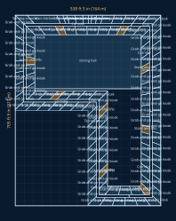

# P2-08 Briefing Halls Canteen: plan

Footprint 538 ft 5 in (164 m) × 705 ft 9 in (215 m) · structural grid 32 ft 10 in (10 m)

## Levels

| Level | Floor above deck | Height | Floor area |
|---|---|---|---|
| Level 1 · Dining floor | 0 ft (0 mm) | 17 ft 9 in (5,400 mm) | 208,591 sq ft (19,379 m²) |

## Elements

| ID | Designation | Type | Name | Level(s) | Size / length | Area | Status |
|---|---|---|---|---|---|---|---|
| E001 | D5F5P2B6A1R1 | room | Dining hall | L1 | 394 ft (120 m) × 200 ft 2 in (61 m) | 78,857 sq ft (7,326 m²) | proposed |
| E002 | D5F5P2B6A1R2 | zone | Terrace court | L1 | 394 ft (120 m) × 361 ft 3 in (110 m) | 47,243 sq ft (4,389 m²) | proposed |
| E003 | D5F5P2B6A1R3 | zone | Corridor | L1 | 401 ft 11 in (122 m) × 9 ft 10 in (3,000 mm) | 3,875 sq ft (360 m²) | proposed |
| E004 | D5F5P2B6A1R4 | zone | Corridor | L1 | 80 ft 9 in (25 m) × 326 ft 1 in (99 m) | 3,875 sq ft (360 m²) | proposed |
| E005 | D5F5P2B6A1R5 | zone | Corridor | L1 | 87 ft 3 in (27 m) × 317 ft 3 in (97 m) | 3,875 sq ft (360 m²) | proposed |
| E006 | D5F5P2B6A1R6 | zone | Corridor | L1 | 121 ft 5 in (37 m) × 288 ft 1 in (88 m) | 3,875 sq ft (360 m²) | proposed |
| E007 | D5F5P2B6A1R7 | zone | Corridor | L1 | 279 ft 2 in (85 m) × 132 ft 7 in (40 m) | 3,875 sq ft (360 m²) | proposed |
| E008 | D5F5P2B6A1R8 | zone | Corridor | L1 | 9 ft 10 in (3,000 mm) × 239 ft 2 in (73 m) | 2,273 sq ft (211 m²) | proposed |
| E009 | D5F5P2B6A1R9 | core | Stairs and lifts | L1 | 40 ft 8 in (12 m) × 31 ft 2 in (9,500 mm) | 818 sq ft (76 m²) | proposed |
| E010 | D5F5P2B6A1R10 | core | Stairs and lifts | L1 | 44 ft 11 in (14 m) × 31 ft 2 in (9,500 mm) | 818 sq ft (76 m²) | proposed |
| E011 | D5F5P2B6A1R11 | core | Stairs and lifts | L1 | 31 ft 2 in (9,500 mm) × 42 ft 8 in (13 m) | 818 sq ft (76 m²) | proposed |
| E012 | D5F5P2B6A1R12 | core | Stairs and lifts | L1 | 31 ft 2 in (9,500 mm) × 33 ft 10 in (10 m) | 823 sq ft (76 m²) | proposed |
| E013 | D5F5P2B6A1R13 | core | Stairs and lifts | L1 | 41 ft 8 in (13 m) × 43 ft 8 in (13 m) | 818 sq ft (76 m²) | proposed |
| E014 | D5F5P2B6A1R14 | core | Stairs and lifts | L1 | 31 ft 2 in (9,500 mm) × 57 ft 5 in (18 m) | 818 sq ft (76 m²) | proposed |
| E015 | D5F5P2B6A1R15 | core | Stairs and lifts | L1 | 31 ft 2 in (9,500 mm) × 57 ft 5 in (18 m) | 818 sq ft (76 m²) | proposed |
| E016 | D5F5P2B6A1R16 | core | Stairs and lifts | L1 | 57 ft 5 in (18 m) × 31 ft 2 in (9,500 mm) | 818 sq ft (76 m²) | proposed |
| E017 | D5F5P2B6A1R17 | core | Stairs and lifts | L1 | 31 ft 2 in (9,500 mm) × 29 ft 10 in (9,100 mm) | 823 sq ft (76 m²) | proposed |
| E018 | D5F5P2B6A1R18 | room | Serving counter | L1 | 70 ft 3 in (21 m) × 31 ft 2 in (9,500 mm) | 1,294 sq ft (120 m²) | proposed |
| E019 | D5F5P2B6A1R19 | room | Main kitchen | L1 | 123 ft 4 in (38 m) × 31 ft 2 in (9,500 mm) | 3,226 sq ft (300 m²) | proposed |
| E020 | D5F5P2B6A1R20 | room | Cold room | L1 | 32 ft 10 in (10 m) × 31 ft 2 in (9,500 mm) | 644 sq ft (60 m²) | proposed |
| E021 | D5F5P2B6A1R21 | room | Freezer room | L1 | 23 ft 11 in (7,300 mm) × 31 ft 2 in (9,500 mm) | 435 sq ft (40 m²) | proposed |
| E022 | D5F5P2B6A1R22 | room | Dry store | L1 | 35 ft 1 in (11 m) × 31 ft 2 in (9,500 mm) | 859 sq ft (80 m²) | proposed |
| E023 | D5F5P2B6A1R23 | room | Dishwash room | L1 | 31 ft 10 in (9,700 mm) × 31 ft 2 in (9,500 mm) | 864 sq ft (80 m²) | proposed |
| E024 | D5F5P2B6A1R24 | room | Goods-in bay | L1 | 22 ft (6,700 mm) × 31 ft 2 in (9,500 mm) | 644 sq ft (60 m²) | proposed |
| E025 | D5F5P2B6A1R25 | room | Waste and recycling room | L1 | 11 ft 10 in (3,600 mm) × 31 ft 2 in (9,500 mm) | 337 sq ft (31 m²) | proposed |
| E026 | D5F5P2B6A1R26 | room | Quick-meal counter | L1 | 20 ft (6,100 mm) × 31 ft 2 in (9,500 mm) | 542 sq ft (50 m²) | proposed |
| E027 | D5F5P2B6A1R27 | room | Toilets | L1 | 25 ft 7 in (7,800 mm) × 31 ft 2 in (9,500 mm) | 644 sq ft (60 m²) | proposed |
| E028 | D5F5P2B6A1R28 | room | Grab-and-go kiosk | L1 | 50 ft 2 in (15 m) × 31 ft 2 in (9,500 mm) | 1,294 sq ft (120 m²) | proposed |
| E029 | D5F5P2B6A1R29 | room | Grab-and-go kiosk | L1 | 55 ft 1 in (17 m) × 31 ft 2 in (9,500 mm) | 1,288 sq ft (120 m²) | proposed |
| E030 | D5F5P2B6A1R30 | room | Grab-and-go kiosk | L1 | 60 ft 4 in (18 m) × 31 ft 2 in (9,500 mm) | 1,294 sq ft (120 m²) | proposed |
| E031 | D5F5P2B6A1R31 | room | Grab-and-go kiosk | L1 | 65 ft 3 in (20 m) × 31 ft 2 in (9,500 mm) | 1,288 sq ft (120 m²) | proposed |
| E032 | D5F5P2B6A1R32 | room | Grab-and-go kiosk | L1 | 65 ft 11 in (20 m) × 35 ft 5 in (11 m) | 1,294 sq ft (120 m²) | proposed |
| E033 | D5F5P2B6A1R33 | room | Grab-and-go kiosk | L1 | 31 ft 2 in (9,500 mm) × 70 ft 3 in (21 m) | 1,288 sq ft (120 m²) | proposed |
| E034 | D5F5P2B6A1R34 | room | Grab-and-go kiosk | L1 | 31 ft 2 in (9,500 mm) × 66 ft 7 in (20 m) | 1,294 sq ft (120 m²) | proposed |
| E035 | D5F5P2B6A1R35 | room | Grab-and-go kiosk | L1 | 31 ft 2 in (9,500 mm) × 62 ft 8 in (19 m) | 1,294 sq ft (120 m²) | proposed |
| E036 | D5F5P2B6A1R36 | room | Grab-and-go kiosk | L1 | 31 ft 2 in (9,500 mm) × 58 ft 9 in (18 m) | 1,294 sq ft (120 m²) | proposed |
| E037 | D5F5P2B6A1R37 | room | Grab-and-go kiosk | L1 | 31 ft 2 in (9,500 mm) × 54 ft 9 in (17 m) | 1,288 sq ft (120 m²) | proposed |
| E038 | D5F5P2B6A1R38 | room | Grab-and-go kiosk | L1 | 31 ft 2 in (9,500 mm) × 51 ft 2 in (16 m) | 1,294 sq ft (120 m²) | proposed |
| E039 | D5F5P2B6A1R39 | room | Grab-and-go kiosk | L1 | 31 ft 2 in (9,500 mm) × 47 ft 3 in (14 m) | 1,288 sq ft (120 m²) | proposed |
| E040 | D5F5P2B6A1R40 | room | Grab-and-go kiosk | L1 | 31 ft 2 in (9,500 mm) × 43 ft 8 in (13 m) | 1,294 sq ft (120 m²) | proposed |
| E041 | D5F5P2B6A1R41 | room | Grab-and-go kiosk | L1 | 31 ft 2 in (9,500 mm) × 43 ft 8 in (13 m) | 1,294 sq ft (120 m²) | proposed |
| E042 | D5F5P2B6A1R42 | room | Grab-and-go kiosk | L1 | 31 ft 2 in (9,500 mm) × 47 ft 3 in (14 m) | 1,294 sq ft (120 m²) | proposed |
| E043 | D5F5P2B6A1R43 | room | Grab-and-go kiosk | L1 | 31 ft 2 in (9,500 mm) × 50 ft 10 in (16 m) | 1,288 sq ft (120 m²) | proposed |
| E044 | D5F5P2B6A1R44 | room | Grab-and-go kiosk | L1 | 31 ft 2 in (9,500 mm) × 54 ft 9 in (17 m) | 1,294 sq ft (120 m²) | proposed |
| E045 | D5F5P2B6A1R45 | room | Grab-and-go kiosk | L1 | 31 ft 2 in (9,500 mm) × 58 ft 5 in (18 m) | 1,288 sq ft (120 m²) | proposed |
| E046 | D5F5P2B6A1R46 | room | Grab-and-go kiosk | L1 | 31 ft 2 in (9,500 mm) × 62 ft 4 in (19 m) | 1,294 sq ft (120 m²) | proposed |
| E047 | D5F5P2B6A1R47 | room | Grab-and-go kiosk | L1 | 31 ft 2 in (9,500 mm) × 65 ft 11 in (20 m) | 1,288 sq ft (120 m²) | proposed |
| E048 | D5F5P2B6A1R48 | room | Grab-and-go kiosk | L1 | 31 ft 2 in (9,500 mm) × 70 ft 3 in (21 m) | 1,299 sq ft (121 m²) | proposed |
| E049 | D5F5P2B6A1R49 | room | Grab-and-go kiosk | L1 | 61 ft (19 m) × 37 ft 9 in (12 m) | 1,288 sq ft (120 m²) | proposed |
| E050 | D5F5P2B6A1R50 | room | Grab-and-go kiosk | L1 | 58 ft 1 in (18 m) × 31 ft 2 in (9,500 mm) | 1,294 sq ft (120 m²) | proposed |
| E051 | D5F5P2B6A1R51 | room | Grab-and-go kiosk | L1 | 47 ft 3 in (14 m) × 31 ft 2 in (9,500 mm) | 1,288 sq ft (120 m²) | proposed |
| E052 | D5F5P2B6A1R52 | room | Grab-and-go kiosk | L1 | 46 ft 11 in (14 m) × 31 ft 2 in (9,500 mm) | 1,288 sq ft (120 m²) | proposed |
| E053 | D5F5P2B6A1R53 | room | Grab-and-go kiosk | L1 | 57 ft 5 in (18 m) × 31 ft 2 in (9,500 mm) | 1,294 sq ft (120 m²) | proposed |
| E054 | D5F5P2B6A1R54 | room | Grab-and-go kiosk | L1 | 64 ft (20 m) × 35 ft 1 in (11 m) | 1,299 sq ft (121 m²) | proposed |
| E055 | D5F5P2B6A1R55 | room | Grab-and-go kiosk | L1 | 31 ft 2 in (9,500 mm) × 72 ft 6 in (22 m) | 1,288 sq ft (120 m²) | proposed |
| E056 | D5F5P2B6A1R56 | room | Grab-and-go kiosk | L1 | 31 ft 2 in (9,500 mm) × 72 ft 6 in (22 m) | 1,288 sq ft (120 m²) | proposed |
| E057 | D5F5P2B6A1R57 | room | Grab-and-go kiosk | L1 | 31 ft 2 in (9,500 mm) × 72 ft 6 in (22 m) | 1,288 sq ft (120 m²) | proposed |
| E058 | D5F5P2B6A1R58 | room | Grab-and-go kiosk | L1 | 31 ft 2 in (9,500 mm) × 72 ft 10 in (22 m) | 1,299 sq ft (121 m²) | proposed |
| E059 | D5F5P2B6A1R59 | room | Grab-and-go kiosk | L1 | 31 ft 2 in (9,500 mm) × 72 ft 6 in (22 m) | 1,288 sq ft (120 m²) | proposed |
| E060 | D5F5P2B6A1R60 | room | Grab-and-go kiosk | L1 | 31 ft 2 in (9,500 mm) × 72 ft 6 in (22 m) | 1,288 sq ft (120 m²) | proposed |
| E061 | D5F5P2B6A1R61 | room | Grab-and-go kiosk | L1 | 31 ft 2 in (9,500 mm) × 72 ft 10 in (22 m) | 1,299 sq ft (121 m²) | proposed |
| E062 | D5F5P2B6A1R62 | room | Grab-and-go kiosk | L1 | 31 ft 2 in (9,500 mm) × 72 ft 6 in (22 m) | 1,288 sq ft (120 m²) | proposed |
| E063 | D5F5P2B6A1R63 | room | Grab-and-go kiosk | L1 | 54 ft 9 in (17 m) × 48 ft 11 in (15 m) | 1,288 sq ft (120 m²) | proposed |
| E064 | D5F5P2B6A1R64 | room | Grab-and-go kiosk | L1 | 72 ft 10 in (22 m) × 31 ft 2 in (9,500 mm) | 1,299 sq ft (121 m²) | proposed |
| E065 | D5F5P2B6A1R65 | room | Grab-and-go kiosk | L1 | 72 ft 6 in (22 m) × 31 ft 2 in (9,500 mm) | 1,288 sq ft (120 m²) | proposed |
| E066 | D5F5P2B6A1R66 | room | Grab-and-go kiosk | L1 | 72 ft 6 in (22 m) × 31 ft 2 in (9,500 mm) | 1,288 sq ft (120 m²) | proposed |
| E067 | D5F5P2B6A1R67 | room | Grab-and-go kiosk | L1 | 72 ft 10 in (22 m) × 31 ft 2 in (9,500 mm) | 1,299 sq ft (121 m²) | proposed |
| E068 | D5F5P2B6A1R68 | room | Grab-and-go kiosk | L1 | 72 ft 6 in (22 m) × 31 ft 2 in (9,500 mm) | 1,288 sq ft (120 m²) | proposed |
| E069 | D5F5P2B6A1R69 | room | Grab-and-go kiosk | L1 | 69 ft 7 in (21 m) × 33 ft 10 in (10 m) | 1,288 sq ft (120 m²) | proposed |
| E070 | D5F5P2B6A1R70 | room | Grab-and-go kiosk | L1 | 31 ft 2 in (9,500 mm) × 67 ft 11 in (21 m) | 1,294 sq ft (120 m²) | proposed |
| E071 | D5F5P2B6A1R71 | room | Grab-and-go kiosk | L1 | 31 ft 2 in (9,500 mm) × 59 ft 9 in (18 m) | 1,288 sq ft (120 m²) | proposed |
| E072 | D5F5P2B6A1R72 | room | Grab-and-go kiosk | L1 | 31 ft 2 in (9,500 mm) × 52 ft 2 in (16 m) | 1,299 sq ft (121 m²) | proposed |
| E073 | D5F5P2B6A1R73 | room | Grab-and-go kiosk | L1 | 31 ft 2 in (9,500 mm) × 45 ft 3 in (14 m) | 1,288 sq ft (120 m²) | proposed |
| E074 | D5F5P2B6A1R74 | room | Grab-and-go kiosk | L1 | 31 ft 2 in (9,500 mm) × 46 ft 11 in (14 m) | 1,294 sq ft (120 m²) | proposed |
| E075 | D5F5P2B6A1R75 | room | Grab-and-go kiosk | L1 | 31 ft 2 in (9,500 mm) × 55 ft 1 in (17 m) | 1,294 sq ft (120 m²) | proposed |
| E076 | D5F5P2B6A1R76 | room | Grab-and-go kiosk | L1 | 31 ft 2 in (9,500 mm) × 63 ft (19 m) | 1,288 sq ft (120 m²) | proposed |
| E077 | D5F5P2B6A1R77 | room | Grab-and-go kiosk | L1 | 31 ft 2 in (9,500 mm) × 56 ft 9 in (17 m) | 885 sq ft (82 m²) | proposed |
| E078 | D5F5P2B6A1R78 | room | Grab-and-go kiosk | L1 | 69 ft 7 in (21 m) × 31 ft 2 in (9,500 mm) | 1,294 sq ft (120 m²) | proposed |
| E079 | D5F5P2B6A1R79 | room | Grab-and-go kiosk | L1 | 79 ft 1 in (24 m) × 31 ft 2 in (9,500 mm) | 1,820 sq ft (169 m²) | proposed |
| E080 | D5F5P2B6A1R80 | room | Grab-and-go kiosk | L1 | 51 ft 2 in (16 m) × 31 ft 2 in (9,500 mm) | 1,294 sq ft (120 m²) | proposed |
| E081 | D5F5P2B6A1R81 | room | Grab-and-go kiosk | L1 | 45 ft 3 in (14 m) × 31 ft 2 in (9,500 mm) | 1,294 sq ft (120 m²) | proposed |
| E082 | D5F5P2B6A1R82 | room | Grab-and-go kiosk | L1 | 44 ft 7 in (14 m) × 31 ft 2 in (9,500 mm) | 1,294 sq ft (120 m²) | proposed |
| E083 | D5F5P2B6A1R83 | room | Grab-and-go kiosk | L1 | 49 ft 10 in (15 m) × 31 ft 2 in (9,500 mm) | 1,288 sq ft (120 m²) | proposed |
| E084 | D5F5P2B6A1R84 | room | Grab-and-go kiosk | L1 | 48 ft 3 in (15 m) × 31 ft 2 in (9,500 mm) | 1,063 sq ft (99 m²) | proposed |
| E085 | D5F5P2B6A1R85 | room | Grab-and-go kiosk | L1 | 65 ft (20 m) × 31 ft 2 in (9,500 mm) | 1,288 sq ft (120 m²) | proposed |
| E086 | D5F5P2B6A1R86 | room | Grab-and-go kiosk | L1 | 60 ft 4 in (18 m) × 40 ft 8 in (12 m) | 1,294 sq ft (120 m²) | proposed |
| E087 | D5F5P2B6A1R87 | room | Grab-and-go kiosk | L1 | 31 ft 2 in (9,500 mm) × 69 ft 7 in (21 m) | 1,294 sq ft (120 m²) | proposed |
| E088 | D5F5P2B6A1R88 | room | Grab-and-go kiosk | L1 | 31 ft 2 in (9,500 mm) × 65 ft (20 m) | 1,288 sq ft (120 m²) | proposed |
| E089 | D5F5P2B6A1R89 | room | Grab-and-go kiosk | L1 | 31 ft 2 in (9,500 mm) × 53 ft 10 in (16 m) | 1,069 sq ft (99 m²) | proposed |
| E090 | D5F5P2B6A1R90 | room | Grab-and-go kiosk | L1 | 31 ft 2 in (9,500 mm) × 54 ft 2 in (16 m) | 1,288 sq ft (120 m²) | proposed |
| E091 | D5F5P2B6A1R91 | room | Grab-and-go kiosk | L1 | 31 ft 2 in (9,500 mm) × 49 ft 10 in (15 m) | 1,294 sq ft (120 m²) | proposed |
| E092 | D5F5P2B6A1R92 | room | Grab-and-go kiosk | L1 | 31 ft 2 in (9,500 mm) × 45 ft 7 in (14 m) | 1,294 sq ft (120 m²) | proposed |
| E093 | D5F5P2B6A1R93 | room | Grab-and-go kiosk | L1 | 31 ft 2 in (9,500 mm) × 43 ft 8 in (13 m) | 1,288 sq ft (120 m²) | proposed |
| E094 | D5F5P2B6A1R94 | room | Grab-and-go kiosk | L1 | 31 ft 2 in (9,500 mm) × 38 ft 5 in (12 m) | 1,063 sq ft (99 m²) | proposed |
| E095 | D5F5P2B6A1R95 | room | Grab-and-go kiosk | L1 | 31 ft 2 in (9,500 mm) × 52 ft 2 in (16 m) | 1,283 sq ft (119 m²) | proposed |
| E096 | D5F5P2B6A1R96 | room | Grab-and-go kiosk | L1 | 31 ft 2 in (9,500 mm) × 56 ft 9 in (17 m) | 1,294 sq ft (120 m²) | proposed |
| E097 | D5F5P2B6A1R97 | room | Grab-and-go kiosk | L1 | 31 ft 2 in (9,500 mm) × 61 ft (19 m) | 1,294 sq ft (120 m²) | proposed |
| E098 | D5F5P2B6A1R98 | room | Grab-and-go kiosk | L1 | 31 ft 2 in (9,500 mm) × 65 ft 3 in (20 m) | 1,294 sq ft (120 m²) | proposed |
| E099 | D5F5P2B6A1R99 | room | Grab-and-go kiosk | L1 | 31 ft 2 in (9,500 mm) × 62 ft (19 m) | 1,063 sq ft (99 m²) | proposed |
| E100 | D5F5P2B6A1R100 | room | Grab-and-go kiosk | L1 | 59 ft 1 in (18 m) × 31 ft 2 in (9,500 mm) | 1,294 sq ft (120 m²) | proposed |
| E101 | D5F5P2B6A1R101 | room | Grab-and-go kiosk | L1 | 49 ft 6 in (15 m) × 31 ft 2 in (9,500 mm) | 1,288 sq ft (120 m²) | proposed |
| E102 | D5F5P2B6A1R102 | room | Grab-and-go kiosk | L1 | 57 ft 1 in (17 m) × 31 ft 2 in (9,500 mm) | 1,294 sq ft (120 m²) | proposed |
| E103 | D5F5P2B6A1R103 | room | Grab-and-go kiosk | L1 | 45 ft 11 in (14 m) × 54 ft 2 in (16 m) | 1,288 sq ft (120 m²) | proposed |
| E104 | D5F5P2B6A1R104 | room | Grab-and-go kiosk | L1 | 31 ft 2 in (9,500 mm) × 65 ft 3 in (20 m) | 1,063 sq ft (99 m²) | proposed |
| E105 | D5F5P2B6A1R105 | room | Grab-and-go kiosk | L1 | 31 ft 2 in (9,500 mm) × 72 ft 10 in (22 m) | 1,299 sq ft (121 m²) | proposed |
| E106 | D5F5P2B6A1R106 | room | Grab-and-go kiosk | L1 | 31 ft 2 in (9,500 mm) × 72 ft 6 in (22 m) | 1,288 sq ft (120 m²) | proposed |
| E107 | D5F5P2B6A1R107 | room | Grab-and-go kiosk | L1 | 31 ft 2 in (9,500 mm) × 72 ft 6 in (22 m) | 1,288 sq ft (120 m²) | proposed |
| E108 | D5F5P2B6A1R108 | room | Grab-and-go kiosk | L1 | 31 ft 2 in (9,500 mm) × 72 ft 10 in (22 m) | 1,299 sq ft (121 m²) | proposed |
| E109 | D5F5P2B6A1R109 | room | Grab-and-go kiosk | L1 | 31 ft 2 in (9,500 mm) × 65 ft 3 in (20 m) | 1,063 sq ft (99 m²) | proposed |
| E110 | D5F5P2B6A1R110 | room | Grab-and-go kiosk | L1 | 31 ft 2 in (9,500 mm) × 72 ft 6 in (22 m) | 1,288 sq ft (120 m²) | proposed |
| E111 | D5F5P2B6A1R111 | room | Grab-and-go kiosk | L1 | 70 ft 6 in (22 m) × 33 ft 2 in (10 m) | 1,288 sq ft (120 m²) | proposed |
| E112 | D5F5P2B6A1R112 | room | Grab-and-go kiosk | L1 | 72 ft 10 in (22 m) × 31 ft 2 in (9,500 mm) | 1,299 sq ft (121 m²) | proposed |
| E113 | D5F5P2B6A1R113 | room | Grab-and-go kiosk | L1 | 72 ft 6 in (22 m) × 31 ft 2 in (9,500 mm) | 1,288 sq ft (120 m²) | proposed |
| E114 | D5F5P2B6A1R114 | room | Grab-and-go kiosk | L1 | 65 ft 3 in (20 m) × 31 ft 2 in (9,500 mm) | 1,063 sq ft (99 m²) | proposed |
| E115 | D5F5P2B6A1R115 | room | Grab-and-go kiosk | L1 | 72 ft 6 in (22 m) × 31 ft 2 in (9,500 mm) | 1,288 sq ft (120 m²) | proposed |
| E116 | D5F5P2B6A1R116 | room | Grab-and-go kiosk | L1 | 72 ft 10 in (22 m) × 31 ft 2 in (9,500 mm) | 1,299 sq ft (121 m²) | proposed |
| E117 | D5F5P2B6A1R117 | room | Grab-and-go kiosk | L1 | 34 ft 9 in (11 m) × 64 ft (20 m) | 1,288 sq ft (120 m²) | proposed |
| E118 | D5F5P2B6A1R118 | room | Grab-and-go kiosk | L1 | 31 ft 2 in (9,500 mm) × 57 ft 5 in (18 m) | 1,294 sq ft (120 m²) | proposed |
| E119 | D5F5P2B6A1R119 | room | Grab-and-go kiosk | L1 | 31 ft 2 in (9,500 mm) × 40 ft (12 m) | 1,058 sq ft (98 m²) | proposed |
| E120 | D5F5P2B6A1R120 | room | Grab-and-go kiosk | L1 | 31 ft 2 in (9,500 mm) × 51 ft 10 in (16 m) | 1,288 sq ft (120 m²) | proposed |
| E121 | D5F5P2B6A1R121 | room | Grab-and-go kiosk | L1 | 31 ft 2 in (9,500 mm) × 82 ft (25 m) | 1,825 sq ft (170 m²) | proposed |

## Drawings

### Level 1 · Dining floor

