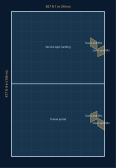
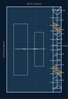
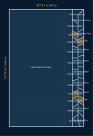

# P2-10 Briefing Halls Service Shaft: plan

Footprint 307 ft 1 in (94 m) × 477 ft 4 in (146 m) · structural grid 32 ft 10 in (10 m)

## Levels

| Level | Floor above deck | Height | Floor area |
|---|---|---|---|
| Level B1 · Service layer landing | −19 ft 8 in (6,000 mm) | 19 ft 8 in (6,000 mm) | 146,592 sq ft (13,619 m²) |
| Level 1 · Lift landing | 0 ft (0 mm) | 29 ft 6 in (9,000 mm) | 143,140 sq ft (13,298 m²) |
| Level 2 · Winding room | 29 ft 6 in (9,000 mm) | 19 ft 8 in (6,000 mm) | 143,165 sq ft (13,300 m²) |

## Elements

| ID | Designation | Type | Name | Level(s) | Size / length | Area | Status |
|---|---|---|---|---|---|---|---|
| E001 | D5F5P2B8A1L1R1, D5F5P2B8A1L2R1 | room | Shaft and lift landing | L1, L2 | 261 ft 2 in (80 m) × 477 ft 4 in (146 m) | 124,665 sq ft (11,582 m²) | proposed |
| E002 |  | fixture | Goods lift cage | L1 | 78 ft 5 in (24 m) × 286 ft 5 in (87 m) | 22,459 sq ft (2,086 m²) | proposed |
| E003 |  | fixture | Crew lift and stair | L1 | 52 ft 2 in (16 m) × 190 ft 11 in (58 m) | 9,961 sq ft (925 m²) | proposed |
| E004 | D5F5P2B8A1LB1R1, D5F5P2B8A1L1R2, D5F5P2B8A1L2R2 | core | Stairs and lifts | LB1, L1, L2 | 21 ft 8 in (6,600 mm) × 36 ft 9 in (11 m) | 572 sq ft (53 m²) | proposed |
| E005 | D5F5P2B8A1LB1R2, D5F5P2B8A1L1R3, D5F5P2B8A1L2R3 | core | Stairs and lifts | LB1, L1, L2 | 21 ft 8 in (6,600 mm) × 39 ft 1 in (12 m) | 572 sq ft (53 m²) | proposed |
| E006 | D5F5P2B8A1LB1R3, D5F5P2B8A1L1R4, D5F5P2B8A1L2R4 | core | Stairs and lifts | LB1, L1, L2 | 21 ft 8 in (6,600 mm) × 36 ft 9 in (11 m) | 572 sq ft (53 m²) | proposed |
| E007 | D5F5P2B8A1LB1R4, D5F5P2B8A1L1R5, D5F5P2B8A1L2R5 | core | Stairs and lifts | LB1, L1, L2 | 21 ft 8 in (6,600 mm) × 39 ft 1 in (12 m) | 572 sq ft (53 m²) | proposed |
| E008 | D5F5P2B8A1L1R6 | room | Lift control room | L1 | 21 ft 8 in (6,600 mm) × 45 ft 3 in (14 m) | 536 sq ft (50 m²) | proposed |
| E009 | D5F5P2B8A1L1R7 | room | Loading bay | L1 | 21 ft 8 in (6,600 mm) × 97 ft 5 in (30 m) | 1,776 sq ft (165 m²) | proposed |
| E010 | D5F5P2B8A1L1R8 | room | Crew check-in | L1 | 21 ft 8 in (6,600 mm) × 27 ft 11 in (8,500 mm) | 426 sq ft (40 m²) | proposed |
| E011 | D5F5P2B8A1L1R9 | room | Tool store | L1 | 21 ft 8 in (6,600 mm) × 44 ft 11 in (14 m) | 856 sq ft (80 m²) | proposed |
| E012 | D5F5P2B8A1L1R10 | room | Staff toilets and showers | L1 | 21 ft 8 in (6,600 mm) × 36 ft 5 in (11 m) | 749 sq ft (70 m²) | proposed |
| E013 | D5F5P2B8A1L1R11 | room | Holding store | L1 | 21 ft 8 in (6,600 mm) × 62 ft (19 m) | 1,282 sq ft (119 m²) | proposed |
| E014 | D5F5P2B8A1L1R12 | room | Holding store | L1 | 21 ft 8 in (6,600 mm) × 67 ft 7 in (21 m) | 1,282 sq ft (119 m²) | proposed |
| E015 | D5F5P2B8A1L1R13 | room | Holding store | L1 | 21 ft 8 in (6,600 mm) × 75 ft 9 in (23 m) | 1,282 sq ft (119 m²) | proposed |
| E016 | D5F5P2B8A1L1R14 | room | Holding store | L1 | 45 ft 11 in (14 m) × 44 ft (13 m) | 1,286 sq ft (119 m²) | proposed |
| E017 | D5F5P2B8A1L1R15 | room | Holding store | L1 | 21 ft 8 in (6,600 mm) × 77 ft 1 in (24 m) | 1,286 sq ft (119 m²) | proposed |
| E018 | D5F5P2B8A1L1R16 | room | Holding store | L1 | 21 ft 8 in (6,600 mm) × 48 ft 11 in (15 m) | 774 sq ft (72 m²) | proposed |
| E019 | D5F5P2B8A1L1R17 | room | Holding store | L1 | 21 ft 8 in (6,600 mm) × 65 ft 7 in (20 m) | 1,282 sq ft (119 m²) | proposed |
| E020 | D5F5P2B8A1L1R18 | room | Holding store | L1 | 21 ft 8 in (6,600 mm) × 62 ft (19 m) | 1,282 sq ft (119 m²) | proposed |
| E021 | D5F5P2B8A1L1R19 | room | Holding store | L1 | 21 ft 8 in (6,600 mm) × 64 ft 4 in (20 m) | 1,286 sq ft (119 m²) | proposed |
| E022 | D5F5P2B8A1L1R20 | room | Holding store | L1 | 21 ft 8 in (6,600 mm) × 45 ft 3 in (14 m) | 771 sq ft (72 m²) | proposed |
| E023 | D5F5P2B8A1L1R21 | room | Holding store | L1 | 21 ft 8 in (6,600 mm) × 75 ft 9 in (23 m) | 1,282 sq ft (119 m²) | proposed |
| E024 | D5F5P2B8A1L1R22 | room | Holding store | L1 | 45 ft 11 in (14 m) × 44 ft (13 m) | 1,034 sq ft (96 m²) | proposed |
| E025 | D5F5P2B8A1L2R6 | room | Winding machinery | L2 | 21 ft 8 in (6,600 mm) × 92 ft 2 in (28 m) | 1,606 sq ft (149 m²) | proposed |
| E026 | D5F5P2B8A1L2R7 | room | Shaft ventilation fans | L2 | 21 ft 8 in (6,600 mm) × 45 ft 7 in (14 m) | 707 sq ft (66 m²) | proposed |
| E027 | D5F5P2B8A1L2R8 | room | Machine gallery | L2 | 21 ft 8 in (6,600 mm) × 51 ft 10 in (16 m) | 973 sq ft (90 m²) | proposed |
| E028 | D5F5P2B8A1L2R9 | room | Machine gallery | L2 | 21 ft 8 in (6,600 mm) × 47 ft 7 in (15 m) | 977 sq ft (91 m²) | proposed |
| E029 | D5F5P2B8A1L2R10 | room | Machine gallery | L2 | 21 ft 8 in (6,600 mm) × 47 ft 3 in (14 m) | 977 sq ft (91 m²) | proposed |
| E030 | D5F5P2B8A1L2R11 | room | Machine gallery | L2 | 21 ft 8 in (6,600 mm) × 51 ft 2 in (16 m) | 977 sq ft (91 m²) | proposed |
| E031 | D5F5P2B8A1L2R12 | room | Machine gallery | L2 | 21 ft 8 in (6,600 mm) × 43 ft (13 m) | 718 sq ft (67 m²) | proposed |
| E032 | D5F5P2B8A1L2R13 | room | Machine gallery | L2 | 21 ft 8 in (6,600 mm) × 61 ft (19 m) | 973 sq ft (90 m²) | proposed |
| E033 | D5F5P2B8A1L2R14 | room | Machine gallery | L2 | 22 ft 8 in (6,900 mm) × 57 ft 9 in (18 m) | 980 sq ft (91 m²) | proposed |
| E034 | D5F5P2B8A1L2R15 | room | Machine gallery | L2 | 31 ft 10 in (9,700 mm) × 48 ft 11 in (15 m) | 980 sq ft (91 m²) | proposed |
| E035 | D5F5P2B8A1L2R16 | room | Machine gallery | L2 | 21 ft 8 in (6,600 mm) × 62 ft (19 m) | 977 sq ft (91 m²) | proposed |
| E036 | D5F5P2B8A1L2R17 | room | Machine gallery | L2 | 21 ft 8 in (6,600 mm) × 46 ft 3 in (14 m) | 718 sq ft (67 m²) | proposed |
| E037 | D5F5P2B8A1L2R18 | room | Machine gallery | L2 | 21 ft 8 in (6,600 mm) × 51 ft 10 in (16 m) | 973 sq ft (90 m²) | proposed |
| E038 | D5F5P2B8A1L2R19 | room | Machine gallery | L2 | 21 ft 8 in (6,600 mm) × 47 ft 7 in (14 m) | 977 sq ft (91 m²) | proposed |
| E039 | D5F5P2B8A1L2R20 | room | Machine gallery | L2 | 21 ft 8 in (6,600 mm) × 47 ft 3 in (14 m) | 977 sq ft (91 m²) | proposed |
| E040 | D5F5P2B8A1L2R21 | room | Machine gallery | L2 | 21 ft 8 in (6,600 mm) × 51 ft 2 in (16 m) | 977 sq ft (91 m²) | proposed |
| E041 | D5F5P2B8A1L2R22 | room | Machine gallery | L2 | 21 ft 8 in (6,600 mm) × 43 ft (13 m) | 718 sq ft (67 m²) | proposed |
| E042 | D5F5P2B8A1L2R23 | room | Machine gallery | L2 | 21 ft 8 in (6,600 mm) × 61 ft (19 m) | 973 sq ft (90 m²) | proposed |
| E043 | D5F5P2B8A1L2R24 | room | Machine gallery | L2 | 45 ft 11 in (14 m) × 57 ft 9 in (18 m) | 1,343 sq ft (125 m²) | proposed |
| E044 | D5F5P2B8A1LB1R5 | room | Service layer landing | LB1 | 307 ft 1 in (94 m) × 238 ft 6 in (73 m) | 73,245 sq ft (6,805 m²) | proposed |
| E045 | D5F5P2B8A1LB1R6 | room | Tunnel portal | LB1 | 307 ft 1 in (94 m) × 238 ft 10 in (73 m) | 73,346 sq ft (6,814 m²) | proposed |

## Drawings

### Level B1 · Service layer landing

### Level 1 · Lift landing

### Level 2 · Winding room

