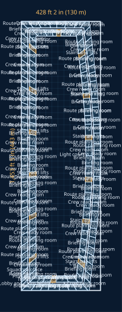
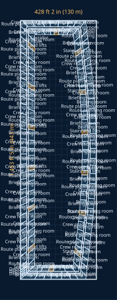

# P2-11 Briefing Annex 1: plan

Footprint 428 ft 2 in (130 m) × 1,453 ft 5 in (443 m) · structural grid 32 ft 10 in (10 m)

## Levels

| Level | Floor above deck | Height | Floor area |
|---|---|---|---|
| Level 1 · Ground floor | 0 ft (0 mm) | 15 ft 9 in (4,800 mm) | 217,690 sq ft (20,224 m²) |
| Level 2 · Briefing floor | 15 ft 9 in (4,800 mm) | 13 ft 9 in (4,200 mm) | 217,628 sq ft (20,218 m²) |

## Elements

| ID | Designation | Type | Name | Level(s) | Size / length | Area | Status |
|---|---|---|---|---|---|---|---|
| E001 | D5F5P2B3A2L1R1 | zone | Light court | L1 | 270 ft 8 in (82 m) × 1,295 ft 11 in (395 m) | 326,182 sq ft (30,303 m²) | proposed |
| E002 | D5F5P2B3A2L1R2 | zone | Corridor | L1 | 9 ft 10 in (3,000 mm) × 400 ft 7 in (122 m) | 3,875 sq ft (360 m²) | proposed |
| E003 | D5F5P2B3A2L1R3 | zone | Corridor | L1 | 9 ft 10 in (3,000 mm) × 396 ft 4 in (121 m) | 3,875 sq ft (360 m²) | proposed |
| E004 | D5F5P2B3A2L1R4 | zone | Corridor | L1 | 9 ft 10 in (3,000 mm) × 398 ft (121 m) | 3,875 sq ft (360 m²) | proposed |
| E005 | D5F5P2B3A2L1R5 | zone | Corridor | L1 | 206 ft 4 in (63 m) × 202 ft 1 in (62 m) | 3,875 sq ft (360 m²) | proposed |
| E006 | D5F5P2B3A2L1R6 | zone | Corridor | L1 | 134 ft 10 in (41 m) × 303 ft 10 in (93 m) | 3,910 sq ft (363 m²) | proposed |
| E007 | D5F5P2B3A2L1R7 | zone | Corridor | L1 | 30 ft 6 in (9,300 mm) × 393 ft 8 in (120 m) | 3,846 sq ft (357 m²) | proposed |
| E008 | D5F5P2B3A2L1R8 | zone | Corridor | L1 | 31 ft 6 in (9,600 mm) × 394 ft (120 m) | 3,849 sq ft (358 m²) | proposed |
| E009 | D5F5P2B3A2L1R9 | zone | Corridor | L1 | 141 ft 1 in (43 m) × 296 ft 7 in (90 m) | 3,913 sq ft (364 m²) | proposed |
| E010 | D5F5P2B3A2L1R10 | zone | Corridor | L1 | 198 ft 10 in (61 m) × 9 ft 10 in (3,000 mm) | 1,897 sq ft (176 m²) | proposed |
| E011 | D5F5P2B3A2L1R11, D5F5P2B3A2L2R1 | core | Stairs and lifts | L1, L2 | 34 ft 5 in (10 m) × 54 ft 9 in (17 m) | 904 sq ft (84 m²) | proposed |
| E012 | D5F5P2B3A2L1R12, D5F5P2B3A2L2R2 | core | Stairs and lifts | L1, L2 | 34 ft 5 in (10 m) × 43 ft (13 m) | 904 sq ft (84 m²) | proposed |
| E013 | D5F5P2B3A2L1R13, D5F5P2B3A2L2R3 | core | Stairs and lifts | L1, L2 | 34 ft 5 in (10 m) × 31 ft 6 in (9,600 mm) | 904 sq ft (84 m²) | proposed |
| E014 | D5F5P2B3A2L1R14, D5F5P2B3A2L2R4 | core | Stairs and lifts | L1, L2 | 34 ft 5 in (10 m) × 32 ft 10 in (10 m) | 904 sq ft (84 m²) | proposed |
| E015 | D5F5P2B3A2L1R15, D5F5P2B3A2L2R5 | core | Stairs and lifts | L1, L2 | 34 ft 5 in (10 m) × 44 ft 7 in (14 m) | 904 sq ft (84 m²) | proposed |
| E016 | D5F5P2B3A2L1R16, D5F5P2B3A2L2R6 | core | Stairs and lifts | L1, L2 | 34 ft 5 in (10 m) × 56 ft 5 in (17 m) | 904 sq ft (84 m²) | proposed |
| E017 | D5F5P2B3A2L1R17, D5F5P2B3A2L2R7 | core | Stairs and lifts | L1, L2 | 29 ft 6 in (9,000 mm) × 34 ft 5 in (10 m) | 904 sq ft (84 m²) | proposed |
| E018 | D5F5P2B3A2L1R18, D5F5P2B3A2L2R8 | core | Stairs and lifts | L1, L2 | 35 ft 1 in (11 m) × 48 ft 7 in (15 m) | 900 sq ft (84 m²) | proposed |
| E019 | D5F5P2B3A2L1R19, D5F5P2B3A2L2R9 | core | Stairs and lifts | L1, L2 | 36 ft 1 in (11 m) × 29 ft 2 in (8,900 mm) | 905 sq ft (84 m²) | proposed |
| E020 | D5F5P2B3A2L1R20, D5F5P2B3A2L2R10 | core | Stairs and lifts | L1, L2 | 35 ft 1 in (11 m) × 27 ft 3 in (8,300 mm) | 910 sq ft (85 m²) | proposed |
| E021 | D5F5P2B3A2L1R21, D5F5P2B3A2L2R11 | core | Stairs and lifts | L1, L2 | 35 ft 1 in (11 m) × 27 ft 7 in (8,400 mm) | 911 sq ft (85 m²) | proposed |
| E022 | D5F5P2B3A2L1R22, D5F5P2B3A2L2R12 | core | Stairs and lifts | L1, L2 | 36 ft 5 in (11 m) × 29 ft 6 in (9,000 mm) | 902 sq ft (84 m²) | proposed |
| E023 | D5F5P2B3A2L1R23, D5F5P2B3A2L2R13 | core | Stairs and lifts | L1, L2 | 34 ft 9 in (11 m) × 51 ft 10 in (16 m) | 911 sq ft (85 m²) | proposed |
| E024 | D5F5P2B3A2L1R24, D5F5P2B3A2L2R14 | core | Stairs and lifts | L1, L2 | 31 ft 6 in (9,600 mm) × 34 ft 5 in (10 m) | 904 sq ft (84 m²) | proposed |
| E025 | D5F5P2B3A2L1R25 | room | Lobby and room board | L1 | 34 ft 5 in (10 m) × 58 ft 9 in (18 m) | 859 sq ft (80 m²) | proposed |
| E026 | D5F5P2B3A2L1R26 | room | Toilets | L1 | 34 ft 5 in (10 m) × 51 ft 6 in (16 m) | 650 sq ft (60 m²) | proposed |
| E027 | D5F5P2B3A2L1R27 | room | Print room | L1 | 34 ft 5 in (10 m) × 44 ft (13 m) | 413 sq ft (38 m²) | proposed |
| E028 | D5F5P2B3A2L1R28 | room | Crew lounge | L1 | 34 ft 5 in (10 m) × 56 ft 1 in (17 m) | 859 sq ft (80 m²) | proposed |
| E029 | D5F5P2B3A2L1R29 | room | Squadron office | L1 | 34 ft 5 in (10 m) × 42 ft 8 in (13 m) | 429 sq ft (40 m²) | proposed |
| E030 | D5F5P2B3A2L1R30 | room | Briefing room | L1 | 34 ft 5 in (10 m) × 85 ft (26 m) | 1,944 sq ft (181 m²) | proposed |
| E031 | D5F5P2B3A2L1R31 | room | Route planning room | L1 | 34 ft 5 in (10 m) × 63 ft 8 in (19 m) | 1,288 sq ft (120 m²) | proposed |
| E032 | D5F5P2B3A2L1R32 | room | Crew ready room | L1 | 34 ft 5 in (10 m) × 71 ft 2 in (22 m) | 1,616 sq ft (150 m²) | proposed |
| E033 | D5F5P2B3A2L1R33 | room | Briefing room | L1 | 34 ft 5 in (10 m) × 78 ft 1 in (24 m) | 1,938 sq ft (180 m²) | proposed |
| E034 | D5F5P2B3A2L1R34 | room | Route planning room | L1 | 34 ft 5 in (10 m) × 56 ft 9 in (17 m) | 1,288 sq ft (120 m²) | proposed |
| E035 | D5F5P2B3A2L1R35 | room | Crew ready room | L1 | 34 ft 5 in (10 m) × 64 ft 4 in (20 m) | 1,616 sq ft (150 m²) | proposed |
| E036 | D5F5P2B3A2L1R36 | room | Briefing room | L1 | 34 ft 5 in (10 m) × 71 ft 2 in (22 m) | 1,938 sq ft (180 m²) | proposed |
| E037 | D5F5P2B3A2L1R37 | room | Route planning room | L1 | 34 ft 5 in (10 m) × 50 ft 2 in (15 m) | 1,294 sq ft (120 m²) | proposed |
| E038 | D5F5P2B3A2L1R38 | room | Crew ready room | L1 | 34 ft 5 in (10 m) × 57 ft 5 in (18 m) | 1,611 sq ft (150 m²) | proposed |
| E039 | D5F5P2B3A2L1R39 | room | Briefing room | L1 | 34 ft 5 in (10 m) × 64 ft 4 in (20 m) | 1,938 sq ft (180 m²) | proposed |
| E040 | D5F5P2B3A2L1R40 | room | Route planning room | L1 | 34 ft 5 in (10 m) × 43 ft 4 in (13 m) | 1,294 sq ft (120 m²) | proposed |
| E041 | D5F5P2B3A2L1R41 | room | Crew ready room | L1 | 34 ft 5 in (10 m) × 50 ft 6 in (15 m) | 1,611 sq ft (150 m²) | proposed |
| E042 | D5F5P2B3A2L1R42 | room | Briefing room | L1 | 34 ft 5 in (10 m) × 57 ft 9 in (18 m) | 1,938 sq ft (180 m²) | proposed |
| E043 | D5F5P2B3A2L1R43 | room | Route planning room | L1 | 34 ft 5 in (10 m) × 38 ft 9 in (12 m) | 1,294 sq ft (120 m²) | proposed |
| E044 | D5F5P2B3A2L1R44 | room | Crew ready room | L1 | 34 ft 5 in (10 m) × 49 ft 10 in (15 m) | 1,611 sq ft (150 m²) | proposed |
| E045 | D5F5P2B3A2L1R45 | room | Briefing room | L1 | 34 ft 5 in (10 m) × 62 ft (19 m) | 1,944 sq ft (181 m²) | proposed |
| E046 | D5F5P2B3A2L1R46 | room | Route planning room | L1 | 34 ft 5 in (10 m) × 45 ft 3 in (14 m) | 1,288 sq ft (120 m²) | proposed |
| E047 | D5F5P2B3A2L1R47 | room | Crew ready room | L1 | 34 ft 5 in (10 m) × 56 ft 9 in (17 m) | 1,611 sq ft (150 m²) | proposed |
| E048 | D5F5P2B3A2L1R48 | room | Briefing room | L1 | 34 ft 5 in (10 m) × 68 ft 11 in (21 m) | 1,944 sq ft (181 m²) | proposed |
| E049 | D5F5P2B3A2L1R49 | room | Route planning room | L1 | 34 ft 5 in (10 m) × 52 ft 2 in (16 m) | 1,288 sq ft (120 m²) | proposed |
| E050 | D5F5P2B3A2L1R50 | room | Crew ready room | L1 | 34 ft 5 in (10 m) × 63 ft 8 in (19 m) | 1,616 sq ft (150 m²) | proposed |
| E051 | D5F5P2B3A2L1R51 | room | Briefing room | L1 | 34 ft 5 in (10 m) × 75 ft 6 in (23 m) | 1,938 sq ft (180 m²) | proposed |
| E052 | D5F5P2B3A2L1R52 | room | Route planning room | L1 | 34 ft 5 in (10 m) × 59 ft 1 in (18 m) | 1,288 sq ft (120 m²) | proposed |
| E053 | D5F5P2B3A2L1R53 | room | Crew ready room | L1 | 34 ft 5 in (10 m) × 70 ft 6 in (22 m) | 1,616 sq ft (150 m²) | proposed |
| E054 | D5F5P2B3A2L1R54 | room | Briefing room | L1 | 34 ft 5 in (10 m) × 82 ft 4 in (25 m) | 1,938 sq ft (180 m²) | proposed |
| E055 | D5F5P2B3A2L1R55 | room | Route planning room | L1 | 34 ft 5 in (10 m) × 65 ft 11 in (20 m) | 1,294 sq ft (120 m²) | proposed |
| E056 | D5F5P2B3A2L1R56 | room | Crew ready room | L1 | 34 ft 5 in (10 m) × 77 ft 1 in (23 m) | 1,611 sq ft (150 m²) | proposed |
| E057 | D5F5P2B3A2L1R57 | room | Briefing room | L1 | 34 ft 5 in (10 m) × 89 ft 3 in (27 m) | 1,938 sq ft (180 m²) | proposed |
| E058 | D5F5P2B3A2L1R58 | room | Route planning room | L1 | 64 ft 8 in (20 m) × 38 ft 5 in (12 m) | 1,288 sq ft (120 m²) | proposed |
| E059 | D5F5P2B3A2L1R59 | room | Crew ready room | L1 | 70 ft 3 in (21 m) × 34 ft 5 in (10 m) | 1,616 sq ft (150 m²) | proposed |
| E060 | D5F5P2B3A2L1R60 | room | Briefing room | L1 | 69 ft 7 in (21 m) × 34 ft 5 in (10 m) | 1,938 sq ft (180 m²) | proposed |
| E061 | D5F5P2B3A2L1R61 | room | Route planning room | L1 | 41 ft 8 in (13 m) × 34 ft 5 in (10 m) | 1,288 sq ft (120 m²) | proposed |
| E062 | D5F5P2B3A2L1R62 | room | Crew ready room | L1 | 51 ft 6 in (16 m) × 34 ft 5 in (10 m) | 1,616 sq ft (150 m²) | proposed |
| E063 | D5F5P2B3A2L1R63 | room | Briefing room | L1 | 70 ft 3 in (21 m) × 34 ft 5 in (10 m) | 1,938 sq ft (180 m²) | proposed |
| E064 | D5F5P2B3A2L1R64 | room | Route planning room | L1 | 60 ft 4 in (18 m) × 34 ft 5 in (10 m) | 1,288 sq ft (120 m²) | proposed |
| E065 | D5F5P2B3A2L1R65 | room | Crew ready room | L1 | 52 ft 10 in (16 m) × 59 ft 1 in (18 m) | 1,616 sq ft (150 m²) | proposed |
| E066 | D5F5P2B3A2L1R66 | room | Briefing room | L1 | 38 ft 1 in (12 m) × 85 ft 8 in (26 m) | 1,952 sq ft (181 m²) | proposed |
| E067 | D5F5P2B3A2L1R67 | room | Route planning room | L1 | 36 ft 1 in (11 m) × 62 ft 8 in (19 m) | 1,293 sq ft (120 m²) | proposed |
| E068 | D5F5P2B3A2L1R68 | room | Crew ready room | L1 | 37 ft 9 in (12 m) × 68 ft 3 in (21 m) | 1,623 sq ft (151 m²) | proposed |
| E069 | D5F5P2B3A2L1R69 | room | Briefing room | L1 | 39 ft 4 in (12 m) × 72 ft 10 in (22 m) | 1,942 sq ft (180 m²) | proposed |
| E070 | D5F5P2B3A2L1R70 | room | Route planning room | L1 | 37 ft 9 in (12 m) × 50 ft 2 in (15 m) | 1,302 sq ft (121 m²) | proposed |
| E071 | D5F5P2B3A2L1R71 | room | Crew ready room | L1 | 39 ft 1 in (12 m) × 55 ft 5 in (17 m) | 1,610 sq ft (150 m²) | proposed |
| E072 | D5F5P2B3A2L1R72 | room | Briefing room | L1 | 40 ft (12 m) × 61 ft (19 m) | 1,941 sq ft (180 m²) | proposed |
| E073 | D5F5P2B3A2L1R73 | room | Route planning room | L1 | 37 ft 1 in (11 m) × 40 ft 4 in (12 m) | 1,296 sq ft (120 m²) | proposed |
| E074 | D5F5P2B3A2L1R74 | room | Crew ready room | L1 | 37 ft 9 in (12 m) × 49 ft 3 in (15 m) | 1,619 sq ft (150 m²) | proposed |
| E075 | D5F5P2B3A2L1R75 | room | Briefing room | L1 | 38 ft 5 in (12 m) × 58 ft 1 in (18 m) | 1,940 sq ft (180 m²) | proposed |
| E076 | D5F5P2B3A2L1R76 | room | Route planning room | L1 | 36 ft 9 in (11 m) × 39 ft 1 in (12 m) | 1,292 sq ft (120 m²) | proposed |
| E077 | D5F5P2B3A2L1R77 | room | Crew ready room | L1 | 35 ft 5 in (11 m) × 48 ft 3 in (15 m) | 1,617 sq ft (150 m²) | proposed |
| E078 | D5F5P2B3A2L1R78 | room | Briefing room | L1 | 36 ft 1 in (11 m) × 57 ft 1 in (17 m) | 1,940 sq ft (180 m²) | proposed |
| E079 | D5F5P2B3A2L1R79 | room | Route planning room | L1 | 35 ft 5 in (11 m) × 38 ft 1 in (12 m) | 1,295 sq ft (120 m²) | proposed |
| E080 | D5F5P2B3A2L1R80 | room | Crew ready room | L1 | 35 ft 1 in (11 m) × 46 ft 11 in (14 m) | 1,611 sq ft (150 m²) | proposed |
| E081 | D5F5P2B3A2L1R81 | room | Briefing room | L1 | 36 ft 1 in (11 m) × 56 ft 5 in (17 m) | 1,933 sq ft (180 m²) | proposed |
| E082 | D5F5P2B3A2L1R82 | room | Route planning room | L1 | 35 ft 5 in (11 m) × 38 ft 5 in (12 m) | 1,295 sq ft (120 m²) | proposed |
| E083 | D5F5P2B3A2L1R83 | room | Crew ready room | L1 | 35 ft 5 in (11 m) × 48 ft 3 in (15 m) | 1,617 sq ft (150 m²) | proposed |
| E084 | D5F5P2B3A2L1R84 | room | Briefing room | L1 | 37 ft 5 in (11 m) × 57 ft 9 in (18 m) | 1,938 sq ft (180 m²) | proposed |
| E085 | D5F5P2B3A2L1R85 | room | Route planning room | L1 | 37 ft 1 in (11 m) × 39 ft 4 in (12 m) | 1,294 sq ft (120 m²) | proposed |
| E086 | D5F5P2B3A2L1R86 | room | Crew ready room | L1 | 37 ft 9 in (12 m) × 49 ft 3 in (15 m) | 1,619 sq ft (150 m²) | proposed |
| E087 | D5F5P2B3A2L1R87 | room | Briefing room | L1 | 38 ft 5 in (12 m) × 59 ft 1 in (18 m) | 1,944 sq ft (181 m²) | proposed |
| E088 | D5F5P2B3A2L1R88 | room | Route planning room | L1 | 38 ft 5 in (12 m) × 42 ft (13 m) | 1,302 sq ft (121 m²) | proposed |
| E089 | D5F5P2B3A2L1R89 | room | Crew ready room | L1 | 39 ft 4 in (12 m) × 54 ft 6 in (17 m) | 1,620 sq ft (150 m²) | proposed |
| E090 | D5F5P2B3A2L1R90 | room | Briefing room | L1 | 40 ft (12 m) × 68 ft 7 in (21 m) | 1,955 sq ft (182 m²) | proposed |
| E091 | D5F5P2B3A2L1R91 | room | Route planning room | L1 | 37 ft 1 in (11 m) × 53 ft 10 in (16 m) | 1,288 sq ft (120 m²) | proposed |
| E092 | D5F5P2B3A2L1R92 | room | Crew ready room | L1 | 37 ft 9 in (12 m) × 67 ft 3 in (20 m) | 1,618 sq ft (150 m²) | proposed |
| E093 | D5F5P2B3A2L1R93 | room | Briefing room | L1 | 38 ft 1 in (12 m) × 80 ft 9 in (25 m) | 1,921 sq ft (178 m²) | proposed |
| E094 | D5F5P2B3A2L1R94 | room | Route planning room | L1 | 35 ft 9 in (11 m) × 66 ft 7 in (20 m) | 1,301 sq ft (121 m²) | proposed |
| E095 | D5F5P2B3A2L1R95 | room | Crew ready room | L1 | 42 ft 4 in (13 m) × 71 ft 10 in (22 m) | 1,619 sq ft (150 m²) | proposed |
| E096 | D5F5P2B3A2L1R96 | room | Briefing room | L1 | 80 ft 1 in (24 m) × 34 ft 5 in (10 m) | 1,938 sq ft (180 m²) | proposed |
| E097 | D5F5P2B3A2L1R97 | room | Route planning room | L1 | 52 ft 2 in (16 m) × 34 ft 5 in (10 m) | 1,288 sq ft (120 m²) | proposed |
| E098 | D5F5P2B3A2L1R98 | room | Crew ready room | L1 | 53 ft 6 in (16 m) × 34 ft 5 in (10 m) | 1,616 sq ft (150 m²) | proposed |
| E099 | D5F5P2B3A2L1R99 | room | Briefing room | L1 | 61 ft 8 in (19 m) × 34 ft 5 in (10 m) | 1,938 sq ft (180 m²) | proposed |
| E100 | D5F5P2B3A2L1R100 | room | Route planning room | L1 | 49 ft 10 in (15 m) × 34 ft 5 in (10 m) | 1,288 sq ft (120 m²) | proposed |
| E101 | D5F5P2B3A2L1R101 | room | Crew ready room | L1 | 67 ft 7 in (21 m) × 34 ft 5 in (10 m) | 1,616 sq ft (150 m²) | proposed |
| E102 | D5F5P2B3A2L1R102 | room | Briefing room | L1 | 76 ft 9 in (23 m) × 34 ft 5 in (10 m) | 1,616 sq ft (150 m²) | proposed |
| E103 | D5F5P2B3A2L1R103 | room | Route planning room | L1 | 34 ft 5 in (10 m) × 70 ft 10 in (22 m) | 1,288 sq ft (120 m²) | proposed |
| E104 | D5F5P2B3A2L1R104 | room | Crew ready room | L1 | 34 ft 5 in (10 m) × 93 ft 6 in (28 m) | 2,159 sq ft (201 m²) | proposed |
| E105 | D5F5P2B3A2L1R105 | room | Briefing room | L1 | 34 ft 5 in (10 m) × 82 ft 8 in (25 m) | 1,938 sq ft (180 m²) | proposed |
| E106 | D5F5P2B3A2L1R106 | room | Route planning room | L1 | 34 ft 5 in (10 m) × 61 ft 4 in (19 m) | 1,288 sq ft (120 m²) | proposed |
| E107 | D5F5P2B3A2L1R107 | room | Crew ready room | L1 | 34 ft 5 in (10 m) × 68 ft 11 in (21 m) | 1,622 sq ft (151 m²) | proposed |
| E108 | D5F5P2B3A2L1R108 | room | Briefing room | L1 | 34 ft 5 in (10 m) × 78 ft 5 in (24 m) | 2,046 sq ft (190 m²) | proposed |
| E109 | D5F5P2B3A2L1R109 | room | Route planning room | L1 | 34 ft 5 in (10 m) × 52 ft 10 in (16 m) | 1,294 sq ft (120 m²) | proposed |
| E110 | D5F5P2B3A2L1R110 | room | Crew ready room | L1 | 34 ft 5 in (10 m) × 60 ft (18 m) | 1,616 sq ft (150 m²) | proposed |
| E111 | D5F5P2B3A2L1R111 | room | Briefing room | L1 | 34 ft 5 in (10 m) × 66 ft 7 in (20 m) | 1,938 sq ft (180 m²) | proposed |
| E112 | D5F5P2B3A2L1R112 | room | Route planning room | L1 | 34 ft 5 in (10 m) × 45 ft 3 in (14 m) | 1,288 sq ft (120 m²) | proposed |
| E113 | D5F5P2B3A2L1R113 | room | Crew ready room | L1 | 34 ft 5 in (10 m) × 28 ft 7 in (8,700 mm) | 763 sq ft (71 m²) | proposed |
| E114 | D5F5P2B3A2L1R114 | room | Briefing room | L1 | 34 ft 5 in (10 m) × 59 ft 5 in (18 m) | 1,938 sq ft (180 m²) | proposed |
| E115 | D5F5P2B3A2L1R115 | room | Route planning room | L1 | 34 ft 5 in (10 m) × 38 ft 5 in (12 m) | 1,288 sq ft (120 m²) | proposed |
| E116 | D5F5P2B3A2L1R116 | room | Crew ready room | L1 | 34 ft 5 in (10 m) × 48 ft 7 in (15 m) | 1,616 sq ft (150 m²) | proposed |
| E117 | D5F5P2B3A2L1R117 | room | Briefing room | L1 | 34 ft 5 in (10 m) × 64 ft (20 m) | 2,051 sq ft (191 m²) | proposed |
| E118 | D5F5P2B3A2L1R118 | room | Route planning room | L1 | 34 ft 5 in (10 m) × 45 ft 7 in (14 m) | 1,288 sq ft (120 m²) | proposed |
| E119 | D5F5P2B3A2L1R119 | room | Crew ready room | L1 | 34 ft 5 in (10 m) × 57 ft 5 in (18 m) | 1,616 sq ft (150 m²) | proposed |
| E120 | D5F5P2B3A2L1R120 | room | Briefing room | L1 | 34 ft 5 in (10 m) × 69 ft 7 in (21 m) | 1,938 sq ft (180 m²) | proposed |
| E121 | D5F5P2B3A2L1R121 | room | Route planning room | L1 | 34 ft 5 in (10 m) × 53 ft 2 in (16 m) | 1,294 sq ft (120 m²) | proposed |
| E122 | D5F5P2B3A2L1R122 | room | Crew ready room | L1 | 34 ft 5 in (10 m) × 39 ft 1 in (12 m) | 757 sq ft (70 m²) | proposed |
| E123 | D5F5P2B3A2L1R123 | room | Briefing room | L1 | 34 ft 5 in (10 m) × 76 ft 9 in (23 m) | 1,938 sq ft (180 m²) | proposed |
| E124 | D5F5P2B3A2L1R124 | room | Route planning room | L1 | 34 ft 5 in (10 m) × 60 ft 4 in (18 m) | 1,288 sq ft (120 m²) | proposed |
| E125 | D5F5P2B3A2L1R125 | room | Crew ready room | L1 | 34 ft 5 in (10 m) × 72 ft 2 in (22 m) | 1,616 sq ft (150 m²) | proposed |
| E126 | D5F5P2B3A2L1R126 | room | Briefing room | L1 | 34 ft 5 in (10 m) × 87 ft 7 in (27 m) | 2,051 sq ft (191 m²) | proposed |
| E127 | D5F5P2B3A2L1R127 | room | Route planning room | L1 | 34 ft 5 in (10 m) × 69 ft 3 in (21 m) | 1,294 sq ft (120 m²) | proposed |
| E128 | D5F5P2B3A2L1R128 | room | Crew ready room | L1 | 45 ft 3 in (14 m) × 67 ft 11 in (21 m) | 1,616 sq ft (150 m²) | proposed |
| E129 | D5F5P2B3A2L1R129 | room | Briefing room | L1 | 80 ft 1 in (24 m) × 34 ft 5 in (10 m) | 1,933 sq ft (180 m²) | proposed |
| E130 | D5F5P2B3A2L1R130 | room | Route planning room | L1 | 49 ft 6 in (15 m) × 34 ft 5 in (10 m) | 1,294 sq ft (120 m²) | proposed |
| E131 | D5F5P2B3A2L1R131 | room | Crew ready room | L1 | 26 ft 3 in (8,000 mm) × 34 ft 5 in (10 m) | 757 sq ft (70 m²) | proposed |
| E132 | D5F5P2B3A2L1R132 | room | Briefing room | L1 | 68 ft 11 in (21 m) × 34 ft 5 in (10 m) | 1,938 sq ft (180 m²) | proposed |
| E133 | D5F5P2B3A2L1R133 | room | Route planning room | L1 | 62 ft 4 in (19 m) × 34 ft 5 in (10 m) | 1,294 sq ft (120 m²) | proposed |
| E134 | D5F5P2B3A2L1R134 | room | Crew ready room | L1 | 39 ft 1 in (12 m) × 75 ft 2 in (23 m) | 1,609 sq ft (150 m²) | proposed |
| E135 | D5F5P2B3A2L1R135 | room | Briefing room | L1 | 38 ft 5 in (12 m) × 86 ft 3 in (26 m) | 2,052 sq ft (191 m²) | proposed |
| E136 | D5F5P2B3A2L1R136 | room | Route planning room | L1 | 36 ft 9 in (11 m) × 56 ft 9 in (17 m) | 1,290 sq ft (120 m²) | proposed |
| E137 | D5F5P2B3A2L1R137 | room | Crew ready room | L1 | 38 ft 5 in (12 m) × 62 ft (19 m) | 1,619 sq ft (150 m²) | proposed |
| E138 | D5F5P2B3A2L1R138 | room | Briefing room | L1 | 40 ft (12 m) × 65 ft 11 in (20 m) | 1,941 sq ft (180 m²) | proposed |
| E139 | D5F5P2B3A2L1R139 | room | Route planning room | L1 | 38 ft 9 in (12 m) × 42 ft 8 in (13 m) | 1,301 sq ft (121 m²) | proposed |
| E140 | D5F5P2B3A2L1R140 | room | Crew ready room | L1 | 36 ft 1 in (11 m) × 25 ft 3 in (7,700 mm) | 762 sq ft (71 m²) | proposed |
| E141 | D5F5P2B3A2L1R141 | room | Briefing room | L1 | 38 ft 1 in (12 m) × 58 ft 5 in (18 m) | 1,918 sq ft (178 m²) | proposed |
| E142 | D5F5P2B3A2L1R142 | room | Route planning room | L1 | 37 ft 1 in (11 m) × 39 ft 8 in (12 m) | 1,294 sq ft (120 m²) | proposed |
| E143 | D5F5P2B3A2L1R143 | room | Crew ready room | L1 | 37 ft 5 in (11 m) × 48 ft 7 in (15 m) | 1,616 sq ft (150 m²) | proposed |
| E144 | D5F5P2B3A2L1R144 | room | Briefing room | L1 | 35 ft 9 in (11 m) × 60 ft 8 in (18 m) | 2,047 sq ft (190 m²) | proposed |
| E145 | D5F5P2B3A2L1R145 | room | Route planning room | L1 | 35 ft 5 in (11 m) × 38 ft 1 in (12 m) | 1,289 sq ft (120 m²) | proposed |
| E146 | D5F5P2B3A2L1R146 | room | Crew ready room | L1 | 35 ft 9 in (11 m) × 47 ft 3 in (14 m) | 1,617 sq ft (150 m²) | proposed |
| E147 | D5F5P2B3A2L1R147 | room | Briefing room | L1 | 35 ft 9 in (11 m) × 56 ft 5 in (17 m) | 1,933 sq ft (180 m²) | proposed |
| E148 | D5F5P2B3A2L1R148 | room | Route planning room | L1 | 35 ft 5 in (11 m) × 38 ft 5 in (12 m) | 1,295 sq ft (120 m²) | proposed |
| E149 | D5F5P2B3A2L1R149 | room | Crew ready room | L1 | 35 ft 1 in (11 m) × 23 ft (7,000 mm) | 758 sq ft (70 m²) | proposed |
| E150 | D5F5P2B3A2L1R150 | room | Briefing room | L1 | 36 ft 9 in (11 m) × 57 ft 9 in (18 m) | 1,936 sq ft (180 m²) | proposed |
| E151 | D5F5P2B3A2L1R151 | room | Route planning room | L1 | 37 ft 1 in (11 m) × 39 ft 4 in (12 m) | 1,294 sq ft (120 m²) | proposed |
| E152 | D5F5P2B3A2L1R152 | room | Crew ready room | L1 | 37 ft 9 in (12 m) × 48 ft 11 in (15 m) | 1,618 sq ft (150 m²) | proposed |
| E153 | D5F5P2B3A2L1R153 | room | Briefing room | L1 | 38 ft 5 in (12 m) × 62 ft (19 m) | 2,047 sq ft (190 m²) | proposed |
| E154 | D5F5P2B3A2L1R154 | room | Route planning room | L1 | 38 ft 5 in (12 m) × 43 ft 4 in (13 m) | 1,296 sq ft (120 m²) | proposed |
| E155 | D5F5P2B3A2L1R155 | room | Crew ready room | L1 | 38 ft 9 in (12 m) × 56 ft 9 in (17 m) | 1,608 sq ft (149 m²) | proposed |
| E156 | D5F5P2B3A2L1R156 | room | Briefing room | L1 | 39 ft 4 in (12 m) × 71 ft 6 in (22 m) | 1,938 sq ft (180 m²) | proposed |
| E157 | D5F5P2B3A2L1R157 | room | Route planning room | L1 | 36 ft 9 in (11 m) × 57 ft 5 in (18 m) | 1,293 sq ft (120 m²) | proposed |
| E158 | D5F5P2B3A2L1R158 | room | Crew ready room | L1 | 34 ft 5 in (10 m) × 44 ft 11 in (14 m) | 755 sq ft (70 m²) | proposed |
| E159 | D5F5P2B3A2L1R159 | room | Briefing room | L1 | 37 ft 9 in (12 m) × 85 ft 8 in (26 m) | 1,934 sq ft (180 m²) | proposed |
| E160 | D5F5P2B3A2L1R160 | room | Route planning room | L1 | 49 ft 6 in (15 m) × 51 ft 10 in (16 m) | 1,291 sq ft (120 m²) | proposed |
| E161 | D5F5P2B3A2L1R161 | room | Crew ready room | L1 | 66 ft 7 in (20 m) × 34 ft 5 in (10 m) | 1,616 sq ft (150 m²) | proposed |
| E162 | D5F5P2B3A2L1R162 | room | Briefing room | L1 | 67 ft 3 in (20 m) × 34 ft 5 in (10 m) | 2,051 sq ft (191 m²) | proposed |
| E163 | D5F5P2B3A2L1R163 | room | Route planning room | L1 | 51 ft 2 in (16 m) × 34 ft 5 in (10 m) | 1,294 sq ft (120 m²) | proposed |
| E164 | D5F5P2B3A2L1R164 | room | Crew ready room | L1 | 88 ft 11 in (27 m) × 34 ft 5 in (10 m) | 2,153 sq ft (200 m²) | proposed |
| E165 | D5F5P2B3A2L2R15 | zone | Corridor | L2 | 9 ft 10 in (3,000 mm) × 400 ft 7 in (122 m) | 3,875 sq ft (360 m²) | proposed |
| E166 | D5F5P2B3A2L2R16 | zone | Corridor | L2 | 9 ft 10 in (3,000 mm) × 396 ft 4 in (121 m) | 3,875 sq ft (360 m²) | proposed |
| E167 | D5F5P2B3A2L2R17 | zone | Corridor | L2 | 9 ft 10 in (3,000 mm) × 398 ft (121 m) | 3,875 sq ft (360 m²) | proposed |
| E168 | D5F5P2B3A2L2R18 | zone | Corridor | L2 | 206 ft 4 in (63 m) × 202 ft 1 in (62 m) | 3,875 sq ft (360 m²) | proposed |
| E169 | D5F5P2B3A2L2R19 | zone | Corridor | L2 | 134 ft 10 in (41 m) × 303 ft 10 in (93 m) | 3,910 sq ft (363 m²) | proposed |
| E170 | D5F5P2B3A2L2R20 | zone | Corridor | L2 | 30 ft 6 in (9,300 mm) × 393 ft 8 in (120 m) | 3,846 sq ft (357 m²) | proposed |
| E171 | D5F5P2B3A2L2R21 | zone | Corridor | L2 | 31 ft 6 in (9,600 mm) × 394 ft (120 m) | 3,849 sq ft (358 m²) | proposed |
| E172 | D5F5P2B3A2L2R22 | zone | Corridor | L2 | 141 ft 1 in (43 m) × 296 ft 7 in (90 m) | 3,913 sq ft (364 m²) | proposed |
| E173 | D5F5P2B3A2L2R23 | zone | Corridor | L2 | 198 ft 10 in (61 m) × 9 ft 10 in (3,000 mm) | 1,897 sq ft (176 m²) | proposed |
| E174 | D5F5P2B3A2L2R24 | room | Debrief room | L2 | 34 ft 5 in (10 m) × 46 ft 7 in (14 m) | 429 sq ft (40 m²) | proposed |
| E175 | D5F5P2B3A2L2R25 | room | Debrief room | L2 | 34 ft 5 in (10 m) × 45 ft 11 in (14 m) | 429 sq ft (40 m²) | proposed |
| E176 | D5F5P2B3A2L2R26 | room | Debrief room | L2 | 34 ft 5 in (10 m) × 45 ft 7 in (14 m) | 435 sq ft (40 m²) | proposed |
| E177 | D5F5P2B3A2L2R27 | room | Tea point | L2 | 34 ft 5 in (10 m) × 44 ft 3 in (14 m) | 413 sq ft (38 m²) | proposed |
| E178 | D5F5P2B3A2L2R28 | room | Toilets | L2 | 34 ft 5 in (10 m) × 50 ft 2 in (15 m) | 644 sq ft (60 m²) | proposed |
| E179 | D5F5P2B3A2L2R29 | room | Briefing room | L2 | 34 ft 5 in (10 m) × 85 ft 11 in (26 m) | 1,938 sq ft (180 m²) | proposed |
| E180 | D5F5P2B3A2L2R30 | room | Route planning room | L2 | 34 ft 5 in (10 m) × 65 ft (20 m) | 1,294 sq ft (120 m²) | proposed |
| E181 | D5F5P2B3A2L2R31 | room | Crew ready room | L2 | 34 ft 5 in (10 m) × 72 ft 2 in (22 m) | 1,611 sq ft (150 m²) | proposed |
| E182 | D5F5P2B3A2L2R32 | room | Briefing room | L2 | 34 ft 5 in (10 m) × 79 ft 5 in (24 m) | 1,944 sq ft (181 m²) | proposed |
| E183 | D5F5P2B3A2L2R33 | room | Route planning room | L2 | 34 ft 5 in (10 m) × 58 ft 1 in (18 m) | 1,288 sq ft (120 m²) | proposed |
| E184 | D5F5P2B3A2L2R34 | room | Crew ready room | L2 | 34 ft 5 in (10 m) × 65 ft 3 in (20 m) | 1,611 sq ft (150 m²) | proposed |
| E185 | D5F5P2B3A2L2R35 | room | Briefing room | L2 | 34 ft 5 in (10 m) × 72 ft 6 in (22 m) | 1,944 sq ft (181 m²) | proposed |
| E186 | D5F5P2B3A2L2R36 | room | Route planning room | L2 | 34 ft 5 in (10 m) × 51 ft 2 in (16 m) | 1,288 sq ft (120 m²) | proposed |
| E187 | D5F5P2B3A2L2R37 | room | Crew ready room | L2 | 34 ft 5 in (10 m) × 58 ft 9 in (18 m) | 1,616 sq ft (150 m²) | proposed |
| E188 | D5F5P2B3A2L2R38 | room | Briefing room | L2 | 34 ft 5 in (10 m) × 65 ft 7 in (20 m) | 1,938 sq ft (180 m²) | proposed |
| E189 | D5F5P2B3A2L2R39 | room | Route planning room | L2 | 34 ft 5 in (10 m) × 44 ft 3 in (14 m) | 1,288 sq ft (120 m²) | proposed |
| E190 | D5F5P2B3A2L2R40 | room | Crew ready room | L2 | 34 ft 5 in (10 m) × 51 ft 10 in (16 m) | 1,616 sq ft (150 m²) | proposed |
| E191 | D5F5P2B3A2L2R41 | room | Briefing room | L2 | 34 ft 5 in (10 m) × 58 ft 9 in (18 m) | 1,938 sq ft (180 m²) | proposed |
| E192 | D5F5P2B3A2L2R42 | room | Route planning room | L2 | 34 ft 5 in (10 m) × 38 ft 5 in (12 m) | 1,294 sq ft (120 m²) | proposed |
| E193 | D5F5P2B3A2L2R43 | room | Crew ready room | L2 | 34 ft 5 in (10 m) × 48 ft 7 in (15 m) | 1,611 sq ft (150 m²) | proposed |
| E194 | D5F5P2B3A2L2R44 | room | Briefing room | L2 | 34 ft 5 in (10 m) × 60 ft 8 in (18 m) | 1,938 sq ft (180 m²) | proposed |
| E195 | D5F5P2B3A2L2R45 | room | Route planning room | L2 | 34 ft 5 in (10 m) × 44 ft 3 in (14 m) | 1,294 sq ft (120 m²) | proposed |
| E196 | D5F5P2B3A2L2R46 | room | Crew ready room | L2 | 34 ft 5 in (10 m) × 55 ft 5 in (17 m) | 1,611 sq ft (150 m²) | proposed |
| E197 | D5F5P2B3A2L2R47 | room | Briefing room | L2 | 34 ft 5 in (10 m) × 67 ft 7 in (21 m) | 1,938 sq ft (180 m²) | proposed |
| E198 | D5F5P2B3A2L2R48 | room | Route planning room | L2 | 34 ft 5 in (10 m) × 51 ft 2 in (16 m) | 1,294 sq ft (120 m²) | proposed |
| E199 | D5F5P2B3A2L2R49 | room | Crew ready room | L2 | 34 ft 5 in (10 m) × 62 ft 4 in (19 m) | 1,611 sq ft (150 m²) | proposed |
| E200 | D5F5P2B3A2L2R50 | room | Briefing room | L2 | 34 ft 5 in (10 m) × 74 ft 6 in (23 m) | 1,944 sq ft (181 m²) | proposed |
| E201 | D5F5P2B3A2L2R51 | room | Route planning room | L2 | 34 ft 5 in (10 m) × 57 ft 9 in (18 m) | 1,288 sq ft (120 m²) | proposed |
| E202 | D5F5P2B3A2L2R52 | room | Crew ready room | L2 | 34 ft 5 in (10 m) × 69 ft 3 in (21 m) | 1,611 sq ft (150 m²) | proposed |
| E203 | D5F5P2B3A2L2R53 | room | Briefing room | L2 | 34 ft 5 in (10 m) × 81 ft 4 in (25 m) | 1,944 sq ft (181 m²) | proposed |
| E204 | D5F5P2B3A2L2R54 | room | Route planning room | L2 | 34 ft 5 in (10 m) × 64 ft 8 in (20 m) | 1,288 sq ft (120 m²) | proposed |
| E205 | D5F5P2B3A2L2R55 | room | Crew ready room | L2 | 34 ft 5 in (10 m) × 76 ft 1 in (23 m) | 1,616 sq ft (150 m²) | proposed |
| E206 | D5F5P2B3A2L2R56 | room | Briefing room | L2 | 34 ft 5 in (10 m) × 87 ft 11 in (27 m) | 1,938 sq ft (180 m²) | proposed |
| E207 | D5F5P2B3A2L2R57 | room | Route planning room | L2 | 42 ft 4 in (13 m) × 62 ft 8 in (19 m) | 1,294 sq ft (120 m²) | proposed |
| E208 | D5F5P2B3A2L2R58 | room | Crew ready room | L2 | 75 ft 2 in (23 m) × 34 ft 5 in (10 m) | 1,611 sq ft (150 m²) | proposed |
| E209 | D5F5P2B3A2L2R59 | room | Briefing room | L2 | 74 ft 6 in (23 m) × 34 ft 5 in (10 m) | 1,933 sq ft (180 m²) | proposed |
| E210 | D5F5P2B3A2L2R60 | room | Route planning room | L2 | 46 ft 11 in (14 m) × 34 ft 5 in (10 m) | 1,300 sq ft (121 m²) | proposed |
| E211 | D5F5P2B3A2L2R61 | room | Crew ready room | L2 | 51 ft 2 in (16 m) × 34 ft 5 in (10 m) | 1,611 sq ft (150 m²) | proposed |
| E212 | D5F5P2B3A2L2R62 | room | Briefing room | L2 | 65 ft (20 m) × 34 ft 5 in (10 m) | 1,933 sq ft (180 m²) | proposed |
| E213 | D5F5P2B3A2L2R63 | room | Route planning room | L2 | 55 ft 9 in (17 m) × 34 ft 5 in (10 m) | 1,300 sq ft (121 m²) | proposed |
| E214 | D5F5P2B3A2L2R64 | room | Crew ready room | L2 | 71 ft 10 in (22 m) × 35 ft 5 in (11 m) | 1,607 sq ft (149 m²) | proposed |
| E215 | D5F5P2B3A2L2R65 | room | Briefing room | L2 | 37 ft 5 in (11 m) × 87 ft 11 in (27 m) | 1,935 sq ft (180 m²) | proposed |
| E216 | D5F5P2B3A2L2R66 | room | Route planning room | L2 | 35 ft 9 in (11 m) × 65 ft (20 m) | 1,290 sq ft (120 m²) | proposed |
| E217 | D5F5P2B3A2L2R67 | room | Crew ready room | L2 | 37 ft 5 in (11 m) × 70 ft 6 in (22 m) | 1,616 sq ft (150 m²) | proposed |
| E218 | D5F5P2B3A2L2R68 | room | Briefing room | L2 | 39 ft 1 in (12 m) × 75 ft 2 in (23 m) | 1,939 sq ft (180 m²) | proposed |
| E219 | D5F5P2B3A2L2R69 | room | Route planning room | L2 | 37 ft 1 in (11 m) × 52 ft 6 in (16 m) | 1,291 sq ft (120 m²) | proposed |
| E220 | D5F5P2B3A2L2R70 | room | Crew ready room | L2 | 38 ft 9 in (12 m) × 57 ft 9 in (18 m) | 1,607 sq ft (149 m²) | proposed |
| E221 | D5F5P2B3A2L2R71 | room | Briefing room | L2 | 40 ft 8 in (12 m) × 62 ft 8 in (19 m) | 1,945 sq ft (181 m²) | proposed |
| E222 | D5F5P2B3A2L2R72 | room | Route planning room | L2 | 37 ft 5 in (11 m) × 41 ft (12 m) | 1,297 sq ft (121 m²) | proposed |
| E223 | D5F5P2B3A2L2R73 | room | Crew ready room | L2 | 37 ft 9 in (12 m) × 49 ft 6 in (15 m) | 1,620 sq ft (150 m²) | proposed |
| E224 | D5F5P2B3A2L2R74 | room | Briefing room | L2 | 38 ft 5 in (12 m) × 58 ft 5 in (18 m) | 1,937 sq ft (180 m²) | proposed |
| E225 | D5F5P2B3A2L2R75 | room | Route planning room | L2 | 37 ft 1 in (11 m) × 39 ft 4 in (12 m) | 1,294 sq ft (120 m²) | proposed |
| E226 | D5F5P2B3A2L2R76 | room | Crew ready room | L2 | 36 ft 1 in (11 m) × 48 ft 3 in (15 m) | 1,608 sq ft (149 m²) | proposed |
| E227 | D5F5P2B3A2L2R77 | room | Briefing room | L2 | 35 ft 9 in (11 m) × 57 ft 5 in (18 m) | 1,931 sq ft (179 m²) | proposed |
| E228 | D5F5P2B3A2L2R78 | room | Route planning room | L2 | 35 ft 5 in (11 m) × 38 ft 5 in (12 m) | 1,295 sq ft (120 m²) | proposed |
| E229 | D5F5P2B3A2L2R79 | room | Crew ready room | L2 | 35 ft 5 in (11 m) × 47 ft 3 in (14 m) | 1,617 sq ft (150 m²) | proposed |
| E230 | D5F5P2B3A2L2R80 | room | Briefing room | L2 | 35 ft 9 in (11 m) × 56 ft 5 in (17 m) | 1,933 sq ft (180 m²) | proposed |
| E231 | D5F5P2B3A2L2R81 | room | Route planning room | L2 | 35 ft 5 in (11 m) × 38 ft 5 in (12 m) | 1,295 sq ft (120 m²) | proposed |
| E232 | D5F5P2B3A2L2R82 | room | Crew ready room | L2 | 35 ft 5 in (11 m) × 47 ft 11 in (15 m) | 1,612 sq ft (150 m²) | proposed |
| E233 | D5F5P2B3A2L2R83 | room | Briefing room | L2 | 36 ft 5 in (11 m) × 57 ft 9 in (18 m) | 1,941 sq ft (180 m²) | proposed |
| E234 | D5F5P2B3A2L2R84 | room | Route planning room | L2 | 37 ft 1 in (11 m) × 39 ft 4 in (12 m) | 1,294 sq ft (120 m²) | proposed |
| E235 | D5F5P2B3A2L2R85 | room | Crew ready room | L2 | 37 ft 9 in (12 m) × 49 ft 3 in (15 m) | 1,619 sq ft (150 m²) | proposed |
| E236 | D5F5P2B3A2L2R86 | room | Briefing room | L2 | 38 ft 5 in (12 m) × 59 ft 1 in (18 m) | 1,949 sq ft (181 m²) | proposed |
| E237 | D5F5P2B3A2L2R87 | room | Route planning room | L2 | 37 ft 1 in (11 m) × 40 ft 8 in (12 m) | 1,291 sq ft (120 m²) | proposed |
| E238 | D5F5P2B3A2L2R88 | room | Crew ready room | L2 | 39 ft 4 in (12 m) × 52 ft 6 in (16 m) | 1,614 sq ft (150 m²) | proposed |
| E239 | D5F5P2B3A2L2R89 | room | Briefing room | L2 | 40 ft (12 m) × 66 ft 3 in (20 m) | 1,940 sq ft (180 m²) | proposed |
| E240 | D5F5P2B3A2L2R90 | room | Route planning room | L2 | 37 ft 5 in (11 m) × 51 ft 6 in (16 m) | 1,286 sq ft (120 m²) | proposed |
| E241 | D5F5P2B3A2L2R91 | room | Crew ready room | L2 | 38 ft 1 in (12 m) × 65 ft (20 m) | 1,625 sq ft (151 m²) | proposed |
| E242 | D5F5P2B3A2L2R92 | room | Briefing room | L2 | 38 ft 9 in (12 m) × 78 ft 5 in (24 m) | 1,938 sq ft (180 m²) | proposed |
| E243 | D5F5P2B3A2L2R93 | room | Route planning room | L2 | 36 ft 1 in (11 m) × 64 ft 4 in (20 m) | 1,303 sq ft (121 m²) | proposed |
| E244 | D5F5P2B3A2L2R94 | room | Crew ready room | L2 | 36 ft 5 in (11 m) × 77 ft 1 in (24 m) | 1,608 sq ft (149 m²) | proposed |
| E245 | D5F5P2B3A2L2R95 | room | Briefing room | L2 | 67 ft 11 in (21 m) × 51 ft 2 in (16 m) | 1,944 sq ft (181 m²) | proposed |
| E246 | D5F5P2B3A2L2R96 | room | Route planning room | L2 | 57 ft 1 in (17 m) × 34 ft 5 in (10 m) | 1,294 sq ft (120 m²) | proposed |
| E247 | D5F5P2B3A2L2R97 | room | Crew ready room | L2 | 58 ft 1 in (18 m) × 34 ft 5 in (10 m) | 1,611 sq ft (150 m²) | proposed |
| E248 | D5F5P2B3A2L2R98 | room | Briefing room | L2 | 61 ft 8 in (19 m) × 34 ft 5 in (10 m) | 1,938 sq ft (180 m²) | proposed |
| E249 | D5F5P2B3A2L2R99 | room | Route planning room | L2 | 45 ft 3 in (14 m) × 34 ft 5 in (10 m) | 1,294 sq ft (120 m²) | proposed |
| E250 | D5F5P2B3A2L2R100 | room | Crew ready room | L2 | 62 ft 8 in (19 m) × 34 ft 5 in (10 m) | 1,611 sq ft (150 m²) | proposed |
| E251 | D5F5P2B3A2L2R101 | room | Briefing room | L2 | 99 ft 5 in (30 m) × 34 ft 5 in (10 m) | 2,481 sq ft (230 m²) | proposed |
| E252 | D5F5P2B3A2L2R102 | room | Route planning room | L2 | 34 ft 5 in (10 m) × 70 ft 10 in (22 m) | 1,288 sq ft (120 m²) | proposed |
| E253 | D5F5P2B3A2L2R103 | room | Crew ready room | L2 | 34 ft 5 in (10 m) × 93 ft 6 in (28 m) | 2,159 sq ft (201 m²) | proposed |
| E254 | D5F5P2B3A2L2R104 | room | Briefing room | L2 | 34 ft 5 in (10 m) × 82 ft 8 in (25 m) | 1,938 sq ft (180 m²) | proposed |
| E255 | D5F5P2B3A2L2R105 | room | Route planning room | L2 | 34 ft 5 in (10 m) × 61 ft 4 in (19 m) | 1,288 sq ft (120 m²) | proposed |
| E256 | D5F5P2B3A2L2R106 | room | Crew ready room | L2 | 34 ft 5 in (10 m) × 68 ft 11 in (21 m) | 1,622 sq ft (151 m²) | proposed |
| E257 | D5F5P2B3A2L2R107 | room | Briefing room | L2 | 34 ft 5 in (10 m) × 78 ft 5 in (24 m) | 2,046 sq ft (190 m²) | proposed |
| E258 | D5F5P2B3A2L2R108 | room | Route planning room | L2 | 34 ft 5 in (10 m) × 52 ft 10 in (16 m) | 1,294 sq ft (120 m²) | proposed |
| E259 | D5F5P2B3A2L2R109 | room | Crew ready room | L2 | 34 ft 5 in (10 m) × 60 ft (18 m) | 1,616 sq ft (150 m²) | proposed |
| E260 | D5F5P2B3A2L2R110 | room | Briefing room | L2 | 34 ft 5 in (10 m) × 66 ft 7 in (20 m) | 1,938 sq ft (180 m²) | proposed |
| E261 | D5F5P2B3A2L2R111 | room | Route planning room | L2 | 34 ft 5 in (10 m) × 45 ft 3 in (14 m) | 1,288 sq ft (120 m²) | proposed |
| E262 | D5F5P2B3A2L2R112 | room | Crew ready room | L2 | 34 ft 5 in (10 m) × 28 ft 7 in (8,700 mm) | 763 sq ft (71 m²) | proposed |
| E263 | D5F5P2B3A2L2R113 | room | Briefing room | L2 | 34 ft 5 in (10 m) × 59 ft 5 in (18 m) | 1,938 sq ft (180 m²) | proposed |
| E264 | D5F5P2B3A2L2R114 | room | Route planning room | L2 | 34 ft 5 in (10 m) × 38 ft 5 in (12 m) | 1,288 sq ft (120 m²) | proposed |
| E265 | D5F5P2B3A2L2R115 | room | Crew ready room | L2 | 34 ft 5 in (10 m) × 48 ft 7 in (15 m) | 1,616 sq ft (150 m²) | proposed |
| E266 | D5F5P2B3A2L2R116 | room | Briefing room | L2 | 34 ft 5 in (10 m) × 64 ft (20 m) | 2,051 sq ft (191 m²) | proposed |
| E267 | D5F5P2B3A2L2R117 | room | Route planning room | L2 | 34 ft 5 in (10 m) × 45 ft 7 in (14 m) | 1,288 sq ft (120 m²) | proposed |
| E268 | D5F5P2B3A2L2R118 | room | Crew ready room | L2 | 34 ft 5 in (10 m) × 57 ft 5 in (18 m) | 1,616 sq ft (150 m²) | proposed |
| E269 | D5F5P2B3A2L2R119 | room | Briefing room | L2 | 34 ft 5 in (10 m) × 69 ft 7 in (21 m) | 1,938 sq ft (180 m²) | proposed |
| E270 | D5F5P2B3A2L2R120 | room | Route planning room | L2 | 34 ft 5 in (10 m) × 53 ft 2 in (16 m) | 1,294 sq ft (120 m²) | proposed |
| E271 | D5F5P2B3A2L2R121 | room | Crew ready room | L2 | 34 ft 5 in (10 m) × 39 ft 1 in (12 m) | 757 sq ft (70 m²) | proposed |
| E272 | D5F5P2B3A2L2R122 | room | Briefing room | L2 | 34 ft 5 in (10 m) × 76 ft 9 in (23 m) | 1,938 sq ft (180 m²) | proposed |
| E273 | D5F5P2B3A2L2R123 | room | Route planning room | L2 | 34 ft 5 in (10 m) × 60 ft 4 in (18 m) | 1,288 sq ft (120 m²) | proposed |
| E274 | D5F5P2B3A2L2R124 | room | Crew ready room | L2 | 34 ft 5 in (10 m) × 72 ft 2 in (22 m) | 1,616 sq ft (150 m²) | proposed |
| E275 | D5F5P2B3A2L2R125 | room | Briefing room | L2 | 34 ft 5 in (10 m) × 87 ft 7 in (27 m) | 2,051 sq ft (191 m²) | proposed |
| E276 | D5F5P2B3A2L2R126 | room | Route planning room | L2 | 34 ft 5 in (10 m) × 69 ft 3 in (21 m) | 1,294 sq ft (120 m²) | proposed |
| E277 | D5F5P2B3A2L2R127 | room | Crew ready room | L2 | 45 ft 3 in (14 m) × 67 ft 11 in (21 m) | 1,616 sq ft (150 m²) | proposed |
| E278 | D5F5P2B3A2L2R128 | room | Briefing room | L2 | 80 ft 1 in (24 m) × 34 ft 5 in (10 m) | 1,933 sq ft (180 m²) | proposed |
| E279 | D5F5P2B3A2L2R129 | room | Route planning room | L2 | 49 ft 6 in (15 m) × 34 ft 5 in (10 m) | 1,294 sq ft (120 m²) | proposed |
| E280 | D5F5P2B3A2L2R130 | room | Crew ready room | L2 | 26 ft 3 in (8,000 mm) × 34 ft 5 in (10 m) | 757 sq ft (70 m²) | proposed |
| E281 | D5F5P2B3A2L2R131 | room | Briefing room | L2 | 68 ft 11 in (21 m) × 34 ft 5 in (10 m) | 1,938 sq ft (180 m²) | proposed |
| E282 | D5F5P2B3A2L2R132 | room | Route planning room | L2 | 62 ft 4 in (19 m) × 34 ft 5 in (10 m) | 1,294 sq ft (120 m²) | proposed |
| E283 | D5F5P2B3A2L2R133 | room | Crew ready room | L2 | 39 ft 1 in (12 m) × 75 ft 2 in (23 m) | 1,609 sq ft (150 m²) | proposed |
| E284 | D5F5P2B3A2L2R134 | room | Briefing room | L2 | 38 ft 5 in (12 m) × 86 ft 3 in (26 m) | 2,052 sq ft (191 m²) | proposed |
| E285 | D5F5P2B3A2L2R135 | room | Route planning room | L2 | 36 ft 9 in (11 m) × 56 ft 9 in (17 m) | 1,290 sq ft (120 m²) | proposed |
| E286 | D5F5P2B3A2L2R136 | room | Crew ready room | L2 | 38 ft 5 in (12 m) × 62 ft (19 m) | 1,619 sq ft (150 m²) | proposed |
| E287 | D5F5P2B3A2L2R137 | room | Briefing room | L2 | 40 ft (12 m) × 65 ft 11 in (20 m) | 1,941 sq ft (180 m²) | proposed |
| E288 | D5F5P2B3A2L2R138 | room | Route planning room | L2 | 38 ft 9 in (12 m) × 42 ft 8 in (13 m) | 1,301 sq ft (121 m²) | proposed |
| E289 | D5F5P2B3A2L2R139 | room | Crew ready room | L2 | 36 ft 1 in (11 m) × 25 ft 3 in (7,700 mm) | 762 sq ft (71 m²) | proposed |
| E290 | D5F5P2B3A2L2R140 | room | Briefing room | L2 | 38 ft 1 in (12 m) × 58 ft 5 in (18 m) | 1,918 sq ft (178 m²) | proposed |
| E291 | D5F5P2B3A2L2R141 | room | Route planning room | L2 | 37 ft 1 in (11 m) × 39 ft 8 in (12 m) | 1,294 sq ft (120 m²) | proposed |
| E292 | D5F5P2B3A2L2R142 | room | Crew ready room | L2 | 37 ft 5 in (11 m) × 48 ft 7 in (15 m) | 1,616 sq ft (150 m²) | proposed |
| E293 | D5F5P2B3A2L2R143 | room | Briefing room | L2 | 35 ft 9 in (11 m) × 60 ft 8 in (18 m) | 2,047 sq ft (190 m²) | proposed |
| E294 | D5F5P2B3A2L2R144 | room | Route planning room | L2 | 35 ft 5 in (11 m) × 38 ft 1 in (12 m) | 1,289 sq ft (120 m²) | proposed |
| E295 | D5F5P2B3A2L2R145 | room | Crew ready room | L2 | 35 ft 9 in (11 m) × 47 ft 3 in (14 m) | 1,617 sq ft (150 m²) | proposed |
| E296 | D5F5P2B3A2L2R146 | room | Briefing room | L2 | 35 ft 9 in (11 m) × 56 ft 5 in (17 m) | 1,933 sq ft (180 m²) | proposed |
| E297 | D5F5P2B3A2L2R147 | room | Route planning room | L2 | 35 ft 5 in (11 m) × 38 ft 5 in (12 m) | 1,295 sq ft (120 m²) | proposed |
| E298 | D5F5P2B3A2L2R148 | room | Crew ready room | L2 | 35 ft 1 in (11 m) × 23 ft (7,000 mm) | 758 sq ft (70 m²) | proposed |
| E299 | D5F5P2B3A2L2R149 | room | Briefing room | L2 | 36 ft 9 in (11 m) × 57 ft 9 in (18 m) | 1,936 sq ft (180 m²) | proposed |
| E300 | D5F5P2B3A2L2R150 | room | Route planning room | L2 | 37 ft 1 in (11 m) × 39 ft 4 in (12 m) | 1,294 sq ft (120 m²) | proposed |
| E301 | D5F5P2B3A2L2R151 | room | Crew ready room | L2 | 37 ft 9 in (12 m) × 48 ft 11 in (15 m) | 1,618 sq ft (150 m²) | proposed |
| E302 | D5F5P2B3A2L2R152 | room | Briefing room | L2 | 38 ft 5 in (12 m) × 62 ft (19 m) | 2,047 sq ft (190 m²) | proposed |
| E303 | D5F5P2B3A2L2R153 | room | Route planning room | L2 | 38 ft 5 in (12 m) × 43 ft 4 in (13 m) | 1,296 sq ft (120 m²) | proposed |
| E304 | D5F5P2B3A2L2R154 | room | Crew ready room | L2 | 38 ft 9 in (12 m) × 56 ft 9 in (17 m) | 1,608 sq ft (149 m²) | proposed |
| E305 | D5F5P2B3A2L2R155 | room | Briefing room | L2 | 39 ft 4 in (12 m) × 71 ft 6 in (22 m) | 1,938 sq ft (180 m²) | proposed |
| E306 | D5F5P2B3A2L2R156 | room | Route planning room | L2 | 36 ft 9 in (11 m) × 57 ft 5 in (18 m) | 1,293 sq ft (120 m²) | proposed |
| E307 | D5F5P2B3A2L2R157 | room | Crew ready room | L2 | 34 ft 5 in (10 m) × 44 ft 11 in (14 m) | 755 sq ft (70 m²) | proposed |
| E308 | D5F5P2B3A2L2R158 | room | Briefing room | L2 | 37 ft 9 in (12 m) × 85 ft 8 in (26 m) | 1,934 sq ft (180 m²) | proposed |
| E309 | D5F5P2B3A2L2R159 | room | Route planning room | L2 | 49 ft 6 in (15 m) × 51 ft 10 in (16 m) | 1,291 sq ft (120 m²) | proposed |
| E310 | D5F5P2B3A2L2R160 | room | Crew ready room | L2 | 66 ft 7 in (20 m) × 34 ft 5 in (10 m) | 1,616 sq ft (150 m²) | proposed |
| E311 | D5F5P2B3A2L2R161 | room | Briefing room | L2 | 67 ft 3 in (20 m) × 34 ft 5 in (10 m) | 2,051 sq ft (191 m²) | proposed |
| E312 | D5F5P2B3A2L2R162 | room | Route planning room | L2 | 51 ft 2 in (16 m) × 34 ft 5 in (10 m) | 1,294 sq ft (120 m²) | proposed |
| E313 | D5F5P2B3A2L2R163 | room | Crew ready room | L2 | 88 ft 11 in (27 m) × 34 ft 5 in (10 m) | 2,153 sq ft (200 m²) | proposed |

## Drawings

### Level 1 · Ground floor

### Level 2 · Briefing floor

