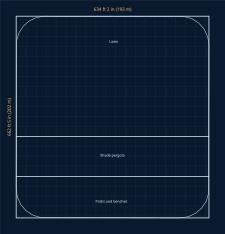

# P2-12 Quiet Garden 1: plan

Footprint 634 ft 2 in (193 m) × 662 ft 5 in (202 m) · structural grid 32 ft 10 in (10 m)

## Levels

| Level | Floor above deck | Height | Floor area |
|---|---|---|---|
| Level 1 · Ground | 0 ft (0 mm) | 13 ft 1 in (4,000 mm) | — |

## Elements

| ID | Designation | Type | Name | Level(s) | Size / length | Area | Status |
|---|---|---|---|---|---|---|---|
| E001 | D5F5P2B4A2R1 | zone | Lawn | L1 | 633 ft 10 in (193 m) × 396 ft (121 m) | 246,555 sq ft (22,906 m²) | proposed |
| E002 | D5F5P2B4A2R2 | zone | Shade pergola | L1 | 633 ft 6 in (193 m) × 129 ft 11 in (40 m) | 82,266 sq ft (7,643 m²) | proposed |
| E003 | D5F5P2B4A2R3 | zone | Paths and benches | L1 | 633 ft 2 in (193 m) × 136 ft 6 in (42 m) | 82,194 sq ft (7,636 m²) | proposed |

## Drawings

### Level 1 · Ground

