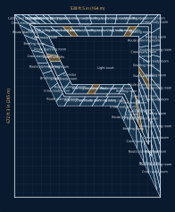
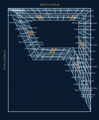

# P2-13 Briefing Annex 2: plan

Footprint 538 ft 5 in (164 m) × 672 ft 3 in (205 m) · structural grid 32 ft 10 in (10 m)

## Levels

| Level | Floor above deck | Height | Floor area |
|---|---|---|---|
| Level 1 · Ground floor | 0 ft (0 mm) | 15 ft 9 in (4,800 mm) | 106,373 sq ft (9,882 m²) |
| Level 2 · Briefing floor 1 | 15 ft 9 in (4,800 mm) | 13 ft 9 in (4,200 mm) | 106,367 sq ft (9,882 m²) |
| Level 3 · Briefing floor 2 | 29 ft 6 in (9,000 mm) | 13 ft 9 in (4,200 mm) | 106,367 sq ft (9,882 m²) |

## Elements

| ID | Designation | Type | Name | Level(s) | Size / length | Area | Status |
|---|---|---|---|---|---|---|---|
| E001 | D5F5P2B6A2L1R1 | zone | Light court | L1 | 334 ft 4 in (102 m) × 247 ft 5 in (75 m) | 53,168 sq ft (4,939 m²) | proposed |
| E002 | D5F5P2B6A2L1R2 | zone | Corridor | L1 | 405 ft 2 in (123 m) × 9 ft 10 in (3,000 mm) | 3,875 sq ft (360 m²) | proposed |
| E003 | D5F5P2B6A2L1R3 | zone | Corridor | L1 | 51 ft 2 in (16 m) × 371 ft 5 in (113 m) | 3,875 sq ft (360 m²) | proposed |
| E004 | D5F5P2B6A2L1R4 | zone | Corridor | L1 | 165 ft 4 in (50 m) × 229 ft 4 in (70 m) | 3,882 sq ft (361 m²) | proposed |
| E005 | D5F5P2B6A2L1R5 | zone | Corridor | L1 | 268 ft 8 in (82 m) × 222 ft 9 in (68 m) | 3,882 sq ft (361 m²) | proposed |
| E006 | D5F5P2B6A2L1R6 | zone | Corridor | L1 | 35 ft 5 in (11 m) × 50 ft 10 in (16 m) | 468 sq ft (44 m²) | proposed |
| E007 | D5F5P2B6A2L1R7, D5F5P2B6A2L2R1, D5F5P2B6A2L3R1 | core | Stairs and lifts | L1, L2, L3 | 55 ft 1 in (17 m) × 34 ft 5 in (10 m) | 904 sq ft (84 m²) | proposed |
| E008 | D5F5P2B6A2L1R8, D5F5P2B6A2L2R2, D5F5P2B6A2L3R2 | core | Stairs and lifts | L1, L2, L3 | 48 ft 7 in (15 m) × 34 ft 5 in (10 m) | 899 sq ft (83 m²) | proposed |
| E009 | D5F5P2B6A2L1R9, D5F5P2B6A2L2R3, D5F5P2B6A2L3R3 | core | Stairs and lifts | L1, L2, L3 | 34 ft 5 in (10 m) × 83 ft 4 in (25 m) | 904 sq ft (84 m²) | proposed |
| E010 | D5F5P2B6A2L1R10, D5F5P2B6A2L2R4, D5F5P2B6A2L3R4 | core | Stairs and lifts | L1, L2, L3 | 27 ft 3 in (8,300 mm) × 136 ft 10 in (42 m) | 883 sq ft (82 m²) | proposed |
| E011 | D5F5P2B6A2L1R11, D5F5P2B6A2L2R5, D5F5P2B6A2L3R5 | core | Stairs and lifts | L1, L2, L3 | 47 ft 11 in (15 m) × 34 ft 5 in (10 m) | 904 sq ft (84 m²) | proposed |
| E012 | D5F5P2B6A2L1R12, D5F5P2B6A2L2R6, D5F5P2B6A2L3R6 | core | Stairs and lifts | L1, L2, L3 | 50 ft 10 in (16 m) × 27 ft 7 in (8,400 mm) | 900 sq ft (84 m²) | proposed |
| E013 | D5F5P2B6A2L1R13 | room | Lobby and room board | L1 | 77 ft 5 in (24 m) × 34 ft 5 in (10 m) | 859 sq ft (80 m²) | proposed |
| E014 | D5F5P2B6A2L1R14 | room | Toilets | L1 | 67 ft 3 in (20 m) × 34 ft 5 in (10 m) | 644 sq ft (60 m²) | proposed |
| E015 | D5F5P2B6A2L1R15 | room | Map table room | L1 | 69 ft 11 in (21 m) × 34 ft 5 in (10 m) | 865 sq ft (80 m²) | proposed |
| E016 | D5F5P2B6A2L1R16 | room | Crew lounge | L1 | 65 ft 3 in (20 m) × 34 ft 5 in (10 m) | 865 sq ft (80 m²) | proposed |
| E017 | D5F5P2B6A2L1R17 | room | Weather briefing room | L1 | 54 ft 9 in (17 m) × 34 ft 5 in (10 m) | 644 sq ft (60 m²) | proposed |
| E018 | D5F5P2B6A2L1R18 | room | Briefing room | L1 | 85 ft 8 in (26 m) × 34 ft 5 in (10 m) | 1,938 sq ft (180 m²) | proposed |
| E019 | D5F5P2B6A2L1R19 | room | Route planning room | L1 | 58 ft 5 in (18 m) × 34 ft 5 in (10 m) | 1,288 sq ft (120 m²) | proposed |
| E020 | D5F5P2B6A2L1R20 | room | Crew ready room | L1 | 60 ft 4 in (18 m) × 34 ft 5 in (10 m) | 1,616 sq ft (150 m²) | proposed |
| E021 | D5F5P2B6A2L1R21 | room | Briefing room | L1 | 61 ft 4 in (19 m) × 34 ft 5 in (10 m) | 1,938 sq ft (180 m²) | proposed |
| E022 | D5F5P2B6A2L1R22 | room | Route planning room | L1 | 42 ft (13 m) × 34 ft 5 in (10 m) | 1,294 sq ft (120 m²) | proposed |
| E023 | D5F5P2B6A2L1R23 | room | Crew ready room | L1 | 58 ft 9 in (18 m) × 34 ft 5 in (10 m) | 1,611 sq ft (150 m²) | proposed |
| E024 | D5F5P2B6A2L1R24 | room | Briefing room | L1 | 77 ft 5 in (24 m) × 34 ft 5 in (10 m) | 1,933 sq ft (180 m²) | proposed |
| E025 | D5F5P2B6A2L1R25 | room | Route planning room | L1 | 67 ft 7 in (21 m) × 34 ft 5 in (10 m) | 1,294 sq ft (120 m²) | proposed |
| E026 | D5F5P2B6A2L1R26 | room | Crew ready room | L1 | 40 ft 4 in (12 m) × 68 ft 7 in (21 m) | 1,616 sq ft (150 m²) | proposed |
| E027 | D5F5P2B6A2L1R27 | room | Briefing room | L1 | 34 ft 5 in (10 m) × 68 ft 11 in (21 m) | 1,938 sq ft (180 m²) | proposed |
| E028 | D5F5P2B6A2L1R28 | room | Route planning room | L1 | 34 ft 5 in (10 m) × 43 ft 8 in (13 m) | 1,294 sq ft (120 m²) | proposed |
| E029 | D5F5P2B6A2L1R29 | room | Crew ready room | L1 | 34 ft 5 in (10 m) × 63 ft (19 m) | 1,616 sq ft (150 m²) | proposed |
| E030 | D5F5P2B6A2L1R30 | room | Briefing room | L1 | 34 ft 5 in (10 m) × 88 ft 11 in (27 m) | 1,938 sq ft (180 m²) | proposed |
| E031 | D5F5P2B6A2L1R31 | room | Route planning room | L1 | 34 ft 5 in (10 m) × 85 ft (26 m) | 1,283 sq ft (119 m²) | proposed |
| E032 | D5F5P2B6A2L1R32 | room | Crew ready room | L1 | 34 ft 5 in (10 m) × 108 ft 3 in (33 m) | 1,616 sq ft (150 m²) | proposed |
| E033 | D5F5P2B6A2L1R33 | room | Briefing room | L1 | 34 ft 5 in (10 m) × 134 ft 2 in (41 m) | 1,938 sq ft (180 m²) | proposed |
| E034 | D5F5P2B6A2L1R34 | room | Route planning room | L1 | 34 ft 5 in (10 m) × 130 ft 7 in (40 m) | 1,294 sq ft (120 m²) | proposed |
| E035 | D5F5P2B6A2L1R35 | room | Crew ready room | L1 | 34 ft 5 in (10 m) × 153 ft 3 in (47 m) | 1,611 sq ft (150 m²) | proposed |
| E036 | D5F5P2B6A2L1R36 | room | Briefing room | L1 | 34 ft 5 in (10 m) × 179 ft 2 in (55 m) | 1,938 sq ft (180 m²) | proposed |
| E037 | D5F5P2B6A2L1R37 | room | Route planning room | L1 | 34 ft 5 in (10 m) × 175 ft 6 in (54 m) | 1,294 sq ft (120 m²) | proposed |
| E038 | D5F5P2B6A2L1R38 | room | Crew ready room | L1 | 42 ft 8 in (13 m) × 170 ft 11 in (52 m) | 1,625 sq ft (151 m²) | proposed |
| E039 | D5F5P2B6A2L1R39 | room | Briefing room | L1 | 49 ft 3 in (15 m) × 182 ft 5 in (56 m) | 1,934 sq ft (180 m²) | proposed |
| E040 | D5F5P2B6A2L1R40 | room | Route planning room | L1 | 32 ft 6 in (9,900 mm) × 147 ft 8 in (45 m) | 1,281 sq ft (119 m²) | proposed |
| E041 | D5F5P2B6A2L1R41 | room | Crew ready room | L1 | 29 ft 2 in (8,900 mm) × 140 ft 5 in (43 m) | 1,621 sq ft (151 m²) | proposed |
| E042 | D5F5P2B6A2L1R42 | room | Briefing room | L1 | 29 ft 6 in (9,000 mm) × 129 ft 3 in (39 m) | 1,946 sq ft (181 m²) | proposed |
| E043 | D5F5P2B6A2L1R43 | room | Route planning room | L1 | 25 ft 3 in (7,700 mm) × 94 ft 6 in (29 m) | 1,291 sq ft (120 m²) | proposed |
| E044 | D5F5P2B6A2L1R44 | room | Crew ready room | L1 | 37 ft 1 in (11 m) × 86 ft 11 in (26 m) | 1,615 sq ft (150 m²) | proposed |
| E045 | D5F5P2B6A2L1R45 | room | Briefing room | L1 | 75 ft 9 in (23 m) × 38 ft 1 in (12 m) | 1,935 sq ft (180 m²) | proposed |
| E046 | D5F5P2B6A2L1R46 | room | Route planning room | L1 | 59 ft 5 in (18 m) × 34 ft 5 in (10 m) | 1,300 sq ft (121 m²) | proposed |
| E047 | D5F5P2B6A2L1R47 | room | Crew ready room | L1 | 68 ft 3 in (21 m) × 34 ft 5 in (10 m) | 1,605 sq ft (149 m²) | proposed |
| E048 | D5F5P2B6A2L1R48 | room | Briefing room | L1 | 78 ft 1 in (24 m) × 34 ft 5 in (10 m) | 1,944 sq ft (181 m²) | proposed |
| E049 | D5F5P2B6A2L1R49 | room | Route planning room | L1 | 51 ft 2 in (16 m) × 46 ft 11 in (14 m) | 1,292 sq ft (120 m²) | proposed |
| E050 | D5F5P2B6A2L1R50 | room | Crew ready room | L1 | 45 ft 11 in (14 m) × 68 ft 11 in (21 m) | 1,624 sq ft (151 m²) | proposed |
| E051 | D5F5P2B6A2L1R51 | room | Briefing room | L1 | 54 ft 9 in (17 m) × 66 ft 7 in (20 m) | 1,933 sq ft (180 m²) | proposed |
| E052 | D5F5P2B6A2L1R52 | room | Route planning room | L1 | 51 ft 6 in (16 m) × 40 ft (12 m) | 1,293 sq ft (120 m²) | proposed |
| E053 | D5F5P2B6A2L1R53 | room | Crew ready room | L1 | 59 ft 9 in (18 m) × 46 ft 11 in (14 m) | 1,617 sq ft (150 m²) | proposed |
| E054 | D5F5P2B6A2L1R54 | room | Briefing room | L1 | 68 ft 11 in (21 m) × 63 ft 8 in (19 m) | 1,937 sq ft (180 m²) | proposed |
| E055 | D5F5P2B6A2L1R55 | room | Route planning room | L1 | 65 ft 3 in (20 m) × 56 ft 5 in (17 m) | 1,290 sq ft (120 m²) | proposed |
| E056 | D5F5P2B6A2L1R56 | room | Crew ready room | L1 | 69 ft 3 in (21 m) × 64 ft 8 in (20 m) | 1,302 sq ft (121 m²) | proposed |
| E057 | D5F5P2B6A2L1R57 | room | Briefing room | L1 | 104 ft 4 in (32 m) × 34 ft 5 in (10 m) | 1,933 sq ft (180 m²) | proposed |
| E058 | D5F5P2B6A2L1R58 | room | Route planning room | L1 | 76 ft 9 in (23 m) × 34 ft 5 in (10 m) | 1,379 sq ft (128 m²) | proposed |
| E059 | D5F5P2B6A2L1R59 | room | Crew ready room | L1 | 67 ft 3 in (20 m) × 34 ft 5 in (10 m) | 1,616 sq ft (150 m²) | proposed |
| E060 | D5F5P2B6A2L1R60 | room | Briefing room | L1 | 64 ft 4 in (20 m) × 34 ft 5 in (10 m) | 1,933 sq ft (180 m²) | proposed |
| E061 | D5F5P2B6A2L1R61 | room | Route planning room | L1 | 42 ft (13 m) × 34 ft 5 in (10 m) | 1,294 sq ft (120 m²) | proposed |
| E062 | D5F5P2B6A2L1R62 | room | Crew ready room | L1 | 65 ft 3 in (20 m) × 34 ft 5 in (10 m) | 1,791 sq ft (166 m²) | proposed |
| E063 | D5F5P2B6A2L1R63 | room | Briefing room | L1 | 67 ft 11 in (21 m) × 47 ft 11 in (15 m) | 1,944 sq ft (181 m²) | proposed |
| E064 | D5F5P2B6A2L1R64 | room | Route planning room | L1 | 34 ft 5 in (10 m) × 51 ft 6 in (16 m) | 1,288 sq ft (120 m²) | proposed |
| E065 | D5F5P2B6A2L1R65 | room | Crew ready room | L1 | 34 ft 5 in (10 m) × 59 ft 9 in (18 m) | 1,616 sq ft (150 m²) | proposed |
| E066 | D5F5P2B6A2L1R66 | room | Briefing room | L1 | 34 ft 5 in (10 m) × 87 ft 7 in (27 m) | 1,786 sq ft (166 m²) | proposed |
| E067 | D5F5P2B6A2L1R67 | room | Route planning room | L1 | 34 ft 5 in (10 m) × 112 ft 2 in (34 m) | 1,294 sq ft (120 m²) | proposed |
| E068 | D5F5P2B6A2L1R68 | room | Crew ready room | L1 | 34 ft 5 in (10 m) × 144 ft 8 in (44 m) | 1,616 sq ft (150 m²) | proposed |
| E069 | D5F5P2B6A2L1R69 | room | Briefing room | L1 | 34 ft 5 in (10 m) × 182 ft 1 in (56 m) | 1,938 sq ft (180 m²) | proposed |
| E070 | D5F5P2B6A2L1R70 | room | Route planning room | L1 | 42 ft 4 in (13 m) × 167 ft 8 in (51 m) | 1,801 sq ft (167 m²) | proposed |
| E071 | D5F5P2B6A2L1R71 | room | Crew ready room | L1 | 29 ft 6 in (9,000 mm) × 125 ft 4 in (38 m) | 1,619 sq ft (150 m²) | proposed |
| E072 | D5F5P2B6A2L1R72 | room | Briefing room | L1 | 50 ft 10 in (16 m) × 80 ft 9 in (25 m) | 1,934 sq ft (180 m²) | proposed |
| E073 | D5F5P2B6A2L1R73 | room | Route planning room | L1 | 59 ft 5 in (18 m) × 34 ft 5 in (10 m) | 1,300 sq ft (121 m²) | proposed |
| E074 | D5F5P2B6A2L1R74 | room | Crew ready room | L1 | 73 ft 6 in (22 m) × 34 ft 5 in (10 m) | 1,786 sq ft (166 m²) | proposed |
| E075 | D5F5P2B6A2L1R75 | room | Briefing room | L1 | 77 ft 9 in (24 m) × 34 ft 5 in (10 m) | 1,933 sq ft (180 m²) | proposed |
| E076 | D5F5P2B6A2L1R76 | room | Route planning room | L1 | 51 ft 10 in (16 m) × 45 ft 7 in (14 m) | 1,295 sq ft (120 m²) | proposed |
| E077 | D5F5P2B6A2L1R77 | room | Crew ready room | L1 | 47 ft 3 in (14 m) × 65 ft 3 in (20 m) | 1,608 sq ft (149 m²) | proposed |
| E078 | D5F5P2B6A2L1R78 | room | Briefing room | L1 | 56 ft 5 in (17 m) × 55 ft 9 in (17 m) | 1,792 sq ft (166 m²) | proposed |
| E079 | D5F5P2B6A2L1R79 | room | Route planning room | L1 | 60 ft (18 m) × 45 ft 7 in (14 m) | 1,296 sq ft (120 m²) | proposed |
| E080 | D5F5P2B6A2L1R80 | room | Crew ready room | L1 | 76 ft 1 in (23 m) × 78 ft 9 in (24 m) | 2,031 sq ft (189 m²) | proposed |
| E081 | D5F5P2B6A2L2R7, D5F5P2B6A2L3R7 | zone | Corridor | L2, L3 | 405 ft 2 in (123 m) × 9 ft 10 in (3,000 mm) | 3,875 sq ft (360 m²) | proposed |
| E082 | D5F5P2B6A2L2R8, D5F5P2B6A2L3R8 | zone | Corridor | L2, L3 | 51 ft 2 in (16 m) × 371 ft 5 in (113 m) | 3,875 sq ft (360 m²) | proposed |
| E083 | D5F5P2B6A2L2R9, D5F5P2B6A2L3R9 | zone | Corridor | L2, L3 | 165 ft 4 in (50 m) × 229 ft 4 in (70 m) | 3,882 sq ft (361 m²) | proposed |
| E084 | D5F5P2B6A2L2R10, D5F5P2B6A2L3R10 | zone | Corridor | L2, L3 | 268 ft 8 in (82 m) × 222 ft 9 in (68 m) | 3,882 sq ft (361 m²) | proposed |
| E085 | D5F5P2B6A2L2R11, D5F5P2B6A2L3R11 | zone | Corridor | L2, L3 | 35 ft 5 in (11 m) × 50 ft 10 in (16 m) | 468 sq ft (44 m²) | proposed |
| E086 | D5F5P2B6A2L2R12, D5F5P2B6A2L3R12 | room | Debrief room | L2, L3 | 66 ft 3 in (20 m) × 34 ft 5 in (10 m) | 435 sq ft (40 m²) | proposed |
| E087 | D5F5P2B6A2L2R13, D5F5P2B6A2L3R13 | room | Debrief room | L2, L3 | 63 ft 8 in (19 m) × 34 ft 5 in (10 m) | 424 sq ft (39 m²) | proposed |
| E088 | D5F5P2B6A2L2R14, D5F5P2B6A2L3R14 | room | Debrief room | L2, L3 | 61 ft 8 in (19 m) × 34 ft 5 in (10 m) | 435 sq ft (40 m²) | proposed |
| E089 | D5F5P2B6A2L2R15, D5F5P2B6A2L3R15 | room | Debrief room | L2, L3 | 59 ft 5 in (18 m) × 34 ft 5 in (10 m) | 429 sq ft (40 m²) | proposed |
| E090 | D5F5P2B6A2L2R16, D5F5P2B6A2L3R16 | room | Tea point | L2, L3 | 56 ft 9 in (17 m) × 34 ft 5 in (10 m) | 413 sq ft (38 m²) | proposed |
| E091 | D5F5P2B6A2L2R17, D5F5P2B6A2L3R17 | room | Toilets | L2, L3 | 60 ft 8 in (18 m) × 34 ft 5 in (10 m) | 650 sq ft (60 m²) | proposed |
| E092 | D5F5P2B6A2L2R18, D5F5P2B6A2L3R18 | room | Briefing room | L2, L3 | 91 ft 2 in (28 m) × 34 ft 5 in (10 m) | 1,933 sq ft (180 m²) | proposed |
| E093 | D5F5P2B6A2L2R19, D5F5P2B6A2L3R19 | room | Route planning room | L2, L3 | 64 ft 4 in (20 m) × 34 ft 5 in (10 m) | 1,294 sq ft (120 m²) | proposed |
| E094 | D5F5P2B6A2L2R20, D5F5P2B6A2L3R20 | room | Crew ready room | L2, L3 | 65 ft 11 in (20 m) × 34 ft 5 in (10 m) | 1,616 sq ft (150 m²) | proposed |
| E095 | D5F5P2B6A2L2R21, D5F5P2B6A2L3R21 | room | Briefing room | L2, L3 | 65 ft 11 in (20 m) × 34 ft 5 in (10 m) | 1,938 sq ft (180 m²) | proposed |
| E096 | D5F5P2B6A2L2R22, D5F5P2B6A2L3R22 | room | Route planning room | L2, L3 | 40 ft 8 in (12 m) × 34 ft 5 in (10 m) | 1,288 sq ft (120 m²) | proposed |
| E097 | D5F5P2B6A2L2R23, D5F5P2B6A2L3R23 | room | Crew ready room | L2, L3 | 53 ft 2 in (16 m) × 34 ft 5 in (10 m) | 1,616 sq ft (150 m²) | proposed |
| E098 | D5F5P2B6A2L2R24, D5F5P2B6A2L3R24 | room | Briefing room | L2, L3 | 71 ft 10 in (22 m) × 34 ft 5 in (10 m) | 1,938 sq ft (180 m²) | proposed |
| E099 | D5F5P2B6A2L2R25, D5F5P2B6A2L3R25 | room | Route planning room | L2, L3 | 61 ft 8 in (19 m) × 34 ft 5 in (10 m) | 1,294 sq ft (120 m²) | proposed |
| E100 | D5F5P2B6A2L2R26, D5F5P2B6A2L3R26 | room | Crew ready room | L2, L3 | 68 ft 11 in (21 m) × 42 ft (13 m) | 1,611 sq ft (150 m²) | proposed |
| E101 | D5F5P2B6A2L2R27, D5F5P2B6A2L3R27 | room | Briefing room | L2, L3 | 34 ft 5 in (10 m) × 79 ft 1 in (24 m) | 1,938 sq ft (180 m²) | proposed |
| E102 | D5F5P2B6A2L2R28, D5F5P2B6A2L3R28 | room | Route planning room | L2, L3 | 34 ft 5 in (10 m) × 45 ft 3 in (14 m) | 1,294 sq ft (120 m²) | proposed |
| E103 | D5F5P2B6A2L2R29, D5F5P2B6A2L3R29 | room | Crew ready room | L2, L3 | 34 ft 5 in (10 m) × 54 ft 6 in (17 m) | 1,611 sq ft (150 m²) | proposed |
| E104 | D5F5P2B6A2L2R30, D5F5P2B6A2L3R30 | room | Briefing room | L2, L3 | 34 ft 5 in (10 m) × 79 ft 1 in (24 m) | 1,938 sq ft (180 m²) | proposed |
| E105 | D5F5P2B6A2L2R31, D5F5P2B6A2L3R31 | room | Route planning room | L2, L3 | 34 ft 5 in (10 m) × 75 ft 2 in (23 m) | 1,288 sq ft (120 m²) | proposed |
| E106 | D5F5P2B6A2L2R32, D5F5P2B6A2L3R32 | room | Crew ready room | L2, L3 | 34 ft 5 in (10 m) × 98 ft 1 in (30 m) | 1,616 sq ft (150 m²) | proposed |
| E107 | D5F5P2B6A2L2R33, D5F5P2B6A2L3R33 | room | Briefing room | L2, L3 | 34 ft 5 in (10 m) × 124 ft (38 m) | 1,938 sq ft (180 m²) | proposed |
| E108 | D5F5P2B6A2L2R34, D5F5P2B6A2L3R34 | room | Route planning room | L2, L3 | 34 ft 5 in (10 m) × 120 ft 1 in (37 m) | 1,288 sq ft (120 m²) | proposed |
| E109 | D5F5P2B6A2L2R35, D5F5P2B6A2L3R35 | room | Crew ready room | L2, L3 | 34 ft 5 in (10 m) × 143 ft 1 in (44 m) | 1,616 sq ft (150 m²) | proposed |
| E110 | D5F5P2B6A2L2R36, D5F5P2B6A2L3R36 | room | Briefing room | L2, L3 | 34 ft 5 in (10 m) × 169 ft (51 m) | 1,938 sq ft (180 m²) | proposed |
| E111 | D5F5P2B6A2L2R37, D5F5P2B6A2L3R37 | room | Route planning room | L2, L3 | 34 ft 5 in (10 m) × 165 ft 4 in (50 m) | 1,294 sq ft (120 m²) | proposed |
| E112 | D5F5P2B6A2L2R38, D5F5P2B6A2L3R38 | room | Crew ready room | L2, L3 | 34 ft 5 in (10 m) × 188 ft 4 in (57 m) | 1,616 sq ft (150 m²) | proposed |
| E113 | D5F5P2B6A2L2R39, D5F5P2B6A2L3R39 | room | Briefing room | L2, L3 | 50 ft 10 in (16 m) × 185 ft 8 in (57 m) | 1,935 sq ft (180 m²) | proposed |
| E114 | D5F5P2B6A2L2R40, D5F5P2B6A2L3R40 | room | Route planning room | L2, L3 | 38 ft 5 in (12 m) × 159 ft 9 in (49 m) | 1,298 sq ft (121 m²) | proposed |
| E115 | D5F5P2B6A2L2R41, D5F5P2B6A2L3R41 | room | Crew ready room | L2, L3 | 34 ft 9 in (11 m) × 152 ft 3 in (46 m) | 1,625 sq ft (151 m²) | proposed |
| E116 | D5F5P2B6A2L2R42, D5F5P2B6A2L3R42 | room | Briefing room | L2, L3 | 29 ft 6 in (9,000 mm) × 141 ft 1 in (43 m) | 1,928 sq ft (179 m²) | proposed |
| E117 | D5F5P2B6A2L2R43, D5F5P2B6A2L3R43 | room | Route planning room | L2, L3 | 19 ft 8 in (6,000 mm) × 106 ft 4 in (32 m) | 1,283 sq ft (119 m²) | proposed |
| E118 | D5F5P2B6A2L2R44, D5F5P2B6A2L3R44 | room | Crew ready room | L2, L3 | 31 ft 2 in (9,500 mm) × 98 ft 9 in (30 m) | 1,604 sq ft (149 m²) | proposed |
| E119 | D5F5P2B6A2L2R45, D5F5P2B6A2L3R45 | room | Briefing room | L2, L3 | 55 ft 1 in (17 m) × 72 ft 6 in (22 m) | 1,944 sq ft (181 m²) | proposed |
| E120 | D5F5P2B6A2L2R46, D5F5P2B6A2L3R46 | room | Route planning room | L2, L3 | 59 ft 1 in (18 m) × 34 ft 5 in (10 m) | 1,288 sq ft (120 m²) | proposed |
| E121 | D5F5P2B6A2L2R47, D5F5P2B6A2L3R47 | room | Crew ready room | L2, L3 | 68 ft 7 in (21 m) × 34 ft 5 in (10 m) | 1,616 sq ft (150 m²) | proposed |
| E122 | D5F5P2B6A2L2R48, D5F5P2B6A2L3R48 | room | Briefing room | L2, L3 | 77 ft 9 in (24 m) × 34 ft 5 in (10 m) | 1,933 sq ft (180 m²) | proposed |
| E123 | D5F5P2B6A2L2R49, D5F5P2B6A2L3R49 | room | Route planning room | L2, L3 | 59 ft 5 in (18 m) × 34 ft 5 in (10 m) | 1,300 sq ft (121 m²) | proposed |
| E124 | D5F5P2B6A2L2R50, D5F5P2B6A2L3R50 | room | Crew ready room | L2, L3 | 52 ft 6 in (16 m) × 59 ft 1 in (18 m) | 1,611 sq ft (150 m²) | proposed |
| E125 | D5F5P2B6A2L2R51, D5F5P2B6A2L3R51 | room | Briefing room | L2, L3 | 51 ft 10 in (16 m) × 72 ft 10 in (22 m) | 1,929 sq ft (179 m²) | proposed |
| E126 | D5F5P2B6A2L2R52, D5F5P2B6A2L3R52 | room | Route planning room | L2, L3 | 48 ft 3 in (15 m) × 46 ft 7 in (14 m) | 1,295 sq ft (120 m²) | proposed |
| E127 | D5F5P2B6A2L2R53, D5F5P2B6A2L3R53 | room | Crew ready room | L2, L3 | 56 ft 9 in (17 m) × 46 ft 11 in (14 m) | 1,619 sq ft (150 m²) | proposed |
| E128 | D5F5P2B6A2L2R54, D5F5P2B6A2L3R54 | room | Briefing room | L2, L3 | 65 ft 11 in (20 m) × 57 ft 1 in (17 m) | 1,947 sq ft (181 m²) | proposed |
| E129 | D5F5P2B6A2L2R55, D5F5P2B6A2L3R55 | room | Route planning room | L2, L3 | 62 ft 4 in (19 m) × 49 ft 10 in (15 m) | 1,297 sq ft (120 m²) | proposed |
| E130 | D5F5P2B6A2L2R56, D5F5P2B6A2L3R56 | room | Crew ready room | L2, L3 | 81 ft 4 in (25 m) × 89 ft 11 in (27 m) | 2,400 sq ft (223 m²) | proposed |
| E131 | D5F5P2B6A2L2R57, D5F5P2B6A2L3R57 | room | Briefing room | L2, L3 | 104 ft 4 in (32 m) × 34 ft 5 in (10 m) | 1,933 sq ft (180 m²) | proposed |
| E132 | D5F5P2B6A2L2R58, D5F5P2B6A2L3R58 | room | Route planning room | L2, L3 | 76 ft 9 in (23 m) × 34 ft 5 in (10 m) | 1,379 sq ft (128 m²) | proposed |
| E133 | D5F5P2B6A2L2R59, D5F5P2B6A2L3R59 | room | Crew ready room | L2, L3 | 67 ft 3 in (20 m) × 34 ft 5 in (10 m) | 1,616 sq ft (150 m²) | proposed |
| E134 | D5F5P2B6A2L2R60, D5F5P2B6A2L3R60 | room | Briefing room | L2, L3 | 64 ft 4 in (20 m) × 34 ft 5 in (10 m) | 1,933 sq ft (180 m²) | proposed |
| E135 | D5F5P2B6A2L2R61, D5F5P2B6A2L3R61 | room | Route planning room | L2, L3 | 42 ft (13 m) × 34 ft 5 in (10 m) | 1,294 sq ft (120 m²) | proposed |
| E136 | D5F5P2B6A2L2R62, D5F5P2B6A2L3R62 | room | Crew ready room | L2, L3 | 65 ft 3 in (20 m) × 34 ft 5 in (10 m) | 1,791 sq ft (166 m²) | proposed |
| E137 | D5F5P2B6A2L2R63, D5F5P2B6A2L3R63 | room | Briefing room | L2, L3 | 67 ft 11 in (21 m) × 47 ft 11 in (15 m) | 1,944 sq ft (181 m²) | proposed |
| E138 | D5F5P2B6A2L2R64, D5F5P2B6A2L3R64 | room | Route planning room | L2, L3 | 34 ft 5 in (10 m) × 51 ft 6 in (16 m) | 1,288 sq ft (120 m²) | proposed |
| E139 | D5F5P2B6A2L2R65, D5F5P2B6A2L3R65 | room | Crew ready room | L2, L3 | 34 ft 5 in (10 m) × 59 ft 9 in (18 m) | 1,616 sq ft (150 m²) | proposed |
| E140 | D5F5P2B6A2L2R66, D5F5P2B6A2L3R66 | room | Briefing room | L2, L3 | 34 ft 5 in (10 m) × 87 ft 7 in (27 m) | 1,786 sq ft (166 m²) | proposed |
| E141 | D5F5P2B6A2L2R67, D5F5P2B6A2L3R67 | room | Route planning room | L2, L3 | 34 ft 5 in (10 m) × 112 ft 2 in (34 m) | 1,294 sq ft (120 m²) | proposed |
| E142 | D5F5P2B6A2L2R68, D5F5P2B6A2L3R68 | room | Crew ready room | L2, L3 | 34 ft 5 in (10 m) × 144 ft 8 in (44 m) | 1,616 sq ft (150 m²) | proposed |
| E143 | D5F5P2B6A2L2R69, D5F5P2B6A2L3R69 | room | Briefing room | L2, L3 | 34 ft 5 in (10 m) × 182 ft 1 in (56 m) | 1,938 sq ft (180 m²) | proposed |
| E144 | D5F5P2B6A2L2R70, D5F5P2B6A2L3R70 | room | Route planning room | L2, L3 | 42 ft 4 in (13 m) × 167 ft 8 in (51 m) | 1,801 sq ft (167 m²) | proposed |
| E145 | D5F5P2B6A2L2R71, D5F5P2B6A2L3R71 | room | Crew ready room | L2, L3 | 29 ft 6 in (9,000 mm) × 125 ft 4 in (38 m) | 1,619 sq ft (150 m²) | proposed |
| E146 | D5F5P2B6A2L2R72, D5F5P2B6A2L3R72 | room | Briefing room | L2, L3 | 50 ft 10 in (16 m) × 80 ft 9 in (25 m) | 1,934 sq ft (180 m²) | proposed |
| E147 | D5F5P2B6A2L2R73, D5F5P2B6A2L3R73 | room | Route planning room | L2, L3 | 59 ft 5 in (18 m) × 34 ft 5 in (10 m) | 1,300 sq ft (121 m²) | proposed |
| E148 | D5F5P2B6A2L2R74, D5F5P2B6A2L3R74 | room | Crew ready room | L2, L3 | 73 ft 6 in (22 m) × 34 ft 5 in (10 m) | 1,786 sq ft (166 m²) | proposed |
| E149 | D5F5P2B6A2L2R75, D5F5P2B6A2L3R75 | room | Briefing room | L2, L3 | 77 ft 9 in (24 m) × 34 ft 5 in (10 m) | 1,933 sq ft (180 m²) | proposed |
| E150 | D5F5P2B6A2L2R76, D5F5P2B6A2L3R76 | room | Route planning room | L2, L3 | 51 ft 10 in (16 m) × 45 ft 7 in (14 m) | 1,295 sq ft (120 m²) | proposed |
| E151 | D5F5P2B6A2L2R77, D5F5P2B6A2L3R77 | room | Crew ready room | L2, L3 | 47 ft 3 in (14 m) × 65 ft 3 in (20 m) | 1,608 sq ft (149 m²) | proposed |
| E152 | D5F5P2B6A2L2R78, D5F5P2B6A2L3R78 | room | Briefing room | L2, L3 | 56 ft 5 in (17 m) × 55 ft 9 in (17 m) | 1,792 sq ft (166 m²) | proposed |
| E153 | D5F5P2B6A2L2R79, D5F5P2B6A2L3R79 | room | Route planning room | L2, L3 | 60 ft (18 m) × 45 ft 7 in (14 m) | 1,296 sq ft (120 m²) | proposed |
| E154 | D5F5P2B6A2L2R80, D5F5P2B6A2L3R80 | room | Crew ready room | L2, L3 | 76 ft 1 in (23 m) × 78 ft 9 in (24 m) | 2,031 sq ft (189 m²) | proposed |

## Drawings

### Level 1 · Ground floor

### Level 2 · Briefing floor 1

### Level 3 · Briefing floor 2

