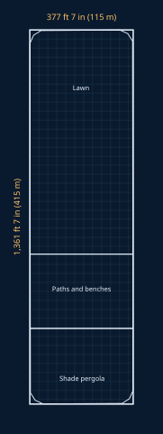

# P2-14 Quiet Garden 2: plan

Footprint 377 ft 7 in (115 m) × 1,361 ft 7 in (415 m) · structural grid 32 ft 10 in (10 m)

## Levels

| Level | Floor above deck | Height | Floor area |
|---|---|---|---|
| Level 1 · Ground | 0 ft (0 mm) | 13 ft 1 in (4,000 mm) | — |

## Elements

| ID | Designation | Type | Name | Level(s) | Size / length | Area | Status |
|---|---|---|---|---|---|---|---|
| E001 | D5F5P2B7A2R1 | zone | Lawn | L1 | 375 ft 8 in (114 m) × 815 ft 7 in (249 m) | 303,930 sq ft (28,236 m²) | proposed |
| E002 | D5F5P2B7A2R2 | zone | Paths and benches | L1 | 375 ft (114 m) × 270 ft 4 in (82 m) | 101,289 sq ft (9,410 m²) | proposed |
| E003 | D5F5P2B7A2R3 | zone | Shade pergola | L1 | 375 ft (114 m) × 274 ft 7 in (84 m) | 101,283 sq ft (9,410 m²) | proposed |

## Drawings

### Level 1 · Ground

