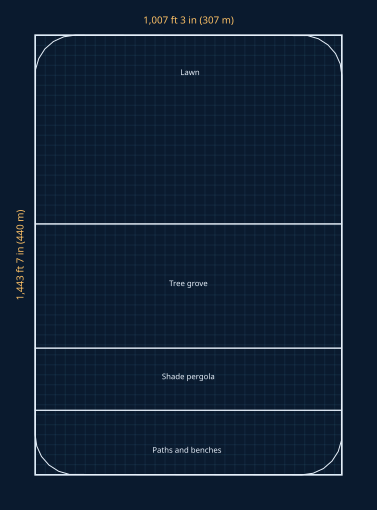

# P2-16 Quiet Garden 3: plan

Footprint 1,007 ft 3 in (307 m) × 1,443 ft 7 in (440 m) · structural grid 32 ft 10 in (10 m)

## Levels

| Level | Floor above deck | Height | Floor area |
|---|---|---|---|
| Level 1 · Ground | 0 ft (0 mm) | 13 ft 1 in (4,000 mm) | — |

## Elements

| ID | Designation | Type | Name | Level(s) | Size / length | Area | Status |
|---|---|---|---|---|---|---|---|
| E001 | D5F5P2B1A2R1 | zone | Lawn | L1 | 1,006 ft 7 in (307 m) × 619 ft 9 in (189 m) | 615,383 sq ft (57,171 m²) | proposed |
| E002 | D5F5P2B1A2R2 | zone | Tree grove | L1 | 1,006 ft 3 in (307 m) × 407 ft 10 in (124 m) | 410,217 sq ft (38,110 m²) | proposed |
| E003 | D5F5P2B1A2R3 | zone | Shade pergola | L1 | 1,006 ft 3 in (307 m) × 204 ft 1 in (62 m) | 205,273 sq ft (19,071 m²) | proposed |
| E004 | D5F5P2B1A2R4 | zone | Paths and benches | L1 | 1,005 ft 11 in (307 m) × 211 ft 11 in (65 m) | 205,144 sq ft (19,059 m²) | proposed |

## Drawings

### Level 1 · Ground

