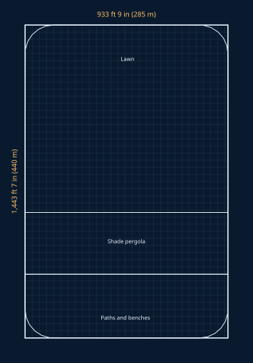

# P2-20 Quiet Garden 5: plan

Footprint 933 ft 9 in (285 m) × 1,443 ft 7 in (440 m) · structural grid 32 ft 10 in (10 m)

## Levels

| Level | Floor above deck | Height | Floor area |
|---|---|---|---|
| Level 1 · Ground | 0 ft (0 mm) | 13 ft 1 in (4,000 mm) | — |

## Elements

| ID | Designation | Type | Name | Level(s) | Size / length | Area | Status |
|---|---|---|---|---|---|---|---|
| E001 | D5F5P2B5A3R1 | zone | Lawn | L1 | 933 ft 5 in (284 m) × 864 ft 6 in (264 m) | 798,202 sq ft (74,155 m²) | proposed |
| E002 | D5F5P2B5A3R2 | zone | Shade pergola | L1 | 932 ft 9 in (284 m) × 285 ft 1 in (87 m) | 265,883 sq ft (24,701 m²) | proposed |
| E003 | D5F5P2B5A3R3 | zone | Paths and benches | L1 | 932 ft 9 in (284 m) × 294 ft (90 m) | 266,097 sq ft (24,721 m²) | proposed |

## Drawings

### Level 1 · Ground

