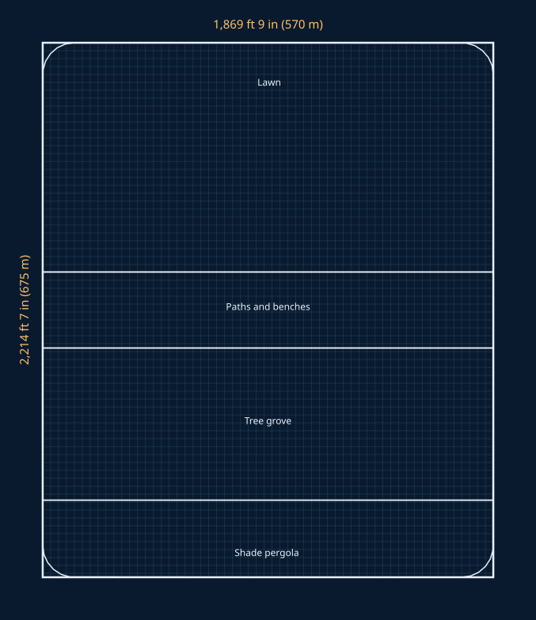

# P2-22 Quiet Garden 6: plan

Footprint 1,869 ft 9 in (570 m) × 2,214 ft 7 in (675 m) · structural grid 32 ft 10 in (10 m)

## Levels

| Level | Floor above deck | Height | Floor area |
|---|---|---|---|
| Level 1 · Ground | 0 ft (0 mm) | 13 ft 1 in (4,000 mm) | — |

## Elements

| ID | Designation | Type | Name | Level(s) | Size / length | Area | Status |
|---|---|---|---|---|---|---|---|
| E001 | D5F5P2B7A3R1 | zone | Lawn | L1 | 1,869 ft 1 in (570 m) × 949 ft 10 in (290 m) | 1,766,036 sq ft (164,070 m²) | proposed |
| E002 | D5F5P2B7A3R2 | zone | Paths and benches | L1 | 1,868 ft 5 in (570 m) × 315 ft (96 m) | 588,485 sq ft (54,672 m²) | proposed |
| E003 | D5F5P2B7A3R3 | zone | Tree grove | L1 | 1,869 ft 1 in (570 m) × 630 ft 3 in (192 m) | 1,177,582 sq ft (109,401 m²) | proposed |
| E004 | D5F5P2B7A3R4 | zone | Shade pergola | L1 | 1,868 ft 5 in (570 m) × 319 ft 7 in (97 m) | 588,441 sq ft (54,668 m²) | proposed |

## Drawings

### Level 1 · Ground

