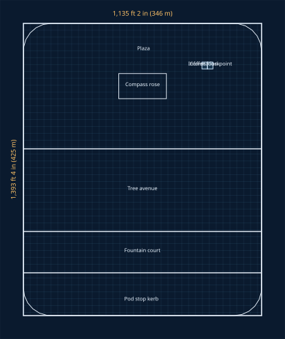

# P3-04 Beacon Plaza: plan

Footprint 1,135 ft 2 in (346 m) × 1,393 ft 4 in (425 m) · structural grid 32 ft 10 in (10 m)

## Levels

| Level | Floor above deck | Height | Floor area |
|---|---|---|---|
| Level 1 · Ground | 0 ft (0 mm) | 13 ft 1 in (4,000 mm) | 1,722 sq ft (160 m²) |

## Elements

| ID | Designation | Type | Name | Level(s) | Size / length | Area | Status |
|---|---|---|---|---|---|---|---|
| E001 | D5F5P3B4A1R1 | zone | Plaza | L1 | 1,134 ft 6 in (346 m) × 598 ft 1 in (182 m) | 670,008 sq ft (62,246 m²) | proposed |
| E002 | D5F5P3B4A1R2 | room | Coffee kiosk | L1 | 26 ft 3 in (8,000 mm) × 32 ft 10 in (10 m) | 861 sq ft (80 m²) | proposed |
| E003 | D5F5P3B4A1R3 | room | Information point | L1 | 26 ft 3 in (8,000 mm) × 32 ft 10 in (10 m) | 861 sq ft (80 m²) | proposed |
| E004 |  | fixture | Compass rose | L1 | 227 ft (69 m) × 119 ft 9 in (36 m) | 27,187 sq ft (2,526 m²) | proposed |
| E005 | D5F5P3B4A1R4 | zone | Tree avenue | L1 | 1,134 ft 2 in (346 m) × 394 ft (120 m) | 446,773 sq ft (41,507 m²) | proposed |
| E006 | D5F5P3B4A1R5 | zone | Fountain court | L1 | 1,134 ft 2 in (346 m) × 197 ft 2 in (60 m) | 223,572 sq ft (20,771 m²) | proposed |
| E007 | D5F5P3B4A1R6 | zone | Pod stop kerb | L1 | 1,133 ft 10 in (346 m) × 204 ft 1 in (62 m) | 223,247 sq ft (20,740 m²) | proposed |

## Drawings

### Level 1 · Ground

