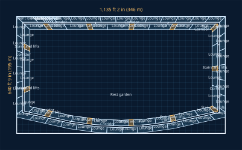
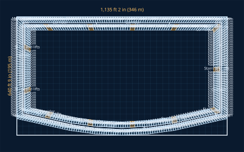

# P3-05 Controllers' Rest Hall: plan

Footprint 1,135 ft 2 in (346 m) × 640 ft 9 in (195 m) · structural grid 32 ft 10 in (10 m)

## Levels

| Level | Floor above deck | Height | Floor area |
|---|---|---|---|
| Level 1 · Lounge floor | 0 ft (0 mm) | 14 ft 9 in (4,500 mm) | 183,472 sq ft (17,045 m²) |
| Level 2 · Rest floor 1 | 14 ft 9 in (4,500 mm) | 11 ft 2 in (3,400 mm) | 183,388 sq ft (17,037 m²) |
| Level 3 · Rest floor 2 | 25 ft 11 in (7,900 mm) | 11 ft 2 in (3,400 mm) | 183,388 sq ft (17,037 m²) |

## Elements

| ID | Designation | Type | Name | Level(s) | Size / length | Area | Status |
|---|---|---|---|---|---|---|---|
| E001 | D5F5P3B4A2L1R1 | zone | Rest garden | L1 | 990 ft 10 in (302 m) × 496 ft 5 in (151 m) | 464,096 sq ft (43,116 m²) | proposed |
| E002 | D5F5P3B4A2L1R2 | zone | Corridor | L1 | 399 ft 11 in (122 m) × 9 ft 10 in (3,000 mm) | 3,875 sq ft (360 m²) | proposed |
| E003 | D5F5P3B4A2L1R3 | zone | Corridor | L1 | 397 ft 4 in (121 m) × 9 ft 10 in (3,000 mm) | 3,875 sq ft (360 m²) | proposed |
| E004 | D5F5P3B4A2L1R4 | zone | Corridor | L1 | 282 ft 10 in (86 m) × 125 ft 8 in (38 m) | 3,875 sq ft (360 m²) | proposed |
| E005 | D5F5P3B4A2L1R5 | zone | Corridor | L1 | 34 ft 5 in (10 m) × 380 ft 3 in (116 m) | 3,873 sq ft (360 m²) | proposed |
| E006 | D5F5P3B4A2L1R6 | zone | Corridor | L1 | 391 ft 5 in (119 m) × 79 ft 9 in (24 m) | 3,810 sq ft (354 m²) | proposed |
| E007 | D5F5P3B4A2L1R7 | zone | Corridor | L1 | 393 ft 4 in (120 m) × 34 ft 9 in (11 m) | 3,868 sq ft (359 m²) | proposed |
| E008 | D5F5P3B4A2L1R8 | zone | Corridor | L1 | 264 ft 9 in (81 m) × 191 ft 11 in (58 m) | 3,846 sq ft (357 m²) | proposed |
| E009 | D5F5P3B4A2L1R9 | zone | Corridor | L1 | 9 ft 10 in (3,000 mm) × 364 ft 2 in (111 m) | 3,521 sq ft (327 m²) | proposed |
| E010 | D5F5P3B4A2L1R10, D5F5P3B4A2L2R1, D5F5P3B4A2L3R1 | core | Stairs and lifts | L1, L2, L3 | 50 ft 6 in (15 m) × 31 ft 2 in (9,500 mm) | 818 sq ft (76 m²) | proposed |
| E011 | D5F5P3B4A2L1R11, D5F5P3B4A2L2R2, D5F5P3B4A2L3R2 | core | Stairs and lifts | L1, L2, L3 | 36 ft 9 in (11 m) × 31 ft 2 in (9,500 mm) | 823 sq ft (76 m²) | proposed |
| E012 | D5F5P3B4A2L1R12, D5F5P3B4A2L2R3, D5F5P3B4A2L3R3 | core | Stairs and lifts | L1, L2, L3 | 29 ft 6 in (9,000 mm) × 31 ft 2 in (9,500 mm) | 813 sq ft (76 m²) | proposed |
| E013 | D5F5P3B4A2L1R13, D5F5P3B4A2L2R4, D5F5P3B4A2L3R4 | core | Stairs and lifts | L1, L2, L3 | 43 ft 8 in (13 m) × 31 ft 2 in (9,500 mm) | 818 sq ft (76 m²) | proposed |
| E014 | D5F5P3B4A2L1R14, D5F5P3B4A2L2R5, D5F5P3B4A2L3R5 | core | Stairs and lifts | L1, L2, L3 | 42 ft 4 in (13 m) × 44 ft 11 in (14 m) | 818 sq ft (76 m²) | proposed |
| E015 | D5F5P3B4A2L1R15, D5F5P3B4A2L2R6, D5F5P3B4A2L3R6 | core | Stairs and lifts | L1, L2, L3 | 31 ft 2 in (9,500 mm) × 28 ft 10 in (8,800 mm) | 818 sq ft (76 m²) | proposed |
| E016 | D5F5P3B4A2L1R16, D5F5P3B4A2L2R7, D5F5P3B4A2L3R7 | core | Stairs and lifts | L1, L2, L3 | 49 ft 10 in (15 m) × 35 ft 1 in (11 m) | 814 sq ft (76 m²) | proposed |
| E017 | D5F5P3B4A2L1R17, D5F5P3B4A2L2R8, D5F5P3B4A2L3R8 | core | Stairs and lifts | L1, L2, L3 | 32 ft 2 in (9,800 mm) × 35 ft 9 in (11 m) | 817 sq ft (76 m²) | proposed |
| E018 | D5F5P3B4A2L1R18, D5F5P3B4A2L2R9, D5F5P3B4A2L3R9 | core | Stairs and lifts | L1, L2, L3 | 27 ft 7 in (8,400 mm) × 32 ft 2 in (9,800 mm) | 819 sq ft (76 m²) | proposed |
| E019 | D5F5P3B4A2L1R19, D5F5P3B4A2L2R10, D5F5P3B4A2L3R10 | core | Stairs and lifts | L1, L2, L3 | 29 ft 6 in (9,000 mm) × 34 ft 9 in (11 m) | 825 sq ft (77 m²) | proposed |
| E020 | D5F5P3B4A2L1R20, D5F5P3B4A2L2R11, D5F5P3B4A2L3R11 | core | Stairs and lifts | L1, L2, L3 | 44 ft 3 in (14 m) × 33 ft 10 in (10 m) | 828 sq ft (77 m²) | proposed |
| E021 | D5F5P3B4A2L1R21, D5F5P3B4A2L2R12, D5F5P3B4A2L3R12 | core | Stairs and lifts | L1, L2, L3 | 31 ft 2 in (9,500 mm) × 37 ft 9 in (12 m) | 818 sq ft (76 m²) | proposed |
| E022 | D5F5P3B4A2L1R22, D5F5P3B4A2L2R13, D5F5P3B4A2L3R13 | core | Stairs and lifts | L1, L2, L3 | 31 ft 2 in (9,500 mm) × 43 ft (13 m) | 818 sq ft (76 m²) | proposed |
| E023 | D5F5P3B4A2L1R23 | room | Silent lounge | L1 | 115 ft 2 in (35 m) × 31 ft 2 in (9,500 mm) | 2,694 sq ft (250 m²) | proposed |
| E024 | D5F5P3B4A2L1R24 | room | Café | L1 | 66 ft 3 in (20 m) × 31 ft 2 in (9,500 mm) | 1,283 sq ft (119 m²) | proposed |
| E025 | D5F5P3B4A2L1R25 | room | Massage room | L1 | 34 ft 9 in (11 m) × 31 ft 2 in (9,500 mm) | 348 sq ft (32 m²) | proposed |
| E026 | D5F5P3B4A2L1R26 | room | Massage room | L1 | 33 ft 10 in (10 m) × 31 ft 2 in (9,500 mm) | 337 sq ft (31 m²) | proposed |
| E027 | D5F5P3B4A2L1R27 | room | Massage room | L1 | 33 ft 2 in (10 m) × 31 ft 2 in (9,500 mm) | 337 sq ft (31 m²) | proposed |
| E028 | D5F5P3B4A2L1R28 | room | Front desk | L1 | 32 ft 10 in (10 m) × 31 ft 2 in (9,500 mm) | 343 sq ft (32 m²) | proposed |
| E029 | D5F5P3B4A2L1R29 | room | Toilets | L1 | 41 ft 8 in (13 m) × 31 ft 2 in (9,500 mm) | 644 sq ft (60 m²) | proposed |
| E030 | D5F5P3B4A2L1R30 | room | Lounge | L1 | 101 ft 1 in (31 m) × 31 ft 2 in (9,500 mm) | 2,587 sq ft (240 m²) | proposed |
| E031 | D5F5P3B4A2L1R31 | room | Lounge | L1 | 96 ft 2 in (29 m) × 31 ft 2 in (9,500 mm) | 2,582 sq ft (240 m²) | proposed |
| E032 | D5F5P3B4A2L1R32 | room | Lounge | L1 | 91 ft 6 in (28 m) × 31 ft 2 in (9,500 mm) | 2,582 sq ft (240 m²) | proposed |
| E033 | D5F5P3B4A2L1R33 | room | Lounge | L1 | 86 ft 11 in (26 m) × 31 ft 2 in (9,500 mm) | 2,582 sq ft (240 m²) | proposed |
| E034 | D5F5P3B4A2L1R34 | room | Lounge | L1 | 85 ft 4 in (26 m) × 31 ft 2 in (9,500 mm) | 2,587 sq ft (240 m²) | proposed |
| E035 | D5F5P3B4A2L1R35 | room | Lounge | L1 | 88 ft 3 in (27 m) × 31 ft 2 in (9,500 mm) | 2,582 sq ft (240 m²) | proposed |
| E036 | D5F5P3B4A2L1R36 | room | Lounge | L1 | 93 ft 2 in (28 m) × 31 ft 2 in (9,500 mm) | 2,587 sq ft (240 m²) | proposed |
| E037 | D5F5P3B4A2L1R37 | room | Lounge | L1 | 97 ft 5 in (30 m) × 31 ft 2 in (9,500 mm) | 2,577 sq ft (239 m²) | proposed |
| E038 | D5F5P3B4A2L1R38 | room | Lounge | L1 | 102 ft 4 in (31 m) × 31 ft 2 in (9,500 mm) | 2,587 sq ft (240 m²) | proposed |
| E039 | D5F5P3B4A2L1R39 | room | Lounge | L1 | 106 ft 11 in (33 m) × 31 ft 2 in (9,500 mm) | 2,582 sq ft (240 m²) | proposed |
| E040 | D5F5P3B4A2L1R40 | room | Lounge | L1 | 111 ft 11 in (34 m) × 31 ft 2 in (9,500 mm) | 2,587 sq ft (240 m²) | proposed |
| E041 | D5F5P3B4A2L1R41 | room | Lounge | L1 | 31 ft 2 in (9,500 mm) × 109 ft 7 in (33 m) | 2,582 sq ft (240 m²) | proposed |
| E042 | D5F5P3B4A2L1R42 | room | Lounge | L1 | 31 ft 2 in (9,500 mm) × 100 ft 9 in (31 m) | 2,582 sq ft (240 m²) | proposed |
| E043 | D5F5P3B4A2L1R43 | room | Lounge | L1 | 31 ft 2 in (9,500 mm) × 91 ft 10 in (28 m) | 2,582 sq ft (240 m²) | proposed |
| E044 | D5F5P3B4A2L1R44 | room | Lounge | L1 | 31 ft 2 in (9,500 mm) × 87 ft 3 in (27 m) | 2,582 sq ft (240 m²) | proposed |
| E045 | D5F5P3B4A2L1R45 | room | Lounge | L1 | 31 ft 2 in (9,500 mm) × 91 ft 10 in (28 m) | 2,587 sq ft (240 m²) | proposed |
| E046 | D5F5P3B4A2L1R46 | room | Lounge | L1 | 31 ft 2 in (9,500 mm) × 100 ft 9 in (31 m) | 2,582 sq ft (240 m²) | proposed |
| E047 | D5F5P3B4A2L1R47 | room | Lounge | L1 | 84 ft (26 m) × 62 ft 8 in (19 m) | 2,583 sq ft (240 m²) | proposed |
| E048 | D5F5P3B4A2L1R48 | room | Lounge | L1 | 103 ft (31 m) × 44 ft 11 in (14 m) | 2,586 sq ft (240 m²) | proposed |
| E049 | D5F5P3B4A2L1R49 | room | Lounge | L1 | 95 ft 2 in (29 m) × 46 ft 11 in (14 m) | 2,582 sq ft (240 m²) | proposed |
| E050 | D5F5P3B4A2L1R50 | room | Lounge | L1 | 88 ft 11 in (27 m) × 45 ft 11 in (14 m) | 2,585 sq ft (240 m²) | proposed |
| E051 | D5F5P3B4A2L1R51 | room | Lounge | L1 | 86 ft 3 in (26 m) × 42 ft (13 m) | 2,580 sq ft (240 m²) | proposed |
| E052 | D5F5P3B4A2L1R52 | room | Lounge | L1 | 85 ft 4 in (26 m) × 37 ft 9 in (12 m) | 2,591 sq ft (241 m²) | proposed |
| E053 | D5F5P3B4A2L1R53 | room | Lounge | L1 | 83 ft 8 in (26 m) × 35 ft 1 in (11 m) | 2,581 sq ft (240 m²) | proposed |
| E054 | D5F5P3B4A2L1R54 | room | Lounge | L1 | 83 ft 8 in (26 m) × 34 ft 9 in (11 m) | 2,585 sq ft (240 m²) | proposed |
| E055 | D5F5P3B4A2L1R55 | room | Lounge | L1 | 85 ft (26 m) × 36 ft 9 in (11 m) | 2,584 sq ft (240 m²) | proposed |
| E056 | D5F5P3B4A2L1R56 | room | Lounge | L1 | 86 ft 3 in (26 m) × 42 ft (13 m) | 2,580 sq ft (240 m²) | proposed |
| E057 | D5F5P3B4A2L1R57 | room | Lounge | L1 | 88 ft 7 in (27 m) × 45 ft 3 in (14 m) | 2,588 sq ft (240 m²) | proposed |
| E058 | D5F5P3B4A2L1R58 | room | Lounge | L1 | 94 ft 6 in (29 m) × 46 ft 11 in (14 m) | 2,582 sq ft (240 m²) | proposed |
| E059 | D5F5P3B4A2L1R59 | room | Lounge | L1 | 102 ft (31 m) × 45 ft 3 in (14 m) | 2,584 sq ft (240 m²) | proposed |
| E060 | D5F5P3B4A2L1R60 | room | Lounge | L1 | 95 ft 2 in (29 m) × 54 ft 2 in (16 m) | 2,592 sq ft (241 m²) | proposed |
| E061 | D5F5P3B4A2L1R61 | room | Lounge | L1 | 31 ft 2 in (9,500 mm) × 101 ft 8 in (31 m) | 2,582 sq ft (240 m²) | proposed |
| E062 | D5F5P3B4A2L1R62 | room | Lounge | L1 | 31 ft 2 in (9,500 mm) × 92 ft 10 in (28 m) | 2,582 sq ft (240 m²) | proposed |
| E063 | D5F5P3B4A2L1R63 | room | Lounge | L1 | 31 ft 2 in (9,500 mm) × 87 ft 3 in (27 m) | 2,582 sq ft (240 m²) | proposed |
| E064 | D5F5P3B4A2L1R64 | room | Lounge | L1 | 31 ft 2 in (9,500 mm) × 90 ft 7 in (28 m) | 2,582 sq ft (240 m²) | proposed |
| E065 | D5F5P3B4A2L1R65 | room | Lounge | L1 | 31 ft 2 in (9,500 mm) × 99 ft 5 in (30 m) | 2,582 sq ft (240 m²) | proposed |
| E066 | D5F5P3B4A2L1R66 | room | Lounge | L1 | 31 ft 2 in (9,500 mm) × 120 ft 9 in (37 m) | 2,950 sq ft (274 m²) | proposed |
| E067 | D5F5P3B4A2L1R67 | room | Lounge | L1 | 128 ft 7 in (39 m) × 31 ft 2 in (9,500 mm) | 3,134 sq ft (291 m²) | proposed |
| E068 | D5F5P3B4A2L1R68 | room | Lounge | L1 | 104 ft (32 m) × 31 ft 2 in (9,500 mm) | 2,587 sq ft (240 m²) | proposed |
| E069 | D5F5P3B4A2L1R69 | room | Lounge | L1 | 132 ft 10 in (40 m) × 31 ft 2 in (9,500 mm) | 3,681 sq ft (342 m²) | proposed |
| E070 | D5F5P3B4A2L1R70 | room | Lounge | L1 | 89 ft 11 in (27 m) × 31 ft 2 in (9,500 mm) | 2,582 sq ft (240 m²) | proposed |
| E071 | D5F5P3B4A2L1R71 | room | Lounge | L1 | 122 ft 1 in (37 m) × 31 ft 2 in (9,500 mm) | 3,691 sq ft (343 m²) | proposed |
| E072 | D5F5P3B4A2L1R72 | room | Lounge | L1 | 89 ft 11 in (27 m) × 31 ft 2 in (9,500 mm) | 2,587 sq ft (240 m²) | proposed |
| E073 | D5F5P3B4A2L1R73 | room | Lounge | L1 | 131 ft 3 in (40 m) × 31 ft 2 in (9,500 mm) | 3,686 sq ft (342 m²) | proposed |
| E074 | D5F5P3B4A2L1R74 | room | Lounge | L1 | 103 ft 8 in (32 m) × 31 ft 2 in (9,500 mm) | 2,582 sq ft (240 m²) | proposed |
| E075 | D5F5P3B4A2L1R75 | room | Lounge | L1 | 145 ft 4 in (44 m) × 31 ft 2 in (9,500 mm) | 3,691 sq ft (343 m²) | proposed |
| E076 | D5F5P3B4A2L1R76 | room | Lounge | L1 | 31 ft 2 in (9,500 mm) × 106 ft 11 in (33 m) | 2,582 sq ft (240 m²) | proposed |
| E077 | D5F5P3B4A2L1R77 | room | Lounge | L1 | 31 ft 2 in (9,500 mm) × 129 ft 11 in (40 m) | 3,686 sq ft (342 m²) | proposed |
| E078 | D5F5P3B4A2L1R78 | room | Lounge | L1 | 31 ft 2 in (9,500 mm) × 88 ft 3 in (27 m) | 2,587 sq ft (240 m²) | proposed |
| E079 | D5F5P3B4A2L1R79 | room | Lounge | L1 | 31 ft 2 in (9,500 mm) × 135 ft 2 in (41 m) | 3,686 sq ft (342 m²) | proposed |
| E080 | D5F5P3B4A2L1R80 | room | Lounge | L1 | 105 ft 8 in (32 m) × 44 ft 7 in (14 m) | 2,588 sq ft (240 m²) | proposed |
| E081 | D5F5P3B4A2L1R81 | room | Lounge | L1 | 129 ft 7 in (40 m) × 54 ft 6 in (17 m) | 3,679 sq ft (342 m²) | proposed |
| E082 | D5F5P3B4A2L1R82 | room | Lounge | L1 | 86 ft 7 in (26 m) × 42 ft (13 m) | 2,581 sq ft (240 m²) | proposed |
| E083 | D5F5P3B4A2L1R83 | room | Lounge | L1 | 120 ft 9 in (37 m) × 41 ft 4 in (13 m) | 3,680 sq ft (342 m²) | proposed |
| E084 | D5F5P3B4A2L1R84 | room | Lounge | L1 | 83 ft 8 in (26 m) × 33 ft 6 in (10 m) | 2,579 sq ft (240 m²) | proposed |
| E085 | D5F5P3B4A2L1R85 | room | Lounge | L1 | 120 ft 1 in (37 m) × 38 ft 9 in (12 m) | 3,674 sq ft (341 m²) | proposed |
| E086 | D5F5P3B4A2L1R86 | room | Lounge | L1 | 86 ft 7 in (26 m) × 42 ft 4 in (13 m) | 2,598 sq ft (241 m²) | proposed |
| E087 | D5F5P3B4A2L1R87 | room | Lounge | L1 | 126 ft 8 in (39 m) × 54 ft 6 in (17 m) | 3,697 sq ft (343 m²) | proposed |
| E088 | D5F5P3B4A2L1R88 | room | Lounge | L1 | 105 ft 4 in (32 m) × 44 ft 7 in (14 m) | 2,590 sq ft (241 m²) | proposed |
| E089 | D5F5P3B4A2L1R89 | room | Lounge | L1 | 52 ft 10 in (16 m) × 119 ft 5 in (36 m) | 3,689 sq ft (343 m²) | proposed |
| E090 | D5F5P3B4A2L1R90 | room | Lounge | L1 | 31 ft 2 in (9,500 mm) × 87 ft 11 in (27 m) | 2,577 sq ft (239 m²) | proposed |
| E091 | D5F5P3B4A2L1R91 | room | Lounge | L1 | 31 ft 2 in (9,500 mm) × 126 ft 4 in (38 m) | 3,691 sq ft (343 m²) | proposed |
| E092 | D5F5P3B4A2L1R92 | room | Lounge | L1 | 31 ft 2 in (9,500 mm) × 125 ft 4 in (38 m) | 3,134 sq ft (291 m²) | proposed |
| E093 | D5F5P3B4A2L2R14, D5F5P3B4A2L3R14 | zone | Corridor | L2, L3 | 399 ft 11 in (122 m) × 9 ft 10 in (3,000 mm) | 3,875 sq ft (360 m²) | proposed |
| E094 | D5F5P3B4A2L2R15, D5F5P3B4A2L3R15 | zone | Corridor | L2, L3 | 397 ft 4 in (121 m) × 9 ft 10 in (3,000 mm) | 3,875 sq ft (360 m²) | proposed |
| E095 | D5F5P3B4A2L2R16, D5F5P3B4A2L3R16 | zone | Corridor | L2, L3 | 282 ft 10 in (86 m) × 125 ft 8 in (38 m) | 3,875 sq ft (360 m²) | proposed |
| E096 | D5F5P3B4A2L2R17, D5F5P3B4A2L3R17 | zone | Corridor | L2, L3 | 34 ft 5 in (10 m) × 380 ft 3 in (116 m) | 3,873 sq ft (360 m²) | proposed |
| E097 | D5F5P3B4A2L2R18, D5F5P3B4A2L3R18 | zone | Corridor | L2, L3 | 391 ft 5 in (119 m) × 79 ft 9 in (24 m) | 3,810 sq ft (354 m²) | proposed |
| E098 | D5F5P3B4A2L2R19, D5F5P3B4A2L3R19 | zone | Corridor | L2, L3 | 393 ft 4 in (120 m) × 34 ft 9 in (11 m) | 3,868 sq ft (359 m²) | proposed |
| E099 | D5F5P3B4A2L2R20, D5F5P3B4A2L3R20 | zone | Corridor | L2, L3 | 264 ft 9 in (81 m) × 191 ft 11 in (58 m) | 3,846 sq ft (357 m²) | proposed |
| E100 | D5F5P3B4A2L2R21, D5F5P3B4A2L3R21 | zone | Corridor | L2, L3 | 9 ft 10 in (3,000 mm) × 364 ft 2 in (111 m) | 3,521 sq ft (327 m²) | proposed |
| E101 | D5F5P3B4A2L2R22, D5F5P3B4A2L3R22 | room | Nap room | L2, L3 | 41 ft 8 in (13 m) × 31 ft 2 in (9,500 mm) | 337 sq ft (31 m²) | proposed |
| E102 | D5F5P3B4A2L2R23, D5F5P3B4A2L3R23 | room | Nap room | L2, L3 | 41 ft 4 in (13 m) × 31 ft 2 in (9,500 mm) | 343 sq ft (32 m²) | proposed |
| E103 | D5F5P3B4A2L2R24, D5F5P3B4A2L3R24 | room | Nap room | L2, L3 | 40 ft 8 in (12 m) × 31 ft 2 in (9,500 mm) | 343 sq ft (32 m²) | proposed |
| E104 | D5F5P3B4A2L2R25, D5F5P3B4A2L3R25 | room | Nap room | L2, L3 | 39 ft 8 in (12 m) × 31 ft 2 in (9,500 mm) | 337 sq ft (31 m²) | proposed |
| E105 | D5F5P3B4A2L2R26, D5F5P3B4A2L3R26 | room | Nap room | L2, L3 | 39 ft 4 in (12 m) × 31 ft 2 in (9,500 mm) | 343 sq ft (32 m²) | proposed |
| E106 | D5F5P3B4A2L2R27, D5F5P3B4A2L3R27 | room | Nap room | L2, L3 | 38 ft 9 in (12 m) × 31 ft 2 in (9,500 mm) | 337 sq ft (31 m²) | proposed |
| E107 | D5F5P3B4A2L2R28, D5F5P3B4A2L3R28 | room | Nap room | L2, L3 | 38 ft 1 in (12 m) × 31 ft 2 in (9,500 mm) | 337 sq ft (31 m²) | proposed |
| E108 | D5F5P3B4A2L2R29, D5F5P3B4A2L3R29 | room | Nap room | L2, L3 | 37 ft 5 in (11 m) × 31 ft 2 in (9,500 mm) | 343 sq ft (32 m²) | proposed |
| E109 | D5F5P3B4A2L2R30, D5F5P3B4A2L3R30 | room | Nap room | L2, L3 | 36 ft 9 in (11 m) × 31 ft 2 in (9,500 mm) | 343 sq ft (32 m²) | proposed |
| E110 | D5F5P3B4A2L2R31, D5F5P3B4A2L3R31 | room | Nap room | L2, L3 | 36 ft 1 in (11 m) × 31 ft 2 in (9,500 mm) | 337 sq ft (31 m²) | proposed |
| E111 | D5F5P3B4A2L2R32, D5F5P3B4A2L3R32 | room | Nap room | L2, L3 | 35 ft 5 in (11 m) × 31 ft 2 in (9,500 mm) | 337 sq ft (31 m²) | proposed |
| E112 | D5F5P3B4A2L2R33, D5F5P3B4A2L3R33 | room | Nap room | L2, L3 | 35 ft 1 in (11 m) × 31 ft 2 in (9,500 mm) | 343 sq ft (32 m²) | proposed |
| E113 | D5F5P3B4A2L2R34, D5F5P3B4A2L3R34 | room | Nap room | L2, L3 | 34 ft 5 in (10 m) × 31 ft 2 in (9,500 mm) | 337 sq ft (31 m²) | proposed |
| E114 | D5F5P3B4A2L2R35, D5F5P3B4A2L3R35 | room | Nap room | L2, L3 | 33 ft 10 in (10 m) × 31 ft 2 in (9,500 mm) | 343 sq ft (32 m²) | proposed |
| E115 | D5F5P3B4A2L2R36, D5F5P3B4A2L3R36 | room | Nap room | L2, L3 | 33 ft 2 in (10 m) × 31 ft 2 in (9,500 mm) | 343 sq ft (32 m²) | proposed |
| E116 | D5F5P3B4A2L2R37, D5F5P3B4A2L3R37 | room | Nap room | L2, L3 | 32 ft 6 in (9,900 mm) × 31 ft 2 in (9,500 mm) | 337 sq ft (31 m²) | proposed |
| E117 | D5F5P3B4A2L2R38, D5F5P3B4A2L3R38 | room | Nap room | L2, L3 | 31 ft 10 in (9,700 mm) × 31 ft 2 in (9,500 mm) | 337 sq ft (31 m²) | proposed |
| E118 | D5F5P3B4A2L2R39, D5F5P3B4A2L3R39 | room | Nap room | L2, L3 | 31 ft 6 in (9,600 mm) × 31 ft 2 in (9,500 mm) | 343 sq ft (32 m²) | proposed |
| E119 | D5F5P3B4A2L2R40, D5F5P3B4A2L3R40 | room | Nap room | L2, L3 | 30 ft 10 in (9,400 mm) × 31 ft 2 in (9,500 mm) | 343 sq ft (32 m²) | proposed |
| E120 | D5F5P3B4A2L2R41, D5F5P3B4A2L3R41 | room | Nap room | L2, L3 | 29 ft 10 in (9,100 mm) × 31 ft 2 in (9,500 mm) | 337 sq ft (31 m²) | proposed |
| E121 | D5F5P3B4A2L2R42, D5F5P3B4A2L3R42 | room | Nap room | L2, L3 | 29 ft 6 in (9,000 mm) × 31 ft 2 in (9,500 mm) | 343 sq ft (32 m²) | proposed |
| E122 | D5F5P3B4A2L2R43, D5F5P3B4A2L3R43 | room | Nap room | L2, L3 | 28 ft 10 in (8,800 mm) × 31 ft 2 in (9,500 mm) | 337 sq ft (31 m²) | proposed |
| E123 | D5F5P3B4A2L2R44, D5F5P3B4A2L3R44 | room | Nap room | L2, L3 | 28 ft 3 in (8,600 mm) × 31 ft 2 in (9,500 mm) | 337 sq ft (31 m²) | proposed |
| E124 | D5F5P3B4A2L2R45, D5F5P3B4A2L3R45 | room | Nap room | L2, L3 | 27 ft 7 in (8,400 mm) × 31 ft 2 in (9,500 mm) | 343 sq ft (32 m²) | proposed |
| E125 | D5F5P3B4A2L2R46, D5F5P3B4A2L3R46 | room | Nap room | L2, L3 | 26 ft 11 in (8,200 mm) × 31 ft 2 in (9,500 mm) | 343 sq ft (32 m²) | proposed |
| E126 | D5F5P3B4A2L2R47, D5F5P3B4A2L3R47 | room | Nap room | L2, L3 | 26 ft 3 in (8,000 mm) × 31 ft 2 in (9,500 mm) | 337 sq ft (31 m²) | proposed |
| E127 | D5F5P3B4A2L2R48, D5F5P3B4A2L3R48 | room | Showers | L2, L3 | 25 ft 7 in (7,800 mm) × 31 ft 2 in (9,500 mm) | 337 sq ft (31 m²) | proposed |
| E128 | D5F5P3B4A2L2R49, D5F5P3B4A2L3R49 | room | Nap room | L2, L3 | 26 ft 7 in (8,100 mm) × 31 ft 2 in (9,500 mm) | 389 sq ft (36 m²) | proposed |
| E129 | D5F5P3B4A2L2R50, D5F5P3B4A2L3R50 | room | Nap room | L2, L3 | 25 ft 11 in (7,900 mm) × 31 ft 2 in (9,500 mm) | 389 sq ft (36 m²) | proposed |
| E130 | D5F5P3B4A2L2R51, D5F5P3B4A2L3R51 | room | Nap room | L2, L3 | 25 ft 3 in (7,700 mm) × 31 ft 2 in (9,500 mm) | 389 sq ft (36 m²) | proposed |
| E131 | D5F5P3B4A2L2R52, D5F5P3B4A2L3R52 | room | Nap room | L2, L3 | 24 ft 7 in (7,500 mm) × 31 ft 2 in (9,500 mm) | 389 sq ft (36 m²) | proposed |
| E132 | D5F5P3B4A2L2R53, D5F5P3B4A2L3R53 | room | Nap room | L2, L3 | 23 ft 11 in (7,300 mm) × 31 ft 2 in (9,500 mm) | 389 sq ft (36 m²) | proposed |
| E133 | D5F5P3B4A2L2R54, D5F5P3B4A2L3R54 | room | Nap room | L2, L3 | 23 ft (7,000 mm) × 31 ft 2 in (9,500 mm) | 383 sq ft (36 m²) | proposed |
| E134 | D5F5P3B4A2L2R55, D5F5P3B4A2L3R55 | room | Nap room | L2, L3 | 22 ft 4 in (6,800 mm) × 31 ft 2 in (9,500 mm) | 389 sq ft (36 m²) | proposed |
| E135 | D5F5P3B4A2L2R56, D5F5P3B4A2L3R56 | room | Nap room | L2, L3 | 21 ft 8 in (6,600 mm) × 31 ft 2 in (9,500 mm) | 389 sq ft (36 m²) | proposed |
| E136 | D5F5P3B4A2L2R57, D5F5P3B4A2L3R57 | room | Nap room | L2, L3 | 21 ft (6,400 mm) × 31 ft 2 in (9,500 mm) | 389 sq ft (36 m²) | proposed |
| E137 | D5F5P3B4A2L2R58, D5F5P3B4A2L3R58 | room | Nap room | L2, L3 | 20 ft 4 in (6,200 mm) × 31 ft 2 in (9,500 mm) | 389 sq ft (36 m²) | proposed |
| E138 | D5F5P3B4A2L2R59, D5F5P3B4A2L3R59 | room | Nap room | L2, L3 | 19 ft 4 in (5,900 mm) × 31 ft 2 in (9,500 mm) | 383 sq ft (36 m²) | proposed |
| E139 | D5F5P3B4A2L2R60, D5F5P3B4A2L3R60 | room | Nap room | L2, L3 | 18 ft 8 in (5,700 mm) × 31 ft 2 in (9,500 mm) | 389 sq ft (36 m²) | proposed |
| E140 | D5F5P3B4A2L2R61, D5F5P3B4A2L3R61 | room | Nap room | L2, L3 | 18 ft 1 in (5,500 mm) × 31 ft 2 in (9,500 mm) | 389 sq ft (36 m²) | proposed |
| E141 | D5F5P3B4A2L2R62, D5F5P3B4A2L3R62 | room | Nap room | L2, L3 | 17 ft 5 in (5,300 mm) × 31 ft 2 in (9,500 mm) | 389 sq ft (36 m²) | proposed |
| E142 | D5F5P3B4A2L2R63, D5F5P3B4A2L3R63 | room | Nap room | L2, L3 | 16 ft 9 in (5,100 mm) × 31 ft 2 in (9,500 mm) | 389 sq ft (36 m²) | proposed |
| E143 | D5F5P3B4A2L2R64, D5F5P3B4A2L3R64 | room | Nap room | L2, L3 | 16 ft 1 in (4,900 mm) × 31 ft 2 in (9,500 mm) | 389 sq ft (36 m²) | proposed |
| E144 | D5F5P3B4A2L2R65, D5F5P3B4A2L3R65 | room | Nap room | L2, L3 | 15 ft 1 in (4,600 mm) × 31 ft 2 in (9,500 mm) | 378 sq ft (35 m²) | proposed |
| E145 | D5F5P3B4A2L2R66, D5F5P3B4A2L3R66 | room | Nap room | L2, L3 | 14 ft 9 in (4,500 mm) × 31 ft 2 in (9,500 mm) | 389 sq ft (36 m²) | proposed |
| E146 | D5F5P3B4A2L2R67, D5F5P3B4A2L3R67 | room | Nap room | L2, L3 | 14 ft 1 in (4,300 mm) × 31 ft 2 in (9,500 mm) | 389 sq ft (36 m²) | proposed |
| E147 | D5F5P3B4A2L2R68, D5F5P3B4A2L3R68 | room | Nap room | L2, L3 | 13 ft 5 in (4,100 mm) × 31 ft 2 in (9,500 mm) | 389 sq ft (36 m²) | proposed |
| E148 | D5F5P3B4A2L2R69, D5F5P3B4A2L3R69 | room | Nap room | L2, L3 | 12 ft 10 in (3,900 mm) × 31 ft 2 in (9,500 mm) | 389 sq ft (36 m²) | proposed |
| E149 | D5F5P3B4A2L2R70, D5F5P3B4A2L3R70 | room | Nap room | L2, L3 | 12 ft 10 in (3,900 mm) × 31 ft 2 in (9,500 mm) | 389 sq ft (36 m²) | proposed |
| E150 | D5F5P3B4A2L2R71, D5F5P3B4A2L3R71 | room | Nap room | L2, L3 | 13 ft 5 in (4,100 mm) × 31 ft 2 in (9,500 mm) | 383 sq ft (36 m²) | proposed |
| E151 | D5F5P3B4A2L2R72, D5F5P3B4A2L3R72 | room | Nap room | L2, L3 | 14 ft 5 in (4,400 mm) × 31 ft 2 in (9,500 mm) | 389 sq ft (36 m²) | proposed |
| E152 | D5F5P3B4A2L2R73, D5F5P3B4A2L3R73 | room | Nap room | L2, L3 | 15 ft 1 in (4,600 mm) × 31 ft 2 in (9,500 mm) | 389 sq ft (36 m²) | proposed |
| E153 | D5F5P3B4A2L2R74, D5F5P3B4A2L3R74 | room | Nap room | L2, L3 | 15 ft 9 in (4,800 mm) × 31 ft 2 in (9,500 mm) | 389 sq ft (36 m²) | proposed |
| E154 | D5F5P3B4A2L2R75, D5F5P3B4A2L3R75 | room | Nap room | L2, L3 | 16 ft 5 in (5,000 mm) × 31 ft 2 in (9,500 mm) | 389 sq ft (36 m²) | proposed |
| E155 | D5F5P3B4A2L2R76, D5F5P3B4A2L3R76 | room | Nap room | L2, L3 | 17 ft 1 in (5,200 mm) × 31 ft 2 in (9,500 mm) | 389 sq ft (36 m²) | proposed |
| E156 | D5F5P3B4A2L2R77, D5F5P3B4A2L3R77 | room | Nap room | L2, L3 | 17 ft 9 in (5,400 mm) × 31 ft 2 in (9,500 mm) | 383 sq ft (36 m²) | proposed |
| E157 | D5F5P3B4A2L2R78, D5F5P3B4A2L3R78 | room | Nap room | L2, L3 | 18 ft 8 in (5,700 mm) × 31 ft 2 in (9,500 mm) | 389 sq ft (36 m²) | proposed |
| E158 | D5F5P3B4A2L2R79, D5F5P3B4A2L3R79 | room | Nap room | L2, L3 | 19 ft 4 in (5,900 mm) × 31 ft 2 in (9,500 mm) | 389 sq ft (36 m²) | proposed |
| E159 | D5F5P3B4A2L2R80, D5F5P3B4A2L3R80 | room | Nap room | L2, L3 | 20 ft (6,100 mm) × 31 ft 2 in (9,500 mm) | 389 sq ft (36 m²) | proposed |
| E160 | D5F5P3B4A2L2R81, D5F5P3B4A2L3R81 | room | Nap room | L2, L3 | 20 ft 8 in (6,300 mm) × 31 ft 2 in (9,500 mm) | 389 sq ft (36 m²) | proposed |
| E161 | D5F5P3B4A2L2R82, D5F5P3B4A2L3R82 | room | Nap room | L2, L3 | 21 ft 4 in (6,500 mm) × 31 ft 2 in (9,500 mm) | 383 sq ft (36 m²) | proposed |
| E162 | D5F5P3B4A2L2R83, D5F5P3B4A2L3R83 | room | Nap room | L2, L3 | 22 ft 4 in (6,800 mm) × 31 ft 2 in (9,500 mm) | 389 sq ft (36 m²) | proposed |
| E163 | D5F5P3B4A2L2R84, D5F5P3B4A2L3R84 | room | Nap room | L2, L3 | 23 ft (7,000 mm) × 31 ft 2 in (9,500 mm) | 389 sq ft (36 m²) | proposed |
| E164 | D5F5P3B4A2L2R85, D5F5P3B4A2L3R85 | room | Nap room | L2, L3 | 23 ft 7 in (7,200 mm) × 31 ft 2 in (9,500 mm) | 389 sq ft (36 m²) | proposed |
| E165 | D5F5P3B4A2L2R86, D5F5P3B4A2L3R86 | room | Nap room | L2, L3 | 24 ft 3 in (7,400 mm) × 31 ft 2 in (9,500 mm) | 389 sq ft (36 m²) | proposed |
| E166 | D5F5P3B4A2L2R87, D5F5P3B4A2L3R87 | room | Nap room | L2, L3 | 24 ft 11 in (7,600 mm) × 31 ft 2 in (9,500 mm) | 389 sq ft (36 m²) | proposed |
| E167 | D5F5P3B4A2L2R88, D5F5P3B4A2L3R88 | room | Nap room | L2, L3 | 25 ft 7 in (7,800 mm) × 31 ft 2 in (9,500 mm) | 383 sq ft (36 m²) | proposed |
| E168 | D5F5P3B4A2L2R89, D5F5P3B4A2L3R89 | room | Nap room | L2, L3 | 26 ft 7 in (8,100 mm) × 31 ft 2 in (9,500 mm) | 389 sq ft (36 m²) | proposed |
| E169 | D5F5P3B4A2L2R90, D5F5P3B4A2L3R90 | room | Nap room | L2, L3 | 27 ft 3 in (8,300 mm) × 31 ft 2 in (9,500 mm) | 389 sq ft (36 m²) | proposed |
| E170 | D5F5P3B4A2L2R91, D5F5P3B4A2L3R91 | room | Nap room | L2, L3 | 27 ft 11 in (8,500 mm) × 31 ft 2 in (9,500 mm) | 389 sq ft (36 m²) | proposed |
| E171 | D5F5P3B4A2L2R92, D5F5P3B4A2L3R92 | room | Nap room | L2, L3 | 28 ft 7 in (8,700 mm) × 31 ft 2 in (9,500 mm) | 389 sq ft (36 m²) | proposed |
| E172 | D5F5P3B4A2L2R93, D5F5P3B4A2L3R93 | room | Nap room | L2, L3 | 29 ft 2 in (8,900 mm) × 31 ft 2 in (9,500 mm) | 389 sq ft (36 m²) | proposed |
| E173 | D5F5P3B4A2L2R94, D5F5P3B4A2L3R94 | room | Nap room | L2, L3 | 29 ft 6 in (9,000 mm) × 31 ft 2 in (9,500 mm) | 378 sq ft (35 m²) | proposed |
| E174 | D5F5P3B4A2L2R95, D5F5P3B4A2L3R95 | room | Nap room | L2, L3 | 30 ft 6 in (9,300 mm) × 31 ft 2 in (9,500 mm) | 389 sq ft (36 m²) | proposed |
| E175 | D5F5P3B4A2L2R96, D5F5P3B4A2L3R96 | room | Nap room | L2, L3 | 31 ft 2 in (9,500 mm) × 31 ft 2 in (9,500 mm) | 389 sq ft (36 m²) | proposed |
| E176 | D5F5P3B4A2L2R97, D5F5P3B4A2L3R97 | room | Nap room | L2, L3 | 31 ft 10 in (9,700 mm) × 31 ft 2 in (9,500 mm) | 389 sq ft (36 m²) | proposed |
| E177 | D5F5P3B4A2L2R98, D5F5P3B4A2L3R98 | room | Nap room | L2, L3 | 32 ft 6 in (9,900 mm) × 31 ft 2 in (9,500 mm) | 389 sq ft (36 m²) | proposed |
| E178 | D5F5P3B4A2L2R99, D5F5P3B4A2L3R99 | room | Nap room | L2, L3 | 33 ft 2 in (10 m) × 31 ft 2 in (9,500 mm) | 383 sq ft (36 m²) | proposed |
| E179 | D5F5P3B4A2L2R100, D5F5P3B4A2L3R100 | room | Nap room | L2, L3 | 34 ft 1 in (10 m) × 31 ft 2 in (9,500 mm) | 389 sq ft (36 m²) | proposed |
| E180 | D5F5P3B4A2L2R101, D5F5P3B4A2L3R101 | room | Nap room | L2, L3 | 34 ft 9 in (11 m) × 31 ft 2 in (9,500 mm) | 389 sq ft (36 m²) | proposed |
| E181 | D5F5P3B4A2L2R102, D5F5P3B4A2L3R102 | room | Nap room | L2, L3 | 35 ft 5 in (11 m) × 31 ft 2 in (9,500 mm) | 389 sq ft (36 m²) | proposed |
| E182 | D5F5P3B4A2L2R103, D5F5P3B4A2L3R103 | room | Nap room | L2, L3 | 36 ft 1 in (11 m) × 31 ft 2 in (9,500 mm) | 389 sq ft (36 m²) | proposed |
| E183 | D5F5P3B4A2L2R104, D5F5P3B4A2L3R104 | room | Nap room | L2, L3 | 36 ft 9 in (11 m) × 31 ft 2 in (9,500 mm) | 389 sq ft (36 m²) | proposed |
| E184 | D5F5P3B4A2L2R105, D5F5P3B4A2L3R105 | room | Nap room | L2, L3 | 37 ft 5 in (11 m) × 31 ft 2 in (9,500 mm) | 383 sq ft (36 m²) | proposed |
| E185 | D5F5P3B4A2L2R106, D5F5P3B4A2L3R106 | room | Nap room | L2, L3 | 38 ft 5 in (12 m) × 31 ft 2 in (9,500 mm) | 389 sq ft (36 m²) | proposed |
| E186 | D5F5P3B4A2L2R107, D5F5P3B4A2L3R107 | room | Nap room | L2, L3 | 39 ft 1 in (12 m) × 31 ft 2 in (9,500 mm) | 389 sq ft (36 m²) | proposed |
| E187 | D5F5P3B4A2L2R108, D5F5P3B4A2L3R108 | room | Nap room | L2, L3 | 39 ft 8 in (12 m) × 31 ft 2 in (9,500 mm) | 389 sq ft (36 m²) | proposed |
| E188 | D5F5P3B4A2L2R109, D5F5P3B4A2L3R109 | room | Nap room | L2, L3 | 40 ft 4 in (12 m) × 31 ft 2 in (9,500 mm) | 389 sq ft (36 m²) | proposed |
| E189 | D5F5P3B4A2L2R110, D5F5P3B4A2L3R110 | room | Nap room | L2, L3 | 41 ft (12 m) × 31 ft 2 in (9,500 mm) | 389 sq ft (36 m²) | proposed |
| E190 | D5F5P3B4A2L2R111, D5F5P3B4A2L3R111 | room | Nap room | L2, L3 | 41 ft 8 in (13 m) × 31 ft 2 in (9,500 mm) | 383 sq ft (36 m²) | proposed |
| E191 | D5F5P3B4A2L2R112, D5F5P3B4A2L3R112 | room | Nap room | L2, L3 | 42 ft 8 in (13 m) × 31 ft 2 in (9,500 mm) | 389 sq ft (36 m²) | proposed |
| E192 | D5F5P3B4A2L2R113, D5F5P3B4A2L3R113 | room | Nap room | L2, L3 | 43 ft 4 in (13 m) × 31 ft 2 in (9,500 mm) | 389 sq ft (36 m²) | proposed |
| E193 | D5F5P3B4A2L2R114, D5F5P3B4A2L3R114 | room | Nap room | L2, L3 | 32 ft 6 in (9,900 mm) × 41 ft 8 in (13 m) | 389 sq ft (36 m²) | proposed |
| E194 | D5F5P3B4A2L2R115, D5F5P3B4A2L3R115 | room | Nap room | L2, L3 | 31 ft 2 in (9,500 mm) × 41 ft 8 in (13 m) | 389 sq ft (36 m²) | proposed |
| E195 | D5F5P3B4A2L2R116, D5F5P3B4A2L3R116 | room | Nap room | L2, L3 | 31 ft 2 in (9,500 mm) × 40 ft 4 in (12 m) | 383 sq ft (36 m²) | proposed |
| E196 | D5F5P3B4A2L2R117, D5F5P3B4A2L3R117 | room | Nap room | L2, L3 | 31 ft 2 in (9,500 mm) × 39 ft 4 in (12 m) | 389 sq ft (36 m²) | proposed |
| E197 | D5F5P3B4A2L2R118, D5F5P3B4A2L3R118 | room | Nap room | L2, L3 | 31 ft 2 in (9,500 mm) × 37 ft 9 in (12 m) | 383 sq ft (36 m²) | proposed |
| E198 | D5F5P3B4A2L2R119, D5F5P3B4A2L3R119 | room | Nap room | L2, L3 | 31 ft 2 in (9,500 mm) × 36 ft 5 in (11 m) | 389 sq ft (36 m²) | proposed |
| E199 | D5F5P3B4A2L2R120, D5F5P3B4A2L3R120 | room | Nap room | L2, L3 | 31 ft 2 in (9,500 mm) × 35 ft 1 in (11 m) | 389 sq ft (36 m²) | proposed |
| E200 | D5F5P3B4A2L2R121, D5F5P3B4A2L3R121 | room | Nap room | L2, L3 | 31 ft 2 in (9,500 mm) × 33 ft 10 in (10 m) | 389 sq ft (36 m²) | proposed |
| E201 | D5F5P3B4A2L2R122, D5F5P3B4A2L3R122 | room | Nap room | L2, L3 | 31 ft 2 in (9,500 mm) × 32 ft 6 in (9,900 mm) | 389 sq ft (36 m²) | proposed |
| E202 | D5F5P3B4A2L2R123, D5F5P3B4A2L3R123 | room | Nap room | L2, L3 | 31 ft 2 in (9,500 mm) × 31 ft 2 in (9,500 mm) | 389 sq ft (36 m²) | proposed |
| E203 | D5F5P3B4A2L2R124, D5F5P3B4A2L3R124 | room | Nap room | L2, L3 | 31 ft 2 in (9,500 mm) × 29 ft 10 in (9,100 mm) | 389 sq ft (36 m²) | proposed |
| E204 | D5F5P3B4A2L2R125, D5F5P3B4A2L3R125 | room | Nap room | L2, L3 | 31 ft 2 in (9,500 mm) × 28 ft 3 in (8,600 mm) | 383 sq ft (36 m²) | proposed |
| E205 | D5F5P3B4A2L2R126, D5F5P3B4A2L3R126 | room | Nap room | L2, L3 | 31 ft 2 in (9,500 mm) × 26 ft 11 in (8,200 mm) | 389 sq ft (36 m²) | proposed |
| E206 | D5F5P3B4A2L2R127, D5F5P3B4A2L3R127 | room | Nap room | L2, L3 | 31 ft 2 in (9,500 mm) × 25 ft 7 in (7,800 mm) | 389 sq ft (36 m²) | proposed |
| E207 | D5F5P3B4A2L2R128, D5F5P3B4A2L3R128 | room | Nap room | L2, L3 | 31 ft 2 in (9,500 mm) × 24 ft 3 in (7,400 mm) | 389 sq ft (36 m²) | proposed |
| E208 | D5F5P3B4A2L2R129, D5F5P3B4A2L3R129 | room | Nap room | L2, L3 | 31 ft 2 in (9,500 mm) × 23 ft (7,000 mm) | 389 sq ft (36 m²) | proposed |
| E209 | D5F5P3B4A2L2R130, D5F5P3B4A2L3R130 | room | Nap room | L2, L3 | 31 ft 2 in (9,500 mm) × 21 ft 8 in (6,600 mm) | 383 sq ft (36 m²) | proposed |
| E210 | D5F5P3B4A2L2R131, D5F5P3B4A2L3R131 | room | Nap room | L2, L3 | 31 ft 2 in (9,500 mm) × 20 ft 8 in (6,300 mm) | 389 sq ft (36 m²) | proposed |
| E211 | D5F5P3B4A2L2R132, D5F5P3B4A2L3R132 | room | Nap room | L2, L3 | 31 ft 2 in (9,500 mm) × 19 ft (5,800 mm) | 383 sq ft (36 m²) | proposed |
| E212 | D5F5P3B4A2L2R133, D5F5P3B4A2L3R133 | room | Nap room | L2, L3 | 31 ft 2 in (9,500 mm) × 17 ft 9 in (5,400 mm) | 389 sq ft (36 m²) | proposed |
| E213 | D5F5P3B4A2L2R134, D5F5P3B4A2L3R134 | room | Nap room | L2, L3 | 31 ft 2 in (9,500 mm) × 16 ft 5 in (5,000 mm) | 389 sq ft (36 m²) | proposed |
| E214 | D5F5P3B4A2L2R135, D5F5P3B4A2L3R135 | room | Nap room | L2, L3 | 31 ft 2 in (9,500 mm) × 15 ft 1 in (4,600 mm) | 389 sq ft (36 m²) | proposed |
| E215 | D5F5P3B4A2L2R136, D5F5P3B4A2L3R136 | room | Nap room | L2, L3 | 31 ft 2 in (9,500 mm) × 13 ft 9 in (4,200 mm) | 389 sq ft (36 m²) | proposed |
| E216 | D5F5P3B4A2L2R137, D5F5P3B4A2L3R137 | room | Nap room | L2, L3 | 31 ft 2 in (9,500 mm) × 13 ft 1 in (4,000 mm) | 389 sq ft (36 m²) | proposed |
| E217 | D5F5P3B4A2L2R138, D5F5P3B4A2L3R138 | room | Nap room | L2, L3 | 31 ft 2 in (9,500 mm) × 13 ft 9 in (4,200 mm) | 389 sq ft (36 m²) | proposed |
| E218 | D5F5P3B4A2L2R139, D5F5P3B4A2L3R139 | room | Nap room | L2, L3 | 31 ft 2 in (9,500 mm) × 15 ft 1 in (4,600 mm) | 389 sq ft (36 m²) | proposed |
| E219 | D5F5P3B4A2L2R140, D5F5P3B4A2L3R140 | room | Nap room | L2, L3 | 31 ft 2 in (9,500 mm) × 16 ft 5 in (5,000 mm) | 383 sq ft (36 m²) | proposed |
| E220 | D5F5P3B4A2L2R141, D5F5P3B4A2L3R141 | room | Nap room | L2, L3 | 31 ft 2 in (9,500 mm) × 18 ft 1 in (5,500 mm) | 389 sq ft (36 m²) | proposed |
| E221 | D5F5P3B4A2L2R142, D5F5P3B4A2L3R142 | room | Nap room | L2, L3 | 31 ft 2 in (9,500 mm) × 19 ft 4 in (5,900 mm) | 389 sq ft (36 m²) | proposed |
| E222 | D5F5P3B4A2L2R143, D5F5P3B4A2L3R143 | room | Nap room | L2, L3 | 31 ft 2 in (9,500 mm) × 20 ft 8 in (6,300 mm) | 389 sq ft (36 m²) | proposed |
| E223 | D5F5P3B4A2L2R144, D5F5P3B4A2L3R144 | room | Nap room | L2, L3 | 31 ft 2 in (9,500 mm) × 21 ft 8 in (6,600 mm) | 383 sq ft (36 m²) | proposed |
| E224 | D5F5P3B4A2L2R145, D5F5P3B4A2L3R145 | room | Nap room | L2, L3 | 31 ft 2 in (9,500 mm) × 23 ft (7,000 mm) | 389 sq ft (36 m²) | proposed |
| E225 | D5F5P3B4A2L2R146, D5F5P3B4A2L3R146 | room | Nap room | L2, L3 | 31 ft 2 in (9,500 mm) × 24 ft 3 in (7,400 mm) | 389 sq ft (36 m²) | proposed |
| E226 | D5F5P3B4A2L2R147, D5F5P3B4A2L3R147 | room | Nap room | L2, L3 | 31 ft 2 in (9,500 mm) × 25 ft 7 in (7,800 mm) | 383 sq ft (36 m²) | proposed |
| E227 | D5F5P3B4A2L2R148, D5F5P3B4A2L3R148 | room | Nap room | L2, L3 | 31 ft 2 in (9,500 mm) × 27 ft 3 in (8,300 mm) | 389 sq ft (36 m²) | proposed |
| E228 | D5F5P3B4A2L2R149, D5F5P3B4A2L3R149 | room | Nap room | L2, L3 | 31 ft 2 in (9,500 mm) × 28 ft 7 in (8,700 mm) | 389 sq ft (36 m²) | proposed |
| E229 | D5F5P3B4A2L2R150, D5F5P3B4A2L3R150 | room | Nap room | L2, L3 | 31 ft 2 in (9,500 mm) × 29 ft 10 in (9,100 mm) | 389 sq ft (36 m²) | proposed |
| E230 | D5F5P3B4A2L2R151, D5F5P3B4A2L3R151 | room | Nap room | L2, L3 | 31 ft 2 in (9,500 mm) × 31 ft 2 in (9,500 mm) | 389 sq ft (36 m²) | proposed |
| E231 | D5F5P3B4A2L2R152, D5F5P3B4A2L3R152 | room | Nap room | L2, L3 | 31 ft 2 in (9,500 mm) × 32 ft 6 in (9,900 mm) | 389 sq ft (36 m²) | proposed |
| E232 | D5F5P3B4A2L2R153, D5F5P3B4A2L3R153 | room | Nap room | L2, L3 | 31 ft 2 in (9,500 mm) × 33 ft 10 in (10 m) | 389 sq ft (36 m²) | proposed |
| E233 | D5F5P3B4A2L2R154, D5F5P3B4A2L3R154 | room | Nap room | L2, L3 | 31 ft 2 in (9,500 mm) × 35 ft 1 in (11 m) | 383 sq ft (36 m²) | proposed |
| E234 | D5F5P3B4A2L2R155, D5F5P3B4A2L3R155 | room | Nap room | L2, L3 | 31 ft 2 in (9,500 mm) × 36 ft 9 in (11 m) | 389 sq ft (36 m²) | proposed |
| E235 | D5F5P3B4A2L2R156, D5F5P3B4A2L3R156 | room | Nap room | L2, L3 | 40 ft 8 in (12 m) × 29 ft 6 in (9,000 mm) | 388 sq ft (36 m²) | proposed |
| E236 | D5F5P3B4A2L2R157, D5F5P3B4A2L3R157 | room | Nap room | L2, L3 | 41 ft 8 in (13 m) × 28 ft 3 in (8,600 mm) | 387 sq ft (36 m²) | proposed |
| E237 | D5F5P3B4A2L2R158, D5F5P3B4A2L3R158 | room | Nap room | L2, L3 | 40 ft 8 in (12 m) × 28 ft 3 in (8,600 mm) | 386 sq ft (36 m²) | proposed |
| E238 | D5F5P3B4A2L2R159, D5F5P3B4A2L3R159 | room | Nap room | L2, L3 | 39 ft 4 in (12 m) × 28 ft 7 in (8,700 mm) | 389 sq ft (36 m²) | proposed |
| E239 | D5F5P3B4A2L2R160, D5F5P3B4A2L3R160 | room | Nap room | L2, L3 | 38 ft 5 in (12 m) × 28 ft 10 in (8,800 mm) | 394 sq ft (37 m²) | proposed |
| E240 | D5F5P3B4A2L2R161, D5F5P3B4A2L3R161 | room | Nap room | L2, L3 | 37 ft 1 in (11 m) × 28 ft 10 in (8,800 mm) | 380 sq ft (35 m²) | proposed |
| E241 | D5F5P3B4A2L2R162, D5F5P3B4A2L3R162 | room | Nap room | L2, L3 | 36 ft 1 in (11 m) × 29 ft 2 in (8,900 mm) | 385 sq ft (36 m²) | proposed |
| E242 | D5F5P3B4A2L2R163, D5F5P3B4A2L3R163 | room | Nap room | L2, L3 | 34 ft 9 in (11 m) × 29 ft 10 in (9,100 mm) | 392 sq ft (36 m²) | proposed |
| E243 | D5F5P3B4A2L2R164, D5F5P3B4A2L3R164 | room | Nap room | L2, L3 | 33 ft 10 in (10 m) × 29 ft 10 in (9,100 mm) | 391 sq ft (36 m²) | proposed |
| E244 | D5F5P3B4A2L2R165, D5F5P3B4A2L3R165 | room | Nap room | L2, L3 | 32 ft 6 in (9,900 mm) × 30 ft 2 in (9,200 mm) | 385 sq ft (36 m²) | proposed |
| E245 | D5F5P3B4A2L2R166, D5F5P3B4A2L3R166 | room | Nap room | L2, L3 | 31 ft 6 in (9,600 mm) × 30 ft 2 in (9,200 mm) | 385 sq ft (36 m²) | proposed |
| E246 | D5F5P3B4A2L2R167, D5F5P3B4A2L3R167 | room | Nap room | L2, L3 | 30 ft 2 in (9,200 mm) × 30 ft 6 in (9,300 mm) | 387 sq ft (36 m²) | proposed |
| E247 | D5F5P3B4A2L2R168, D5F5P3B4A2L3R168 | room | Nap room | L2, L3 | 29 ft 2 in (8,900 mm) × 30 ft 10 in (9,400 mm) | 388 sq ft (36 m²) | proposed |
| E248 | D5F5P3B4A2L2R169, D5F5P3B4A2L3R169 | room | Nap room | L2, L3 | 28 ft 3 in (8,600 mm) × 30 ft 10 in (9,400 mm) | 384 sq ft (36 m²) | proposed |
| E249 | D5F5P3B4A2L2R170, D5F5P3B4A2L3R170 | room | Nap room | L2, L3 | 26 ft 11 in (8,200 mm) × 31 ft 6 in (9,600 mm) | 390 sq ft (36 m²) | proposed |
| E250 | D5F5P3B4A2L2R171, D5F5P3B4A2L3R171 | room | Nap room | L2, L3 | 25 ft 7 in (7,800 mm) × 31 ft 10 in (9,700 mm) | 390 sq ft (36 m²) | proposed |
| E251 | D5F5P3B4A2L2R172, D5F5P3B4A2L3R172 | room | Nap room | L2, L3 | 24 ft 7 in (7,500 mm) × 31 ft 10 in (9,700 mm) | 387 sq ft (36 m²) | proposed |
| E252 | D5F5P3B4A2L2R173, D5F5P3B4A2L3R173 | room | Nap room | L2, L3 | 23 ft 7 in (7,200 mm) × 32 ft 2 in (9,800 mm) | 388 sq ft (36 m²) | proposed |
| E253 | D5F5P3B4A2L2R174, D5F5P3B4A2L3R174 | room | Nap room | L2, L3 | 22 ft 4 in (6,800 mm) × 32 ft 6 in (9,900 mm) | 389 sq ft (36 m²) | proposed |
| E254 | D5F5P3B4A2L2R175, D5F5P3B4A2L3R175 | room | Nap room | L2, L3 | 21 ft (6,400 mm) × 32 ft 6 in (9,900 mm) | 386 sq ft (36 m²) | proposed |
| E255 | D5F5P3B4A2L2R176, D5F5P3B4A2L3R176 | room | Nap room | L2, L3 | 19 ft 8 in (6,000 mm) × 32 ft 10 in (10 m) | 381 sq ft (35 m²) | proposed |
| E256 | D5F5P3B4A2L2R177, D5F5P3B4A2L3R177 | room | Nap room | L2, L3 | 19 ft (5,800 mm) × 33 ft 2 in (10 m) | 393 sq ft (37 m²) | proposed |
| E257 | D5F5P3B4A2L2R178, D5F5P3B4A2L3R178 | room | Nap room | L2, L3 | 18 ft 1 in (5,500 mm) × 33 ft 2 in (10 m) | 388 sq ft (36 m²) | proposed |
| E258 | D5F5P3B4A2L2R179, D5F5P3B4A2L3R179 | room | Nap room | L2, L3 | 17 ft 9 in (5,400 mm) × 32 ft 6 in (9,900 mm) | 388 sq ft (36 m²) | proposed |
| E259 | D5F5P3B4A2L2R180, D5F5P3B4A2L3R180 | room | Nap room | L2, L3 | 17 ft 5 in (5,300 mm) × 32 ft 6 in (9,900 mm) | 388 sq ft (36 m²) | proposed |
| E260 | D5F5P3B4A2L2R181, D5F5P3B4A2L3R181 | room | Nap room | L2, L3 | 17 ft 1 in (5,200 mm) × 32 ft 6 in (9,900 mm) | 387 sq ft (36 m²) | proposed |
| E261 | D5F5P3B4A2L2R182, D5F5P3B4A2L3R182 | room | Nap room | L2, L3 | 17 ft 1 in (5,200 mm) × 32 ft 6 in (9,900 mm) | 392 sq ft (36 m²) | proposed |
| E262 | D5F5P3B4A2L2R183, D5F5P3B4A2L3R183 | room | Nap room | L2, L3 | 16 ft 9 in (5,100 mm) × 32 ft 6 in (9,900 mm) | 387 sq ft (36 m²) | proposed |
| E263 | D5F5P3B4A2L2R184, D5F5P3B4A2L3R184 | room | Nap room | L2, L3 | 16 ft 5 in (5,000 mm) × 32 ft 6 in (9,900 mm) | 386 sq ft (36 m²) | proposed |
| E264 | D5F5P3B4A2L2R185, D5F5P3B4A2L3R185 | room | Nap room | L2, L3 | 16 ft 1 in (4,900 mm) × 32 ft 10 in (10 m) | 388 sq ft (36 m²) | proposed |
| E265 | D5F5P3B4A2L2R186, D5F5P3B4A2L3R186 | room | Nap room | L2, L3 | 15 ft 9 in (4,800 mm) × 32 ft 10 in (10 m) | 389 sq ft (36 m²) | proposed |
| E266 | D5F5P3B4A2L2R187, D5F5P3B4A2L3R187 | room | Nap room | L2, L3 | 15 ft 9 in (4,800 mm) × 32 ft 10 in (10 m) | 394 sq ft (37 m²) | proposed |
| E267 | D5F5P3B4A2L2R188, D5F5P3B4A2L3R188 | room | Nap room | L2, L3 | 15 ft 5 in (4,700 mm) × 32 ft 10 in (10 m) | 382 sq ft (36 m²) | proposed |
| E268 | D5F5P3B4A2L2R189, D5F5P3B4A2L3R189 | room | Nap room | L2, L3 | 15 ft 5 in (4,700 mm) × 32 ft 6 in (9,900 mm) | 386 sq ft (36 m²) | proposed |
| E269 | D5F5P3B4A2L2R190, D5F5P3B4A2L3R190 | room | Nap room | L2, L3 | 15 ft 5 in (4,700 mm) × 31 ft 10 in (9,700 mm) | 396 sq ft (37 m²) | proposed |
| E270 | D5F5P3B4A2L2R191, D5F5P3B4A2L3R191 | room | Nap room | L2, L3 | 14 ft 9 in (4,500 mm) × 31 ft 10 in (9,700 mm) | 385 sq ft (36 m²) | proposed |
| E271 | D5F5P3B4A2L2R192, D5F5P3B4A2L3R192 | room | Nap room | L2, L3 | 14 ft 5 in (4,400 mm) × 31 ft 10 in (9,700 mm) | 385 sq ft (36 m²) | proposed |
| E272 | D5F5P3B4A2L2R193, D5F5P3B4A2L3R193 | room | Nap room | L2, L3 | 14 ft 5 in (4,400 mm) × 31 ft 10 in (9,700 mm) | 390 sq ft (36 m²) | proposed |
| E273 | D5F5P3B4A2L2R194, D5F5P3B4A2L3R194 | room | Nap room | L2, L3 | 14 ft 1 in (4,300 mm) × 31 ft 6 in (9,600 mm) | 387 sq ft (36 m²) | proposed |
| E274 | D5F5P3B4A2L2R195, D5F5P3B4A2L3R195 | room | Nap room | L2, L3 | 13 ft 9 in (4,200 mm) × 31 ft 6 in (9,600 mm) | 387 sq ft (36 m²) | proposed |
| E275 | D5F5P3B4A2L2R196, D5F5P3B4A2L3R196 | room | Nap room | L2, L3 | 13 ft 5 in (4,100 mm) × 31 ft 10 in (9,700 mm) | 384 sq ft (36 m²) | proposed |
| E276 | D5F5P3B4A2L2R197, D5F5P3B4A2L3R197 | room | Nap room | L2, L3 | 13 ft 5 in (4,100 mm) × 31 ft 10 in (9,700 mm) | 389 sq ft (36 m²) | proposed |
| E277 | D5F5P3B4A2L2R198, D5F5P3B4A2L3R198 | room | Nap room | L2, L3 | 13 ft 1 in (4,000 mm) × 31 ft 10 in (9,700 mm) | 384 sq ft (36 m²) | proposed |
| E278 | D5F5P3B4A2L2R199, D5F5P3B4A2L3R199 | room | Nap room | L2, L3 | 13 ft 1 in (4,000 mm) × 31 ft 10 in (9,700 mm) | 394 sq ft (37 m²) | proposed |
| E279 | D5F5P3B4A2L2R200, D5F5P3B4A2L3R200 | room | Nap room | L2, L3 | 12 ft 6 in (3,800 mm) × 31 ft 10 in (9,700 mm) | 386 sq ft (36 m²) | proposed |
| E280 | D5F5P3B4A2L2R201, D5F5P3B4A2L3R201 | room | Nap room | L2, L3 | 12 ft 6 in (3,800 mm) × 31 ft 6 in (9,600 mm) | 389 sq ft (36 m²) | proposed |
| E281 | D5F5P3B4A2L2R202, D5F5P3B4A2L3R202 | room | Nap room | L2, L3 | 12 ft 6 in (3,800 mm) × 31 ft 10 in (9,700 mm) | 384 sq ft (36 m²) | proposed |
| E282 | D5F5P3B4A2L2R203, D5F5P3B4A2L3R203 | room | Nap room | L2, L3 | 13 ft 1 in (4,000 mm) × 31 ft 10 in (9,700 mm) | 394 sq ft (37 m²) | proposed |
| E283 | D5F5P3B4A2L2R204, D5F5P3B4A2L3R204 | room | Nap room | L2, L3 | 13 ft 1 in (4,000 mm) × 31 ft 10 in (9,700 mm) | 384 sq ft (36 m²) | proposed |
| E284 | D5F5P3B4A2L2R205, D5F5P3B4A2L3R205 | room | Nap room | L2, L3 | 13 ft 5 in (4,100 mm) × 31 ft 10 in (9,700 mm) | 384 sq ft (36 m²) | proposed |
| E285 | D5F5P3B4A2L2R206, D5F5P3B4A2L3R206 | room | Nap room | L2, L3 | 13 ft 9 in (4,200 mm) × 31 ft 10 in (9,700 mm) | 389 sq ft (36 m²) | proposed |
| E286 | D5F5P3B4A2L2R207, D5F5P3B4A2L3R207 | room | Nap room | L2, L3 | 14 ft 1 in (4,300 mm) × 31 ft 6 in (9,600 mm) | 387 sq ft (36 m²) | proposed |
| E287 | D5F5P3B4A2L2R208, D5F5P3B4A2L3R208 | room | Nap room | L2, L3 | 14 ft 5 in (4,400 mm) × 31 ft 6 in (9,600 mm) | 388 sq ft (36 m²) | proposed |
| E288 | D5F5P3B4A2L2R209, D5F5P3B4A2L3R209 | room | Nap room | L2, L3 | 14 ft 5 in (4,400 mm) × 31 ft 10 in (9,700 mm) | 385 sq ft (36 m²) | proposed |
| E289 | D5F5P3B4A2L2R210, D5F5P3B4A2L3R210 | room | Nap room | L2, L3 | 14 ft 9 in (4,500 mm) × 31 ft 10 in (9,700 mm) | 390 sq ft (36 m²) | proposed |
| E290 | D5F5P3B4A2L2R211, D5F5P3B4A2L3R211 | room | Nap room | L2, L3 | 15 ft 1 in (4,600 mm) × 31 ft 10 in (9,700 mm) | 390 sq ft (36 m²) | proposed |
| E291 | D5F5P3B4A2L2R212, D5F5P3B4A2L3R212 | room | Nap room | L2, L3 | 15 ft 5 in (4,700 mm) × 32 ft 2 in (9,800 mm) | 391 sq ft (36 m²) | proposed |
| E292 | D5F5P3B4A2L2R213, D5F5P3B4A2L3R213 | room | Nap room | L2, L3 | 15 ft 5 in (4,700 mm) × 32 ft 10 in (10 m) | 389 sq ft (36 m²) | proposed |
| E293 | D5F5P3B4A2L2R214, D5F5P3B4A2L3R214 | room | Nap room | L2, L3 | 15 ft 5 in (4,700 mm) × 32 ft 10 in (10 m) | 382 sq ft (36 m²) | proposed |
| E294 | D5F5P3B4A2L2R215, D5F5P3B4A2L3R215 | room | Nap room | L2, L3 | 15 ft 9 in (4,800 mm) × 32 ft 6 in (9,900 mm) | 385 sq ft (36 m²) | proposed |
| E295 | D5F5P3B4A2L2R216, D5F5P3B4A2L3R216 | room | Nap room | L2, L3 | 16 ft 1 in (4,900 mm) × 32 ft 6 in (9,900 mm) | 386 sq ft (36 m²) | proposed |
| E296 | D5F5P3B4A2L2R217, D5F5P3B4A2L3R217 | room | Nap room | L2, L3 | 16 ft 5 in (5,000 mm) × 32 ft 6 in (9,900 mm) | 391 sq ft (36 m²) | proposed |
| E297 | D5F5P3B4A2L2R218, D5F5P3B4A2L3R218 | room | Nap room | L2, L3 | 16 ft 5 in (5,000 mm) × 32 ft 6 in (9,900 mm) | 386 sq ft (36 m²) | proposed |
| E298 | D5F5P3B4A2L2R219, D5F5P3B4A2L3R219 | room | Nap room | L2, L3 | 16 ft 9 in (5,100 mm) × 32 ft 6 in (9,900 mm) | 385 sq ft (36 m²) | proposed |
| E299 | D5F5P3B4A2L2R220, D5F5P3B4A2L3R220 | room | Nap room | L2, L3 | 17 ft 1 in (5,200 mm) × 32 ft 6 in (9,900 mm) | 386 sq ft (36 m²) | proposed |
| E300 | D5F5P3B4A2L2R221, D5F5P3B4A2L3R221 | room | Nap room | L2, L3 | 17 ft 5 in (5,300 mm) × 32 ft 6 in (9,900 mm) | 388 sq ft (36 m²) | proposed |
| E301 | D5F5P3B4A2L2R222, D5F5P3B4A2L3R222 | room | Nap room | L2, L3 | 17 ft 9 in (5,400 mm) × 32 ft 6 in (9,900 mm) | 393 sq ft (37 m²) | proposed |
| E302 | D5F5P3B4A2L2R223, D5F5P3B4A2L3R223 | room | Nap room | L2, L3 | 17 ft 9 in (5,400 mm) × 32 ft 6 in (9,900 mm) | 388 sq ft (36 m²) | proposed |
| E303 | D5F5P3B4A2L2R224, D5F5P3B4A2L3R224 | room | Nap room | L2, L3 | 18 ft 1 in (5,500 mm) × 33 ft 6 in (10 m) | 384 sq ft (36 m²) | proposed |
| E304 | D5F5P3B4A2L2R225, D5F5P3B4A2L3R225 | room | Nap room | L2, L3 | 19 ft 4 in (5,900 mm) × 33 ft 2 in (10 m) | 389 sq ft (36 m²) | proposed |
| E305 | D5F5P3B4A2L2R226, D5F5P3B4A2L3R226 | room | Nap room | L2, L3 | 20 ft 8 in (6,300 mm) × 32 ft 6 in (9,900 mm) | 385 sq ft (36 m²) | proposed |
| E306 | D5F5P3B4A2L2R227, D5F5P3B4A2L3R227 | room | Nap room | L2, L3 | 22 ft (6,700 mm) × 32 ft 6 in (9,900 mm) | 392 sq ft (36 m²) | proposed |
| E307 | D5F5P3B4A2L2R228, D5F5P3B4A2L3R228 | room | Nap room | L2, L3 | 22 ft 8 in (6,900 mm) × 32 ft 2 in (9,800 mm) | 381 sq ft (35 m²) | proposed |
| E308 | D5F5P3B4A2L2R229, D5F5P3B4A2L3R229 | room | Nap room | L2, L3 | 23 ft 11 in (7,300 mm) × 31 ft 10 in (9,700 mm) | 385 sq ft (36 m²) | proposed |
| E309 | D5F5P3B4A2L2R230, D5F5P3B4A2L3R230 | room | Nap room | L2, L3 | 25 ft 3 in (7,700 mm) × 31 ft 10 in (9,700 mm) | 389 sq ft (36 m²) | proposed |
| E310 | D5F5P3B4A2L2R231, D5F5P3B4A2L3R231 | room | Nap room | L2, L3 | 26 ft 3 in (8,000 mm) × 31 ft 6 in (9,600 mm) | 388 sq ft (36 m²) | proposed |
| E311 | D5F5P3B4A2L2R232, D5F5P3B4A2L3R232 | room | Nap room | L2, L3 | 27 ft 3 in (8,300 mm) × 31 ft 6 in (9,600 mm) | 391 sq ft (36 m²) | proposed |
| E312 | D5F5P3B4A2L2R233, D5F5P3B4A2L3R233 | room | Nap room | L2, L3 | 28 ft 7 in (8,700 mm) × 31 ft 2 in (9,500 mm) | 390 sq ft (36 m²) | proposed |
| E313 | D5F5P3B4A2L2R234, D5F5P3B4A2L3R234 | room | Nap room | L2, L3 | 29 ft 10 in (9,100 mm) × 30 ft 6 in (9,300 mm) | 384 sq ft (36 m²) | proposed |
| E314 | D5F5P3B4A2L2R235, D5F5P3B4A2L3R235 | room | Nap room | L2, L3 | 30 ft 10 in (9,400 mm) × 30 ft 6 in (9,300 mm) | 385 sq ft (36 m²) | proposed |
| E315 | D5F5P3B4A2L2R236, D5F5P3B4A2L3R236 | room | Nap room | L2, L3 | 32 ft 2 in (9,800 mm) × 30 ft 2 in (9,200 mm) | 392 sq ft (36 m²) | proposed |
| E316 | D5F5P3B4A2L2R237, D5F5P3B4A2L3R237 | room | Nap room | L2, L3 | 33 ft 2 in (10 m) × 29 ft 10 in (9,100 mm) | 386 sq ft (36 m²) | proposed |
| E317 | D5F5P3B4A2L2R238, D5F5P3B4A2L3R238 | room | Nap room | L2, L3 | 34 ft 5 in (11 m) × 29 ft 10 in (9,100 mm) | 391 sq ft (36 m²) | proposed |
| E318 | D5F5P3B4A2L2R239, D5F5P3B4A2L3R239 | room | Nap room | L2, L3 | 35 ft 5 in (11 m) × 29 ft 6 in (9,000 mm) | 386 sq ft (36 m²) | proposed |
| E319 | D5F5P3B4A2L2R240, D5F5P3B4A2L3R240 | room | Nap room | L2, L3 | 36 ft 9 in (11 m) × 29 ft 2 in (8,900 mm) | 391 sq ft (36 m²) | proposed |
| E320 | D5F5P3B4A2L2R241, D5F5P3B4A2L3R241 | room | Nap room | L2, L3 | 37 ft 9 in (12 m) × 28 ft 10 in (8,800 mm) | 386 sq ft (36 m²) | proposed |
| E321 | D5F5P3B4A2L2R242, D5F5P3B4A2L3R242 | room | Nap room | L2, L3 | 39 ft 1 in (12 m) × 28 ft 7 in (8,700 mm) | 388 sq ft (36 m²) | proposed |
| E322 | D5F5P3B4A2L2R243, D5F5P3B4A2L3R243 | room | Nap room | L2, L3 | 40 ft (12 m) × 28 ft 3 in (8,600 mm) | 380 sq ft (35 m²) | proposed |
| E323 | D5F5P3B4A2L2R244, D5F5P3B4A2L3R244 | room | Nap room | L2, L3 | 41 ft 4 in (13 m) × 28 ft 3 in (8,600 mm) | 394 sq ft (37 m²) | proposed |
| E324 | D5F5P3B4A2L2R245, D5F5P3B4A2L3R245 | room | Nap room | L2, L3 | 42 ft 4 in (13 m) × 27 ft 11 in (8,500 mm) | 386 sq ft (36 m²) | proposed |
| E325 | D5F5P3B4A2L2R246, D5F5P3B4A2L3R246 | room | Nap room | L2, L3 | 34 ft 5 in (10 m) × 34 ft 5 in (10 m) | 388 sq ft (36 m²) | proposed |
| E326 | D5F5P3B4A2L2R247, D5F5P3B4A2L3R247 | room | Nap room | L2, L3 | 31 ft 2 in (9,500 mm) × 35 ft 9 in (11 m) | 383 sq ft (36 m²) | proposed |
| E327 | D5F5P3B4A2L2R248, D5F5P3B4A2L3R248 | room | Nap room | L2, L3 | 31 ft 2 in (9,500 mm) × 34 ft 5 in (10 m) | 389 sq ft (36 m²) | proposed |
| E328 | D5F5P3B4A2L2R249, D5F5P3B4A2L3R249 | room | Nap room | L2, L3 | 31 ft 2 in (9,500 mm) × 33 ft 2 in (10 m) | 389 sq ft (36 m²) | proposed |
| E329 | D5F5P3B4A2L2R250, D5F5P3B4A2L3R250 | room | Nap room | L2, L3 | 31 ft 2 in (9,500 mm) × 31 ft 10 in (9,700 mm) | 389 sq ft (36 m²) | proposed |
| E330 | D5F5P3B4A2L2R251, D5F5P3B4A2L3R251 | room | Nap room | L2, L3 | 31 ft 2 in (9,500 mm) × 30 ft 6 in (9,300 mm) | 389 sq ft (36 m²) | proposed |
| E331 | D5F5P3B4A2L2R252, D5F5P3B4A2L3R252 | room | Nap room | L2, L3 | 31 ft 2 in (9,500 mm) × 29 ft 2 in (8,900 mm) | 389 sq ft (36 m²) | proposed |
| E332 | D5F5P3B4A2L2R253, D5F5P3B4A2L3R253 | room | Nap room | L2, L3 | 31 ft 2 in (9,500 mm) × 27 ft 11 in (8,500 mm) | 389 sq ft (36 m²) | proposed |
| E333 | D5F5P3B4A2L2R254, D5F5P3B4A2L3R254 | room | Nap room | L2, L3 | 31 ft 2 in (9,500 mm) × 26 ft 3 in (8,000 mm) | 383 sq ft (36 m²) | proposed |
| E334 | D5F5P3B4A2L2R255, D5F5P3B4A2L3R255 | room | Nap room | L2, L3 | 31 ft 2 in (9,500 mm) × 24 ft 11 in (7,600 mm) | 389 sq ft (36 m²) | proposed |
| E335 | D5F5P3B4A2L2R256, D5F5P3B4A2L3R256 | room | Nap room | L2, L3 | 31 ft 2 in (9,500 mm) × 23 ft 7 in (7,200 mm) | 389 sq ft (36 m²) | proposed |
| E336 | D5F5P3B4A2L2R257, D5F5P3B4A2L3R257 | room | Nap room | L2, L3 | 31 ft 2 in (9,500 mm) × 22 ft 4 in (6,800 mm) | 389 sq ft (36 m²) | proposed |
| E337 | D5F5P3B4A2L2R258, D5F5P3B4A2L3R258 | room | Nap room | L2, L3 | 31 ft 2 in (9,500 mm) × 21 ft (6,400 mm) | 389 sq ft (36 m²) | proposed |
| E338 | D5F5P3B4A2L2R259, D5F5P3B4A2L3R259 | room | Nap room | L2, L3 | 31 ft 2 in (9,500 mm) × 19 ft 8 in (6,000 mm) | 383 sq ft (36 m²) | proposed |
| E339 | D5F5P3B4A2L2R260, D5F5P3B4A2L3R260 | room | Nap room | L2, L3 | 31 ft 2 in (9,500 mm) × 18 ft 8 in (5,700 mm) | 389 sq ft (36 m²) | proposed |
| E340 | D5F5P3B4A2L2R261, D5F5P3B4A2L3R261 | room | Nap room | L2, L3 | 31 ft 2 in (9,500 mm) × 17 ft 5 in (5,300 mm) | 389 sq ft (36 m²) | proposed |
| E341 | D5F5P3B4A2L2R262, D5F5P3B4A2L3R262 | room | Nap room | L2, L3 | 31 ft 2 in (9,500 mm) × 15 ft 9 in (4,800 mm) | 383 sq ft (36 m²) | proposed |
| E342 | D5F5P3B4A2L2R263, D5F5P3B4A2L3R263 | room | Nap room | L2, L3 | 31 ft 2 in (9,500 mm) × 14 ft 5 in (4,400 mm) | 389 sq ft (36 m²) | proposed |
| E343 | D5F5P3B4A2L2R264, D5F5P3B4A2L3R264 | room | Nap room | L2, L3 | 31 ft 2 in (9,500 mm) × 13 ft 1 in (4,000 mm) | 389 sq ft (36 m²) | proposed |
| E344 | D5F5P3B4A2L2R265, D5F5P3B4A2L3R265 | room | Nap room | L2, L3 | 31 ft 2 in (9,500 mm) × 13 ft 1 in (4,000 mm) | 389 sq ft (36 m²) | proposed |
| E345 | D5F5P3B4A2L2R266, D5F5P3B4A2L3R266 | room | Nap room | L2, L3 | 31 ft 2 in (9,500 mm) × 14 ft 5 in (4,400 mm) | 389 sq ft (36 m²) | proposed |
| E346 | D5F5P3B4A2L2R267, D5F5P3B4A2L3R267 | room | Nap room | L2, L3 | 31 ft 2 in (9,500 mm) × 15 ft 9 in (4,800 mm) | 389 sq ft (36 m²) | proposed |
| E347 | D5F5P3B4A2L2R268, D5F5P3B4A2L3R268 | room | Nap room | L2, L3 | 31 ft 2 in (9,500 mm) × 17 ft 1 in (5,200 mm) | 389 sq ft (36 m²) | proposed |
| E348 | D5F5P3B4A2L2R269, D5F5P3B4A2L3R269 | room | Nap room | L2, L3 | 31 ft 2 in (9,500 mm) × 18 ft 4 in (5,600 mm) | 383 sq ft (36 m²) | proposed |
| E349 | D5F5P3B4A2L2R270, D5F5P3B4A2L3R270 | room | Nap room | L2, L3 | 31 ft 2 in (9,500 mm) × 20 ft (6,100 mm) | 389 sq ft (36 m²) | proposed |
| E350 | D5F5P3B4A2L2R271, D5F5P3B4A2L3R271 | room | Nap room | L2, L3 | 31 ft 2 in (9,500 mm) × 21 ft 4 in (6,500 mm) | 389 sq ft (36 m²) | proposed |
| E351 | D5F5P3B4A2L2R272, D5F5P3B4A2L3R272 | room | Nap room | L2, L3 | 31 ft 2 in (9,500 mm) × 22 ft 8 in (6,900 mm) | 389 sq ft (36 m²) | proposed |
| E352 | D5F5P3B4A2L2R273, D5F5P3B4A2L3R273 | room | Nap room | L2, L3 | 31 ft 2 in (9,500 mm) × 23 ft 7 in (7,200 mm) | 383 sq ft (36 m²) | proposed |
| E353 | D5F5P3B4A2L2R274, D5F5P3B4A2L3R274 | room | Nap room | L2, L3 | 31 ft 2 in (9,500 mm) × 24 ft 11 in (7,600 mm) | 389 sq ft (36 m²) | proposed |
| E354 | D5F5P3B4A2L2R275, D5F5P3B4A2L3R275 | room | Nap room | L2, L3 | 31 ft 2 in (9,500 mm) × 26 ft 3 in (8,000 mm) | 389 sq ft (36 m²) | proposed |
| E355 | D5F5P3B4A2L2R276, D5F5P3B4A2L3R276 | room | Nap room | L2, L3 | 31 ft 2 in (9,500 mm) × 27 ft 7 in (8,400 mm) | 383 sq ft (36 m²) | proposed |
| E356 | D5F5P3B4A2L2R277, D5F5P3B4A2L3R277 | room | Nap room | L2, L3 | 31 ft 2 in (9,500 mm) × 29 ft 2 in (8,900 mm) | 389 sq ft (36 m²) | proposed |
| E357 | D5F5P3B4A2L2R278, D5F5P3B4A2L3R278 | room | Nap room | L2, L3 | 31 ft 2 in (9,500 mm) × 30 ft 6 in (9,300 mm) | 389 sq ft (36 m²) | proposed |
| E358 | D5F5P3B4A2L2R279, D5F5P3B4A2L3R279 | room | Nap room | L2, L3 | 31 ft 2 in (9,500 mm) × 31 ft 10 in (9,700 mm) | 389 sq ft (36 m²) | proposed |
| E359 | D5F5P3B4A2L2R280, D5F5P3B4A2L3R280 | room | Nap room | L2, L3 | 31 ft 2 in (9,500 mm) × 33 ft 2 in (10 m) | 389 sq ft (36 m²) | proposed |
| E360 | D5F5P3B4A2L2R281, D5F5P3B4A2L3R281 | room | Nap room | L2, L3 | 31 ft 2 in (9,500 mm) × 34 ft 5 in (10 m) | 389 sq ft (36 m²) | proposed |
| E361 | D5F5P3B4A2L2R282, D5F5P3B4A2L3R282 | room | Nap room | L2, L3 | 31 ft 2 in (9,500 mm) × 35 ft 9 in (11 m) | 389 sq ft (36 m²) | proposed |
| E362 | D5F5P3B4A2L2R283, D5F5P3B4A2L3R283 | room | Nap room | L2, L3 | 31 ft 2 in (9,500 mm) × 37 ft 1 in (11 m) | 383 sq ft (36 m²) | proposed |
| E363 | D5F5P3B4A2L2R284, D5F5P3B4A2L3R284 | room | Nap room | L2, L3 | 31 ft 2 in (9,500 mm) × 38 ft 9 in (12 m) | 389 sq ft (36 m²) | proposed |
| E364 | D5F5P3B4A2L2R285, D5F5P3B4A2L3R285 | room | Nap room | L2, L3 | 31 ft 2 in (9,500 mm) × 40 ft (12 m) | 389 sq ft (36 m²) | proposed |
| E365 | D5F5P3B4A2L2R286, D5F5P3B4A2L3R286 | room | Nap room | L2, L3 | 31 ft 2 in (9,500 mm) × 41 ft (12 m) | 383 sq ft (36 m²) | proposed |
| E366 | D5F5P3B4A2L2R287, D5F5P3B4A2L3R287 | room | Nap room | L2, L3 | 31 ft 2 in (9,500 mm) × 47 ft 3 in (14 m) | 532 sq ft (49 m²) | proposed |
| E367 | D5F5P3B4A2L2R288, D5F5P3B4A2L3R288 | room | Nap room | L2, L3 | 43 ft 4 in (13 m) × 31 ft 2 in (9,500 mm) | 389 sq ft (36 m²) | proposed |
| E368 | D5F5P3B4A2L2R289, D5F5P3B4A2L3R289 | room | Nap room | L2, L3 | 42 ft 4 in (13 m) × 31 ft 2 in (9,500 mm) | 383 sq ft (36 m²) | proposed |
| E369 | D5F5P3B4A2L2R290, D5F5P3B4A2L3R290 | room | Nap room | L2, L3 | 41 ft 8 in (13 m) × 31 ft 2 in (9,500 mm) | 389 sq ft (36 m²) | proposed |
| E370 | D5F5P3B4A2L2R291, D5F5P3B4A2L3R291 | room | Nap room | L2, L3 | 41 ft (13 m) × 31 ft 2 in (9,500 mm) | 389 sq ft (36 m²) | proposed |
| E371 | D5F5P3B4A2L2R292, D5F5P3B4A2L3R292 | room | Nap room | L2, L3 | 40 ft 4 in (12 m) × 31 ft 2 in (9,500 mm) | 389 sq ft (36 m²) | proposed |
| E372 | D5F5P3B4A2L2R293, D5F5P3B4A2L3R293 | room | Nap room | L2, L3 | 39 ft 4 in (12 m) × 31 ft 2 in (9,500 mm) | 383 sq ft (36 m²) | proposed |
| E373 | D5F5P3B4A2L2R294, D5F5P3B4A2L3R294 | room | Nap room | L2, L3 | 38 ft 9 in (12 m) × 31 ft 2 in (9,500 mm) | 389 sq ft (36 m²) | proposed |
| E374 | D5F5P3B4A2L2R295, D5F5P3B4A2L3R295 | room | Nap room | L2, L3 | 38 ft 1 in (12 m) × 31 ft 2 in (9,500 mm) | 389 sq ft (36 m²) | proposed |
| E375 | D5F5P3B4A2L2R296, D5F5P3B4A2L3R296 | room | Nap room | L2, L3 | 35 ft 9 in (11 m) × 31 ft 2 in (9,500 mm) | 389 sq ft (36 m²) | proposed |
| E376 | D5F5P3B4A2L2R297, D5F5P3B4A2L3R297 | room | Nap room | L2, L3 | 34 ft 9 in (11 m) × 31 ft 2 in (9,500 mm) | 389 sq ft (36 m²) | proposed |
| E377 | D5F5P3B4A2L2R298, D5F5P3B4A2L3R298 | room | Nap room | L2, L3 | 33 ft 10 in (10 m) × 31 ft 2 in (9,500 mm) | 389 sq ft (36 m²) | proposed |
| E378 | D5F5P3B4A2L2R299, D5F5P3B4A2L3R299 | room | Nap room | L2, L3 | 33 ft 2 in (10 m) × 31 ft 2 in (9,500 mm) | 389 sq ft (36 m²) | proposed |
| E379 | D5F5P3B4A2L2R300, D5F5P3B4A2L3R300 | room | Nap room | L2, L3 | 32 ft 6 in (9,900 mm) × 31 ft 2 in (9,500 mm) | 389 sq ft (36 m²) | proposed |
| E380 | D5F5P3B4A2L2R301, D5F5P3B4A2L3R301 | room | Nap room | L2, L3 | 31 ft 6 in (9,600 mm) × 31 ft 2 in (9,500 mm) | 383 sq ft (36 m²) | proposed |
| E381 | D5F5P3B4A2L2R302, D5F5P3B4A2L3R302 | room | Nap room | L2, L3 | 30 ft 10 in (9,400 mm) × 31 ft 2 in (9,500 mm) | 389 sq ft (36 m²) | proposed |
| E382 | D5F5P3B4A2L2R303, D5F5P3B4A2L3R303 | room | Nap room | L2, L3 | 30 ft 2 in (9,200 mm) × 31 ft 2 in (9,500 mm) | 389 sq ft (36 m²) | proposed |
| E383 | D5F5P3B4A2L2R304, D5F5P3B4A2L3R304 | room | Nap room | L2, L3 | 29 ft 6 in (9,000 mm) × 31 ft 2 in (9,500 mm) | 389 sq ft (36 m²) | proposed |
| E384 | D5F5P3B4A2L2R305, D5F5P3B4A2L3R305 | room | Nap room | L2, L3 | 28 ft 7 in (8,700 mm) × 31 ft 2 in (9,500 mm) | 383 sq ft (36 m²) | proposed |
| E385 | D5F5P3B4A2L2R306, D5F5P3B4A2L3R306 | room | Nap room | L2, L3 | 27 ft 11 in (8,500 mm) × 31 ft 2 in (9,500 mm) | 389 sq ft (36 m²) | proposed |
| E386 | D5F5P3B4A2L2R307, D5F5P3B4A2L3R307 | room | Nap room | L2, L3 | 27 ft 3 in (8,300 mm) × 31 ft 2 in (9,500 mm) | 389 sq ft (36 m²) | proposed |
| E387 | D5F5P3B4A2L2R308, D5F5P3B4A2L3R308 | room | Nap room | L2, L3 | 26 ft 3 in (8,000 mm) × 31 ft 2 in (9,500 mm) | 383 sq ft (36 m²) | proposed |
| E388 | D5F5P3B4A2L2R309, D5F5P3B4A2L3R309 | room | Nap room | L2, L3 | 25 ft 7 in (7,800 mm) × 31 ft 2 in (9,500 mm) | 389 sq ft (36 m²) | proposed |
| E389 | D5F5P3B4A2L2R310, D5F5P3B4A2L3R310 | room | Nap room | L2, L3 | 24 ft 11 in (7,600 mm) × 31 ft 2 in (9,500 mm) | 389 sq ft (36 m²) | proposed |
| E390 | D5F5P3B4A2L2R311, D5F5P3B4A2L3R311 | room | Nap room | L2, L3 | 26 ft 3 in (8,000 mm) × 31 ft 2 in (9,500 mm) | 455 sq ft (42 m²) | proposed |
| E391 | D5F5P3B4A2L2R312, D5F5P3B4A2L3R312 | room | Nap room | L2, L3 | 21 ft 8 in (6,600 mm) × 31 ft 2 in (9,500 mm) | 389 sq ft (36 m²) | proposed |
| E392 | D5F5P3B4A2L2R313, D5F5P3B4A2L3R313 | room | Nap room | L2, L3 | 20 ft 8 in (6,300 mm) × 31 ft 2 in (9,500 mm) | 383 sq ft (36 m²) | proposed |
| E393 | D5F5P3B4A2L2R314, D5F5P3B4A2L3R314 | room | Nap room | L2, L3 | 20 ft (6,100 mm) × 31 ft 2 in (9,500 mm) | 389 sq ft (36 m²) | proposed |
| E394 | D5F5P3B4A2L2R315, D5F5P3B4A2L3R315 | room | Nap room | L2, L3 | 19 ft 4 in (5,900 mm) × 31 ft 2 in (9,500 mm) | 389 sq ft (36 m²) | proposed |
| E395 | D5F5P3B4A2L2R316, D5F5P3B4A2L3R316 | room | Nap room | L2, L3 | 18 ft 8 in (5,700 mm) × 31 ft 2 in (9,500 mm) | 389 sq ft (36 m²) | proposed |
| E396 | D5F5P3B4A2L2R317, D5F5P3B4A2L3R317 | room | Nap room | L2, L3 | 17 ft 9 in (5,400 mm) × 31 ft 2 in (9,500 mm) | 383 sq ft (36 m²) | proposed |
| E397 | D5F5P3B4A2L2R318, D5F5P3B4A2L3R318 | room | Nap room | L2, L3 | 17 ft 1 in (5,200 mm) × 31 ft 2 in (9,500 mm) | 389 sq ft (36 m²) | proposed |
| E398 | D5F5P3B4A2L2R319, D5F5P3B4A2L3R319 | room | Nap room | L2, L3 | 16 ft 5 in (5,000 mm) × 31 ft 2 in (9,500 mm) | 389 sq ft (36 m²) | proposed |
| E399 | D5F5P3B4A2L2R320, D5F5P3B4A2L3R320 | room | Nap room | L2, L3 | 15 ft 9 in (4,800 mm) × 31 ft 2 in (9,500 mm) | 389 sq ft (36 m²) | proposed |
| E400 | D5F5P3B4A2L2R321, D5F5P3B4A2L3R321 | room | Nap room | L2, L3 | 14 ft 9 in (4,500 mm) × 31 ft 2 in (9,500 mm) | 383 sq ft (36 m²) | proposed |
| E401 | D5F5P3B4A2L2R322, D5F5P3B4A2L3R322 | room | Nap room | L2, L3 | 14 ft 1 in (4,300 mm) × 31 ft 2 in (9,500 mm) | 389 sq ft (36 m²) | proposed |
| E402 | D5F5P3B4A2L2R323, D5F5P3B4A2L3R323 | room | Nap room | L2, L3 | 13 ft 5 in (4,100 mm) × 31 ft 2 in (9,500 mm) | 389 sq ft (36 m²) | proposed |
| E403 | D5F5P3B4A2L2R324, D5F5P3B4A2L3R324 | room | Nap room | L2, L3 | 13 ft 1 in (4,000 mm) × 31 ft 2 in (9,500 mm) | 394 sq ft (37 m²) | proposed |
| E404 | D5F5P3B4A2L2R325, D5F5P3B4A2L3R325 | room | Nap room | L2, L3 | 13 ft 1 in (4,000 mm) × 31 ft 2 in (9,500 mm) | 383 sq ft (36 m²) | proposed |
| E405 | D5F5P3B4A2L2R326, D5F5P3B4A2L3R326 | room | Nap room | L2, L3 | 14 ft 1 in (4,300 mm) × 31 ft 2 in (9,500 mm) | 389 sq ft (36 m²) | proposed |
| E406 | D5F5P3B4A2L2R327, D5F5P3B4A2L3R327 | room | Nap room | L2, L3 | 17 ft 1 in (5,200 mm) × 31 ft 2 in (9,500 mm) | 460 sq ft (43 m²) | proposed |
| E407 | D5F5P3B4A2L2R328, D5F5P3B4A2L3R328 | room | Nap room | L2, L3 | 17 ft 1 in (5,200 mm) × 31 ft 2 in (9,500 mm) | 389 sq ft (36 m²) | proposed |
| E408 | D5F5P3B4A2L2R329, D5F5P3B4A2L3R329 | room | Nap room | L2, L3 | 17 ft 9 in (5,400 mm) × 31 ft 2 in (9,500 mm) | 389 sq ft (36 m²) | proposed |
| E409 | D5F5P3B4A2L2R330, D5F5P3B4A2L3R330 | room | Nap room | L2, L3 | 18 ft 4 in (5,600 mm) × 31 ft 2 in (9,500 mm) | 383 sq ft (36 m²) | proposed |
| E410 | D5F5P3B4A2L2R331, D5F5P3B4A2L3R331 | room | Nap room | L2, L3 | 19 ft 8 in (6,000 mm) × 31 ft 2 in (9,500 mm) | 394 sq ft (37 m²) | proposed |
| E411 | D5F5P3B4A2L2R332, D5F5P3B4A2L3R332 | room | Nap room | L2, L3 | 20 ft 4 in (6,200 mm) × 31 ft 2 in (9,500 mm) | 389 sq ft (36 m²) | proposed |
| E412 | D5F5P3B4A2L2R333, D5F5P3B4A2L3R333 | room | Nap room | L2, L3 | 21 ft (6,400 mm) × 31 ft 2 in (9,500 mm) | 389 sq ft (36 m²) | proposed |
| E413 | D5F5P3B4A2L2R334, D5F5P3B4A2L3R334 | room | Nap room | L2, L3 | 21 ft 8 in (6,600 mm) × 31 ft 2 in (9,500 mm) | 383 sq ft (36 m²) | proposed |
| E414 | D5F5P3B4A2L2R335, D5F5P3B4A2L3R335 | room | Nap room | L2, L3 | 22 ft 8 in (6,900 mm) × 31 ft 2 in (9,500 mm) | 389 sq ft (36 m²) | proposed |
| E415 | D5F5P3B4A2L2R336, D5F5P3B4A2L3R336 | room | Nap room | L2, L3 | 23 ft 4 in (7,100 mm) × 31 ft 2 in (9,500 mm) | 389 sq ft (36 m²) | proposed |
| E416 | D5F5P3B4A2L2R337, D5F5P3B4A2L3R337 | room | Nap room | L2, L3 | 23 ft 11 in (7,300 mm) × 31 ft 2 in (9,500 mm) | 389 sq ft (36 m²) | proposed |
| E417 | D5F5P3B4A2L2R338, D5F5P3B4A2L3R338 | room | Nap room | L2, L3 | 24 ft 7 in (7,500 mm) × 31 ft 2 in (9,500 mm) | 383 sq ft (36 m²) | proposed |
| E418 | D5F5P3B4A2L2R339, D5F5P3B4A2L3R339 | room | Nap room | L2, L3 | 25 ft 7 in (7,800 mm) × 31 ft 2 in (9,500 mm) | 389 sq ft (36 m²) | proposed |
| E419 | D5F5P3B4A2L2R340, D5F5P3B4A2L3R340 | room | Nap room | L2, L3 | 26 ft 3 in (8,000 mm) × 31 ft 2 in (9,500 mm) | 389 sq ft (36 m²) | proposed |
| E420 | D5F5P3B4A2L2R341, D5F5P3B4A2L3R341 | room | Nap room | L2, L3 | 26 ft 11 in (8,200 mm) × 31 ft 2 in (9,500 mm) | 383 sq ft (36 m²) | proposed |
| E421 | D5F5P3B4A2L2R342, D5F5P3B4A2L3R342 | room | Nap room | L2, L3 | 27 ft 11 in (8,500 mm) × 31 ft 2 in (9,500 mm) | 389 sq ft (36 m²) | proposed |
| E422 | D5F5P3B4A2L2R343, D5F5P3B4A2L3R343 | room | Nap room | L2, L3 | 30 ft 10 in (9,400 mm) × 31 ft 2 in (9,500 mm) | 460 sq ft (43 m²) | proposed |
| E423 | D5F5P3B4A2L2R344, D5F5P3B4A2L3R344 | room | Nap room | L2, L3 | 31 ft 2 in (9,500 mm) × 31 ft 2 in (9,500 mm) | 389 sq ft (36 m²) | proposed |
| E424 | D5F5P3B4A2L2R345, D5F5P3B4A2L3R345 | room | Nap room | L2, L3 | 31 ft 10 in (9,700 mm) × 31 ft 2 in (9,500 mm) | 389 sq ft (36 m²) | proposed |
| E425 | D5F5P3B4A2L2R346, D5F5P3B4A2L3R346 | room | Nap room | L2, L3 | 32 ft 6 in (9,900 mm) × 31 ft 2 in (9,500 mm) | 389 sq ft (36 m²) | proposed |
| E426 | D5F5P3B4A2L2R347, D5F5P3B4A2L3R347 | room | Nap room | L2, L3 | 33 ft 2 in (10 m) × 31 ft 2 in (9,500 mm) | 383 sq ft (36 m²) | proposed |
| E427 | D5F5P3B4A2L2R348, D5F5P3B4A2L3R348 | room | Nap room | L2, L3 | 34 ft 1 in (10 m) × 31 ft 2 in (9,500 mm) | 389 sq ft (36 m²) | proposed |
| E428 | D5F5P3B4A2L2R349, D5F5P3B4A2L3R349 | room | Nap room | L2, L3 | 34 ft 9 in (11 m) × 31 ft 2 in (9,500 mm) | 389 sq ft (36 m²) | proposed |
| E429 | D5F5P3B4A2L2R350, D5F5P3B4A2L3R350 | room | Nap room | L2, L3 | 35 ft 5 in (11 m) × 31 ft 2 in (9,500 mm) | 383 sq ft (36 m²) | proposed |
| E430 | D5F5P3B4A2L2R351, D5F5P3B4A2L3R351 | room | Nap room | L2, L3 | 36 ft 5 in (11 m) × 31 ft 2 in (9,500 mm) | 389 sq ft (36 m²) | proposed |
| E431 | D5F5P3B4A2L2R352, D5F5P3B4A2L3R352 | room | Nap room | L2, L3 | 37 ft 1 in (11 m) × 31 ft 2 in (9,500 mm) | 389 sq ft (36 m²) | proposed |
| E432 | D5F5P3B4A2L2R353, D5F5P3B4A2L3R353 | room | Nap room | L2, L3 | 37 ft 9 in (12 m) × 31 ft 2 in (9,500 mm) | 389 sq ft (36 m²) | proposed |
| E433 | D5F5P3B4A2L2R354, D5F5P3B4A2L3R354 | room | Nap room | L2, L3 | 38 ft 5 in (12 m) × 31 ft 2 in (9,500 mm) | 383 sq ft (36 m²) | proposed |
| E434 | D5F5P3B4A2L2R355, D5F5P3B4A2L3R355 | room | Nap room | L2, L3 | 39 ft 4 in (12 m) × 31 ft 2 in (9,500 mm) | 389 sq ft (36 m²) | proposed |
| E435 | D5F5P3B4A2L2R356, D5F5P3B4A2L3R356 | room | Nap room | L2, L3 | 40 ft (12 m) × 31 ft 2 in (9,500 mm) | 389 sq ft (36 m²) | proposed |
| E436 | D5F5P3B4A2L2R357, D5F5P3B4A2L3R357 | room | Nap room | L2, L3 | 40 ft 8 in (12 m) × 31 ft 2 in (9,500 mm) | 389 sq ft (36 m²) | proposed |
| E437 | D5F5P3B4A2L2R358, D5F5P3B4A2L3R358 | room | Nap room | L2, L3 | 41 ft 4 in (13 m) × 31 ft 2 in (9,500 mm) | 383 sq ft (36 m²) | proposed |
| E438 | D5F5P3B4A2L2R359, D5F5P3B4A2L3R359 | room | Nap room | L2, L3 | 44 ft 11 in (14 m) × 31 ft 2 in (9,500 mm) | 465 sq ft (43 m²) | proposed |
| E439 | D5F5P3B4A2L2R360, D5F5P3B4A2L3R360 | room | Nap room | L2, L3 | 31 ft 2 in (9,500 mm) × 41 ft (12 m) | 389 sq ft (36 m²) | proposed |
| E440 | D5F5P3B4A2L2R361, D5F5P3B4A2L3R361 | room | Nap room | L2, L3 | 31 ft 2 in (9,500 mm) × 39 ft 4 in (12 m) | 383 sq ft (36 m²) | proposed |
| E441 | D5F5P3B4A2L2R362, D5F5P3B4A2L3R362 | room | Nap room | L2, L3 | 31 ft 2 in (9,500 mm) × 38 ft 1 in (12 m) | 389 sq ft (36 m²) | proposed |
| E442 | D5F5P3B4A2L2R363, D5F5P3B4A2L3R363 | room | Nap room | L2, L3 | 31 ft 2 in (9,500 mm) × 36 ft 5 in (11 m) | 389 sq ft (36 m²) | proposed |
| E443 | D5F5P3B4A2L2R364, D5F5P3B4A2L3R364 | room | Nap room | L2, L3 | 31 ft 2 in (9,500 mm) × 34 ft 9 in (11 m) | 389 sq ft (36 m²) | proposed |
| E444 | D5F5P3B4A2L2R365, D5F5P3B4A2L3R365 | room | Nap room | L2, L3 | 31 ft 2 in (9,500 mm) × 33 ft 2 in (10 m) | 383 sq ft (36 m²) | proposed |
| E445 | D5F5P3B4A2L2R366, D5F5P3B4A2L3R366 | room | Nap room | L2, L3 | 31 ft 2 in (9,500 mm) × 31 ft 10 in (9,700 mm) | 389 sq ft (36 m²) | proposed |
| E446 | D5F5P3B4A2L2R367, D5F5P3B4A2L3R367 | room | Nap room | L2, L3 | 31 ft 2 in (9,500 mm) × 30 ft 2 in (9,200 mm) | 389 sq ft (36 m²) | proposed |
| E447 | D5F5P3B4A2L2R368, D5F5P3B4A2L3R368 | room | Nap room | L2, L3 | 31 ft 2 in (9,500 mm) × 28 ft 7 in (8,700 mm) | 389 sq ft (36 m²) | proposed |
| E448 | D5F5P3B4A2L2R369, D5F5P3B4A2L3R369 | room | Nap room | L2, L3 | 31 ft 2 in (9,500 mm) × 26 ft 11 in (8,200 mm) | 383 sq ft (36 m²) | proposed |
| E449 | D5F5P3B4A2L2R370, D5F5P3B4A2L3R370 | room | Nap room | L2, L3 | 31 ft 2 in (9,500 mm) × 25 ft 7 in (7,800 mm) | 389 sq ft (36 m²) | proposed |
| E450 | D5F5P3B4A2L2R371, D5F5P3B4A2L3R371 | room | Nap room | L2, L3 | 31 ft 2 in (9,500 mm) × 23 ft 11 in (7,300 mm) | 389 sq ft (36 m²) | proposed |
| E451 | D5F5P3B4A2L2R372, D5F5P3B4A2L3R372 | room | Nap room | L2, L3 | 31 ft 2 in (9,500 mm) × 22 ft 4 in (6,800 mm) | 389 sq ft (36 m²) | proposed |
| E452 | D5F5P3B4A2L2R373, D5F5P3B4A2L3R373 | room | Nap room | L2, L3 | 31 ft 2 in (9,500 mm) × 20 ft 8 in (6,300 mm) | 383 sq ft (36 m²) | proposed |
| E453 | D5F5P3B4A2L2R374, D5F5P3B4A2L3R374 | room | Nap room | L2, L3 | 31 ft 2 in (9,500 mm) × 19 ft 4 in (5,900 mm) | 394 sq ft (37 m²) | proposed |
| E454 | D5F5P3B4A2L2R375, D5F5P3B4A2L3R375 | room | Nap room | L2, L3 | 31 ft 2 in (9,500 mm) × 19 ft 8 in (6,000 mm) | 455 sq ft (42 m²) | proposed |
| E455 | D5F5P3B4A2L2R376, D5F5P3B4A2L3R376 | room | Nap room | L2, L3 | 31 ft 2 in (9,500 mm) × 13 ft 1 in (4,000 mm) | 383 sq ft (36 m²) | proposed |
| E456 | D5F5P3B4A2L2R377, D5F5P3B4A2L3R377 | room | Nap room | L2, L3 | 31 ft 2 in (9,500 mm) × 14 ft 1 in (4,300 mm) | 394 sq ft (37 m²) | proposed |
| E457 | D5F5P3B4A2L2R378, D5F5P3B4A2L3R378 | room | Nap room | L2, L3 | 31 ft 2 in (9,500 mm) × 15 ft 5 in (4,700 mm) | 389 sq ft (36 m²) | proposed |
| E458 | D5F5P3B4A2L2R379, D5F5P3B4A2L3R379 | room | Nap room | L2, L3 | 31 ft 2 in (9,500 mm) × 16 ft 9 in (5,100 mm) | 383 sq ft (36 m²) | proposed |
| E459 | D5F5P3B4A2L2R380, D5F5P3B4A2L3R380 | room | Nap room | L2, L3 | 31 ft 2 in (9,500 mm) × 18 ft 8 in (5,700 mm) | 394 sq ft (37 m²) | proposed |
| E460 | D5F5P3B4A2L2R381, D5F5P3B4A2L3R381 | room | Nap room | L2, L3 | 31 ft 2 in (9,500 mm) × 20 ft (6,100 mm) | 383 sq ft (36 m²) | proposed |
| E461 | D5F5P3B4A2L2R382, D5F5P3B4A2L3R382 | room | Nap room | L2, L3 | 31 ft 2 in (9,500 mm) × 21 ft 8 in (6,600 mm) | 389 sq ft (36 m²) | proposed |
| E462 | D5F5P3B4A2L2R383, D5F5P3B4A2L3R383 | room | Nap room | L2, L3 | 31 ft 2 in (9,500 mm) × 23 ft (7,000 mm) | 383 sq ft (36 m²) | proposed |
| E463 | D5F5P3B4A2L2R384, D5F5P3B4A2L3R384 | room | Nap room | L2, L3 | 31 ft 2 in (9,500 mm) × 24 ft 11 in (7,600 mm) | 394 sq ft (37 m²) | proposed |
| E464 | D5F5P3B4A2L2R385, D5F5P3B4A2L3R385 | room | Nap room | L2, L3 | 31 ft 2 in (9,500 mm) × 26 ft 3 in (8,000 mm) | 383 sq ft (36 m²) | proposed |
| E465 | D5F5P3B4A2L2R386, D5F5P3B4A2L3R386 | room | Nap room | L2, L3 | 31 ft 2 in (9,500 mm) × 27 ft 11 in (8,500 mm) | 389 sq ft (36 m²) | proposed |
| E466 | D5F5P3B4A2L2R387, D5F5P3B4A2L3R387 | room | Nap room | L2, L3 | 31 ft 2 in (9,500 mm) × 29 ft 2 in (8,900 mm) | 383 sq ft (36 m²) | proposed |
| E467 | D5F5P3B4A2L2R388, D5F5P3B4A2L3R388 | room | Nap room | L2, L3 | 31 ft 2 in (9,500 mm) × 31 ft 2 in (9,500 mm) | 394 sq ft (37 m²) | proposed |
| E468 | D5F5P3B4A2L2R389, D5F5P3B4A2L3R389 | room | Nap room | L2, L3 | 31 ft 2 in (9,500 mm) × 32 ft 6 in (9,900 mm) | 383 sq ft (36 m²) | proposed |
| E469 | D5F5P3B4A2L2R390, D5F5P3B4A2L3R390 | room | Nap room | L2, L3 | 31 ft 2 in (9,500 mm) × 34 ft 1 in (10 m) | 389 sq ft (36 m²) | proposed |
| E470 | D5F5P3B4A2L2R391, D5F5P3B4A2L3R391 | room | Nap room | L2, L3 | 31 ft 2 in (9,500 mm) × 38 ft 1 in (12 m) | 460 sq ft (43 m²) | proposed |
| E471 | D5F5P3B4A2L2R392, D5F5P3B4A2L3R392 | room | Nap room | L2, L3 | 40 ft 4 in (12 m) × 28 ft 7 in (8,700 mm) | 391 sq ft (36 m²) | proposed |
| E472 | D5F5P3B4A2L2R393, D5F5P3B4A2L3R393 | room | Nap room | L2, L3 | 39 ft 1 in (12 m) × 28 ft 7 in (8,700 mm) | 385 sq ft (36 m²) | proposed |
| E473 | D5F5P3B4A2L2R394, D5F5P3B4A2L3R394 | room | Nap room | L2, L3 | 37 ft 9 in (12 m) × 28 ft 10 in (8,800 mm) | 388 sq ft (36 m²) | proposed |
| E474 | D5F5P3B4A2L2R395, D5F5P3B4A2L3R395 | room | Nap room | L2, L3 | 36 ft 5 in (11 m) × 29 ft 2 in (8,900 mm) | 388 sq ft (36 m²) | proposed |
| E475 | D5F5P3B4A2L2R396, D5F5P3B4A2L3R396 | room | Nap room | L2, L3 | 35 ft 1 in (11 m) × 29 ft 6 in (9,000 mm) | 389 sq ft (36 m²) | proposed |
| E476 | D5F5P3B4A2L2R397, D5F5P3B4A2L3R397 | room | Nap room | L2, L3 | 33 ft 10 in (10 m) × 29 ft 6 in (9,000 mm) | 382 sq ft (35 m²) | proposed |
| E477 | D5F5P3B4A2L2R398, D5F5P3B4A2L3R398 | room | Nap room | L2, L3 | 32 ft 6 in (9,900 mm) × 30 ft 2 in (9,200 mm) | 389 sq ft (36 m²) | proposed |
| E478 | D5F5P3B4A2L2R399, D5F5P3B4A2L3R399 | room | Nap room | L2, L3 | 31 ft 2 in (9,500 mm) × 30 ft 6 in (9,300 mm) | 390 sq ft (36 m²) | proposed |
| E479 | D5F5P3B4A2L2R400, D5F5P3B4A2L3R400 | room | Nap room | L2, L3 | 29 ft 10 in (9,100 mm) × 30 ft 6 in (9,300 mm) | 385 sq ft (36 m²) | proposed |
| E480 | D5F5P3B4A2L2R401, D5F5P3B4A2L3R401 | room | Nap room | L2, L3 | 28 ft 7 in (8,700 mm) × 30 ft 10 in (9,400 mm) | 386 sq ft (36 m²) | proposed |
| E481 | D5F5P3B4A2L2R402, D5F5P3B4A2L3R402 | room | Nap room | L2, L3 | 27 ft 3 in (8,300 mm) × 31 ft 2 in (9,500 mm) | 386 sq ft (36 m²) | proposed |
| E482 | D5F5P3B4A2L2R403, D5F5P3B4A2L3R403 | room | Nap room | L2, L3 | 25 ft 11 in (7,900 mm) × 31 ft 6 in (9,600 mm) | 387 sq ft (36 m²) | proposed |
| E483 | D5F5P3B4A2L2R404, D5F5P3B4A2L3R404 | room | Nap room | L2, L3 | 24 ft 7 in (7,500 mm) × 31 ft 10 in (9,700 mm) | 387 sq ft (36 m²) | proposed |
| E484 | D5F5P3B4A2L2R405, D5F5P3B4A2L3R405 | room | Nap room | L2, L3 | 23 ft 4 in (7,100 mm) × 32 ft 2 in (9,800 mm) | 388 sq ft (36 m²) | proposed |
| E485 | D5F5P3B4A2L2R406, D5F5P3B4A2L3R406 | room | Nap room | L2, L3 | 22 ft (6,700 mm) × 32 ft 6 in (9,900 mm) | 388 sq ft (36 m²) | proposed |
| E486 | D5F5P3B4A2L2R407, D5F5P3B4A2L3R407 | room | Nap room | L2, L3 | 23 ft (7,000 mm) × 33 ft 2 in (10 m) | 460 sq ft (43 m²) | proposed |
| E487 | D5F5P3B4A2L2R408, D5F5P3B4A2L3R408 | room | Nap room | L2, L3 | 17 ft 5 in (5,300 mm) × 32 ft 6 in (9,900 mm) | 388 sq ft (36 m²) | proposed |
| E488 | D5F5P3B4A2L2R409, D5F5P3B4A2L3R409 | room | Nap room | L2, L3 | 17 ft 5 in (5,300 mm) × 32 ft 6 in (9,900 mm) | 393 sq ft (36 m²) | proposed |
| E489 | D5F5P3B4A2L2R410, D5F5P3B4A2L3R410 | room | Nap room | L2, L3 | 17 ft 1 in (5,200 mm) × 32 ft 6 in (9,900 mm) | 382 sq ft (36 m²) | proposed |
| E490 | D5F5P3B4A2L2R411, D5F5P3B4A2L3R411 | room | Nap room | L2, L3 | 17 ft 1 in (5,200 mm) × 32 ft 10 in (10 m) | 390 sq ft (36 m²) | proposed |
| E491 | D5F5P3B4A2L2R412, D5F5P3B4A2L3R412 | room | Nap room | L2, L3 | 16 ft 9 in (5,100 mm) × 32 ft 10 in (10 m) | 389 sq ft (36 m²) | proposed |
| E492 | D5F5P3B4A2L2R413, D5F5P3B4A2L3R413 | room | Nap room | L2, L3 | 16 ft 5 in (5,000 mm) × 32 ft 6 in (9,900 mm) | 386 sq ft (36 m²) | proposed |
| E493 | D5F5P3B4A2L2R414, D5F5P3B4A2L3R414 | room | Nap room | L2, L3 | 16 ft 5 in (5,000 mm) × 32 ft 6 in (9,900 mm) | 391 sq ft (36 m²) | proposed |
| E494 | D5F5P3B4A2L2R415, D5F5P3B4A2L3R415 | room | Nap room | L2, L3 | 16 ft 1 in (4,900 mm) × 32 ft 6 in (9,900 mm) | 386 sq ft (36 m²) | proposed |
| E495 | D5F5P3B4A2L2R416, D5F5P3B4A2L3R416 | room | Nap room | L2, L3 | 15 ft 9 in (4,800 mm) × 32 ft 6 in (9,900 mm) | 385 sq ft (36 m²) | proposed |
| E496 | D5F5P3B4A2L2R417, D5F5P3B4A2L3R417 | room | Nap room | L2, L3 | 15 ft 5 in (4,700 mm) × 32 ft 10 in (10 m) | 387 sq ft (36 m²) | proposed |
| E497 | D5F5P3B4A2L2R418, D5F5P3B4A2L3R418 | room | Nap room | L2, L3 | 15 ft 1 in (4,600 mm) × 32 ft 6 in (9,900 mm) | 385 sq ft (36 m²) | proposed |
| E498 | D5F5P3B4A2L2R419, D5F5P3B4A2L3R419 | room | Nap room | L2, L3 | 15 ft 1 in (4,600 mm) × 31 ft 10 in (9,700 mm) | 390 sq ft (36 m²) | proposed |
| E499 | D5F5P3B4A2L2R420, D5F5P3B4A2L3R420 | room | Nap room | L2, L3 | 14 ft 9 in (4,500 mm) × 31 ft 10 in (9,700 mm) | 385 sq ft (36 m²) | proposed |
| E500 | D5F5P3B4A2L2R421, D5F5P3B4A2L3R421 | room | Nap room | L2, L3 | 14 ft 9 in (4,500 mm) × 31 ft 6 in (9,600 mm) | 393 sq ft (36 m²) | proposed |
| E501 | D5F5P3B4A2L2R422, D5F5P3B4A2L3R422 | room | Nap room | L2, L3 | 14 ft 1 in (4,300 mm) × 31 ft 6 in (9,600 mm) | 382 sq ft (36 m²) | proposed |
| E502 | D5F5P3B4A2L2R423, D5F5P3B4A2L3R423 | room | Nap room | L2, L3 | 16 ft 5 in (5,000 mm) × 32 ft 2 in (9,800 mm) | 462 sq ft (43 m²) | proposed |
| E503 | D5F5P3B4A2L2R424, D5F5P3B4A2L3R424 | room | Nap room | L2, L3 | 13 ft 1 in (4,000 mm) × 31 ft 10 in (9,700 mm) | 384 sq ft (36 m²) | proposed |
| E504 | D5F5P3B4A2L2R425, D5F5P3B4A2L3R425 | room | Nap room | L2, L3 | 13 ft 1 in (4,000 mm) × 31 ft 10 in (9,700 mm) | 389 sq ft (36 m²) | proposed |
| E505 | D5F5P3B4A2L2R426, D5F5P3B4A2L3R426 | room | Nap room | L2, L3 | 12 ft 10 in (3,900 mm) × 31 ft 10 in (9,700 mm) | 389 sq ft (36 m²) | proposed |
| E506 | D5F5P3B4A2L2R427, D5F5P3B4A2L3R427 | room | Nap room | L2, L3 | 12 ft 6 in (3,800 mm) × 31 ft 6 in (9,600 mm) | 384 sq ft (36 m²) | proposed |
| E507 | D5F5P3B4A2L2R428, D5F5P3B4A2L3R428 | room | Nap room | L2, L3 | 12 ft 10 in (3,900 mm) × 31 ft 10 in (9,700 mm) | 389 sq ft (36 m²) | proposed |
| E508 | D5F5P3B4A2L2R429, D5F5P3B4A2L3R429 | room | Nap room | L2, L3 | 12 ft 10 in (3,900 mm) × 31 ft 10 in (9,700 mm) | 384 sq ft (36 m²) | proposed |
| E509 | D5F5P3B4A2L2R430, D5F5P3B4A2L3R430 | room | Nap room | L2, L3 | 13 ft 5 in (4,100 mm) × 31 ft 10 in (9,700 mm) | 394 sq ft (37 m²) | proposed |
| E510 | D5F5P3B4A2L2R431, D5F5P3B4A2L3R431 | room | Nap room | L2, L3 | 13 ft 5 in (4,100 mm) × 31 ft 10 in (9,700 mm) | 384 sq ft (36 m²) | proposed |
| E511 | D5F5P3B4A2L2R432, D5F5P3B4A2L3R432 | room | Nap room | L2, L3 | 13 ft 9 in (4,200 mm) × 31 ft 6 in (9,600 mm) | 389 sq ft (36 m²) | proposed |
| E512 | D5F5P3B4A2L2R433, D5F5P3B4A2L3R433 | room | Nap room | L2, L3 | 13 ft 9 in (4,200 mm) × 31 ft 10 in (9,700 mm) | 384 sq ft (36 m²) | proposed |
| E513 | D5F5P3B4A2L2R434, D5F5P3B4A2L3R434 | room | Nap room | L2, L3 | 14 ft 5 in (4,400 mm) × 31 ft 10 in (9,700 mm) | 395 sq ft (37 m²) | proposed |
| E514 | D5F5P3B4A2L2R435, D5F5P3B4A2L3R435 | room | Nap room | L2, L3 | 14 ft 5 in (4,400 mm) × 31 ft 10 in (9,700 mm) | 385 sq ft (36 m²) | proposed |
| E515 | D5F5P3B4A2L2R436, D5F5P3B4A2L3R436 | room | Nap room | L2, L3 | 14 ft 9 in (4,500 mm) × 31 ft 10 in (9,700 mm) | 390 sq ft (36 m²) | proposed |
| E516 | D5F5P3B4A2L2R437, D5F5P3B4A2L3R437 | room | Nap room | L2, L3 | 14 ft 9 in (4,500 mm) × 31 ft 6 in (9,600 mm) | 383 sq ft (36 m²) | proposed |
| E517 | D5F5P3B4A2L2R438, D5F5P3B4A2L3R438 | room | Nap room | L2, L3 | 15 ft 1 in (4,600 mm) × 32 ft 2 in (9,800 mm) | 384 sq ft (36 m²) | proposed |
| E518 | D5F5P3B4A2L2R439, D5F5P3B4A2L3R439 | room | Nap room | L2, L3 | 17 ft 9 in (5,400 mm) × 33 ft 2 in (10 m) | 461 sq ft (43 m²) | proposed |
| E519 | D5F5P3B4A2L2R440, D5F5P3B4A2L3R440 | room | Nap room | L2, L3 | 16 ft 1 in (4,900 mm) × 32 ft 10 in (10 m) | 388 sq ft (36 m²) | proposed |
| E520 | D5F5P3B4A2L2R441, D5F5P3B4A2L3R441 | room | Nap room | L2, L3 | 16 ft 5 in (5,000 mm) × 32 ft 6 in (9,900 mm) | 386 sq ft (36 m²) | proposed |
| E521 | D5F5P3B4A2L2R442, D5F5P3B4A2L3R442 | room | Nap room | L2, L3 | 16 ft 9 in (5,100 mm) × 32 ft 6 in (9,900 mm) | 387 sq ft (36 m²) | proposed |
| E522 | D5F5P3B4A2L2R443, D5F5P3B4A2L3R443 | room | Nap room | L2, L3 | 17 ft 1 in (5,200 mm) × 32 ft 6 in (9,900 mm) | 392 sq ft (36 m²) | proposed |
| E523 | D5F5P3B4A2L2R444, D5F5P3B4A2L3R444 | room | Nap room | L2, L3 | 17 ft 1 in (5,200 mm) × 32 ft 6 in (9,900 mm) | 387 sq ft (36 m²) | proposed |
| E524 | D5F5P3B4A2L2R445, D5F5P3B4A2L3R445 | room | Nap room | L2, L3 | 17 ft 5 in (5,300 mm) × 32 ft 6 in (9,900 mm) | 388 sq ft (36 m²) | proposed |
| E525 | D5F5P3B4A2L2R446, D5F5P3B4A2L3R446 | room | Nap room | L2, L3 | 17 ft 9 in (5,400 mm) × 32 ft 6 in (9,900 mm) | 387 sq ft (36 m²) | proposed |
| E526 | D5F5P3B4A2L2R447, D5F5P3B4A2L3R447 | room | Nap room | L2, L3 | 18 ft 1 in (5,500 mm) × 32 ft 10 in (10 m) | 386 sq ft (36 m²) | proposed |
| E527 | D5F5P3B4A2L2R448, D5F5P3B4A2L3R448 | room | Nap room | L2, L3 | 19 ft (5,800 mm) × 33 ft 2 in (10 m) | 388 sq ft (36 m²) | proposed |
| E528 | D5F5P3B4A2L2R449, D5F5P3B4A2L3R449 | room | Nap room | L2, L3 | 20 ft 4 in (6,200 mm) × 32 ft 10 in (10 m) | 387 sq ft (36 m²) | proposed |
| E529 | D5F5P3B4A2L2R450, D5F5P3B4A2L3R450 | room | Nap room | L2, L3 | 21 ft 8 in (6,600 mm) × 32 ft 6 in (9,900 mm) | 387 sq ft (36 m²) | proposed |
| E530 | D5F5P3B4A2L2R451, D5F5P3B4A2L3R451 | room | Nap room | L2, L3 | 23 ft (7,000 mm) × 32 ft 2 in (9,800 mm) | 387 sq ft (36 m²) | proposed |
| E531 | D5F5P3B4A2L2R452, D5F5P3B4A2L3R452 | room | Nap room | L2, L3 | 24 ft 3 in (7,400 mm) × 31 ft 10 in (9,700 mm) | 386 sq ft (36 m²) | proposed |
| E532 | D5F5P3B4A2L2R453, D5F5P3B4A2L3R453 | room | Nap room | L2, L3 | 25 ft 7 in (7,800 mm) × 31 ft 6 in (9,600 mm) | 386 sq ft (36 m²) | proposed |
| E533 | D5F5P3B4A2L2R454, D5F5P3B4A2L3R454 | room | Nap room | L2, L3 | 26 ft 11 in (8,200 mm) × 31 ft 6 in (9,600 mm) | 390 sq ft (36 m²) | proposed |
| E534 | D5F5P3B4A2L2R455, D5F5P3B4A2L3R455 | room | Nap room | L2, L3 | 30 ft 6 in (9,300 mm) × 31 ft 6 in (9,600 mm) | 456 sq ft (42 m²) | proposed |
| E535 | D5F5P3B4A2L2R456, D5F5P3B4A2L3R456 | room | Nap room | L2, L3 | 32 ft 10 in (10 m) × 29 ft 10 in (9,100 mm) | 385 sq ft (36 m²) | proposed |
| E536 | D5F5P3B4A2L2R457, D5F5P3B4A2L3R457 | room | Nap room | L2, L3 | 34 ft 1 in (10 m) × 29 ft 6 in (9,000 mm) | 384 sq ft (36 m²) | proposed |
| E537 | D5F5P3B4A2L2R458, D5F5P3B4A2L3R458 | room | Nap room | L2, L3 | 35 ft 5 in (11 m) × 29 ft 6 in (9,000 mm) | 390 sq ft (36 m²) | proposed |
| E538 | D5F5P3B4A2L2R459, D5F5P3B4A2L3R459 | room | Nap room | L2, L3 | 36 ft 9 in (11 m) × 29 ft 2 in (8,900 mm) | 389 sq ft (36 m²) | proposed |
| E539 | D5F5P3B4A2L2R460, D5F5P3B4A2L3R460 | room | Nap room | L2, L3 | 38 ft 1 in (12 m) × 28 ft 10 in (8,800 mm) | 387 sq ft (36 m²) | proposed |
| E540 | D5F5P3B4A2L2R461, D5F5P3B4A2L3R461 | room | Nap room | L2, L3 | 39 ft 4 in (12 m) × 28 ft 7 in (8,700 mm) | 386 sq ft (36 m²) | proposed |
| E541 | D5F5P3B4A2L2R462, D5F5P3B4A2L3R462 | room | Nap room | L2, L3 | 40 ft 8 in (12 m) × 28 ft 3 in (8,600 mm) | 388 sq ft (36 m²) | proposed |
| E542 | D5F5P3B4A2L2R463, D5F5P3B4A2L3R463 | room | Nap room | L2, L3 | 42 ft (13 m) × 27 ft 11 in (8,500 mm) | 385 sq ft (36 m²) | proposed |
| E543 | D5F5P3B4A2L2R464, D5F5P3B4A2L3R464 | room | Nap room | L2, L3 | 37 ft 5 in (11 m) × 31 ft 10 in (9,700 mm) | 384 sq ft (36 m²) | proposed |
| E544 | D5F5P3B4A2L2R465, D5F5P3B4A2L3R465 | room | Nap room | L2, L3 | 31 ft 2 in (9,500 mm) × 36 ft 1 in (11 m) | 394 sq ft (37 m²) | proposed |
| E545 | D5F5P3B4A2L2R466, D5F5P3B4A2L3R466 | room | Nap room | L2, L3 | 31 ft 2 in (9,500 mm) × 34 ft 1 in (10 m) | 383 sq ft (36 m²) | proposed |
| E546 | D5F5P3B4A2L2R467, D5F5P3B4A2L3R467 | room | Nap room | L2, L3 | 31 ft 2 in (9,500 mm) × 32 ft 10 in (10 m) | 389 sq ft (36 m²) | proposed |
| E547 | D5F5P3B4A2L2R468, D5F5P3B4A2L3R468 | room | Nap room | L2, L3 | 31 ft 2 in (9,500 mm) × 31 ft 2 in (9,500 mm) | 383 sq ft (36 m²) | proposed |
| E548 | D5F5P3B4A2L2R469, D5F5P3B4A2L3R469 | room | Nap room | L2, L3 | 31 ft 2 in (9,500 mm) × 29 ft 10 in (9,100 mm) | 394 sq ft (37 m²) | proposed |
| E549 | D5F5P3B4A2L2R470, D5F5P3B4A2L3R470 | room | Nap room | L2, L3 | 31 ft 2 in (9,500 mm) × 27 ft 11 in (8,500 mm) | 383 sq ft (36 m²) | proposed |
| E550 | D5F5P3B4A2L2R471, D5F5P3B4A2L3R471 | room | Nap room | L2, L3 | 31 ft 2 in (9,500 mm) × 28 ft 10 in (8,800 mm) | 465 sq ft (43 m²) | proposed |
| E551 | D5F5P3B4A2L2R472, D5F5P3B4A2L3R472 | room | Nap room | L2, L3 | 31 ft 2 in (9,500 mm) × 21 ft 4 in (6,500 mm) | 383 sq ft (36 m²) | proposed |
| E552 | D5F5P3B4A2L2R473, D5F5P3B4A2L3R473 | room | Nap room | L2, L3 | 31 ft 2 in (9,500 mm) × 20 ft (6,100 mm) | 389 sq ft (36 m²) | proposed |
| E553 | D5F5P3B4A2L2R474, D5F5P3B4A2L3R474 | room | Nap room | L2, L3 | 31 ft 2 in (9,500 mm) × 18 ft 4 in (5,600 mm) | 383 sq ft (36 m²) | proposed |
| E554 | D5F5P3B4A2L2R475, D5F5P3B4A2L3R475 | room | Nap room | L2, L3 | 31 ft 2 in (9,500 mm) × 17 ft 1 in (5,200 mm) | 394 sq ft (37 m²) | proposed |
| E555 | D5F5P3B4A2L2R476, D5F5P3B4A2L3R476 | room | Nap room | L2, L3 | 31 ft 2 in (9,500 mm) × 15 ft 1 in (4,600 mm) | 383 sq ft (36 m²) | proposed |
| E556 | D5F5P3B4A2L2R477, D5F5P3B4A2L3R477 | room | Nap room | L2, L3 | 31 ft 2 in (9,500 mm) × 13 ft 9 in (4,200 mm) | 389 sq ft (36 m²) | proposed |
| E557 | D5F5P3B4A2L2R478, D5F5P3B4A2L3R478 | room | Nap room | L2, L3 | 31 ft 2 in (9,500 mm) × 13 ft 1 in (4,000 mm) | 383 sq ft (36 m²) | proposed |
| E558 | D5F5P3B4A2L2R479, D5F5P3B4A2L3R479 | room | Nap room | L2, L3 | 31 ft 2 in (9,500 mm) × 14 ft 5 in (4,400 mm) | 394 sq ft (37 m²) | proposed |
| E559 | D5F5P3B4A2L2R480, D5F5P3B4A2L3R480 | room | Nap room | L2, L3 | 31 ft 2 in (9,500 mm) × 15 ft 9 in (4,800 mm) | 383 sq ft (36 m²) | proposed |
| E560 | D5F5P3B4A2L2R481, D5F5P3B4A2L3R481 | room | Nap room | L2, L3 | 31 ft 2 in (9,500 mm) × 17 ft 5 in (5,300 mm) | 389 sq ft (36 m²) | proposed |
| E561 | D5F5P3B4A2L2R482, D5F5P3B4A2L3R482 | room | Nap room | L2, L3 | 31 ft 2 in (9,500 mm) × 18 ft 8 in (5,700 mm) | 383 sq ft (36 m²) | proposed |
| E562 | D5F5P3B4A2L2R483, D5F5P3B4A2L3R483 | room | Nap room | L2, L3 | 31 ft 2 in (9,500 mm) × 20 ft 8 in (6,300 mm) | 394 sq ft (37 m²) | proposed |
| E563 | D5F5P3B4A2L2R484, D5F5P3B4A2L3R484 | room | Nap room | L2, L3 | 31 ft 2 in (9,500 mm) × 22 ft (6,700 mm) | 383 sq ft (36 m²) | proposed |
| E564 | D5F5P3B4A2L2R485, D5F5P3B4A2L3R485 | room | Nap room | L2, L3 | 31 ft 2 in (9,500 mm) × 23 ft 7 in (7,200 mm) | 389 sq ft (36 m²) | proposed |
| E565 | D5F5P3B4A2L2R486, D5F5P3B4A2L3R486 | room | Nap room | L2, L3 | 31 ft 2 in (9,500 mm) × 25 ft 3 in (7,700 mm) | 389 sq ft (36 m²) | proposed |
| E566 | D5F5P3B4A2L2R487, D5F5P3B4A2L3R487 | room | Nap room | L2, L3 | 31 ft 2 in (9,500 mm) × 29 ft 2 in (8,900 mm) | 460 sq ft (43 m²) | proposed |
| E567 | D5F5P3B4A2L2R488, D5F5P3B4A2L3R488 | room | Nap room | L2, L3 | 31 ft 2 in (9,500 mm) × 31 ft 6 in (9,600 mm) | 383 sq ft (36 m²) | proposed |
| E568 | D5F5P3B4A2L2R489, D5F5P3B4A2L3R489 | room | Nap room | L2, L3 | 31 ft 2 in (9,500 mm) × 33 ft 6 in (10 m) | 394 sq ft (37 m²) | proposed |
| E569 | D5F5P3B4A2L2R490, D5F5P3B4A2L3R490 | room | Nap room | L2, L3 | 31 ft 2 in (9,500 mm) × 34 ft 9 in (11 m) | 383 sq ft (36 m²) | proposed |
| E570 | D5F5P3B4A2L2R491, D5F5P3B4A2L3R491 | room | Nap room | L2, L3 | 31 ft 2 in (9,500 mm) × 36 ft 5 in (11 m) | 389 sq ft (36 m²) | proposed |
| E571 | D5F5P3B4A2L2R492, D5F5P3B4A2L3R492 | room | Nap room | L2, L3 | 31 ft 2 in (9,500 mm) × 38 ft 1 in (12 m) | 389 sq ft (36 m²) | proposed |
| E572 | D5F5P3B4A2L2R493, D5F5P3B4A2L3R493 | room | Nap room | L2, L3 | 31 ft 2 in (9,500 mm) × 39 ft 8 in (12 m) | 389 sq ft (36 m²) | proposed |
| E573 | D5F5P3B4A2L2R494, D5F5P3B4A2L3R494 | room | Nap room | L2, L3 | 31 ft 2 in (9,500 mm) × 41 ft (12 m) | 383 sq ft (36 m²) | proposed |
| E574 | D5F5P3B4A2L2R495, D5F5P3B4A2L3R495 | room | Nap room | L2, L3 | 31 ft 2 in (9,500 mm) × 42 ft 8 in (13 m) | 389 sq ft (36 m²) | proposed |

## Drawings

### Level 1 · Lounge floor

### Level 2 · Rest floor 1

### Level 3 · Rest floor 2

