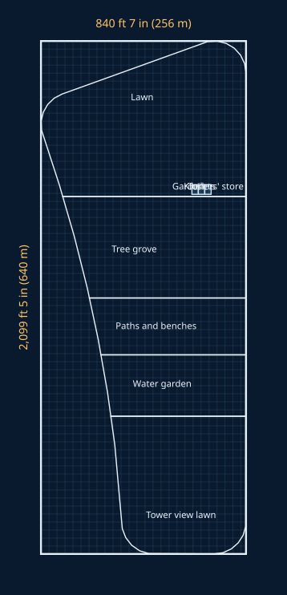

# P3-08 Beacon Garden 1: plan

Footprint 840 ft 7 in (256 m) × 2,099 ft 5 in (640 m) · structural grid 32 ft 10 in (10 m)

## Levels

| Level | Floor above deck | Height | Floor area |
|---|---|---|---|
| Level 1 · Ground | 0 ft (0 mm) | 13 ft 1 in (4,000 mm) | 3,100 sq ft (288 m²) |

## Elements

| ID | Designation | Type | Name | Level(s) | Size / length | Area | Status |
|---|---|---|---|---|---|---|---|
| E001 | D5F5P3B1A1R1 | zone | Lawn | L1 | 839 ft 11 in (256 m) × 636 ft 6 in (194 m) | 431,400 sq ft (40,078 m²) | proposed |
| E002 | D5F5P3B1A1R2 | room | Kiosk | L1 | 26 ft 3 in (8,000 mm) × 39 ft 4 in (12 m) | 1,033 sq ft (96 m²) | proposed |
| E003 | D5F5P3B1A1R3 | room | Toilets | L1 | 26 ft 3 in (8,000 mm) × 39 ft 4 in (12 m) | 1,033 sq ft (96 m²) | proposed |
| E004 | D5F5P3B1A1R4 | room | Gardeners' store | L1 | 26 ft 3 in (8,000 mm) × 39 ft 4 in (12 m) | 1,033 sq ft (96 m²) | proposed |
| E005 | D5F5P3B1A1R5 | zone | Tree grove | L1 | 751 ft (229 m) × 414 ft 8 in (126 m) | 287,622 sq ft (26,721 m²) | proposed |
| E006 | D5F5P3B1A1R6 | zone | Paths and benches | L1 | 641 ft 5 in (196 m) × 232 ft 11 in (71 m) | 143,710 sq ft (13,351 m²) | proposed |
| E007 | D5F5P3B1A1R7 | zone | Water garden | L1 | 594 ft 2 in (181 m) × 251 ft 4 in (77 m) | 143,889 sq ft (13,368 m²) | proposed |
| E008 | D5F5P3B1A1R8 | zone | Tower view lawn | L1 | 553 ft 2 in (169 m) × 563 ft 8 in (172 m) | 287,617 sq ft (26,721 m²) | proposed |

## Drawings

### Level 1 · Ground

