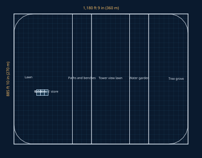

# P3-09 Beacon Garden 2: plan

Footprint 1,180 ft 9 in (360 m) × 885 ft 10 in (270 m) · structural grid 32 ft 10 in (10 m)

## Levels

| Level | Floor above deck | Height | Floor area |
|---|---|---|---|
| Level 1 · Ground | 0 ft (0 mm) | 13 ft 1 in (4,000 mm) | 3,100 sq ft (288 m²) |

## Elements

| ID | Designation | Type | Name | Level(s) | Size / length | Area | Status |
|---|---|---|---|---|---|---|---|
| E001 | D5F5P3B5A2R1 | zone | Lawn | L1 | 396 ft 8 in (121 m) × 884 ft 10 in (270 m) | 342,879 sq ft (31,854 m²) | proposed |
| E002 | D5F5P3B5A2R2 | room | Kiosk | L1 | 26 ft 3 in (8,000 mm) × 39 ft 4 in (12 m) | 1,033 sq ft (96 m²) | proposed |
| E003 | D5F5P3B5A2R3 | room | Toilets | L1 | 26 ft 3 in (8,000 mm) × 39 ft 4 in (12 m) | 1,033 sq ft (96 m²) | proposed |
| E004 | D5F5P3B5A2R4 | room | Gardeners' store | L1 | 26 ft 3 in (8,000 mm) × 39 ft 4 in (12 m) | 1,033 sq ft (96 m²) | proposed |
| E005 | D5F5P3B5A2R5 | zone | Paths and benches | L1 | 129 ft 3 in (39 m) × 884 ft 10 in (270 m) | 114,337 sq ft (10,622 m²) | proposed |
| E006 | D5F5P3B5A2R6 | zone | Tower view lawn | L1 | 258 ft 2 in (79 m) × 884 ft 10 in (270 m) | 228,383 sq ft (21,218 m²) | proposed |
| E007 | D5F5P3B5A2R7 | zone | Water garden | L1 | 129 ft 3 in (39 m) × 884 ft 6 in (270 m) | 114,337 sq ft (10,622 m²) | proposed |
| E008 | D5F5P3B5A2R8 | zone | Tree grove | L1 | 267 ft 5 in (82 m) × 884 ft 10 in (270 m) | 228,542 sq ft (21,232 m²) | proposed |

## Drawings

### Level 1 · Ground

