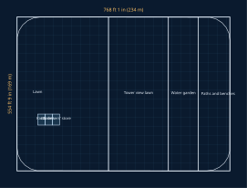

# P3-10 Beacon Garden 3: plan

Footprint 768 ft 1 in (234 m) × 554 ft 9 in (169 m) · structural grid 32 ft 10 in (10 m)

## Levels

| Level | Floor above deck | Height | Floor area |
|---|---|---|---|
| Level 1 · Ground | 0 ft (0 mm) | 13 ft 1 in (4,000 mm) | 3,100 sq ft (288 m²) |

## Elements

| ID | Designation | Type | Name | Level(s) | Size / length | Area | Status |
|---|---|---|---|---|---|---|---|
| E001 | D5F5P3B6A2R1 | zone | Lawn | L1 | 330 ft 1 in (101 m) × 554 ft 6 in (169 m) | 179,649 sq ft (16,690 m²) | proposed |
| E002 | D5F5P3B6A2R2 | room | Kiosk | L1 | 26 ft 3 in (8,000 mm) × 39 ft 4 in (12 m) | 1,033 sq ft (96 m²) | proposed |
| E003 | D5F5P3B6A2R3 | room | Toilets | L1 | 26 ft 3 in (8,000 mm) × 39 ft 4 in (12 m) | 1,033 sq ft (96 m²) | proposed |
| E004 | D5F5P3B6A2R4 | room | Gardeners' store | L1 | 26 ft 3 in (8,000 mm) × 39 ft 4 in (12 m) | 1,033 sq ft (96 m²) | proposed |
| E005 | D5F5P3B6A2R5 | zone | Tower view lawn | L1 | 216 ft 2 in (66 m) × 554 ft 6 in (169 m) | 119,808 sq ft (11,131 m²) | proposed |
| E006 | D5F5P3B6A2R6 | zone | Water garden | L1 | 107 ft 11 in (33 m) × 554 ft 2 in (169 m) | 59,795 sq ft (5,555 m²) | proposed |
| E007 | D5F5P3B6A2R7 | zone | Paths and benches | L1 | 113 ft 10 in (35 m) × 553 ft 10 in (169 m) | 59,916 sq ft (5,566 m²) | proposed |

## Drawings

### Level 1 · Ground

