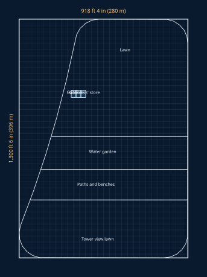

# P3-11 Beacon Garden 4: plan

Footprint 918 ft 4 in (280 m) × 1,300 ft 6 in (396 m) · structural grid 32 ft 10 in (10 m)

## Levels

| Level | Floor above deck | Height | Floor area |
|---|---|---|---|
| Level 1 · Ground | 0 ft (0 mm) | 13 ft 1 in (4,000 mm) | 3,100 sq ft (288 m²) |

## Elements

| ID | Designation | Type | Name | Level(s) | Size / length | Area | Status |
|---|---|---|---|---|---|---|---|
| E001 | D5F5P3B2A2R1 | zone | Lawn | L1 | 743 ft 9 in (227 m) × 638 ft 1 in (194 m) | 415,172 sq ft (38,571 m²) | proposed |
| E002 | D5F5P3B2A2R2 | room | Kiosk | L1 | 26 ft 3 in (8,000 mm) × 39 ft 4 in (12 m) | 1,033 sq ft (96 m²) | proposed |
| E003 | D5F5P3B2A2R3 | room | Toilets | L1 | 26 ft 3 in (8,000 mm) × 39 ft 4 in (12 m) | 1,033 sq ft (96 m²) | proposed |
| E004 | D5F5P3B2A2R4 | room | Gardeners' store | L1 | 26 ft 3 in (8,000 mm) × 39 ft 4 in (12 m) | 1,033 sq ft (96 m²) | proposed |
| E005 | D5F5P3B2A2R5 | zone | Water garden | L1 | 799 ft 6 in (244 m) × 179 ft 6 in (55 m) | 138,256 sq ft (12,844 m²) | proposed |
| E006 | D5F5P3B2A2R6 | zone | Paths and benches | L1 | 857 ft 3 in (261 m) × 167 ft 4 in (51 m) | 138,478 sq ft (12,865 m²) | proposed |
| E007 | D5F5P3B2A2R7 | zone | Tower view lawn | L1 | 917 ft 4 in (280 m) × 315 ft 7 in (96 m) | 276,640 sq ft (25,701 m²) | proposed |

## Drawings

### Level 1 · Ground

