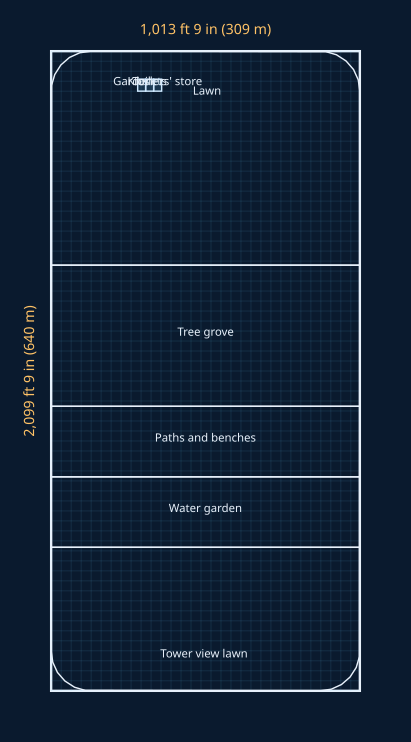

# P3-12 Beacon Garden 5: plan

Footprint 1,013 ft 9 in (309 m) × 2,099 ft 9 in (640 m) · structural grid 32 ft 10 in (10 m)

## Levels

| Level | Floor above deck | Height | Floor area |
|---|---|---|---|
| Level 1 · Ground | 0 ft (0 mm) | 13 ft 1 in (4,000 mm) | 3,100 sq ft (288 m²) |

## Elements

| ID | Designation | Type | Name | Level(s) | Size / length | Area | Status |
|---|---|---|---|---|---|---|---|
| E001 | D5F5P3B4A3R1 | zone | Lawn | L1 | 1,012 ft 10 in (309 m) × 702 ft 5 in (214 m) | 703,150 sq ft (65,325 m²) | proposed |
| E002 | D5F5P3B4A3R2 | room | Kiosk | L1 | 26 ft 3 in (8,000 mm) × 39 ft 4 in (12 m) | 1,033 sq ft (96 m²) | proposed |
| E003 | D5F5P3B4A3R3 | room | Toilets | L1 | 26 ft 3 in (8,000 mm) × 39 ft 4 in (12 m) | 1,033 sq ft (96 m²) | proposed |
| E004 | D5F5P3B4A3R4 | room | Gardeners' store | L1 | 26 ft 3 in (8,000 mm) × 39 ft 4 in (12 m) | 1,033 sq ft (96 m²) | proposed |
| E005 | D5F5P3B4A3R5 | zone | Tree grove | L1 | 1,012 ft 10 in (309 m) × 463 ft 3 in (141 m) | 469,030 sq ft (43,574 m²) | proposed |
| E006 | D5F5P3B4A3R6 | zone | Paths and benches | L1 | 1,012 ft 10 in (309 m) × 231 ft 8 in (71 m) | 234,515 sq ft (21,787 m²) | proposed |
| E007 | D5F5P3B4A3R7 | zone | Water garden | L1 | 1,012 ft 6 in (309 m) × 231 ft 4 in (70 m) | 234,183 sq ft (21,756 m²) | proposed |
| E008 | D5F5P3B4A3R8 | zone | Tower view lawn | L1 | 1,012 ft 10 in (309 m) × 471 ft 2 in (144 m) | 468,951 sq ft (43,567 m²) | proposed |

## Drawings

### Level 1 · Ground

