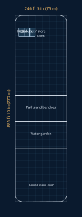

# P3-13 Beacon Garden 6: plan

Footprint 246 ft 5 in (75 m) × 885 ft 10 in (270 m) · structural grid 32 ft 10 in (10 m)

## Levels

| Level | Floor above deck | Height | Floor area |
|---|---|---|---|
| Level 1 · Ground | 0 ft (0 mm) | 13 ft 1 in (4,000 mm) | 3,100 sq ft (288 m²) |

## Elements

| ID | Designation | Type | Name | Level(s) | Size / length | Area | Status |
|---|---|---|---|---|---|---|---|
| E001 | D5F5P3B5A3R1 | zone | Lawn | L1 | 245 ft 1 in (75 m) × 379 ft 11 in (116 m) | 92,145 sq ft (8,561 m²) | proposed |
| E002 | D5F5P3B5A3R2 | room | Kiosk | L1 | 26 ft 3 in (8,000 mm) × 39 ft 4 in (12 m) | 1,033 sq ft (96 m²) | proposed |
| E003 | D5F5P3B5A3R3 | room | Toilets | L1 | 26 ft 3 in (8,000 mm) × 39 ft 4 in (12 m) | 1,033 sq ft (96 m²) | proposed |
| E004 | D5F5P3B5A3R4 | room | Gardeners' store | L1 | 26 ft 3 in (8,000 mm) × 39 ft 4 in (12 m) | 1,033 sq ft (96 m²) | proposed |
| E005 | D5F5P3B5A3R5 | zone | Paths and benches | L1 | 244 ft 5 in (74 m) × 125 ft 4 in (38 m) | 30,633 sq ft (2,846 m²) | proposed |
| E006 | D5F5P3B5A3R6 | zone | Water garden | L1 | 244 ft 9 in (75 m) × 125 ft 8 in (38 m) | 30,713 sq ft (2,853 m²) | proposed |
| E007 | D5F5P3B5A3R7 | zone | Tower view lawn | L1 | 244 ft 9 in (75 m) × 254 ft 3 in (77 m) | 61,431 sq ft (5,707 m²) | proposed |

## Drawings

### Level 1 · Ground

