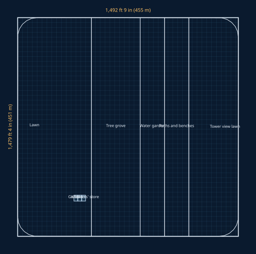

# P3-14 Beacon Garden 7: plan

Footprint 1,492 ft 9 in (455 m) × 1,479 ft 4 in (451 m) · structural grid 32 ft 10 in (10 m)

## Levels

| Level | Floor above deck | Height | Floor area |
|---|---|---|---|
| Level 1 · Ground | 0 ft (0 mm) | 13 ft 1 in (4,000 mm) | 3,100 sq ft (288 m²) |

## Elements

| ID | Designation | Type | Name | Level(s) | Size / length | Area | Status |
|---|---|---|---|---|---|---|---|
| E001 | D5F5P3B6A3R1 | zone | Lawn | L1 | 499 ft 4 in (152 m) × 1,478 ft 4 in (451 m) | 729,673 sq ft (67,789 m²) | proposed |
| E002 | D5F5P3B6A3R2 | room | Kiosk | L1 | 26 ft 3 in (8,000 mm) × 39 ft 4 in (12 m) | 1,033 sq ft (96 m²) | proposed |
| E003 | D5F5P3B6A3R3 | room | Toilets | L1 | 26 ft 3 in (8,000 mm) × 39 ft 4 in (12 m) | 1,033 sq ft (96 m²) | proposed |
| E004 | D5F5P3B6A3R4 | room | Gardeners' store | L1 | 26 ft 3 in (8,000 mm) × 39 ft 4 in (12 m) | 1,033 sq ft (96 m²) | proposed |
| E005 | D5F5P3B6A3R5 | zone | Tree grove | L1 | 329 ft 5 in (100 m) × 1,478 ft 4 in (451 m) | 486,854 sq ft (45,230 m²) | proposed |
| E006 | D5F5P3B6A3R6 | zone | Water garden | L1 | 164 ft 8 in (50 m) × 1,478 ft 4 in (451 m) | 243,427 sq ft (22,615 m²) | proposed |
| E007 | D5F5P3B6A3R7 | zone | Paths and benches | L1 | 164 ft 4 in (50 m) × 1,478 ft (450 m) | 242,942 sq ft (22,570 m²) | proposed |
| E008 | D5F5P3B6A3R8 | zone | Tower view lawn | L1 | 335 ft (102 m) × 1,478 ft 4 in (451 m) | 486,741 sq ft (45,220 m²) | proposed |

## Drawings

### Level 1 · Ground

