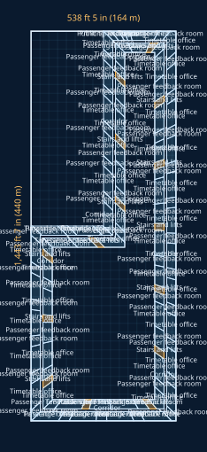
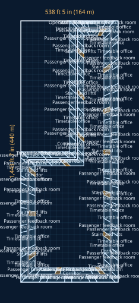

# P4-02 Shuttle Schedules Office: plan

Footprint 538 ft 5 in (164 m) × 1,443 ft 7 in (440 m) · structural grid 32 ft 10 in (10 m)

## Levels

| Level | Floor above deck | Height | Floor area |
|---|---|---|---|
| Level 1 · Ground floor | 0 ft (0 mm) | 15 ft 9 in (4,800 mm) | 237,847 sq ft (22,097 m²) |
| Level 2 · Office floor 1 | 15 ft 9 in (4,800 mm) | 13 ft 9 in (4,200 mm) | 237,847 sq ft (22,097 m²) |
| Level 3 · Office floor 2 | 29 ft 6 in (9,000 mm) | 13 ft 9 in (4,200 mm) | 237,847 sq ft (22,097 m²) |
| Level 4 · Office floor 3 | 43 ft 4 in (13 m) | 13 ft 9 in (4,200 mm) | 237,847 sq ft (22,097 m²) |

## Elements

| ID | Designation | Type | Name | Level(s) | Size / length | Area | Status |
|---|---|---|---|---|---|---|---|
| E001 | D5F5P4B1A2L1R1 | zone | Light court | L1 | 380 ft 11 in (116 m) × 1,286 ft 1 in (392 m) | 295,461 sq ft (27,449 m²) | proposed |
| E002 | D5F5P4B1A2L1R2 | zone | Corridor | L1 | 200 ft 2 in (61 m) × 211 ft 11 in (65 m) | 3,875 sq ft (360 m²) | proposed |
| E003 | D5F5P4B1A2L1R3 | zone | Corridor | L1 | 9 ft 10 in (3,000 mm) × 398 ft (121 m) | 3,875 sq ft (360 m²) | proposed |
| E004 | D5F5P4B1A2L1R4 | zone | Corridor | L1 | 9 ft 10 in (3,000 mm) × 396 ft 8 in (121 m) | 3,875 sq ft (360 m²) | proposed |
| E005 | D5F5P4B1A2L1R5 | zone | Corridor | L1 | 29 ft 2 in (8,900 mm) × 381 ft 3 in (116 m) | 3,875 sq ft (360 m²) | proposed |
| E006 | D5F5P4B1A2L1R6 | zone | Corridor | L1 | 402 ft 3 in (123 m) × 9 ft 10 in (3,000 mm) | 3,875 sq ft (360 m²) | proposed |
| E007 | D5F5P4B1A2L1R7 | zone | Corridor | L1 | 55 ft 1 in (17 m) × 352 ft 8 in (108 m) | 3,875 sq ft (360 m²) | proposed |
| E008 | D5F5P4B1A2L1R8 | zone | Corridor | L1 | 107 ft 11 in (33 m) × 300 ft 10 in (92 m) | 3,875 sq ft (360 m²) | proposed |
| E009 | D5F5P4B1A2L1R9 | zone | Corridor | L1 | 181 ft 1 in (55 m) × 232 ft 3 in (71 m) | 3,875 sq ft (360 m²) | proposed |
| E010 | D5F5P4B1A2L1R10 | zone | Corridor | L1 | 9 ft 10 in (3,000 mm) × 403 ft 7 in (123 m) | 3,875 sq ft (360 m²) | proposed |
| E011 | D5F5P4B1A2L1R11 | zone | Corridor | L1 | 9 ft 10 in (3,000 mm) × 115 ft 6 in (35 m) | 1,040 sq ft (97 m²) | proposed |
| E012 | D5F5P4B1A2L1R12, D5F5P4B1A2L2R1, D5F5P4B1A2L3R1, D5F5P4B1A2L4R1 | core | Stairs and lifts | L1, L2, L3, L4 | 46 ft 3 in (14 m) × 34 ft 5 in (10 m) | 899 sq ft (83 m²) | proposed |
| E013 | D5F5P4B1A2L1R13, D5F5P4B1A2L2R2, D5F5P4B1A2L3R2, D5F5P4B1A2L4R2 | core | Stairs and lifts | L1, L2, L3, L4 | 34 ft 5 in (10 m) × 50 ft 2 in (15 m) | 904 sq ft (84 m²) | proposed |
| E014 | D5F5P4B1A2L1R14, D5F5P4B1A2L2R3, D5F5P4B1A2L3R3, D5F5P4B1A2L4R3 | core | Stairs and lifts | L1, L2, L3, L4 | 34 ft 5 in (10 m) × 38 ft 1 in (12 m) | 904 sq ft (84 m²) | proposed |
| E015 | D5F5P4B1A2L1R15, D5F5P4B1A2L2R4, D5F5P4B1A2L3R4, D5F5P4B1A2L4R4 | core | Stairs and lifts | L1, L2, L3, L4 | 34 ft 5 in (10 m) × 26 ft 11 in (8,200 mm) | 904 sq ft (84 m²) | proposed |
| E016 | D5F5P4B1A2L1R16, D5F5P4B1A2L2R5, D5F5P4B1A2L3R5, D5F5P4B1A2L4R5 | core | Stairs and lifts | L1, L2, L3, L4 | 34 ft 5 in (10 m) × 38 ft 9 in (12 m) | 904 sq ft (84 m²) | proposed |
| E017 | D5F5P4B1A2L1R17, D5F5P4B1A2L2R6, D5F5P4B1A2L3R6, D5F5P4B1A2L4R6 | core | Stairs and lifts | L1, L2, L3, L4 | 34 ft 5 in (10 m) × 50 ft 10 in (16 m) | 904 sq ft (84 m²) | proposed |
| E018 | D5F5P4B1A2L1R18, D5F5P4B1A2L2R7, D5F5P4B1A2L3R7, D5F5P4B1A2L4R7 | core | Stairs and lifts | L1, L2, L3, L4 | 54 ft 6 in (17 m) × 34 ft 5 in (10 m) | 904 sq ft (84 m²) | proposed |
| E019 | D5F5P4B1A2L1R19, D5F5P4B1A2L2R8, D5F5P4B1A2L3R8, D5F5P4B1A2L4R8 | core | Stairs and lifts | L1, L2, L3, L4 | 36 ft 5 in (11 m) × 34 ft 5 in (10 m) | 904 sq ft (84 m²) | proposed |
| E020 | D5F5P4B1A2L1R20, D5F5P4B1A2L2R9, D5F5P4B1A2L3R9, D5F5P4B1A2L4R9 | core | Stairs and lifts | L1, L2, L3, L4 | 34 ft 5 in (10 m) × 50 ft 10 in (16 m) | 904 sq ft (84 m²) | proposed |
| E021 | D5F5P4B1A2L1R21, D5F5P4B1A2L2R10, D5F5P4B1A2L3R10, D5F5P4B1A2L4R10 | core | Stairs and lifts | L1, L2, L3, L4 | 34 ft 5 in (10 m) × 28 ft 3 in (8,600 mm) | 904 sq ft (84 m²) | proposed |
| E022 | D5F5P4B1A2L1R22, D5F5P4B1A2L2R11, D5F5P4B1A2L3R11, D5F5P4B1A2L4R11 | core | Stairs and lifts | L1, L2, L3, L4 | 34 ft 5 in (10 m) × 54 ft 9 in (17 m) | 904 sq ft (84 m²) | proposed |
| E023 | D5F5P4B1A2L1R23, D5F5P4B1A2L2R12, D5F5P4B1A2L3R12, D5F5P4B1A2L4R12 | core | Stairs and lifts | L1, L2, L3, L4 | 60 ft 8 in (18 m) × 34 ft 5 in (10 m) | 904 sq ft (84 m²) | proposed |
| E024 | D5F5P4B1A2L1R24, D5F5P4B1A2L2R13, D5F5P4B1A2L3R13, D5F5P4B1A2L4R13 | core | Stairs and lifts | L1, L2, L3, L4 | 34 ft 5 in (10 m) × 60 ft 8 in (18 m) | 904 sq ft (84 m²) | proposed |
| E025 | D5F5P4B1A2L1R25, D5F5P4B1A2L2R14, D5F5P4B1A2L3R14, D5F5P4B1A2L4R14 | core | Stairs and lifts | L1, L2, L3, L4 | 34 ft 5 in (10 m) × 60 ft 8 in (19 m) | 904 sq ft (84 m²) | proposed |
| E026 | D5F5P4B1A2L1R26, D5F5P4B1A2L2R15, D5F5P4B1A2L3R15, D5F5P4B1A2L4R15 | core | Stairs and lifts | L1, L2, L3, L4 | 34 ft 5 in (10 m) × 60 ft 8 in (18 m) | 904 sq ft (84 m²) | proposed |
| E027 | D5F5P4B1A2L1R27 | room | Public timetable desk | L1 | 55 ft 9 in (17 m) × 34 ft 5 in (10 m) | 859 sq ft (80 m²) | proposed |
| E028 | D5F5P4B1A2L1R28 | room | Printing and signs room | L1 | 48 ft 7 in (15 m) × 34 ft 5 in (10 m) | 865 sq ft (80 m²) | proposed |
| E029 | D5F5P4B1A2L1R29 | room | Reception | L1 | 33 ft 2 in (10 m) × 34 ft 5 in (10 m) | 537 sq ft (50 m²) | proposed |
| E030 | D5F5P4B1A2L1R30 | room | Toilets | L1 | 31 ft 2 in (9,500 mm) × 34 ft 5 in (10 m) | 644 sq ft (60 m²) | proposed |
| E031 | D5F5P4B1A2L1R31 | room | Timetable office | L1 | 107 ft 7 in (33 m) × 34 ft 5 in (10 m) | 3,232 sq ft (300 m²) | proposed |
| E032 | D5F5P4B1A2L1R32 | room | Passenger feedback room | L1 | 61 ft (19 m) × 34 ft 5 in (10 m) | 1,294 sq ft (120 m²) | proposed |
| E033 | D5F5P4B1A2L1R33 | room | Timetable office | L1 | 50 ft 6 in (15 m) × 107 ft 3 in (33 m) | 3,221 sq ft (299 m²) | proposed |
| E034 | D5F5P4B1A2L1R34 | room | Passenger feedback room | L1 | 34 ft 5 in (10 m) × 67 ft 7 in (21 m) | 1,300 sq ft (121 m²) | proposed |
| E035 | D5F5P4B1A2L1R35 | room | Timetable office | L1 | 34 ft 5 in (10 m) × 120 ft 5 in (37 m) | 3,227 sq ft (300 m²) | proposed |
| E036 | D5F5P4B1A2L1R36 | room | Passenger feedback room | L1 | 34 ft 5 in (10 m) × 61 ft (19 m) | 1,288 sq ft (120 m²) | proposed |
| E037 | D5F5P4B1A2L1R37 | room | Timetable office | L1 | 34 ft 5 in (10 m) × 114 ft 2 in (35 m) | 3,232 sq ft (300 m²) | proposed |
| E038 | D5F5P4B1A2L1R38 | room | Passenger feedback room | L1 | 34 ft 5 in (10 m) × 54 ft 6 in (17 m) | 1,288 sq ft (120 m²) | proposed |
| E039 | D5F5P4B1A2L1R39 | room | Timetable office | L1 | 34 ft 5 in (10 m) × 107 ft 7 in (33 m) | 3,232 sq ft (300 m²) | proposed |
| E040 | D5F5P4B1A2L1R40 | room | Passenger feedback room | L1 | 34 ft 5 in (10 m) × 47 ft 11 in (15 m) | 1,288 sq ft (120 m²) | proposed |
| E041 | D5F5P4B1A2L1R41 | room | Timetable office | L1 | 34 ft 5 in (10 m) × 101 ft 1 in (31 m) | 3,232 sq ft (300 m²) | proposed |
| E042 | D5F5P4B1A2L1R42 | room | Passenger feedback room | L1 | 34 ft 5 in (10 m) × 41 ft 8 in (13 m) | 1,294 sq ft (120 m²) | proposed |
| E043 | D5F5P4B1A2L1R43 | room | Timetable office | L1 | 34 ft 5 in (10 m) × 95 ft 10 in (29 m) | 3,221 sq ft (299 m²) | proposed |
| E044 | D5F5P4B1A2L1R44 | room | Passenger feedback room | L1 | 34 ft 5 in (10 m) × 39 ft 8 in (12 m) | 1,294 sq ft (120 m²) | proposed |
| E045 | D5F5P4B1A2L1R45 | room | Timetable office | L1 | 34 ft 5 in (10 m) × 99 ft 1 in (30 m) | 3,232 sq ft (300 m²) | proposed |
| E046 | D5F5P4B1A2L1R46 | room | Passenger feedback room | L1 | 34 ft 5 in (10 m) × 45 ft 11 in (14 m) | 1,288 sq ft (120 m²) | proposed |
| E047 | D5F5P4B1A2L1R47 | room | Timetable office | L1 | 34 ft 5 in (10 m) × 105 ft 8 in (32 m) | 3,232 sq ft (300 m²) | proposed |
| E048 | D5F5P4B1A2L1R48 | room | Passenger feedback room | L1 | 34 ft 5 in (10 m) × 52 ft 6 in (16 m) | 1,288 sq ft (120 m²) | proposed |
| E049 | D5F5P4B1A2L1R49 | room | Timetable office | L1 | 34 ft 5 in (10 m) × 112 ft 2 in (34 m) | 3,232 sq ft (300 m²) | proposed |
| E050 | D5F5P4B1A2L1R50 | room | Passenger feedback room | L1 | 34 ft 5 in (10 m) × 59 ft 1 in (18 m) | 1,294 sq ft (120 m²) | proposed |
| E051 | D5F5P4B1A2L1R51 | room | Timetable office | L1 | 34 ft 5 in (10 m) × 118 ft 1 in (36 m) | 3,221 sq ft (299 m²) | proposed |
| E052 | D5F5P4B1A2L1R52 | room | Passenger feedback room | L1 | 34 ft 5 in (10 m) × 65 ft 7 in (20 m) | 1,300 sq ft (121 m²) | proposed |
| E053 | D5F5P4B1A2L1R53 | room | Timetable office | L1 | 34 ft 5 in (10 m) × 124 ft 8 in (38 m) | 3,221 sq ft (299 m²) | proposed |
| E054 | D5F5P4B1A2L1R54 | room | Passenger feedback room | L1 | 48 ft 11 in (15 m) × 56 ft 1 in (17 m) | 1,294 sq ft (120 m²) | proposed |
| E055 | D5F5P4B1A2L1R55 | room | Timetable office | L1 | 119 ft 9 in (36 m) × 34 ft 5 in (10 m) | 3,232 sq ft (300 m²) | proposed |
| E056 | D5F5P4B1A2L1R56 | room | Passenger feedback room | L1 | 54 ft 6 in (17 m) × 34 ft 5 in (10 m) | 1,294 sq ft (120 m²) | proposed |
| E057 | D5F5P4B1A2L1R57 | room | Timetable office | L1 | 101 ft 8 in (31 m) × 34 ft 5 in (10 m) | 3,227 sq ft (300 m²) | proposed |
| E058 | D5F5P4B1A2L1R58 | room | Passenger feedback room | L1 | 40 ft (12 m) × 34 ft 5 in (10 m) | 1,288 sq ft (120 m²) | proposed |
| E059 | D5F5P4B1A2L1R59 | room | Timetable office | L1 | 103 ft 8 in (32 m) × 34 ft 5 in (10 m) | 3,227 sq ft (300 m²) | proposed |
| E060 | D5F5P4B1A2L1R60 | room | Passenger feedback room | L1 | 56 ft 5 in (17 m) × 34 ft 5 in (10 m) | 1,294 sq ft (120 m²) | proposed |
| E061 | D5F5P4B1A2L1R61 | room | Timetable office | L1 | 121 ft 9 in (37 m) × 34 ft 5 in (10 m) | 3,232 sq ft (300 m²) | proposed |
| E062 | D5F5P4B1A2L1R62 | room | Passenger feedback room | L1 | 35 ft 5 in (11 m) × 69 ft 3 in (21 m) | 1,294 sq ft (120 m²) | proposed |
| E063 | D5F5P4B1A2L1R63 | room | Timetable office | L1 | 34 ft 5 in (10 m) × 119 ft 9 in (36 m) | 3,227 sq ft (300 m²) | proposed |
| E064 | D5F5P4B1A2L1R64 | room | Passenger feedback room | L1 | 34 ft 5 in (10 m) × 57 ft 1 in (17 m) | 1,294 sq ft (120 m²) | proposed |
| E065 | D5F5P4B1A2L1R65 | room | Timetable office | L1 | 34 ft 5 in (10 m) × 106 ft 8 in (32 m) | 3,227 sq ft (300 m²) | proposed |
| E066 | D5F5P4B1A2L1R66 | room | Passenger feedback room | L1 | 34 ft 5 in (10 m) × 43 ft 8 in (13 m) | 1,288 sq ft (120 m²) | proposed |
| E067 | D5F5P4B1A2L1R67 | room | Timetable office | L1 | 34 ft 5 in (10 m) × 98 ft 5 in (30 m) | 3,232 sq ft (300 m²) | proposed |
| E068 | D5F5P4B1A2L1R68 | room | Passenger feedback room | L1 | 34 ft 5 in (10 m) × 44 ft 3 in (14 m) | 1,288 sq ft (120 m²) | proposed |
| E069 | D5F5P4B1A2L1R69 | room | Timetable office | L1 | 34 ft 5 in (10 m) × 107 ft 3 in (33 m) | 3,232 sq ft (300 m²) | proposed |
| E070 | D5F5P4B1A2L1R70 | room | Passenger feedback room | L1 | 34 ft 5 in (10 m) × 57 ft 5 in (18 m) | 1,288 sq ft (120 m²) | proposed |
| E071 | D5F5P4B1A2L1R71 | room | Timetable office | L1 | 34 ft 5 in (10 m) × 120 ft 5 in (37 m) | 3,232 sq ft (300 m²) | proposed |
| E072 | D5F5P4B1A2L1R72 | room | Passenger feedback room | L1 | 39 ft 8 in (12 m) × 65 ft (20 m) | 1,288 sq ft (120 m²) | proposed |
| E073 | D5F5P4B1A2L1R73 | room | Timetable office | L1 | 128 ft 3 in (39 m) × 34 ft 5 in (10 m) | 3,232 sq ft (300 m²) | proposed |
| E074 | D5F5P4B1A2L1R74 | room | Passenger feedback room | L1 | 71 ft 10 in (22 m) × 34 ft 5 in (10 m) | 1,288 sq ft (120 m²) | proposed |
| E075 | D5F5P4B1A2L1R75 | room | Timetable office | L1 | 128 ft 3 in (39 m) × 34 ft 5 in (10 m) | 3,232 sq ft (300 m²) | proposed |
| E076 | D5F5P4B1A2L1R76 | room | Passenger feedback room | L1 | 71 ft 10 in (22 m) × 34 ft 5 in (10 m) | 1,288 sq ft (120 m²) | proposed |
| E077 | D5F5P4B1A2L1R77 | room | Timetable office | L1 | 36 ft 1 in (11 m) × 126 ft 8 in (39 m) | 3,232 sq ft (300 m²) | proposed |
| E078 | D5F5P4B1A2L1R78 | room | Passenger feedback room | L1 | 34 ft 5 in (10 m) × 71 ft 10 in (22 m) | 1,288 sq ft (120 m²) | proposed |
| E079 | D5F5P4B1A2L1R79 | room | Timetable office | L1 | 34 ft 5 in (10 m) × 128 ft 3 in (39 m) | 3,232 sq ft (300 m²) | proposed |
| E080 | D5F5P4B1A2L1R80 | room | Passenger feedback room | L1 | 34 ft 5 in (10 m) × 71 ft 10 in (22 m) | 1,288 sq ft (120 m²) | proposed |
| E081 | D5F5P4B1A2L1R81 | room | Timetable office | L1 | 34 ft 5 in (10 m) × 128 ft 3 in (39 m) | 3,232 sq ft (300 m²) | proposed |
| E082 | D5F5P4B1A2L1R82 | room | Passenger feedback room | L1 | 34 ft 5 in (10 m) × 71 ft 10 in (22 m) | 1,288 sq ft (120 m²) | proposed |
| E083 | D5F5P4B1A2L1R83 | room | Timetable office | L1 | 34 ft 5 in (10 m) × 128 ft 3 in (39 m) | 3,232 sq ft (300 m²) | proposed |
| E084 | D5F5P4B1A2L1R84 | room | Passenger feedback room | L1 | 34 ft 5 in (10 m) × 71 ft 10 in (22 m) | 1,288 sq ft (120 m²) | proposed |
| E085 | D5F5P4B1A2L1R85 | room | Timetable office | L1 | 34 ft 5 in (10 m) × 128 ft 3 in (39 m) | 3,232 sq ft (300 m²) | proposed |
| E086 | D5F5P4B1A2L1R86 | room | Passenger feedback room | L1 | 34 ft 5 in (10 m) × 71 ft 10 in (22 m) | 1,288 sq ft (120 m²) | proposed |
| E087 | D5F5P4B1A2L1R87 | room | Timetable office | L1 | 34 ft 5 in (10 m) × 101 ft 8 in (31 m) | 2,317 sq ft (215 m²) | proposed |
| E088 | D5F5P4B1A2L1R88 | room | Passenger feedback room | L1 | 63 ft (19 m) × 34 ft 5 in (10 m) | 1,288 sq ft (120 m²) | proposed |
| E089 | D5F5P4B1A2L1R89 | room | Timetable office | L1 | 80 ft 9 in (25 m) × 34 ft 5 in (10 m) | 2,249 sq ft (209 m²) | proposed |
| E090 | D5F5P4B1A2L1R90 | room | Passenger feedback room | L1 | 47 ft 7 in (14 m) × 54 ft 2 in (16 m) | 1,294 sq ft (120 m²) | proposed |
| E091 | D5F5P4B1A2L1R91 | room | Timetable office | L1 | 34 ft 5 in (10 m) × 124 ft 8 in (38 m) | 3,232 sq ft (300 m²) | proposed |
| E092 | D5F5P4B1A2L1R92 | room | Passenger feedback room | L1 | 34 ft 5 in (10 m) × 100 ft 5 in (31 m) | 2,543 sq ft (236 m²) | proposed |
| E093 | D5F5P4B1A2L1R93 | room | Timetable office | L1 | 34 ft 5 in (10 m) × 114 ft 6 in (35 m) | 3,227 sq ft (300 m²) | proposed |
| E094 | D5F5P4B1A2L1R94 | room | Passenger feedback room | L1 | 34 ft 5 in (10 m) × 55 ft 1 in (17 m) | 1,300 sq ft (121 m²) | proposed |
| E095 | D5F5P4B1A2L1R95 | room | Timetable office | L1 | 34 ft 5 in (10 m) × 88 ft 3 in (27 m) | 2,543 sq ft (236 m²) | proposed |
| E096 | D5F5P4B1A2L1R96 | room | Passenger feedback room | L1 | 34 ft 5 in (10 m) × 47 ft 11 in (15 m) | 1,294 sq ft (120 m²) | proposed |
| E097 | D5F5P4B1A2L1R97 | room | Timetable office | L1 | 34 ft 5 in (10 m) × 100 ft 9 in (31 m) | 3,232 sq ft (300 m²) | proposed |
| E098 | D5F5P4B1A2L1R98 | room | Passenger feedback room | L1 | 34 ft 5 in (10 m) × 76 ft 1 in (23 m) | 2,543 sq ft (236 m²) | proposed |
| E099 | D5F5P4B1A2L1R99 | room | Timetable office | L1 | 34 ft 5 in (10 m) × 97 ft 1 in (30 m) | 3,232 sq ft (300 m²) | proposed |
| E100 | D5F5P4B1A2L1R100 | room | Passenger feedback room | L1 | 34 ft 5 in (10 m) × 44 ft (13 m) | 1,288 sq ft (120 m²) | proposed |
| E101 | D5F5P4B1A2L1R101 | room | Timetable office | L1 | 34 ft 5 in (10 m) × 83 ft 8 in (26 m) | 2,549 sq ft (237 m²) | proposed |
| E102 | D5F5P4B1A2L1R102 | room | Passenger feedback room | L1 | 34 ft 5 in (10 m) × 51 ft 6 in (16 m) | 1,294 sq ft (120 m²) | proposed |
| E103 | D5F5P4B1A2L1R103 | room | Timetable office | L1 | 34 ft 5 in (10 m) × 110 ft 11 in (34 m) | 3,227 sq ft (300 m²) | proposed |
| E104 | D5F5P4B1A2L1R104 | room | Passenger feedback room | L1 | 34 ft 5 in (10 m) × 95 ft 10 in (29 m) | 2,549 sq ft (237 m²) | proposed |
| E105 | D5F5P4B1A2L1R105 | room | Timetable office | L1 | 34 ft 5 in (10 m) × 121 ft 5 in (37 m) | 3,232 sq ft (300 m²) | proposed |
| E106 | D5F5P4B1A2L1R106 | room | Passenger feedback room | L1 | 34 ft 5 in (10 m) × 68 ft 3 in (21 m) | 1,288 sq ft (120 m²) | proposed |
| E107 | D5F5P4B1A2L1R107 | room | Timetable office | L1 | 57 ft 1 in (17 m) × 82 ft 4 in (25 m) | 2,549 sq ft (237 m²) | proposed |
| E108 | D5F5P4B1A2L1R108 | room | Passenger feedback room | L1 | 60 ft 4 in (18 m) × 34 ft 5 in (10 m) | 1,288 sq ft (120 m²) | proposed |
| E109 | D5F5P4B1A2L1R109 | room | Timetable office | L1 | 105 ft 8 in (32 m) × 34 ft 5 in (10 m) | 3,232 sq ft (300 m²) | proposed |
| E110 | D5F5P4B1A2L1R110 | room | Passenger feedback room | L1 | 80 ft 1 in (24 m) × 34 ft 5 in (10 m) | 2,549 sq ft (237 m²) | proposed |
| E111 | D5F5P4B1A2L1R111 | room | Timetable office | L1 | 113 ft 10 in (35 m) × 34 ft 5 in (10 m) | 3,232 sq ft (300 m²) | proposed |
| E112 | D5F5P4B1A2L1R112 | room | Passenger feedback room | L1 | 68 ft 7 in (21 m) × 34 ft 5 in (10 m) | 1,288 sq ft (120 m²) | proposed |
| E113 | D5F5P4B1A2L1R113 | room | Timetable office | L1 | 36 ft 1 in (11 m) × 102 ft 8 in (31 m) | 2,549 sq ft (237 m²) | proposed |
| E114 | D5F5P4B1A2L1R114 | room | Passenger feedback room | L1 | 34 ft 5 in (10 m) × 58 ft 5 in (18 m) | 1,294 sq ft (120 m²) | proposed |
| E115 | D5F5P4B1A2L1R115 | room | Timetable office | L1 | 34 ft 5 in (10 m) × 106 ft 11 in (33 m) | 3,227 sq ft (300 m²) | proposed |
| E116 | D5F5P4B1A2L1R116 | room | Passenger feedback room | L1 | 34 ft 5 in (10 m) × 78 ft 1 in (24 m) | 2,549 sq ft (237 m²) | proposed |
| E117 | D5F5P4B1A2L1R117 | room | Timetable office | L1 | 34 ft 5 in (10 m) × 102 ft 8 in (31 m) | 3,227 sq ft (300 m²) | proposed |
| E118 | D5F5P4B1A2L1R118 | room | Passenger feedback room | L1 | 34 ft 5 in (10 m) × 54 ft 2 in (16 m) | 1,294 sq ft (120 m²) | proposed |
| E119 | D5F5P4B1A2L1R119 | room | Timetable office | L1 | 34 ft 5 in (10 m) × 96 ft 9 in (30 m) | 2,549 sq ft (237 m²) | proposed |
| E120 | D5F5P4B1A2L1R120 | room | Passenger feedback room | L1 | 34 ft 9 in (11 m) × 69 ft 7 in (21 m) | 1,294 sq ft (120 m²) | proposed |
| E121 | D5F5P4B1A2L1R121 | room | Timetable office | L1 | 127 ft 11 in (39 m) × 34 ft 5 in (10 m) | 3,221 sq ft (299 m²) | proposed |
| E122 | D5F5P4B1A2L1R122 | room | Passenger feedback room | L1 | 108 ft 7 in (33 m) × 34 ft 5 in (10 m) | 2,554 sq ft (237 m²) | proposed |
| E123 | D5F5P4B1A2L1R123 | room | Timetable office | L1 | 109 ft 7 in (33 m) × 53 ft 2 in (16 m) | 3,232 sq ft (300 m²) | proposed |
| E124 | D5F5P4B1A2L1R124 | room | Passenger feedback room | L1 | 34 ft 5 in (10 m) × 71 ft 10 in (22 m) | 1,288 sq ft (120 m²) | proposed |
| E125 | D5F5P4B1A2L1R125 | room | Timetable office | L1 | 34 ft 5 in (10 m) × 108 ft 3 in (33 m) | 2,543 sq ft (236 m²) | proposed |
| E126 | D5F5P4B1A2L1R126 | room | Passenger feedback room | L1 | 34 ft 5 in (10 m) × 72 ft 2 in (22 m) | 1,300 sq ft (121 m²) | proposed |
| E127 | D5F5P4B1A2L1R127 | room | Timetable office | L1 | 34 ft 5 in (10 m) × 127 ft 11 in (39 m) | 3,221 sq ft (299 m²) | proposed |
| E128 | D5F5P4B1A2L1R128 | room | Passenger feedback room | L1 | 34 ft 5 in (10 m) × 108 ft 7 in (33 m) | 2,554 sq ft (237 m²) | proposed |
| E129 | D5F5P4B1A2L1R129 | room | Timetable office | L1 | 34 ft 5 in (10 m) × 128 ft 3 in (39 m) | 3,232 sq ft (300 m²) | proposed |
| E130 | D5F5P4B1A2L1R130 | room | Passenger feedback room | L1 | 34 ft 5 in (10 m) × 71 ft 10 in (22 m) | 1,288 sq ft (120 m²) | proposed |
| E131 | D5F5P4B1A2L1R131 | room | Timetable office | L1 | 34 ft 5 in (10 m) × 108 ft 3 in (33 m) | 2,543 sq ft (236 m²) | proposed |
| E132 | D5F5P4B1A2L1R132 | room | Passenger feedback room | L1 | 34 ft 5 in (10 m) × 72 ft 2 in (22 m) | 1,300 sq ft (121 m²) | proposed |
| E133 | D5F5P4B1A2L1R133 | room | Timetable office | L1 | 34 ft 5 in (10 m) × 99 ft 5 in (30 m) | 2,238 sq ft (208 m²) | proposed |
| E134 | D5F5P4B1A2L2R16, D5F5P4B1A2L3R16, D5F5P4B1A2L4R16 | zone | Corridor | L2, L3, L4 | 200 ft 2 in (61 m) × 211 ft 11 in (65 m) | 3,875 sq ft (360 m²) | proposed |
| E135 | D5F5P4B1A2L2R17, D5F5P4B1A2L3R17, D5F5P4B1A2L4R17 | zone | Corridor | L2, L3, L4 | 9 ft 10 in (3,000 mm) × 398 ft (121 m) | 3,875 sq ft (360 m²) | proposed |
| E136 | D5F5P4B1A2L2R18, D5F5P4B1A2L3R18, D5F5P4B1A2L4R18 | zone | Corridor | L2, L3, L4 | 9 ft 10 in (3,000 mm) × 396 ft 8 in (121 m) | 3,875 sq ft (360 m²) | proposed |
| E137 | D5F5P4B1A2L2R19, D5F5P4B1A2L3R19, D5F5P4B1A2L4R19 | zone | Corridor | L2, L3, L4 | 29 ft 2 in (8,900 mm) × 381 ft 3 in (116 m) | 3,875 sq ft (360 m²) | proposed |
| E138 | D5F5P4B1A2L2R20, D5F5P4B1A2L3R20, D5F5P4B1A2L4R20 | zone | Corridor | L2, L3, L4 | 402 ft 3 in (123 m) × 9 ft 10 in (3,000 mm) | 3,875 sq ft (360 m²) | proposed |
| E139 | D5F5P4B1A2L2R21, D5F5P4B1A2L3R21, D5F5P4B1A2L4R21 | zone | Corridor | L2, L3, L4 | 55 ft 1 in (17 m) × 352 ft 8 in (108 m) | 3,875 sq ft (360 m²) | proposed |
| E140 | D5F5P4B1A2L2R22, D5F5P4B1A2L3R22, D5F5P4B1A2L4R22 | zone | Corridor | L2, L3, L4 | 107 ft 11 in (33 m) × 300 ft 10 in (92 m) | 3,875 sq ft (360 m²) | proposed |
| E141 | D5F5P4B1A2L2R23, D5F5P4B1A2L3R23, D5F5P4B1A2L4R23 | zone | Corridor | L2, L3, L4 | 181 ft 1 in (55 m) × 232 ft 3 in (71 m) | 3,875 sq ft (360 m²) | proposed |
| E142 | D5F5P4B1A2L2R24, D5F5P4B1A2L3R24, D5F5P4B1A2L4R24 | zone | Corridor | L2, L3, L4 | 9 ft 10 in (3,000 mm) × 403 ft 7 in (123 m) | 3,875 sq ft (360 m²) | proposed |
| E143 | D5F5P4B1A2L2R25, D5F5P4B1A2L3R25, D5F5P4B1A2L4R25 | zone | Corridor | L2, L3, L4 | 9 ft 10 in (3,000 mm) × 115 ft 6 in (35 m) | 1,040 sq ft (97 m²) | proposed |
| E144 | D5F5P4B1A2L2R26, D5F5P4B1A2L3R26, D5F5P4B1A2L4R26 | room | Operators' liaison room | L2, L3, L4 | 50 ft 6 in (15 m) × 34 ft 5 in (10 m) | 650 sq ft (60 m²) | proposed |
| E145 | D5F5P4B1A2L2R27, D5F5P4B1A2L3R27, D5F5P4B1A2L4R27 | room | Modelling room | L2, L3, L4 | 55 ft 5 in (17 m) × 34 ft 5 in (10 m) | 1,074 sq ft (100 m²) | proposed |
| E146 | D5F5P4B1A2L2R28, D5F5P4B1A2L3R28, D5F5P4B1A2L4R28 | room | Tea point | L2, L3, L4 | 29 ft 10 in (9,100 mm) × 34 ft 5 in (10 m) | 413 sq ft (38 m²) | proposed |
| E147 | D5F5P4B1A2L2R29, D5F5P4B1A2L3R29, D5F5P4B1A2L4R29 | room | Staff toilets and showers | L2, L3, L4 | 34 ft 9 in (11 m) × 34 ft 5 in (10 m) | 752 sq ft (70 m²) | proposed |
| E148 | D5F5P4B1A2L2R30, D5F5P4B1A2L3R30, D5F5P4B1A2L4R30 | room | Timetable office | L2, L3, L4 | 107 ft 7 in (33 m) × 34 ft 5 in (10 m) | 3,232 sq ft (300 m²) | proposed |
| E149 | D5F5P4B1A2L2R31, D5F5P4B1A2L3R31, D5F5P4B1A2L4R31 | room | Passenger feedback room | L2, L3, L4 | 60 ft 8 in (18 m) × 34 ft 5 in (10 m) | 1,288 sq ft (120 m²) | proposed |
| E150 | D5F5P4B1A2L2R32, D5F5P4B1A2L3R32, D5F5P4B1A2L4R32 | room | Timetable office | L2, L3, L4 | 51 ft 2 in (16 m) × 106 ft 11 in (33 m) | 3,232 sq ft (300 m²) | proposed |
| E151 | D5F5P4B1A2L2R33, D5F5P4B1A2L3R33, D5F5P4B1A2L4R33 | room | Passenger feedback room | L2, L3, L4 | 34 ft 5 in (10 m) × 67 ft 3 in (21 m) | 1,288 sq ft (120 m²) | proposed |
| E152 | D5F5P4B1A2L2R34, D5F5P4B1A2L3R34, D5F5P4B1A2L4R34 | room | Timetable office | L2, L3, L4 | 34 ft 5 in (10 m) × 120 ft 5 in (37 m) | 3,232 sq ft (300 m²) | proposed |
| E153 | D5F5P4B1A2L2R35, D5F5P4B1A2L3R35, D5F5P4B1A2L4R35 | room | Passenger feedback room | L2, L3, L4 | 34 ft 5 in (10 m) × 61 ft (19 m) | 1,294 sq ft (120 m²) | proposed |
| E154 | D5F5P4B1A2L2R36, D5F5P4B1A2L3R36, D5F5P4B1A2L4R36 | room | Timetable office | L2, L3, L4 | 34 ft 5 in (10 m) × 113 ft 10 in (35 m) | 3,227 sq ft (300 m²) | proposed |
| E155 | D5F5P4B1A2L2R37, D5F5P4B1A2L3R37, D5F5P4B1A2L4R37 | room | Passenger feedback room | L2, L3, L4 | 34 ft 5 in (10 m) × 54 ft 6 in (17 m) | 1,294 sq ft (120 m²) | proposed |
| E156 | D5F5P4B1A2L2R38, D5F5P4B1A2L3R38, D5F5P4B1A2L4R38 | room | Timetable office | L2, L3, L4 | 34 ft 5 in (10 m) × 107 ft 7 in (33 m) | 3,227 sq ft (300 m²) | proposed |
| E157 | D5F5P4B1A2L2R39, D5F5P4B1A2L3R39, D5F5P4B1A2L4R39 | room | Passenger feedback room | L2, L3, L4 | 34 ft 5 in (10 m) × 48 ft 3 in (15 m) | 1,288 sq ft (120 m²) | proposed |
| E158 | D5F5P4B1A2L2R40, D5F5P4B1A2L3R40, D5F5P4B1A2L4R40 | room | Timetable office | L2, L3, L4 | 34 ft 5 in (10 m) × 101 ft 5 in (31 m) | 3,232 sq ft (300 m²) | proposed |
| E159 | D5F5P4B1A2L2R41, D5F5P4B1A2L3R41, D5F5P4B1A2L4R41 | room | Passenger feedback room | L2, L3, L4 | 34 ft 5 in (10 m) × 41 ft 8 in (13 m) | 1,288 sq ft (120 m²) | proposed |
| E160 | D5F5P4B1A2L2R42, D5F5P4B1A2L3R42, D5F5P4B1A2L4R42 | room | Timetable office | L2, L3, L4 | 34 ft 5 in (10 m) × 96 ft 2 in (29 m) | 3,232 sq ft (300 m²) | proposed |
| E161 | D5F5P4B1A2L2R43, D5F5P4B1A2L3R43, D5F5P4B1A2L4R43 | room | Passenger feedback room | L2, L3, L4 | 34 ft 5 in (10 m) × 39 ft 8 in (12 m) | 1,294 sq ft (120 m²) | proposed |
| E162 | D5F5P4B1A2L2R44, D5F5P4B1A2L3R44, D5F5P4B1A2L4R44 | room | Timetable office | L2, L3, L4 | 34 ft 5 in (10 m) × 99 ft 1 in (30 m) | 3,227 sq ft (300 m²) | proposed |
| E163 | D5F5P4B1A2L2R45, D5F5P4B1A2L3R45, D5F5P4B1A2L4R45 | room | Passenger feedback room | L2, L3, L4 | 34 ft 5 in (10 m) × 46 ft 3 in (14 m) | 1,294 sq ft (120 m²) | proposed |
| E164 | D5F5P4B1A2L2R46, D5F5P4B1A2L3R46, D5F5P4B1A2L4R46 | room | Timetable office | L2, L3, L4 | 34 ft 5 in (10 m) × 105 ft 8 in (32 m) | 3,232 sq ft (300 m²) | proposed |
| E165 | D5F5P4B1A2L2R47, D5F5P4B1A2L3R47, D5F5P4B1A2L4R47 | room | Passenger feedback room | L2, L3, L4 | 34 ft 5 in (10 m) × 52 ft 6 in (16 m) | 1,288 sq ft (120 m²) | proposed |
| E166 | D5F5P4B1A2L2R48, D5F5P4B1A2L3R48, D5F5P4B1A2L4R48 | room | Timetable office | L2, L3, L4 | 34 ft 5 in (10 m) × 111 ft 11 in (34 m) | 3,227 sq ft (300 m²) | proposed |
| E167 | D5F5P4B1A2L2R49, D5F5P4B1A2L3R49, D5F5P4B1A2L4R49 | room | Passenger feedback room | L2, L3, L4 | 34 ft 5 in (10 m) × 58 ft 9 in (18 m) | 1,288 sq ft (120 m²) | proposed |
| E168 | D5F5P4B1A2L2R50, D5F5P4B1A2L3R50, D5F5P4B1A2L4R50 | room | Timetable office | L2, L3, L4 | 34 ft 5 in (10 m) × 118 ft 5 in (36 m) | 3,232 sq ft (300 m²) | proposed |
| E169 | D5F5P4B1A2L2R51, D5F5P4B1A2L3R51, D5F5P4B1A2L4R51 | room | Passenger feedback room | L2, L3, L4 | 34 ft 5 in (10 m) × 65 ft 3 in (20 m) | 1,288 sq ft (120 m²) | proposed |
| E170 | D5F5P4B1A2L2R52, D5F5P4B1A2L3R52, D5F5P4B1A2L4R52 | room | Timetable office | L2, L3, L4 | 34 ft 5 in (10 m) × 125 ft (38 m) | 3,232 sq ft (300 m²) | proposed |
| E171 | D5F5P4B1A2L2R53, D5F5P4B1A2L3R53, D5F5P4B1A2L4R53 | room | Passenger feedback room | L2, L3, L4 | 48 ft 7 in (15 m) × 56 ft 5 in (17 m) | 1,294 sq ft (120 m²) | proposed |
| E172 | D5F5P4B1A2L2R54, D5F5P4B1A2L3R54, D5F5P4B1A2L4R54 | room | Timetable office | L2, L3, L4 | 119 ft 9 in (36 m) × 34 ft 5 in (10 m) | 3,227 sq ft (300 m²) | proposed |
| E173 | D5F5P4B1A2L2R55, D5F5P4B1A2L3R55, D5F5P4B1A2L4R55 | room | Passenger feedback room | L2, L3, L4 | 54 ft 6 in (17 m) × 34 ft 5 in (10 m) | 1,288 sq ft (120 m²) | proposed |
| E174 | D5F5P4B1A2L2R56, D5F5P4B1A2L3R56, D5F5P4B1A2L4R56 | room | Timetable office | L2, L3, L4 | 102 ft (31 m) × 34 ft 5 in (10 m) | 3,238 sq ft (301 m²) | proposed |
| E175 | D5F5P4B1A2L2R57, D5F5P4B1A2L3R57, D5F5P4B1A2L4R57 | room | Passenger feedback room | L2, L3, L4 | 40 ft (12 m) × 34 ft 5 in (10 m) | 1,288 sq ft (120 m²) | proposed |
| E176 | D5F5P4B1A2L2R58, D5F5P4B1A2L3R58, D5F5P4B1A2L4R58 | room | Timetable office | L2, L3, L4 | 103 ft 8 in (32 m) × 34 ft 5 in (10 m) | 3,227 sq ft (300 m²) | proposed |
| E177 | D5F5P4B1A2L2R59, D5F5P4B1A2L3R59, D5F5P4B1A2L4R59 | room | Passenger feedback room | L2, L3, L4 | 56 ft 5 in (17 m) × 34 ft 5 in (10 m) | 1,294 sq ft (120 m²) | proposed |
| E178 | D5F5P4B1A2L2R60, D5F5P4B1A2L3R60, D5F5P4B1A2L4R60 | room | Timetable office | L2, L3, L4 | 121 ft 5 in (37 m) × 34 ft 5 in (10 m) | 3,227 sq ft (300 m²) | proposed |
| E179 | D5F5P4B1A2L2R61, D5F5P4B1A2L3R61, D5F5P4B1A2L4R61 | room | Passenger feedback room | L2, L3, L4 | 35 ft 9 in (11 m) × 68 ft 7 in (21 m) | 1,288 sq ft (120 m²) | proposed |
| E180 | D5F5P4B1A2L2R62, D5F5P4B1A2L3R62, D5F5P4B1A2L4R62 | room | Timetable office | L2, L3, L4 | 34 ft 5 in (10 m) × 120 ft 1 in (37 m) | 3,232 sq ft (300 m²) | proposed |
| E181 | D5F5P4B1A2L2R63, D5F5P4B1A2L3R63, D5F5P4B1A2L4R63 | room | Passenger feedback room | L2, L3, L4 | 34 ft 5 in (10 m) × 57 ft 1 in (17 m) | 1,288 sq ft (120 m²) | proposed |
| E182 | D5F5P4B1A2L2R64, D5F5P4B1A2L3R64, D5F5P4B1A2L4R64 | room | Timetable office | L2, L3, L4 | 34 ft 5 in (10 m) × 106 ft 11 in (33 m) | 3,232 sq ft (300 m²) | proposed |
| E183 | D5F5P4B1A2L2R65, D5F5P4B1A2L3R65, D5F5P4B1A2L4R65 | room | Passenger feedback room | L2, L3, L4 | 34 ft 5 in (10 m) × 44 ft (13 m) | 1,288 sq ft (120 m²) | proposed |
| E184 | D5F5P4B1A2L2R66, D5F5P4B1A2L3R66, D5F5P4B1A2L4R66 | room | Timetable office | L2, L3, L4 | 34 ft 5 in (10 m) × 98 ft 5 in (30 m) | 3,232 sq ft (300 m²) | proposed |
| E185 | D5F5P4B1A2L2R67, D5F5P4B1A2L3R67, D5F5P4B1A2L4R67 | room | Passenger feedback room | L2, L3, L4 | 34 ft 5 in (10 m) × 44 ft (13 m) | 1,288 sq ft (120 m²) | proposed |
| E186 | D5F5P4B1A2L2R68, D5F5P4B1A2L3R68, D5F5P4B1A2L4R68 | room | Timetable office | L2, L3, L4 | 34 ft 5 in (10 m) × 106 ft 11 in (33 m) | 3,232 sq ft (300 m²) | proposed |
| E187 | D5F5P4B1A2L2R69, D5F5P4B1A2L3R69, D5F5P4B1A2L4R69 | room | Passenger feedback room | L2, L3, L4 | 34 ft 5 in (10 m) × 57 ft 1 in (17 m) | 1,288 sq ft (120 m²) | proposed |
| E188 | D5F5P4B1A2L2R70, D5F5P4B1A2L3R70, D5F5P4B1A2L4R70 | room | Timetable office | L2, L3, L4 | 34 ft 5 in (10 m) × 120 ft 5 in (37 m) | 3,232 sq ft (300 m²) | proposed |
| E189 | D5F5P4B1A2L2R71, D5F5P4B1A2L3R71, D5F5P4B1A2L4R71 | room | Passenger feedback room | L2, L3, L4 | 39 ft 4 in (12 m) × 65 ft 7 in (20 m) | 1,294 sq ft (120 m²) | proposed |
| E190 | D5F5P4B1A2L2R72, D5F5P4B1A2L3R72, D5F5P4B1A2L4R72 | room | Timetable office | L2, L3, L4 | 128 ft 3 in (39 m) × 34 ft 5 in (10 m) | 3,232 sq ft (300 m²) | proposed |
| E191 | D5F5P4B1A2L2R73, D5F5P4B1A2L3R73, D5F5P4B1A2L4R73 | room | Passenger feedback room | L2, L3, L4 | 71 ft 10 in (22 m) × 34 ft 5 in (10 m) | 1,288 sq ft (120 m²) | proposed |
| E192 | D5F5P4B1A2L2R74, D5F5P4B1A2L3R74, D5F5P4B1A2L4R74 | room | Timetable office | L2, L3, L4 | 128 ft 3 in (39 m) × 34 ft 5 in (10 m) | 3,232 sq ft (300 m²) | proposed |
| E193 | D5F5P4B1A2L2R75, D5F5P4B1A2L3R75, D5F5P4B1A2L4R75 | room | Passenger feedback room | L2, L3, L4 | 71 ft 10 in (22 m) × 34 ft 5 in (10 m) | 1,288 sq ft (120 m²) | proposed |
| E194 | D5F5P4B1A2L2R76, D5F5P4B1A2L3R76, D5F5P4B1A2L4R76 | room | Timetable office | L2, L3, L4 | 36 ft 5 in (11 m) × 126 ft 4 in (38 m) | 3,232 sq ft (300 m²) | proposed |
| E195 | D5F5P4B1A2L2R77, D5F5P4B1A2L3R77, D5F5P4B1A2L4R77 | room | Passenger feedback room | L2, L3, L4 | 34 ft 5 in (10 m) × 71 ft 10 in (22 m) | 1,288 sq ft (120 m²) | proposed |
| E196 | D5F5P4B1A2L2R78, D5F5P4B1A2L3R78, D5F5P4B1A2L4R78 | room | Timetable office | L2, L3, L4 | 34 ft 5 in (10 m) × 128 ft 3 in (39 m) | 3,232 sq ft (300 m²) | proposed |
| E197 | D5F5P4B1A2L2R79, D5F5P4B1A2L3R79, D5F5P4B1A2L4R79 | room | Passenger feedback room | L2, L3, L4 | 34 ft 5 in (10 m) × 71 ft 10 in (22 m) | 1,288 sq ft (120 m²) | proposed |
| E198 | D5F5P4B1A2L2R80, D5F5P4B1A2L3R80, D5F5P4B1A2L4R80 | room | Timetable office | L2, L3, L4 | 34 ft 5 in (10 m) × 128 ft 3 in (39 m) | 3,232 sq ft (300 m²) | proposed |
| E199 | D5F5P4B1A2L2R81, D5F5P4B1A2L3R81, D5F5P4B1A2L4R81 | room | Passenger feedback room | L2, L3, L4 | 34 ft 5 in (10 m) × 71 ft 10 in (22 m) | 1,288 sq ft (120 m²) | proposed |
| E200 | D5F5P4B1A2L2R82, D5F5P4B1A2L3R82, D5F5P4B1A2L4R82 | room | Timetable office | L2, L3, L4 | 34 ft 5 in (10 m) × 128 ft 3 in (39 m) | 3,232 sq ft (300 m²) | proposed |
| E201 | D5F5P4B1A2L2R83, D5F5P4B1A2L3R83, D5F5P4B1A2L4R83 | room | Passenger feedback room | L2, L3, L4 | 34 ft 5 in (10 m) × 71 ft 10 in (22 m) | 1,288 sq ft (120 m²) | proposed |
| E202 | D5F5P4B1A2L2R84, D5F5P4B1A2L3R84, D5F5P4B1A2L4R84 | room | Timetable office | L2, L3, L4 | 34 ft 5 in (10 m) × 128 ft 3 in (39 m) | 3,232 sq ft (300 m²) | proposed |
| E203 | D5F5P4B1A2L2R85, D5F5P4B1A2L3R85, D5F5P4B1A2L4R85 | room | Passenger feedback room | L2, L3, L4 | 34 ft 5 in (10 m) × 71 ft 10 in (22 m) | 1,288 sq ft (120 m²) | proposed |
| E204 | D5F5P4B1A2L2R86, D5F5P4B1A2L3R86, D5F5P4B1A2L4R86 | room | Timetable office | L2, L3, L4 | 34 ft 5 in (10 m) × 102 ft (31 m) | 2,328 sq ft (216 m²) | proposed |
| E205 | D5F5P4B1A2L2R87, D5F5P4B1A2L3R87, D5F5P4B1A2L4R87 | room | Passenger feedback room | L2, L3, L4 | 63 ft (19 m) × 34 ft 5 in (10 m) | 1,288 sq ft (120 m²) | proposed |
| E206 | D5F5P4B1A2L2R88, D5F5P4B1A2L3R88, D5F5P4B1A2L4R88 | room | Timetable office | L2, L3, L4 | 80 ft 9 in (25 m) × 34 ft 5 in (10 m) | 2,249 sq ft (209 m²) | proposed |
| E207 | D5F5P4B1A2L2R89, D5F5P4B1A2L3R89, D5F5P4B1A2L4R89 | room | Passenger feedback room | L2, L3, L4 | 47 ft 7 in (14 m) × 54 ft 2 in (16 m) | 1,294 sq ft (120 m²) | proposed |
| E208 | D5F5P4B1A2L2R90, D5F5P4B1A2L3R90, D5F5P4B1A2L4R90 | room | Timetable office | L2, L3, L4 | 34 ft 5 in (10 m) × 124 ft 8 in (38 m) | 3,232 sq ft (300 m²) | proposed |
| E209 | D5F5P4B1A2L2R91, D5F5P4B1A2L3R91, D5F5P4B1A2L4R91 | room | Passenger feedback room | L2, L3, L4 | 34 ft 5 in (10 m) × 100 ft 5 in (31 m) | 2,543 sq ft (236 m²) | proposed |
| E210 | D5F5P4B1A2L2R92, D5F5P4B1A2L3R92, D5F5P4B1A2L4R92 | room | Timetable office | L2, L3, L4 | 34 ft 5 in (10 m) × 114 ft 6 in (35 m) | 3,227 sq ft (300 m²) | proposed |
| E211 | D5F5P4B1A2L2R93, D5F5P4B1A2L3R93, D5F5P4B1A2L4R93 | room | Passenger feedback room | L2, L3, L4 | 34 ft 5 in (10 m) × 55 ft 1 in (17 m) | 1,300 sq ft (121 m²) | proposed |
| E212 | D5F5P4B1A2L2R94, D5F5P4B1A2L3R94, D5F5P4B1A2L4R94 | room | Timetable office | L2, L3, L4 | 34 ft 5 in (10 m) × 88 ft 3 in (27 m) | 2,543 sq ft (236 m²) | proposed |
| E213 | D5F5P4B1A2L2R95, D5F5P4B1A2L3R95, D5F5P4B1A2L4R95 | room | Passenger feedback room | L2, L3, L4 | 34 ft 5 in (10 m) × 47 ft 11 in (15 m) | 1,294 sq ft (120 m²) | proposed |
| E214 | D5F5P4B1A2L2R96, D5F5P4B1A2L3R96, D5F5P4B1A2L4R96 | room | Timetable office | L2, L3, L4 | 34 ft 5 in (10 m) × 100 ft 9 in (31 m) | 3,232 sq ft (300 m²) | proposed |
| E215 | D5F5P4B1A2L2R97, D5F5P4B1A2L3R97, D5F5P4B1A2L4R97 | room | Passenger feedback room | L2, L3, L4 | 34 ft 5 in (10 m) × 76 ft 1 in (23 m) | 2,543 sq ft (236 m²) | proposed |
| E216 | D5F5P4B1A2L2R98, D5F5P4B1A2L3R98, D5F5P4B1A2L4R98 | room | Timetable office | L2, L3, L4 | 34 ft 5 in (10 m) × 97 ft 1 in (30 m) | 3,232 sq ft (300 m²) | proposed |
| E217 | D5F5P4B1A2L2R99, D5F5P4B1A2L3R99, D5F5P4B1A2L4R99 | room | Passenger feedback room | L2, L3, L4 | 34 ft 5 in (10 m) × 44 ft (13 m) | 1,288 sq ft (120 m²) | proposed |
| E218 | D5F5P4B1A2L2R100, D5F5P4B1A2L3R100, D5F5P4B1A2L4R100 | room | Timetable office | L2, L3, L4 | 34 ft 5 in (10 m) × 83 ft 8 in (26 m) | 2,549 sq ft (237 m²) | proposed |
| E219 | D5F5P4B1A2L2R101, D5F5P4B1A2L3R101, D5F5P4B1A2L4R101 | room | Passenger feedback room | L2, L3, L4 | 34 ft 5 in (10 m) × 51 ft 6 in (16 m) | 1,294 sq ft (120 m²) | proposed |
| E220 | D5F5P4B1A2L2R102, D5F5P4B1A2L3R102, D5F5P4B1A2L4R102 | room | Timetable office | L2, L3, L4 | 34 ft 5 in (10 m) × 110 ft 11 in (34 m) | 3,227 sq ft (300 m²) | proposed |
| E221 | D5F5P4B1A2L2R103, D5F5P4B1A2L3R103, D5F5P4B1A2L4R103 | room | Passenger feedback room | L2, L3, L4 | 34 ft 5 in (10 m) × 95 ft 10 in (29 m) | 2,549 sq ft (237 m²) | proposed |
| E222 | D5F5P4B1A2L2R104, D5F5P4B1A2L3R104, D5F5P4B1A2L4R104 | room | Timetable office | L2, L3, L4 | 34 ft 5 in (10 m) × 121 ft 5 in (37 m) | 3,232 sq ft (300 m²) | proposed |
| E223 | D5F5P4B1A2L2R105, D5F5P4B1A2L3R105, D5F5P4B1A2L4R105 | room | Passenger feedback room | L2, L3, L4 | 34 ft 5 in (10 m) × 68 ft 3 in (21 m) | 1,288 sq ft (120 m²) | proposed |
| E224 | D5F5P4B1A2L2R106, D5F5P4B1A2L3R106, D5F5P4B1A2L4R106 | room | Timetable office | L2, L3, L4 | 57 ft 1 in (17 m) × 82 ft 4 in (25 m) | 2,549 sq ft (237 m²) | proposed |
| E225 | D5F5P4B1A2L2R107, D5F5P4B1A2L3R107, D5F5P4B1A2L4R107 | room | Passenger feedback room | L2, L3, L4 | 60 ft 4 in (18 m) × 34 ft 5 in (10 m) | 1,288 sq ft (120 m²) | proposed |
| E226 | D5F5P4B1A2L2R108, D5F5P4B1A2L3R108, D5F5P4B1A2L4R108 | room | Timetable office | L2, L3, L4 | 105 ft 8 in (32 m) × 34 ft 5 in (10 m) | 3,232 sq ft (300 m²) | proposed |
| E227 | D5F5P4B1A2L2R109, D5F5P4B1A2L3R109, D5F5P4B1A2L4R109 | room | Passenger feedback room | L2, L3, L4 | 80 ft 1 in (24 m) × 34 ft 5 in (10 m) | 2,549 sq ft (237 m²) | proposed |
| E228 | D5F5P4B1A2L2R110, D5F5P4B1A2L3R110, D5F5P4B1A2L4R110 | room | Timetable office | L2, L3, L4 | 113 ft 10 in (35 m) × 34 ft 5 in (10 m) | 3,232 sq ft (300 m²) | proposed |
| E229 | D5F5P4B1A2L2R111, D5F5P4B1A2L3R111, D5F5P4B1A2L4R111 | room | Passenger feedback room | L2, L3, L4 | 68 ft 7 in (21 m) × 34 ft 5 in (10 m) | 1,288 sq ft (120 m²) | proposed |
| E230 | D5F5P4B1A2L2R112, D5F5P4B1A2L3R112, D5F5P4B1A2L4R112 | room | Timetable office | L2, L3, L4 | 36 ft 1 in (11 m) × 102 ft 8 in (31 m) | 2,549 sq ft (237 m²) | proposed |
| E231 | D5F5P4B1A2L2R113, D5F5P4B1A2L3R113, D5F5P4B1A2L4R113 | room | Passenger feedback room | L2, L3, L4 | 34 ft 5 in (10 m) × 58 ft 5 in (18 m) | 1,294 sq ft (120 m²) | proposed |
| E232 | D5F5P4B1A2L2R114, D5F5P4B1A2L3R114, D5F5P4B1A2L4R114 | room | Timetable office | L2, L3, L4 | 34 ft 5 in (10 m) × 106 ft 11 in (33 m) | 3,227 sq ft (300 m²) | proposed |
| E233 | D5F5P4B1A2L2R115, D5F5P4B1A2L3R115, D5F5P4B1A2L4R115 | room | Passenger feedback room | L2, L3, L4 | 34 ft 5 in (10 m) × 78 ft 1 in (24 m) | 2,549 sq ft (237 m²) | proposed |
| E234 | D5F5P4B1A2L2R116, D5F5P4B1A2L3R116, D5F5P4B1A2L4R116 | room | Timetable office | L2, L3, L4 | 34 ft 5 in (10 m) × 102 ft 8 in (31 m) | 3,227 sq ft (300 m²) | proposed |
| E235 | D5F5P4B1A2L2R117, D5F5P4B1A2L3R117, D5F5P4B1A2L4R117 | room | Passenger feedback room | L2, L3, L4 | 34 ft 5 in (10 m) × 54 ft 2 in (16 m) | 1,294 sq ft (120 m²) | proposed |
| E236 | D5F5P4B1A2L2R118, D5F5P4B1A2L3R118, D5F5P4B1A2L4R118 | room | Timetable office | L2, L3, L4 | 34 ft 5 in (10 m) × 96 ft 9 in (30 m) | 2,549 sq ft (237 m²) | proposed |
| E237 | D5F5P4B1A2L2R119, D5F5P4B1A2L3R119, D5F5P4B1A2L4R119 | room | Passenger feedback room | L2, L3, L4 | 34 ft 9 in (11 m) × 69 ft 7 in (21 m) | 1,294 sq ft (120 m²) | proposed |
| E238 | D5F5P4B1A2L2R120, D5F5P4B1A2L3R120, D5F5P4B1A2L4R120 | room | Timetable office | L2, L3, L4 | 127 ft 11 in (39 m) × 34 ft 5 in (10 m) | 3,221 sq ft (299 m²) | proposed |
| E239 | D5F5P4B1A2L2R121, D5F5P4B1A2L3R121, D5F5P4B1A2L4R121 | room | Passenger feedback room | L2, L3, L4 | 108 ft 7 in (33 m) × 34 ft 5 in (10 m) | 2,554 sq ft (237 m²) | proposed |
| E240 | D5F5P4B1A2L2R122, D5F5P4B1A2L3R122, D5F5P4B1A2L4R122 | room | Timetable office | L2, L3, L4 | 109 ft 7 in (33 m) × 53 ft 2 in (16 m) | 3,232 sq ft (300 m²) | proposed |
| E241 | D5F5P4B1A2L2R123, D5F5P4B1A2L3R123, D5F5P4B1A2L4R123 | room | Passenger feedback room | L2, L3, L4 | 34 ft 5 in (10 m) × 71 ft 10 in (22 m) | 1,288 sq ft (120 m²) | proposed |
| E242 | D5F5P4B1A2L2R124, D5F5P4B1A2L3R124, D5F5P4B1A2L4R124 | room | Timetable office | L2, L3, L4 | 34 ft 5 in (10 m) × 108 ft 3 in (33 m) | 2,543 sq ft (236 m²) | proposed |
| E243 | D5F5P4B1A2L2R125, D5F5P4B1A2L3R125, D5F5P4B1A2L4R125 | room | Passenger feedback room | L2, L3, L4 | 34 ft 5 in (10 m) × 72 ft 2 in (22 m) | 1,300 sq ft (121 m²) | proposed |
| E244 | D5F5P4B1A2L2R126, D5F5P4B1A2L3R126, D5F5P4B1A2L4R126 | room | Timetable office | L2, L3, L4 | 34 ft 5 in (10 m) × 127 ft 11 in (39 m) | 3,221 sq ft (299 m²) | proposed |
| E245 | D5F5P4B1A2L2R127, D5F5P4B1A2L3R127, D5F5P4B1A2L4R127 | room | Passenger feedback room | L2, L3, L4 | 34 ft 5 in (10 m) × 108 ft 7 in (33 m) | 2,554 sq ft (237 m²) | proposed |
| E246 | D5F5P4B1A2L2R128, D5F5P4B1A2L3R128, D5F5P4B1A2L4R128 | room | Timetable office | L2, L3, L4 | 34 ft 5 in (10 m) × 128 ft 3 in (39 m) | 3,232 sq ft (300 m²) | proposed |
| E247 | D5F5P4B1A2L2R129, D5F5P4B1A2L3R129, D5F5P4B1A2L4R129 | room | Passenger feedback room | L2, L3, L4 | 34 ft 5 in (10 m) × 71 ft 10 in (22 m) | 1,288 sq ft (120 m²) | proposed |
| E248 | D5F5P4B1A2L2R130, D5F5P4B1A2L3R130, D5F5P4B1A2L4R130 | room | Timetable office | L2, L3, L4 | 34 ft 5 in (10 m) × 108 ft 3 in (33 m) | 2,543 sq ft (236 m²) | proposed |
| E249 | D5F5P4B1A2L2R131, D5F5P4B1A2L3R131, D5F5P4B1A2L4R131 | room | Passenger feedback room | L2, L3, L4 | 34 ft 5 in (10 m) × 72 ft 2 in (22 m) | 1,300 sq ft (121 m²) | proposed |
| E250 | D5F5P4B1A2L2R132, D5F5P4B1A2L3R132, D5F5P4B1A2L4R132 | room | Timetable office | L2, L3, L4 | 34 ft 5 in (10 m) × 99 ft 5 in (30 m) | 2,238 sq ft (208 m²) | proposed |

## Drawings

### Level 1 · Ground floor

### Level 2 · Office floor 1

### Level 3 · Office floor 2

### Level 4 · Office floor 3

