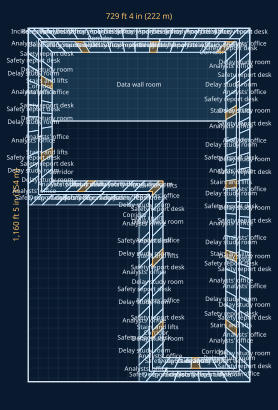
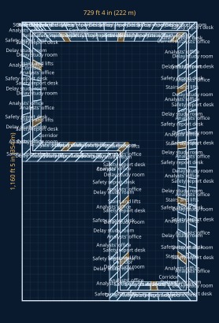

# P4-04 Analysts' Hall: plan

Footprint 729 ft 4 in (222 m) × 1,160 ft 5 in (354 m) · structural grid 32 ft 10 in (10 m)

## Levels

| Level | Floor above deck | Height | Floor area |
|---|---|---|---|
| Level 1 · Ground floor | 0 ft (0 mm) | 15 ft 9 in (4,800 mm) | 355,059 sq ft (32,986 m²) |
| Level 2 · Office floor 1 | 15 ft 9 in (4,800 mm) | 13 ft 9 in (4,200 mm) | 226,031 sq ft (20,999 m²) |
| Level 3 · Office floor 2 | 29 ft 6 in (9,000 mm) | 13 ft 9 in (4,200 mm) | 226,031 sq ft (20,999 m²) |
| Level 4 · Office floor 3 | 43 ft 4 in (13 m) | 13 ft 9 in (4,200 mm) | 226,031 sq ft (20,999 m²) |

## Elements

| ID | Designation | Type | Name | Level(s) | Size / length | Area | Status |
|---|---|---|---|---|---|---|---|
| E001 | D5F5P4B3A1L1R1 | room | Data wall room | L1 | 571 ft 10 in (174 m) × 225 ft 9 in (69 m) | 129,079 sq ft (11,992 m²) | proposed |
| E002 | D5F5P4B3A1L1R2 | zone | Light court | L1 | 571 ft 10 in (174 m) × 777 ft 3 in (237 m) | 232,720 sq ft (21,620 m²) | proposed |
| E003 | D5F5P4B3A1L1R3 | zone | Corridor | L1 | 399 ft 7 in (122 m) × 9 ft 10 in (3,000 mm) | 3,875 sq ft (360 m²) | proposed |
| E004 | D5F5P4B3A1L1R4 | zone | Corridor | L1 | 262 ft 10 in (80 m) × 145 ft 4 in (44 m) | 3,875 sq ft (360 m²) | proposed |
| E005 | D5F5P4B3A1L1R5 | zone | Corridor | L1 | 9 ft 10 in (3,000 mm) × 397 ft 4 in (121 m) | 3,875 sq ft (360 m²) | proposed |
| E006 | D5F5P4B3A1L1R6 | zone | Corridor | L1 | 9 ft 10 in (3,000 mm) × 397 ft 4 in (121 m) | 3,875 sq ft (360 m²) | proposed |
| E007 | D5F5P4B3A1L1R7 | zone | Corridor | L1 | 244 ft 5 in (74 m) × 166 ft (51 m) | 3,875 sq ft (360 m²) | proposed |
| E008 | D5F5P4B3A1L1R8 | zone | Corridor | L1 | 57 ft 9 in (18 m) × 354 ft (108 m) | 3,875 sq ft (360 m²) | proposed |
| E009 | D5F5P4B3A1L1R9 | zone | Corridor | L1 | 167 ft 4 in (51 m) × 246 ft 1 in (75 m) | 3,875 sq ft (360 m²) | proposed |
| E010 | D5F5P4B3A1L1R10 | zone | Corridor | L1 | 217 ft 2 in (66 m) × 192 ft 7 in (59 m) | 3,875 sq ft (360 m²) | proposed |
| E011 | D5F5P4B3A1L1R11 | zone | Corridor | L1 | 9 ft 10 in (3,000 mm) × 321 ft 2 in (98 m) | 3,100 sq ft (288 m²) | proposed |
| E012 | D5F5P4B3A1L1R12, D5F5P4B3A1L2R1, D5F5P4B3A1L3R1, D5F5P4B3A1L4R1 | core | Stairs and lifts | L1, L2, L3, L4 | 47 ft 3 in (14 m) × 34 ft 5 in (10 m) | 899 sq ft (83 m²) | proposed |
| E013 | D5F5P4B3A1L1R13, D5F5P4B3A1L2R2, D5F5P4B3A1L3R2, D5F5P4B3A1L4R2 | core | Stairs and lifts | L1, L2, L3, L4 | 31 ft 10 in (9,700 mm) × 34 ft 5 in (10 m) | 904 sq ft (84 m²) | proposed |
| E014 | D5F5P4B3A1L1R14, D5F5P4B3A1L2R3, D5F5P4B3A1L3R3, D5F5P4B3A1L4R3 | core | Stairs and lifts | L1, L2, L3, L4 | 58 ft 5 in (18 m) × 34 ft 5 in (10 m) | 899 sq ft (83 m²) | proposed |
| E015 | D5F5P4B3A1L1R15, D5F5P4B3A1L2R4, D5F5P4B3A1L3R4, D5F5P4B3A1L4R4 | core | Stairs and lifts | L1, L2, L3, L4 | 34 ft 5 in (10 m) × 46 ft 7 in (14 m) | 904 sq ft (84 m²) | proposed |
| E016 | D5F5P4B3A1L1R16, D5F5P4B3A1L2R5, D5F5P4B3A1L3R5, D5F5P4B3A1L4R5 | core | Stairs and lifts | L1, L2, L3, L4 | 34 ft 5 in (10 m) × 30 ft 10 in (9,400 mm) | 910 sq ft (85 m²) | proposed |
| E017 | D5F5P4B3A1L1R17, D5F5P4B3A1L2R6, D5F5P4B3A1L3R6, D5F5P4B3A1L4R6 | core | Stairs and lifts | L1, L2, L3, L4 | 34 ft 5 in (10 m) × 37 ft 5 in (11 m) | 910 sq ft (85 m²) | proposed |
| E018 | D5F5P4B3A1L1R18, D5F5P4B3A1L2R7, D5F5P4B3A1L3R7, D5F5P4B3A1L4R7 | core | Stairs and lifts | L1, L2, L3, L4 | 34 ft 5 in (10 m) × 53 ft 2 in (16 m) | 910 sq ft (85 m²) | proposed |
| E019 | D5F5P4B3A1L1R19, D5F5P4B3A1L2R8, D5F5P4B3A1L3R8, D5F5P4B3A1L4R8 | core | Stairs and lifts | L1, L2, L3, L4 | 30 ft 2 in (9,200 mm) × 34 ft 5 in (10 m) | 904 sq ft (84 m²) | proposed |
| E020 | D5F5P4B3A1L1R20, D5F5P4B3A1L2R9, D5F5P4B3A1L3R9, D5F5P4B3A1L4R9 | core | Stairs and lifts | L1, L2, L3, L4 | 34 ft 5 in (10 m) × 60 ft 8 in (18 m) | 904 sq ft (84 m²) | proposed |
| E021 | D5F5P4B3A1L1R21, D5F5P4B3A1L2R10, D5F5P4B3A1L3R10, D5F5P4B3A1L4R10 | core | Stairs and lifts | L1, L2, L3, L4 | 34 ft 5 in (10 m) × 60 ft 8 in (18 m) | 904 sq ft (84 m²) | proposed |
| E022 | D5F5P4B3A1L1R22, D5F5P4B3A1L2R11, D5F5P4B3A1L3R11, D5F5P4B3A1L4R11 | core | Stairs and lifts | L1, L2, L3, L4 | 47 ft 7 in (14 m) × 47 ft 7 in (14 m) | 904 sq ft (84 m²) | proposed |
| E023 | D5F5P4B3A1L1R23, D5F5P4B3A1L2R12, D5F5P4B3A1L3R12, D5F5P4B3A1L4R12 | core | Stairs and lifts | L1, L2, L3, L4 | 60 ft 8 in (18 m) × 34 ft 5 in (10 m) | 904 sq ft (84 m²) | proposed |
| E024 | D5F5P4B3A1L1R24, D5F5P4B3A1L2R13, D5F5P4B3A1L3R13, D5F5P4B3A1L4R13 | core | Stairs and lifts | L1, L2, L3, L4 | 34 ft 5 in (10 m) × 44 ft 11 in (14 m) | 910 sq ft (85 m²) | proposed |
| E025 | D5F5P4B3A1L1R25, D5F5P4B3A1L2R14, D5F5P4B3A1L3R14, D5F5P4B3A1L4R14 | core | Stairs and lifts | L1, L2, L3, L4 | 34 ft 5 in (10 m) × 43 ft (13 m) | 904 sq ft (84 m²) | proposed |
| E026 | D5F5P4B3A1L1R26 | room | Reception | L1 | 49 ft 3 in (15 m) × 34 ft 5 in (10 m) | 537 sq ft (50 m²) | proposed |
| E027 | D5F5P4B3A1L1R27 | room | Incident replay room | L1 | 56 ft 9 in (17 m) × 34 ft 5 in (10 m) | 865 sq ft (80 m²) | proposed |
| E028 | D5F5P4B3A1L1R28 | room | Toilets | L1 | 48 ft 3 in (15 m) × 34 ft 5 in (10 m) | 644 sq ft (60 m²) | proposed |
| E029 | D5F5P4B3A1L1R29 | room | Analysts' office | L1 | 99 ft 9 in (30 m) × 34 ft 5 in (10 m) | 2,583 sq ft (240 m²) | proposed |
| E030 | D5F5P4B3A1L1R30 | room | Delay study room | L1 | 65 ft 7 in (20 m) × 34 ft 5 in (10 m) | 1,616 sq ft (150 m²) | proposed |
| E031 | D5F5P4B3A1L1R31 | room | Safety report desk | L1 | 52 ft 2 in (16 m) × 34 ft 5 in (10 m) | 1,294 sq ft (120 m²) | proposed |
| E032 | D5F5P4B3A1L1R32 | room | Analysts' office | L1 | 84 ft (26 m) × 34 ft 5 in (10 m) | 2,583 sq ft (240 m²) | proposed |
| E033 | D5F5P4B3A1L1R33 | room | Delay study room | L1 | 49 ft 10 in (15 m) × 34 ft 5 in (10 m) | 1,616 sq ft (150 m²) | proposed |
| E034 | D5F5P4B3A1L1R34 | room | Safety report desk | L1 | 39 ft 4 in (12 m) × 34 ft 5 in (10 m) | 1,288 sq ft (120 m²) | proposed |
| E035 | D5F5P4B3A1L1R35 | room | Analysts' office | L1 | 81 ft 8 in (25 m) × 34 ft 5 in (10 m) | 2,577 sq ft (239 m²) | proposed |
| E036 | D5F5P4B3A1L1R36 | room | Delay study room | L1 | 59 ft 9 in (18 m) × 34 ft 5 in (10 m) | 1,616 sq ft (150 m²) | proposed |
| E037 | D5F5P4B3A1L1R37 | room | Safety report desk | L1 | 54 ft 6 in (17 m) × 34 ft 5 in (10 m) | 1,294 sq ft (120 m²) | proposed |
| E038 | D5F5P4B3A1L1R38 | room | Analysts' office | L1 | 97 ft 5 in (30 m) × 34 ft 5 in (10 m) | 2,583 sq ft (240 m²) | proposed |
| E039 | D5F5P4B3A1L1R39 | room | Delay study room | L1 | 75 ft 6 in (23 m) × 34 ft 5 in (10 m) | 1,616 sq ft (150 m²) | proposed |
| E040 | D5F5P4B3A1L1R40 | room | Safety report desk | L1 | 68 ft 3 in (21 m) × 36 ft 5 in (11 m) | 1,294 sq ft (120 m²) | proposed |
| E041 | D5F5P4B3A1L1R41 | room | Analysts' office | L1 | 34 ft 5 in (10 m) × 106 ft 11 in (33 m) | 2,583 sq ft (240 m²) | proposed |
| E042 | D5F5P4B3A1L1R42 | room | Delay study room | L1 | 34 ft 5 in (10 m) × 75 ft 2 in (23 m) | 1,616 sq ft (150 m²) | proposed |
| E043 | D5F5P4B3A1L1R43 | room | Safety report desk | L1 | 34 ft 5 in (10 m) × 63 ft (19 m) | 1,288 sq ft (120 m²) | proposed |
| E044 | D5F5P4B3A1L1R44 | room | Analysts' office | L1 | 34 ft 5 in (10 m) × 97 ft 1 in (30 m) | 2,583 sq ft (240 m²) | proposed |
| E045 | D5F5P4B3A1L1R45 | room | Delay study room | L1 | 34 ft 5 in (10 m) × 65 ft 7 in (20 m) | 1,616 sq ft (150 m²) | proposed |
| E046 | D5F5P4B3A1L1R46 | room | Safety report desk | L1 | 34 ft 5 in (10 m) × 53 ft 6 in (16 m) | 1,288 sq ft (120 m²) | proposed |
| E047 | D5F5P4B3A1L1R47 | room | Analysts' office | L1 | 34 ft 5 in (10 m) × 87 ft 7 in (27 m) | 2,588 sq ft (240 m²) | proposed |
| E048 | D5F5P4B3A1L1R48 | room | Delay study room | L1 | 34 ft 5 in (10 m) × 55 ft 5 in (17 m) | 1,611 sq ft (150 m²) | proposed |
| E049 | D5F5P4B3A1L1R49 | room | Safety report desk | L1 | 34 ft 5 in (10 m) × 43 ft 8 in (13 m) | 1,294 sq ft (120 m²) | proposed |
| E050 | D5F5P4B3A1L1R50 | room | Analysts' office | L1 | 34 ft 5 in (10 m) × 77 ft 9 in (24 m) | 2,583 sq ft (240 m²) | proposed |
| E051 | D5F5P4B3A1L1R51 | room | Delay study room | L1 | 34 ft 5 in (10 m) × 48 ft 7 in (15 m) | 1,616 sq ft (150 m²) | proposed |
| E052 | D5F5P4B3A1L1R52 | room | Safety report desk | L1 | 34 ft 5 in (10 m) × 41 ft (12 m) | 1,288 sq ft (120 m²) | proposed |
| E053 | D5F5P4B3A1L1R53 | room | Analysts' office | L1 | 34 ft 5 in (10 m) × 82 ft (25 m) | 2,588 sq ft (240 m²) | proposed |
| E054 | D5F5P4B3A1L1R54 | room | Delay study room | L1 | 34 ft 5 in (10 m) × 57 ft 5 in (18 m) | 1,611 sq ft (150 m²) | proposed |
| E055 | D5F5P4B3A1L1R55 | room | Safety report desk | L1 | 34 ft 5 in (10 m) × 50 ft 10 in (16 m) | 1,294 sq ft (120 m²) | proposed |
| E056 | D5F5P4B3A1L1R56 | room | Analysts' office | L1 | 34 ft 5 in (10 m) × 91 ft 6 in (28 m) | 2,577 sq ft (239 m²) | proposed |
| E057 | D5F5P4B3A1L1R57 | room | Delay study room | L1 | 34 ft 5 in (10 m) × 67 ft 7 in (21 m) | 1,622 sq ft (151 m²) | proposed |
| E058 | D5F5P4B3A1L1R58 | room | Safety report desk | L1 | 34 ft 5 in (10 m) × 60 ft 4 in (18 m) | 1,288 sq ft (120 m²) | proposed |
| E059 | D5F5P4B3A1L1R59 | room | Analysts' office | L1 | 34 ft 5 in (10 m) × 101 ft 5 in (31 m) | 2,583 sq ft (240 m²) | proposed |
| E060 | D5F5P4B3A1L1R60 | room | Delay study room | L1 | 34 ft 5 in (10 m) × 77 ft 1 in (24 m) | 1,616 sq ft (150 m²) | proposed |
| E061 | D5F5P4B3A1L1R61 | room | Safety report desk | L1 | 34 ft 5 in (10 m) × 70 ft 3 in (21 m) | 1,294 sq ft (120 m²) | proposed |
| E062 | D5F5P4B3A1L1R62 | room | Analysts' office | L1 | 93 ft 10 in (29 m) × 42 ft 8 in (13 m) | 2,583 sq ft (240 m²) | proposed |
| E063 | D5F5P4B3A1L1R63 | room | Delay study room | L1 | 62 ft 4 in (19 m) × 34 ft 5 in (10 m) | 1,611 sq ft (150 m²) | proposed |
| E064 | D5F5P4B3A1L1R64 | room | Safety report desk | L1 | 44 ft 7 in (14 m) × 34 ft 5 in (10 m) | 1,294 sq ft (120 m²) | proposed |
| E065 | D5F5P4B3A1L1R65 | room | Analysts' office | L1 | 83 ft (25 m) × 34 ft 5 in (10 m) | 2,583 sq ft (240 m²) | proposed |
| E066 | D5F5P4B3A1L1R66 | room | Delay study room | L1 | 64 ft 8 in (20 m) × 34 ft 5 in (10 m) | 1,616 sq ft (150 m²) | proposed |
| E067 | D5F5P4B3A1L1R67 | room | Safety report desk | L1 | 64 ft (20 m) × 34 ft 5 in (10 m) | 1,294 sq ft (120 m²) | proposed |
| E068 | D5F5P4B3A1L1R68 | room | Analysts' office | L1 | 52 ft 2 in (16 m) × 89 ft 7 in (27 m) | 2,583 sq ft (240 m²) | proposed |
| E069 | D5F5P4B3A1L1R69 | room | Delay study room | L1 | 34 ft 5 in (10 m) × 81 ft 4 in (25 m) | 1,616 sq ft (150 m²) | proposed |
| E070 | D5F5P4B3A1L1R70 | room | Safety report desk | L1 | 34 ft 5 in (10 m) × 71 ft 10 in (22 m) | 1,288 sq ft (120 m²) | proposed |
| E071 | D5F5P4B3A1L1R71 | room | Analysts' office | L1 | 34 ft 5 in (10 m) × 109 ft 7 in (33 m) | 2,588 sq ft (240 m²) | proposed |
| E072 | D5F5P4B3A1L1R72 | room | Delay study room | L1 | 34 ft 5 in (10 m) × 81 ft (25 m) | 1,605 sq ft (149 m²) | proposed |
| E073 | D5F5P4B3A1L1R73 | room | Safety report desk | L1 | 34 ft 5 in (10 m) × 72 ft 2 in (22 m) | 1,300 sq ft (121 m²) | proposed |
| E074 | D5F5P4B3A1L1R74 | room | Analysts' office | L1 | 34 ft 5 in (10 m) × 109 ft 3 in (33 m) | 2,577 sq ft (239 m²) | proposed |
| E075 | D5F5P4B3A1L1R75 | room | Delay study room | L1 | 34 ft 5 in (10 m) × 81 ft 4 in (25 m) | 1,616 sq ft (150 m²) | proposed |
| E076 | D5F5P4B3A1L1R76 | room | Safety report desk | L1 | 34 ft 5 in (10 m) × 71 ft 10 in (22 m) | 1,288 sq ft (120 m²) | proposed |
| E077 | D5F5P4B3A1L1R77 | room | Analysts' office | L1 | 34 ft 5 in (10 m) × 109 ft 7 in (33 m) | 2,588 sq ft (240 m²) | proposed |
| E078 | D5F5P4B3A1L1R78 | room | Delay study room | L1 | 34 ft 5 in (10 m) × 81 ft 4 in (25 m) | 1,616 sq ft (150 m²) | proposed |
| E079 | D5F5P4B3A1L1R79 | room | Safety report desk | L1 | 71 ft 6 in (22 m) × 34 ft 9 in (11 m) | 1,288 sq ft (120 m²) | proposed |
| E080 | D5F5P4B3A1L1R80 | room | Analysts' office | L1 | 109 ft 7 in (33 m) × 34 ft 5 in (10 m) | 2,588 sq ft (240 m²) | proposed |
| E081 | D5F5P4B3A1L1R81 | room | Delay study room | L1 | 81 ft 4 in (25 m) × 34 ft 5 in (10 m) | 1,616 sq ft (150 m²) | proposed |
| E082 | D5F5P4B3A1L1R82 | room | Safety report desk | L1 | 71 ft 10 in (22 m) × 34 ft 5 in (10 m) | 1,288 sq ft (120 m²) | proposed |
| E083 | D5F5P4B3A1L1R83 | room | Analysts' office | L1 | 109 ft 3 in (33 m) × 34 ft 5 in (10 m) | 2,577 sq ft (239 m²) | proposed |
| E084 | D5F5P4B3A1L1R84 | room | Delay study room | L1 | 81 ft 4 in (25 m) × 34 ft 5 in (10 m) | 1,616 sq ft (150 m²) | proposed |
| E085 | D5F5P4B3A1L1R85 | room | Safety report desk | L1 | 72 ft 2 in (22 m) × 34 ft 5 in (10 m) | 1,300 sq ft (121 m²) | proposed |
| E086 | D5F5P4B3A1L1R86 | room | Analysts' office | L1 | 43 ft 4 in (13 m) × 96 ft 2 in (29 m) | 2,577 sq ft (239 m²) | proposed |
| E087 | D5F5P4B3A1L1R87 | room | Delay study room | L1 | 34 ft 5 in (10 m) × 69 ft 11 in (21 m) | 1,616 sq ft (150 m²) | proposed |
| E088 | D5F5P4B3A1L1R88 | room | Safety report desk | L1 | 34 ft 5 in (10 m) × 55 ft 1 in (17 m) | 1,288 sq ft (120 m²) | proposed |
| E089 | D5F5P4B3A1L1R89 | room | Analysts' office | L1 | 34 ft 5 in (10 m) × 85 ft 8 in (26 m) | 2,583 sq ft (240 m²) | proposed |
| E090 | D5F5P4B3A1L1R90 | room | Delay study room | L1 | 34 ft 5 in (10 m) × 49 ft 10 in (15 m) | 1,616 sq ft (150 m²) | proposed |
| E091 | D5F5P4B3A1L1R91 | room | Safety report desk | L1 | 34 ft 5 in (10 m) × 40 ft (12 m) | 1,294 sq ft (120 m²) | proposed |
| E092 | D5F5P4B3A1L1R92 | room | Analysts' office | L1 | 34 ft 5 in (10 m) × 84 ft 8 in (26 m) | 2,583 sq ft (240 m²) | proposed |
| E093 | D5F5P4B3A1L1R93 | room | Delay study room | L1 | 34 ft 5 in (10 m) × 64 ft (20 m) | 1,611 sq ft (150 m²) | proposed |
| E094 | D5F5P4B3A1L1R94 | room | Safety report desk | L1 | 34 ft 5 in (10 m) × 60 ft (18 m) | 1,294 sq ft (120 m²) | proposed |
| E095 | D5F5P4B3A1L1R95 | room | Analysts' office | L1 | 34 ft 5 in (10 m) × 104 ft 8 in (32 m) | 2,588 sq ft (240 m²) | proposed |
| E096 | D5F5P4B3A1L1R96 | room | Delay study room | L1 | 78 ft 9 in (24 m) × 34 ft 5 in (10 m) | 1,616 sq ft (150 m²) | proposed |
| E097 | D5F5P4B3A1L1R97 | room | Safety report desk | L1 | 83 ft 4 in (25 m) × 34 ft 5 in (10 m) | 1,978 sq ft (184 m²) | proposed |
| E098 | D5F5P4B3A1L1R98 | room | Analysts' office | L1 | 90 ft 7 in (28 m) × 34 ft 5 in (10 m) | 2,588 sq ft (240 m²) | proposed |
| E099 | D5F5P4B3A1L1R99 | room | Delay study room | L1 | 55 ft 5 in (17 m) × 34 ft 5 in (10 m) | 1,616 sq ft (150 m²) | proposed |
| E100 | D5F5P4B3A1L1R100 | room | Safety report desk | L1 | 41 ft (12 m) × 34 ft 5 in (10 m) | 1,288 sq ft (120 m²) | proposed |
| E101 | D5F5P4B3A1L1R101 | room | Analysts' office | L1 | 51 ft 10 in (16 m) × 34 ft 5 in (10 m) | 1,695 sq ft (158 m²) | proposed |
| E102 | D5F5P4B3A1L1R102 | room | Delay study room | L1 | 56 ft 9 in (17 m) × 34 ft 5 in (10 m) | 1,616 sq ft (150 m²) | proposed |
| E103 | D5F5P4B3A1L1R103 | room | Safety report desk | L1 | 52 ft 2 in (16 m) × 34 ft 5 in (10 m) | 1,294 sq ft (120 m²) | proposed |
| E104 | D5F5P4B3A1L1R104 | room | Analysts' office | L1 | 95 ft 10 in (29 m) × 34 ft 5 in (10 m) | 2,577 sq ft (239 m²) | proposed |
| E105 | D5F5P4B3A1L1R105 | room | Delay study room | L1 | 77 ft 5 in (24 m) × 34 ft 5 in (10 m) | 1,701 sq ft (158 m²) | proposed |
| E106 | D5F5P4B3A1L1R106 | room | Safety report desk | L1 | 40 ft 4 in (12 m) × 64 ft 8 in (20 m) | 1,294 sq ft (120 m²) | proposed |
| E107 | D5F5P4B3A1L1R107 | room | Analysts' office | L1 | 34 ft 5 in (10 m) × 104 ft 8 in (32 m) | 2,583 sq ft (240 m²) | proposed |
| E108 | D5F5P4B3A1L1R108 | room | Delay study room | L1 | 34 ft 5 in (10 m) × 72 ft 6 in (22 m) | 1,616 sq ft (150 m²) | proposed |
| E109 | D5F5P4B3A1L1R109 | room | Safety report desk | L1 | 34 ft 5 in (10 m) × 71 ft 10 in (22 m) | 1,695 sq ft (157 m²) | proposed |
| E110 | D5F5P4B3A1L1R110 | room | Analysts' office | L1 | 34 ft 5 in (10 m) × 91 ft 10 in (28 m) | 2,583 sq ft (240 m²) | proposed |
| E111 | D5F5P4B3A1L1R111 | room | Delay study room | L1 | 34 ft 5 in (10 m) × 59 ft 9 in (18 m) | 1,616 sq ft (150 m²) | proposed |
| E112 | D5F5P4B3A1L1R112 | room | Safety report desk | L1 | 34 ft 5 in (10 m) × 47 ft 3 in (14 m) | 1,288 sq ft (120 m²) | proposed |
| E113 | D5F5P4B3A1L1R113 | room | Analysts' office | L1 | 34 ft 5 in (10 m) × 56 ft 1 in (17 m) | 1,695 sq ft (157 m²) | proposed |
| E114 | D5F5P4B3A1L1R114 | room | Delay study room | L1 | 34 ft 5 in (10 m) × 48 ft 11 in (15 m) | 1,611 sq ft (150 m²) | proposed |
| E115 | D5F5P4B3A1L1R115 | room | Safety report desk | L1 | 34 ft 5 in (10 m) × 38 ft 9 in (12 m) | 1,288 sq ft (120 m²) | proposed |
| E116 | D5F5P4B3A1L1R116 | room | Analysts' office | L1 | 34 ft 5 in (10 m) × 79 ft 5 in (24 m) | 2,583 sq ft (240 m²) | proposed |
| E117 | D5F5P4B3A1L1R117 | room | Delay study room | L1 | 34 ft 5 in (10 m) × 57 ft 9 in (18 m) | 1,695 sq ft (158 m²) | proposed |
| E118 | D5F5P4B3A1L1R118 | room | Safety report desk | L1 | 34 ft 5 in (10 m) × 50 ft 6 in (15 m) | 1,288 sq ft (120 m²) | proposed |
| E119 | D5F5P4B3A1L1R119 | room | Analysts' office | L1 | 34 ft 5 in (10 m) × 91 ft 10 in (28 m) | 2,583 sq ft (240 m²) | proposed |
| E120 | D5F5P4B3A1L1R120 | room | Delay study room | L1 | 34 ft 5 in (10 m) × 67 ft 11 in (21 m) | 1,616 sq ft (150 m²) | proposed |
| E121 | D5F5P4B3A1L1R121 | room | Safety report desk | L1 | 34 ft 5 in (10 m) × 73 ft 6 in (22 m) | 1,695 sq ft (158 m²) | proposed |
| E122 | D5F5P4B3A1L1R122 | room | Analysts' office | L1 | 34 ft 5 in (10 m) × 105 ft (32 m) | 2,583 sq ft (240 m²) | proposed |
| E123 | D5F5P4B3A1L1R123 | room | Delay study room | L1 | 49 ft 6 in (15 m) × 62 ft 8 in (19 m) | 1,611 sq ft (150 m²) | proposed |
| E124 | D5F5P4B3A1L1R124 | room | Safety report desk | L1 | 61 ft 8 in (19 m) × 34 ft 5 in (10 m) | 1,294 sq ft (120 m²) | proposed |
| E125 | D5F5P4B3A1L1R125 | room | Analysts' office | L1 | 61 ft (19 m) × 34 ft 5 in (10 m) | 1,695 sq ft (158 m²) | proposed |
| E126 | D5F5P4B3A1L1R126 | room | Delay study room | L1 | 56 ft 5 in (17 m) × 34 ft 5 in (10 m) | 1,616 sq ft (150 m²) | proposed |
| E127 | D5F5P4B3A1L1R127 | room | Safety report desk | L1 | 58 ft 9 in (18 m) × 34 ft 5 in (10 m) | 1,288 sq ft (120 m²) | proposed |
| E128 | D5F5P4B3A1L1R128 | room | Analysts' office | L1 | 57 ft 1 in (17 m) × 83 ft (25 m) | 2,588 sq ft (240 m²) | proposed |
| E129 | D5F5P4B3A1L1R129 | room | Delay study room | L1 | 34 ft 5 in (10 m) × 83 ft 8 in (26 m) | 1,695 sq ft (158 m²) | proposed |
| E130 | D5F5P4B3A1L1R130 | room | Safety report desk | L1 | 34 ft 5 in (10 m) × 71 ft 10 in (22 m) | 1,288 sq ft (120 m²) | proposed |
| E131 | D5F5P4B3A1L1R131 | room | Analysts' office | L1 | 34 ft 5 in (10 m) × 109 ft 3 in (33 m) | 2,577 sq ft (239 m²) | proposed |
| E132 | D5F5P4B3A1L1R132 | room | Delay study room | L1 | 34 ft 5 in (10 m) × 81 ft 4 in (25 m) | 1,616 sq ft (150 m²) | proposed |
| E133 | D5F5P4B3A1L1R133 | room | Safety report desk | L1 | 34 ft 5 in (10 m) × 83 ft 8 in (26 m) | 1,695 sq ft (158 m²) | proposed |
| E134 | D5F5P4B3A1L1R134 | room | Analysts' office | L1 | 34 ft 5 in (10 m) × 109 ft 7 in (33 m) | 2,588 sq ft (240 m²) | proposed |
| E135 | D5F5P4B3A1L1R135 | room | Delay study room | L1 | 34 ft 5 in (10 m) × 81 ft 4 in (25 m) | 1,616 sq ft (150 m²) | proposed |
| E136 | D5F5P4B3A1L1R136 | room | Safety report desk | L1 | 34 ft 5 in (10 m) × 71 ft 10 in (22 m) | 1,288 sq ft (120 m²) | proposed |
| E137 | D5F5P4B3A1L1R137 | room | Analysts' office | L1 | 34 ft 5 in (10 m) × 83 ft 8 in (26 m) | 1,695 sq ft (158 m²) | proposed |
| E138 | D5F5P4B3A1L1R138 | room | Delay study room | L1 | 81 ft 4 in (25 m) × 34 ft 5 in (10 m) | 1,616 sq ft (150 m²) | proposed |
| E139 | D5F5P4B3A1L1R139 | room | Safety report desk | L1 | 71 ft 10 in (22 m) × 34 ft 5 in (10 m) | 1,288 sq ft (120 m²) | proposed |
| E140 | D5F5P4B3A1L1R140 | room | Analysts' office | L1 | 109 ft 7 in (33 m) × 34 ft 5 in (10 m) | 2,588 sq ft (240 m²) | proposed |
| E141 | D5F5P4B3A1L1R141 | room | Delay study room | L1 | 83 ft 8 in (25 m) × 34 ft 5 in (10 m) | 1,695 sq ft (158 m²) | proposed |
| E142 | D5F5P4B3A1L1R142 | room | Safety report desk | L1 | 71 ft 10 in (22 m) × 34 ft 5 in (10 m) | 1,288 sq ft (120 m²) | proposed |
| E143 | D5F5P4B3A1L1R143 | room | Analysts' office | L1 | 109 ft 7 in (33 m) × 34 ft 5 in (10 m) | 2,588 sq ft (240 m²) | proposed |
| E144 | D5F5P4B3A1L1R144 | room | Delay study room | L1 | 38 ft 9 in (12 m) × 73 ft 10 in (22 m) | 1,611 sq ft (150 m²) | proposed |
| E145 | D5F5P4B3A1L1R145 | room | Safety report desk | L1 | 34 ft 5 in (10 m) × 73 ft 6 in (22 m) | 1,690 sq ft (157 m²) | proposed |
| E146 | D5F5P4B3A1L1R146 | room | Analysts' office | L1 | 34 ft 5 in (10 m) × 85 ft 11 in (26 m) | 2,583 sq ft (240 m²) | proposed |
| E147 | D5F5P4B3A1L1R147 | room | Delay study room | L1 | 34 ft 5 in (10 m) × 50 ft 6 in (15 m) | 1,616 sq ft (150 m²) | proposed |
| E148 | D5F5P4B3A1L1R148 | room | Safety report desk | L1 | 34 ft 5 in (10 m) × 42 ft (13 m) | 1,288 sq ft (120 m²) | proposed |
| E149 | D5F5P4B3A1L1R149 | room | Analysts' office | L1 | 34 ft 5 in (10 m) × 60 ft 4 in (18 m) | 1,695 sq ft (158 m²) | proposed |
| E150 | D5F5P4B3A1L1R150 | room | Delay study room | L1 | 34 ft 5 in (10 m) × 69 ft 3 in (21 m) | 1,616 sq ft (150 m²) | proposed |
| E151 | D5F5P4B3A1L1R151 | room | Safety report desk | L1 | 34 ft 5 in (10 m) × 87 ft 7 in (27 m) | 1,978 sq ft (184 m²) | proposed |
| E152 | D5F5P4B3A1L2R15, D5F5P4B3A1L3R15, D5F5P4B3A1L4R15 | zone | Corridor | L2, L3, L4 | 399 ft 7 in (122 m) × 9 ft 10 in (3,000 mm) | 3,875 sq ft (360 m²) | proposed |
| E153 | D5F5P4B3A1L2R16, D5F5P4B3A1L3R16, D5F5P4B3A1L4R16 | zone | Corridor | L2, L3, L4 | 262 ft 10 in (80 m) × 145 ft 4 in (44 m) | 3,875 sq ft (360 m²) | proposed |
| E154 | D5F5P4B3A1L2R17, D5F5P4B3A1L3R17, D5F5P4B3A1L4R17 | zone | Corridor | L2, L3, L4 | 9 ft 10 in (3,000 mm) × 397 ft 4 in (121 m) | 3,875 sq ft (360 m²) | proposed |
| E155 | D5F5P4B3A1L2R18, D5F5P4B3A1L3R18, D5F5P4B3A1L4R18 | zone | Corridor | L2, L3, L4 | 9 ft 10 in (3,000 mm) × 397 ft 4 in (121 m) | 3,875 sq ft (360 m²) | proposed |
| E156 | D5F5P4B3A1L2R19, D5F5P4B3A1L3R19, D5F5P4B3A1L4R19 | zone | Corridor | L2, L3, L4 | 244 ft 5 in (74 m) × 166 ft (51 m) | 3,875 sq ft (360 m²) | proposed |
| E157 | D5F5P4B3A1L2R20, D5F5P4B3A1L3R20, D5F5P4B3A1L4R20 | zone | Corridor | L2, L3, L4 | 57 ft 9 in (18 m) × 354 ft (108 m) | 3,875 sq ft (360 m²) | proposed |
| E158 | D5F5P4B3A1L2R21, D5F5P4B3A1L3R21, D5F5P4B3A1L4R21 | zone | Corridor | L2, L3, L4 | 167 ft 4 in (51 m) × 246 ft 1 in (75 m) | 3,875 sq ft (360 m²) | proposed |
| E159 | D5F5P4B3A1L2R22, D5F5P4B3A1L3R22, D5F5P4B3A1L4R22 | zone | Corridor | L2, L3, L4 | 217 ft 2 in (66 m) × 192 ft 7 in (59 m) | 3,875 sq ft (360 m²) | proposed |
| E160 | D5F5P4B3A1L2R23, D5F5P4B3A1L3R23, D5F5P4B3A1L4R23 | zone | Corridor | L2, L3, L4 | 9 ft 10 in (3,000 mm) × 321 ft 2 in (98 m) | 3,100 sq ft (288 m²) | proposed |
| E161 | D5F5P4B3A1L2R24, D5F5P4B3A1L3R24, D5F5P4B3A1L4R24 | room | Statistics room | L2, L3, L4 | 64 ft 4 in (20 m) × 34 ft 5 in (10 m) | 1,079 sq ft (100 m²) | proposed |
| E162 | D5F5P4B3A1L2R25, D5F5P4B3A1L3R25, D5F5P4B3A1L4R25 | room | Meeting room | L2, L3, L4 | 43 ft 4 in (13 m) × 34 ft 5 in (10 m) | 429 sq ft (40 m²) | proposed |
| E163 | D5F5P4B3A1L2R26, D5F5P4B3A1L3R26, D5F5P4B3A1L4R26 | room | Meeting room | L2, L3, L4 | 42 ft (13 m) × 34 ft 5 in (10 m) | 429 sq ft (40 m²) | proposed |
| E164 | D5F5P4B3A1L2R27, D5F5P4B3A1L3R27, D5F5P4B3A1L4R27 | room | Tea point | L2, L3, L4 | 40 ft 4 in (12 m) × 34 ft 5 in (10 m) | 413 sq ft (38 m²) | proposed |
| E165 | D5F5P4B3A1L2R28, D5F5P4B3A1L3R28, D5F5P4B3A1L4R28 | room | Staff toilets and showers | L2, L3, L4 | 48 ft 7 in (15 m) × 34 ft 5 in (10 m) | 752 sq ft (70 m²) | proposed |
| E166 | D5F5P4B3A1L2R29, D5F5P4B3A1L3R29, D5F5P4B3A1L4R29 | room | Analysts' office | L2, L3, L4 | 96 ft 9 in (29 m) × 34 ft 5 in (10 m) | 2,583 sq ft (240 m²) | proposed |
| E167 | D5F5P4B3A1L2R30, D5F5P4B3A1L3R30, D5F5P4B3A1L4R30 | room | Delay study room | L2, L3, L4 | 62 ft 8 in (19 m) × 34 ft 5 in (10 m) | 1,616 sq ft (150 m²) | proposed |
| E168 | D5F5P4B3A1L2R31, D5F5P4B3A1L3R31, D5F5P4B3A1L4R31 | room | Safety report desk | L2, L3, L4 | 49 ft 3 in (15 m) × 34 ft 5 in (10 m) | 1,294 sq ft (120 m²) | proposed |
| E169 | D5F5P4B3A1L2R32, D5F5P4B3A1L3R32, D5F5P4B3A1L4R32 | room | Analysts' office | L2, L3, L4 | 81 ft (25 m) × 34 ft 5 in (10 m) | 2,583 sq ft (240 m²) | proposed |
| E170 | D5F5P4B3A1L2R33, D5F5P4B3A1L3R33, D5F5P4B3A1L4R33 | room | Delay study room | L2, L3, L4 | 49 ft 3 in (15 m) × 34 ft 5 in (10 m) | 1,616 sq ft (150 m²) | proposed |
| E171 | D5F5P4B3A1L2R34, D5F5P4B3A1L3R34, D5F5P4B3A1L4R34 | room | Safety report desk | L2, L3, L4 | 41 ft 8 in (13 m) × 34 ft 5 in (10 m) | 1,288 sq ft (120 m²) | proposed |
| E172 | D5F5P4B3A1L2R35, D5F5P4B3A1L3R35, D5F5P4B3A1L4R35 | room | Analysts' office | L2, L3, L4 | 85 ft (26 m) × 34 ft 5 in (10 m) | 2,588 sq ft (240 m²) | proposed |
| E173 | D5F5P4B3A1L2R36, D5F5P4B3A1L3R36, D5F5P4B3A1L4R36 | room | Delay study room | L2, L3, L4 | 62 ft 8 in (19 m) × 34 ft 5 in (10 m) | 1,616 sq ft (150 m²) | proposed |
| E174 | D5F5P4B3A1L2R37, D5F5P4B3A1L3R37, D5F5P4B3A1L4R37 | room | Safety report desk | L2, L3, L4 | 57 ft 5 in (18 m) × 34 ft 5 in (10 m) | 1,288 sq ft (120 m²) | proposed |
| E175 | D5F5P4B3A1L2R38, D5F5P4B3A1L3R38, D5F5P4B3A1L4R38 | room | Analysts' office | L2, L3, L4 | 100 ft 9 in (31 m) × 34 ft 5 in (10 m) | 2,583 sq ft (240 m²) | proposed |
| E176 | D5F5P4B3A1L2R39, D5F5P4B3A1L3R39, D5F5P4B3A1L4R39 | room | Delay study room | L2, L3, L4 | 78 ft 9 in (24 m) × 34 ft 5 in (10 m) | 1,616 sq ft (150 m²) | proposed |
| E177 | D5F5P4B3A1L2R40, D5F5P4B3A1L3R40, D5F5P4B3A1L4R40 | room | Safety report desk | L2, L3, L4 | 39 ft 1 in (12 m) × 66 ft 3 in (20 m) | 1,294 sq ft (120 m²) | proposed |
| E178 | D5F5P4B3A1L2R41, D5F5P4B3A1L3R41, D5F5P4B3A1L4R41 | room | Analysts' office | L2, L3, L4 | 34 ft 5 in (10 m) × 105 ft (32 m) | 2,577 sq ft (239 m²) | proposed |
| E179 | D5F5P4B3A1L2R42, D5F5P4B3A1L3R42, D5F5P4B3A1L4R42 | room | Delay study room | L2, L3, L4 | 34 ft 5 in (10 m) × 73 ft 6 in (22 m) | 1,622 sq ft (151 m²) | proposed |
| E180 | D5F5P4B3A1L2R43, D5F5P4B3A1L3R43, D5F5P4B3A1L4R43 | room | Safety report desk | L2, L3, L4 | 34 ft 5 in (10 m) × 61 ft 4 in (19 m) | 1,288 sq ft (120 m²) | proposed |
| E181 | D5F5P4B3A1L2R44, D5F5P4B3A1L3R44, D5F5P4B3A1L4R44 | room | Analysts' office | L2, L3, L4 | 34 ft 5 in (10 m) × 95 ft 6 in (29 m) | 2,583 sq ft (240 m²) | proposed |
| E182 | D5F5P4B3A1L2R45, D5F5P4B3A1L3R45, D5F5P4B3A1L4R45 | room | Delay study room | L2, L3, L4 | 34 ft 5 in (10 m) × 63 ft 8 in (19 m) | 1,616 sq ft (150 m²) | proposed |
| E183 | D5F5P4B3A1L2R46, D5F5P4B3A1L3R46, D5F5P4B3A1L4R46 | room | Safety report desk | L2, L3, L4 | 34 ft 5 in (10 m) × 51 ft 6 in (16 m) | 1,288 sq ft (120 m²) | proposed |
| E184 | D5F5P4B3A1L2R47, D5F5P4B3A1L3R47, D5F5P4B3A1L4R47 | room | Analysts' office | L2, L3, L4 | 34 ft 5 in (10 m) × 85 ft 8 in (26 m) | 2,583 sq ft (240 m²) | proposed |
| E185 | D5F5P4B3A1L2R48, D5F5P4B3A1L3R48, D5F5P4B3A1L4R48 | room | Delay study room | L2, L3, L4 | 34 ft 5 in (10 m) × 53 ft 10 in (16 m) | 1,616 sq ft (150 m²) | proposed |
| E186 | D5F5P4B3A1L2R49, D5F5P4B3A1L3R49, D5F5P4B3A1L4R49 | room | Safety report desk | L2, L3, L4 | 34 ft 5 in (10 m) × 41 ft 8 in (13 m) | 1,288 sq ft (120 m²) | proposed |
| E187 | D5F5P4B3A1L2R50, D5F5P4B3A1L3R50, D5F5P4B3A1L4R50 | room | Analysts' office | L2, L3, L4 | 34 ft 5 in (10 m) × 77 ft 5 in (24 m) | 2,588 sq ft (240 m²) | proposed |
| E188 | D5F5P4B3A1L2R51, D5F5P4B3A1L3R51, D5F5P4B3A1L4R51 | room | Delay study room | L2, L3, L4 | 34 ft 5 in (10 m) × 49 ft 6 in (15 m) | 1,611 sq ft (150 m²) | proposed |
| E189 | D5F5P4B3A1L2R52, D5F5P4B3A1L3R52, D5F5P4B3A1L4R52 | room | Safety report desk | L2, L3, L4 | 34 ft 5 in (10 m) × 43 ft (13 m) | 1,294 sq ft (120 m²) | proposed |
| E190 | D5F5P4B3A1L2R53, D5F5P4B3A1L3R53, D5F5P4B3A1L4R53 | room | Analysts' office | L2, L3, L4 | 34 ft 5 in (10 m) × 84 ft (26 m) | 2,588 sq ft (240 m²) | proposed |
| E191 | D5F5P4B3A1L2R54, D5F5P4B3A1L3R54, D5F5P4B3A1L4R54 | room | Delay study room | L2, L3, L4 | 34 ft 5 in (10 m) × 59 ft 5 in (18 m) | 1,611 sq ft (150 m²) | proposed |
| E192 | D5F5P4B3A1L2R55, D5F5P4B3A1L3R55, D5F5P4B3A1L4R55 | room | Safety report desk | L2, L3, L4 | 34 ft 5 in (10 m) × 52 ft 10 in (16 m) | 1,294 sq ft (120 m²) | proposed |
| E193 | D5F5P4B3A1L2R56, D5F5P4B3A1L3R56, D5F5P4B3A1L4R56 | room | Analysts' office | L2, L3, L4 | 34 ft 5 in (10 m) × 93 ft 6 in (29 m) | 2,583 sq ft (240 m²) | proposed |
| E194 | D5F5P4B3A1L2R57, D5F5P4B3A1L3R57, D5F5P4B3A1L4R57 | room | Delay study room | L2, L3, L4 | 34 ft 5 in (10 m) × 68 ft 11 in (21 m) | 1,611 sq ft (150 m²) | proposed |
| E195 | D5F5P4B3A1L2R58, D5F5P4B3A1L3R58, D5F5P4B3A1L4R58 | room | Safety report desk | L2, L3, L4 | 34 ft 5 in (10 m) × 62 ft 4 in (19 m) | 1,294 sq ft (120 m²) | proposed |
| E196 | D5F5P4B3A1L2R59, D5F5P4B3A1L3R59, D5F5P4B3A1L4R59 | room | Analysts' office | L2, L3, L4 | 34 ft 5 in (10 m) × 103 ft 4 in (32 m) | 2,583 sq ft (240 m²) | proposed |
| E197 | D5F5P4B3A1L2R60, D5F5P4B3A1L3R60, D5F5P4B3A1L4R60 | room | Delay study room | L2, L3, L4 | 34 ft 5 in (10 m) × 79 ft 1 in (24 m) | 1,616 sq ft (150 m²) | proposed |
| E198 | D5F5P4B3A1L2R61, D5F5P4B3A1L3R61, D5F5P4B3A1L4R61 | room | Safety report desk | L2, L3, L4 | 54 ft 6 in (17 m) × 49 ft 3 in (15 m) | 1,294 sq ft (120 m²) | proposed |
| E199 | D5F5P4B3A1L2R62, D5F5P4B3A1L3R62, D5F5P4B3A1L4R62 | room | Analysts' office | L2, L3, L4 | 96 ft 9 in (30 m) × 34 ft 5 in (10 m) | 2,577 sq ft (239 m²) | proposed |
| E200 | D5F5P4B3A1L2R63, D5F5P4B3A1L3R63, D5F5P4B3A1L4R63 | room | Delay study room | L2, L3, L4 | 56 ft 1 in (17 m) × 34 ft 5 in (10 m) | 1,616 sq ft (150 m²) | proposed |
| E201 | D5F5P4B3A1L2R64, D5F5P4B3A1L3R64, D5F5P4B3A1L4R64 | room | Safety report desk | L2, L3, L4 | 41 ft 4 in (13 m) × 34 ft 5 in (10 m) | 1,294 sq ft (120 m²) | proposed |
| E202 | D5F5P4B3A1L2R65, D5F5P4B3A1L3R65, D5F5P4B3A1L4R65 | room | Analysts' office | L2, L3, L4 | 86 ft 3 in (26 m) × 34 ft 5 in (10 m) | 2,583 sq ft (240 m²) | proposed |
| E203 | D5F5P4B3A1L2R66, D5F5P4B3A1L3R66, D5F5P4B3A1L4R66 | room | Delay study room | L2, L3, L4 | 70 ft 10 in (22 m) × 34 ft 5 in (10 m) | 1,611 sq ft (150 m²) | proposed |
| E204 | D5F5P4B3A1L2R67, D5F5P4B3A1L3R67, D5F5P4B3A1L4R67 | room | Safety report desk | L2, L3, L4 | 58 ft 5 in (18 m) × 45 ft 3 in (14 m) | 1,294 sq ft (120 m²) | proposed |
| E205 | D5F5P4B3A1L2R68, D5F5P4B3A1L3R68, D5F5P4B3A1L4R68 | room | Analysts' office | L2, L3, L4 | 34 ft 5 in (10 m) × 109 ft 7 in (33 m) | 2,588 sq ft (240 m²) | proposed |
| E206 | D5F5P4B3A1L2R69, D5F5P4B3A1L3R69, D5F5P4B3A1L4R69 | room | Delay study room | L2, L3, L4 | 34 ft 5 in (10 m) × 81 ft 4 in (25 m) | 1,616 sq ft (150 m²) | proposed |
| E207 | D5F5P4B3A1L2R70, D5F5P4B3A1L3R70, D5F5P4B3A1L4R70 | room | Safety report desk | L2, L3, L4 | 34 ft 5 in (10 m) × 71 ft 10 in (22 m) | 1,288 sq ft (120 m²) | proposed |
| E208 | D5F5P4B3A1L2R71, D5F5P4B3A1L3R71, D5F5P4B3A1L4R71 | room | Analysts' office | L2, L3, L4 | 34 ft 5 in (10 m) × 109 ft 3 in (33 m) | 2,577 sq ft (239 m²) | proposed |
| E209 | D5F5P4B3A1L2R72, D5F5P4B3A1L3R72, D5F5P4B3A1L4R72 | room | Delay study room | L2, L3, L4 | 34 ft 5 in (10 m) × 81 ft 4 in (25 m) | 1,616 sq ft (150 m²) | proposed |
| E210 | D5F5P4B3A1L2R73, D5F5P4B3A1L3R73, D5F5P4B3A1L4R73 | room | Safety report desk | L2, L3, L4 | 34 ft 5 in (10 m) × 72 ft 2 in (22 m) | 1,300 sq ft (121 m²) | proposed |
| E211 | D5F5P4B3A1L2R74, D5F5P4B3A1L3R74, D5F5P4B3A1L4R74 | room | Analysts' office | L2, L3, L4 | 34 ft 5 in (10 m) × 109 ft 3 in (33 m) | 2,577 sq ft (239 m²) | proposed |
| E212 | D5F5P4B3A1L2R75, D5F5P4B3A1L3R75, D5F5P4B3A1L4R75 | room | Delay study room | L2, L3, L4 | 34 ft 5 in (10 m) × 81 ft 4 in (25 m) | 1,616 sq ft (150 m²) | proposed |
| E213 | D5F5P4B3A1L2R76, D5F5P4B3A1L3R76, D5F5P4B3A1L4R76 | room | Safety report desk | L2, L3, L4 | 34 ft 5 in (10 m) × 71 ft 10 in (22 m) | 1,288 sq ft (120 m²) | proposed |
| E214 | D5F5P4B3A1L2R77, D5F5P4B3A1L3R77, D5F5P4B3A1L4R77 | room | Analysts' office | L2, L3, L4 | 34 ft 5 in (10 m) × 109 ft 7 in (33 m) | 2,588 sq ft (240 m²) | proposed |
| E215 | D5F5P4B3A1L2R78, D5F5P4B3A1L3R78, D5F5P4B3A1L4R78 | room | Delay study room | L2, L3, L4 | 65 ft (20 m) × 50 ft 10 in (16 m) | 1,616 sq ft (150 m²) | proposed |
| E216 | D5F5P4B3A1L2R79, D5F5P4B3A1L3R79, D5F5P4B3A1L4R79 | room | Safety report desk | L2, L3, L4 | 71 ft 10 in (22 m) × 34 ft 5 in (10 m) | 1,288 sq ft (120 m²) | proposed |
| E217 | D5F5P4B3A1L2R80, D5F5P4B3A1L3R80, D5F5P4B3A1L4R80 | room | Analysts' office | L2, L3, L4 | 109 ft 7 in (33 m) × 34 ft 5 in (10 m) | 2,588 sq ft (240 m²) | proposed |
| E218 | D5F5P4B3A1L2R81, D5F5P4B3A1L3R81, D5F5P4B3A1L4R81 | room | Delay study room | L2, L3, L4 | 81 ft (25 m) × 34 ft 5 in (10 m) | 1,605 sq ft (149 m²) | proposed |
| E219 | D5F5P4B3A1L2R82, D5F5P4B3A1L3R82, D5F5P4B3A1L4R82 | room | Safety report desk | L2, L3, L4 | 72 ft 2 in (22 m) × 34 ft 5 in (10 m) | 1,300 sq ft (121 m²) | proposed |
| E220 | D5F5P4B3A1L2R83, D5F5P4B3A1L3R83, D5F5P4B3A1L4R83 | room | Analysts' office | L2, L3, L4 | 109 ft 3 in (33 m) × 34 ft 5 in (10 m) | 2,577 sq ft (239 m²) | proposed |
| E221 | D5F5P4B3A1L2R84, D5F5P4B3A1L3R84, D5F5P4B3A1L4R84 | room | Delay study room | L2, L3, L4 | 81 ft 4 in (25 m) × 34 ft 5 in (10 m) | 1,616 sq ft (150 m²) | proposed |
| E222 | D5F5P4B3A1L2R85, D5F5P4B3A1L3R85, D5F5P4B3A1L4R85 | room | Safety report desk | L2, L3, L4 | 50 ft 2 in (15 m) × 54 ft 9 in (17 m) | 1,294 sq ft (120 m²) | proposed |
| E223 | D5F5P4B3A1L2R86, D5F5P4B3A1L3R86, D5F5P4B3A1L4R86 | room | Analysts' office | L2, L3, L4 | 34 ft 5 in (10 m) × 101 ft 8 in (31 m) | 2,583 sq ft (240 m²) | proposed |
| E224 | D5F5P4B3A1L2R87, D5F5P4B3A1L3R87, D5F5P4B3A1L4R87 | room | Delay study room | L2, L3, L4 | 34 ft 5 in (10 m) × 65 ft 11 in (20 m) | 1,611 sq ft (150 m²) | proposed |
| E225 | D5F5P4B3A1L2R88, D5F5P4B3A1L3R88, D5F5P4B3A1L4R88 | room | Safety report desk | L2, L3, L4 | 34 ft 5 in (10 m) × 51 ft 6 in (16 m) | 1,294 sq ft (120 m²) | proposed |
| E226 | D5F5P4B3A1L2R89, D5F5P4B3A1L3R89, D5F5P4B3A1L4R89 | room | Analysts' office | L2, L3, L4 | 34 ft 5 in (10 m) × 81 ft 8 in (25 m) | 2,583 sq ft (240 m²) | proposed |
| E227 | D5F5P4B3A1L2R90, D5F5P4B3A1L3R90, D5F5P4B3A1L4R90 | room | Delay study room | L2, L3, L4 | 34 ft 5 in (10 m) × 49 ft 10 in (15 m) | 1,616 sq ft (150 m²) | proposed |
| E228 | D5F5P4B3A1L2R91, D5F5P4B3A1L3R91, D5F5P4B3A1L4R91 | room | Safety report desk | L2, L3, L4 | 34 ft 5 in (10 m) × 43 ft 8 in (13 m) | 1,288 sq ft (120 m²) | proposed |
| E229 | D5F5P4B3A1L2R92, D5F5P4B3A1L3R92, D5F5P4B3A1L4R92 | room | Analysts' office | L2, L3, L4 | 34 ft 5 in (10 m) × 88 ft 3 in (27 m) | 2,583 sq ft (240 m²) | proposed |
| E230 | D5F5P4B3A1L2R93, D5F5P4B3A1L3R93, D5F5P4B3A1L4R93 | room | Delay study room | L2, L3, L4 | 34 ft 5 in (10 m) × 67 ft 11 in (21 m) | 1,616 sq ft (150 m²) | proposed |
| E231 | D5F5P4B3A1L2R94, D5F5P4B3A1L3R94, D5F5P4B3A1L4R94 | room | Safety report desk | L2, L3, L4 | 34 ft 5 in (10 m) × 64 ft (19 m) | 1,294 sq ft (120 m²) | proposed |
| E232 | D5F5P4B3A1L2R95, D5F5P4B3A1L3R95, D5F5P4B3A1L4R95 | room | Analysts' office | L2, L3, L4 | 34 ft 5 in (10 m) × 77 ft 5 in (24 m) | 1,577 sq ft (146 m²) | proposed |
| E233 | D5F5P4B3A1L2R96, D5F5P4B3A1L3R96, D5F5P4B3A1L4R96 | room | Delay study room | L2, L3, L4 | 78 ft 9 in (24 m) × 34 ft 5 in (10 m) | 1,616 sq ft (150 m²) | proposed |
| E234 | D5F5P4B3A1L2R97, D5F5P4B3A1L3R97, D5F5P4B3A1L4R97 | room | Safety report desk | L2, L3, L4 | 83 ft 4 in (25 m) × 34 ft 5 in (10 m) | 1,978 sq ft (184 m²) | proposed |
| E235 | D5F5P4B3A1L2R98, D5F5P4B3A1L3R98, D5F5P4B3A1L4R98 | room | Analysts' office | L2, L3, L4 | 90 ft 7 in (28 m) × 34 ft 5 in (10 m) | 2,588 sq ft (240 m²) | proposed |
| E236 | D5F5P4B3A1L2R99, D5F5P4B3A1L3R99, D5F5P4B3A1L4R99 | room | Delay study room | L2, L3, L4 | 55 ft 5 in (17 m) × 34 ft 5 in (10 m) | 1,616 sq ft (150 m²) | proposed |
| E237 | D5F5P4B3A1L2R100, D5F5P4B3A1L3R100, D5F5P4B3A1L4R100 | room | Safety report desk | L2, L3, L4 | 41 ft (12 m) × 34 ft 5 in (10 m) | 1,288 sq ft (120 m²) | proposed |
| E238 | D5F5P4B3A1L2R101, D5F5P4B3A1L3R101, D5F5P4B3A1L4R101 | room | Analysts' office | L2, L3, L4 | 51 ft 10 in (16 m) × 34 ft 5 in (10 m) | 1,695 sq ft (158 m²) | proposed |
| E239 | D5F5P4B3A1L2R102, D5F5P4B3A1L3R102, D5F5P4B3A1L4R102 | room | Delay study room | L2, L3, L4 | 56 ft 9 in (17 m) × 34 ft 5 in (10 m) | 1,616 sq ft (150 m²) | proposed |
| E240 | D5F5P4B3A1L2R103, D5F5P4B3A1L3R103, D5F5P4B3A1L4R103 | room | Safety report desk | L2, L3, L4 | 52 ft 2 in (16 m) × 34 ft 5 in (10 m) | 1,294 sq ft (120 m²) | proposed |
| E241 | D5F5P4B3A1L2R104, D5F5P4B3A1L3R104, D5F5P4B3A1L4R104 | room | Analysts' office | L2, L3, L4 | 95 ft 10 in (29 m) × 34 ft 5 in (10 m) | 2,577 sq ft (239 m²) | proposed |
| E242 | D5F5P4B3A1L2R105, D5F5P4B3A1L3R105, D5F5P4B3A1L4R105 | room | Delay study room | L2, L3, L4 | 77 ft 5 in (24 m) × 34 ft 5 in (10 m) | 1,701 sq ft (158 m²) | proposed |
| E243 | D5F5P4B3A1L2R106, D5F5P4B3A1L3R106, D5F5P4B3A1L4R106 | room | Safety report desk | L2, L3, L4 | 40 ft 4 in (12 m) × 64 ft 8 in (20 m) | 1,294 sq ft (120 m²) | proposed |
| E244 | D5F5P4B3A1L2R107, D5F5P4B3A1L3R107, D5F5P4B3A1L4R107 | room | Analysts' office | L2, L3, L4 | 34 ft 5 in (10 m) × 104 ft 8 in (32 m) | 2,583 sq ft (240 m²) | proposed |
| E245 | D5F5P4B3A1L2R108, D5F5P4B3A1L3R108, D5F5P4B3A1L4R108 | room | Delay study room | L2, L3, L4 | 34 ft 5 in (10 m) × 72 ft 6 in (22 m) | 1,616 sq ft (150 m²) | proposed |
| E246 | D5F5P4B3A1L2R109, D5F5P4B3A1L3R109, D5F5P4B3A1L4R109 | room | Safety report desk | L2, L3, L4 | 34 ft 5 in (10 m) × 71 ft 10 in (22 m) | 1,695 sq ft (157 m²) | proposed |
| E247 | D5F5P4B3A1L2R110, D5F5P4B3A1L3R110, D5F5P4B3A1L4R110 | room | Analysts' office | L2, L3, L4 | 34 ft 5 in (10 m) × 91 ft 10 in (28 m) | 2,583 sq ft (240 m²) | proposed |
| E248 | D5F5P4B3A1L2R111, D5F5P4B3A1L3R111, D5F5P4B3A1L4R111 | room | Delay study room | L2, L3, L4 | 34 ft 5 in (10 m) × 59 ft 9 in (18 m) | 1,616 sq ft (150 m²) | proposed |
| E249 | D5F5P4B3A1L2R112, D5F5P4B3A1L3R112, D5F5P4B3A1L4R112 | room | Safety report desk | L2, L3, L4 | 34 ft 5 in (10 m) × 47 ft 3 in (14 m) | 1,288 sq ft (120 m²) | proposed |
| E250 | D5F5P4B3A1L2R113, D5F5P4B3A1L3R113, D5F5P4B3A1L4R113 | room | Analysts' office | L2, L3, L4 | 34 ft 5 in (10 m) × 56 ft 1 in (17 m) | 1,695 sq ft (157 m²) | proposed |
| E251 | D5F5P4B3A1L2R114, D5F5P4B3A1L3R114, D5F5P4B3A1L4R114 | room | Delay study room | L2, L3, L4 | 34 ft 5 in (10 m) × 48 ft 11 in (15 m) | 1,611 sq ft (150 m²) | proposed |
| E252 | D5F5P4B3A1L2R115, D5F5P4B3A1L3R115, D5F5P4B3A1L4R115 | room | Safety report desk | L2, L3, L4 | 34 ft 5 in (10 m) × 38 ft 9 in (12 m) | 1,288 sq ft (120 m²) | proposed |
| E253 | D5F5P4B3A1L2R116, D5F5P4B3A1L3R116, D5F5P4B3A1L4R116 | room | Analysts' office | L2, L3, L4 | 34 ft 5 in (10 m) × 79 ft 5 in (24 m) | 2,583 sq ft (240 m²) | proposed |
| E254 | D5F5P4B3A1L2R117, D5F5P4B3A1L3R117, D5F5P4B3A1L4R117 | room | Delay study room | L2, L3, L4 | 34 ft 5 in (10 m) × 57 ft 9 in (18 m) | 1,695 sq ft (158 m²) | proposed |
| E255 | D5F5P4B3A1L2R118, D5F5P4B3A1L3R118, D5F5P4B3A1L4R118 | room | Safety report desk | L2, L3, L4 | 34 ft 5 in (10 m) × 50 ft 6 in (15 m) | 1,288 sq ft (120 m²) | proposed |
| E256 | D5F5P4B3A1L2R119, D5F5P4B3A1L3R119, D5F5P4B3A1L4R119 | room | Analysts' office | L2, L3, L4 | 34 ft 5 in (10 m) × 91 ft 10 in (28 m) | 2,583 sq ft (240 m²) | proposed |
| E257 | D5F5P4B3A1L2R120, D5F5P4B3A1L3R120, D5F5P4B3A1L4R120 | room | Delay study room | L2, L3, L4 | 34 ft 5 in (10 m) × 67 ft 11 in (21 m) | 1,616 sq ft (150 m²) | proposed |
| E258 | D5F5P4B3A1L2R121, D5F5P4B3A1L3R121, D5F5P4B3A1L4R121 | room | Safety report desk | L2, L3, L4 | 34 ft 5 in (10 m) × 73 ft 6 in (22 m) | 1,695 sq ft (158 m²) | proposed |
| E259 | D5F5P4B3A1L2R122, D5F5P4B3A1L3R122, D5F5P4B3A1L4R122 | room | Analysts' office | L2, L3, L4 | 34 ft 5 in (10 m) × 105 ft (32 m) | 2,583 sq ft (240 m²) | proposed |
| E260 | D5F5P4B3A1L2R123, D5F5P4B3A1L3R123, D5F5P4B3A1L4R123 | room | Delay study room | L2, L3, L4 | 49 ft 6 in (15 m) × 62 ft 8 in (19 m) | 1,611 sq ft (150 m²) | proposed |
| E261 | D5F5P4B3A1L2R124, D5F5P4B3A1L3R124, D5F5P4B3A1L4R124 | room | Safety report desk | L2, L3, L4 | 61 ft 8 in (19 m) × 34 ft 5 in (10 m) | 1,294 sq ft (120 m²) | proposed |
| E262 | D5F5P4B3A1L2R125, D5F5P4B3A1L3R125, D5F5P4B3A1L4R125 | room | Analysts' office | L2, L3, L4 | 61 ft (19 m) × 34 ft 5 in (10 m) | 1,695 sq ft (158 m²) | proposed |
| E263 | D5F5P4B3A1L2R126, D5F5P4B3A1L3R126, D5F5P4B3A1L4R126 | room | Delay study room | L2, L3, L4 | 56 ft 5 in (17 m) × 34 ft 5 in (10 m) | 1,616 sq ft (150 m²) | proposed |
| E264 | D5F5P4B3A1L2R127, D5F5P4B3A1L3R127, D5F5P4B3A1L4R127 | room | Safety report desk | L2, L3, L4 | 58 ft 9 in (18 m) × 34 ft 5 in (10 m) | 1,288 sq ft (120 m²) | proposed |
| E265 | D5F5P4B3A1L2R128, D5F5P4B3A1L3R128, D5F5P4B3A1L4R128 | room | Analysts' office | L2, L3, L4 | 57 ft 1 in (17 m) × 83 ft (25 m) | 2,588 sq ft (240 m²) | proposed |
| E266 | D5F5P4B3A1L2R129, D5F5P4B3A1L3R129, D5F5P4B3A1L4R129 | room | Delay study room | L2, L3, L4 | 34 ft 5 in (10 m) × 83 ft 8 in (26 m) | 1,695 sq ft (158 m²) | proposed |
| E267 | D5F5P4B3A1L2R130, D5F5P4B3A1L3R130, D5F5P4B3A1L4R130 | room | Safety report desk | L2, L3, L4 | 34 ft 5 in (10 m) × 71 ft 10 in (22 m) | 1,288 sq ft (120 m²) | proposed |
| E268 | D5F5P4B3A1L2R131, D5F5P4B3A1L3R131, D5F5P4B3A1L4R131 | room | Analysts' office | L2, L3, L4 | 34 ft 5 in (10 m) × 109 ft 3 in (33 m) | 2,577 sq ft (239 m²) | proposed |
| E269 | D5F5P4B3A1L2R132, D5F5P4B3A1L3R132, D5F5P4B3A1L4R132 | room | Delay study room | L2, L3, L4 | 34 ft 5 in (10 m) × 81 ft 4 in (25 m) | 1,616 sq ft (150 m²) | proposed |
| E270 | D5F5P4B3A1L2R133, D5F5P4B3A1L3R133, D5F5P4B3A1L4R133 | room | Safety report desk | L2, L3, L4 | 34 ft 5 in (10 m) × 83 ft 8 in (26 m) | 1,695 sq ft (158 m²) | proposed |
| E271 | D5F5P4B3A1L2R134, D5F5P4B3A1L3R134, D5F5P4B3A1L4R134 | room | Analysts' office | L2, L3, L4 | 34 ft 5 in (10 m) × 109 ft 7 in (33 m) | 2,588 sq ft (240 m²) | proposed |
| E272 | D5F5P4B3A1L2R135, D5F5P4B3A1L3R135, D5F5P4B3A1L4R135 | room | Delay study room | L2, L3, L4 | 34 ft 5 in (10 m) × 81 ft 4 in (25 m) | 1,616 sq ft (150 m²) | proposed |
| E273 | D5F5P4B3A1L2R136, D5F5P4B3A1L3R136, D5F5P4B3A1L4R136 | room | Safety report desk | L2, L3, L4 | 34 ft 5 in (10 m) × 71 ft 10 in (22 m) | 1,288 sq ft (120 m²) | proposed |
| E274 | D5F5P4B3A1L2R137, D5F5P4B3A1L3R137, D5F5P4B3A1L4R137 | room | Analysts' office | L2, L3, L4 | 34 ft 5 in (10 m) × 83 ft 8 in (26 m) | 1,695 sq ft (158 m²) | proposed |
| E275 | D5F5P4B3A1L2R138, D5F5P4B3A1L3R138, D5F5P4B3A1L4R138 | room | Delay study room | L2, L3, L4 | 81 ft 4 in (25 m) × 34 ft 5 in (10 m) | 1,616 sq ft (150 m²) | proposed |
| E276 | D5F5P4B3A1L2R139, D5F5P4B3A1L3R139, D5F5P4B3A1L4R139 | room | Safety report desk | L2, L3, L4 | 71 ft 10 in (22 m) × 34 ft 5 in (10 m) | 1,288 sq ft (120 m²) | proposed |
| E277 | D5F5P4B3A1L2R140, D5F5P4B3A1L3R140, D5F5P4B3A1L4R140 | room | Analysts' office | L2, L3, L4 | 109 ft 7 in (33 m) × 34 ft 5 in (10 m) | 2,588 sq ft (240 m²) | proposed |
| E278 | D5F5P4B3A1L2R141, D5F5P4B3A1L3R141, D5F5P4B3A1L4R141 | room | Delay study room | L2, L3, L4 | 83 ft 8 in (25 m) × 34 ft 5 in (10 m) | 1,695 sq ft (158 m²) | proposed |
| E279 | D5F5P4B3A1L2R142, D5F5P4B3A1L3R142, D5F5P4B3A1L4R142 | room | Safety report desk | L2, L3, L4 | 71 ft 10 in (22 m) × 34 ft 5 in (10 m) | 1,288 sq ft (120 m²) | proposed |
| E280 | D5F5P4B3A1L2R143, D5F5P4B3A1L3R143, D5F5P4B3A1L4R143 | room | Analysts' office | L2, L3, L4 | 109 ft 7 in (33 m) × 34 ft 5 in (10 m) | 2,588 sq ft (240 m²) | proposed |
| E281 | D5F5P4B3A1L2R144, D5F5P4B3A1L3R144, D5F5P4B3A1L4R144 | room | Delay study room | L2, L3, L4 | 38 ft 9 in (12 m) × 73 ft 10 in (22 m) | 1,611 sq ft (150 m²) | proposed |
| E282 | D5F5P4B3A1L2R145, D5F5P4B3A1L3R145, D5F5P4B3A1L4R145 | room | Safety report desk | L2, L3, L4 | 34 ft 5 in (10 m) × 73 ft 6 in (22 m) | 1,690 sq ft (157 m²) | proposed |
| E283 | D5F5P4B3A1L2R146, D5F5P4B3A1L3R146, D5F5P4B3A1L4R146 | room | Analysts' office | L2, L3, L4 | 34 ft 5 in (10 m) × 85 ft 11 in (26 m) | 2,583 sq ft (240 m²) | proposed |
| E284 | D5F5P4B3A1L2R147, D5F5P4B3A1L3R147, D5F5P4B3A1L4R147 | room | Delay study room | L2, L3, L4 | 34 ft 5 in (10 m) × 50 ft 6 in (15 m) | 1,616 sq ft (150 m²) | proposed |
| E285 | D5F5P4B3A1L2R148, D5F5P4B3A1L3R148, D5F5P4B3A1L4R148 | room | Safety report desk | L2, L3, L4 | 34 ft 5 in (10 m) × 42 ft (13 m) | 1,288 sq ft (120 m²) | proposed |
| E286 | D5F5P4B3A1L2R149, D5F5P4B3A1L3R149, D5F5P4B3A1L4R149 | room | Analysts' office | L2, L3, L4 | 34 ft 5 in (10 m) × 60 ft 4 in (18 m) | 1,695 sq ft (158 m²) | proposed |
| E287 | D5F5P4B3A1L2R150, D5F5P4B3A1L3R150, D5F5P4B3A1L4R150 | room | Delay study room | L2, L3, L4 | 34 ft 5 in (10 m) × 69 ft 3 in (21 m) | 1,616 sq ft (150 m²) | proposed |
| E288 | D5F5P4B3A1L2R151, D5F5P4B3A1L3R151, D5F5P4B3A1L4R151 | room | Safety report desk | L2, L3, L4 | 34 ft 5 in (10 m) × 87 ft 7 in (27 m) | 1,978 sq ft (184 m²) | proposed |

## Drawings

### Level 1 · Ground floor

### Level 2 · Office floor 1

### Level 3 · Office floor 2

### Level 4 · Office floor 3

