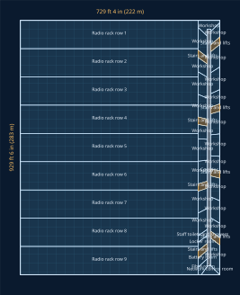
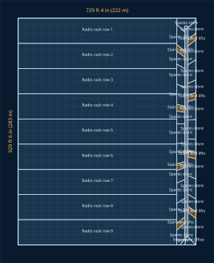

# P4-06 Flight Radio Hub: plan

Footprint 729 ft 4 in (222 m) × 929 ft 6 in (283 m) · structural grid 32 ft 10 in (10 m)

## Levels

| Level | Floor above deck | Height | Floor area |
|---|---|---|---|
| Level 1 · Radio hall floor | 0 ft (0 mm) | 26 ft 3 in (8,000 mm) | 659,163 sq ft (61,238 m²) |
| Level 2 · Upper floor | 26 ft 3 in (8,000 mm) | 14 ft 9 in (4,500 mm) | 659,163 sq ft (61,238 m²) |

## Elements

| ID | Designation | Type | Name | Level(s) | Size / length | Area | Status |
|---|---|---|---|---|---|---|---|
| E001 | D5F5P4B5A1L1R1, D5F5P4B5A1L2R1 | room | Radio rack row 1 | L1, L2 | 650 ft 7 in (198 m) × 103 ft 4 in (32 m) | 67,236 sq ft (6,246 m²) | proposed |
| E002 | D5F5P4B5A1L1R2, D5F5P4B5A1L2R2 | room | Radio rack row 2 | L1, L2 | 650 ft 7 in (198 m) × 103 ft 4 in (32 m) | 67,236 sq ft (6,246 m²) | proposed |
| E003 | D5F5P4B5A1L1R3, D5F5P4B5A1L2R3 | room | Radio rack row 3 | L1, L2 | 650 ft 7 in (198 m) × 103 ft (31 m) | 67,023 sq ft (6,227 m²) | proposed |
| E004 | D5F5P4B5A1L1R4, D5F5P4B5A1L2R4 | room | Radio rack row 4 | L1, L2 | 650 ft 7 in (198 m) × 103 ft 4 in (32 m) | 67,236 sq ft (6,246 m²) | proposed |
| E005 | D5F5P4B5A1L1R5, D5F5P4B5A1L2R5 | room | Radio rack row 5 | L1, L2 | 650 ft 7 in (198 m) × 103 ft 4 in (32 m) | 67,236 sq ft (6,246 m²) | proposed |
| E006 | D5F5P4B5A1L1R6, D5F5P4B5A1L2R6 | room | Radio rack row 6 | L1, L2 | 650 ft 7 in (198 m) × 103 ft 4 in (32 m) | 67,236 sq ft (6,246 m²) | proposed |
| E007 | D5F5P4B5A1L1R7, D5F5P4B5A1L2R7 | room | Radio rack row 7 | L1, L2 | 650 ft 7 in (198 m) × 103 ft (31 m) | 67,023 sq ft (6,227 m²) | proposed |
| E008 | D5F5P4B5A1L1R8, D5F5P4B5A1L2R8 | room | Radio rack row 8 | L1, L2 | 650 ft 7 in (198 m) × 103 ft 4 in (32 m) | 67,236 sq ft (6,246 m²) | proposed |
| E009 | D5F5P4B5A1L1R9, D5F5P4B5A1L2R9 | room | Radio rack row 9 | L1, L2 | 650 ft 7 in (198 m) × 103 ft 4 in (32 m) | 67,236 sq ft (6,246 m²) | proposed |
| E010 | D5F5P4B5A1L1R10, D5F5P4B5A1L2R10 | core | Stairs and lifts | L1, L2 | 32 ft 6 in (9,900 mm) × 53 ft 6 in (16 m) | 853 sq ft (79 m²) | proposed |
| E011 | D5F5P4B5A1L1R11, D5F5P4B5A1L2R11 | core | Stairs and lifts | L1, L2 | 32 ft 6 in (9,900 mm) × 36 ft 5 in (11 m) | 847 sq ft (79 m²) | proposed |
| E012 | D5F5P4B5A1L1R12, D5F5P4B5A1L2R12 | core | Stairs and lifts | L1, L2 | 32 ft 6 in (9,900 mm) × 33 ft 2 in (10 m) | 853 sq ft (79 m²) | proposed |
| E013 | D5F5P4B5A1L1R13, D5F5P4B5A1L2R13 | core | Stairs and lifts | L1, L2 | 32 ft 6 in (9,900 mm) × 50 ft 2 in (15 m) | 853 sq ft (79 m²) | proposed |
| E014 | D5F5P4B5A1L1R14, D5F5P4B5A1L2R14 | core | Stairs and lifts | L1, L2 | 32 ft 6 in (9,900 mm) × 53 ft 6 in (16 m) | 853 sq ft (79 m²) | proposed |
| E015 | D5F5P4B5A1L1R15, D5F5P4B5A1L2R15 | core | Stairs and lifts | L1, L2 | 32 ft 6 in (9,900 mm) × 36 ft 5 in (11 m) | 847 sq ft (79 m²) | proposed |
| E016 | D5F5P4B5A1L1R16, D5F5P4B5A1L2R16 | core | Stairs and lifts | L1, L2 | 32 ft 6 in (9,900 mm) × 33 ft 2 in (10 m) | 853 sq ft (79 m²) | proposed |
| E017 | D5F5P4B5A1L1R17, D5F5P4B5A1L2R17 | core | Stairs and lifts | L1, L2 | 32 ft 6 in (9,900 mm) × 50 ft 2 in (15 m) | 853 sq ft (79 m²) | proposed |
| E018 | D5F5P4B5A1L1R18 | zone | Corridor | L1 | 13 ft 9 in (4,200 mm) × 864 ft 6 in (264 m) | 8,548 sq ft (794 m²) | proposed |
| E019 | D5F5P4B5A1L1R19 | room | Network control room | L1 | 67 ft 7 in (21 m) × 32 ft 6 in (9,900 mm) | 1,289 sq ft (120 m²) | proposed |
| E020 | D5F5P4B5A1L1R20 | room | Fibre room | L1 | 34 ft 5 in (10 m) × 58 ft 1 in (18 m) | 1,076 sq ft (100 m²) | proposed |
| E021 | D5F5P4B5A1L1R21 | room | Battery room | L1 | 32 ft 6 in (9,900 mm) × 61 ft 4 in (19 m) | 1,039 sq ft (97 m²) | proposed |
| E022 | D5F5P4B5A1L1R22 | room | Locker room | L1 | 32 ft 6 in (9,900 mm) × 55 ft 1 in (17 m) | 970 sq ft (90 m²) | proposed |
| E023 | D5F5P4B5A1L1R23 | room | Staff toilets and showers | L1 | 32 ft 6 in (9,900 mm) × 46 ft 7 in (14 m) | 751 sq ft (70 m²) | proposed |
| E024 | D5F5P4B5A1L1R24 | room | Workshop | L1 | 32 ft 6 in (9,900 mm) × 99 ft 5 in (30 m) | 2,589 sq ft (241 m²) | proposed |
| E025 | D5F5P4B5A1L1R25 | room | Workshop | L1 | 32 ft 6 in (9,900 mm) × 90 ft 11 in (28 m) | 2,499 sq ft (232 m²) | proposed |
| E026 | D5F5P4B5A1L1R26 | room | Workshop | L1 | 32 ft 6 in (9,900 mm) × 86 ft 3 in (26 m) | 2,589 sq ft (241 m²) | proposed |
| E027 | D5F5P4B5A1L1R27 | room | Workshop | L1 | 32 ft 6 in (9,900 mm) × 82 ft 4 in (25 m) | 2,579 sq ft (240 m²) | proposed |
| E028 | D5F5P4B5A1L1R28 | room | Workshop | L1 | 32 ft 6 in (9,900 mm) × 54 ft 6 in (17 m) | 1,636 sq ft (152 m²) | proposed |
| E029 | D5F5P4B5A1L1R29 | room | Workshop | L1 | 32 ft 6 in (9,900 mm) × 90 ft 7 in (28 m) | 2,589 sq ft (241 m²) | proposed |
| E030 | D5F5P4B5A1L1R30 | room | Workshop | L1 | 32 ft 6 in (9,900 mm) × 96 ft 2 in (29 m) | 2,584 sq ft (240 m²) | proposed |
| E031 | D5F5P4B5A1L1R31 | room | Workshop | L1 | 32 ft 6 in (9,900 mm) × 71 ft 6 in (22 m) | 1,636 sq ft (152 m²) | proposed |
| E032 | D5F5P4B5A1L1R32 | room | Workshop | L1 | 32 ft 6 in (9,900 mm) × 107 ft 7 in (33 m) | 2,589 sq ft (241 m²) | proposed |
| E033 | D5F5P4B5A1L1R33 | room | Workshop | L1 | 78 ft 9 in (24 m) × 56 ft 9 in (17 m) | 2,584 sq ft (240 m²) | proposed |
| E034 | D5F5P4B5A1L1R34 | room | Workshop | L1 | 32 ft 6 in (9,900 mm) × 80 ft 5 in (24 m) | 1,636 sq ft (152 m²) | proposed |
| E035 | D5F5P4B5A1L1R35 | room | Workshop | L1 | 32 ft 6 in (9,900 mm) × 103 ft (31 m) | 2,584 sq ft (240 m²) | proposed |
| E036 | D5F5P4B5A1L1R36 | room | Workshop | L1 | 32 ft 6 in (9,900 mm) × 97 ft 5 in (30 m) | 2,589 sq ft (241 m²) | proposed |
| E037 | D5F5P4B5A1L1R37 | room | Workshop | L1 | 32 ft 6 in (9,900 mm) × 63 ft 4 in (19 m) | 1,636 sq ft (152 m²) | proposed |
| E038 | D5F5P4B5A1L1R38 | room | Workshop | L1 | 32 ft 6 in (9,900 mm) × 86 ft 3 in (26 m) | 2,589 sq ft (241 m²) | proposed |
| E039 | D5F5P4B5A1L1R39 | room | Workshop | L1 | 32 ft 6 in (9,900 mm) × 82 ft 4 in (25 m) | 2,579 sq ft (240 m²) | proposed |
| E040 | D5F5P4B5A1L1R40 | room | Workshop | L1 | 32 ft 6 in (9,900 mm) × 54 ft 6 in (17 m) | 1,636 sq ft (152 m²) | proposed |
| E041 | D5F5P4B5A1L1R41 | room | Workshop | L1 | 32 ft 6 in (9,900 mm) × 90 ft 7 in (28 m) | 2,589 sq ft (241 m²) | proposed |
| E042 | D5F5P4B5A1L1R42 | room | Workshop | L1 | 32 ft 6 in (9,900 mm) × 96 ft 2 in (29 m) | 2,584 sq ft (240 m²) | proposed |
| E043 | D5F5P4B5A1L1R43 | room | Workshop | L1 | 32 ft 6 in (9,900 mm) × 71 ft 6 in (22 m) | 1,636 sq ft (152 m²) | proposed |
| E044 | D5F5P4B5A1L1R44 | room | Workshop | L1 | 32 ft 6 in (9,900 mm) × 133 ft 6 in (41 m) | 3,405 sq ft (316 m²) | proposed |
| E045 | D5F5P4B5A1L2R18 | zone | Corridor | L2 | 13 ft 9 in (4,200 mm) × 864 ft 6 in (264 m) | 8,548 sq ft (794 m²) | proposed |
| E046 | D5F5P4B5A1L2R19 | room | Engineers' office | L2 | 45 ft 3 in (14 m) × 32 ft 6 in (9,900 mm) | 863 sq ft (80 m²) | proposed |
| E047 | D5F5P4B5A1L2R20 | room | Tea point | L2 | 23 ft 11 in (7,300 mm) × 32 ft 6 in (9,900 mm) | 362 sq ft (34 m²) | proposed |
| E048 | D5F5P4B5A1L2R21 | room | Spares store | L2 | 35 ft 1 in (11 m) × 88 ft 11 in (27 m) | 2,179 sq ft (202 m²) | proposed |
| E049 | D5F5P4B5A1L2R22 | room | Spares store | L2 | 32 ft 6 in (9,900 mm) × 103 ft (31 m) | 2,584 sq ft (240 m²) | proposed |
| E050 | D5F5P4B5A1L2R23 | room | Spares store | L2 | 32 ft 6 in (9,900 mm) × 97 ft 5 in (30 m) | 2,589 sq ft (241 m²) | proposed |
| E051 | D5F5P4B5A1L2R24 | room | Spares store | L2 | 32 ft 6 in (9,900 mm) × 63 ft 4 in (19 m) | 1,636 sq ft (152 m²) | proposed |
| E052 | D5F5P4B5A1L2R25 | room | Spares store | L2 | 32 ft 6 in (9,900 mm) × 86 ft 3 in (26 m) | 2,589 sq ft (241 m²) | proposed |
| E053 | D5F5P4B5A1L2R26 | room | Spares store | L2 | 32 ft 6 in (9,900 mm) × 82 ft 4 in (25 m) | 2,579 sq ft (240 m²) | proposed |
| E054 | D5F5P4B5A1L2R27 | room | Spares store | L2 | 32 ft 6 in (9,900 mm) × 54 ft 6 in (17 m) | 1,636 sq ft (152 m²) | proposed |
| E055 | D5F5P4B5A1L2R28 | room | Spares store | L2 | 32 ft 6 in (9,900 mm) × 90 ft 7 in (28 m) | 2,589 sq ft (241 m²) | proposed |
| E056 | D5F5P4B5A1L2R29 | room | Spares store | L2 | 32 ft 6 in (9,900 mm) × 96 ft 2 in (29 m) | 2,584 sq ft (240 m²) | proposed |
| E057 | D5F5P4B5A1L2R30 | room | Spares store | L2 | 32 ft 6 in (9,900 mm) × 71 ft 6 in (22 m) | 1,636 sq ft (152 m²) | proposed |
| E058 | D5F5P4B5A1L2R31 | room | Spares store | L2 | 32 ft 6 in (9,900 mm) × 107 ft 7 in (33 m) | 2,589 sq ft (241 m²) | proposed |
| E059 | D5F5P4B5A1L2R32 | room | Spares store | L2 | 78 ft 9 in (24 m) × 56 ft 9 in (17 m) | 2,584 sq ft (240 m²) | proposed |
| E060 | D5F5P4B5A1L2R33 | room | Spares store | L2 | 32 ft 6 in (9,900 mm) × 80 ft 5 in (24 m) | 1,636 sq ft (152 m²) | proposed |
| E061 | D5F5P4B5A1L2R34 | room | Spares store | L2 | 32 ft 6 in (9,900 mm) × 103 ft (31 m) | 2,584 sq ft (240 m²) | proposed |
| E062 | D5F5P4B5A1L2R35 | room | Spares store | L2 | 32 ft 6 in (9,900 mm) × 97 ft 5 in (30 m) | 2,589 sq ft (241 m²) | proposed |
| E063 | D5F5P4B5A1L2R36 | room | Spares store | L2 | 32 ft 6 in (9,900 mm) × 63 ft 4 in (19 m) | 1,636 sq ft (152 m²) | proposed |
| E064 | D5F5P4B5A1L2R37 | room | Spares store | L2 | 32 ft 6 in (9,900 mm) × 86 ft 3 in (26 m) | 2,589 sq ft (241 m²) | proposed |
| E065 | D5F5P4B5A1L2R38 | room | Spares store | L2 | 32 ft 6 in (9,900 mm) × 82 ft 4 in (25 m) | 2,579 sq ft (240 m²) | proposed |
| E066 | D5F5P4B5A1L2R39 | room | Spares store | L2 | 32 ft 6 in (9,900 mm) × 54 ft 6 in (17 m) | 1,636 sq ft (152 m²) | proposed |
| E067 | D5F5P4B5A1L2R40 | room | Spares store | L2 | 32 ft 6 in (9,900 mm) × 90 ft 7 in (28 m) | 2,589 sq ft (241 m²) | proposed |
| E068 | D5F5P4B5A1L2R41 | room | Spares store | L2 | 32 ft 6 in (9,900 mm) × 96 ft 2 in (29 m) | 2,584 sq ft (240 m²) | proposed |
| E069 | D5F5P4B5A1L2R42 | room | Spares store | L2 | 32 ft 6 in (9,900 mm) × 71 ft 6 in (22 m) | 1,636 sq ft (152 m²) | proposed |
| E070 | D5F5P4B5A1L2R43 | room | Spares store | L2 | 32 ft 6 in (9,900 mm) × 133 ft 6 in (41 m) | 3,405 sq ft (316 m²) | proposed |

## Drawings

### Level 1 · Radio hall floor

### Level 2 · Upper floor

