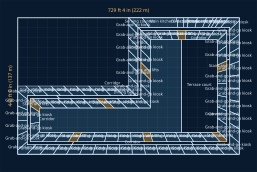

# P4-07 Dispatch Canteen: plan

Footprint 729 ft 4 in (222 m) × 448 ft 6 in (137 m) · structural grid 32 ft 10 in (10 m)

## Levels

| Level | Floor above deck | Height | Floor area |
|---|---|---|---|
| Level 1 · Dining floor | 0 ft (0 mm) | 17 ft 9 in (5,400 mm) | 182,396 sq ft (16,945 m²) |

## Elements

| ID | Designation | Type | Name | Level(s) | Size / length | Area | Status |
|---|---|---|---|---|---|---|---|
| E001 | D5F5P4B5A2R1 | room | Dining hall | L1 | 466 ft 6 in (142 m) × 304 ft 2 in (93 m) | 60,092 sq ft (5,583 m²) | proposed |
| E002 | D5F5P4B5A2R2 | zone | Terrace court | L1 | 118 ft 5 in (36 m) × 304 ft 2 in (93 m) | 36,021 sq ft (3,346 m²) | proposed |
| E003 | D5F5P4B5A2R3 | zone | Corridor | L1 | 302 ft 6 in (92 m) × 108 ft 3 in (33 m) | 3,875 sq ft (360 m²) | proposed |
| E004 | D5F5P4B5A2R4 | zone | Corridor | L1 | 126 ft 8 in (39 m) × 282 ft 6 in (86 m) | 3,875 sq ft (360 m²) | proposed |
| E005 | D5F5P4B5A2R5 | zone | Corridor | L1 | 399 ft 7 in (122 m) × 9 ft 10 in (3,000 mm) | 3,875 sq ft (360 m²) | proposed |
| E006 | D5F5P4B5A2R6 | zone | Corridor | L1 | 152 ft 7 in (46 m) × 161 ft 9 in (49 m) | 3,875 sq ft (360 m²) | proposed |
| E007 | D5F5P4B5A2R7 | zone | Corridor | L1 | 277 ft 7 in (85 m) × 135 ft 10 in (41 m) | 3,875 sq ft (360 m²) | proposed |
| E008 | D5F5P4B5A2R8 | zone | Corridor | L1 | 9 ft 10 in (3,000 mm) × 108 ft 3 in (33 m) | 969 sq ft (90 m²) | proposed |
| E009 | D5F5P4B5A2R9 | core | Stairs and lifts | L1 | 29 ft 6 in (9,000 mm) × 31 ft 2 in (9,500 mm) | 818 sq ft (76 m²) | proposed |
| E010 | D5F5P4B5A2R10 | core | Stairs and lifts | L1 | 31 ft 2 in (9,500 mm) × 37 ft 9 in (12 m) | 818 sq ft (76 m²) | proposed |
| E011 | D5F5P4B5A2R11 | core | Stairs and lifts | L1 | 50 ft 10 in (16 m) × 36 ft 1 in (11 m) | 818 sq ft (76 m²) | proposed |
| E012 | D5F5P4B5A2R12 | core | Stairs and lifts | L1 | 32 ft 10 in (10 m) × 31 ft 2 in (9,500 mm) | 818 sq ft (76 m²) | proposed |
| E013 | D5F5P4B5A2R13 | core | Stairs and lifts | L1 | 44 ft (13 m) × 31 ft 2 in (9,500 mm) | 818 sq ft (76 m²) | proposed |
| E014 | D5F5P4B5A2R14 | core | Stairs and lifts | L1 | 38 ft 5 in (12 m) × 44 ft 7 in (14 m) | 813 sq ft (76 m²) | proposed |
| E015 | D5F5P4B5A2R15 | core | Stairs and lifts | L1 | 57 ft 5 in (18 m) × 31 ft 2 in (9,500 mm) | 818 sq ft (76 m²) | proposed |
| E016 | D5F5P4B5A2R16 | core | Stairs and lifts | L1 | 31 ft 2 in (9,500 mm) × 57 ft 5 in (18 m) | 818 sq ft (76 m²) | proposed |
| E017 | D5F5P4B5A2R17 | room | Serving counter | L1 | 68 ft 11 in (21 m) × 31 ft 2 in (9,500 mm) | 1,294 sq ft (120 m²) | proposed |
| E018 | D5F5P4B5A2R18 | room | Main kitchen | L1 | 117 ft 5 in (36 m) × 31 ft 2 in (9,500 mm) | 3,226 sq ft (300 m²) | proposed |
| E019 | D5F5P4B5A2R19 | room | Cold room | L1 | 23 ft (7,000 mm) × 31 ft 2 in (9,500 mm) | 644 sq ft (60 m²) | proposed |
| E020 | D5F5P4B5A2R20 | room | Freezer room | L1 | 15 ft 1 in (4,600 mm) × 31 ft 2 in (9,500 mm) | 429 sq ft (40 m²) | proposed |
| E021 | D5F5P4B5A2R21 | room | Dry store | L1 | 32 ft 10 in (10 m) × 31 ft 2 in (9,500 mm) | 869 sq ft (81 m²) | proposed |
| E022 | D5F5P4B5A2R22 | room | Dishwash room | L1 | 37 ft 9 in (12 m) × 31 ft 2 in (9,500 mm) | 859 sq ft (80 m²) | proposed |
| E023 | D5F5P4B5A2R23 | room | Goods-in bay | L1 | 35 ft 5 in (11 m) × 31 ft 2 in (9,500 mm) | 644 sq ft (60 m²) | proposed |
| E024 | D5F5P4B5A2R24 | room | Waste and recycling room | L1 | 28 ft 7 in (8,700 mm) × 31 ft 2 in (9,500 mm) | 337 sq ft (31 m²) | proposed |
| E025 | D5F5P4B5A2R25 | room | Night counter | L1 | 33 ft 10 in (10 m) × 31 ft 2 in (9,500 mm) | 435 sq ft (40 m²) | proposed |
| E026 | D5F5P4B5A2R26 | room | Toilets | L1 | 43 ft 8 in (13 m) × 31 ft 2 in (9,500 mm) | 644 sq ft (60 m²) | proposed |
| E027 | D5F5P4B5A2R27 | room | Grab-and-go kiosk | L1 | 60 ft 8 in (18 m) × 39 ft 4 in (12 m) | 1,294 sq ft (120 m²) | proposed |
| E028 | D5F5P4B5A2R28 | room | Grab-and-go kiosk | L1 | 31 ft 2 in (9,500 mm) × 68 ft 3 in (21 m) | 1,294 sq ft (120 m²) | proposed |
| E029 | D5F5P4B5A2R29 | room | Grab-and-go kiosk | L1 | 31 ft 2 in (9,500 mm) × 62 ft (19 m) | 1,288 sq ft (120 m²) | proposed |
| E030 | D5F5P4B5A2R30 | room | Grab-and-go kiosk | L1 | 31 ft 2 in (9,500 mm) × 55 ft 9 in (17 m) | 1,288 sq ft (120 m²) | proposed |
| E031 | D5F5P4B5A2R31 | room | Grab-and-go kiosk | L1 | 31 ft 2 in (9,500 mm) × 49 ft 6 in (15 m) | 1,294 sq ft (120 m²) | proposed |
| E032 | D5F5P4B5A2R32 | room | Grab-and-go kiosk | L1 | 31 ft 2 in (9,500 mm) × 44 ft 7 in (14 m) | 1,294 sq ft (120 m²) | proposed |
| E033 | D5F5P4B5A2R33 | room | Grab-and-go kiosk | L1 | 31 ft 2 in (9,500 mm) × 45 ft 7 in (14 m) | 1,288 sq ft (120 m²) | proposed |
| E034 | D5F5P4B5A2R34 | room | Grab-and-go kiosk | L1 | 31 ft 2 in (9,500 mm) × 51 ft 10 in (16 m) | 1,294 sq ft (120 m²) | proposed |
| E035 | D5F5P4B5A2R35 | room | Grab-and-go kiosk | L1 | 31 ft 2 in (9,500 mm) × 58 ft 1 in (18 m) | 1,294 sq ft (120 m²) | proposed |
| E036 | D5F5P4B5A2R36 | room | Grab-and-go kiosk | L1 | 31 ft 2 in (9,500 mm) × 64 ft 4 in (20 m) | 1,294 sq ft (120 m²) | proposed |
| E037 | D5F5P4B5A2R37 | room | Grab-and-go kiosk | L1 | 36 ft 9 in (11 m) × 64 ft (19 m) | 1,288 sq ft (120 m²) | proposed |
| E038 | D5F5P4B5A2R38 | room | Grab-and-go kiosk | L1 | 70 ft 3 in (21 m) × 31 ft 2 in (9,500 mm) | 1,294 sq ft (120 m²) | proposed |
| E039 | D5F5P4B5A2R39 | room | Grab-and-go kiosk | L1 | 66 ft 3 in (20 m) × 31 ft 2 in (9,500 mm) | 1,288 sq ft (120 m²) | proposed |
| E040 | D5F5P4B5A2R40 | room | Grab-and-go kiosk | L1 | 62 ft 8 in (19 m) × 31 ft 2 in (9,500 mm) | 1,294 sq ft (120 m²) | proposed |
| E041 | D5F5P4B5A2R41 | room | Grab-and-go kiosk | L1 | 59 ft 1 in (18 m) × 31 ft 2 in (9,500 mm) | 1,294 sq ft (120 m²) | proposed |
| E042 | D5F5P4B5A2R42 | room | Grab-and-go kiosk | L1 | 55 ft 5 in (17 m) × 31 ft 2 in (9,500 mm) | 1,294 sq ft (120 m²) | proposed |
| E043 | D5F5P4B5A2R43 | room | Grab-and-go kiosk | L1 | 51 ft 6 in (16 m) × 31 ft 2 in (9,500 mm) | 1,283 sq ft (119 m²) | proposed |
| E044 | D5F5P4B5A2R44 | room | Grab-and-go kiosk | L1 | 48 ft 3 in (15 m) × 31 ft 2 in (9,500 mm) | 1,294 sq ft (120 m²) | proposed |
| E045 | D5F5P4B5A2R45 | room | Grab-and-go kiosk | L1 | 44 ft 7 in (14 m) × 31 ft 2 in (9,500 mm) | 1,294 sq ft (120 m²) | proposed |
| E046 | D5F5P4B5A2R46 | room | Grab-and-go kiosk | L1 | 43 ft 4 in (13 m) × 31 ft 2 in (9,500 mm) | 1,288 sq ft (120 m²) | proposed |
| E047 | D5F5P4B5A2R47 | room | Grab-and-go kiosk | L1 | 45 ft 11 in (14 m) × 31 ft 2 in (9,500 mm) | 1,294 sq ft (120 m²) | proposed |
| E048 | D5F5P4B5A2R48 | room | Grab-and-go kiosk | L1 | 49 ft 6 in (15 m) × 31 ft 2 in (9,500 mm) | 1,294 sq ft (120 m²) | proposed |
| E049 | D5F5P4B5A2R49 | room | Grab-and-go kiosk | L1 | 53 ft 2 in (16 m) × 31 ft 2 in (9,500 mm) | 1,288 sq ft (120 m²) | proposed |
| E050 | D5F5P4B5A2R50 | room | Grab-and-go kiosk | L1 | 57 ft 1 in (17 m) × 31 ft 2 in (9,500 mm) | 1,294 sq ft (120 m²) | proposed |
| E051 | D5F5P4B5A2R51 | room | Grab-and-go kiosk | L1 | 60 ft 8 in (18 m) × 31 ft 2 in (9,500 mm) | 1,294 sq ft (120 m²) | proposed |
| E052 | D5F5P4B5A2R52 | room | Grab-and-go kiosk | L1 | 64 ft 4 in (20 m) × 31 ft 2 in (9,500 mm) | 1,288 sq ft (120 m²) | proposed |
| E053 | D5F5P4B5A2R53 | room | Grab-and-go kiosk | L1 | 68 ft 3 in (21 m) × 31 ft 2 in (9,500 mm) | 1,294 sq ft (120 m²) | proposed |
| E054 | D5F5P4B5A2R54 | room | Grab-and-go kiosk | L1 | 59 ft 1 in (18 m) × 41 ft 4 in (13 m) | 1,288 sq ft (120 m²) | proposed |
| E055 | D5F5P4B5A2R55 | room | Grab-and-go kiosk | L1 | 31 ft 2 in (9,500 mm) × 62 ft (19 m) | 1,294 sq ft (120 m²) | proposed |
| E056 | D5F5P4B5A2R56 | room | Grab-and-go kiosk | L1 | 31 ft 2 in (9,500 mm) × 48 ft 7 in (15 m) | 1,294 sq ft (120 m²) | proposed |
| E057 | D5F5P4B5A2R57 | room | Grab-and-go kiosk | L1 | 31 ft 2 in (9,500 mm) × 48 ft 3 in (15 m) | 1,294 sq ft (120 m²) | proposed |
| E058 | D5F5P4B5A2R58 | room | Grab-and-go kiosk | L1 | 31 ft 2 in (9,500 mm) × 61 ft (19 m) | 1,288 sq ft (120 m²) | proposed |
| E059 | D5F5P4B5A2R59 | room | Grab-and-go kiosk | L1 | 57 ft 9 in (18 m) × 43 ft 8 in (13 m) | 1,294 sq ft (120 m²) | proposed |
| E060 | D5F5P4B5A2R60 | room | Grab-and-go kiosk | L1 | 72 ft 6 in (22 m) × 31 ft 2 in (9,500 mm) | 1,288 sq ft (120 m²) | proposed |
| E061 | D5F5P4B5A2R61 | room | Grab-and-go kiosk | L1 | 72 ft 10 in (22 m) × 31 ft 2 in (9,500 mm) | 1,299 sq ft (121 m²) | proposed |
| E062 | D5F5P4B5A2R62 | room | Grab-and-go kiosk | L1 | 72 ft 6 in (22 m) × 31 ft 2 in (9,500 mm) | 1,288 sq ft (120 m²) | proposed |
| E063 | D5F5P4B5A2R63 | room | Grab-and-go kiosk | L1 | 72 ft 6 in (22 m) × 31 ft 2 in (9,500 mm) | 1,288 sq ft (120 m²) | proposed |
| E064 | D5F5P4B5A2R64 | room | Grab-and-go kiosk | L1 | 72 ft 6 in (22 m) × 31 ft 2 in (9,500 mm) | 1,288 sq ft (120 m²) | proposed |
| E065 | D5F5P4B5A2R65 | room | Grab-and-go kiosk | L1 | 72 ft 10 in (22 m) × 31 ft 2 in (9,500 mm) | 1,299 sq ft (121 m²) | proposed |
| E066 | D5F5P4B5A2R66 | room | Grab-and-go kiosk | L1 | 72 ft 6 in (22 m) × 31 ft 2 in (9,500 mm) | 1,288 sq ft (120 m²) | proposed |
| E067 | D5F5P4B5A2R67 | room | Grab-and-go kiosk | L1 | 72 ft 6 in (22 m) × 31 ft 2 in (9,500 mm) | 1,288 sq ft (120 m²) | proposed |
| E068 | D5F5P4B5A2R68 | room | Grab-and-go kiosk | L1 | 37 ft 9 in (12 m) × 66 ft 3 in (20 m) | 1,299 sq ft (121 m²) | proposed |
| E069 | D5F5P4B5A2R69 | room | Grab-and-go kiosk | L1 | 31 ft 2 in (9,500 mm) × 72 ft 6 in (22 m) | 1,288 sq ft (120 m²) | proposed |
| E070 | D5F5P4B5A2R70 | room | Grab-and-go kiosk | L1 | 31 ft 2 in (9,500 mm) × 72 ft 6 in (22 m) | 1,288 sq ft (120 m²) | proposed |
| E071 | D5F5P4B5A2R71 | room | Grab-and-go kiosk | L1 | 31 ft 2 in (9,500 mm) × 72 ft 10 in (22 m) | 1,299 sq ft (121 m²) | proposed |
| E072 | D5F5P4B5A2R72 | room | Grab-and-go kiosk | L1 | 31 ft 2 in (9,500 mm) × 72 ft 6 in (22 m) | 1,288 sq ft (120 m²) | proposed |
| E073 | D5F5P4B5A2R73 | room | Grab-and-go kiosk | L1 | 31 ft 2 in (9,500 mm) × 54 ft 9 in (17 m) | 736 sq ft (68 m²) | proposed |
| E074 | D5F5P4B5A2R74 | room | Grab-and-go kiosk | L1 | 67 ft 7 in (21 m) × 31 ft 2 in (9,500 mm) | 1,294 sq ft (120 m²) | proposed |
| E075 | D5F5P4B5A2R75 | room | Grab-and-go kiosk | L1 | 57 ft 1 in (17 m) × 31 ft 2 in (9,500 mm) | 1,288 sq ft (120 m²) | proposed |
| E076 | D5F5P4B5A2R76 | room | Grab-and-go kiosk | L1 | 30 ft 10 in (9,400 mm) × 31 ft 2 in (9,500 mm) | 716 sq ft (67 m²) | proposed |
| E077 | D5F5P4B5A2R77 | room | Grab-and-go kiosk | L1 | 47 ft 11 in (15 m) × 31 ft 2 in (9,500 mm) | 1,288 sq ft (120 m²) | proposed |
| E078 | D5F5P4B5A2R78 | room | Grab-and-go kiosk | L1 | 58 ft 5 in (18 m) × 31 ft 2 in (9,500 mm) | 1,294 sq ft (120 m²) | proposed |
| E079 | D5F5P4B5A2R79 | room | Grab-and-go kiosk | L1 | 63 ft 4 in (19 m) × 35 ft 5 in (11 m) | 1,294 sq ft (120 m²) | proposed |
| E080 | D5F5P4B5A2R80 | room | Grab-and-go kiosk | L1 | 31 ft 2 in (9,500 mm) × 67 ft 11 in (21 m) | 1,294 sq ft (120 m²) | proposed |
| E081 | D5F5P4B5A2R81 | room | Grab-and-go kiosk | L1 | 31 ft 2 in (9,500 mm) × 64 ft (20 m) | 1,426 sq ft (133 m²) | proposed |
| E082 | D5F5P4B5A2R82 | room | Grab-and-go kiosk | L1 | 31 ft 2 in (9,500 mm) × 46 ft 11 in (14 m) | 1,294 sq ft (120 m²) | proposed |
| E083 | D5F5P4B5A2R83 | room | Grab-and-go kiosk | L1 | 31 ft 2 in (9,500 mm) × 45 ft 3 in (14 m) | 1,288 sq ft (120 m²) | proposed |
| E084 | D5F5P4B5A2R84 | room | Grab-and-go kiosk | L1 | 31 ft 2 in (9,500 mm) × 51 ft 6 in (16 m) | 1,294 sq ft (120 m²) | proposed |
| E085 | D5F5P4B5A2R85 | room | Grab-and-go kiosk | L1 | 31 ft 2 in (9,500 mm) × 59 ft 1 in (18 m) | 1,288 sq ft (120 m²) | proposed |
| E086 | D5F5P4B5A2R86 | room | Grab-and-go kiosk | L1 | 31 ft 2 in (9,500 mm) × 71 ft 10 in (22 m) | 1,432 sq ft (133 m²) | proposed |
| E087 | D5F5P4B5A2R87 | room | Grab-and-go kiosk | L1 | 68 ft 3 in (21 m) × 31 ft 2 in (9,500 mm) | 1,288 sq ft (120 m²) | proposed |
| E088 | D5F5P4B5A2R88 | room | Grab-and-go kiosk | L1 | 64 ft 4 in (20 m) × 31 ft 2 in (9,500 mm) | 1,294 sq ft (120 m²) | proposed |
| E089 | D5F5P4B5A2R89 | room | Grab-and-go kiosk | L1 | 60 ft (18 m) × 31 ft 2 in (9,500 mm) | 1,294 sq ft (120 m²) | proposed |
| E090 | D5F5P4B5A2R90 | room | Grab-and-go kiosk | L1 | 55 ft 9 in (17 m) × 31 ft 2 in (9,500 mm) | 1,294 sq ft (120 m²) | proposed |
| E091 | D5F5P4B5A2R91 | room | Grab-and-go kiosk | L1 | 55 ft 9 in (17 m) × 31 ft 2 in (9,500 mm) | 1,426 sq ft (133 m²) | proposed |
| E092 | D5F5P4B5A2R92 | room | Grab-and-go kiosk | L1 | 44 ft 7 in (14 m) × 31 ft 2 in (9,500 mm) | 1,294 sq ft (120 m²) | proposed |
| E093 | D5F5P4B5A2R93 | room | Grab-and-go kiosk | L1 | 43 ft 8 in (13 m) × 31 ft 2 in (9,500 mm) | 1,288 sq ft (120 m²) | proposed |
| E094 | D5F5P4B5A2R94 | room | Grab-and-go kiosk | L1 | 47 ft 3 in (14 m) × 31 ft 2 in (9,500 mm) | 1,294 sq ft (120 m²) | proposed |
| E095 | D5F5P4B5A2R95 | room | Grab-and-go kiosk | L1 | 51 ft 2 in (16 m) × 31 ft 2 in (9,500 mm) | 1,288 sq ft (120 m²) | proposed |
| E096 | D5F5P4B5A2R96 | room | Grab-and-go kiosk | L1 | 60 ft (18 m) × 31 ft 2 in (9,500 mm) | 1,432 sq ft (133 m²) | proposed |
| E097 | D5F5P4B5A2R97 | room | Grab-and-go kiosk | L1 | 62 ft 8 in (19 m) × 31 ft 2 in (9,500 mm) | 1,294 sq ft (120 m²) | proposed |
| E098 | D5F5P4B5A2R98 | room | Grab-and-go kiosk | L1 | 66 ft 7 in (20 m) × 31 ft 2 in (9,500 mm) | 1,288 sq ft (120 m²) | proposed |
| E099 | D5F5P4B5A2R99 | room | Grab-and-go kiosk | L1 | 65 ft 11 in (20 m) × 34 ft 5 in (10 m) | 1,294 sq ft (120 m²) | proposed |
| E100 | D5F5P4B5A2R100 | room | Grab-and-go kiosk | L1 | 31 ft 2 in (9,500 mm) × 58 ft 1 in (18 m) | 1,288 sq ft (120 m²) | proposed |
| E101 | D5F5P4B5A2R101 | room | Grab-and-go kiosk | L1 | 31 ft 2 in (9,500 mm) × 58 ft 9 in (18 m) | 1,432 sq ft (133 m²) | proposed |
| E102 | D5F5P4B5A2R102 | room | Grab-and-go kiosk | L1 | 72 ft 10 in (22 m) × 31 ft 2 in (9,500 mm) | 1,299 sq ft (121 m²) | proposed |
| E103 | D5F5P4B5A2R103 | room | Grab-and-go kiosk | L1 | 72 ft 6 in (22 m) × 31 ft 2 in (9,500 mm) | 1,288 sq ft (120 m²) | proposed |
| E104 | D5F5P4B5A2R104 | room | Grab-and-go kiosk | L1 | 72 ft 6 in (22 m) × 31 ft 2 in (9,500 mm) | 1,288 sq ft (120 m²) | proposed |
| E105 | D5F5P4B5A2R105 | room | Grab-and-go kiosk | L1 | 72 ft 10 in (22 m) × 31 ft 2 in (9,500 mm) | 1,299 sq ft (121 m²) | proposed |
| E106 | D5F5P4B5A2R106 | room | Grab-and-go kiosk | L1 | 76 ft 9 in (23 m) × 31 ft 2 in (9,500 mm) | 1,421 sq ft (132 m²) | proposed |
| E107 | D5F5P4B5A2R107 | room | Grab-and-go kiosk | L1 | 72 ft 10 in (22 m) × 31 ft 2 in (9,500 mm) | 1,299 sq ft (121 m²) | proposed |
| E108 | D5F5P4B5A2R108 | room | Grab-and-go kiosk | L1 | 72 ft 6 in (22 m) × 31 ft 2 in (9,500 mm) | 1,288 sq ft (120 m²) | proposed |
| E109 | D5F5P4B5A2R109 | room | Grab-and-go kiosk | L1 | 67 ft 7 in (21 m) × 36 ft 1 in (11 m) | 1,288 sq ft (120 m²) | proposed |
| E110 | D5F5P4B5A2R110 | room | Grab-and-go kiosk | L1 | 31 ft 2 in (9,500 mm) × 72 ft 10 in (22 m) | 1,299 sq ft (121 m²) | proposed |
| E111 | D5F5P4B5A2R111 | room | Grab-and-go kiosk | L1 | 31 ft 2 in (9,500 mm) × 77 ft 1 in (24 m) | 1,432 sq ft (133 m²) | proposed |
| E112 | D5F5P4B5A2R112 | room | Grab-and-go kiosk | L1 | 31 ft 2 in (9,500 mm) × 72 ft 6 in (22 m) | 1,288 sq ft (120 m²) | proposed |
| E113 | D5F5P4B5A2R113 | room | Grab-and-go kiosk | L1 | 31 ft 2 in (9,500 mm) × 72 ft 6 in (22 m) | 1,288 sq ft (120 m²) | proposed |
| E114 | D5F5P4B5A2R114 | room | Grab-and-go kiosk | L1 | 31 ft 2 in (9,500 mm) × 54 ft 2 in (16 m) | 716 sq ft (66 m²) | proposed |

## Drawings

### Level 1 · Dining floor

