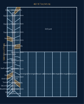
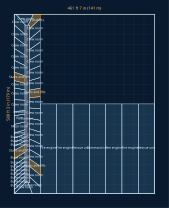
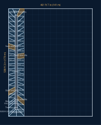

# P4-08 Dispatch Fire Station: plan

Footprint 461 ft 7 in (141 m) × 588 ft 3 in (179 m) · structural grid 32 ft 10 in (10 m)

## Levels

| Level | Floor above deck | Height | Floor area |
|---|---|---|---|
| Level 1 · Appliance floor | 0 ft (0 mm) | 23 ft (7,000 mm) | 148,800 sq ft (13,824 m²) |
| Level 2 · Crew floor | 23 ft (7,000 mm) | 13 ft 9 in (4,200 mm) | 148,800 sq ft (13,824 m²) |
| Level 3 · Training floor | 36 ft 9 in (11 m) | 13 ft 9 in (4,200 mm) | 38,055 sq ft (3,535 m²) |

## Elements

| ID | Designation | Type | Name | Level(s) | Size / length | Area | Status |
|---|---|---|---|---|---|---|---|
| E001 | D5F5P4B6A1L1R1, D5F5P4B6A1L2R1 | room | Fire engine | L1, L2 | 53 ft 10 in (16 m) × 294 ft 3 in (90 m) | 15,835 sq ft (1,471 m²) | proposed |
| E002 | D5F5P4B6A1L1R2, D5F5P4B6A1L2R2 | room | Fire engine | L1, L2 | 53 ft 10 in (16 m) × 294 ft 3 in (90 m) | 15,835 sq ft (1,471 m²) | proposed |
| E003 | D5F5P4B6A1L1R3, D5F5P4B6A1L2R3 | room | Rescue unit | L1, L2 | 53 ft 10 in (16 m) × 294 ft 3 in (90 m) | 15,835 sq ft (1,471 m²) | proposed |
| E004 | D5F5P4B6A1L1R4, D5F5P4B6A1L2R4 | room | Command car | L1, L2 | 53 ft 6 in (16 m) × 294 ft 3 in (90 m) | 15,738 sq ft (1,462 m²) | proposed |
| E005 | D5F5P4B6A1L1R5, D5F5P4B6A1L2R5 | room | Fire engine | L1, L2 | 53 ft 10 in (16 m) × 294 ft 3 in (90 m) | 15,835 sq ft (1,471 m²) | proposed |
| E006 | D5F5P4B6A1L1R6, D5F5P4B6A1L2R6 | room | Fire engine | L1, L2 | 53 ft 10 in (16 m) × 294 ft 3 in (90 m) | 15,835 sq ft (1,471 m²) | proposed |
| E007 | D5F5P4B6A1L1R7, D5F5P4B6A1L2R7 | room | Rescue unit | L1, L2 | 53 ft 10 in (16 m) × 294 ft 3 in (90 m) | 15,835 sq ft (1,471 m²) | proposed |
| E008 | D5F5P4B6A1L1R8 | zone | Drill yard | L1 | 376 ft 4 in (115 m) × 294 ft (90 m) | 110,622 sq ft (10,277 m²) | proposed |
| E009 | D5F5P4B6A1L1R9, D5F5P4B6A1L2R8, D5F5P4B6A1L3R1 | core | Stairs and lifts | L1, L2, L3 | 35 ft 5 in (11 m) × 46 ft 3 in (14 m) | 924 sq ft (86 m²) | proposed |
| E010 | D5F5P4B6A1L1R10, D5F5P4B6A1L2R9, D5F5P4B6A1L3R2 | core | Stairs and lifts | L1, L2, L3 | 35 ft 5 in (11 m) × 37 ft 1 in (11 m) | 930 sq ft (86 m²) | proposed |
| E011 | D5F5P4B6A1L1R11, D5F5P4B6A1L2R10, D5F5P4B6A1L3R3 | core | Stairs and lifts | L1, L2, L3 | 39 ft 4 in (12 m) × 47 ft 11 in (15 m) | 942 sq ft (87 m²) | proposed |
| E012 | D5F5P4B6A1L1R12, D5F5P4B6A1L2R11, D5F5P4B6A1L3R4 | core | Stairs and lifts | L1, L2, L3 | 35 ft 5 in (11 m) × 30 ft 10 in (9,400 mm) | 930 sq ft (86 m²) | proposed |
| E013 | D5F5P4B6A1L1R13, D5F5P4B6A1L2R12, D5F5P4B6A1L3R5 | core | Stairs and lifts | L1, L2, L3 | 35 ft 5 in (11 m) × 52 ft 10 in (16 m) | 930 sq ft (86 m²) | proposed |
| E014 | D5F5P4B6A1L1R14 | zone | Corridor | L1 | 14 ft 5 in (4,400 mm) × 517 ft 5 in (158 m) | 5,138 sq ft (477 m²) | proposed |
| E015 | D5F5P4B6A1L1R15 | room | Watch room | L1 | 35 ft 5 in (11 m) × 52 ft 6 in (16 m) | 645 sq ft (60 m²) | proposed |
| E016 | D5F5P4B6A1L1R16 | room | Breathing apparatus room | L1 | 35 ft 5 in (11 m) × 55 ft 9 in (17 m) | 854 sq ft (79 m²) | proposed |
| E017 | D5F5P4B6A1L1R17 | room | Decontamination room | L1 | 35 ft 5 in (11 m) × 47 ft 3 in (14 m) | 645 sq ft (60 m²) | proposed |
| E018 | D5F5P4B6A1L1R18 | room | Turnout gear room | L1 | 35 ft 5 in (11 m) × 53 ft 6 in (16 m) | 971 sq ft (90 m²) | proposed |
| E019 | D5F5P4B6A1L1R19 | room | Electrical fire kit room | L1 | 35 ft 5 in (11 m) × 42 ft 8 in (13 m) | 692 sq ft (64 m²) | proposed |
| E020 | D5F5P4B6A1L1R20 | room | Hose store | L1 | 35 ft 5 in (11 m) × 38 ft 5 in (12 m) | 756 sq ft (70 m²) | proposed |
| E021 | D5F5P4B6A1L1R21 | room | Staff toilets and showers | L1 | 35 ft 5 in (11 m) × 35 ft 5 in (11 m) | 750 sq ft (70 m²) | proposed |
| E022 | D5F5P4B6A1L1R22 | room | Equipment store | L1 | 35 ft 5 in (11 m) × 64 ft (20 m) | 1,936 sq ft (180 m²) | proposed |
| E023 | D5F5P4B6A1L1R23 | room | Equipment store | L1 | 35 ft 5 in (11 m) × 57 ft 9 in (18 m) | 1,924 sq ft (179 m²) | proposed |
| E024 | D5F5P4B6A1L1R24 | room | Equipment store | L1 | 35 ft 5 in (11 m) × 68 ft 7 in (21 m) | 2,249 sq ft (209 m²) | proposed |
| E025 | D5F5P4B6A1L1R25 | room | Equipment store | L1 | 35 ft 5 in (11 m) × 70 ft 6 in (22 m) | 1,930 sq ft (179 m²) | proposed |
| E026 | D5F5P4B6A1L1R26 | room | Equipment store | L1 | 35 ft 5 in (11 m) × 77 ft 9 in (24 m) | 1,930 sq ft (179 m²) | proposed |
| E027 | D5F5P4B6A1L1R27 | room | Equipment store | L1 | 35 ft 5 in (11 m) × 85 ft (26 m) | 1,936 sq ft (180 m²) | proposed |
| E028 | D5F5P4B6A1L1R28 | room | Equipment store | L1 | 62 ft 8 in (19 m) × 49 ft 3 in (15 m) | 1,814 sq ft (168 m²) | proposed |
| E029 | D5F5P4B6A1L1R29 | room | Equipment store | L1 | 35 ft 5 in (11 m) × 84 ft 8 in (26 m) | 1,924 sq ft (179 m²) | proposed |
| E030 | D5F5P4B6A1L1R30 | room | Equipment store | L1 | 35 ft 5 in (11 m) × 78 ft 1 in (24 m) | 1,936 sq ft (180 m²) | proposed |
| E031 | D5F5P4B6A1L1R31 | room | Equipment store | L1 | 35 ft 5 in (11 m) × 70 ft 10 in (22 m) | 1,930 sq ft (179 m²) | proposed |
| E032 | D5F5P4B6A1L1R32 | room | Equipment store | L1 | 35 ft 5 in (11 m) × 60 ft 8 in (18 m) | 1,814 sq ft (168 m²) | proposed |
| E033 | D5F5P4B6A1L1R33 | room | Equipment store | L1 | 35 ft 5 in (11 m) × 58 ft 1 in (18 m) | 1,930 sq ft (179 m²) | proposed |
| E034 | D5F5P4B6A1L1R34 | room | Equipment store | L1 | 35 ft 5 in (11 m) × 62 ft 4 in (19 m) | 1,936 sq ft (180 m²) | proposed |
| E035 | D5F5P4B6A1L1R35 | room | Equipment store | L1 | 35 ft 5 in (11 m) × 69 ft 3 in (21 m) | 1,930 sq ft (179 m²) | proposed |
| E036 | D5F5P4B6A1L1R36 | room | Equipment store | L1 | 35 ft 5 in (11 m) × 72 ft 10 in (22 m) | 1,814 sq ft (168 m²) | proposed |
| E037 | D5F5P4B6A1L1R37 | room | Equipment store | L1 | 35 ft 5 in (11 m) × 86 ft 3 in (26 m) | 1,936 sq ft (180 m²) | proposed |
| E038 | D5F5P4B6A1L1R38 | room | Equipment store | L1 | 85 ft 4 in (26 m) × 38 ft 5 in (12 m) | 1,877 sq ft (174 m²) | proposed |
| E039 | D5F5P4B6A1L2R13 | zone | Corridor | L2 | 14 ft 5 in (4,400 mm) × 517 ft 5 in (158 m) | 5,138 sq ft (477 m²) | proposed |
| E040 | D5F5P4B6A1L2R14 | room | Bunk rooms | L2 | 35 ft 5 in (11 m) × 47 ft 3 in (14 m) | 442 sq ft (41 m²) | proposed |
| E041 | D5F5P4B6A1L2R15 | room | Bunk rooms | L2 | 35 ft 5 in (11 m) × 45 ft 7 in (14 m) | 442 sq ft (41 m²) | proposed |
| E042 | D5F5P4B6A1L2R16 | room | Bunk rooms | L2 | 35 ft 5 in (11 m) × 44 ft (13 m) | 442 sq ft (41 m²) | proposed |
| E043 | D5F5P4B6A1L2R17 | room | Bunk rooms | L2 | 35 ft 5 in (11 m) × 42 ft 4 in (13 m) | 436 sq ft (40 m²) | proposed |
| E044 | D5F5P4B6A1L2R18 | room | Bunk rooms | L2 | 35 ft 5 in (11 m) × 41 ft (12 m) | 448 sq ft (42 m²) | proposed |
| E045 | D5F5P4B6A1L2R19 | room | Bunk rooms | L2 | 35 ft 5 in (11 m) × 39 ft 1 in (12 m) | 436 sq ft (40 m²) | proposed |
| E046 | D5F5P4B6A1L2R20 | room | Bunk rooms | L2 | 35 ft 5 in (11 m) × 37 ft 9 in (12 m) | 448 sq ft (42 m²) | proposed |
| E047 | D5F5P4B6A1L2R21 | room | Bunk rooms | L2 | 35 ft 5 in (11 m) × 43 ft 4 in (13 m) | 715 sq ft (66 m²) | proposed |
| E048 | D5F5P4B6A1L2R22 | room | Bunk rooms | L2 | 35 ft 5 in (11 m) × 30 ft 2 in (9,200 mm) | 448 sq ft (42 m²) | proposed |
| E049 | D5F5P4B6A1L2R23 | room | Bunk rooms | L2 | 35 ft 5 in (11 m) × 28 ft 3 in (8,600 mm) | 436 sq ft (40 m²) | proposed |
| E050 | D5F5P4B6A1L2R24 | room | Bunk rooms | L2 | 35 ft 5 in (11 m) × 26 ft 11 in (8,200 mm) | 448 sq ft (42 m²) | proposed |
| E051 | D5F5P4B6A1L2R25 | room | Kitchen | L2 | 35 ft 5 in (11 m) × 27 ft 7 in (8,400 mm) | 535 sq ft (50 m²) | proposed |
| E052 | D5F5P4B6A1L2R26 | room | Mess room | L2 | 35 ft 5 in (11 m) × 37 ft 1 in (11 m) | 965 sq ft (90 m²) | proposed |
| E053 | D5F5P4B6A1L2R27 | room | Gym | L2 | 35 ft 5 in (11 m) × 33 ft 6 in (10 m) | 959 sq ft (89 m²) | proposed |
| E054 | D5F5P4B6A1L2R28 | room | Laundry | L2 | 35 ft 5 in (11 m) × 16 ft 5 in (5,000 mm) | 448 sq ft (42 m²) | proposed |
| E055 | D5F5P4B6A1L2R29 | room | Crew room | L2 | 35 ft 5 in (11 m) × 38 ft 9 in (12 m) | 1,290 sq ft (120 m²) | proposed |
| E056 | D5F5P4B6A1L2R30 | room | Crew room | L2 | 35 ft 5 in (11 m) × 40 ft 4 in (12 m) | 1,285 sq ft (119 m²) | proposed |
| E057 | D5F5P4B6A1L2R31 | room | Crew room | L2 | 35 ft 5 in (11 m) × 30 ft 6 in (9,300 mm) | 802 sq ft (75 m²) | proposed |
| E058 | D5F5P4B6A1L2R32 | room | Crew room | L2 | 35 ft 5 in (11 m) × 51 ft 2 in (16 m) | 1,285 sq ft (119 m²) | proposed |
| E059 | D5F5P4B6A1L2R33 | room | Crew room | L2 | 35 ft 5 in (11 m) × 56 ft 1 in (17 m) | 1,290 sq ft (120 m²) | proposed |
| E060 | D5F5P4B6A1L2R34 | room | Crew room | L2 | 35 ft 5 in (11 m) × 60 ft 8 in (18 m) | 1,285 sq ft (119 m²) | proposed |
| E061 | D5F5P4B6A1L2R35 | room | Crew room | L2 | 35 ft 5 in (11 m) × 65 ft 7 in (20 m) | 1,290 sq ft (120 m²) | proposed |
| E062 | D5F5P4B6A1L2R36 | room | Crew room | L2 | 36 ft 5 in (11 m) × 66 ft 3 in (20 m) | 1,285 sq ft (119 m²) | proposed |
| E063 | D5F5P4B6A1L2R37 | room | Crew room | L2 | 56 ft 9 in (17 m) × 35 ft 5 in (11 m) | 1,174 sq ft (109 m²) | proposed |
| E064 | D5F5P4B6A1L2R38 | room | Crew room | L2 | 35 ft 5 in (11 m) × 67 ft 7 in (21 m) | 1,279 sq ft (119 m²) | proposed |
| E065 | D5F5P4B6A1L2R39 | room | Crew room | L2 | 35 ft 5 in (11 m) × 63 ft 4 in (19 m) | 1,290 sq ft (120 m²) | proposed |
| E066 | D5F5P4B6A1L2R40 | room | Crew room | L2 | 35 ft 5 in (11 m) × 58 ft 9 in (18 m) | 1,290 sq ft (120 m²) | proposed |
| E067 | D5F5P4B6A1L2R41 | room | Crew room | L2 | 35 ft 5 in (11 m) × 53 ft 10 in (16 m) | 1,285 sq ft (119 m²) | proposed |
| E068 | D5F5P4B6A1L2R42 | room | Crew room | L2 | 35 ft 5 in (11 m) × 49 ft 3 in (15 m) | 1,290 sq ft (120 m²) | proposed |
| E069 | D5F5P4B6A1L2R43 | room | Crew room | L2 | 35 ft 5 in (11 m) × 41 ft 4 in (13 m) | 1,168 sq ft (109 m²) | proposed |
| E070 | D5F5P4B6A1L2R44 | room | Crew room | L2 | 35 ft 5 in (11 m) × 38 ft 9 in (12 m) | 1,290 sq ft (120 m²) | proposed |
| E071 | D5F5P4B6A1L2R45 | room | Crew room | L2 | 35 ft 5 in (11 m) × 40 ft 4 in (12 m) | 1,285 sq ft (119 m²) | proposed |
| E072 | D5F5P4B6A1L2R46 | room | Crew room | L2 | 35 ft 5 in (11 m) × 45 ft 3 in (14 m) | 1,290 sq ft (120 m²) | proposed |
| E073 | D5F5P4B6A1L2R47 | room | Crew room | L2 | 35 ft 5 in (11 m) × 49 ft 10 in (15 m) | 1,285 sq ft (119 m²) | proposed |
| E074 | D5F5P4B6A1L2R48 | room | Crew room | L2 | 35 ft 5 in (11 m) × 54 ft 9 in (17 m) | 1,290 sq ft (120 m²) | proposed |
| E075 | D5F5P4B6A1L2R49 | room | Crew room | L2 | 35 ft 5 in (11 m) × 55 ft 9 in (17 m) | 1,168 sq ft (109 m²) | proposed |
| E076 | D5F5P4B6A1L2R50 | room | Crew room | L2 | 35 ft 5 in (11 m) × 66 ft 11 in (20 m) | 1,290 sq ft (120 m²) | proposed |
| E077 | D5F5P4B6A1L2R51 | room | Crew room | L2 | 39 ft 8 in (12 m) × 55 ft 5 in (17 m) | 1,290 sq ft (120 m²) | proposed |
| E078 | D5F5P4B6A1L2R52 | room | Crew room | L2 | 59 ft 5 in (18 m) × 35 ft 5 in (11 m) | 1,232 sq ft (114 m²) | proposed |
| E079 | D5F5P4B6A1L3R6 | zone | Corridor | L3 | 14 ft 5 in (4,400 mm) × 517 ft 5 in (158 m) | 5,138 sq ft (477 m²) | proposed |
| E080 | D5F5P4B6A1L3R7 | room | Station commander's office | L3 | 35 ft 5 in (11 m) × 47 ft 3 in (14 m) | 442 sq ft (41 m²) | proposed |
| E081 | D5F5P4B6A1L3R8 | room | Training room | L3 | 35 ft 5 in (11 m) × 62 ft 4 in (19 m) | 1,075 sq ft (100 m²) | proposed |
| E082 | D5F5P4B6A1L3R9 | room | Fire safety office | L3 | 35 ft 5 in (11 m) × 41 ft 8 in (13 m) | 442 sq ft (41 m²) | proposed |
| E083 | D5F5P4B6A1L3R10 | room | Records room | L3 | 35 ft 5 in (11 m) × 40 ft (12 m) | 436 sq ft (41 m²) | proposed |
| E084 | D5F5P4B6A1L3R11 | room | Offices | L3 | 35 ft 5 in (11 m) × 52 ft 6 in (16 m) | 971 sq ft (90 m²) | proposed |
| E085 | D5F5P4B6A1L3R12 | room | Offices | L3 | 35 ft 5 in (11 m) × 35 ft 1 in (11 m) | 442 sq ft (41 m²) | proposed |
| E086 | D5F5P4B6A1L3R13 | room | Offices | L3 | 35 ft 5 in (11 m) × 44 ft (13 m) | 971 sq ft (90 m²) | proposed |
| E087 | D5F5P4B6A1L3R14 | room | Offices | L3 | 35 ft 5 in (11 m) × 40 ft 4 in (12 m) | 965 sq ft (90 m²) | proposed |
| E088 | D5F5P4B6A1L3R15 | room | Offices | L3 | 35 ft 5 in (11 m) × 37 ft 1 in (11 m) | 971 sq ft (90 m²) | proposed |
| E089 | D5F5P4B6A1L3R16 | room | Offices | L3 | 35 ft 5 in (11 m) × 33 ft 2 in (10 m) | 959 sq ft (89 m²) | proposed |
| E090 | D5F5P4B6A1L3R17 | room | Offices | L3 | 35 ft 5 in (11 m) × 29 ft 10 in (9,100 mm) | 965 sq ft (90 m²) | proposed |
| E091 | D5F5P4B6A1L3R18 | room | Offices | L3 | 35 ft 5 in (11 m) × 29 ft 2 in (8,900 mm) | 971 sq ft (90 m²) | proposed |
| E092 | D5F5P4B6A1L3R19 | room | Offices | L3 | 35 ft 5 in (11 m) × 31 ft 6 in (9,600 mm) | 959 sq ft (89 m²) | proposed |
| E093 | D5F5P4B6A1L3R20 | room | Offices | L3 | 35 ft 5 in (11 m) × 31 ft 10 in (9,700 mm) | 854 sq ft (79 m²) | proposed |
| E094 | D5F5P4B6A1L3R21 | room | Offices | L3 | 35 ft 5 in (11 m) × 41 ft 8 in (13 m) | 965 sq ft (90 m²) | proposed |
| E095 | D5F5P4B6A1L3R22 | room | Offices | L3 | 35 ft 5 in (11 m) × 45 ft 3 in (14 m) | 965 sq ft (90 m²) | proposed |
| E096 | D5F5P4B6A1L3R23 | room | Offices | L3 | 35 ft 5 in (11 m) × 48 ft 7 in (15 m) | 965 sq ft (90 m²) | proposed |
| E097 | D5F5P4B6A1L3R24 | room | Offices | L3 | 35 ft 5 in (11 m) × 52 ft 2 in (16 m) | 965 sq ft (90 m²) | proposed |
| E098 | D5F5P4B6A1L3R25 | room | Offices | L3 | 35 ft 5 in (11 m) × 55 ft 9 in (17 m) | 965 sq ft (90 m²) | proposed |
| E099 | D5F5P4B6A1L3R26 | room | Offices | L3 | 35 ft 5 in (11 m) × 59 ft 5 in (18 m) | 971 sq ft (90 m²) | proposed |
| E100 | D5F5P4B6A1L3R27 | room | Offices | L3 | 39 ft 1 in (12 m) × 49 ft 3 in (15 m) | 965 sq ft (90 m²) | proposed |
| E101 | D5F5P4B6A1L3R28 | room | Offices | L3 | 41 ft (13 m) × 35 ft 5 in (11 m) | 849 sq ft (79 m²) | proposed |
| E102 | D5F5P4B6A1L3R29 | room | Offices | L3 | 35 ft 5 in (11 m) × 59 ft 5 in (18 m) | 965 sq ft (90 m²) | proposed |
| E103 | D5F5P4B6A1L3R30 | room | Offices | L3 | 35 ft 5 in (11 m) × 55 ft 9 in (17 m) | 959 sq ft (89 m²) | proposed |
| E104 | D5F5P4B6A1L3R31 | room | Offices | L3 | 35 ft 5 in (11 m) × 52 ft 6 in (16 m) | 971 sq ft (90 m²) | proposed |
| E105 | D5F5P4B6A1L3R32 | room | Offices | L3 | 35 ft 5 in (11 m) × 48 ft 11 in (15 m) | 965 sq ft (90 m²) | proposed |
| E106 | D5F5P4B6A1L3R33 | room | Offices | L3 | 35 ft 5 in (11 m) × 45 ft 3 in (14 m) | 965 sq ft (90 m²) | proposed |
| E107 | D5F5P4B6A1L3R34 | room | Offices | L3 | 35 ft 5 in (11 m) × 41 ft 8 in (13 m) | 965 sq ft (90 m²) | proposed |
| E108 | D5F5P4B6A1L3R35 | room | Offices | L3 | 35 ft 5 in (11 m) × 38 ft 5 in (12 m) | 965 sq ft (90 m²) | proposed |
| E109 | D5F5P4B6A1L3R36 | room | Offices | L3 | 35 ft 5 in (11 m) × 31 ft 10 in (9,700 mm) | 849 sq ft (79 m²) | proposed |
| E110 | D5F5P4B6A1L3R37 | room | Offices | L3 | 35 ft 5 in (11 m) × 29 ft 2 in (8,900 mm) | 971 sq ft (90 m²) | proposed |
| E111 | D5F5P4B6A1L3R38 | room | Offices | L3 | 35 ft 5 in (11 m) × 29 ft 6 in (9,000 mm) | 959 sq ft (89 m²) | proposed |
| E112 | D5F5P4B6A1L3R39 | room | Offices | L3 | 35 ft 5 in (11 m) × 33 ft 2 in (10 m) | 965 sq ft (90 m²) | proposed |
| E113 | D5F5P4B6A1L3R40 | room | Offices | L3 | 35 ft 5 in (11 m) × 36 ft 9 in (11 m) | 971 sq ft (90 m²) | proposed |
| E114 | D5F5P4B6A1L3R41 | room | Offices | L3 | 35 ft 5 in (11 m) × 40 ft (12 m) | 965 sq ft (90 m²) | proposed |
| E115 | D5F5P4B6A1L3R42 | room | Offices | L3 | 35 ft 5 in (11 m) × 43 ft 8 in (13 m) | 965 sq ft (90 m²) | proposed |
| E116 | D5F5P4B6A1L3R43 | room | Offices | L3 | 35 ft 5 in (11 m) × 47 ft 3 in (14 m) | 965 sq ft (90 m²) | proposed |
| E117 | D5F5P4B6A1L3R44 | room | Offices | L3 | 35 ft 5 in (11 m) × 47 ft 3 in (14 m) | 849 sq ft (79 m²) | proposed |
| E118 | D5F5P4B6A1L3R45 | room | Offices | L3 | 35 ft 5 in (11 m) × 57 ft 1 in (17 m) | 965 sq ft (90 m²) | proposed |
| E119 | D5F5P4B6A1L3R46 | room | Offices | L3 | 35 ft 5 in (11 m) × 60 ft 8 in (18 m) | 971 sq ft (90 m²) | proposed |
| E120 | D5F5P4B6A1L3R47 | room | Offices | L3 | 42 ft 4 in (13 m) × 38 ft 5 in (12 m) | 965 sq ft (90 m²) | proposed |
| E121 | D5F5P4B6A1L3R48 | room | Offices | L3 | 44 ft (13 m) × 35 ft 5 in (11 m) | 913 sq ft (85 m²) | proposed |

## Drawings

### Level 1 · Appliance floor

### Level 2 · Crew floor

### Level 3 · Training floor

