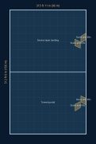
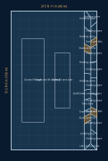
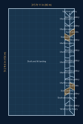

# P4-10 Dispatch Service Shaft: plan

Footprint 315 ft 11 in (96 m) × 512 ft 6 in (156 m) · structural grid 32 ft 10 in (10 m)

## Levels

| Level | Floor above deck | Height | Floor area |
|---|---|---|---|
| Level B1 · Service layer landing | −19 ft 8 in (6,000 mm) | 19 ft 8 in (6,000 mm) | 161,911 sq ft (15,042 m²) |
| Level 1 · Lift landing | 0 ft (0 mm) | 29 ft 6 in (9,000 mm) | 158,407 sq ft (14,716 m²) |
| Level 2 · Winding room | 29 ft 6 in (9,000 mm) | 19 ft 8 in (6,000 mm) | 158,407 sq ft (14,716 m²) |

## Elements

| ID | Designation | Type | Name | Level(s) | Size / length | Area | Status |
|---|---|---|---|---|---|---|---|
| E001 | D5F5P4B8A1L1R1, D5F5P4B8A1L2R1 | room | Shaft and lift landing | L1, L2 | 270 ft (82 m) × 512 ft 6 in (156 m) | 138,373 sq ft (12,855 m²) | proposed |
| E002 |  | fixture | Goods lift cage | L1 | 81 ft (25 m) × 307 ft 9 in (94 m) | 24,938 sq ft (2,317 m²) | proposed |
| E003 |  | fixture | Crew lift and stair | L1 | 53 ft 10 in (16 m) × 204 ft 9 in (62 m) | 11,015 sq ft (1,023 m²) | proposed |
| E004 | D5F5P4B8A1LB1R1, D5F5P4B8A1L1R2, D5F5P4B8A1L2R2 | core | Stairs and lifts | LB1, L1, L2 | 21 ft 8 in (6,600 mm) × 38 ft 9 in (12 m) | 568 sq ft (53 m²) | proposed |
| E005 | D5F5P4B8A1LB1R2, D5F5P4B8A1L1R3, D5F5P4B8A1L2R3 | core | Stairs and lifts | LB1, L1, L2 | 21 ft 8 in (6,600 mm) × 36 ft 9 in (11 m) | 568 sq ft (53 m²) | proposed |
| E006 | D5F5P4B8A1LB1R3, D5F5P4B8A1L1R4, D5F5P4B8A1L2R4 | core | Stairs and lifts | LB1, L1, L2 | 21 ft 8 in (6,600 mm) × 38 ft 9 in (12 m) | 568 sq ft (53 m²) | proposed |
| E007 | D5F5P4B8A1LB1R4, D5F5P4B8A1L1R5, D5F5P4B8A1L2R5 | core | Stairs and lifts | LB1, L1, L2 | 21 ft 8 in (6,600 mm) × 36 ft 9 in (11 m) | 568 sq ft (53 m²) | proposed |
| E008 | D5F5P4B8A1L1R6 | room | Lift control room | L1 | 45 ft 11 in (14 m) × 22 ft 4 in (6,800 mm) | 540 sq ft (50 m²) | proposed |
| E009 | D5F5P4B8A1L1R7 | room | Loading bay | L1 | 21 ft 8 in (6,600 mm) × 108 ft 7 in (33 m) | 1,968 sq ft (183 m²) | proposed |
| E010 | D5F5P4B8A1L1R8 | room | Crew check-in | L1 | 21 ft 8 in (6,600 mm) × 30 ft 2 in (9,200 mm) | 430 sq ft (40 m²) | proposed |
| E011 | D5F5P4B8A1L1R9 | room | Tool store | L1 | 21 ft 8 in (6,600 mm) × 47 ft 3 in (14 m) | 853 sq ft (79 m²) | proposed |
| E012 | D5F5P4B8A1L1R10 | room | Staff toilets and showers | L1 | 21 ft 8 in (6,600 mm) × 39 ft 4 in (12 m) | 749 sq ft (70 m²) | proposed |
| E013 | D5F5P4B8A1L1R11 | room | Holding store | L1 | 21 ft 8 in (6,600 mm) × 62 ft (19 m) | 1,282 sq ft (119 m²) | proposed |
| E014 | D5F5P4B8A1L1R12 | room | Holding store | L1 | 21 ft 8 in (6,600 mm) × 84 ft (26 m) | 1,691 sq ft (157 m²) | proposed |
| E015 | D5F5P4B8A1L1R13 | room | Holding store | L1 | 21 ft 8 in (6,600 mm) × 73 ft 6 in (22 m) | 1,286 sq ft (119 m²) | proposed |
| E016 | D5F5P4B8A1L1R14 | room | Holding store | L1 | 22 ft (6,700 mm) × 75 ft 6 in (23 m) | 1,282 sq ft (119 m²) | proposed |
| E017 | D5F5P4B8A1L1R15 | room | Holding store | L1 | 40 ft 4 in (12 m) × 58 ft 1 in (18 m) | 1,286 sq ft (119 m²) | proposed |
| E018 | D5F5P4B8A1L1R16 | room | Holding store | L1 | 21 ft 8 in (6,600 mm) × 69 ft 7 in (21 m) | 1,158 sq ft (108 m²) | proposed |
| E019 | D5F5P4B8A1L1R17 | room | Holding store | L1 | 21 ft 8 in (6,600 mm) × 67 ft 11 in (21 m) | 1,282 sq ft (119 m²) | proposed |
| E020 | D5F5P4B8A1L1R18 | room | Holding store | L1 | 21 ft 8 in (6,600 mm) × 62 ft 8 in (19 m) | 1,282 sq ft (119 m²) | proposed |
| E021 | D5F5P4B8A1L1R19 | room | Holding store | L1 | 21 ft 8 in (6,600 mm) × 62 ft (19 m) | 1,286 sq ft (119 m²) | proposed |
| E022 | D5F5P4B8A1L1R20 | room | Holding store | L1 | 21 ft 8 in (6,600 mm) × 60 ft 4 in (18 m) | 1,154 sq ft (107 m²) | proposed |
| E023 | D5F5P4B8A1L1R21 | room | Holding store | L1 | 21 ft 8 in (6,600 mm) × 73 ft 6 in (22 m) | 1,286 sq ft (119 m²) | proposed |
| E024 | D5F5P4B8A1L1R22 | room | Holding store | L1 | 21 ft 8 in (6,600 mm) × 75 ft 6 in (23 m) | 1,218 sq ft (113 m²) | proposed |
| E025 | D5F5P4B8A1L2R6 | room | Winding machinery | L2 | 45 ft 11 in (14 m) × 69 ft 7 in (21 m) | 1,609 sq ft (149 m²) | proposed |
| E026 | D5F5P4B8A1L2R7 | room | Shaft ventilation fans | L2 | 21 ft 8 in (6,600 mm) × 57 ft 1 in (17 m) | 899 sq ft (83 m²) | proposed |
| E027 | D5F5P4B8A1L2R8 | room | Machine gallery | L2 | 21 ft 8 in (6,600 mm) × 58 ft 5 in (18 m) | 1,069 sq ft (99 m²) | proposed |
| E028 | D5F5P4B8A1L2R9 | room | Machine gallery | L2 | 21 ft 8 in (6,600 mm) × 54 ft 2 in (16 m) | 1,073 sq ft (100 m²) | proposed |
| E029 | D5F5P4B8A1L2R10 | room | Machine gallery | L2 | 21 ft 8 in (6,600 mm) × 51 ft 6 in (16 m) | 1,069 sq ft (99 m²) | proposed |
| E030 | D5F5P4B8A1L2R11 | room | Machine gallery | L2 | 21 ft 8 in (6,600 mm) × 53 ft 6 in (16 m) | 1,069 sq ft (99 m²) | proposed |
| E031 | D5F5P4B8A1L2R12 | room | Machine gallery | L2 | 21 ft 8 in (6,600 mm) × 41 ft 4 in (13 m) | 725 sq ft (67 m²) | proposed |
| E032 | D5F5P4B8A1L2R13 | room | Machine gallery | L2 | 21 ft 8 in (6,600 mm) × 63 ft 4 in (19 m) | 1,073 sq ft (100 m²) | proposed |
| E033 | D5F5P4B8A1L2R14 | room | Machine gallery | L2 | 21 ft 8 in (6,600 mm) × 67 ft 7 in (21 m) | 1,069 sq ft (99 m²) | proposed |
| E034 | D5F5P4B8A1L2R15 | room | Machine gallery | L2 | 45 ft 11 in (14 m) × 37 ft 9 in (12 m) | 1,080 sq ft (100 m²) | proposed |
| E035 | D5F5P4B8A1L2R16 | room | Machine gallery | L2 | 21 ft 8 in (6,600 mm) × 68 ft 3 in (21 m) | 1,069 sq ft (99 m²) | proposed |
| E036 | D5F5P4B8A1L2R17 | room | Machine gallery | L2 | 21 ft 8 in (6,600 mm) × 48 ft 7 in (15 m) | 721 sq ft (67 m²) | proposed |
| E037 | D5F5P4B8A1L2R18 | room | Machine gallery | L2 | 21 ft 8 in (6,600 mm) × 58 ft 5 in (18 m) | 1,069 sq ft (99 m²) | proposed |
| E038 | D5F5P4B8A1L2R19 | room | Machine gallery | L2 | 21 ft 8 in (6,600 mm) × 54 ft 2 in (16 m) | 1,073 sq ft (100 m²) | proposed |
| E039 | D5F5P4B8A1L2R20 | room | Machine gallery | L2 | 21 ft 8 in (6,600 mm) × 51 ft 6 in (16 m) | 1,069 sq ft (99 m²) | proposed |
| E040 | D5F5P4B8A1L2R21 | room | Machine gallery | L2 | 21 ft 8 in (6,600 mm) × 53 ft 6 in (16 m) | 1,069 sq ft (99 m²) | proposed |
| E041 | D5F5P4B8A1L2R22 | room | Machine gallery | L2 | 21 ft 8 in (6,600 mm) × 41 ft 4 in (13 m) | 725 sq ft (67 m²) | proposed |
| E042 | D5F5P4B8A1L2R23 | room | Machine gallery | L2 | 21 ft 8 in (6,600 mm) × 63 ft 4 in (19 m) | 1,073 sq ft (100 m²) | proposed |
| E043 | D5F5P4B8A1L2R24 | room | Machine gallery | L2 | 21 ft 8 in (6,600 mm) × 85 ft (26 m) | 1,431 sq ft (133 m²) | proposed |
| E044 | D5F5P4B8A1LB1R5 | room | Service layer landing | LB1 | 315 ft 11 in (96 m) × 256 ft 3 in (78 m) | 80,956 sq ft (7,521 m²) | proposed |
| E045 | D5F5P4B8A1LB1R6 | room | Tunnel portal | LB1 | 315 ft 11 in (96 m) × 256 ft 3 in (78 m) | 80,956 sq ft (7,521 m²) | proposed |

## Drawings

### Level B1 · Service layer landing

### Level 1 · Lift landing

### Level 2 · Winding room

