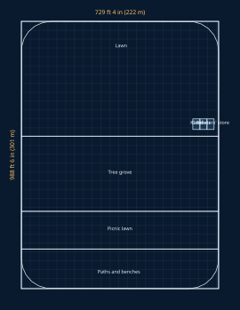

# P4-12 Staff Garden 1: plan

Footprint 729 ft 4 in (222 m) × 988 ft 6 in (301 m) · structural grid 32 ft 10 in (10 m)

## Levels

| Level | Floor above deck | Height | Floor area |
|---|---|---|---|
| Level 1 · Ground | 0 ft (0 mm) | 13 ft 1 in (4,000 mm) | 3,100 sq ft (288 m²) |

## Elements

| ID | Designation | Type | Name | Level(s) | Size / length | Area | Status |
|---|---|---|---|---|---|---|---|
| E001 | D5F5P4B3A2R1 | zone | Lawn | L1 | 728 ft 8 in (222 m) × 424 ft 6 in (129 m) | 303,704 sq ft (28,215 m²) | proposed |
| E002 | D5F5P4B3A2R2 | room | Kiosk | L1 | 26 ft 3 in (8,000 mm) × 39 ft 4 in (12 m) | 1,033 sq ft (96 m²) | proposed |
| E003 | D5F5P4B3A2R3 | room | Toilets | L1 | 26 ft 3 in (8,000 mm) × 39 ft 4 in (12 m) | 1,033 sq ft (96 m²) | proposed |
| E004 | D5F5P4B3A2R4 | room | Gardeners' store | L1 | 26 ft 3 in (8,000 mm) × 39 ft 4 in (12 m) | 1,033 sq ft (96 m²) | proposed |
| E005 | D5F5P4B3A2R5 | zone | Tree grove | L1 | 728 ft 8 in (222 m) × 278 ft 3 in (85 m) | 202,637 sq ft (18,826 m²) | proposed |
| E006 | D5F5P4B3A2R6 | zone | Picnic lawn | L1 | 728 ft 8 in (222 m) × 139 ft 1 in (42 m) | 101,319 sq ft (9,413 m²) | proposed |
| E007 | D5F5P4B3A2R7 | zone | Paths and benches | L1 | 728 ft 4 in (222 m) × 146 ft 8 in (45 m) | 101,175 sq ft (9,399 m²) | proposed |

## Drawings

### Level 1 · Ground

